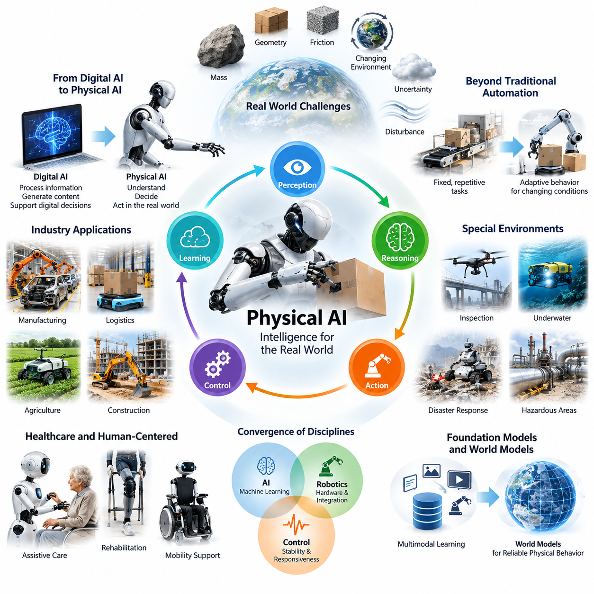
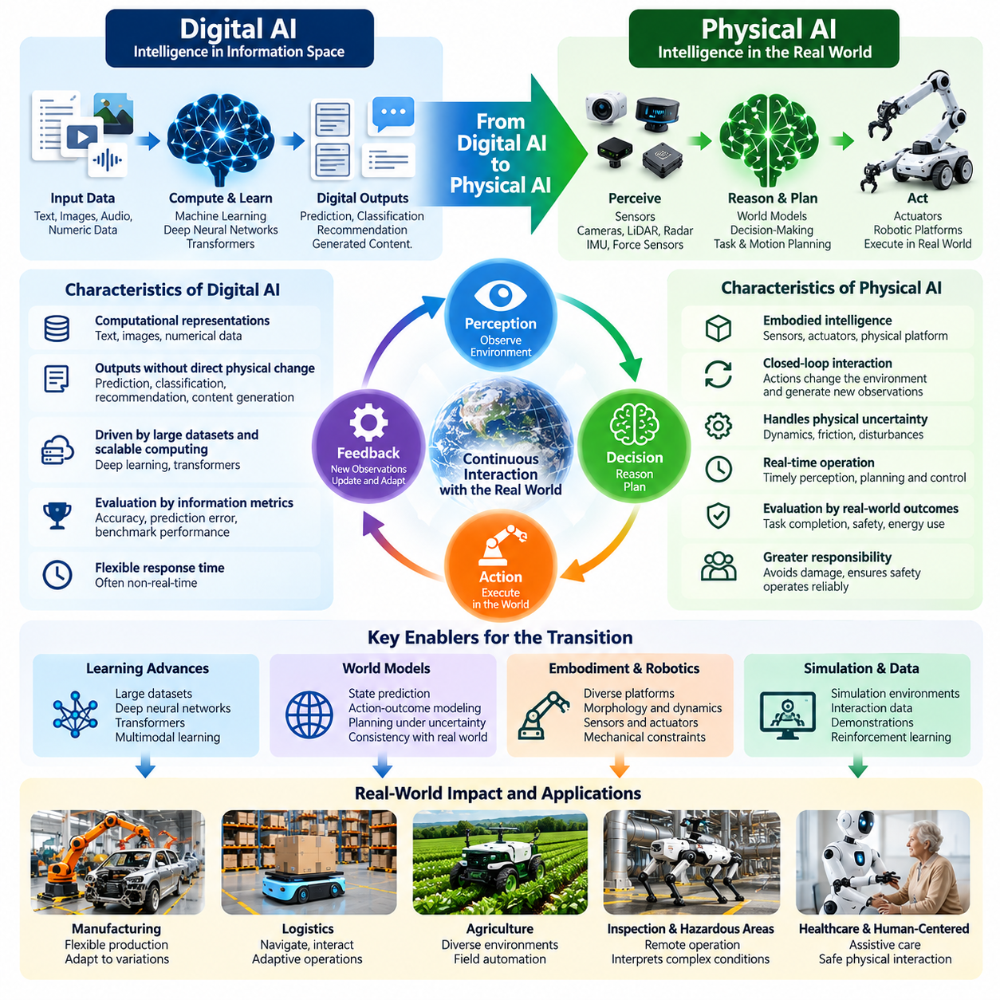
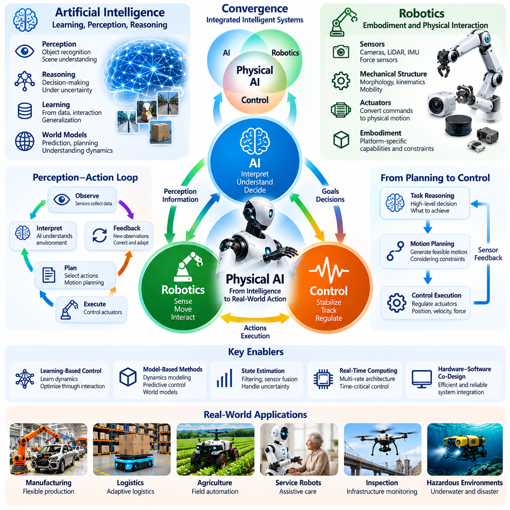
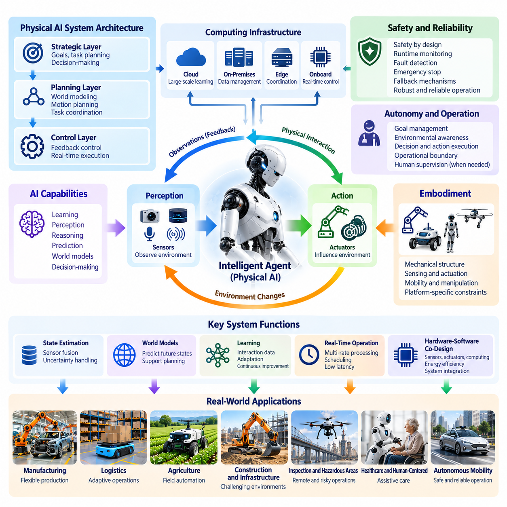
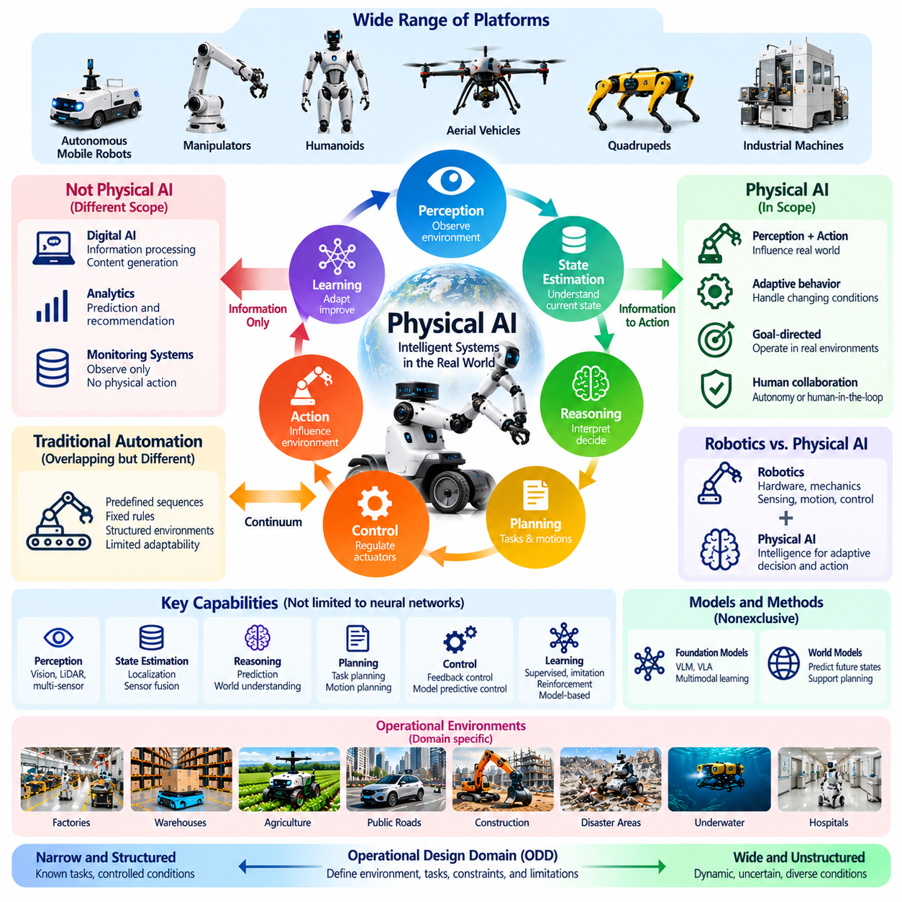
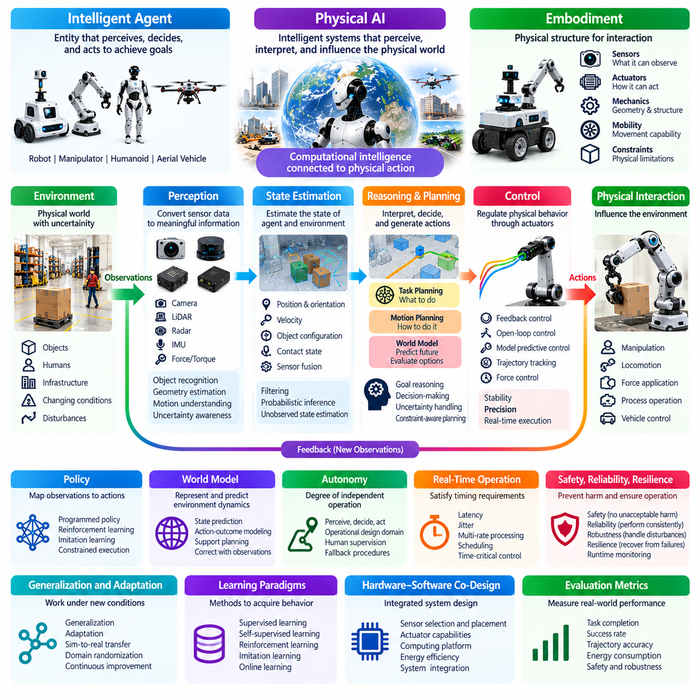
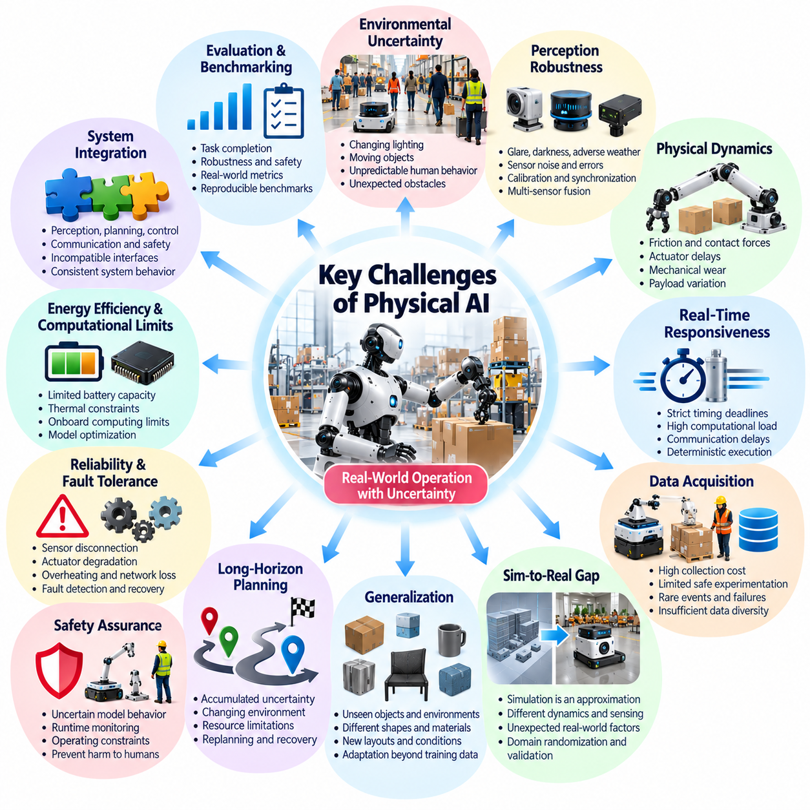
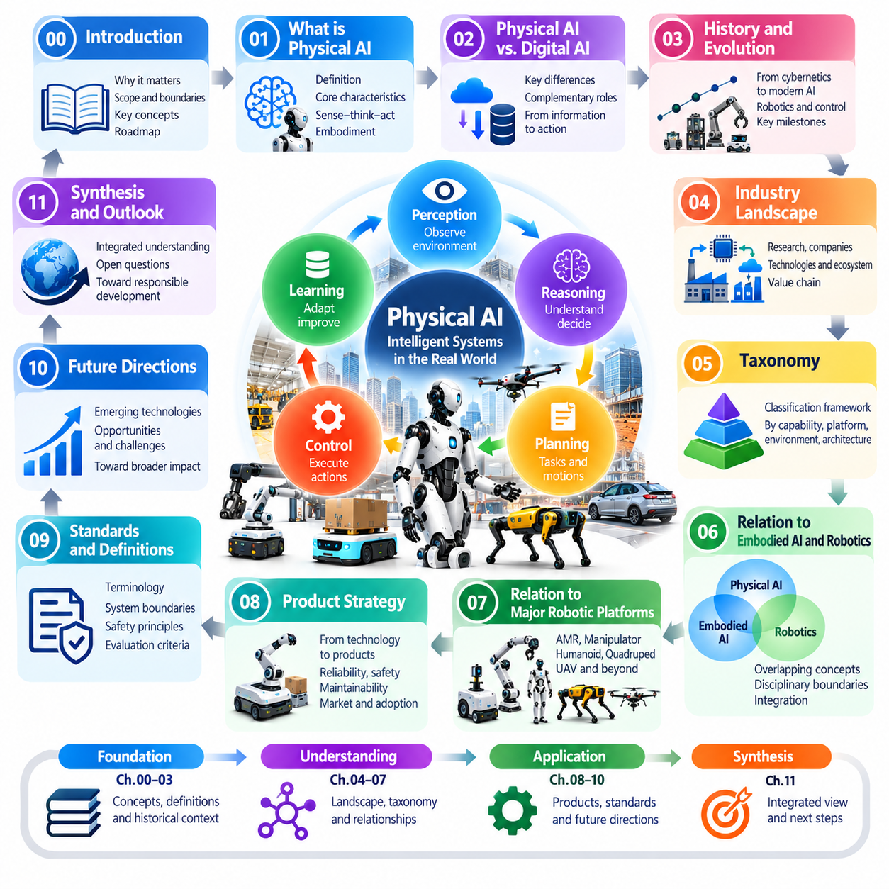

**Volume 02. Physical AI Foundations and Definitions**

# Chapter 00. Introduction

## 00.01. Why Physical AI Matters

{width="7.268055555555556in" height="7.268055555555556in"}

피지컬 인공지능(Physical AI)은 인공지능(Artificial Intelligence)이 세계와 상호작용하는 방식에 근본적인 변화를 가져온다. 기존 인공지능이 주로 정보를 처리하고 콘텐츠를 생성하며 디지털 의사결정을 지원했다면, 피지컬 인공지능은 지능을 물리적 환경(Physical Environment), 기계 및 실제 행동과 연결한다. 그 중요성은 지능형 시스템(Intelligent System)이 정보를 이해하는 수준을 넘어 현실 세계를 인식하고, 예측하고, 판단하며, 직접 행동할 수 있도록 한다는 데 있다.

물리적 세계(Physical World)는 디지털 지능(Digital Intelligence)만으로 완전히 해결하기 어려운 과제를 제시한다. 물체에는 질량이 존재하고, 환경은 지속적으로 변화하며, 모든 행동은 기하학(Geometry), 마찰(Friction), 중력(Gravity), 에너지(Energy)의 제약을 받는다. 지능형 기계는 불확실성(Uncertainty), 불완전한 관측(Incomplete Observation), 예측하기 어려운 외란(Disturbance) 속에서도 작동해야 한다. 피지컬 인공지능은 계산 지능(Computational Intelligence)을 이러한 물리적 현실과 통합하는 체계를 제공한다는 점에서 중요하다.

전통적인 자동화(Traditional Automation)는 사전에 정의된 명령, 구조화된 환경(Structured Environment), 반복 작업을 통해 높은 생산성을 달성해 왔다. 그러나 작업 대상이나 운영 조건이 예상과 다르게 변화하면 대응 능력이 제한되는 경우가 많다. 피지컬 인공지능은 인식(Perception), 추론(Reasoning), 학습(Learning), 피드백 제어(Feedback Control)를 결합하여 자동화를 적응형 행동(Adaptive Behavior)으로 확장하고, 시스템 설계 단계에서 완전히 예측하기 어려운 변화에도 효과적으로 대응하도록 한다.

피지컬 인공지능의 중요성은 지능이 측정 가능한 물리적 결과(Physical Outcome)를 만들어야 하는 상황에서 더욱 분명해진다. 디지털 모델(Digital Model)은 물체를 정확하게 식별하는 것으로 충분할 수 있지만, 로봇 시스템(Robotic System)은 물체의 위치를 파악하고, 물리적 특성을 추정하며, 실행 가능한 움직임을 계획하고, 안전하게 행동을 수행해야 한다. 따라서 성공적인 지능은 관측(Observation), 의사결정(Decision Making), 물리적 상호작용(Physical Interaction), 환경 상태(Environmental State)의 변화 사이에 형성되는 전체 관계에 달려 있다.

피지컬 인공지능은 자율성(Autonomy)의 의미도 변화시킨다. 자율 시스템(Autonomous System)은 사람의 개입 없이 명령을 순차적으로 실행하는 수준을 넘어야 한다. 환경 조건을 지속적으로 평가하고, 운영상의 한계를 인식하며, 행동을 조정하고, 지원이나 보호 조치가 필요한 시점을 판단할 수 있어야 한다. 이러한 목표 지향적 행동(Goal-Directed Behavior), 환경 인식(Environmental Awareness), 운영 책임성(Operational Responsibility)의 결합은 실질적인 물리적 자율성을 단순한 자동 실행과 구별한다.

피지컬 인공지능이 중요한 주요 이유 중 하나는 지속적인 노동력 및 생산성 문제를 해결할 수 있는 잠재력 때문이다. 제조업(Manufacturing), 물류(Logistics), 농업(Agriculture), 건설(Construction), 기반시설 유지보수(Infrastructure Maintenance)에는 정해진 절차만으로 자동화하기 어려운 육체적 작업이 존재한다. 다양한 물체와 환경, 작업 흐름에 적응할 수 있는 지능형 기계는 작업자를 지원하고, 운영 일관성을 향상시키며, 기존 자동화 기술이 적용되기 어려웠던 영역으로 자동화 범위를 확대할 수 있다.

제조 환경(Manufacturing Environment)에서 피지컬 인공지능은 제품의 다양성, 조립 순서의 변화, 예측하기 어려운 자재 조건에 대응하는 유연 생산 시스템(Flexible Production System)을 지원할 수 있다. 지능형 로봇 시스템은 고정된 프로그램에만 의존하지 않고 센서 관측(Sensor Observation)과 학습된 표현(Learned Representation)을 활용하여 행동을 조정할 수 있다. 이러한 능력은 시스템 재구성(Reconfiguration)에 필요한 노력을 줄이고 대응성을 높일 수 있지만, 실제 배포에는 여전히 엄격한 엔지니어링(Engineering)과 검증(Validation)이 요구된다.

물류 및 창고 운영(Logistics and Warehouse Operations)은 또 다른 중요한 적용 분야이다. 자율이동로봇(Autonomous Mobile Robot, AMR)은 동적으로 변화하는 공간을 탐색하고, 작업자와 상호작용하며, 장애물을 회피하고, 운송 작업을 조정해야 한다. 이동형 매니퓰레이터(Mobile Manipulator)는 이동과 물체 조작을 결합하여 이러한 능력을 확장한다. 피지컬 인공지능은 이러한 기능을 적응형 시스템(Adaptive System)으로 통합하고 변화하는 운영 요구사항에 대응하도록 하는 공통 지능 체계를 제공한다.

피지컬 인공지능은 사람이 접근하기 어렵거나 위험하거나 비용이 많이 드는 환경에서도 중요하다. 검사 로봇(Inspection Robot), 무인항공기(Unmanned Aerial Vehicle, UAV), 수중 시스템(Underwater System), 원격 매니퓰레이터(Remote Manipulator)는 산업시설, 재난 지역, 험난한 지형에서 작업을 수행할 수 있다. 이러한 시스템이 낯선 환경을 해석하고 제한된 조건에서 자체적으로 의사결정을 수행할 수 있다면, 지속적인 인간 감독이나 원격 연결에 전적으로 의존하지 않으면서 활용 가치를 높일 수 있다.

의료 및 인간 중심 응용 분야(Healthcare and Human-Centered Applications) 역시 물리적 지능의 중요성을 보여준다. 보조 로봇(Assistive Robot), 재활 시스템(Rehabilitation System), 지능형 이동 보조 장치(Intelligent Mobility Device)는 개인별 차이와 변화하는 신체 조건을 고려하면서 사람과 가까운 거리에서 작동해야 한다. 이러한 응용에는 정확한 인식이나 정교한 알고리즘만으로는 충분하지 않다. 예측 가능한 상호작용, 적절한 힘 제어(Force Control), 신뢰성 있는 모니터링(Monitoring), 인간의 요구를 중심으로 설계된 안전 메커니즘(Safety Mechanism)이 필요하다.

인공지능, 로보틱스(Robotics), 제어공학(Control Engineering)의 융합(Convergence)은 이러한 변화의 핵심이다. 기계학습(Machine Learning)은 패턴 인식(Pattern Recognition)과 적응 능력을 제공하고, 로보틱스는 물리적 메커니즘(Physical Mechanism)과 시스템 통합(System Integration)을 담당하며, 제어이론(Control Theory)은 안정적이고 반응성 높은 행동을 유지하는 방법을 제공한다. 피지컬 인공지능은 이러한 분야를 결합하여 지능형 행동을 독립적인 소프트웨어 모델이 아니라 전체 시스템의 특성으로 다룬다.

파운데이션 모델(Foundation Model)과 멀티모달 학습(Multimodal Learning)의 발전은 피지컬 인공지능에 새로운 기회를 제공한다. 언어, 이미지, 비디오, 행동 관련 정보로 학습된 모델은 명령 해석과 환경 이해에 활용할 수 있는 재사용 가능한 표현(Reusable Representation)을 제공할 수 있다. 그러나 이러한 표현을 신뢰할 수 있는 물리적 행동으로 전환하려면 센서 관측, 로봇의 능력, 작업 제약조건(Task Constraint), 실제 움직임의 결과에 기반한 연결이 필요하다.

월드 모델(World Model)은 물리적 에이전트(Physical Agent)가 환경의 미래 변화를 예측해야 한다는 점에서 특히 중요하다. 장애물에 접근하거나, 변형 가능한 물체(Deformable Object)를 조작하거나, 움직이는 사람과 상호작용하는 로봇은 가능한 미래 상태(Future State)를 예측함으로써 이점을 얻을 수 있다. 이러한 예측은 계획(Planning)과 위험 평가(Risk Assessment)를 지원한다. 그 유용성은 불확실성을 표현하고 실제 관측 결과가 예상과 다를 때 예측을 갱신하는 능력에 달려 있다.

인식과 행동의 관계는 피지컬 인공지능을 근본적으로 상호작용적(Interactive)인 기술로 만든다. 지능형 에이전트(Intelligent Agent)는 단순히 환경을 관측하고 최종 답변을 생성하는 데 그치지 않는다. 에이전트의 행동은 환경을 변화시키고, 그 변화는 새로운 관측을 만들어 후속 의사결정에 영향을 준다. 이러한 지속적인 피드백 과정(Feedback Process)은 수정, 적응, 학습을 가능하게 하지만, 잘못된 판단이 되돌릴 수 없는 물리적 결과를 초래할 가능성도 함께 발생시킨다.

따라서 안전성(Safety)은 피지컬 인공지능의 기반 특성이다. 디지털 응용 프로그램(Digital Application)의 오류는 잘못된 정보나 거래 실패로 이어질 수 있지만, 물리적 시스템(Physical System)의 오류는 장비 손상, 운영 중단, 인명 피해를 초래할 수 있다. 물리적 지능은 적절한 안전 제약조건(Safety Constraint) 안에서 작동해야 하며, 신뢰성 있는 센싱(Sensing), 제한된 행동(Bounded Action), 보호 제어 메커니즘(Protective Control Mechanism), 비정상 상태의 감지 및 대응 절차를 결합해야 한다.

실시간 동작(Real-Time Operation)은 또 다른 본질적인 차이를 만든다. 물리적 시스템은 계산이 수행되는 동안에도 물체가 계속 움직이고 환경 조건이 변화하기 때문에 엄격한 시간 제한 안에서 의사결정을 내려야 하는 경우가 많다. 지능형 제어기(Intelligent Controller)는 모델 복잡도(Model Complexity), 예측 정확도(Prediction Accuracy), 통신 지연(Communication Latency), 가용 연산 자원(Computing Resource) 사이의 균형을 유지해야 한다. 따라서 연산 성능은 시간적 보장(Timing Guarantee) 및 물리적 시스템의 동작과 함께 평가되어야 한다.

에너지 효율(Energy Efficiency)과 하드웨어 제약조건(Hardware Constraint)도 피지컬 인공지능의 실용성에 영향을 미친다. 로봇과 자율 기계는 제한된 배터리 용량(Battery Capacity), 열 설계 한계(Thermal Budget), 온보드 연산 자원(Onboard Computing Resource) 안에서 작동하는 경우가 많다. 고도화된 지능이라도 연산 요구량 때문에 지속적인 운영이 불가능하다면 실질적인 효과를 얻기 어렵다. 따라서 피지컬 인공지능은 알고리즘, 센서, 프로세서, 액추에이터(Actuator), 통신 시스템, 전력 관리(Power Management)를 함께 고려하는 통합 설계를 요구한다.

시뮬레이션(Simulation)과 디지털 트윈(Digital Twin)은 실제 배포 전에 물리적 상호작용을 연구할 수 있도록 중요한 개발 능력을 제공한다. 가상 환경(Virtual Environment)은 학습 경험을 생성하고, 시스템을 비정상적인 조건에 노출하며, 반복적인 평가를 지원할 수 있다. 그러나 시뮬레이션 환경과 실제 환경 사이에는 여전히 중요한 차이가 존재한다. 피지컬 인공지능 개발에서는 검증, 적응, 신중하게 통제된 실제 환경 실험을 통해 이러한 차이를 해결해야 한다.

데이터 수집(Data Acquisition)은 또 다른 근본적인 과제이다. 디지털 인공지능은 기존 텍스트, 이미지, 온라인 상호작용으로 구성된 대규모 데이터에서 학습할 수 있는 경우가 많다. 반면 피지컬 인공지능은 움직임, 힘, 행동, 환경 변화, 작업 결과에 관한 추가적인 정보가 필요하다. 이러한 데이터의 수집에는 상당한 비용과 시간이 소요될 수 있다. 효율적인 시연 데이터(Demonstration Data), 시뮬레이션 생성 경험(Simulation-Generated Experience), 운영 피드백(Operational Feedback)은 적응 가능한 물리적 지능을 개발하기 위한 중요한 자원이 된다.

피지컬 인공지능의 경제적 중요성은 개별 수작업을 대체하는 수준을 넘어선다. 지능형 물리 시스템은 연속 검사(Continuous Inspection), 유연 제조(Flexible Manufacturing), 분산 물류(Distributed Logistics), 협업 로봇 서비스(Coordinated Robotic Services)를 포함하는 새로운 운영 모델(Operational Model)을 가능하게 할 수 있다. 상업적 가치는 생산성, 신뢰성(Reliability), 안전성, 수명주기 비용(Lifecycle Cost)의 측정 가능한 개선에 달려 있다. 따라서 성공적인 도입에는 기술적 능력, 응용 요구사항, 지속 가능한 비즈니스 모델(Business Model) 사이의 정합성이 필요하다.

피지컬 인공지능은 개별 기계 중심의 구조에서 상호 연결된 지능형 시스템으로의 전환도 촉진한다. 여러 로봇은 관측 정보를 공유하고, 활동을 조정하며, 플릿 수준 정보(Fleet-Level Information)를 활용하여 운영 의사결정을 개선할 수 있다. 엣지 컴퓨팅(Edge Computing)은 즉각적인 현장 대응을 지원하고, 클라우드 인프라(Cloud Infrastructure)는 대규모 학습과 관리를 지원할 수 있다. 이러한 분산 아키텍처(Distributed Architecture)는 집단적 개선(Collective Improvement)의 기회를 제공하는 동시에 통신, 사이버보안(Cybersecurity), 거버넌스(Governance) 문제를 발생시킨다.

피지컬 인공지능의 보다 광범위한 중요성은 인간 지능(Human Intelligence)과 기계 능력(Machine Capability) 사이의 관계를 확장한다는 데 있다. 인공지능을 디지털 인터페이스(Digital Interface)에 한정하지 않고, 피지컬 인공지능은 물리적 작업과 환경 상호작용에 직접 참여할 수 있는 시스템을 도입한다. 이러한 시스템의 발전은 책임 있는 배포(Responsible Deployment)와 인간 감독(Human Oversight)이 함께 이루어진다는 전제 아래 산업 공정, 교통, 공공 기반시설, 일상 서비스의 구조를 변화시킬 수 있다.

피지컬 인공지능이 중요한 이유를 이해하려면 이를 단일 알고리즘, 특정 로봇 유형, 일시적인 기술 동향이 아니라 시스템 수준의 패러다임(System-Level Paradigm)으로 바라보아야 한다. 핵심적인 기회는 현실 세계의 제약조건 아래에서 인식, 추론, 예측, 학습, 제어된 행동(Controlled Action)을 통합하는 데 있다. 장기적인 중요성은 단순히 인공지능 모델의 능력이 얼마나 발전하는지가 아니라, 완전한 물리적 시스템이 유용하고 안전하며 신뢰할 수 있고 적응 가능한 행동을 대규모로 제공할 수 있는지에 따라 결정될 것이다.

## 00.02. From Digital AI to Physical AI

{width="7.268055555555556in" height="7.268055555555556in"}

디지털 인공지능(Digital AI)에서 피지컬 인공지능(Physical AI)으로의 전환은 인공지능(Artificial Intelligence)이 정보 처리(Information Processing) 중심에서 물리적 세계(Physical World)와의 지능적 상호작용(Intelligent Interaction)으로 확장되는 근본적인 변화를 의미한다. 디지털 인공지능은 언어 이해(Language Understanding), 이미지 인식(Image Recognition), 예측(Prediction), 콘텐츠 생성(Content Generation)에서 뛰어난 능력을 보여주었다. 피지컬 인공지능은 이러한 능력을 실제 물체, 물리적 과정, 지속적으로 변화하는 환경 조건에 의사결정이 직접적인 영향을 미치는 영역으로 확장한다.

디지털 인공지능은 전통적으로 텍스트(Text), 이미지(Image), 수치 데이터(Numerical Data), 구조화된 정보(Structured Information)와 같은 계산적 표현(Computational Representation)을 기반으로 작동한다. 그 출력은 일반적으로 예측, 분류(Classification), 추천(Recommendation), 생성된 콘텐츠의 형태로 나타난다. 이러한 출력이 물리적 활동에 간접적인 영향을 미칠 수는 있지만, 지능 자체는 물리적 실행(Physical Execution)과 분리되어 있는 경우가 많다. 피지컬 인공지능은 계산적 의사결정을 센서(Sensor), 액추에이터(Actuator), 환경 피드백(Environmental Feedback)과 연결함으로써 이러한 분리를 해소한다.

이러한 차이는 인공지능의 의사결정이 초래하는 결과를 고려할 때 더욱 명확해진다. 잘못된 디지털 예측은 부정확한 정보나 부적절한 추천을 생성할 수 있다. 반면 잘못된 물리적 행동(Physical Action)은 충돌(Collision), 장비 손상(Equipment Damage), 운영 중단(Operational Disruption), 인명 피해(Human Injury)를 초래할 수 있다. 따라서 피지컬 인공지능은 예측 정확도(Prediction Accuracy)뿐 아니라 행동 실행 가능성(Action Feasibility), 환경 불확실성(Environmental Uncertainty), 시스템 안정성(System Stability), 물리적 행동의 안전성(Safety)까지 고려해야 한다.

디지털 인공지능의 발전은 대규모 데이터셋(Large-Scale Dataset), 확장 가능한 컴퓨팅 인프라(Scalable Computing Infrastructure), 점점 고도화되는 기계학습 아키텍처(Machine Learning Architecture)에 의해 가속되었다. 심층 신경망(Deep Neural Network)은 인식(Perception)과 패턴 인식(Pattern Recognition)의 성능을 크게 향상시켰으며, 트랜스포머(Transformer)는 언어 및 멀티모달 추론(Multimodal Reasoning) 능력을 확장하였다. 이러한 발전은 피지컬 인공지능의 중요한 기반을 형성했지만, 계산 지능(Computational Intelligence)만으로 실제 환경과의 성공적인 상호작용이 보장되는 것은 아니다.

피지컬 인공지능은 체화(Embodiment)를 핵심적인 고려 요소로 도입한다. 지능은 특정한 센서, 액추에이터, 기계적 구조(Mechanical Structure), 운동 능력(Movement Capability)을 갖춘 물리적 플랫폼(Physical Platform)을 통해 작동해야 한다. 바퀴형 로봇(Wheeled Robot), 산업용 매니퓰레이터(Industrial Manipulator), 휴머노이드(Humanoid), 무인항공기(Aerial Vehicle)는 계산 모델을 공유할 수 있지만 서로 다른 물리적 행동이 필요하다. 각 시스템의 지능은 형태학(Morphology), 동역학(Dynamics), 운영 제약조건(Operating Constraint), 신체와 주변 환경 사이의 관계를 고려해야 한다.

또 다른 주요 전환은 관측(Observation)과 행동(Action) 사이의 관계에서 나타난다. 디지털 인공지능은 관측 대상 환경을 직접 변화시키지 않은 상태에서 기존 데이터셋이나 사용자가 제공한 입력을 처리하는 경우가 많다. 반면 피지컬 인공지능은 각 행동이 환경을 변화시키고 새로운 관측을 생성하는 지속적인 상호작용을 통해 작동한다. 이로 인해 인식, 의사결정(Decision-Making), 실행(Execution), 피드백(Feedback)이 시스템 운영 전반에서 조정되어야 하는 폐루프 과정(Closed-Loop Process)이 형성된다.

폐루프 지능(Closed-Loop Intelligence)은 물리적 환경이 예측한 대로 정확하게 움직이는 경우가 드물기 때문에 필수적이다. 이동로봇(Mobile Robot)은 예상하지 못한 장애물을 만날 수 있고, 매니퓰레이터는 물체 미끄러짐(Object Slippage)을 경험할 수 있으며, 자율주행차(Autonomous Vehicle)는 변화하는 도로 조건에 직면할 수 있다. 피지컬 인공지능은 예상 상태(Expected State)와 관측 상태(Observed State) 사이의 차이를 감지하고, 내부 환경 이해를 갱신하며, 후속 행동을 수정해야 한다. 이러한 지속적인 보정(Continuous Correction)은 적응형 물리적 행동(Adaptive Physical Behavior)을 고정된 실행 순서(Fixed Execution Sequence)와 구별한다.

이러한 전환은 지능형 연산(Intelligent Computation)에서 시간(Time)의 역할도 변화시킨다. 많은 디지털 응용 프로그램(Digital Application)은 출력이 움직이는 물리적 시스템에 즉각적인 영향을 미치지 않기 때문에 응답 시간(Response Time)의 변동을 허용할 수 있다. 반면 피지컬 인공지능은 의사결정 지연(Decision Delay)이 성능을 저하시키거나 안전성을 위협할 수 있는 실시간 제약조건(Real-Time Constraint) 아래에서 작동하는 경우가 많다. 따라서 인식, 계획(Planning), 제어(Control)는 관리 대상 물리적 과정의 시간 요구사항(Timing Requirement)에 맞추어 조정되어야 한다.

디지털 인공지능은 일반적으로 분류 정확도(Classification Accuracy), 예측 오차(Prediction Error), 언어 품질(Language Quality), 벤치마크 성능(Benchmark Performance)과 같은 지표를 통해 성공 여부를 평가한다. 피지컬 인공지능은 실제 세계의 결과를 반영하는 추가적인 평가 차원(Evaluation Dimension)이 필요하다. 작업 완료(Task Completion), 궤적 정확도(Trajectory Accuracy), 에너지 소비(Energy Consumption), 충돌 회피(Collision Avoidance), 복구 행동(Recovery Behavior), 운영 신뢰성(Operational Reliability)이 핵심적인 평가 기준이 된다. 계산적으로 정확한 모델이라도 물리적 실행이 불안정하거나 안전하지 않다면 실제 적용에 적합하지 않을 수 있다.

수동적 추론(Passive Inference)에서 능동적 상호작용(Active Interaction)으로의 발전은 새로운 학습 요구사항(Learning Requirement)을 도입한다. 디지털 인공지능은 기존에 수집된 정보에 대한 학습을 통해 성능을 향상시킬 수 있는 반면, 피지컬 인공지능은 행동이 미래 환경 상태(Future Environmental State)에 어떤 영향을 미치는지도 학습해야 한다. 상호작용 데이터(Interaction Data), 시연(Demonstration), 강화학습(Reinforcement Learning), 시뮬레이션 경험(Simulation Experience)은 중요한 학습 자원이 된다. 이러한 접근법은 정적인 예제나 사전에 정의된 명령만으로 완전히 규정하기 어려운 행동을 지능형 에이전트(Intelligent Agent)가 습득하도록 지원한다.

월드 모델(World Model)은 디지털 인공지능과 피지컬 인공지능 사이를 연결하는 중요한 개념적 가교(Conceptual Bridge)를 제공한다. 지능형 시스템은 현재 관측만 표현하는 대신 상태(State), 행동, 가능한 미래 결과(Future Outcome) 사이의 관계를 학습할 수 있다. 이러한 모델은 불확실성(Uncertainty) 아래에서 예측, 계획, 의사결정을 지원한다. 모델의 효과는 관련 물리 동역학(Physical Dynamics)을 포착하고 실제 상호작용에서 수집된 관측과 일관성을 유지하는 능력에 달려 있다.

파운데이션 모델(Foundation Model)의 등장은 디지털 표현(Digital Representation)에서 얻은 지식을 물리적 지능(Physical Intelligence)으로 이전할 수 있는 기회를 제공한다. 비전 언어 모델(Vision-Language Model, VLM)은 장면 해석(Scene Interpretation)과 명령 이해(Instruction Understanding)를 지원할 수 있으며, 비전 언어 행동 모델(Vision-Language-Action Model, VLA)은 멀티모달 정보(Multimodal Information)를 실행 가능한 행동(Executable Behavior)과 연결하려고 한다. 그러나 성공적인 물리적 배포(Physical Deployment)를 위해서는 현실 기반 연결(Grounding), 동작 생성(Motion Generation), 피드백 제어(Feedback Control), 환경 제약조건에 대한 행동 검증(Action Verification)을 위한 추가적인 메커니즘이 필요하다.

피지컬 인공지능은 소프트웨어 지능(Software Intelligence)과 하드웨어 설계(Hardware Design) 사이의 더욱 긴밀한 통합도 요구한다. 센서 배치(Sensor Placement)는 관측 가능성(Observability)에 영향을 미치고, 액추에이터 특성(Actuator Characteristics)은 실행 가능한 움직임을 결정하며, 연산 자원(Computational Resource)은 의사결정 속도를 제한한다. 소프트웨어를 물리적 기계와 독립적으로 배포할 수 있는 응용 분야와 달리, 지능형 로봇 시스템은 기계 설계, 전자장치(Electronics), 임베디드 컴퓨팅(Embedded Computing), 통신(Communication), 학습 알고리즘(Learning Algorithm)을 상호 연결된 구성요소로 조정해야 한다.

피지컬 인공지능의 컴퓨팅 아키텍처(Computing Architecture)는 중앙집중식 처리 모델(Centralized Processing Model)을 넘어 확장되는 경우가 많다. 온보드 프로세서(Onboard Processor)와 엣지 컴퓨팅 플랫폼(Edge Computing Platform)은 저지연 인식(Low-Latency Perception)과 제어를 제공할 수 있으며, 온프레미스 인프라(On-Premises Infrastructure)는 여러 기계를 조정하고 공유 운영 정보(Shared Operational Information)를 유지할 수 있다. 클라우드 시스템(Cloud System)은 대규모 학습(Large-Scale Training), 모델 배포(Model Distribution), 플릿 분석(Fleet Analytics)을 지원할 수 있다. 이러한 기능은 시간 요구사항, 연결성(Connectivity), 보안(Security), 신뢰성 요구사항에 따라 분산되어야 한다.

시뮬레이션(Simulation)은 물리적 실험을 통한 직접 학습이 비용이 많이 들고 느리거나 위험할 수 있기 때문에 이러한 전환 과정에서 점점 더 중요해진다. 시뮬레이션 환경(Simulated Environment)은 에이전트가 작업을 연습하고, 다양한 조건을 경험하며, 실제 배포 전에 후보 행동(Candidate Behavior)을 평가할 수 있도록 한다. 그러나 동역학, 센싱(Sensing), 접촉(Contact), 환경 복잡성(Environmental Complexity)의 차이는 시뮬레이션과 현실 사이의 격차(Simulation-to-Reality Gap)를 발생시키며, 이는 적응(Adaptation)과 실제 환경 검증(Real-World Validation)을 통해 해결해야 한다.

안전성(Safety)과 신뢰성(Reliability)은 지능의 발전과 함께 진화해야 한다. 디지털 모델(Digital Model)은 주로 통계적 성능(Statistical Performance)을 기준으로 평가되는 경우가 많지만, 피지컬 인공지능 시스템은 학습된 모델이 불확실하거나 잘못된 출력을 생성하더라도 효과적으로 작동하는 보호 메커니즘(Protective Mechanism)이 필요하다. 런타임 모니터링(Runtime Monitoring), 운영 한계(Operational Limit), 비상 정지(Emergency Stopping), 대체 대응 절차(Fallback Procedure), 인간 개입 메커니즘(Human Intervention Mechanism)은 개별 예측 오류가 허용할 수 없는 물리적 실패(Physical Failure)로 이어지는 것을 방지하는 데 도움을 준다.

디지털 인공지능에서 피지컬 인공지능으로의 전환은 시스템 개발 방식(System Development Practice)도 변화시킨다. 정확한 모델을 학습시키는 것은 실제로 작동하는 물리적 에이전트를 구축하는 과정의 일부에 불과하다. 엔지니어는 인식, 위치 추정(Localization), 계획, 제어, 통신, 구동(Actuation)을 일관된 운영 아키텍처(Operational Architecture)로 통합해야 한다. 테스트(Testing)는 현실적인 조건에서 구성요소 동작(Component Behavior), 하위 시스템 상호작용(Subsystem Interaction), 환경 외란(Environmental Disturbance), 전체 작업 실행(Complete Task Execution)을 포괄해야 한다.

산업 응용(Industrial Application)은 디지털 지능이 어떻게 물리적 결과를 만들어 내는지 보여준다. 제조 데이터를 분석하는 인공지능 시스템은 개선 방안을 추천할 수 있지만, 피지컬 인공지능 시스템은 생산 조건을 인식하고 이에 따라 로봇 작업을 조정할 수 있다. 마찬가지로 창고 지능(Warehouse Intelligence)은 재고 수요 예측(Inventory Demand Prediction)에서 자율 운송(Autonomous Transportation)과 조작(Manipulation)의 조정으로 발전할 수 있다. 이러한 차이의 핵심은 지능형 의사결정을 제어된 물리적 실행(Controlled Physical Execution)과 연결하는 데 있다.

이러한 변화가 피지컬 인공지능이 디지털 인공지능을 대체한다는 의미는 아니다. 오히려 피지컬 인공지능은 디지털 인공지능의 능력을 기반으로 구축되면서 체화, 상호작용, 물리적 제약조건(Physical Constraint)과 관련된 추가 요구사항을 도입한다. 언어 이해, 시각 인식(Visual Recognition), 확률적 추론(Probabilistic Reasoning), 학습된 표현(Learned Representation)은 여전히 중요한 구성요소이다. 이러한 능력은 추상적 지능(Abstract Intelligence)을 신뢰할 수 있는 물리적 행동으로 변환하는 메커니즘과 통합될 때 더욱 강력한 가치를 발휘한다.

피지컬 인공지능으로의 장기적인 전환은 세계를 설명하는 지능에서 세계에 직접 참여할 수 있는 지능으로 발전하는 보다 광범위한 흐름을 반영한다. 이러한 전환을 실현하려면 학습, 월드 모델링(World Modeling), 로보틱스(Robotics), 실시간 컴퓨팅(Real-Time Computing), 안전공학(Safety Engineering)의 발전이 필요하다. 그 성공 여부는 디지털 추론(Digital Reasoning)을 물리적 현실에 기반한 인식(Physically Grounded Perception), 적응형 제어(Adaptive Control), 신뢰할 수 있는 행동(Dependable Action)과 결합하여 복잡한 환경에서도 안정적으로 작동하는 완전한 시스템(Complete System)을 개발할 수 있는지에 달려 있다.

## 00.03. AI Robotics and Control Convergence

{width="7.268055555555556in" height="7.268055555555556in"}

인공지능(Artificial Intelligence), 로보틱스(Robotics), 제어공학(Control Engineering)의 융합(Convergence)은 피지컬 인공지능(Physical AI)의 기술적 기반을 형성한다. 인공지능은 학습(Learning), 인식(Perception), 추론(Reasoning) 능력을 제공하고, 로보틱스는 물리적 상호작용(Physical Interaction)에 필요한 기계적 메커니즘(Mechanical Mechanism)을 제공한다. 제어공학은 계획된 행동이 안정성(Stability), 정밀성(Precision), 응답성(Responsiveness)을 갖추고 실행되도록 보장한다. 이들의 통합은 기계가 계산 지능(Computational Intelligence)을 목적 지향적인 물리적 행동(Purposeful Physical Behavior)으로 전환할 수 있도록 한다.

역사적으로 이러한 학문 분야는 부분적으로 독립된 연구 전통(Research Tradition)을 통해 발전해 왔다. 인공지능은 기호적 추론(Symbolic Reasoning), 지식 표현(Knowledge Representation), 통계적 학습(Statistical Learning)에 중점을 두었다. 로보틱스는 기계적 구조(Mechanism), 운동학(Kinematics), 센싱(Sensing), 동작 생성(Motion Generation)에 집중했으며, 제어공학은 동적 시스템(Dynamic System)을 조절하기 위한 수학적 방법(Mathematical Method)을 발전시켰다. 피지컬 인공지능은 이러한 분야가 통합된 지능형 기계(Unified Intelligent Machine)로 점차 결합되는 과정에서 등장한다.

인공지능은 복잡한 관측(Complex Observation)을 해석하고 불확실성(Uncertainty) 아래에서 의사결정(Decision-Making)을 수행하는 능력을 제공한다. 기계학습 모델(Machine Learning Model)은 물체를 식별하고, 환경 조건(Environmental Condition)을 추정하며, 패턴(Pattern)을 인식하고, 가능한 결과(Possible Outcome)를 예측할 수 있다. 이러한 능력은 로봇 시스템(Robotic System)이 경직된 사전 프로그래밍 시나리오(Preprogrammed Scenario)를 넘어 작동하도록 지원한다. 그러나 지능형 예측(Intelligent Prediction)은 실행 가능한 행동(Executable Action)과 지속적으로 갱신되는 환경 정보(Environmental Information)에 연결될 때 비로소 물리적 의미를 갖는다.

로보틱스는 인공지능이 물리적 세계(Physical World)와 상호작용할 수 있도록 하는 체화(Embodiment)를 제공한다. 센서(Sensor)는 환경에 관한 정보를 수집하고, 기계적 구조(Mechanical Structure)는 운동 능력(Movement Capability)을 결정하며, 액추에이터(Actuator)는 제어 명령(Control Command)을 물리적 움직임(Physical Motion)으로 변환한다. 로봇 형태학(Robot Morphology)은 어떤 행동이 가능하며 얼마나 효과적으로 수행될 수 있는지에 영향을 미친다. 따라서 지능형 행동(Intelligent Behavior)은 로봇 플랫폼(Robotic Platform)의 물리적 특성(Physical Characteristics)을 고려하여 설계되어야 한다.

제어공학은 물리적 행동을 조절하는 데 필요한 수학적 원리(Mathematical Principle)와 운영 원리(Operational Principle)를 확립한다. 피드백 제어기(Feedback Controller)는 목표 상태(Desired State)와 측정 상태(Measured State)를 비교하고 편차(Deviation)를 줄이도록 액추에이터 명령을 조정한다. 비례-적분-미분 제어(Proportional-Integral-Derivative Control, PID Control), 상태 추정(State Estimation), 모델 예측 제어(Model Predictive Control, MPC)와 같은 기술은 외란(Disturbance)과 모델링 오차(Modeling Error)가 존재하더라도 안정성을 유지하고 목표 궤적(Desired Trajectory)을 추종하는 메커니즘을 제공한다.

이러한 융합은 고수준 추론(High-Level Reasoning)이 저수준 제어(Low-Level Control)와 상호작용해야 할 때 특히 중요해진다. 인공지능 모델은 로봇이 물체를 파지(Grasp)해야 한다고 판단할 수 있지만, 로봇 시스템은 실행 가능한 움직임(Feasible Motion)을 계산하고 액추에이터를 조정해야 한다. 이후 제어 알고리즘(Control Algorithm)은 실행 과정에서 위치(Position), 속도(Velocity), 힘(Force)을 조절한다. 성공적인 작동을 위해서는 작업 추론(Task Reasoning), 동작 계획(Motion Planning), 물리적 제어(Physical Control) 사이에서 일관된 정보 교환(Information Exchange)이 이루어져야 한다.

이러한 통합의 핵심 원리는 인식-행동 피드백 루프(Perception-Action Feedback Loop)이다. 센서는 환경 조건을 관측하고, 인공지능 모델은 관측 결과를 해석하며, 계획 모듈(Planning Module)은 행동을 선택하고, 제어기는 생성된 명령을 실행한다. 이후 센서 측정(Sensor Measurement)은 환경이 어떻게 반응했는지를 보여준다. 이러한 연속적인 순환 과정(Continuous Cycle)을 통해 지능형 기계는 오류를 수정하고, 외란에 적응하며, 운영 조건이 변화하더라도 목표 지향적 행동(Goal-Directed Behavior)을 유지할 수 있다.

전통적인 로봇 시스템(Traditional Robotic System)은 계획과 제어를 서로 다른 처리 단계(Processing Stage)로 분리하는 경우가 많다. 계획은 환경 모델(Environmental Model)을 기반으로 궤적(Trajectory)을 생성하고, 제어기는 해당 궤적을 추종하도록 작동한다. 피지컬 인공지능은 적응형 계획(Adaptive Planning)과 학습된 표현(Learned Representation)을 통해 이러한 기능을 점차 긴밀하게 연결한다. 이러한 통합은 환경 조건이 변화할 때 응답성을 향상시킬 수 있지만, 동시에 검증(Verification)과 시스템 수준 조정(System-Level Coordination)에 대한 요구사항도 증가시킨다.

학습 기반 제어(Learning-Based Control)는 인공지능과 제어이론(Control Theory) 사이의 상호작용이 확대되고 있음을 보여준다. 신경망(Neural Network)은 복잡한 동역학(Complex Dynamics)을 근사하고, 알려지지 않은 매개변수(Unknown Parameter)를 추정하거나, 경험을 바탕으로 제어 정책(Control Policy)을 생성할 수 있다. 강화학습(Reinforcement Learning)은 시뮬레이션 환경(Simulated Environment)이나 물리적 환경(Physical Environment)과의 상호작용을 통해 행동을 최적화할 수 있다. 그러나 학습된 정책(Learned Policy)은 안전 필수 응용 분야(Safety-Critical Application)에 배포되기 전에 적절한 제약조건(Constraint), 모니터링(Monitoring), 검증(Validation)을 거쳐야 한다.

모델 기반 접근법(Model-Based Approach)은 또 다른 중요한 연결을 제공한다. 제어공학은 전통적으로 시스템 동역학(System Dynamics)의 수학적 표현(Mathematical Representation)을 사용하여 제어 입력(Control Input)에 대한 반응을 예측한다. 현대 인공지능은 데이터에서 동역학을 학습하고 예측형 월드 모델(Predictive World Model)을 구축함으로써 이러한 방법을 확장할 수 있다. 학습된 표현과 모델 예측 제어를 결합하면 물리적 제약조건과 미래 시스템 동작(Future System Behavior)을 명시적으로 고려하면서 불확실성 아래에서 계획을 지원할 수 있다.

상태 추정(State Estimation)은 물리적 시스템이 내부 상태(Internal State)에 관한 완전한 정보를 제공하는 경우가 드물기 때문에 필수적이다. 센서는 잡음(Noise)을 발생시키고, 측정값(Measurement)은 지연될 수 있으며, 중요한 변수(Variable)는 관측되지 않은 상태로 남을 수 있다. 로보틱스와 제어공학은 필터링(Filtering), 센서 융합(Sensor Fusion), 확률적 추정(Probabilistic Estimation)을 사용하여 관련 상태를 재구성한다. 인공지능 기법(AI Method)은 복잡한 시각 관측(Visual Observation)과 멀티모달 관측(Multimodal Observation)에서 유용한 표현을 추출함으로써 이러한 기술을 보완할 수 있다.

실시간 컴퓨팅(Real-Time Computing)은 지능형 추론(Intelligent Reasoning)과 물리적 실행(Physical Execution) 사이에 실질적인 경계(Practical Boundary)를 형성한다. 고수준 인공지능 모델(High-Level AI Model)은 상당한 연산 자원(Computational Resource)을 요구할 수 있지만, 저수준 제어기(Low-Level Controller)는 일반적으로 훨씬 높은 갱신 주기(Update Frequency)로 작동한다. 피지컬 인공지능 아키텍처(Physical AI Architecture)는 안정성이나 응답성을 저해하지 않으면서 이러한 서로 다른 시간 척도(Timescale)를 조정해야 한다. 이를 위해서는 신중한 스케줄링(Scheduling), 통신 설계(Communication Design), 시간 임계 기능(Time-Critical Function)의 분리가 필요하다.

하드웨어-소프트웨어 공동 설계(Hardware-Software Co-Design)는 지능이 물리적 구동(Physical Actuation)에 가까워질수록 더욱 중요해진다. 센서 선택(Sensor Selection)은 이용 가능한 관측을 결정하고, 액추에이터 대역폭(Actuator Bandwidth)은 제어 성능(Control Performance)에 영향을 미치며, 프로세서 성능(Processor Capability)은 추론 지연(Inference Latency)에 영향을 준다. 기계 설계(Mechanical Design) 역시 계획과 제어의 복잡성을 변화시킨다. 따라서 효과적인 피지컬 인공지능 개발에는 학습 알고리즘, 로봇 하드웨어(Robotic Hardware), 제어 아키텍처(Control Architecture) 전반에 걸친 조정된 최적화(Coordinated Optimization)가 필요하다.

이러한 융합은 계층적 지능 아키텍처(Hierarchical Intelligence Architecture)도 지원한다. 고수준 추론은 목표(Objective)를 해석하고 작업(Task)을 선택할 수 있으며, 중간 수준 계획(Intermediate-Level Planning)은 실행 가능한 궤적을 생성하고, 저수준 제어기는 움직임과 접촉력(Contact Force)을 조절할 수 있다. 피드백은 상위 계층으로 전달되어 환경 이해(Environmental Understanding)와 운영 의사결정(Operational Decision)을 갱신한다. 이러한 아키텍처는 복잡한 행동을 서로 다른 추상화 수준(Abstraction Level)과 시간적 해상도(Temporal Resolution)에 따라 체계적으로 구성할 수 있도록 한다.

자율이동로봇(Autonomous Mobile Robot, AMR)은 이러한 통합의 실질적인 가치를 보여준다. 인공지능 기반 인식(AI-Based Perception)은 장애물을 식별하고 주변 활동을 해석하며, 로보틱스는 이동 메커니즘(Locomotion Mechanism)과 센싱 하드웨어(Sensing Hardware)를 제공하고, 제어 알고리즘은 주행(Navigation)과 움직임을 조절한다. 위치 추정(Localization), 경로 계획(Path Planning), 장애물 회피(Obstacle Avoidance), 궤적 추종(Trajectory Tracking)은 함께 작동해야 한다. 어느 하나의 구성요소에서 발생한 실패도 전체 자율 시스템(Autonomous System)의 성능과 안전성에 영향을 미칠 수 있다.

조작 작업(Manipulation Task)은 지능이 긴밀하게 결합되어야 하는 또 다른 사례이다. 로봇 팔(Robotic Arm)은 물체를 인식하고, 자세(Pose)를 추정하며, 적절한 파지(Grasp)를 선택하고, 접촉이 많은 움직임(Contact-Rich Movement)을 실행해야 한다. 인공지능은 시각적 이해(Visual Understanding)와 파지 예측(Grasp Prediction)에 기여하고, 로보틱스는 운동학적 능력(Kinematic Capability)과 기계적 능력(Mechanical Capability)을 정의하며, 제어공학은 힘과 궤적을 조절한다. 이러한 통합은 서로 다른 특성을 가진 물체에 대해 더욱 적응적인 조작(Adaptive Manipulation)을 가능하게 한다.

동일한 융합은 휴머노이드 로봇(Humanoid Robot), 사족보행 로봇(Quadruped Robot), 무인항공기(Aerial Vehicle), 자율 산업 기계(Autonomous Industrial Machine)로 확장된다. 각 플랫폼은 서로 다른 동역학, 구동 요구사항(Actuation Requirement), 환경 상호작용(Environmental Interaction)을 가진다. 인식 및 추론 모델은 공통 기반(Common Foundation)을 공유할 수 있지만, 제어 전략(Control Strategy)은 체화 특화 제약조건(Embodiment-Specific Constraint)을 준수해야 한다. 따라서 피지컬 인공지능은 재사용 가능한 지능(Reusable Intelligence)과 신뢰할 수 있는 물리적 실행을 위한 특화 메커니즘(Specialized Mechanism)을 결합한다.

안전공학(Safety Engineering)은 통합 설계(Coordinated Design)에 추가적인 요구사항을 제시한다. 인공지능 모델은 불확실한 예측을 생성할 수 있고, 로봇 하드웨어는 고장(Failure)을 경험할 수 있으며, 제어기는 기존 가정(Assumption)을 벗어나는 운영 조건에 직면할 수 있다. 보호 제약조건(Protective Constraint), 고장 감지(Fault Detection), 비상 정지(Emergency Stopping), 대체 대응 행동(Fallback Behavior)은 시스템 전반에 통합되어야 한다. 신뢰할 수 있는 피지컬 인공지능은 지능적 적응(Intelligent Adaptation)이 독립적으로 강제되는 안전 메커니즘(Independently Enforced Safety Mechanism)과 양립할 수 있어야 한다.

시뮬레이션(Simulation)은 인공지능, 로보틱스, 제어공학을 위한 공통 개발 환경(Shared Development Environment)을 제공한다. 로봇의 기계적 구조, 환경 동역학(Environmental Dynamics), 센서, 제어 알고리즘을 실제 배포(Physical Deployment) 전에 함께 평가할 수 있다. 학습 기법(Learning Method)은 후보 행동(Candidate Behavior)을 생성할 수 있으며, 제어 분석(Control Analysis)은 안정성과 제약조건 충족 여부(Constraint Satisfaction)를 검토한다. 그러나 시뮬레이션은 모든 물리적 상호작용이나 운영 외란(Operational Disturbance)을 완벽하게 재현할 수 없으므로 실제 환경 테스트(Real-World Testing)는 여전히 필요하다.

이러한 학문 분야의 융합은 지능형 기계(Intelligent Machine)를 평가하고 설계하는 방식도 변화시킨다. 개별 모델의 정확도(Model Accuracy), 기계적 능력(Mechanical Capability), 제어기 성능(Controller Performance)만으로는 전체 시스템 품질(Overall System Quality)을 독립적으로 입증할 수 없다. 피지컬 인공지능은 전체 작업 실행(Complete Task Execution), 강건성(Robustness), 효율성(Efficiency), 적응성(Adaptability), 안전성을 기준으로 평가되어야 한다. 피지컬 인공지능의 핵심적인 성과는 학습, 체화, 피드백 제어가 하나의 통합 시스템(Unified System)으로 조정되어 물리적 세계에서 신뢰할 수 있는 행동을 수행할 수 있도록 하는 데 있다.

## 00.04. Physical AI as a System Paradigm

{width="7.268055555555556in" height="7.268055555555556in"}

피지컬 인공지능(Physical AI)은 독립적인 인공지능 모델(Artificial Intelligence Model)이나 로봇 기술(Robotic Technology)이 아니라 시스템 패러다임(System Paradigm)으로 이해하는 것이 가장 적절하다. 피지컬 인공지능의 지능은 인식(Perception), 추론(Reasoning), 예측(Prediction), 계획(Planning), 제어(Control), 물리적 상호작용(Physical Interaction)의 조정된 작동에서 나타난다. 각 기능은 정보가 행동으로 전환되고 행동이 새로운 정보를 생성하는 더 큰 운영 과정(Operational Process)에 기여한다. 따라서 시스템 수준 통합(System-Level Integration)은 실질적인 물리적 지능(Physical Intelligence)을 구현하기 위한 근본적인 요소이다.

시스템 패러다임은 개별 기술을 독립적으로 평가하기보다 구성요소(Component) 사이의 관계를 강조한다. 고도화된 인식 모델(Perception Model)이라도 신뢰할 수 있는 위치 추정(Localization), 계획, 제어가 없다면 성공적인 작동을 보장할 수 없다. 마찬가지로 정밀한 액추에이터(Actuator)도 적절한 환경 이해(Environmental Understanding)가 없다면 지능형 행동(Intelligent Behavior)을 만들어 낼 수 없다. 피지컬 인공지능은 이러한 기능이 지속적인 조정을 통해 성능이 결정되는 통합 아키텍처(Integrated Architecture)로 작동할 것을 요구한다.

피지컬 인공지능의 기본 구조(Fundamental Structure)는 정의된 목표(Objective)를 달성하기 위해 물리적 환경(Physical Environment)과 상호작용하는 지능형 에이전트(Intelligent Agent)를 포함한다. 센서(Sensor)는 관측 정보(Observation)를 제공하고, 계산 모델(Computational Model)은 관련 상태(State)를 추정하며, 의사결정 메커니즘(Decision Mechanism)은 행동(Action)을 선택하고, 액추에이터는 환경에 영향을 미친다. 그 결과로 발생한 변화는 다시 관측되어 지속적인 피드백 과정(Continuous Feedback Process)을 형성한다. 이러한 폐루프 관계(Closed-Loop Relationship)는 전체 시스템의 운영 기반(Operational Foundation)을 확립한다.

피지컬 인공지능 아키텍처(Physical AI Architecture)는 여러 추상화 수준(Abstraction Level)과 의사결정 수준(Decision-Making Level)을 고려해야 한다. 고수준 지능(High-Level Intelligence)은 목표를 해석하고 작업 우선순위(Task Priority)를 평가하며 전략(Strategy)을 선택한다. 중간 수준 메커니즘(Intermediate-Level Mechanism)은 동작 계획(Motion Plan)을 생성하고 활동을 조정하며, 저수준 제어기(Low-Level Controller)는 물리적 움직임(Physical Movement)을 조절한다. 전략적 의사결정(Strategic Decision)이 즉각적인 환경 조건(Environmental Condition)과 기계적 한계(Mechanical Limitation)에 일관되게 부합하도록 이러한 수준 사이에서 정보가 전달되어야 한다.

시스템 관점(System Perspective)은 체화(Embodiment)를 명시적으로 고려할 것도 요구한다. 물리적 에이전트(Physical Agent)는 정의된 센싱(Sensing), 이동(Movement), 상호작용 능력(Interaction Capability)을 갖춘 특정 기계적 구조(Mechanical Structure)를 통해 작동한다. 동일한 계산적 목표(Computational Objective)라도 바퀴형 로봇(Wheeled Robot), 매니퓰레이터(Manipulator), 휴머노이드(Humanoid), 항공 플랫폼(Aerial Platform)에 따라 서로 다른 구현 방식(Implementation)이 필요할 수 있다. 따라서 지능은 이를 실행하는 시스템의 물리적 능력(Physical Capability)과 제약조건(Constraint)에 따라 해석되어야 한다.

환경 상호작용(Environmental Interaction)은 모델 정확도(Model Accuracy)만으로 제거할 수 없는 불확실성(Uncertainty)을 발생시킨다. 센서 측정값(Sensor Measurement)에는 잡음(Noise)이 포함되고, 물리 동역학(Physical Dynamics)은 완전히 이해되지 않을 수 있으며, 외부 외란(External Disturbance)은 예상 결과(Expected Outcome)를 변화시킬 수 있다. 피지컬 인공지능 시스템은 효과적인 작동을 유지하기 위해 추정(Estimation), 예측, 피드백(Feedback), 적응(Adaptation)을 결합해야 한다. 강건성(Robustness)은 단일 구성요소의 완벽성에 의존하는 것이 아니라 불확실성에 대한 조정된 대응(Coordinated Response)에서 나타난다.

월드 모델(World Model)은 이러한 시스템 패러다임에서 중요한 조직화 메커니즘(Organizing Mechanism)을 제공한다. 환경 상태(Environmental State), 행동, 가능한 미래 결과(Future Outcome) 사이의 관계를 표현함으로써 예측과 계획을 지원할 수 있다. 그러나 월드 모델은 현재 관측(Current Observation) 및 실행 가능한 제어 메커니즘(Executable Control Mechanism)과 지속적으로 연결되어 있어야 한다. 월드 모델의 실질적인 가치는 예측이 의사결정에 얼마나 효과적으로 영향을 미치고, 이후 피드백이 부정확한 예상을 얼마나 적절하게 수정하는지에 달려 있다.

피지컬 인공지능은 서로 다른 시간 척도(Temporal Scale)에 걸친 조정도 요구한다. 전략적 계획(Strategic Planning)은 수분 또는 수시간에 걸친 목표를 고려할 수 있지만, 동작 계획은 더 짧은 시간 간격(Interval)에서 작동하고 제어 루프(Control Loop)는 밀리초(Millisecond) 단위로 반응한다. 지연되거나 일관되지 않은 정보가 물리적 성능(Physical Performance)을 저하시킬 수 있으므로 이러한 과정은 독립적으로 작동할 수 없다. 따라서 시스템 아키텍처(System Architecture)는 상호 연결된 기능 사이의 타이밍(Timing), 스케줄링(Scheduling), 통신(Communication)을 관리해야 한다.

하드웨어(Hardware)와 소프트웨어(Software)는 피지컬 인공지능 시스템 설계(Physical AI System Design)에서 분리할 수 없는 요소이다. 센서 배치(Sensor Placement)는 관측 가능한 정보(Observable Information)를 결정하고, 액추에이터 특성(Actuator Characteristics)은 가능한 움직임을 제한하며, 컴퓨팅 플랫폼(Computing Platform)은 추론 지연(Inference Latency)과 에너지 소비(Energy Consumption)에 영향을 미친다. 소프트웨어 알고리즘(Software Algorithm)은 이러한 한계를 수용해야 하며, 하드웨어 구성(Hardware Configuration)은 요구되는 지능 능력(Intelligence Capability)을 지원해야 한다. 이러한 관계는 실제 배포(Practical Deployment)를 위해 하드웨어-소프트웨어 공동 설계(Hardware-Software Co-Design)가 필수적임을 보여준다.

피지컬 인공지능의 컴퓨팅 구조(Computing Structure)는 온보드 프로세서(Onboard Processor), 엣지 인프라(Edge Infrastructure), 온프레미스 시스템(On-Premises System), 클라우드 플랫폼(Cloud Platform)에 걸쳐 확장될 수 있다. 시간 임계 인식(Time-Critical Perception)과 제어는 일반적으로 로컬 실행(Local Execution)이 필요하지만, 광범위한 조정(Broader Coordination)과 연산 집약적 학습(Computationally Intensive Learning)은 분산 자원(Distributed Resource)을 활용할 수 있다. 효과적인 시스템 설계는 모든 지능이 하나의 위치에 존재한다고 가정하지 않고 지연시간(Latency), 대역폭(Bandwidth), 신뢰성(Reliability), 개인정보 보호(Privacy), 안전성(Safety) 요구사항에 따라 기능을 배치한다.

안전성은 개발 이후 추가되는 기능(Additional Feature)이 아니라 아키텍처 속성(Architectural Property)으로 다루어져야 한다. 학습된 모델(Learned Model)은 불확실한 출력(Uncertain Output)을 생성할 수 있고, 센서는 고장 날 수 있으며, 액추에이터는 예상과 다르게 작동할 수 있다. 보호 제약조건(Protective Constraint), 고장 감지(Fault Detection), 런타임 모니터링(Runtime Monitoring), 비상 정지(Emergency Stopping), 대체 대응 메커니즘(Fallback Mechanism)은 시스템 경계(System Boundary)를 넘어 작동해야 한다. 안전한 물리적 지능(Safe Physical Intelligence)은 조정된 예방(Prevention), 감지(Detection), 복구(Recovery) 능력에 달려 있다.

시스템 패러다임은 자율성(Autonomy)을 정의하고 평가하는 방식도 변화시킨다. 자율성은 단순히 인간의 개입(Human Intervention) 없이 명령을 실행하는 능력이 아니다. 여기에는 환경 인식(Environmental Awareness), 목표 관리(Goal Management), 의사결정(Decision-Making), 행동 실행(Action Execution), 운영 한계(Operational Limitation)의 인식이 포함된다. 시스템은 정의된 운영 영역(Operating Domain) 안에서 높은 자율성을 보여주면서도 익숙하지 않은 조건에서는 감독(Supervision)이 필요할 수 있다. 따라서 자율성은 명시적인 운영 경계(Operational Boundary) 안에서 평가되어야 한다.

학습(Learning) 역시 시스템 수준 능력(System-Level Capability)이다. 성능 개선이 기존 제약조건을 훼손하지 않으면서 물리적 행동에 영향을 미쳐야 하기 때문이다. 운영 중 수집된 데이터(Data)는 환경 패턴(Environmental Pattern), 제어 한계(Control Limitation), 반복적인 실패(Recurring Failure)를 드러낼 수 있다. 모델은 오프라인 학습(Offline Training)이나 신중하게 관리되는 적응(Managed Adaptation)을 통해 갱신될 수 있다. 그러나 갱신된 지능의 배포에는 검증(Validation), 호환성 검사(Compatibility Check), 운영 신뢰성을 유지하는 메커니즘이 필요하다.

시뮬레이션(Simulation)과 디지털 트윈(Digital Twin)은 물리적 메커니즘(Physical Mechanism), 센서, 환경 동역학(Environmental Dynamics), 소프트웨어 구성요소(Software Component) 사이의 상호작용을 표현함으로써 시스템 수준 개발(System-Level Development)을 지원한다. 이를 통해 엔지니어는 개별 알고리즘 성능(Algorithm Performance)이 아니라 전체 작업 실행(Complete Task Execution)을 검토할 수 있다. 그러나 시뮬레이션에서의 성공만으로 실제 환경 신뢰성(Real-World Reliability)을 입증할 수는 없다. 모델링 차이(Modeling Difference), 환경 변화(Environmental Variation), 예상하지 못한 상호작용을 평가하기 위해서는 실제 환경 검증(Physical Validation)이 여전히 필요하다.

여러 물리적 에이전트의 통합은 시스템 패러다임을 개별 기계의 범위를 넘어 확장한다. 로봇은 관측 정보를 교환하고, 작업을 조정하며, 환경 표현(Environmental Representation)을 공유하고, 집단 운영(Collective Operation)을 최적화할 수 있다. 플릿 수준 지능(Fleet-Level Intelligence)은 통신, 동기화(Synchronization), 자원 할당(Resource Allocation), 분산 의사결정(Distributed Decision-Making)에 대한 추가 요구사항을 도입한다. 전체 시스템은 개별 에이전트나 네트워크 연결(Network Connection)이 일시적으로 사용할 수 없는 상황에서도 기능을 유지해야 한다.

시스템 수준 관점(System-Level Perspective)은 성능 평가(Performance Evaluation)도 변화시킨다. 높은 인식 정확도(Perception Accuracy)나 계획 효율성(Planning Efficiency)이 반드시 성공적인 물리적 작동을 의미하지는 않는다. 평가는 작업 완료(Task Completion), 안정성(Stability), 안전성, 에너지 효율(Energy Efficiency), 복구 행동(Recovery Behavior), 장기 신뢰성(Long-Term Reliability)을 검토해야 한다. 이러한 지표(Metric)는 구성요소 사이의 상호작용을 드러내고 개별 벤치마크(Isolated Benchmark)에서 놓칠 수 있는 실패를 발견하도록 한다. 완전한 운영 결과(Complete Operational Outcome)가 지능을 평가하는 주요 기준이 된다.

따라서 피지컬 인공지능 개발에는 학제 간 엔지니어링(Interdisciplinary Engineering) 실무가 필요하다. 인공지능 연구자(AI Researcher), 로보틱스 전문가(Roboticist), 제어 엔지니어(Control Engineer), 임베디드 소프트웨어 개발자(Embedded Software Developer), 기계 설계자(Mechanical Designer), 안전 전문가(Safety Specialist)는 요구사항(Requirement)과 인터페이스(Interface)를 조정해야 한다. 한 분야에서 이루어진 결정은 다른 분야의 실현 가능성(Feasibility)에 영향을 미칠 수 있다. 효과적인 개발 프로세스(Development Process)는 공유 명세(Shared Specification), 통합 절차(Integration Procedure), 검증 방법(Verification Method), 추적 가능한 시스템 요구사항(Traceable System Requirement)을 확립한다.

시스템 패러다임은 제품 전략(Product Strategy)과 배포(Deployment)에도 영향을 미친다. 성공적인 피지컬 인공지능 제품(Physical AI Product)에는 뛰어난 모델이나 인상적인 시연(Demonstration) 이상의 요소가 필요하다. 제품은 정의된 환경에서 일관되게 작동하고, 기존 작업 흐름(Workflow)과 통합되며, 유지보수(Maintenance)를 지원하고, 측정 가능한 운영 가치(Operational Value)를 제공해야 한다. 수명주기 관리(Lifecycle Management), 사이버보안(Cybersecurity), 신뢰성 엔지니어링(Reliability Engineering), 지속적 개선(Continuous Improvement)은 제품 아키텍처(Product Architecture)의 필수 요소가 된다.

따라서 피지컬 인공지능은 정보를 신뢰할 수 있는 물리적 결과(Reliable Physical Outcome)로 전환하기 위한 아키텍처로 이해할 수 있다. 인식은 환경 인식 능력(Environmental Awareness)을 확립하고, 추론은 목표를 해석하며, 예측은 결과를 예상하고, 계획은 실행 가능한 행동(Feasible Action)을 선택하며, 제어는 물리적 제약조건(Physical Constraint) 아래에서 이를 실행한다. 피드백은 이러한 기능을 지속적인 운영 과정(Continuous Operational Process)으로 연결한다. 이들의 집단적 행동(Collective Behavior)은 시스템이 실질적인 지능(Practical Intelligence)을 보여주는지를 결정한다.

피지컬 인공지능을 시스템 패러다임으로 이해하는 것은 정의(Definition), 분류체계(Taxonomy), 아키텍처, 미래 발전(Future Development)을 위한 기반을 제공한다. 이는 개별 알고리즘의 성과(Isolated Algorithmic Achievement)에서 완전한 지능형 기계(Complete Intelligent Machine)의 조정된 성능(Coordinated Performance)으로 관심을 이동시킨다. 핵심 목표는 단순히 인공지능의 능력을 향상시키는 것이 아니라, 물리적 세계의 복잡성 속에서도 인식하고, 추론하고, 행동하고, 적응하며, 신뢰성을 유지할 수 있는 통합 시스템(Integrated System)을 구축하는 것이다.

## 00.05. Scope and Boundaries of Physical AI

{width="7.268055555555556in" height="7.268055555555556in"}

피지컬 인공지능(Physical AI)의 범위(Scope)는 물리적 환경(Physical Environment)에 영향을 미치는 행동을 통해 물리적 세계(Physical World)를 인식하고, 추론하며, 상호작용하는 지능형 시스템(Intelligent System)을 포괄한다. 피지컬 인공지능은 계산적 의사결정(Computational Decision)을 물리적 과정(Physical Process)과 연결함으로써 기존 소프트웨어 지능(Software Intelligence)의 범위를 넘어선다. 피지컬 인공지능의 경계(Boundary)를 정의하는 것은 실질적인 물리적 지능(Physical Intelligence)을 자동화(Automation), 디지털 분석(Digital Analytics), 그리고 세계를 능동적으로 변화시키지 않고 관측만 수행하는 시스템과 구별하는 데 필수적이다.

피지컬 인공지능은 특정 로봇 형태(Robot Morphology), 산업(Industry), 컴퓨팅 아키텍처(Computing Architecture)에 제한되지 않는다. 자율이동로봇(Autonomous Mobile Robot, AMR), 매니퓰레이터(Manipulator), 휴머노이드(Humanoid), 무인항공기(Aerial Vehicle), 지능형 산업 기계(Intelligent Industrial Machine)는 모두 피지컬 인공지능의 능력을 구현할 수 있다. 이들의 공통적인 특징은 환경 인식(Environmental Perception), 의사결정(Decision-Making), 물리적으로 영향을 미치는 행동(Physically Consequential Action)의 통합이다. 구체적인 메커니즘은 서로 다르지만, 지능과 물리적 상호작용(Physical Interaction) 사이의 근본적인 관계는 여전히 핵심 요소이다.

중요한 정의적 경계(Defining Boundary)는 정보 처리(Information Processing)와 물리적 행위 능력(Physical Agency)의 구분에 있다. 이미지를 분류하거나 장비 고장(Equipment Failure)을 예측하는 디지털 모델(Digital Model)이 자동으로 완전한 피지컬 인공지능 시스템(Complete Physical AI System)이 되는 것은 아니다. 이러한 모델의 출력(Output)은 물리적 운영(Physical Operation)을 지원할 수 있지만, 직접적인 물리적 지능(Direct Physical Intelligence)을 구현하려면 환경에 영향을 미치는 행동을 선택하고, 실행하거나, 조절하는 메커니즘과 통합되어야 한다. 이러한 구분은 지원 인공지능 구성요소(Enabling AI Component)와 실제로 작동하는 물리적 에이전트(Operational Physical Agent)를 구별한다.

피지컬 인공지능은 기존 자동화(Conventional Automation)와도 차이가 있지만, 두 영역의 경계는 중첩될 수 있다. 전통적인 자동화(Traditional Automation)는 구조화된 운영 조건(Structured Operating Condition)에서 사전에 정의된 순서(Predefined Sequence)나 고정된 제어 규칙(Fixed Control Rule)을 따르는 경우가 많다. 피지컬 인공지능은 변화하는 환경을 해석하고, 상황에 따른 행동(Context-Dependent Action)을 선택하며, 피드백(Feedback)이나 학습(Learning)을 통해 행동을 적응시키는 능력을 도입한다. 그러나 고도화된 자동화(Sophisticated Automation)에도 지능형 기능(Intelligent Function)이 포함될 수 있으므로, 두 영역의 차이는 절대적인 구분보다는 연속적인 스펙트럼(Continuum)으로 이해해야 한다.

피지컬 인공지능과 로보틱스(Robotics)의 관계 역시 유사한 개념적 구분(Conceptual Distinction)이 필요하다. 로보틱스는 물리적 기계(Physical Machine)의 설계(Design), 제작(Construction), 센싱(Sensing), 이동(Movement), 제어(Control)를 다룬다. 피지컬 인공지능은 이러한 기계가 환경 조건(Environmental Condition)을 해석하고 적응형 행동(Adaptive Action)을 수행하도록 하는 지능에 초점을 맞춘다. 로봇은 고급 인공지능(Advanced AI) 없이도 작동할 수 있으며, 피지컬 인공지능의 원리는 기존 로봇 플랫폼(Conventional Robotic Platform)을 넘어 지능형 물리 인프라(Intelligent Physical Infrastructure)와 자동화 장비(Automated Equipment)에도 적용될 수 있다.

체화 인공지능(Embodied AI)은 환경과의 상호작용에 기반한 지능(Intelligence Grounded in Environmental Interaction)을 강조한다는 점에서 피지컬 인공지능과 밀접하게 관련되어 있다. 체화 인공지능은 에이전트(Agent)의 신체(Body), 감각 능력(Sensory Capability), 행동(Action)이 학습과 인지(Cognition)에 어떤 영향을 미치는지를 연구하는 경우가 많다. 피지컬 인공지능은 이러한 원리를 수용하면서 완전한 운영 시스템(Complete Operational System), 물리적 제약조건(Physical Constraint), 엔지니어링 통합(Engineering Integration), 실제 환경 배포(Real-World Deployment)를 강조한다. 두 개념의 경계는 완전히 분리된 범주를 형성하기보다 상당 부분 중첩된다.

피지컬 인공지능의 범위에는 인식(Perception), 상태 추정(State Estimation), 환경 이해(Environmental Understanding), 추론(Reasoning), 예측(Prediction), 계획(Planning), 제어(Control), 학습(Learning)이 포함된다. 이러한 능력이 모두 신경망(Neural Network)에 의존하거나 하나의 계산 모델(Computational Model) 안에서 작동할 필요는 없다. 고전적 알고리즘(Classical Algorithm), 확률적 방법(Probabilistic Method), 학습된 표현(Learned Representation), 피드백 제어기(Feedback Controller)는 하나의 아키텍처(Architecture) 안에서 공존할 수 있다. 중요한 것은 물리적 현실에 기반한 목표 지향적 행동(Physically Grounded, Goal-Directed Behavior)에 이들이 조정된 방식으로 기여하는가이다.

물리적 상호작용은 시스템 경계(System Boundary)를 결정하는 중요한 기준(Criterion)을 제공한다. 행동에는 이동(Locomotion), 조작(Manipulation), 힘의 적용(Force Application), 차량 조향(Vehicle Steering), 물리적 공정 제어(Physical Process Regulation)가 포함될 수 있다. 이러한 행동이 반드시 인간의 움직임(Human Movement)과 유사할 필요는 없지만, 물리적 환경에 의미 있는 결과(Meaningful Consequence)를 발생시켜야 한다. 설명이나 권고(Recommendation)만 생성하는 시스템은 일반적으로 물리적 행동을 위한 운영 메커니즘(Operational Mechanism)에 연결되지 않는 한 지원 기술(Supporting Technology)의 범주에 머문다.

자율성(Autonomy)은 엄격한 진입 요건(Entry Requirement)이 아니라 피지컬 인공지능의 범위를 구성하는 또 다른 차원(Dimension)이다. 일부 피지컬 인공지능 시스템은 정의된 환경에서 독립적으로 작동하지만, 다른 시스템은 인간 운영자(Human Operator)와 의사결정 책임(Decision-Making Responsibility)을 공유한다. 원격조작(Teleoperation), 감독 제어(Supervisory Control), 인간 참여형 아키텍처(Human-in-the-Loop Architecture)에도 상당한 수준의 물리적 지능이 포함될 수 있다. 따라서 모든 피지컬 인공지능 시스템이 인간의 개입 없이 작동해야 한다고 가정하기보다 자율성 수준(Level of Autonomy)을 명시적으로 설명해야 한다.

운영 환경(Operational Environment)은 피지컬 인공지능을 분류하고 평가하는 방식에도 영향을 미친다. 구조화된 공장(Structured Factory), 창고(Warehouse), 병원(Hospital), 공공도로(Public Road), 농경지(Agricultural Field), 비정형 실외 환경(Unstructured Outdoor Environment)은 서로 다른 요구사항(Requirement)을 부과한다. 특정 환경을 위해 설계된 시스템이 다른 환경에서도 안정적으로 일반화(Generalization)된다고 보장할 수 없다. 따라서 피지컬 인공지능의 능력은 예상 조건(Expected Condition), 작업(Task), 제약조건(Constraint), 한계(Limitation)를 명시하는 운영 설계 영역(Operational Design Domain, ODD) 안에서 해석되어야 한다.

피지컬 인공지능은 특정 학습 패러다임(Learning Paradigm)을 필수적으로 요구하지 않는다. 지도학습(Supervised Learning), 모방학습(Imitation Learning), 강화학습(Reinforcement Learning), 자기지도학습(Self-Supervised Learning), 모델 기반 방법(Model-Based Method)은 모두 물리적 지능에 기여할 수 있다. 일부 시스템은 운영 중 모델을 갱신하지 않고 사전학습 모델(Pretrained Model)에 의존할 수 있으며, 다른 시스템은 통제된 적응(Controlled Adaptation)을 포함할 수 있다. 따라서 지속적인 온라인 학습(Continuous Online Learning)은 보편적인 요구사항이 아니지만, 학습과 일반화는 고급 지능 능력(Advanced Intelligence Capability)의 중요한 차원으로 남는다.

파운데이션 모델(Foundation Model)과 월드 모델(World Model)은 피지컬 인공지능에서 중요하지만 배타적이지 않은 위치를 차지한다. 시각-언어 모델(Vision-Language Model, VLM)은 장면(Scene)과 지시문(Instruction)을 해석할 수 있으며, 시각-언어-행동 모델(Vision-Language-Action Model, VLA)은 멀티모달 관측(Multimodal Observation)을 행동 생성(Action Generation)과 연결할 수 있다. 월드 모델은 환경 변화(Environmental Change)를 예측하고 계획을 지원할 수 있다. 그러나 특정 모델 계열(Model Family) 하나가 전체 분야를 정의하지는 않으며, 성공적인 배포는 여전히 제어, 센싱, 안전성, 시스템 통합(System Integration)에 달려 있다.

피지컬 인공지능의 컴퓨팅 경계(Computing Boundary)는 임베디드 프로세서(Embedded Processor), 엣지 장치(Edge Device), 온프레미스 인프라(On-Premises Infrastructure), 클라우드 플랫폼(Cloud Platform)에 걸쳐 확장된다. 지능은 지연시간(Latency), 연산 요구량(Computational Demand), 통신 신뢰성(Communication Reliability), 보안 요구사항(Security Requirement)에 따라 분산될 수 있다. 실시간 제어(Real-Time Control)는 일반적으로 물리적 하드웨어(Physical Hardware) 가까이에서 수행되지만, 학습과 광범위한 조정(Broader Coordination)은 원격에서 이루어질 수 있다. 따라서 피지컬 인공지능은 연산이 수행되는 물리적 위치가 아니라 기능적 통합(Functional Integration)에 의해 정의된다.

시뮬레이션(Simulation)은 또 다른 중요한 경계를 형성한다. 가상 로봇(Virtual Robot)과 시뮬레이션 환경(Simulated Environment)은 학습, 실험(Experimentation), 평가(Evaluation)를 위한 유용한 환경을 제공한다. 그러나 시뮬레이션에서만 입증된 성능이 물리적 세계에서의 신뢰할 수 있는 작동(Reliable Operation)을 보장하지는 않는다. 시뮬레이션 기반 지능(Simulation-Based Intelligence)은 피지컬 인공지능 연구(Physical AI Research)의 일부로 간주할 수 있지만, 실제 배포된 물리적 능력(Deployed Physical Capability)에 관한 주장은 관련된 실제 환경 상호작용(Real-World Interaction)과 검증 절차(Validation Procedure)의 증거를 필요로 한다.

안전성(Safety), 신뢰성(Reliability), 물리적 제약조건(Physical Constraint)은 선택적인 엔지니어링 고려사항(Optional Engineering Concern)이 아니라 피지컬 인공지능 범위의 필수 요소이다. 지능형 의사결정(Intelligent Decision)은 기계적 한계(Mechanical Limit), 에너지 예산(Energy Budget), 타이밍 요구사항(Timing Requirement), 허용 가능한 운영 위험(Acceptable Operational Risk)을 준수해야 한다. 행동의 결과를 제어하는 메커니즘 없이 정교한 행동만 생성하는 시스템은 신뢰할 수 있는 배포(Dependable Deployment)를 위해 불완전한 상태에 머문다. 따라서 물리적 지능은 계산 능력(Computational Capability)과 물리적 실행 품질(Physical Execution Quality)을 모두 기준으로 평가되어야 한다.

피지컬 인공지능의 경계는 다중 에이전트 시스템(Multi-Agent System)과 집단 시스템(Collective System)으로도 확장된다. 개별 로봇은 관측 정보를 공유하고, 작업을 조정하며, 분산 지능(Distributed Intelligence)을 활용하여 운영 성능(Operational Performance)을 향상시킬 수 있다. 이러한 시스템에는 플릿 관리(Fleet Management), 통신(Communication), 동기화(Synchronization), 공유 환경 표현(Shared Environmental Representation)이 추가된다. 이는 물리적 지능이 하나의 자율 에이전트(Autonomous Agent) 내부에만 존재하는 것이 아니라 여러 기계 사이의 조정된 상호작용(Coordinated Interaction)에서 나타날 수도 있음을 반영한다.

인간의 참여(Human Participation)는 이 분야를 정의할 때 여전히 중요한 고려사항이다. 피지컬 인공지능은 협동로봇(Collaborative Robot), 보조 장치(Assistive Device), 감독형 자율 기계(Supervised Autonomous Machine), 인간 능력 증강 시스템(Human Capability Augmentation System)을 지원할 수 있다. 안전성, 윤리적 판단(Ethical Judgment), 예외 상황(Exceptional Situation)을 위해 인간 감독(Human Oversight)이 계속 필요할 수 있다. 시스템이 물리적 운영에서 의미 있는 인식, 추론 또는 적응형 제어(Adaptive Control)를 수행한다면 인간 감독이 존재한다는 사실만으로 물리적 지능이 부정되는 것은 아니다.

피지컬 인공지능은 일반 인공지능(General Artificial Intelligence)과도 구별되어야 한다. 시스템은 광범위한 인간 수준 추론(Human-Level Reasoning)이나 보편적 문제 해결 능력(Universal Problem-Solving Capability)을 갖추지 않더라도 좁은 운영 영역(Narrow Operational Domain)에서 고도화된 물리적 수행 능력(Physical Competence)을 보여줄 수 있다. 반대로 강력한 범용 디지털 모델(General-Purpose Digital Model)은 물리적 실행에 필요한 체화(Embodiment)와 제어 메커니즘(Control Mechanism)을 갖추지 못할 수 있다. 물리적 지능과 일반 지능(General Intelligence)은 관련된 연구 방향(Research Direction)이지만, 어느 하나가 다른 하나를 자동으로 의미하지는 않는다.

엔지니어링 관점(Engineering Perspective)에서 피지컬 인공지능 시스템의 실질적인 경계(Practical Boundary)는 목표(Objective), 구성요소(Component), 인터페이스(Interface), 운영 영역(Operational Domain), 물리적 결과에 대한 책임(Responsibility for Physical Outcomes)을 통해 설정된다. 이러한 경계는 시스템이 무엇을 관측할 수 있는지, 어떤 행동을 수행할 수 있는지, 의사결정을 어떻게 검증하는지, 언제 외부 개입(External Intervention)이 필요한지를 결정한다. 명시적인 시스템 경계(Explicit System Boundary)는 의미 있는 비교(Meaningful Comparison), 재현 가능한 평가(Reproducible Evaluation), 책임 있는 배포(Accountable Deployment)를 가능하게 한다.

피지컬 인공지능의 범위와 경계를 정의하는 것은 일관된 용어(Terminology), 분류체계(Taxonomy), 아키텍처(Architecture), 제품 개발(Product Development)을 위한 기반을 제공한다. 이 분야는 다양한 체화 형태(Embodiment), 알고리즘(Algorithm), 자율성 수준(Autonomy Level), 배포 환경(Deployment Environment)을 포괄하지만, 핵심 원리는 지능과 물리적으로 의미 있는 상호작용(Physically Consequential Interaction)의 통합에 있다. 명확한 경계는 피지컬 인공지능이라는 용어가 무제한적으로 적용되는 명칭이 되는 것을 방지하면서, 발전하는 지능형 물리 시스템(Intelligent Physical System)을 설명하는 데 필요한 포괄성(Breadth)을 유지하도록 한다.

## 00.06. Core Concepts and Terminology

{width="7.268055555555556in" height="7.268055555555556in"}

피지컬 인공지능(Physical AI)은 조정된 계산 과정(Computational Process)과 기계적 과정(Mechanical Process)을 통해 물리적 세계(Physical World)를 인식하고, 해석하며, 영향을 미치는 지능형 시스템(Intelligent System)을 의미한다. 순수한 디지털 지능(Digital Intelligence)과 달리 피지컬 인공지능은 추론(Reasoning)과 의사결정(Decision-Making)을 관측 가능한 물리적 결과(Observable Physical Consequence)를 발생시키는 행동(Action)과 연결한다. 따라서 피지컬 인공지능의 용어체계(Terminology)는 인공지능 능력(Artificial Intelligence Capability)뿐만 아니라 체화(Embodiment), 환경 상호작용(Environmental Interaction), 피드백(Feedback), 운영 제약조건(Operational Constraint)까지 설명할 수 있어야 한다.

지능형 에이전트(Intelligent Agent)는 환경(Environment) 안에서 정보를 수신하고, 행동을 선택하며, 목표(Objective)를 추구할 수 있는 개체(Entity)이다. 피지컬 인공지능에서 에이전트는 로봇(Robot), 자율주행 차량(Autonomous Vehicle), 산업 기계(Industrial Machine), 분산 물리 시스템(Distributed Physical System)일 수 있다. 에이전트 개념(Agent Concept)은 특정 기계적 형태(Mechanical Form)보다 기능적 행동(Functional Behavior)을 강조한다. 에이전트의 지능은 변화하는 물리적 조건(Physical Condition)에 적절하게 대응하면서 목표를 달성하는 능력을 통해 평가된다.

체화(Embodiment)는 지능과 에이전트가 환경과 상호작용하는 데 사용하는 물리적 구조(Physical Structure) 사이의 관계를 설명한다. 센서(Sensor), 액추에이터(Actuator), 기계적 형상(Mechanical Geometry), 이동 메커니즘(Mobility Mechanism)은 에이전트가 무엇을 인식하고 수행할 수 있는지를 결정한다. 체화는 물리적 능력(Physical Capability)이 가능한 행동을 제한하기 때문에 학습(Learning), 계획(Planning), 제어(Control)에 영향을 미친다. 따라서 동일한 알고리즘(Algorithm)이라도 서로 다른 로봇 플랫폼(Robotic Platform)에 배포되면 서로 다른 행동을 만들어 낼 수 있다.

인식(Perception)은 센서 측정값(Sensor Measurement)을 환경에 관한 의미 있는 정보(Meaningful Information)로 변환하는 과정이다. 카메라(Camera), 라이다(LiDAR), 레이더(Radar), 관성 센서(Inertial Sensor), 힘 센서(Force Sensor)는 서로 다른 특성과 한계를 가진 관측 정보(Observation)를 제공한다. 인식 알고리즘(Perception Algorithm)은 물체를 식별하고, 기하학적 구조(Geometry)를 추정하며, 움직임(Motion)을 인식하고, 주변 조건(Surrounding Condition)을 해석한다. 센서 정보가 불완전하거나 잡음(Noise)을 포함하거나 지연될 수 있으므로 신뢰할 수 있는 인식에는 불확실성 인지(Uncertainty Awareness)가 필요하다.

상태 추정(State Estimation)은 이용 가능한 관측 정보와 사전 정보(Prior Information)를 바탕으로 시스템 또는 환경의 가능한 상태(Probable State)를 결정하는 과정이다. 관련 상태에는 위치(Position), 자세(Orientation), 속도(Velocity), 물체 구성(Object Configuration), 접촉 조건(Contact Condition)이 포함될 수 있다. 필터링(Filtering), 센서 융합(Sensor Fusion), 확률적 추론(Probabilistic Inference)과 같은 기술은 직접 측정할 수 없는 변수(Variable)를 재구성하는 데 도움을 준다. 정확한 상태 추정은 내비게이션(Navigation), 조작(Manipulation), 예측(Prediction), 피드백 제어(Feedback Control)를 지원한다.

추론(Reasoning)은 정보를 해석하고, 관계(Relationship)를 평가하며, 시스템 목표(System Objective)에 부합하는 결론(Conclusion)이나 의사결정(Decision)을 선택하는 과정이다. 계획(Planning)은 이러한 결정을 실행 가능한 행동(Feasible Action)의 순서로 변환한다. 작업 계획(Task Planning)은 무엇을 달성해야 하는지를 다루고, 동작 계획(Motion Planning)은 물리적 움직임을 통해 의도한 결과(Intended Result)를 어떻게 달성할 수 있는지를 결정한다. 두 과정 모두 환경 불확실성(Environmental Uncertainty), 기계적 한계(Mechanical Limitation), 이용 가능한 자원(Available Resource)을 고려해야 한다.

제어(Control)는 액추에이터 또는 다른 운영 메커니즘(Operational Mechanism)에 적용되는 명령(Command)을 통해 물리적 행동(Physical Behavior)을 조절하는 과정이다. 피드백 제어(Feedback Control)는 목표 행동(Desired Behavior)과 측정된 결과(Measured Outcome)를 비교하고 편차(Deviation)를 지속적으로 수정한다. 개루프 제어(Open-Loop Control)는 결과 측정값을 수정에 활용하지 않고 명령을 실행한다. 피지컬 인공지능은 변화하는 조건에서 신뢰할 수 있는 작동(Dependable Operation)을 달성하기 위해 예측 기반 계획(Predictive Planning)과 폐루프 제어(Closed-Loop Control)를 결합하는 경우가 많다.

정책(Policy)은 관측 정보 또는 추정 상태(Estimated State)를 행동으로 대응시키는 의사결정 메커니즘(Decision Mechanism)이다. 정책은 명시적으로 프로그래밍(Programming)되거나, 제어 방법(Control Method)을 통해 최적화되거나, 데이터(Data)로부터 학습될 수 있다. 강화학습(Reinforcement Learning)은 상호작용과 보상 기반 평가(Reward-Based Evaluation)를 통해 정책을 개선하며, 모방학습(Imitation Learning)은 시연(Demonstration)으로부터 행동을 도출한다. 정책 성능(Policy Performance)은 관측 정보의 품질, 학습 조건(Training Condition), 실행 중 적용되는 제약조건(Constraint)에 따라 달라진다.

월드 모델(World Model)은 환경의 여러 측면을 표현하고, 서로 다른 행동에 따라 상태가 어떻게 변화할 수 있는지를 예측한다. 월드 모델은 물리 방정식(Physical Equation), 확률적 표현(Probabilistic Representation), 신경망(Neural Network), 또는 이러한 접근법의 조합을 사용할 수 있다. 월드 모델은 미래 상황 예측(Anticipation), 계획, 대안 행동(Alternative Behavior)의 평가를 지원한다. 그러나 월드 모델의 예측은 근사치(Approximation)이므로 관측 정보와 실제 환경 피드백(Real-World Feedback)을 통해 지속적으로 수정되어야 한다.

자율성(Autonomy)은 시스템이 지속적인 인간 지시(Human Direction) 없이 조건을 인식하고, 의사결정을 수행하며, 행동을 실행할 수 있는 정도(Degree)를 설명한다. 자율성이 반드시 완전한 독립성(Complete Independence)이나 제한 없는 의사결정(Unrestricted Decision-Making)을 의미하는 것은 아니다. 운영 설계 영역(Operational Design Domain, ODD)은 자율 기능(Autonomous Capability)이 작동하도록 의도된 환경과 조건을 정의한다. 인간 감독(Human Supervision), 원격 개입(Remote Intervention), 대체 대응 절차(Fallback Procedure)는 여전히 필요할 수 있다.

실시간 작동(Real-Time Operation)은 정의된 시간 요구사항(Timing Requirement)을 충족해야 하는 컴퓨팅 및 제어 과정(Computing and Control Process)을 의미한다. 인식, 계획, 제어는 서로 다른 주파수(Frequency)로 작동하는 경우가 많아 스케줄링(Scheduling)과 동기화(Synchronization)에 어려움을 발생시킨다. 지연시간(Latency)은 사건(Event)과 그에 대응하는 반응(Response) 사이의 지연을 측정하며, 지터(Jitter)는 타이밍의 변동(Variation in Timing)을 설명한다. 지연된 행동은 안정성(Stability)이나 안전성(Safety)을 저하시킬 수 있으므로 피지컬 인공지능은 이러한 특성을 관리해야 한다.

강건성(Robustness)은 외란(Disturbance), 불확실성(Uncertainty), 환경 변화(Environmental Variation)에도 허용 가능한 성능(Acceptable Performance)을 유지하는 능력이다. 신뢰성(Reliability)은 지정된 조건과 기간(Specified Condition and Period) 동안 요구 기능(Required Function)을 수행할 확률(Probability)과 관련된다. 안전성(Safety)은 허용할 수 없는 피해(Unacceptable Harm)를 방지하는 데 중점을 두며, 회복탄력성(Resilience)은 장애나 중단(Disruption)으로부터 복구하는 능력을 포함한다. 이러한 개념은 서로 관련되어 있지만 구별되며, 서로 다른 평가 방법(Evaluation Method)과 엔지니어링 증거(Engineering Evidence)를 요구한다.

일반화(Generalization)는 개발 과정(Development Process)에서 경험한 조건과 동일하지 않은 상황에서도 효과적으로 작동하는 능력을 설명한다. 적응(Adaptation)은 새로운 상황에 대응하여 시스템 행동(System Behavior)이나 내부 매개변수(Internal Parameter)가 변화하는 것을 의미한다. 시뮬레이션-현실 전이(Sim-to-Real Transfer)는 시뮬레이션에서 개발된 능력을 물리적 환경(Physical Environment)에 적용하는 과정이다. 성공적인 전이를 위해서는 동역학(Dynamics), 센싱(Sensing), 접촉 행동(Contact Behavior), 환경 복잡성(Environmental Complexity)의 차이를 고려해야 한다.

파운데이션 모델(Foundation Model)은 다양한 후속 작업(Downstream Task)을 지원하도록 설계된 대규모 사전학습 모델(Large Pretrained Model)이다. 시각-언어 모델(Vision-Language Model, VLM)은 시각적 관측(Visual Observation)과 언어적 이해(Linguistic Understanding)를 연결하며, 시각-언어-행동 모델(Vision-Language-Action Model, VLA)은 멀티모달 처리(Multimodal Processing)를 행동 생성(Action Generation)으로 확장한다. 이러한 모델은 지시 수행(Instruction Following)과 작업 유연성(Task Flexibility)을 향상시킬 수 있다. 그러나 모델의 출력은 여전히 물리적 상태(Physical State), 실행 가능한 행동(Feasible Action), 적절한 안전 제약조건(Safety Constraint)에 기반해야 한다.

피지컬 인공지능 아키텍처(Physical AI Architecture)는 센싱(Sensing), 연산(Computation), 의사결정(Decision-Making), 통신(Communication), 구동(Actuation)을 하나의 조정된 시스템(Coordinated System)으로 구성한다. 임베디드 프로세서(Embedded Processor)와 엣지 장치(Edge Device)는 로컬 응답성(Local Responsiveness)을 지원하며, 온프레미스 자원(On-Premises Resource)과 클라우드 자원(Cloud Resource)은 광범위한 조정(Broader Coordination)이나 학습 능력(Training Capability)을 제공할 수 있다. 기능 할당(Function Allocation)은 지연시간, 대역폭(Bandwidth), 연산 용량(Computational Capacity), 보안(Security), 운영 신뢰성(Operational Reliability)에 따라 결정된다.

이러한 개념들은 피지컬 인공지능 시스템(Physical AI System)을 설명하기 위한 일관된 용어체계(Consistent Vocabulary)를 확립한다. 인식은 환경 정보(Environmental Information)를 제공하고, 상태 추정은 관련 조건(Relevant Condition)을 재구성하며, 추론과 계획은 행동을 결정하고, 제어는 물리적 실행(Physical Execution)을 수행한다. 학습과 월드 모델은 적응성(Adaptability)과 예측 능력(Predictive Capability)을 확장하며, 안전성과 신뢰성은 시스템 작동에 제약을 부여한다. 이러한 기능의 통합은 피지컬 인공지능을 완전한 지능형 물리 시스템(Complete Intelligent Physical System)으로 정의한다.

## 00.07. Key Challenges of Physical AI

{width="7.268055555555556in" height="7.268055555555556in"}

피지컬 인공지능(Physical AI)은 의사결정(Decision-Making)이 물리적 환경(Physical Environment)에 직접적인 영향을 미치기 때문에 기존 디지털 지능(Digital Intelligence)에서 발생하는 문제를 넘어서는 도전과제(Challenge)에 직면한다. 오류(Error)는 충돌(Collision), 장비 손상(Equipment Damage), 운영 중단(Operational Disruption), 인명 피해(Human Injury)를 초래할 수 있다. 따라서 성공적인 개발에는 정확한 알고리즘(Accurate Algorithm) 이상의 요소가 필요하다. 불확실한 실제 환경 조건(Uncertain Real-World Condition)에서 인식(Perception), 추론(Reasoning), 제어(Control), 안전성(Safety), 신뢰성(Reliability), 지속적 운영(Continuous Operation)을 위한 통합적인 해결책이 요구된다.

환경 불확실성(Environmental Uncertainty)은 가장 근본적인 도전과제 중 하나이다. 물리적 환경에는 변화하는 조명(Changing Lighting), 움직이는 물체(Moving Object), 예측하기 어려운 인간 행동(Unpredictable Human Behavior), 예상하지 못한 장애물(Unexpected Obstacle)이 존재한다. 센서(Sensor)는 불완전하거나 잡음(Noise)이 포함된 관측 정보(Observation)를 제공하며, 환경 조건은 학습 과정에서 설정한 가정(Training Assumption)과 다를 수 있다. 피지컬 인공지능 시스템은 이러한 변화에도 유용한 환경 이해(Environmental Understanding)를 유지하고, 이용 가능한 정보가 신뢰할 수 있는 행동(Reliable Action)을 수행하기에 불충분한 상황을 인식해야 한다.

인식 강건성(Perception Robustness)을 확보하는 것은 센서 성능(Sensor Performance)이 환경 및 운영 조건(Environmental and Operational Condition)에 따라 달라지기 때문에 여전히 어렵다. 카메라(Camera)는 눈부심(Glare)이나 어두운 환경(Darkness)에서 성능이 저하될 수 있고, 라이다(LiDAR) 측정값은 악천후(Adverse Weather)에서 품질이 떨어질 수 있으며, 관성 센서(Inertial Sensor)는 추정 오차(Estimation Error)가 누적된다. 여러 센서를 결합하면 관측 범위(Coverage)를 개선할 수 있지만, 보정(Calibration), 동기화(Synchronization), 융합(Fusion)과 관련된 새로운 문제가 발생한다. 신뢰할 수 있는 인식에는 정확한 측정(Accurate Measurement)과 불확실성의 명시적 관리(Explicit Uncertainty Management)가 모두 필요하다.

물리 동역학(Physical Dynamics)은 실제 시스템이 단순화된 수학적 모델(Mathematical Model)에 따라 항상 작동하지 않기 때문에 추가적인 복잡성을 발생시킨다. 마찰(Friction), 접촉력(Contact Force), 액추에이터 지연(Actuator Delay), 기계적 마모(Mechanical Wear), 적재하중 변화(Payload Variation)는 예상된 움직임(Expected Movement)을 변화시킬 수 있다. 학습 기반 예측(Learning-Based Prediction) 역시 익숙하지 않은 조건에서는 부정확해질 수 있다. 피지컬 인공지능은 변화하는 동역학과 외란(Disturbance)을 보상하기 위해 예측 모델(Predictive Model), 피드백 제어(Feedback Control), 적응형 추정(Adaptive Estimation)을 결합해야 한다.

실시간 응답성(Real-Time Responsiveness)은 지능형 의사결정(Intelligent Decision)이 빠르게 변화하는 물리적 상황에 영향을 미쳐야 할 때 필수적이다. 복잡한 신경망(Neural Network)은 상당한 연산량(Computation)을 요구할 수 있지만, 제어 시스템(Control System)은 엄격한 시간 제약(Strict Timing Deadline) 아래에서 작동할 수 있다. 통신 지연(Communication Delay), 스케줄링 충돌(Scheduling Conflict), 가변적인 추론 지연시간(Variable Inference Latency)은 성능을 저하시킬 수 있다. 시스템 설계자(System Designer)는 모델 복잡도(Model Complexity), 결정적 실행(Deterministic Execution), 연산 효율성(Computational Efficiency), 적시의 물리적 응답(Timely Physical Response) 사이에서 균형을 유지해야 한다.

데이터 수집(Data Acquisition)은 또 다른 주요 장애요인(Major Obstacle)이다. 물리적 상호작용 데이터(Physical Interaction Data)는 로봇 장비(Robot Equipment), 운영 공간(Operating Space), 감독(Supervision), 유지보수(Maintenance)가 필요하기 때문에 수집 비용이 높다. 충돌이나 드문 고장(Rare Failure)을 포함한 일부 중요한 사건은 제한 없는 실험(Unrestricted Experimentation)을 통해 안전하게 수집할 수 없다. 또한 데이터셋(Dataset)은 다양한 환경과 하드웨어 플랫폼(Hardware Platform)에 걸친 충분한 다양성(Diversity)을 확보하지 못할 수 있다. 이러한 한계는 학습(Training), 벤치마킹(Benchmarking), 일반화(Generalization)를 어렵게 만든다.

시뮬레이션-현실 격차(Simulation-to-Reality Gap)는 피지컬 인공지능 개발에서 지속적으로 나타나는 도전과제이다. 시뮬레이터(Simulator)는 동역학(Dynamics), 센싱(Sensing), 재료(Material), 환경 상호작용(Environmental Interaction)을 근사하지만, 모든 실제 환경 조건을 재현할 수는 없다. 시뮬레이션에서 우수한 성능을 보이는 정책(Policy)도 예상하지 못한 마찰, 센서 잡음(Sensor Noise), 물체 특성(Object Property)에 노출되면 실패할 수 있다. 도메인 무작위화(Domain Randomization), 시스템 식별(System Identification), 물리적 검증(Physical Validation)은 이러한 격차를 줄이는 데 도움을 주지만 완전히 제거하지는 못한다.

일반화(Generalization)는 물리적 작업(Physical Task)이 학습 데이터(Training Data)에 나타나지 않은 물체, 환경, 운영 조건(Operating Condition)의 조합을 포함하기 때문에 어렵다. 익숙한 물체를 조작하도록 학습된 로봇은 새로운 형상(Shape), 재료(Material), 접촉 구성(Contact Configuration)을 가진 물체를 다루는 데 어려움을 겪을 수 있다. 마찬가지로 내비게이션 정책(Navigation Policy)은 새로운 공간 배치(Layout)에서 성능이 저하될 수 있다. 피지컬 인공지능은 제한적으로 정의된 사례(Narrowly Defined Example)를 넘어 신뢰할 수 있는 성능을 지원하는 표현(Representation)과 적응 메커니즘(Adaptation Mechanism)을 필요로 한다.

장기 시계열 계획(Long-Horizon Planning)은 일련의 행동(Action Sequence)에 걸쳐 누적되는 불확실성을 발생시킨다. 작은 예측 오차(Prediction Error)도 여러 단계의 조정된 작업(Coordinated Step)이 필요한 경우 상당한 문제로 확대될 수 있다. 환경 변화(Environmental Change)는 이전의 가정(Prior Assumption)을 무효화할 수 있으며, 자원 제약(Resource Limitation)은 실행 가능한 의사결정(Feasible Decision)을 제한한다. 월드 모델(World Model)과 계층적 계획(Hierarchical Planning)은 미래 상황 예측(Anticipation)을 개선할 수 있지만, 성공적인 실행을 위해서는 빈번한 관측, 재계획(Replanning), 예상하지 못한 결과로부터의 복구(Recovery)가 여전히 필요하다.

안전성 보증(Safety Assurance)은 학습된 모델(Learned Model)이 물리적 행동에 영향을 미칠 때 특히 어려워진다. 신경망은 학습 분포(Training Distribution)를 벗어난 조건에서 예측하기 어려운 행동을 보일 수 있으며, 내부 의사결정 과정(Internal Decision Process)을 해석하기 어려울 수 있다. 따라서 기존 안전성 분석(Conventional Safety Analysis)은 런타임 모니터링(Runtime Monitoring), 운영 제약조건(Operating Constraint), 독립적인 보호 메커니즘(Independent Protective Mechanism)과 결합되어야 한다. 허용 가능한 안전성(Acceptable Safety)을 입증하려면 현실적인 위험요인(Realistic Hazard)과 운영 조건에 걸친 증거(Evidence)가 필요하다.

신뢰성(Reliability)과 내결함성(Fault Tolerance)은 지속적인 배포(Sustained Deployment)를 위해 동일하게 중요하다. 센서 연결이 끊어질 수 있고, 액추에이터 성능이 저하될 수 있으며, 프로세서(Processor)는 과열될 수 있고, 통신 네트워크(Communication Network)는 사용할 수 없는 상태가 될 수 있다. 피지컬 인공지능 시스템은 고장(Fault)을 감지하고, 영향을 받은 기능을 격리하며, 필요한 경우 안전한 운영 상태(Safe Operating State)로 전환해야 한다. 복구 메커니즘(Recovery Mechanism)은 성능이 저하된 지능(Degraded Intelligence)이 허용할 수 없는 물리적 위험(Unacceptable Physical Risk)을 발생시키지 않도록 하면서 필수 기능(Essential Capability)을 유지해야 한다.

에너지 효율성(Energy Efficiency)과 연산 제약조건(Computational Limitation)은 실제 시스템 아키텍처(Practical System Architecture)를 제한한다. 이동로봇(Mobile Robot)은 제한된 배터리 용량(Battery Capacity), 열 예산(Thermal Budget), 온보드 연산 자원(Onboard Processing Resource)으로 작동하는 경우가 많다. 대규모 모델(Large Model)은 추론 능력(Reasoning Capability)을 향상시킬 수 있지만 전력 소비(Power Consumption)와 추론 지연(Inference Delay)을 증가시킨다. 효과적인 배포를 위해서는 모델 최적화(Model Optimization), 하드웨어 인지형 스케줄링(Hardware-Aware Scheduling), 온보드(Onboard), 엣지(Edge), 원격 인프라(Remote Infrastructure) 사이의 적절한 연산 분산(Computation Distribution)이 필요하다.

시스템 통합(System Integration)은 인식, 계획(Planning), 제어, 통신(Communication), 안전 기능(Safety Function)이 독립적으로 발전하면서 어려워진다. 구성요소(Component)는 서로 호환되지 않는 데이터 표현(Data Representation), 타이밍 가정(Timing Assumption), 좌표계(Coordinate System)를 사용할 수 있다. 개별적으로 정확한 모듈(Module)이라도 잘못 연결되면 불안정한 행동(Unstable Behavior)을 발생시킬 수 있다. 인터페이스 명세(Interface Specification), 동기화, 통합 테스트(Integration Testing), 종단 간 검증(End-to-End Validation)은 일관된 시스템 동작(Consistent System Behavior)을 유지하는 데 필수적이다.

평가(Evaluation)와 벤치마킹(Benchmarking)은 알고리즘 정확도(Algorithm Accuracy)만으로 물리적 지능(Physical Intelligence)을 완전히 설명할 수 없기 때문에 여전히 어렵다. 모델이 높은 인식 성능 점수(Perception Score)를 달성하더라도 전체 로봇 시스템(Complete Robotic System)은 작업을 신뢰성 있게 완료하지 못할 수 있다. 의미 있는 평가는 작업 완료(Task Completion), 실행 시간(Execution Time), 강건성(Robustness), 안전성, 에너지 사용량(Energy Use), 복구 행동(Recovery Behavior)을 고려해야 한다. 재현 가능한 벤치마크(Reproducible Benchmark)를 위해서는 명확하게 정의된 환경, 운영 조건, 실패 기준(Failure Criterion)도 필요하다.

인간 상호작용(Human Interaction)은 추가적인 기술적 및 운영적 요구사항(Technical and Operational Requirement)을 발생시킨다. 피지컬 인공지능 시스템은 인간의 의도(Human Intention)를 해석하고, 개인 공간(Personal Space)을 존중하며, 예측하기 어려운 움직임에 안전하게 대응해야 한다. 공유 작업공간(Shared Workspace)에서는 이해하기 쉬운 행동(Understandable Behavior)과 인간-기계 간 효과적인 의사소통(Effective Human-Machine Communication)이 필요하다. 특히 비정상 상황(Abnormal Situation)이나 불확실한 자율 의사결정(Uncertain Autonomous Decision) 중 운영자가 개입해야 하는 경우 인간 감독(Human Oversight)이 실질적으로 가능해야 한다.

사이버보안(Cybersecurity)과 데이터 거버넌스(Data Governance)는 물리적 기계가 네트워크 기반 지능(Networked Intelligence)에 의존할 때 핵심적인 요소가 된다. 승인되지 않은 명령(Unauthorized Command), 침해된 센서(Compromised Sensor), 조작된 모델(Manipulated Model), 통신 장애(Disrupted Communication)는 물리적 결과(Physical Consequence)를 발생시킬 수 있다. 분산 아키텍처(Distributed Architecture)는 접근 제어(Access Control), 소프트웨어 업데이트(Software Update), 민감한 환경 데이터(Sensitive Environmental Data)와 관련된 문제도 도입한다. 보안(Security)은 안전공학(Safety Engineering)과 무관한 소프트웨어 기능으로 취급되지 않고 통합되어야 한다.

확장성(Scalability)은 피지컬 인공지능이 개별 시연(Isolated Demonstration)에서 로봇 플릿(Robot Fleet)과 산업 현장 배포(Industrial Deployment)로 확대될 때 어려움을 발생시킨다. 여러 기계를 조정하려면 통신, 작업 할당(Task Allocation), 공유 환경 인식(Shared Environmental Awareness), 자원 관리(Resource Management)가 필요하다. 네트워크 중단(Network Interruption)과 일관되지 않은 관측 정보(Inconsistent Observation)는 집단 성능(Collective Performance)을 저하시킬 수 있다. 대규모 운영(Large-Scale Operation)에는 유지보수가 가능한 소프트웨어(Maintainable Software), 표준화된 인터페이스(Standardized Interface), 효과적인 수명주기 관리(Lifecycle Management)도 필요하다.

경제적 도전과제(Economic Challenge)는 기술적 능력(Technical Capability)을 지속 가능한 운영 가치(Sustainable Operational Value)로 전환하는 데 있다. 개발에는 하드웨어(Hardware), 데이터셋, 컴퓨팅 인프라(Computing Infrastructure), 통합, 현장 테스트(Field Testing)에 상당한 투자가 필요하다. 시스템의 신뢰성이 충분하지 않으면 유지보수 비용(Maintenance Cost)과 배포 복잡성(Deployment Complexity)이 기대 효과(Benefit)를 초과할 수 있다. 실질적인 도입(Practical Adoption)은 현실적인 운영 조건에서 생산성(Productivity), 안전성, 유연성(Flexibility), 서비스 품질(Service Quality)이 측정 가능한 수준으로 개선되는지에 달려 있다.

이러한 도전과제를 해결하려면 인공지능(Artificial Intelligence), 로보틱스(Robotics), 제어공학(Control Engineering), 시스템 엔지니어링(Systems Engineering), 안전 분야(Safety Discipline) 사이의 학제 간 협력(Interdisciplinary Cooperation)이 필요하다. 개별 모델이나 알고리즘 하나로 물리적 상호작용의 모든 한계를 해결할 수는 없다. 발전은 학습을 물리 모델링(Physical Modeling), 신뢰할 수 있는 하드웨어(Reliable Hardware), 엄격한 검증(Rigorous Validation), 운영 피드백(Operational Feedback)과 결합하는 데 달려 있다. 피지컬 인공지능은 독립적인 지능 기능(Isolated Intelligence Capability)이 아니라 통합된 엔지니어링 시스템(Integrated Engineering System)으로 개발되어야 한다.

## 00.08. Roadmap of This Volume

{width="7.268055555555556in" height="7.268055555555556in"}

이 권(Volume)은 지능형 물리 시스템(Intelligent Physical System)의 새로운 기술 분야로 발전하고 있는 피지컬 인공지능(Physical AI)을 이해하는 데 필요한 개념적 기반(Conceptual Foundation), 정의(Definition), 체계적 프레임워크(Organizational Framework)를 확립한다. 개별 알고리즘(Algorithm)이나 로봇 제품(Robotic Product)에 집중하기보다 지능(Intelligence)을 인식(Perception), 체화(Embodiment), 의사결정(Decision-Making), 행동(Action)과 연결하는 원리를 살펴본다. 전체 구성은 기본 정의(Fundamental Definition)에서 출발하여 역사적 배경(Historical Context), 분류체계(Taxonomy), 응용 분야(Application), 표준(Standards), 미래 발전 방향(Future Directions)으로 확장된다.

서론 장(Introduction Chapter)은 피지컬 인공지능이 중요한 이유를 설명하고, 디지털 지능(Digital Intelligence)에서 물리적 환경(Physical Environment)과 상호작용할 수 있는 시스템으로의 전환을 다룬다. 인공지능(Artificial Intelligence), 로보틱스(Robotics), 제어공학(Control Engineering)의 융합(Convergence)을 살펴보면서 피지컬 인공지능을 시스템 패러다임(System Paradigm)으로 제시한다. 또한 이 분야의 범위(Scope)를 정의하고, 핵심 용어(Core Terminology)를 소개하며, 주요 기술적 및 운영적 도전과제(Technical and Operational Challenge)를 식별한다.

다음 장에서는 무엇이 피지컬 인공지능을 구성하는가라는 근본적인 질문을 다룬다. 지능형 연산(Intelligent Computation)과 물리적으로 의미 있는 행동(Physically Consequential Action) 사이의 관계를 살펴보면서 인식, 추론(Reasoning), 계획(Planning), 피드백(Feedback)을 강조한다. 특히 피지컬 인공지능을 정의하는 특성(Defining Characteristic)으로서 체화와 환경 상호작용(Environmental Interaction)에 주목한다. 이러한 개념은 완전한 피지컬 인공지능 시스템(Complete Physical AI System)을 개별 지원 기술(Enabling Technology)과 구별하기 위한 공통 기반(Common Foundation)을 확립한다.

피지컬 인공지능과 디지털 인공지능(Digital AI)의 비교는 두 분야의 차이점(Difference)과 상호보완적 능력(Complementary Capability)을 더욱 깊이 설명한다. 디지털 인공지능은 주로 정보 처리(Information Processing)와 계산적 표현(Computational Representation)을 통해 작동하지만, 피지컬 인공지능은 물리 동역학(Physical Dynamics), 실행 제약조건(Execution Constraint), 실제 환경에서 발생하는 결과(Real-World Consequence)를 고려해야 한다. 이러한 비교는 모델 정확도(Model Accuracy)만으로 물리적 수행 능력(Physical Competence)을 입증할 수 없는 이유와 피드백, 타이밍(Timing), 안전성(Safety)이 필수적인 이유를 명확히 한다.

역사 장(Historical Chapter)은 피지컬 인공지능의 지적 기원(Intellectual Origin)과 기술적 기원(Technological Origin)을 추적한다. 사이버네틱스(Cybernetics), 피드백 제어(Feedback Control), 인공지능, 로보틱스의 발전을 이후의 기계학습(Machine Learning)과 자율 시스템(Autonomous System)의 발전과 연결한다. 이러한 발전 과정을 이해하면 이전에 분리되어 있던 학문 분야가 점차 통합된 아키텍처(Integrated Architecture)로 융합된 과정을 파악할 수 있다. 역사적 배경은 오랫동안 유지되어 온 엔지니어링 원리(Engineering Principle)와 최근의 기술 발전(Technological Development)을 구별하는 데에도 도움을 준다.

산업 환경 장(Industry Landscape Chapter)은 연구기관(Research Institution), 기술 기업(Technology Company), 로봇 제조사(Robotics Manufacturer), 산업 분야(Industrial Sector) 전반에서 피지컬 인공지능이 어떻게 발전하고 있는지를 살펴본다. 컴퓨팅 플랫폼(Computing Platform), 센싱 기술(Sensing Technology), 로봇 하드웨어(Robotic Hardware), 지능형 소프트웨어(Intelligent Software)의 역할을 검토한다. 또한 기술 공급업체(Technology Provider), 시스템 통합업체(System Integrator), 응용 개발업체(Application Developer) 사이의 관계를 분석하여 광범위한 피지컬 인공지능 생태계(Physical AI Ecosystem)를 이해하기 위한 배경을 제공한다.

분류체계 전용 장(Dedicated Taxonomy Chapter)은 피지컬 인공지능에서 체계적 분류(Systematic Classification)가 필요한 이유를 소개한다. 이 분야에는 다양한 기계(Machine), 지능 능력(Intelligence Capability), 운영 환경(Operating Environment), 아키텍처 접근법(Architectural Approach)이 포함되므로 일관된 범주(Consistent Category)가 필수적이다. 분류체계는 하드웨어 형태(Hardware Morphology)를 지능이나 자율성(Autonomy)과 혼동하지 않으면서 시스템을 비교할 수 있는 개념적 구조(Conceptual Structure)를 제공한다. 또한 더욱 명확한 의사소통(Communication), 평가(Evaluation), 기술 개발(Technology Development)을 지원한다.

피지컬 인공지능, 체화 인공지능(Embodied AI), 로보틱스 사이의 관계를 검토하여 중첩되는 개념(Overlapping Concept)과 학문적 경계(Disciplinary Boundary)를 명확히 한다. 체화 인공지능은 물리적 상호작용에 의해 형성되는 지능을 강조하고, 로보틱스는 자율 기계(Autonomous Machine)를 위한 기계적 및 계산적 기반(Mechanical and Computational Foundation)을 제공한다. 피지컬 인공지능은 이러한 관점을 운영 시스템(Operational System) 안에서 통합한다. 이러한 논의는 지능형 행동(Intelligent Behavior)의 서로 다른 측면을 설명하는 관련 용어를 구별 없이 사용하는 문제를 방지하는 데 도움을 준다.

이 권은 이후 자율이동로봇(Autonomous Mobile Robot, AMR), 매니퓰레이터(Manipulator), 휴머노이드(Humanoid), 사족보행 로봇(Quadruped Robot), 무인항공기(Unmanned Aerial Vehicle, UAV)를 포함한 주요 로봇 플랫폼(Robotic Platform)과 피지컬 인공지능의 관계를 살펴본다. 각 플랫폼은 서로 다른 센싱(Sensing), 구동(Actuation), 이동성(Mobility), 제어 요구사항(Control Requirement)을 가진다. 이러한 논의는 일반적인 지능 원리(General Intelligence Principle)와 체화 특화 구현 과제(Embodiment-Specific Implementation Challenge)를 구별하고, 공통적인 피지컬 인공지능 능력이 다양한 물리적 상호작용 형태를 어떻게 지원할 수 있는지 보여준다.

제품 전략 장(Product Strategy Chapter)은 기술적 능력(Technological Capability)에 관한 논의를 실제 배포(Practical Deployment)와 운영 가치(Operational Value)로 확장한다. 피지컬 인공지능 시스템을 신뢰성(Reliability), 안전성, 유지보수성(Maintainability), 통합성(Integration)에 관한 실제 환경 요구사항(Real-World Requirement)을 충족하는 제품으로 개발하는 방법을 검토한다. 기술적 성능(Technical Performance)과 응용 요구사항(Application Need) 사이의 관계에 주목한다. 이러한 관점은 개념적 기반을 엔지니어링 의사결정(Engineering Decision) 및 지속 가능한 도입(Sustainable Adoption)과 연결한다.

표준과 정의(Standards and Definitions)는 발전 중인 기술 분야에서 일관된 용어체계(Terminology)와 평가 기준(Evaluation Criteria)이 필수적이므로 별도로 다룬다. 관련 장에서는 정의, 시스템 경계(System Boundary), 안전 원칙(Safety Principle), 기술 표준(Technical Standard)이 상호운용성(Interoperability)과 책임 있는 배포(Accountable Deployment)를 어떻게 지원하는지 살펴본다. 또한 용어체계가 확립된 엔지니어링 개념(Established Engineering Concept)과 새롭게 등장하는 분류체계(Emerging Classification)를 구별해야 하는 이유와 능력에 관한 주장(Capability Claim)에 명시적인 증거(Explicit Evidence)가 필요한 이유를 설명한다.

미래 발전 방향 장(Future Directions Chapter)은 학습 알고리즘(Learning Algorithm), 월드 모델(World Model), 컴퓨팅 인프라(Computing Infrastructure), 로봇 플랫폼이 발전함에 따라 피지컬 인공지능이 어떻게 진화할 수 있는지 살펴본다. 아직 해결되지 않은 한계(Unresolved Limitation)를 인정하면서 더욱 적응적(Adaptive)이고 일반화 가능하며(Generalizable), 협력적인(Collaborative) 물리 시스템의 가능성을 탐구한다. 모델 규모(Model Scale)의 증가가 자동으로 물리적 지능을 만들어 낸다고 가정하기보다 시스템 통합(System Integration), 신뢰할 수 있는 실행(Reliable Execution), 실제 환경 검증(Real-World Validation)의 발전을 강조한다.

이러한 장들을 통해 이 권은 개념적 이해(Conceptual Understanding)에서 기술적 해석(Technological Interpretation)과 실제 응용(Practical Application)으로 이어지는 발전적 구성(Progression)을 따른다. 정의는 공통 언어(Common Language)를 확립하고, 역사적 분석(Historical Analysis)은 기원을 설명하며, 분류체계는 분야를 체계화하고, 플랫폼 비교(Platform Comparison)는 구현상의 차이(Implementation Difference)를 드러낸다. 산업, 제품, 표준에 관한 논의는 이러한 기반을 실제 배포와 연결한다. 이후 미래 발전 방향은 통합된 프레임워크(Integrated Framework)에서 도출되는 기회(Opportunity)와 질문(Question)을 제시한다.

중요한 목표 중 하나는 개별 구성요소(Individual Component)에 속하는 능력과 완전한 시스템 수준(Complete System Level)에서 나타나는 속성(Emergent Property)을 구별하는 것이다. 인식 정확도(Perception Accuracy), 계획의 정교함(Planning Sophistication), 제어 정밀도(Control Precision)는 중요하지만, 어느 하나도 독립적으로 성공적인 물리적 행동(Successful Physical Behavior)을 보장하지 않는다. 독자는 이러한 능력을 개별 성과(Isolated Achievement)로 취급하기보다 환경 불확실성(Environmental Uncertainty), 연산 제약(Computational Limitation), 운영 제약조건(Operational Constraint) 아래에서 어떻게 상호작용하는지 평가하도록 안내받는다.

이 권은 지능형 물리 시스템(Intelligent Physical System)에 관한 후속 기술 연구(Subsequent Technical Study)를 이해하기 위한 기반도 확립한다. 자율성, 체화, 상태 추정(State Estimation), 월드 모델링(World Modeling), 실시간 제어(Real-Time Control), 안전성과 같은 개념은 더욱 전문적인 논의(Specialized Discussion)에서 반복적으로 활용되는 기준점(Reference Point)을 제공한다. 일관된 개념적 기반(Consistent Conceptual Foundation)은 서로 다른 알고리즘, 로봇 아키텍처(Robotic Architecture), 응용 분야를 검토하면서도 공통적인 시스템 수준 요구사항(System-Level Requirement)을 놓치지 않도록 한다.

궁극적으로 이 권은 피지컬 인공지능을 기술 분야(Technological Discipline)이자 엔지니어링 패러다임(Engineering Paradigm)으로 일관되게 이해할 수 있도록 하는 것을 목표로 한다. 각 장은 피지컬 인공지능이 무엇인지, 어떻게 등장했는지, 관련 분야와 어떻게 다른지, 그 능력을 어떻게 분류하고 적용할 수 있는지를 종합적으로 설명한다. 이러한 기반은 독자가 물리적 세계에서 인식하고, 추론하고, 행동하고, 적응하며, 신뢰할 수 있게 작동하는 통합 능력(Integrated Capability)을 기준으로 지능형 물리 시스템을 평가할 수 있도록 준비시킨다.
