**Volume 02. Physical AI Foundations and Definitions**

# Chapter 01. What is Physical AI

## 01.01. Definition of Physical AI

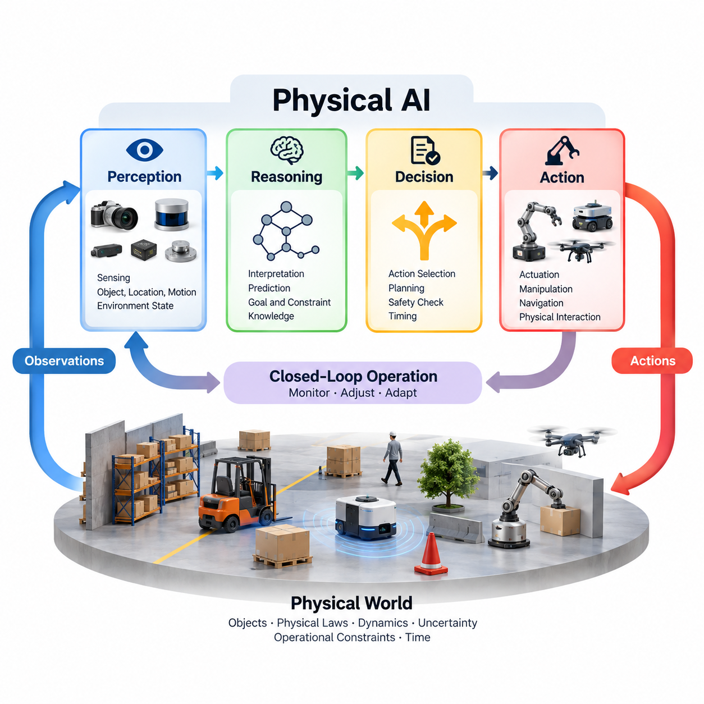{width="7.268055555555556in" height="7.268055555555556in"}

피지컬 인공지능(Physical Artificial Intelligence, Physical AI)은 감지(Sensing)와 행동(Action)을 통해 물리적 세계(Physical World)를 인식하고, 해석하며, 추론하고, 상호작용할 수 있는 인공지능 시스템(Artificial Intelligence System)을 의미한다. 디지털 정보 처리(Digital Information Processing)에 국한된 지능과 달리, 피지컬 AI는 물리 법칙(Physical Laws), 공간적 관계(Spatial Relationships), 시간적 동역학(Temporal Dynamics), 물질적 제약(Material Constraints)이 적용되는 환경에서 작동한다. 핵심 특징은 계산 지능(Computational Intelligence)과 현실 세계의 상호작용(Real-World Interaction)을 통합한다는 점이다.

피지컬 AI는 인식(Perception), 추론(Reasoning), 의사결정(Decision-Making), 제어(Control), 학습(Learning)이 물리적 환경(Physical Environment)에서 목표를 달성하도록 조정되는 시스템 수준의 패러다임(System-Level Paradigm)으로 이해할 수 있다. 지능은 예측 정확도(Prediction Accuracy)나 생성된 정보의 품질만으로 평가되지 않는다. 환경 변화(Environmental Changes), 운영 제약(Operational Constraints), 불확실성(Uncertainty)에 대응하면서 적절한 물리적 결과(Physical Outcomes)를 만들어 내는 능력으로도 평가된다.

피지컬 AI 시스템(Physical AI System)은 일반적으로 지능형 에이전트(Intelligent Agent), 환경(Environment), 작업 또는 목표(Task or Objective)로 구성된다. 에이전트는 센서(Sensor)나 다른 정보 채널(Information Channel)을 통해 관측값(Observations)을 수집하고, 주변 환경을 해석하며, 행동을 선택한 다음 액추에이터(Actuator) 또는 연결된 물리적 메커니즘(Physical Mechanism)을 통해 환경에 영향을 미친다. 이러한 행동의 결과는 새로운 관측값을 생성하며, 에이전트와 물리적 세계 사이에 지속적인 상호작용을 형성한다.

물리적 환경(Physical Environment)은 지능형 행동(Intelligent Behavior)에 근본적인 영향을 미치는 특성을 가진다. 물체는 기하학적 형상(Geometry), 질량(Mass), 마찰(Friction), 관성(Inertia), 기계적 특성(Mechanical Properties)을 가지며, 행동은 시간에 따라 진행되고 되돌릴 수 없는 결과를 발생시킬 수 있다. 예를 들어 창고에서 이동하는 로봇은 장애물(Obstacles), 이동하는 작업자(Moving Workers), 접지 조건(Traction Conditions), 정지 거리(Stopping Distance)를 고려해야 한다. 따라서 성공적인 지능은 계산적 목표와 물리적 실행 가능성(Physical Feasibility)을 모두 이해해야 한다.

인식(Perception)은 물리적 세계와 지능형 시스템이 유지하는 계산적 표현(Computational Representation)을 연결하는 역할을 한다. 카메라(Camera), 라이다(LiDAR), 레이더(Radar), 관성 센서(Inertial Sensor), 힘 센서(Force Sensor) 및 기타 감지 기술(Sensing Technologies)은 환경 상태에 대한 측정값을 제공한다. 이러한 측정값은 불완전하거나 잡음(Noise)을 포함하고 모호할 수 있다. 피지컬 AI는 이를 물체, 위치, 움직임, 접촉 상태(Contact Conditions) 및 행동에 필요한 물리적 특성에 대한 유용한 추정값(Estimates)으로 변환해야 한다.

추론(Reasoning)은 피지컬 AI 에이전트가 관측값을 목표, 제약 조건(Constraints), 가능한 미래 결과와 연관하여 해석하도록 한다. 지능형 시스템은 개별 센서 측정값에 단순히 반응하는 대신 대안적인 행동(Alternative Actions)을 평가하고, 결과를 예측하며, 작업 요구사항(Task Requirements)에 적합한 행동을 선택할 수 있다. 이러한 추론에는 기하학적 관계(Geometric Relationships), 물리적 동역학(Physical Dynamics), 인과적 의존성(Causal Dependencies), 불확실성 및 이전 상호작용을 통해 획득한 지식이 포함될 수 있다.

행동(Action)은 피지컬 AI를 물리적 현상을 단순히 설명하거나 분류하는 시스템과 구별하는 요소이다. 지능형 에이전트는 의사결정을 이동(Motion), 조작(Manipulation), 내비게이션(Navigation) 또는 기타 물리적 과정(Physical Processes)을 통해 환경에 영향을 미칠 수 있는 명령으로 변환해야 한다. 이러한 명령은 액추에이터의 한계(Actuator Limitations), 기계적 성능(Mechanical Capabilities), 시간 요구사항(Timing Requirements), 안전 경계(Safety Boundaries)를 준수해야 한다. 지능의 효과는 궁극적으로 선택한 행동이 의도한 물리적 결과를 만들어 내는지에 달려 있다.

피지컬 AI의 핵심 속성은 관측값이 후속 의사결정과 행동에 지속적으로 영향을 미치는 폐루프 동작(Closed-Loop Operation)이다. 에이전트는 자신의 행동 결과를 모니터링(Monitoring)하고 조건이 변화하면 대응 방식을 조정한다. 이러한 피드백 구조(Feedback Structure)는 외란(Disturbances), 모델링 오차(Modeling Errors), 예상하지 못한 사건(Unexpected Events)을 보상할 수 있도록 한다. 실제 환경은 초기 계획대로 정확하게 작동하는 경우가 드물기 때문에 폐루프 지능(Closed-Loop Intelligence)은 특히 중요하다.

피지컬 AI는 시간(Time)과 동적 행동(Dynamic Behavior)에 대한 이해도 필요하다. 물체는 움직이고, 환경 조건은 변화하며, 행동 기회는 짧은 시간 안에 사라질 수 있다. 따라서 의사결정은 무엇을 수행해야 하는지만이 아니라 언제 행동해야 하는지도 고려해야 한다. 센서 데이터 수집(Sensor Acquisition), 계산 처리(Computational Processing), 통신(Communication), 액추에이터 응답(Actuator Response)에서 발생하는 지연(Latency)은 안정성(Stability), 작업 성능(Task Performance), 운영 안전성(Operational Safety)에 직접적인 영향을 미칠 수 있다.

체화(Embodiment)는 지능과 에이전트가 환경과 상호작용하는 물리적 구조 사이의 관계를 설명한다. 이동 로봇(Mobile Robot), 로봇 팔(Robotic Arm), 휴머노이드(Humanoid), 사족보행 로봇(Quadruped), 무인항공기(Unmanned Aerial Vehicle)는 서로 다른 이동 능력(Movement Capabilities), 센서 구성(Sensing Arrangements), 기계적 제약(Mechanical Constraints)을 가진다. 이러한 차이는 각 시스템이 수행할 수 있는 행동을 결정하며, 인식, 추론, 계획(Planning), 제어가 구현되는 방식에도 영향을 미친다.

피지컬 AI는 로보틱스(Robotics)와 밀접하게 관련되지만 두 개념이 동일한 것은 아니다. 로보틱스는 적응형 지능(Adaptive Intelligence) 없이 고정된 프로그램을 실행하는 시스템을 포함하여 로봇 기계의 설계, 제작, 제어, 운영을 포괄한다. 피지컬 AI는 물리적 상호작용에 기반한 지능형 행동(Intelligent Behavior)을 강조하며 다양한 로봇 플랫폼(Robot Platforms)에 통합될 수 있다. 로보틱스는 피지컬 AI의 능력을 구현하고 평가할 수 있는 중요한 물리적 구현 형태(Embodiments)를 제공한다.

피지컬 AI와 체화 인공지능(Embodied AI)의 관계 역시 밀접하다. 체화 인공지능은 에이전트의 신체(Body)와 환경 사이의 상호작용에서 지능이 어떻게 나타나거나 형성되는지를 강조한다. 피지컬 AI는 감지, 계산, 물리적 모델링(Physical Modeling), 계획, 제어, 운영 배포(Operational Deployment)를 포함하는 보다 광범위한 시스템 관점(Systems Perspective)을 채택한다. 두 관점 모두 지능형 행동을 물리적 상호작용과 분리하여 완전히 이해할 수 없다는 점을 인정한다.

학습(Learning)과 적응(Adaptation)은 피지컬 AI가 사전에 결정된 반응을 넘어설 수 있도록 한다. 시스템은 경험(Experience)을 통해 객체 인식(Object Recognition)을 개선하고, 알려지지 않은 동역학(Unknown Dynamics)을 추정하며, 조작 전략(Manipulation Strategies)을 개선하거나 변화하는 조건에 맞춰 내비게이션 행동(Navigation Behavior)을 조정할 수 있다. 학습은 시연(Demonstrations), 지도 학습(Supervised Learning), 강화학습(Reinforcement Learning), 시뮬레이션(Simulation), 운영 데이터(Operational Data)를 통해 이루어질 수 있다. 그러나 모든 피지컬 AI 시스템에 온라인 학습(Online Learning)이 필수적인 것은 아니며, 적응은 안전 요구사항(Safety Requirements)과 양립해야 한다.

월드 모델(World Model)은 물리적 환경의 구조와 동역학을 표현하는 메커니즘(Mechanism)을 제공한다. 이러한 모델은 객체 관계(Object Relationships), 공간 점유(Spatial Occupancy), 움직임 패턴(Motion Patterns), 접촉 상호작용(Contact Interactions), 미래 상태 예측(Future State Predictions)을 표현할 수 있다. 피지컬 AI 에이전트는 서로 다른 행동에 따라 환경이 어떻게 변화할지 추정함으로써 실행 전에 대안을 평가할 수 있다. 월드 모델은 명시적으로 설계되거나 데이터로부터 학습되거나 하이브리드 접근법(Hybrid Approaches)을 통해 구성될 수 있다.

불확실성(Uncertainty)은 센서가 모든 관련 특성을 관측할 수 없고 환경의 행동을 완벽하게 예측할 수도 없기 때문에 물리적 지능(Physical Intelligence)에서 피할 수 없는 특성이다. 에이전트는 물체의 위치(Object Locations), 재료 특성(Material Characteristics), 인간의 의도(Human Intentions), 행동의 결과에 대해 불확실성을 가질 수 있다. 따라서 피지컬 AI는 완전하고 정확한 지식을 가정하는 대신, 이용 가능한 증거(Evidence)를 불확실성 인식 추정(Uncertainty-Aware Estimation), 강건한 계획(Robust Planning), 보정 피드백(Corrective Feedback)과 결합해야 한다.

자율성(Autonomy)은 피지컬 AI 시스템이 지속적인 인간 개입(Human Intervention) 없이 할당된 목표를 추구할 수 있는 정도를 나타낸다. 자율적 행동(Autonomous Behavior)에는 행동 선택(Action Selection), 계획 조정(Plan Adjustment), 고장 감지(Failure Detection), 외란으로부터의 복구(Recovery from Disturbances)가 포함될 수 있다. 그러나 자율성이 제한 없는 의사결정을 의미하지는 않는다. 운영 경계(Operational Boundaries), 감독 제어(Supervisory Controls), 인간 승인(Human Authorization), 사전에 정의된 안전 제약(Predefined Safety Constraints)은 책임 있는 물리적 시스템 운영의 필수 구성 요소이다.

안전(Safety)은 피지컬 AI의 행동이 사람, 장비, 기반시설(Infrastructure), 주변 환경에 영향을 미칠 수 있기 때문에 근본적인 요구사항이다. 오류는 충돌(Collisions), 불안정한 움직임(Unstable Motion), 물체 손상(Damaged Objects), 기타 위험한 결과(Hazardous Outcomes)를 초래할 수 있다. 따라서 지능형 의사결정은 위험 평가(Risk Assessment), 안전 모니터링(Safety Monitoring), 보호 제어(Protective Control), 대체 대응 메커니즘(Fallback Mechanisms)과 함께 작동해야 한다. 시스템이 허용 가능한 물리적 위험 수준(Acceptable Physical Risk)을 유지할 수 없다면 높은 작업 성능만으로는 충분하지 않다.

피지컬 AI 시스템은 계산 자원 및 자원 제약(Computational and Resource Constraints) 아래에서도 작동한다. 임베디드 프로세서(Embedded Processors), 엣지 가속기(Edge Accelerators), 통신 네트워크(Communication Networks), 배터리(Batteries), 열 관리 시스템(Thermal Management Systems)은 모델 복잡도(Model Complexity)와 실행 속도(Execution Speed)에 실질적인 한계를 부여한다. 오프라인 실험(Offline Experiments)에서 우수한 성능을 보이는 지능형 알고리즘도 실시간 요구사항(Real-Time Requirements)을 충족하지 못하면 실제 배포에 적합하지 않을 수 있다. 시스템 아키텍처(System Architecture)는 지능, 신뢰성(Reliability), 에너지 소비(Energy Consumption), 응답성(Responsiveness) 사이의 균형을 유지해야 한다.

피지컬 AI의 적용 범위는 자율 이동 로봇(Autonomous Mobile Robots), 산업용 매니퓰레이터(Industrial Manipulators), 휴머노이드 로봇(Humanoid Robots), 다족보행 플랫폼(Legged Platforms), 항공 이동체(Aerial Vehicles), 지능형 모빌리티 시스템(Intelligent Mobility Systems)에 걸쳐 있다. 응용 분야에는 제조(Manufacturing), 물류(Logistics), 농업(Agriculture), 의료(Healthcare), 기반시설 검사(Infrastructure Inspection), 자율 운송(Autonomous Transportation)이 포함된다. 이러한 플랫폼은 형태(Morphology)와 운영 목적(Operational Purpose)이 크게 다르지만, 환경 이해(Environmental Understanding)를 물리적으로 의미 있는 의사결정 및 행동과 연결해야 한다는 공통된 요구를 가진다.

피지컬 AI는 단순히 고급 기계학습 모델(Advanced Machine Learning Models)이나 강력한 컴퓨팅 하드웨어(Computing Hardware)의 존재만으로 정의되어서는 안 된다. 물리적 과정에 영향을 주지 않고 설명만 생성하는 정교한 모델은 기본적으로 정보 처리 시스템(Information-Processing System)에 해당한다. 반대로 의미 있는 환경 해석 없이 고정된 명령을 실행하는 물리적 기계가 반드시 높은 수준의 물리적 지능을 보여주는 것도 아니다. 핵심 판단 기준은 지능과 상황 기반 물리적 행동(Situated Physical Behavior)의 통합 여부이다.

지능(Intelligence)과 자동화(Automation)의 차이는 특히 중요하다. 기존 자동화(Conventional Automation)는 비교적 안정적인 운영 조건에서 사전에 정의된 순서(Predetermined Sequences)를 따르는 경우가 많지만, 피지컬 AI는 인식, 상황 기반 의사결정(Contextual Decision-Making), 적응형 행동(Adaptive Action)을 통해 변동성(Variability)에 대응하고자 한다. 그러나 두 개념의 경계는 절대적이지 않고 점진적이다. 현대 산업 시스템은 결정론적 자동화(Deterministic Automation), 모델 기반 제어(Model-Based Control), 기계학습(Machine Learning), 자율적 의사결정(Autonomous Decision-Making)을 하나의 통합 아키텍처(Unified Architecture) 안에서 결합할 수 있다.

따라서 피지컬 AI는 물리적 상태를 인식하고, 유용한 표현(Representations)을 유지하며, 가능한 결과를 추론하고, 실행 가능한 행동(Feasible Actions)을 선택하며, 이를 수행하고, 결과를 평가하는 여러 상호 보완적 능력(Complementary Capabilities)을 통해 특징지을 수 있다. 이러한 능력이 반드시 단일 알고리즘(Single Algorithm)이나 통합 신경망(Unified Neural Network)에 의존할 필요는 없다. 신뢰할 수 있고 목표 지향적인 상호작용(Reliable and Goal-Directed Interaction)을 지원하는 여러 하위 시스템(SubSystems)의 조정된 행동을 통해 구현될 수 있다.

궁극적으로 피지컬 AI는 인공지능(Artificial Intelligence), 로보틱스(Robotics), 제어공학(Control Engineering), 물리적 모델링(Physical Modeling), 지능형 시스템 설계(Intelligent System Design)의 융합(Convergence)을 나타낸다. 그 목적은 계산적 이해(Computational Understanding)를 물질적 세계(Material World)에서 효과적인 행동으로 전환하는 것이다. 피지컬 AI 시스템의 성숙도(Maturity)는 단순히 무엇을 인식하거나 예측할 수 있는지가 아니라, 실제 물리적 조건에서 의미 있는 작업을 얼마나 신뢰성 있고 안전하며 자율적으로 수행할 수 있는지를 통해 나타난다.

## 01.02. Intelligence in the Physical World

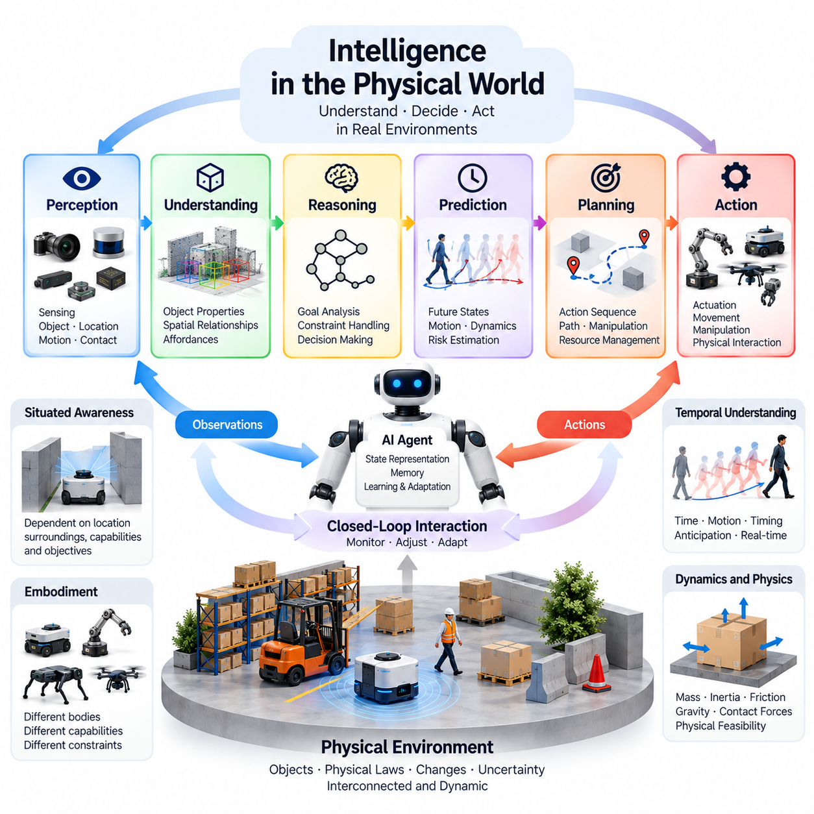{width="7.268055555555556in" height="7.268055555555556in"}

물리적 세계에서의 지능(Intelligence in the Physical World)은 물리 법칙(Physical Laws)이 지배하는 환경에서 에이전트(Agent)가 주변 환경을 이해하고, 상황에 적합한 의사결정(Context-Sensitive Decision-Making)을 수행하며, 효과적인 행동(Effective Actions)을 만들어 내는 능력을 의미한다. 기호 조작(Symbolic Manipulation)이나 디지털 정보 처리(Digital Information Processing)만으로 표현되는 지능과 달리, 물리적 지능(Physical Intelligence)은 물질(Matter), 공간(Space), 시간(Time)과의 지속적인 상호작용을 통해 작동해야 한다. 그 효과는 실제 환경에서 관측 가능한 결과(Observable Outcomes)를 통해 입증된다.

물리적 세계(Physical World)는 근본적으로 동적이고 상호 연결된 운영 환경(Dynamic and Interconnected Operating Environment)을 제공한다. 물체는 움직이고, 힘(Forces)은 상호작용하며, 표면은 변형되고, 환경 조건(Environmental Conditions)은 지능형 에이전트의 의도와 무관하게 변화한다. 성공적인 피지컬 AI(Physical AI) 시스템은 이러한 변화를 인식하고 그에 따라 행동을 조정해야 한다. 따라서 지능은 단순히 객체를 식별하거나 사건을 예측하는 것을 넘어, 환경 이해(Environmental Understanding)와 물리적 행동(Physical Action) 사이의 유용한 관계를 유지하는 능력을 포함한다.

물리적 지능(Physical Intelligence)은 에이전트의 내부 계산 과정(Internal Computational Processes)과 외부 환경(External Environment) 사이의 상호작용에서 나타난다. 센서(Sensors)는 관측값(Observations)을 제공하고, 계산 모델(Computational Models)은 관련 조건을 해석하며, 액추에이터(Actuators)는 의사결정을 물리적 효과(Physical Effects)로 변환한다. 이러한 효과는 환경을 변화시키고 후속 관측값에 영향을 미친다. 이처럼 반복되는 상호작용을 통해 에이전트는 사전에 정의된 명령에만 의존하지 않고 변화하는 조건에 대응하는 행동을 형성한다.

물리적 지능의 필수적인 특징은 상황 인식(Situated Awareness)이며, 이는 의사결정이 에이전트의 현재 위치(Current Location), 주변 환경(Surroundings), 능력(Capabilities), 목표(Objectives)에 따라 달라진다는 의미이다. 좁은 통로에 접근하는 자율 이동 로봇(Autonomous Mobile Robot)은 자신의 크기(Dimensions), 주변 장애물(Nearby Obstacles), 통과 가능한 여유 공간(Available Clearance), 이동 제약(Movement Constraints)을 고려해야 한다. 동일한 통로라도 어떤 로봇은 통과할 수 있지만 다른 로봇은 접근할 수 없을 수 있다. 따라서 지능형 행동은 환경 조건과 체화(Embodiment) 사이의 관계를 반영해야 한다.

물리적 지능은 공간적 관계(Spatial Relationships)와 기하학적 구조(Geometric Structure)를 해석하는 능력을 필요로 한다. 물체는 위치(Positions)를 차지하고, 방향(Orientations)을 가지며, 주변 표면과 장애물로부터 일정한 거리(Distances)를 유지한다. 이러한 관계를 이해하면 내비게이션(Navigation), 조작(Manipulation), 충돌 회피(Collision Avoidance), 협조 이동(Coordinated Movement)이 가능해진다. 공간 지능(Spatial Intelligence)은 자유 공간(Free Space)을 인식하고, 도달 가능한 구성(Reachable Configurations)을 추정하며, 특정 행동을 가능하게 하거나 방해하는 물리적 배치(Physical Arrangements)를 식별하는 능력도 포함한다.

시간적 이해(Temporal Understanding) 역시 물리적 환경이 지속적으로 변화하기 때문에 중요하다. 움직이는 장애물(Moving Obstacle)은 현재 위치가 안전해 보이더라도 위험해질 수 있으며, 물체의 방향이 변하면서 조작 기회(Manipulation Opportunity)가 사라질 수도 있다. 지능형 에이전트는 정적인 관측값(Static Observations)에만 의존하지 않고 움직임(Motion), 타이밍(Timing), 미래 상태(Future States)를 추론해야 한다. 따라서 효과적인 물리적 행동은 환경 변화를 예측하고 적절한 시간 간격(Time Intervals) 내에 대응하는 능력에 달려 있다.

물리적 지능은 질량(Mass), 관성(Inertia), 마찰(Friction), 중력(Gravity), 접촉력(Contact Forces)을 포함하는 동역학(Dynamics)에 대한 민감성도 요구한다. 깨지기 쉬운 물체를 다루는 로봇 매니퓰레이터(Robotic Manipulator)는 파지력(Gripping Force)과 가속도(Acceleration)를 조절해야 하며, 이동 플랫폼(Mobile Platform)은 접지력(Traction)과 정지 거리(Stopping Distance)를 고려해야 한다. 이러한 요구사항은 올바른 행동 선택(Action Selection)이 물리적 실행 가능성(Physical Feasibility)에 의존한다는 사실을 보여준다. 겉보기에 합리적인 계획도 기계적 한계(Mechanical Limitations)나 환경 제약(Environmental Constraints)을 위반하면 실패할 수 있다.

인식(Perception)은 물리적 지능이 환경에 관한 정보를 획득하는 기반이다. 카메라(Cameras), 깊이 센서(Depth Sensors), 라이다(LiDAR), 레이더(Radar), 관성 센서(Inertial Sensors), 촉각 장치(Tactile Devices)는 물리적 상태에 대한 상호 보완적인 측정값(Complementary Measurements)을 제공한다. 그러나 센서 관측값(Sensor Observations)은 완전하거나 완벽하게 정확한 경우가 드물다. 지능형 시스템은 측정값을 통합하고, 숨겨진 특성(Hidden Properties)을 추정하며, 의미 있는 환경 변화와 잡음(Noise), 모호성(Ambiguity), 일시적인 감지 실패(Temporary Sensing Failures)를 구별해야 한다.

관측(Observation)과 이해(Understanding)의 차이는 특히 중요하다. 객체를 감지(Detection)했다고 해서 반드시 그 객체가 이동 가능한지, 깨지기 쉬운지, 위험한지 또는 현재 작업과 관련이 있는지를 알 수 있는 것은 아니다. 물리적 지능은 객체의 특성(Properties), 관계(Relationships), 가능한 상호작용(Possible Interactions)을 바탕으로 객체를 해석해야 한다. 이러한 해석은 현재 관측된 조건에서 에이전트가 무엇을 수행할 수 있는지 식별함으로써 인식과 행동을 연결한다.

행동 유도성(Affordances)은 물리적 환경에서 가능한 행동(Action Possibilities)을 이해하는 데 유용한 개념이다. 손잡이(Handle)는 파지(Grasping)를 가능하게 하고, 열린 복도(Open Corridor)는 이동(Navigation)을 가능하게 하며, 안정적인 표면(Stable Surface)은 물체 배치(Object Placement)를 가능하게 할 수 있다. 이러한 가능성은 환경의 특성뿐 아니라 에이전트의 체화(Embodiment)와 능력(Capabilities)에 따라서도 달라진다. 따라서 물리적 지능은 환경을 수동적인 객체의 집합(Passive Collection of Objects)으로 취급하기보다 실행 가능한 기회(Actionable Opportunities)를 인식하는 능력을 포함한다.

물리적 환경에서의 추론(Reasoning)은 목표(Goals)를 실행 가능한 행동 순서(Feasible Sequences of Actions)와 연결해야 한다. 지능형 시스템은 물체에 도달할 수 있는지, 이동 경로(Route)가 계속 안전한지, 조작 전략(Manipulation Strategy)이 원하는 결과를 만들어 낼 수 있는지를 판단해야 할 수 있다. 이러한 추론은 환경 표현(Environmental Representations), 물리적 제약(Physical Constraints), 가능한 결과에 대한 예측(Predictions of Possible Outcomes)을 결합한다. 그 목적은 실제 행동으로 전환되었을 때도 의미를 유지하는 의사결정을 지원하는 것이다.

예측(Prediction)은 에이전트가 자신의 행동 결과를 미리 예상할 수 있도록 하여 물리적 지능을 강화한다. 월드 모델(World Model)은 물체가 어떻게 움직일지, 장애물이 내비게이션에 어떤 영향을 미칠지, 조작 과정에서 접촉력(Contact Forces)이 어떻게 변화할지를 추정할 수 있다. 이러한 예측은 계획(Planning)과 위험 감소(Risk Reduction)를 지원하지만, 실제 물리적 행동에 대한 근사치(Approximations)라는 한계를 가진다. 지능형 운영(Intelligent Operation)은 예측 결과와 관측값을 비교하고 그 차이(Discrepancies)를 보정하는 과정을 필요로 한다.

폐루프 피드백(Closed-Loop Feedback)은 물리적 행동이 완벽하게 예측 가능한 결과를 만들어 내는 경우가 드물기 때문에 필수적이다. 바퀴 미끄러짐(Wheel Slip), 센서 불확실성(Sensor Uncertainty), 기계적 유연성(Mechanical Compliance), 예상하지 못한 사람의 움직임(Unexpected Human Movement)은 계획된 행동에서 벗어나는 편차(Deviations)를 발생시킬 수 있다. 피지컬 AI 시스템은 이러한 편차를 모니터링하고 명령을 적절하게 조정해야 한다. 피드백은 지능을 개별적인 의사결정의 연속에서 관측, 평가(Evaluation), 보정(Correction), 행동이 지속적으로 반복되는 과정으로 전환한다.

불확실성(Uncertainty)과 부분 관측 가능성(Partial Observability)은 물리적 지능에 추가적인 요구사항을 부여한다. 에이전트는 가려진 장애물(Occluded Obstacle)의 정확한 위치, 익숙하지 않은 물체의 무게(Weight), 주변 사람의 의도(Intentions)를 알지 못할 수 있다. 따라서 지능형 행동은 불완전한 지식(Incomplete Knowledge)과 잠재적 결과(Potential Consequences)를 고려해야 한다. 보수적인 행동(Conservative Actions), 추가 감지(Additional Sensing), 불확실성 인식 계획(Uncertainty-Aware Planning), 안전한 대체 행동(Safe Fallback Behavior)은 모호한 조건에서도 신뢰성 있는 운영을 유지하는 데 도움이 된다.

학습(Learning)은 물리적 지능이 사전에 정의된 모델(Predefined Models)에만 의존하지 않고 경험(Experience)을 통해 개선되도록 한다. 반복적인 상호작용(Repeated Interactions)은 환경의 규칙성(Environmental Regularities), 액추에이터 특성(Actuator Characteristics), 효과적인 행동 전략(Effective Action Strategies)을 파악하는 데 도움이 된다. 학습에는 지도 학습 데이터(Supervised Data), 인간 시연(Human Demonstrations), 강화학습(Reinforcement Learning), 시뮬레이션 기반 경험(Simulation-Based Experience)이 활용될 수 있다. 그러나 획득한 지식(Acquired Knowledge)은 물리적 제약에 따라 평가되어야 하며, 작업 성능 향상이 자동으로 안전한 행동을 보장하는 것은 아니다.

일반화(Generalization)는 실제 환경이 학습 데이터(Training Data)에 표현된 조건과 다르기 때문에 핵심적인 과제이다. 조명(Lighting), 객체 형상(Object Geometry), 표면 마찰(Surface Friction), 인간 행동(Human Behavior), 공간 배치(Spatial Layouts)는 배포 환경(Deployment Environments)에 따라 크게 달라질 수 있다. 물리적으로 지능적인 시스템은 완전한 재설계 없이도 이러한 변화에 걸쳐 유용한 성능을 유지해야 한다. 따라서 일반화는 강건한 표현(Robust Representations), 적응형 제어(Adaptive Control), 적절한 학습 다양성(Training Diversity), 지속적인 평가(Continuous Evaluation)에 의존한다.

체화(Embodiment)는 지능이 표현되는 방식과 수행할 수 있는 물리적 작업(Physical Tasks)에 영향을 미친다. 바퀴형 로봇(Wheeled Robot), 로봇 팔(Robotic Arm), 휴머노이드(Humanoid), 사족보행 로봇(Quadruped), 항공 이동체(Aerial Vehicle)는 서로 다른 기계적 구조(Mechanical Structures)를 통해 환경과 상호작용한다. 따라서 감지 요구사항(Sensing Requirements), 제어 전략(Control Strategies), 사용 가능한 행동(Available Actions)이 서로 다르다. 물리적 지능은 이러한 차이를 고려하면서도 인식, 예측, 추론, 학습의 전이 가능한 원리(Transferable Principles)가 다양한 플랫폼을 지원할 수 있도록 해야 한다.

물리적 지능은 실시간 계산 요구사항(Real-Time Computational Requirements)의 제약도 받는다. 환경 변화는 즉각적인 대응(Immediate Responses)을 요구할 수 있지만, 인식 및 계획 알고리즘(Perception and Planning Algorithms)은 처리 자원(Processing Resources)과 통신 시간(Communication Time)을 필요로 한다. 논리적으로 올바른 의사결정이라도 지연되면 성능이 저하되거나 위험이 발생할 수 있다. 효과적인 시스템은 운영 마감시간(Operational Deadlines)을 충족하기 위해 계산 복잡도(Computational Complexity), 감지 주파수(Sensing Frequency), 제어 응답성(Control Responsiveness), 하드웨어 성능(Hardware Capabilities)을 조정해야 한다.

안전(Safety)은 행동이 사람, 장비, 기반시설(Infrastructure)에 직접적인 영향을 미칠 수 있기 때문에 물리적 세계의 지능과 분리할 수 없는 요소이다. 작업 목표(Task Objective)를 달성하더라도 허용할 수 없는 충돌 위험(Unacceptable Collision Risk)을 발생시키는 의사결정은 운영상 성공했다고 볼 수 없다. 지능형 시스템은 위험 요소(Hazards)를 인식하고, 물리적 경계(Physical Boundaries)를 준수하며, 보호 메커니즘(Protective Mechanisms)을 유지해야 한다. 안전 모니터링(Safety Monitoring), 제약 기반 계획(Constrained Planning), 비상 대응(Emergency Responses), 인간 감독(Human Supervision)은 책임 있는 물리적 자율성(Responsible Physical Autonomy)을 지원한다.

자율성(Autonomy)은 지속적인 외부 지시(External Direction) 없이 환경 변화(Environmental Variation)를 관리하면서 물리적 목표(Physical Objectives)를 추구하는 능력을 설명한다. 자율 에이전트(Autonomous Agents)는 경로를 선택하고, 물체를 조작하며, 외란(Disturbances)에 대응하고, 특정 고장(Failures)으로부터 복구할 수 있다. 그러나 의미 있는 자율성(Meaningful Autonomy)은 운영 한계(Operational Limits)를 인식하고 필요할 때 지원을 요청하는 능력을 요구한다. 따라서 물리적 지능은 제한 없는 독립성(Unrestricted Independence)이 아니라 책임 있는 의사결정(Responsible Decision-Making)과 관련된다.

물리적 지능의 평가(Evaluation)는 기존의 예측 정확도(Prediction Accuracy)나 계산 벤치마크(Computational Benchmarks)를 넘어야 한다. 관련 평가 지표(Evaluation Metrics)에는 작업 완료(Task Completion), 내비게이션 효율성(Navigation Efficiency), 조작 신뢰성(Manipulation Reliability), 응답 지연(Response Latency), 강건성(Robustness), 에너지 소비(Energy Consumption), 안전 성능(Safety Performance)이 포함된다. 시험(Testing)은 변화하는 환경, 예상하지 못한 외란, 사람과의 상호작용을 고려해야 한다. 핵심 질문은 시스템이 현실적인 운영 조건(Realistic Operating Conditions)에서 적절한 물리적 결과를 일관되게 만들어 낼 수 있는지에 있다.

궁극적으로 물리적 세계에서의 지능(Intelligence in the Physical World)은 인식(Perception), 공간 이해(Spatial Understanding), 시간적 추론(Temporal Reasoning), 물리적 예측(Physical Prediction), 적응형 제어(Adaptive Control), 목표 지향적 행동(Goal-Directed Action)의 통합을 의미한다. 이러한 능력은 체화(Embodiment), 불확실성(Uncertainty), 환경 피드백(Environmental Feedback)의 영향을 받는 상호 연결된 과정(Interconnected Process)으로 작동한다. 피지컬 AI(Physical AI)는 계산 지능(Computational Intelligence)이 관측과 의사결정을 실제 세계에서 안전하고 효과적이며 상황에 적합한 행동으로 신뢰성 있게 전환할 수 있을 때 실질적인 의미를 가진다.

## 01.03. Agent Environment and Task

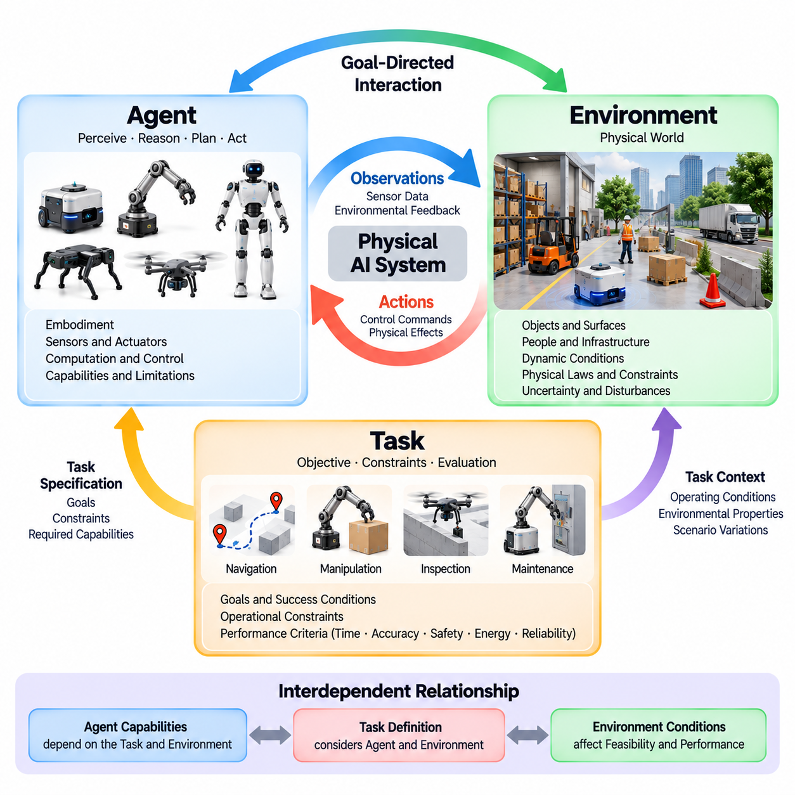{width="7.268055555555556in" height="7.268055555555556in"}

피지컬 AI(Physical AI) 시스템은 에이전트(Agent), 환경(Environment), 작업(Task)이라는 세 가지 기본 요소를 통해 이해할 수 있다. 에이전트는 환경을 인식하고 행동할 수 있는 주체를 나타내며, 환경은 상호작용이 발생하는 물리적 조건(Physical Conditions)을 정의하고, 작업은 행동을 이끄는 목표(Objective)를 설정한다. 이러한 요소들은 지능형 물리 시스템(Intelligent Physical Systems)을 설명하고 의미 있는 결과를 달성하는 능력을 평가하기 위한 개념적 프레임워크(Conceptual Framework)를 제공한다.

에이전트(Agent)는 주변 환경에 관한 정보를 수신하고 환경에 영향을 미치기 위한 행동을 선택하는 자율적(Autonomous) 또는 부분 자율적(Partially Autonomous) 주체이다. 피지컬 AI에서 에이전트는 이동 로봇(Mobile Robots), 매니퓰레이터(Manipulators), 휴머노이드(Humanoids), 항공 이동체(Aerial Vehicles), 대규모 기반시설(Larger Infrastructures)에 통합된 지능형 기계(Intelligent Machines)를 포함할 수 있다. 에이전트의 지능은 단순한 계산 능력(Computational Capability)이 아니라 인식(Perception), 추론(Reasoning), 계획(Planning), 제어(Control)가 물리적 상호작용(Physical Interaction)과 얼마나 효과적으로 연결되는지에 달려 있다.

환경(Environment)은 에이전트 외부에서 관측(Observations), 의사결정(Decisions), 행동(Actions)에 영향을 미칠 수 있는 모든 요소를 포함한다. 여기에는 물리적 객체(Physical Objects), 표면(Surfaces), 장애물(Obstacles), 사람(People), 기반시설(Infrastructure), 환경 조건(Environmental Conditions), 다른 지능형 에이전트(Intelligent Agents)가 포함된다. 환경은 반드시 정적(Static)이거나 예측 가능(Predictable)한 것은 아니다. 환경의 특성은 지속적으로 변화할 수 있으며, 이에 따라 에이전트는 할당된 목표를 추구하면서 자신의 이해를 수정하고 행동을 적응시켜야 하는 상황에 직면한다.

작업(Task)은 에이전트와 환경 사이의 상호작용을 통해 달성하고자 하는 결과(Desired Outcome)를 정의한다. 작업에는 목적지 도달(Reaching a Destination), 자재 운송(Transporting Materials), 물체 조작(Manipulating Objects), 장비 검사(Inspecting Equipment), 지정된 운영 조건 유지(Maintaining Operating Conditions)가 포함될 수 있다. 의미 있는 작업 정의(Task Definition)는 성공 조건(Success Conditions), 관련 제약 조건(Relevant Constraints), 허용 가능한 행동(Acceptable Behavior)을 명확히 한다. 작업이 명확하게 정의되지 않으면 에이전트가 정교한 계산 능력을 보여주더라도 유용한 목표 지향적 물리 지능(Goal-Directed Physical Intelligence)을 입증하기 어렵다.

에이전트, 환경, 작업 사이의 관계는 본질적으로 상호 의존적(Interdependent)이다. 한 에이전트에게 적절한 행동이 다른 에이전트에게는 기계적 구조(Mechanical Structure), 감지 능력(Sensing Capabilities), 계산 자원(Computational Resources)의 차이로 인해 불가능할 수 있다. 마찬가지로 통제된 환경(Controlled Environment)에서 간단한 작업도 불확실성(Uncertainty)이나 외란(Disturbance)이 존재하면 어려워질 수 있다. 따라서 물리적 지능(Physical Intelligence)은 특정 에이전트, 운영 조건(Operating Conditions), 목표(Objectives)와의 관계 속에서 평가되어야 한다.

에이전트의 능력(Agent Capabilities)은 기계적 형태(Morphology), 액추에이터 특성(Actuator Characteristics), 센서 배치(Sensor Placement), 사용 가능한 계산 자원(Computational Resources)을 포함하는 체화(Embodiment)에 의해 결정된다. 바퀴형 로봇(Wheeled Robot)은 평탄한 바닥에서 효율적으로 이동할 수 있지만 계단에서는 어려움을 겪을 수 있으며, 다족보행 로봇(Legged Robot)은 더 높은 에너지 비용(Energy Cost)을 감수하면서 불규칙한 지형(Irregular Terrain)을 통과할 수 있다. 매니퓰레이터(Manipulator)는 작업 공간(Workspace) 내에서 물체를 정밀하게 배치할 수 있지만 임의의 위치에 도달할 수는 없다. 이러한 물리적 특성은 지능형 에이전트가 수행할 수 있는 실행 가능한 행동(Feasible Actions)의 범위를 결정한다.

환경(Environment)은 이러한 능력이 발휘될 수 있는 조건을 결정한다. 실내 창고(Indoor Warehouses), 실외 도로(Outdoor Roads), 산업 시설(Industrial Facilities), 병원(Hospitals), 농업 현장(Agricultural Fields)은 서로 다른 공간 배치(Spatial Layouts), 표면 특성(Surface Properties), 조명 조건(Lighting Conditions), 운영 위험 요소(Operational Hazards)를 가진다. 환경 특성(Environmental Characteristics)은 감지 신뢰성(Sensing Reliability), 이동 가능성(Movement Feasibility), 통신 품질(Communication Quality), 작업 복잡도(Task Complexity)에 영향을 미친다. 효과적인 피지컬 AI 아키텍처(Physical AI Architecture)는 보편적으로 예측 가능한 세계를 가정하기보다 이러한 조건을 고려해야 한다.

작업(Task)은 에이전트의 행동이 목적성을 갖는지 판단하는 기준을 제공한다. 화물을 운송하는 창고 로봇(Warehouse Robot)은 충돌 제약(Collision Constraints), 운영 일정(Operational Schedules), 적재 하중 제한(Payload Limitations)을 준수하면서 정확한 목적지에 도달해야 한다. 화물이 손상되거나 안전 경계(Safety Boundaries)를 위반했다면 단순히 목적지에 도착한 것만으로는 충분하지 않을 수 있다. 따라서 작업 성공(Task Success)은 최종 위치(Final Position)나 상태(State)에 도달했는지만이 아니라 행동의 품질(Quality)과 결과(Consequences)를 평가해야 한다.

에이전트와 환경 사이의 상호작용(Interaction)은 관측(Observations)과 행동(Actions)을 통해 이루어진다. 센서(Sensors)는 환경의 특정 측면을 나타내는 측정값(Measurements)을 생성하고, 액추에이터(Actuators)는 물리적 조건을 변화시키는 명령(Commands)을 실행한다. 에이전트는 관측값을 사용하여 현재 상황(Current Situation)을 추정하고 적절한 대응(Appropriate Responses)을 결정한다. 각각의 행동은 이후 의사결정을 위한 조건을 변화시키며, 이러한 반복 과정을 통해 지능형 행동(Intelligent Behavior)이 시간에 따라 형성된다.

실제 환경 상태(True Environmental State)와 에이전트의 관측값(Agent Observations)을 구분하는 것은 필수적이다. 물리적 환경에는 가려진 장애물(Hidden Obstacles), 불확실한 마찰계수(Uncertain Friction Coefficients), 관측되지 않은 인간의 의도(Unobserved Human Intentions)처럼 항상 직접 측정할 수 없는 특성이 존재한다. 센서는 이러한 조건에 대해 불완전하고 잡음(Noise)이 포함될 수 있는 정보를 제공한다. 따라서 에이전트는 모든 관련 물리적 특성을 즉시 이용할 수 있다고 가정하기보다 환경에 대한 추정값(Estimates)이나 신념 상태(Beliefs)를 유지해야 한다.

작업(Task)은 목표(Goals), 제약 조건(Constraints), 성능 기준(Performance Criteria)을 통해 표현할 수 있다. 목표는 원하는 상태(Desired States)나 결과(Outcomes)를 설명하고, 제약 조건은 허용 가능한 행동(Permissible Actions)의 한계를 설정하며, 성능 기준은 실행 품질(Execution Quality)을 측정한다. 이러한 요소에는 완료 시간(Completion Time), 에너지 소비(Energy Consumption), 위치 정확도(Positional Accuracy), 안전 여유(Safety Margins), 신뢰성(Reliability)이 포함될 수 있다. 각 요소의 상대적 중요성은 응용 분야(Application)에 따라 달라지므로 작업 명세(Task Specification)는 피지컬 AI 시스템 설계의 핵심 부분이다.

에이전트의 행동(Agent Behavior)은 작업 요구사항(Task Requirements)과 환경 복잡도(Environmental Complexity)에 따라 반응형(Reactive), 예측형(Predictive), 숙고형(Deliberative)으로 구분할 수 있다. 반응형 행동(Reactive Behavior)은 즉각적인 관측값에 직접 대응하고, 예측형 행동(Predictive Behavior)은 미래 조건을 예상한다. 숙고형 행동(Deliberative Behavior)은 실행 전에 대안적인 행동 순서(Alternative Action Sequences)를 평가한다. 실제 피지컬 AI 시스템은 이러한 접근법을 결합하여 즉각적인 위험에 빠르게 대응하면서 할당된 작업을 달성하기 위한 장기 계획(Long-Term Plans)을 유지하는 경우가 많다.

환경 동역학(Environmental Dynamics)은 행동의 결과가 시간에 따라 전개되기 때문에 추가적인 과제를 발생시킨다. 움직이는 사람에게 접근하는 로봇은 현재 거리(Current Distance)뿐 아니라 미래 위치(Future Positions)도 고려해야 한다. 물체를 들어 올리는 매니퓰레이터(Manipulator)는 움직임 전반에 걸쳐 가속도(Acceleration), 중력(Gravity), 접촉력(Contact Forces)을 고려해야 한다. 따라서 지능형 작업 수행(Intelligent Task Execution)은 에이전트의 행동과 환경 과정(Environmental Processes)이 미래의 물리적 상태(Future Physical States)에 공동으로 어떤 영향을 미치는지 이해해야 한다.

에이전트는 환경에서 제어 가능한 요소(Controllable Aspects)와 제어할 수 없는 요소(Uncontrollable Aspects)도 구분해야 한다. 모터 명령(Motor Commands)과 액추에이터 힘(Actuator Forces)은 직접 제어할 수 있지만, 사람의 움직임(Human Movement), 외부 외란(External Disturbances), 예상하지 못한 장비 동작(Unexpected Equipment Behavior)은 에이전트의 제어 범위를 벗어난다. 효과적인 계획(Effective Planning)은 이러한 차이를 고려하여 불확실성에도 유용성을 유지하는 행동을 선택한다. 강건한 행동(Robust Behavior)은 완전히 예측하거나 제어할 수 없는 조건에 적응하는 능력에 달려 있다.

작업 수행(Task Execution)은 복잡한 목표(Complex Objective)를 더 작은 행동(Smaller Actions)이나 중간 목표(Intermediate Goals)로 분해해야 하는 경우가 많다. 배송 로봇(Delivery Robot)은 자기 위치 추정(Localization), 경로 계획(Route Planning), 장애물 회피(Obstacle Avoidance), 목적지 접근(Destination Approach), 배송 완료 확인(Delivery Confirmation)을 수행해야 할 수 있다. 각 단계는 이전 상호작용에서 획득한 정보에 의존한다. 계층적 작업 구성(Hierarchical Task Organization)은 장기 목표(Long-Term Objectives)와 단기 제어 요구사항(Short-Term Control Requirements)을 조정하면서 조건이 변화할 때 계획을 수정할 수 있도록 한다.

에이전트, 환경, 작업 사이의 관계는 적절한 자율성 수준(Level of Autonomy)도 결정한다. 일부 작업은 명확하게 정의된 운영 조건(Operating Conditions) 내에서 독립적으로 수행할 수 있지만, 다른 작업은 인간 감독(Human Supervision)이나 개입(Intervention)이 필요하다. 따라서 자율성(Autonomy)은 제한 없는 독립성(Unrestricted Independence)이 아니라 운영 경계(Operational Boundaries) 내에서 발휘되는 능력으로 이해해야 한다. 지능형 에이전트는 자신이 보유한 지식(Knowledge)이나 능력(Capabilities)이 충분하지 않은 상황을 인식해야 한다.

다중 에이전트(Multiple Agents)는 물리적 환경에 추가적인 관계를 형성한다. 로봇은 협력(Cooperation)하거나 공유 자원(Shared Resources)을 두고 경쟁할 수 있으며, 관측값을 교환하거나 공통 공간(Common Spaces)에서 움직임을 조정할 수 있다. 이러한 상황에서는 한 에이전트의 행동이 다른 에이전트의 환경 일부가 된다. 다중 에이전트 피지컬 AI(Multi-Agent Physical AI)는 개별 참여자(Individual Participants)의 목표와 제약을 유지하면서 통신(Communication), 협조(Coordination), 자원 할당(Resource Allocation), 상호작용 안전(Interaction Safety)을 다루어야 한다.

에이전트(Agent)의 정의는 단일 로봇 기계를 넘어 확장될 수도 있다. 분산 감지 시스템(Distributed Sensing Systems), 엣지 컴퓨팅 기반시설(Edge Computing Infrastructure), 협조된 액추에이터(Coordinated Actuators)는 집합적으로 지능형 물리 행동(Intelligent Physical Behavior)을 지원할 수 있다. 이러한 아키텍처에서는 인식(Perception)과 의사결정(Decision-Making)이 여러 계산 노드(Computational Nodes)에 분산될 수 있다. 핵심 요구사항은 전체 시스템이 환경 관측(Environmental Observations), 목표 지향적 의사결정(Goal-Directed Decisions), 물리적 행동(Physical Actions) 사이의 의미 있는 연결을 유지하는 것이다.

피지컬 AI의 평가(Evaluation)는 에이전트-환경-작업 관계(Agent-Environment-Task Relationship) 전체를 고려해야 한다. 시뮬레이션(Simulation)에서 측정한 성능은 센서 잡음(Sensor Noise), 물리적 외란(Physical Disturbances), 예상하지 못한 상호작용(Unexpected Interactions)으로 인해 실제 운영 환경(Actual Operating Environments)의 결과와 다를 수 있다. 의미 있는 평가는 대표적인 조건(Representative Conditions)에서 작업 완료(Task Completion), 강건성(Robustness), 효율성(Efficiency), 안전성(Safety), 적응성(Adaptability)을 검토해야 한다. 하나의 제한적으로 통제된 시나리오(Narrowly Controlled Scenario)에서 성공했다는 이유만으로 시스템이 일반적인 능력(General Capability)을 갖추었다고 판단할 수는 없다.

궁극적으로 에이전트-환경-작업 프레임워크(Agent-Environment-Task Framework)는 지능을 상황 기반(Situated)의 목표 지향적 물리 상호작용(Goal-Directed Physical Interaction)으로 이해하기 위한 기반을 제공한다. 에이전트는 감지(Sensing), 추론(Reasoning), 행동(Action) 능력을 제공하고, 환경은 기회(Opportunities)와 제약(Constraints)을 설정하며, 작업은 성공적인 행동(Successful Behavior)의 의미를 정의한다. 피지컬 AI(Physical AI)는 이러한 요소들이 일관된 과정(Coherent Process)으로 통합되어 물리적 세계에서 신뢰성 있고 적응적이며 안전한 결과(Reliable, Adaptive, and Safe Outcomes)를 만들어 낼 때 구현된다.

## 01.04. Perception Reasoning Action Loop

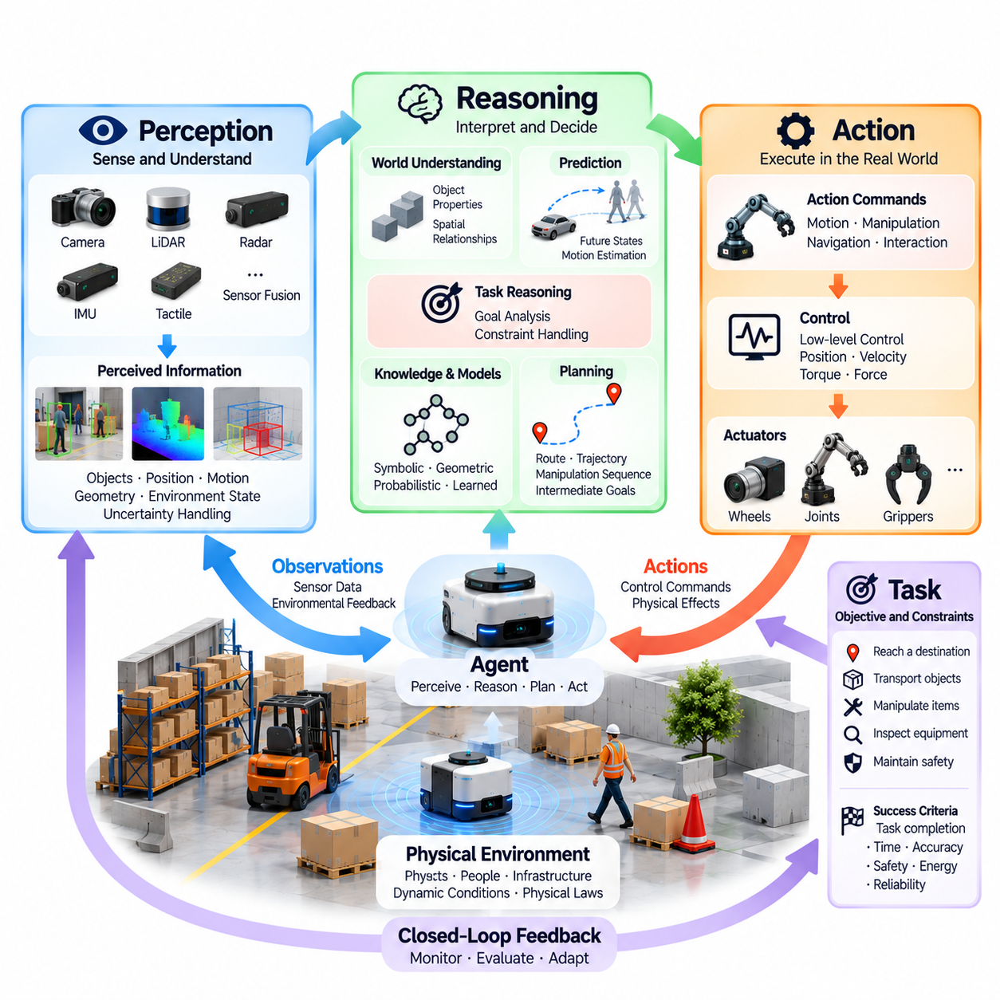{width="7.268055555555556in" height="7.268055555555556in"}

인식-추론-행동 루프(Perception-Reasoning-Action Loop)는 환경 감지(Environmental Sensing)를 지능형 의사결정(Intelligent Decision-Making) 및 물리적 행동(Physical Behavior)과 연결하는 피지컬 AI(Physical AI)의 기본 작동 원리(Fundamental Operating Principle)이다. 에이전트(Agent)는 이러한 지속적인 순환 과정(Continuous Cycle)을 통해 주변 환경을 관측하고, 관련 정보를 해석하며, 적절한 행동을 결정하고, 그 결과를 평가한다. 이 루프는 지능형 시스템(Intelligent Systems)이 사전에 정의된 명령에 전적으로 의존하지 않고 변화하는 조건에 대응할 수 있도록 한다.

인식(Perception)은 지능형 에이전트와 물리적 환경(Physical Environment) 사이의 연결을 형성한다. 센서(Sensors)는 객체(Objects), 표면(Surfaces), 움직임(Motion), 장애물(Obstacles), 환경 조건(Environmental Conditions)에 관한 정보를 획득한다. 카메라(Cameras), 라이다(LiDAR), 레이더(Radar), 관성 센서(Inertial Sensors), 촉각 장치(Tactile Devices)는 상황 이해(Situational Understanding)를 지원하는 상호 보완적인 측정값(Complementary Measurements)을 제공한다. 이러한 관측값(Observations)은 에이전트가 현재 상황을 추정하고 할당된 작업과 관련된 정보를 식별하는 초기 증거(Initial Evidence)가 된다.

원시 센서 측정값(Raw Sensor Measurements)이 자동으로 의미 있는 환경 이해(Environmental Understanding)를 제공하는 것은 아니다. 이미지는 픽셀 강도(Pixel Intensities)를 포함하고, 라이다는 공간 측정값(Spatial Measurements)을 생성하며, 관성 센서는 움직임 관련 신호(Motion-Related Signals)를 보고한다. 인식 알고리즘(Perception Algorithms)은 이러한 측정값을 객체, 위치(Positions), 속도(Velocities), 기하학적 구조(Geometry), 상호작용(Interactions)에 대한 표현(Representations)으로 변환한다. 이렇게 생성된 정보는 실제 물리 시스템(Physical Systems)에 영향을 미치는 의사결정을 지원할 만큼 충분히 정확하고 시의적절해야 한다.

센서 융합(Sensor Fusion)은 여러 측정 소스(Measurement Sources)의 정보를 결합하여 인식 성능을 향상시킨다. 카메라는 객체를 식별하고, 라이다는 거리를 추정하며, 관성 센서는 에이전트의 움직임에 관한 정보를 제공할 수 있다. 이러한 측정값을 통합하면 모호성(Ambiguity)을 줄이고 환경 추정값(Environmental Estimates)을 개선할 수 있다. 그러나 센서 융합은 보정 오차(Calibration Errors), 동기화 차이(Synchronization Differences), 센서 불확실성(Sensor Uncertainty), 관측값 사이의 잠재적 불일치(Possible Inconsistencies)를 고려해야 한다.

추론(Reasoning)은 인식된 정보를 에이전트의 목표(Objectives)를 지원하는 의사결정(Decisions)으로 변환한다. 추론은 현재 환경 추정값(Current Environmental Estimates)을 작업 요구사항(Task Requirements), 물리적 제약(Physical Constraints), 사용 가능한 행동(Available Actions)과 연결한다. 자율 로봇(Autonomous Robot)은 통로를 통과할 수 있는지, 장애물을 회피해야 하는지, 목표 객체(Target Object)를 안전하게 조작할 수 있는지 판단할 수 있다. 따라서 추론은 조건을 인식하는 수준을 넘어 미래 행동에 대한 의미(Significance)를 평가하는 과정이다.

추론 과정(Reasoning Process)에는 기호적 지식(Symbolic Knowledge), 기하학적 계산(Geometric Calculations), 확률적 추론(Probabilistic Inference), 학습된 모델(Learned Models) 또는 이러한 접근법의 조합이 포함될 수 있다. 서로 다른 방법은 관계를 이해하고 대안을 평가하는 데 상호 보완적인 능력을 제공한다. 실제 피지컬 AI 시스템은 충돌 회피(Collision Avoidance)에 기하학적 추론(Geometric Reasoning)을 사용하고, 불확실한 관측값에 확률적 추론(Probabilistic Reasoning)을 적용하며, 복잡한 환경을 해석하기 위해 학습된 표현(Learned Representations)을 활용할 수 있다.

계획(Planning)은 추론을 실행 가능한 행동(Executable Actions)의 선택과 연결한다. 계획은 제약 조건(Constraints)을 준수하면서 에이전트가 추정된 현재 상태(Estimated Current State)에서 원하는 목표(Desired Objective)로 이동하는 방법을 결정한다. 계획에는 경로(Routes), 이동 궤적(Motion Trajectories), 조작 순서(Manipulation Sequences), 중간 목표(Intermediate Goals)가 포함될 수 있다. 계획의 유용성은 에이전트의 기계적 한계(Mechanical Limitations), 환경 조건(Environmental Conditions), 운영 요구사항(Operational Requirements) 아래에서도 실행 가능성을 유지하는지에 달려 있다.

예측(Prediction)은 환경이 어떻게 변화할 수 있는지와 후보 행동(Candidate Actions)이 미래 상태(Future States)에 어떤 영향을 미칠 수 있는지를 추정함으로써 추론 과정을 강화한다. 이동 로봇(Mobile Robot)은 보행자의 움직임(Pedestrian Motion)을 예측할 수 있으며, 매니퓰레이터(Manipulator)는 접촉 과정에서 물체의 변위(Object Displacement)를 예상할 수 있다. 이러한 예측은 에이전트가 행동하기 전에 대안을 비교하도록 돕는다. 예측은 완벽하지 않으므로 새로운 관측값이 확보될 때마다 지속적으로 수정되어야 한다.

행동(Action)은 선택된 의사결정을 물리적 환경에 영향을 미치는 명령(Commands)으로 변환한다. 이러한 명령은 모터(Motors), 로봇 관절(Robotic Joints), 조향 시스템(Steering Systems), 그리퍼(Grippers), 기타 액추에이터(Actuators)를 제어할 수 있다. 실행 과정(Execution Process)은 액추에이터 한계(Actuator Limits), 기계적 동역학(Mechanical Dynamics), 응답 지연(Response Delays), 물리적 상호작용(Physical Interactions)을 고려해야 한다. 논리적으로 적절한 의사결정이라도 실행 가능하고 제어 가능한 물리적 행동으로 변환되지 못한다면 충분하지 않다.

제어 메커니즘(Control Mechanisms)은 선택된 행동이 적절한 정밀도(Precision)와 안정성(Stability)을 가지고 실행되도록 보장한다. 저수준 제어기(Low-Level Controllers)는 위치(Position), 속도(Velocity), 토크(Torque), 힘(Force)과 같은 물리량을 조절하며, 상위 수준 시스템(Higher-Level Systems)은 작업 목표(Task Objectives)와 이동 전략(Movement Strategies)을 조정한다. 이러한 분리는 지능형 추론(Intelligent Reasoning)이 고속 제어 과정(Fast Control Processes)과 함께 작동하도록 한다. 효과적인 통합을 위해서는 계획 결정(Planning Decisions)과 액추에이터 수준 실행(Actuator-Level Execution) 사이의 일관된 통신이 필요하다.

에이전트가 자신의 행동 결과를 관측하고 그 정보를 후속 의사결정에 활용할 때 루프는 폐루프(Closed Loop)가 된다. 계획된 경로(Planned Path)를 따라 이동하는 로봇은 바퀴 미끄러짐(Wheel Slip)이나 예상하지 못한 장애물(Unexpected Obstacle)을 감지하고 움직임을 조정할 수 있다. 피드백(Feedback)은 의도한 행동(Intended Behavior)과 실제 행동(Actual Behavior) 사이의 편차(Deviations)를 보정하도록 한다. 이러한 피드백이 없으면 오류가 누적되고 환경 조건이 변화하면서 계획된 행동이 부적절해질 수 있다.

폐루프 동작(Closed-Loop Operation)은 물리적 환경이 불확실하고 지속적으로 변화하기 때문에 특히 중요하다. 센서 측정값(Sensor Measurements)에는 잡음(Noise)이 포함될 수 있고, 객체는 예상하지 못하게 움직일 수 있으며, 기계 시스템(Mechanical Systems)은 이론적 예측(Theoretical Predictions)과 다르게 반응할 수 있다. 인식, 추론, 행동을 반복하면 에이전트는 이러한 차이를 보상할 수 있다. 지능형 행동(Intelligent Behavior)의 품질은 이 순환 과정이 목표(Objectives)와 실제 결과(Actual Outcomes) 사이의 일치성을 얼마나 효과적으로 유지하는지에 달려 있다.

인식-추론-행동 루프(Perception-Reasoning-Action Loop)가 반드시 각 단계가 이전 단계의 완료를 기다리는 경직된 순서(Rigid Sequence)로 작동하는 것은 아니다. 실제 시스템에서는 인식, 계획, 제어가 서로 다른 주파수(Frequencies)에서 동시에 실행되는 경우가 많다. 고속 제어 루프(Fast Control Loops)는 밀리초(Milliseconds) 단위로 반응할 수 있지만, 복잡한 추론 과정(Complex Reasoning Processes)은 더 긴 시간 간격에서 작동한다. 이러한 비동기 과정(Asynchronous Processes)을 조정하는 것은 응답성(Responsiveness)과 일관된 시스템 동작(Consistent System Behavior)을 유지하는 데 필수적이다.

지연시간(Latency)은 물리적 조건이 변화함에 따라 정보와 의사결정의 유효성이 감소하기 때문에 중요한 제약 조건(Critical Constraint)이다. 지연은 센서 데이터 수집(Sensor Acquisition), 데이터 전송(Data Transmission), 모델 추론(Model Inference), 계획(Planning), 액추에이터 실행(Actuator Execution) 과정에서 발생할 수 있다. 장애물을 너무 늦게 감지하면 추론 알고리즘(Reasoning Algorithm)이 올바른 대응을 선택하더라도 회피가 불가능할 수 있다. 따라서 피지컬 AI 아키텍처(Physical AI Architectures)는 계산 정확도(Computational Accuracy)만 최적화하는 것이 아니라 종단 간 시간 관리(End-to-End Timing)를 수행해야 한다.

불확실성(Uncertainty)은 루프의 모든 단계에 영향을 미친다. 인식(Perception)은 불완전한 추정값(Imperfect Estimates)을 생성하고, 추론(Reasoning)은 불완전한 지식(Incomplete Knowledge)을 평가하며, 행동(Action)은 예측과 다른 결과를 만들어 낼 수 있다. 지능형 시스템은 불확실성을 표현하고 행동을 선택할 때 그 결과를 고려해야 한다. 추가 감지(Additional Sensing), 보수적 계획(Conservative Planning), 강건한 제어(Robust Control), 안전한 대체 전략(Safe Fallback Strategies)은 환경 정보가 모호한 상황에서도 신뢰성 있는 운영(Reliable Operation)을 유지하도록 돕는다.

기억(Memory)은 루프의 연속적인 반복(Iterations) 사이에서 지속성(Continuity)을 제공한다. 에이전트는 이전 관측값(Previous Observations), 추정된 객체 궤적(Estimated Object Trajectories), 완료된 행동(Completed Actions), 작업 진행 상태(Task Progress)를 보존할 수 있다. 이러한 정보는 일시적으로 관측할 수 없는 조건을 추론하도록 지원하고 불필요한 의사결정의 반복을 방지한다. 기억은 또한 즉각적인 감각 정보(Immediate Sensory Information)를 장기 목표(Long-Term Objectives) 및 축적된 경험(Accumulated Experience)과 연결하도록 한다.

학습(Learning)은 반복적인 상호작용(Repeated Interaction)을 통해 루프가 개선되도록 한다. 예측 결과(Predicted Outcomes)와 관측 결과(Observed Outcomes) 사이의 차이는 인식 모델(Perception Models), 환경 가정(Environmental Assumptions), 제어 전략(Control Strategies)의 한계를 드러낼 수 있다. 이러한 경험은 모델 개선(Model Refinement), 정책 적응(Policy Adaptation), 작업 수행 개선(Improved Task Execution)을 지원할 수 있다. 그러나 지능형 행동의 변화는 예상하지 못한 물리적 위험(Physical Risks)을 초래할 수 있으므로 학습 메커니즘(Learning Mechanisms)은 신중하게 평가되어야 한다.

안전 메커니즘(Safety Mechanisms)은 행동이 선택된 이후에만 적용되는 것이 아니라 인식-추론-행동 루프(Perception-Reasoning-Action Loop) 전체에서 작동해야 한다. 인식은 위험 요소(Hazards)를 식별하고, 추론은 안전 제약(Safety Constraints)을 준수하며, 행동 실행(Action Execution)은 허용된 운영 한계(Permissible Operating Limits) 내에서 유지되어야 한다. 독립적인 모니터링(Independent Monitoring)과 보호 제어(Protective Control)는 안전하지 않은 조건이 발생할 때 개입할 수 있다. 이러한 계층적 접근법(Layered Approach)은 하나의 구성 요소에서 발생한 오류가 허용할 수 없는 물리적 결과로 이어지는 것을 방지하는 데 도움이 된다.

이 루프는 분산 피지컬 AI 아키텍처(Distributed Physical AI Architectures)로 확장될 수 있다. 센서(Sensors), 엣지 프로세서(Edge Processors), 온프레미스 컴퓨팅 시스템(On-Premise Computing Systems), 클라우드 서비스(Cloud Services)는 인식, 추론, 학습의 서로 다른 기능을 담당할 수 있다. 시간에 민감한 의사결정(Time-Critical Decisions)은 일반적으로 충분히 가까운 위치에서의 로컬 처리(Local Processing)를 필요로 하며, 긴급성이 낮은 계산은 공유 기반시설(Shared Infrastructure)을 활용할 수 있다. 아키텍처는 통신 지연(Communication Delays)이나 일시적인 네트워크 장애(Temporary Network Failures)가 발생하더라도 피드백 연속성(Feedback Continuity)과 예측 가능한 응답 동작(Predictable Response Behavior)을 유지해야 한다.

인식-추론-행동 루프의 평가(Evaluation)는 개별 알고리즘 성능(Isolated Algorithm Performance)이 아니라 통합 시스템(Integrated System)을 검토해야 한다. 관련 지표에는 인식 정확도(Perception Accuracy), 의사결정 품질(Decision Quality), 행동 정밀도(Action Precision), 응답 지연시간(Response Latency), 작업 완료(Task Completion), 강건성(Robustness), 안전성(Safety)이 포함된다. 객체 감지(Object Detection) 성능이 우수한 시스템이라도 계획이 지연되거나 제어가 불안정하면 전체 성능이 저하될 수 있다. 성공적인 피지컬 AI는 완전한 상호작용 순환 과정(Complete Interaction Cycle) 전반의 조정된 성능에 달려 있다.

궁극적으로 인식-추론-행동 루프(Perception-Reasoning-Action Loop)는 계산 지능(Computational Intelligence)이 물리적 행동(Physical Behavior)으로 전환되는 운영 기반(Operational Foundation)을 제공한다. 인식(Perception)은 상황 인식(Awareness)을 형성하고, 추론(Reasoning)은 의미 있는 대응(Meaningful Responses)을 결정하며, 행동(Action)은 환경을 변화시킨다. 피드백(Feedback)은 이러한 능력을 지속적인 적응 과정(Continuous Adaptive Process)으로 연결한다. 피지컬 AI는 이 루프가 불확실한 관측값(Uncertain Observations)을 정의된 목표(Defined Objectives)에 부합하는 시의적절하고 실행 가능하며 안전한 행동으로 일관되게 전환할 때 신뢰성 있는 자율성(Reliable Autonomy)을 달성한다.

## 01.05. Sense Model Predict Plan Act Learn

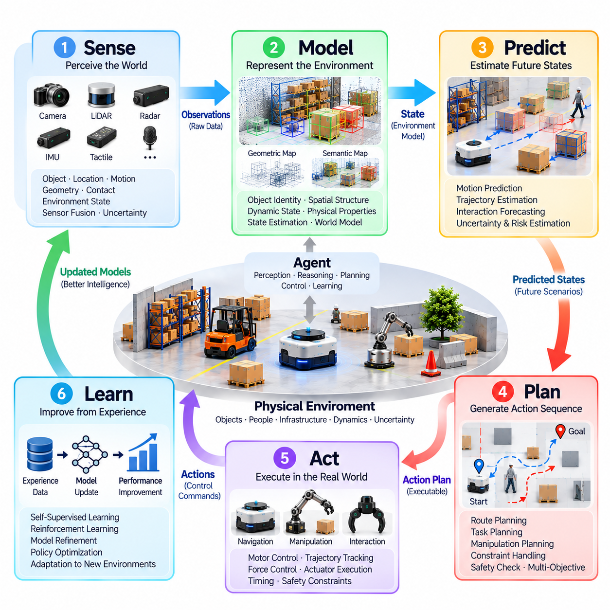{width="7.268055555555556in" height="7.268055555555556in"}

감지-모델링-예측-계획-행동-학습 프레임워크(Sense-Model-Predict-Plan-Act-Learn Framework)는 피지컬 AI(Physical AI) 시스템이 환경 관측(Environmental Observations)을 목적 지향적 물리 행동(Purposeful Physical Behavior)으로 변환하는 지속적인 지능 순환 과정(Continuous Intelligence Cycle)을 설명한다. 이 프레임워크는 환경 표현(Environmental Representation), 미래 상태 예측(Future-State Prediction), 구조화된 계획(Structured Planning), 경험 기반 개선(Experience-Driven Improvement)을 통합하여 기본적인 인식-행동 피드백(Perception-Action Feedback)을 확장한다. 이러한 상호 연결된 능력은 지능형 에이전트(Intelligent Agents)가 불확실성(Uncertainty) 속에서 작동하면서 변화하는 물리적 조건(Physical Conditions)에 적응하도록 한다.

감지(Sensing)는 에이전트와 주변 환경에 관한 정보를 수집함으로써 지능 순환 과정(Intelligence Cycle)의 기반을 형성한다. 카메라(Cameras), 라이다(LiDAR), 레이더(Radar), 관성 센서(Inertial Sensors), 촉각 센서(Tactile Sensors), 기타 측정 장치(Measurement Devices)는 물리적 현실(Physical Reality)의 상호 보완적인 측면을 포착한다. 이러한 장치의 출력은 객체 위치(Object Locations), 움직임(Motion), 기하학적 구조(Geometry), 접촉 조건(Contact Conditions), 환경 변화(Environmental Changes)에 관한 증거를 제공한다. 신뢰성 있는 감지(Reliable Sensing)를 위해서는 적절한 보정(Calibration), 동기화(Synchronization), 측정 품질(Measurement Quality)이 필요하다.

감지 과정(Sensing Process)은 물리적 측정(Physical Measurement)에 내재된 한계를 고려해야 한다. 센서는 잡음이 포함된 측정값(Noisy Readings)을 생성하거나 일시적인 고장(Temporary Failures)을 경험할 수 있으며, 가림 현상(Occlusion)과 환경 간섭(Environmental Interference)으로 인해 관측 가능성(Visibility)이 저하될 수 있다. 지능형 시스템(Intelligent System)은 관측값이 세계를 완벽하게 설명한다고 가정할 수 없다. 대신 측정 신뢰도(Measurement Confidence)를 평가하고, 상호 보완적인 정보 소스(Complementary Information Sources)를 결합하며, 중요한 결과를 초래할 수 있는 행동을 선택하기 전에 추가 관측(Additional Observations)이 필요한 상황을 인식해야 한다.

모델링(Modeling)은 센서 관측값(Sensor Observations)을 환경 이해(Environmental Understanding)와 의사결정(Decision-Making)을 지원하는 구조화된 표현(Structured Representations)으로 변환한다. 이러한 표현은 공간 기하학(Spatial Geometry), 객체 식별 정보(Object Identities), 동적 상태(Dynamic States), 물리적 특성(Physical Properties), 개체 간 관계(Relationships Between Entities)를 설명할 수 있다. 모델(Model)은 현재 환경에 대한 추정값(Estimate)을 유지함으로써 개별 측정값을 넘어서는 연속성(Continuity)을 제공한다. 모델의 구조는 작업(Task), 사용 가능한 센서(Available Sensors), 계산 자원(Computational Resources), 요구되는 세부 수준(Required Level of Detail)에 따라 달라진다.

환경 모델(Environmental Models)은 기하학적 지도(Geometric Maps), 의미 정보(Semantic Information), 확률적 상태 추정값(Probabilistic State Estimates), 학습된 표현(Learned Representations)을 결합할 수 있다. 이동 로봇(Mobile Robot)은 점유 지도(Occupancy Map)와 추정된 자세(Estimated Pose)를 유지할 수 있으며, 매니퓰레이터(Manipulator)는 객체 기하학(Object Geometry), 접촉 상태(Contact States), 도달 가능한 구성(Reachable Configurations)을 표현할 수 있다. 더욱 발전된 시스템은 행동과 환경 변화 사이의 관계를 포착하기 위해 학습 기반 월드 모델(Learned World Models)을 사용할 수 있다. 모든 물리적 작업에 보편적으로 최적인 단일 표현 방식(Single Representation)은 존재하지 않는다.

예측(Prediction)은 환경 모델(Environmental Models)을 사용하여 물리적 조건이 시간에 따라 어떻게 변화할 수 있는지 추정한다. 예측은 객체의 움직임(Object Motion), 공간 관계(Spatial Relationships)의 변화, 후보 행동(Candidate Actions)의 잠재적 결과(Potential Consequences)를 고려한다. 보행자 주변을 이동하는 로봇은 미래 궤적(Future Trajectories)을 추정할 수 있으며, 매니퓰레이터(Manipulator)는 파지(Grasping) 과정에서 물체의 움직임(Object Movement)을 예측할 수 있다. 예측은 잠재적 결과가 직접 관측되기 전에 식별함으로써 선제적 행동(Proactive Behavior)을 가능하게 한다.

예측 모델(Predictive Models)은 물리 방정식(Physical Equations), 확률적 동역학(Probabilistic Dynamics), 신경망(Neural Networks) 또는 이러한 접근법의 조합을 포함할 수 있다. 물리 기반 방법(Physics-Based Methods)은 알려진 기계적 관계(Mechanical Relationships)를 표현하는 반면, 학습 기반 모델(Learned Models)은 경험을 통해 복잡한 상호작용(Complex Interactions)을 근사할 수 있다. 이러한 모델의 효과는 사용 가능한 정보의 품질(Information Quality)과 기본 가정(Underlying Assumptions)의 타당성에 달려 있다. 따라서 예측은 불확실성(Uncertainty)과 모델링 오차(Modeling Error)를 적절하게 처리해야 한다.

계획(Planning)은 추정된 상태(Estimated States)와 예측된 결과(Predicted Outcomes)를 실행 가능한 행동 순서(Feasible Action Sequences)로 변환한다. 계획은 물리적 제약(Physical Constraints), 운영 제약(Operational Constraints), 안전 제약(Safety Constraints)을 준수하면서 에이전트가 목표(Goal)를 향해 진행하는 방법을 결정한다. 계획에는 이동 경로 선택(Navigation Route Selection), 이동 궤적 생성(Motion Trajectory Generation), 조작 단계 일정 수립(Manipulation Step Scheduling), 다중 목표 조정(Multiple Objective Coordination)이 포함될 수 있다. 유용한 계획은 작업 성공(Task Success)과 실행 시간(Execution Time), 에너지 소비(Energy Consumption), 강건성(Robustness), 위험(Risk) 사이의 균형을 유지해야 한다.

효과적인 계획(Effective Planning)은 고정된 행동 순서(Fixed Action Sequence)에만 의존하기보다 여러 대안(Alternatives)을 평가해야 한다. 이동 로봇(Mobile Robot)은 혼잡도(Congestion), 장애물 움직임(Obstacle Movement), 이동 비용(Travel Cost)을 기준으로 경로를 비교할 수 있다. 매니퓰레이터(Manipulator)는 안정성(Stability)과 충돌 위험(Collision Risk)에 따라 서로 다른 파지 구성(Grasp Configurations)을 평가할 수 있다. 예측 기반 계획(Predictive Planning)은 에이전트가 결과를 미리 예상하도록 하지만, 실제 환경의 동작이 모델의 예상과 다를 수 있으므로 계획은 조정 가능성(Adjustability)을 유지해야 한다.

행동(Action)은 선택된 계획(Selected Plans)을 모터(Motors), 관절(Joints), 그리퍼(Grippers), 조향 메커니즘(Steering Mechanisms), 기타 액추에이터(Actuators)를 통해 실행되는 물리적 명령(Physical Commands)으로 변환한다. 실행 과정(Execution Process)은 기계적 한계(Mechanical Limits), 힘 요구사항(Force Requirements), 시간 제약(Timing Constraints), 액추에이터 동역학(Actuator Dynamics)을 고려해야 한다. 상위 수준 의사결정(High-Level Decisions)은 일반적으로 위치(Position), 속도(Velocity), 토크(Torque), 힘(Force)을 조절하는 하위 수준 제어 기준값(Lower-Level Control References)으로 변환된다. 성공적인 행동은 계획된 동작(Planned Behavior)과 물리적 능력(Physical Capabilities) 사이의 일관성을 필요로 한다.

물리적 행동(Physical Action)은 필연적으로 이후 의사결정이 이루어지는 조건을 변화시킨다. 로봇의 움직임은 관측 시점(Viewpoint)을 변경하고, 파지(Grasp)는 객체의 접촉 관계(Object Contact Relationships)를 변화시키며, 상호작용(Interaction)은 주변 사람이나 기계에 영향을 미칠 수 있다. 이러한 결과는 새로운 관측값(New Observations)과 잠재적으로 새로운 불확실성(New Uncertainties)을 생성한다. 따라서 지능 순환 과정(Intelligence Cycle)은 명령 실행(Command Execution) 이후에 종료될 수 없으며, 실제 결과(Actual Outcomes)가 의도한 결과(Intended Results)와 일치하는지 지속적으로 평가해야 한다.

학습(Learning)은 축적된 경험(Accumulated Experience)을 활용하여 인식(Perception), 모델(Models), 예측(Predictions), 계획 전략(Planning Strategies), 제어 정책(Control Policies)을 개선함으로써 시스템 성능을 향상시킨다. 예측된 결과(Predicted Outcomes)와 관측된 결과(Observed Outcomes) 사이의 차이는 환경 동역학(Environmental Dynamics)과 시스템 한계(System Limitations)에 관한 정보를 제공한다. 학습은 지도 학습(Supervised Learning), 모방 학습(Imitation Learning), 강화 학습(Reinforcement Learning), 자기지도 학습(Self-Supervised Learning)을 통해 이루어질 수 있다. 그 목적은 이전 상호작용에서 얻은 증거를 활용하여 미래 행동(Future Behavior)을 개선하는 것이다.

학습(Learning)이 반드시 배포된 모델(Deployed Models)의 제한 없는 온라인 수정(Unrestricted Online Modification)을 요구하는 것은 아니다. 안전 필수 시스템(Safety-Critical Systems)은 운영 경험(Operational Experience)을 수집하면서 통제된 오프라인 학습(Controlled Offline Training)과 검증(Validation)을 통해 모델을 업데이트할 수 있다. 이러한 분리는 검증되지 않은 변경(Unverified Changes)이 물리적 행동(Physical Behavior)에 영향을 미치는 것을 방지하는 데 도움이 된다. 따라서 지속적 개선(Continuous Improvement)은 즉각적인 자율적 매개변수 업데이트(Autonomous Parameter Updates)가 아니라 데이터 수집(Data Collection), 모델 평가(Model Evaluation), 통제된 배포(Controlled Deployment), 모니터링(Monitoring)을 포함할 수 있다.

여섯 가지 능력(Six Capabilities)은 완전히 독립된 여섯 개의 처리 단계(Processing Stages)가 아니라 상호 연결된 순환 과정(Interconnected Cycle)을 형성한다. 감지(Sensing)는 모델링(Modeling)에 필요한 정보를 제공하고, 모델은 예측(Prediction)을 지원하며, 예측은 계획(Planning)에 정보를 제공하고, 계획은 행동(Action)을 안내하며, 관측된 결과(Observed Outcomes)는 학습(Learning)의 근거가 된다. 한 단계의 개선은 다른 단계의 효과에도 영향을 미칠 수 있다. 감지나 모델링의 약점(Weaknesses)은 전체 과정으로 전파되어 전반적인 작업 신뢰성(Task Reliability)을 저하시킬 수 있다.

피드백(Feedback)은 예상된 물리적 결과(Expected Physical Outcomes)와 관측된 물리적 결과(Observed Physical Outcomes)를 비교함으로써 각 단계를 연결한다. 로봇이 바퀴 미끄러짐(Wheel Slip), 예상하지 못한 접촉(Unexpected Contact), 움직이는 장애물(Moving Obstacle)을 경험하면 새로운 센서 측정값(New Sensor Measurements)이 이전 모델(Previous Model)과의 편차(Deviations)를 드러낸다. 시스템은 상태 추정값(State Estimate)을 업데이트하고, 예측을 수정하며, 변경된 계획(Modified Plan)을 생성할 수 있다. 이러한 반복적인 보정(Repeated Correction)은 외란(Disturbances), 불완전한 모델(Imperfect Models), 변화하는 환경 조건(Changing Environmental Conditions)에도 강건한 운영(Robust Operation)을 가능하게 한다.

불확실성(Uncertainty)은 전체 순환 과정(Complete Cycle)에서 관리되어야 한다. 감지(Sensing)는 측정 불확실성(Measurement Uncertainty)을 발생시키고, 모델링(Modeling)은 표현 오차(Representation Error)를 도입하며, 예측(Prediction)은 미래 상태 불확실성(Future-State Uncertainty)을 포함하고, 행동(Action)은 실행 변동성(Execution Variability)을 발생시킨다. 계획(Planning)은 실행 가능한 행동(Feasible Behavior)을 선택할 때 이러한 불확실성을 고려해야 한다. 학습(Learning)은 시간이 지남에 따라 일부 불확실성을 감소시킬 수 있지만, 익숙하지 않은 환경(Unfamiliar Environments)과 예상하지 못한 사건(Unexpected Events)에 대응하려면 지속적인 주의(Caution)와 적응형 대응(Adaptive Responses)이 필요하다.

시간적 조정(Temporal Coordination)은 서로 다른 능력이 각기 다른 계산 주파수(Computational Frequencies)에서 작동하기 때문에 필수적이다. 센서 데이터 수집(Sensor Acquisition)과 저수준 제어(Low-Level Control)는 빠른 업데이트(Rapid Updates)를 요구할 수 있지만, 월드 모델 개선(World-Model Refinement)과 전략적 계획(Strategic Planning)은 더 긴 시간 간격에서 작동할 수 있다. 학습 과정(Learning Processes)은 비동기적(Asynchronously)으로 수행되거나 실제 운영(Active Deployment) 외부에서 진행될 수 있다. 실제 아키텍처(Practical Architecture)는 이러한 시간적 차이를 조정하면서 안전 필수 의사결정(Safety-Critical Decisions)에 충분히 최신 정보(Current Information)가 제공되도록 해야 한다.

컴퓨팅 아키텍처(Computational Architecture)는 지능 순환 과정(Intelligence Cycle)의 구현 방식에 영향을 미친다. 임베디드 프로세서(Embedded Processors)와 엣지 컴퓨팅 플랫폼(Edge Computing Platforms)은 일반적으로 시간에 민감한 인식(Time-Sensitive Perception), 계획(Planning), 제어(Control)를 지원한다. 온프레미스 기반시설(On-Premise Infrastructure)은 공유 환경 모델(Shared Environmental Models), 협조(Coordination), 추가 계산 용량(Additional Computational Capacity)을 제공할 수 있으며, 클라우드 시스템(Cloud Systems)은 대규모 학습(Large-Scale Training)과 전체 로봇군 학습(Fleet-Wide Learning)을 지원할 수 있다. 기능 배치(Functional Placement)는 지연시간(Latency), 신뢰성(Reliability), 통신(Communication), 자원 요구사항(Resource Requirements)을 반영해야 한다.

기억(Memory)은 관련 관측값(Relevant Observations), 환경 상태(Environmental States), 이전 행동(Previous Actions), 작업 결과(Task Outcomes)를 보존함으로써 연속적인 순환 과정(Successive Cycles) 사이의 연속성(Continuity)을 제공한다. 단기 기억(Short-Term Memory)은 추적(Tracking)과 즉각적인 의사결정(Immediate Decision-Making)을 지원하며, 장기 기억(Long-Term Memory)은 적응(Adaptation)에 유용한 경험을 보존할 수 있다. 적절한 기억 메커니즘(Memory Mechanisms)이 없다면 에이전트는 정보를 반복적으로 재발견하거나 일시적으로 가려진 조건(Temporarily Hidden Conditions)에 대한 인식을 잃을 수 있다. 따라서 기억은 모델링, 예측, 계획, 학습을 강화한다.

안전(Safety)은 프레임워크의 모든 능력에 통합되어야 한다. 감지(Sensing)는 위험 요소(Hazards)를 탐지하고, 모델(Models)은 관련 제약 조건(Relevant Constraints)을 표현하며, 예측(Prediction)은 위험한 결과(Dangerous Outcomes)를 식별하고, 계획(Planning)은 허용할 수 없는 행동(Unacceptable Actions)을 배제해야 한다. 실행(Execution)에는 보호 제어(Protective Control)와 비상 대응(Emergency Responses)이 필요하며, 학습(Learning)은 검증되지 않은 행동(Unvalidated Behavior)의 도입을 방지해야 한다. 지능형 구성 요소(Intelligent Components)가 허용 가능한 물리적 위험 수준(Acceptable Physical Risk)을 보장할 수 없는 경우 독립적인 안전 메커니즘(Independent Safety Mechanisms)이 필요할 수 있다.

이 프레임워크는 통합된 피지컬 AI 성능(Integrated Physical AI Performance)의 평가(Evaluation)도 지원한다. 감지 정확도(Sensing Accuracy), 모델 일관성(Model Consistency), 예측 오차(Prediction Error), 계획 실행 가능성(Planning Feasibility), 실행 정밀도(Execution Precision), 학습 효과(Learning Effectiveness)는 시스템 능력(System Capability)을 측정하는 상호 보완적인 지표를 제공한다. 그러나 개별 지표(Isolated Metrics)만으로는 운영 성공(Operational Success)을 완전히 입증할 수 없다. 평가는 현실적인 환경 조건(Realistic Environmental Conditions)에서 작업 완료(Task Completion), 강건성(Robustness), 지연시간(Latency), 자원 효율성(Resource Efficiency), 안전성(Safety)을 검토해야 한다.

궁극적으로 감지-모델링-예측-계획-행동-학습(Sense-Model-Predict-Plan-Act-Learn)은 피지컬 AI 시스템이 현실을 인식하고, 이해를 구성하며, 결과를 예상하고, 행동을 선택하며, 환경과 상호작용하고, 경험을 통해 개선되는 방식을 통합적으로 설명한다. 이 프레임워크의 강점은 지식(Knowledge)과 물리적 결과(Physical Outcomes) 사이의 지속적인 연결(Continuous Connection)에 있다. 신뢰성 있는 피지컬 AI(Reliable Physical AI)는 이러한 능력이 의미 있는 목표(Meaningful Goals)와 안전 제약(Safety Constraints)에 부합하는 적응형 피드백 기반 과정(Adaptive, Feedback-Driven Process)으로 함께 작동할 때 구현된다.

## 01.06. Embodiment and Physical Interaction

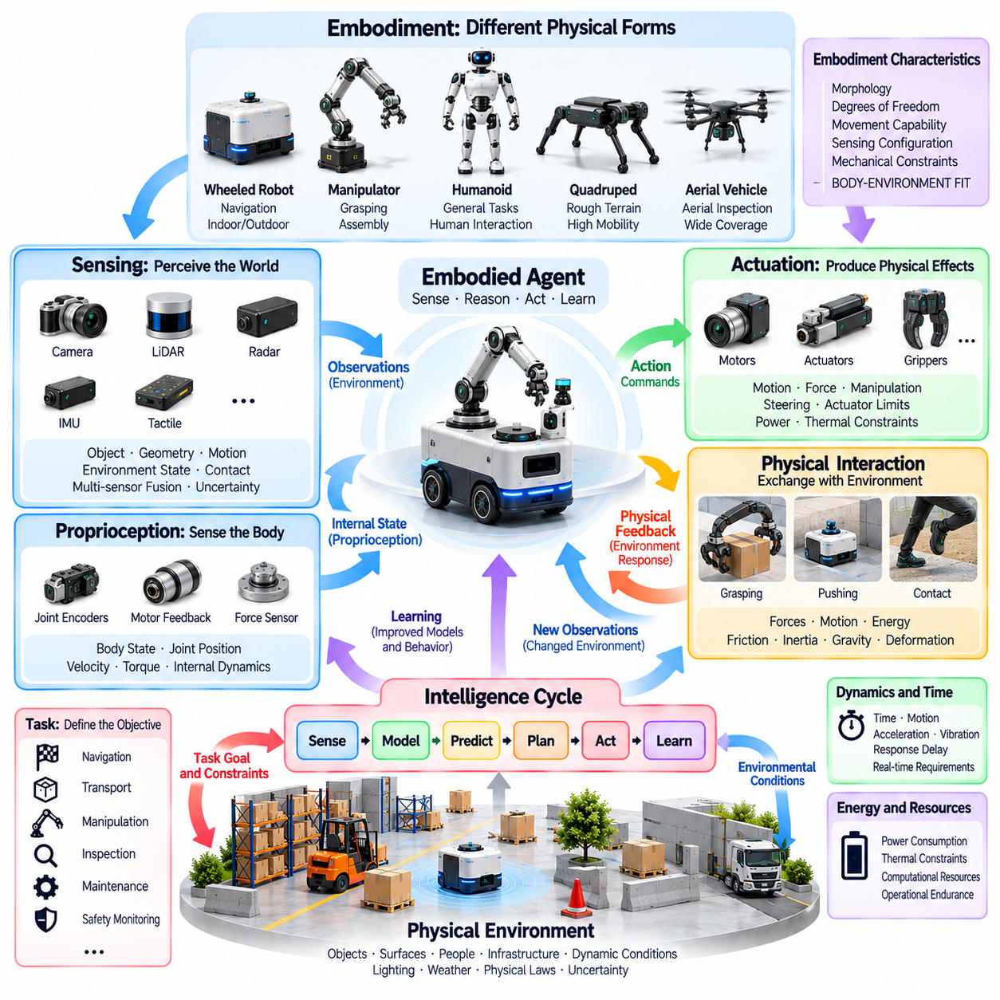{width="7.268055555555556in" height="7.268055555555556in"}

체화(Embodiment)는 지능(Intelligence)이 환경과 상호작용하는 물리적 구조(Physical Structures)를 통해 작동한다는 점에서 피지컬 AI(Physical AI)의 핵심적인 특성(Defining Characteristic)이다. 체화된 에이전트(Embodied Agent)는 세계를 경험하고 영향을 미치는 방식을 결정하는 감지 능력(Sensing Capabilities), 구동 능력(Actuation Capabilities), 기계적 능력(Mechanical Capabilities)을 갖는다. 따라서 지능은 추상적 계산(Abstract Computation)에 국한되지 않으며, 물리적 형태(Physical Form), 환경 조건(Environmental Conditions), 목표 지향적 행동(Goal-Directed Behavior) 사이의 관계를 통해 발현된다.

지능형 에이전트(Intelligent Agent)의 물리적 신체(Physical Body)는 사용 가능한 행동(Available Actions)과 지각 기회(Perceptual Opportunities)를 결정한다. 바퀴형 로봇(Wheeled Robot), 휴머노이드(Humanoid), 로봇 팔(Robotic Arm), 항공 이동체(Aerial Vehicle)는 서로 다른 이동 능력(Movement Capabilities), 감지 구성(Sensing Configurations), 운영 한계(Operational Limitations)를 가진다. 이러한 차이는 각 시스템이 주변 환경을 해석하고 작업을 수행하는 방식에 영향을 미친다. 체화는 인식(Perception), 추론(Reasoning), 제어(Control)가 작동해야 하는 실질적인 경계(Practical Boundaries)를 설정한다.

물리적 상호작용(Physical Interaction)은 에이전트가 환경과 힘(Forces), 운동(Motion), 에너지(Energy), 정보(Information)를 교환할 때 발생한다. 매니퓰레이터(Manipulator)는 물체를 파지하기 위해 접촉력(Contact Forces)을 가하고, 이동 로봇(Mobile Robot)은 이동하기 위해 지면과의 마찰을 통한 견인력(Traction)을 생성한다. 겉보기에 단순한 행동도 마찰(Friction), 관성(Inertia), 중력(Gravity), 기계적 제약(Mechanical Constraints)에 의존한다. 성공적인 상호작용을 위해서는 지능형 시스템이 행동을 순수한 기호적 명령(Symbolic Commands)으로 취급하지 않고 이러한 물리적 관계(Physical Relationships)를 고려해야 한다.

체화된 에이전트(Embodied Agent)의 형태학적 구조(Morphology)는 계산 요구사항(Computational Requirements)과 행동 가능성(Behavioral Possibilities)에 영향을 미친다. 관절 배치(Joint Arrangements), 바퀴 구성(Wheel Configurations), 액추에이터 배치(Actuator Placement), 구조적 유연성(Structural Compliance), 신체 치수(Body Dimensions)는 어떤 움직임이 실행 가능한지를 결정한다. 기계적 설계(Mechanical Design)는 특정 작업을 단순화하는 동시에 다른 작업을 더 어렵게 만들 수 있다. 따라서 물리적 지능(Physical Intelligence)은 신체 설계(Body Design)와 계산 기반 제어(Computational Control)가 얼마나 효과적으로 상호 보완하는지에 부분적으로 의존한다.

센서(Sensors)는 물리적 상호작용과 관련된 조건을 측정함으로써 체화(Embodiment)를 환경 인식(Environmental Awareness)과 연결한다. 카메라(Cameras)와 깊이 센서(Depth Sensors)는 관측 가능한 기하학적 구조(Visible Geometry)에 관한 정보를 제공하고, 관성 센서(Inertial Sensors)는 움직임(Motion)과 방향(Orientation)을 추정한다. 힘 센서(Force Sensors)와 촉각 센서(Tactile Sensors)는 시각적 인식(Visual Perception)만으로는 포착하기 어려운 접촉 조건(Contact Conditions)을 드러낸다. 센서 배치(Sensor Placement), 시야(Field of View), 측정 정확도(Measurement Accuracy), 물리적 접근성(Physical Accessibility)은 체화된 에이전트가 이용할 수 있는 정보의 품질(Information Quality)에 영향을 미친다.

액추에이터(Actuators)는 계산 기반 의사결정(Computational Decisions)을 기계적 효과(Mechanical Effects)로 변환한다. 모터(Motors), 유압 시스템(Hydraulic Systems), 공압 장치(Pneumatic Devices), 특수 메커니즘(Specialized Mechanisms)은 제어 명령(Control Commands)에 따라 움직임이나 힘을 생성한다. 이러한 장치의 능력은 토크(Torque), 속도(Speed), 전력(Power), 열적 조건(Thermal Conditions), 구조적 강도(Structural Strength)에 의해 제한된다. 이론적으로 바람직한 행동이라도 물리적으로 실행할 수 없거나 안전하지 않을 수 있으므로 지능형 제어기(Intelligent Controller)는 행동을 계획할 때 이러한 한계를 고려해야 한다.

접촉(Contact)은 많은 작업이 객체와 표면에 대한 제어된 상호작용(Controlled Interaction)을 요구하기 때문에 체화 지능(Embodied Intelligence)의 핵심적인 특징이다. 파지(Grasping), 밀기(Pushing), 보행(Walking), 도킹(Docking), 조립(Assembly)은 접촉 기하학(Contact Geometry)과 힘 분포(Force Distribution)에 의존한다. 접촉 조건(Contact Conditions)은 갑작스럽게 변화하여 비선형 동작(Nonlinear Behavior)과 불확실성(Uncertainty)을 발생시킬 수 있다. 따라서 피지컬 AI는 기계적 조건(Mechanical Conditions)의 예상하지 못한 변화에 대응하면서 안정적인 상호작용(Stable Interactions)을 유지하도록 감지(Sensing)와 제어(Control)를 조정해야 한다.

체화(Embodiment)는 에이전트가 자신의 물리적 구성(Physical Configuration)과 움직임(Motion)을 추정하는 능력인 고유수용감각(Proprioception)도 포함한다. 관절 엔코더(Joint Encoders), 관성 측정 장치(Inertial Measurement Units), 모터 피드백(Motor Feedback), 힘 센서(Force Sensors)는 내부 상태(Internal States)에 관한 정보를 제공한다. 이러한 자기 인식(Self-Awareness)은 균형(Balance), 협응된 움직임(Coordinated Movement), 정밀한 조작(Accurate Manipulation)을 지원한다. 고유수용 정보(Proprioceptive Information)와 외부 인식(External Perception)을 결합하면 에이전트는 자신의 신체 구성(Body Configuration)을 주변 객체 및 환경 제약(Environmental Constraints)과 연관 지을 수 있다.

신체와 환경 사이의 관계는 물리적 특성과 에이전트의 능력에 따라 결정되는 행동 가능성(Affordances)을 형성한다. 어떤 표면은 보행(Walking)을 지원하지만 바퀴 이동(Wheeled Movement)에는 적합하지 않을 수 있으며, 어떤 객체는 하나의 매니퓰레이터(Manipulator)로 파지할 수 있지만 다른 매니퓰레이터로는 접근할 수 없을 수 있다. 따라서 행동 가능성(Affordances)은 고정된 객체 특성(Fixed Object Characteristics)이 아니라 관계적 특성(Relational Properties)이다. 이를 인식하면 피지컬 AI 시스템은 의미 있으면서 물리적으로 달성 가능한 행동(Physically Achievable Actions)을 식별할 수 있다.

체화된 상호작용(Embodied Interaction)은 행동(Action)과 환경 반응(Environmental Response) 사이의 지속적인 피드백(Continuous Feedback)을 통해 전개된다. 로봇이 물체를 밀면 발생하는 변위(Displacement)를 통해 마찰(Friction), 질량(Mass), 저항(Resistance)에 관한 정보를 얻을 수 있다. 다족보행 로봇(Legged Robot)이 불규칙한 지형(Irregular Terrain)에 접촉하면 힘 피드백(Force Feedback)을 통해 균형(Balance)과 자세(Posture)를 조정할 수 있다. 이러한 상호작용은 에이전트가 행동하는 동안 자신의 이해를 개선하도록 하며, 인식(Perception)과 물리적 행동(Physical Behavior)이 밀접하게 결합된 과정임을 보여준다.

물리적 동역학(Physical Dynamics)은 체화 지능(Embodied Intelligence)에 시간적 요구사항(Temporal Requirements)을 부과한다. 운동량(Momentum), 가속도(Acceleration), 진동(Vibration), 액추에이터 응답 지연(Actuator Response Delays)은 에이전트가 얼마나 빠르게 반응해야 하는지에 영향을 미친다. 균형을 유지하는 로봇(Balancing Robot)은 빠른 안정화(Rapid Stabilization)가 필요할 수 있으며, 이동 플랫폼(Mobile Platform)은 제동 거리(Braking Distance)와 회전 한계(Turning Limitations)를 고려해야 한다. 이러한 요구사항으로 인해 효과적인 물리적 상호작용을 유지하려면 감지(Sensing), 계산(Computation), 제어(Control) 사이의 실시간 조정(Real-Time Coordination)이 필수적이다.

유연성(Compliance)과 기계적 적응성(Mechanical Adaptability)은 불확실한 환경(Uncertain Environments)과의 상호작용을 개선할 수 있다. 유연 관절(Flexible Joints), 순응형 그리퍼(Compliant Grippers), 힘 제어 메커니즘(Force-Controlled Mechanisms)은 접촉 중 손상을 줄이고 객체 기하학(Object Geometry)의 변화에 대응할 수 있다. 그러나 유연성은 모델링하거나 제어해야 하는 추가적인 동역학(Additional Dynamics)을 발생시키기도 한다. 효과적인 체화 지능은 기계적 적응성과 의도한 작업에 필요한 정밀도(Precision), 안정성(Stability), 예측 가능성(Predictability) 사이의 균형을 유지한다.

체화된 에이전트(Embodied Agents)는 물리적 운영(Physical Operation) 중 에너지 제약(Energy Constraints)과 열적 제약(Thermal Constraints)도 관리해야 한다. 이동(Movement), 감지(Sensing), 계산(Computation), 통신(Communication)은 제한된 자원(Limited Resources)을 소비하며, 액추에이터(Actuators)와 프로세서(Processors)는 열(Heat)을 발생시킨다. 작업 계획(Task Planning)은 배터리 용량(Battery Capacity), 적재 하중(Payload), 지형(Terrain), 운영 시간(Operating Duration), 냉각 요구사항(Cooling Requirements)을 고려해야 할 수 있다. 따라서 물리적 지능은 사용 가능한 운영 기간(Operational Period) 전체에서 실행 가능성을 유지하는 행동을 선택하는 능력도 포함한다.

물리적 상호작용을 통한 학습(Learning Through Physical Interaction)은 에이전트가 객체(Objects), 표면(Surfaces), 움직임의 결과(Movement Consequences)에 대한 이해를 개선하도록 한다. 반복적인 파지 시도(Repeated Grasping Attempts)는 적절한 접촉 구성(Contact Configurations)을 드러낼 수 있으며, 이동 경험(Navigation Experience)은 견인력(Traction)과 지형 난이도(Terrain Difficulty)에 대한 추정값을 개선할 수 있다. 이러한 경험은 예측 모델(Predictive Models)과 제어 정책(Control Policies)을 개선할 수 있다. 그러나 물리적 학습(Physical Learning)은 장비 마모(Equipment Wear), 운영 비용(Operational Cost), 안전하지 않은 탐색(Unsafe Exploration)의 가능성을 고려해야 한다.

시뮬레이션(Simulation)은 실제 배포(Deployment) 전에 체화 지능(Embodied Intelligence)을 개발하기 위한 중요한 환경을 제공한다. 물리 엔진(Physics Engines)은 강체 운동(Rigid-Body Motion), 접촉력(Contact Forces), 액추에이터 동작(Actuator Behavior), 센서 관측값(Sensor Observations)을 근사할 수 있다. 시뮬레이션 기반 상호작용(Simulated Interaction)은 통제된 실험(Controlled Experimentation)과 반복적인 평가(Repeated Evaluation)를 지원한다. 그러나 마찰(Friction), 유연성(Compliance), 감지(Sensing), 환경 변동성(Environmental Variability)의 차이는 시뮬레이션과 현실 사이의 격차(Simulation-to-Reality Gap)를 발생시키므로 물리적 시험(Physical Testing)을 통한 검증(Validation)이 필요하다.

체화(Embodiment)는 휴머노이드(Humanoid)나 동물 모방 로봇(Animal-Inspired Robots)에만 국한되지 않는다. 산업용 매니퓰레이터(Industrial Manipulators), 자율 이동 로봇(Autonomous Mobile Robots), 드론(Drones), 지능형 차량(Intelligent Vehicles), 고정형 로봇 시스템(Stationary Robotic Systems)은 모두 환경과 상호작용하는 물리적 구조(Physical Structures)를 갖는다. 분산 감지 및 구동 기반시설(Distributed Sensing and Actuation Infrastructures)도 구성 요소들이 집합적으로 물리적 과정(Physical Processes)에 영향을 미칠 때 체화된 행동(Embodied Behavior)을 지원할 수 있다. 핵심적인 특성은 지능(Intelligence)과 물리적 행동(Physical Action) 사이의 의미 있는 결합(Meaningful Coupling)이다.

체화(Embodiment)와 자율성(Autonomy)의 구분은 중요하다. 로봇은 정교한 물리적 신체(Sophisticated Physical Body)를 갖추고도 원격 명령(Remote Commands)에 전적으로 의존할 수 있으며, 다른 시스템은 제한된 기계적 능력(Limited Mechanical Capabilities) 내에서 독립적으로 행동을 선택할 수 있다. 체화는 상호작용을 위한 물리적 수단(Physical Means of Interaction)을 설명하는 반면, 자율성은 의사결정 권한(Decision-Making Authority)과 운영 독립성(Operational Independence)에 관한 개념이다. 피지컬 AI는 어느 한 요소가 다른 요소를 자동으로 보장한다고 가정하지 않고 이러한 차원을 통합한다.

안전(Safety)은 물리적 행동이 힘(Forces), 충돌(Collisions), 불안정성(Instability), 환경 손상(Environmental Damage)을 발생시킬 수 있기 때문에 체화(Embodiment)와 분리할 수 없다. 기계적 한계(Mechanical Limits), 충돌 모니터링(Collision Monitoring), 힘 제한(Force Restrictions), 보호 제어(Protective Control), 비상 정지 메커니즘(Emergency Stopping Mechanisms)은 이러한 위험을 관리하는 데 도움이 된다. 안전 요구사항(Safety Requirements)은 신체 구조(Body Structure), 운영 환경(Operating Environment), 상호작용 유형(Interaction Type)에 따라 달라진다. 인식(Perception)이나 추론(Reasoning)이 잘못된 결정을 내리더라도 지능형 행동(Intelligent Behavior)은 물리적 제약(Physical Constraints)을 준수해야 한다.

체화된 피지컬 AI(Embodied Physical AI)의 평가는 기계적 능력(Mechanical Capabilities), 지능형 제어(Intelligent Control), 환경 상호작용(Environmental Interaction) 사이의 전체 관계를 검토해야 한다. 관련 지표에는 작업 성공(Task Success), 이동 정확도(Motion Accuracy), 접촉 안정성(Contact Stability), 에너지 효율성(Energy Efficiency), 강건성(Robustness), 안전성(Safety)이 포함된다. 성능은 계산 벤치마크(Computational Benchmarks)만으로 추론하기보다 대표적인 물리적 조건(Representative Physical Conditions)에서 시험해야 한다. 효과적인 체화(Effective Embodiment)는 실제 환경(Real Environments)과의 신뢰성 있는 상호작용(Reliable Interaction)을 통해 입증된다.

궁극적으로 체화(Embodiment)는 피지컬 AI를 추상적 의사결정(Abstract Decision-Making)에서 상황 기반 물리 지능(Situated Physical Intelligence)으로 전환한다. 신체 형태학(Body Morphology)은 가능한 행동(Possible Actions)을 결정하고, 센서(Sensors)는 환경 인식(Environmental Awareness)을 형성하며, 액추에이터(Actuators)는 물리적 효과(Physical Effects)를 생성하고, 피드백(Feedback)은 행동을 그 결과(Consequences)와 연결한다. 지능(Intelligence)은 실제 세계의 제약(Real-World Constraints) 아래에서 이러한 요소들이 조정되어 작동하는 과정을 통해 발전한다. 신뢰성 있는 피지컬 AI(Reliable Physical AI)는 계산 기반 추론(Computational Reasoning)과 물리적 체화(Physical Embodiment)가 통합된 적응형 시스템(Integrated Adaptive System)으로 기능할 때 구현된다.

## 01.07. Autonomy Agency and Goal Directed Behavior

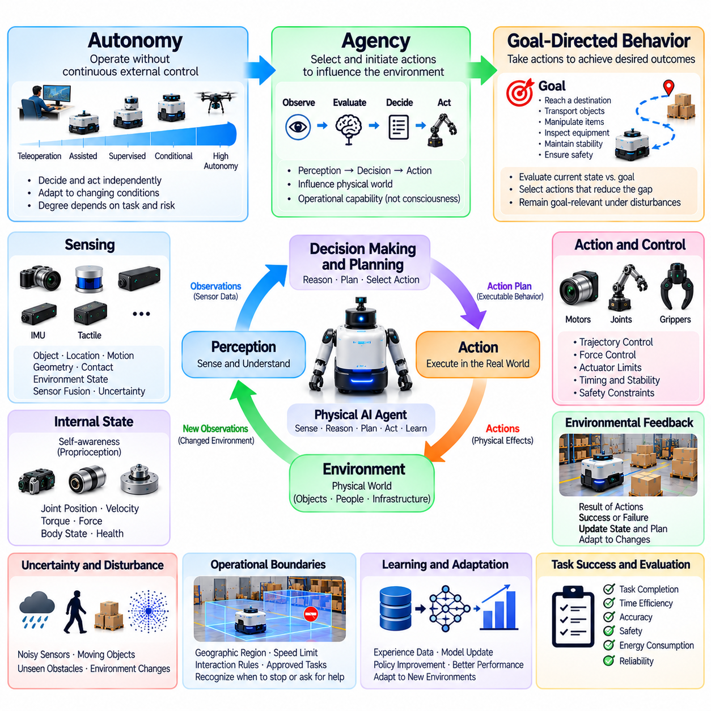{width="7.268055555555556in" height="7.268055555555556in"}

자율성(Autonomy), 행위 주체성(Agency), 목표 지향적 행동(Goal-Directed Behavior)은 피지컬 AI(Physical AI) 시스템이 물리적 세계(Physical World)에서 의사결정을 내리고 행동하는 방식을 설명하는 기본 개념(Fundamental Concepts)이다. 자율성은 지속적인 외부 제어(External Control) 없이 작동하는 능력을 의미하고, 행위 주체성은 행동을 선택하고 개시하는 능력(Capacity)을 나타내며, 목표 지향적 행동은 이러한 행동을 원하는 결과(Desired Outcomes)와 연결한다. 이러한 특성들은 지능형 물리 시스템(Intelligent Physical Systems)을 단순히 고정된 명령(Fixed Instructions)을 실행하는 기계와 구별한다.

자율성(Autonomy)은 단일한 보편적 능력(Universal Capability)이 아니라 연속적인 수준(Spectrum)으로 존재한다. 일부 시스템은 인간 감독(Human Supervision) 아래에서 사전에 정의된 행동(Predefined Actions)을 수행하는 반면, 다른 시스템은 독립적으로 환경 조건을 인식하고 전략을 선택하며 환경 변화(Environmental Changes)에 적응한다. 적절한 자율성 수준(Degree of Autonomy)은 작업 복잡도(Task Complexity), 운영 위험(Operational Risk), 시스템 신뢰성(System Reliability)에 따라 달라진다. 로봇은 특정 환경에서는 상당한 자율성을 보여주지만 다른 환경에서는 지원(Assistance)이 필요할 수 있다.

행위 주체성(Agency)은 지능형 시스템(Intelligent System)이 선택한 행동(Selected Actions)을 통해 환경에 영향을 미칠 수 있는 기능적 능력(Functional Ability)을 의미한다. 에이전트(Agent)는 관측값(Observations)을 수신하고, 사용 가능한 대안(Available Alternatives)을 평가하며, 물리적 조건(Physical Conditions)을 변화시키는 행동을 생성한다. 행위 주체성이 반드시 의식(Consciousness), 주관적 경험(Subjective Experience), 제한 없는 독립성(Unrestricted Independence)을 의미하는 것은 아니다. 피지컬 AI에서 행위 주체성은 주로 의사결정 능력(Decision-Making Capability), 행동 선택(Action Selection), 환경적 결과(Environmental Consequences) 사이의 운영적 관계(Operational Relationship)를 설명한다.

목표 지향적 행동(Goal-Directed Behavior)은 자율적 행동(Autonomous Action)에 목적(Purpose)과 방향(Direction)을 제공한다. 목표(Goal)는 목적지 도달(Reaching a Destination), 객체 배치(Positioning an Object), 검사 완료(Completing an Inspection), 환경 안정성 유지(Maintaining Environmental Stability)와 같은 원하는 조건(Desired Condition)을 지정한다. 에이전트는 현재 상황(Current Situation)을 이러한 목표와 비교하여 차이를 줄이기 위한 행동을 선택한다. 효과적인 행동(Effective Behavior)은 외란(Disturbances)과 변화하는 조건(Changing Conditions)에 대응하면서 목표와의 관련성(Goal Relevance)을 유지해야 한다.

목표(Goals)는 목표 상태(Target States), 작업 명세(Task Specifications), 성능 목표(Performance Objectives), 허용 가능한 결과에 대한 제약 조건(Constraints on Acceptable Outcomes)으로 표현할 수 있다. 이동 로봇(Mobile Robot)은 지정된 시간 내에 특정 위치에 도달해야 할 수 있으며, 매니퓰레이터(Manipulator)는 정의된 허용 오차(Defined Tolerance) 내에서 객체를 배치해야 할 수 있다. 목표 표현(Goal Representations)은 계획(Planning)과 평가(Evaluation)를 지원할 만큼 충분히 명확해야 한다. 모호한 목표(Ambiguous Objectives)는 국소적으로는 성공한 것처럼 보이지만 실제 작업 요구사항(Actual Task Requirements)을 충족하지 못하는 행동을 초래할 수 있다.

자율적 행동(Autonomous Behavior)을 위해서는 에이전트가 자신의 상황에 대한 내부 표현(Internal Representation)을 통해 관측값(Observations)을 의사결정(Decisions)과 연결해야 한다. 이러한 표현에는 위치(Position), 움직임(Motion), 주변 객체(Nearby Objects), 작업 진행 상태(Task Progress), 추정된 환경 조건(Estimated Environmental Conditions)이 포함될 수 있다. 에이전트는 사용 가능한 정보를 목표(Objectives)와 비교하고 적절한 대응(Appropriate Responses)을 선택한다. 관측값은 불완전하므로 자율적 의사결정(Autonomous Decisions)은 완벽한 환경 지식(Perfect Environmental Knowledge)을 가정하기보다 불확실성(Uncertainty)을 고려해야 한다.

의사결정 권한(Decision-Making Authority)은 자율성(Autonomy)의 중요한 차원(Dimension)이다. 시스템은 저수준 제어(Low-Level Control)를 독립적으로 실행하면서도 목적지 선택(Destination Selection)이나 주요 행동(Major Actions)의 승인을 인간 운영자(Human Operator)에게 의존할 수 있다. 다른 시스템은 작업 계획(Task Plans)을 생성하지만 위험 장비(Hazardous Equipment)와 상호작용하기 전에 승인(Authorization)을 요구할 수 있다. 이러한 구분은 어떤 의사결정이 에이전트에게 위임(Delegated)되고 어떤 의사결정이 외부 감독(External Supervision) 아래에 유지되는지를 명확하게 한다.

운영 경계(Operational Boundaries)는 자율적 행동(Autonomous Behavior)이 허용되는 조건을 정의한다. 이러한 경계에는 지리적 영역(Geographic Regions), 속도 제한(Speed Limits), 환경 요구사항(Environmental Requirements), 상호작용 제한(Interaction Restrictions), 승인된 작업 범주(Approved Task Categories)가 포함될 수 있다. 자율 에이전트(Autonomous Agent)는 이러한 조건이 위반되거나 더 이상 충족되지 않는 상황을 인식해야 한다. 운영 설계 영역(Operational Design Domain) 내에서 작동하는 것은 익숙하지 않은 상황까지 독립성을 극대화하는 것보다 중요한 경우가 많다.

목표 지향적 행동(Goal-Directed Behavior)은 작업 완료(Task Completion)에 대한 예상 기여도(Expected Contribution)를 바탕으로 행동을 선택하는 과정을 포함한다. 목적지를 향해 이동하는 로봇은 단순히 목표 방향으로 움직이는 것이 아니라 장애물(Obstacles), 사용 가능한 경로(Available Routes), 이동 제약(Movement Constraints)을 고려해야 한다. 매니퓰레이터(Manipulator)는 객체 이송(Object Transfer)을 시도하기 전에 파지 실행 가능성(Grasp Feasibility)을 평가해야 한다. 목표와 실행 가능한 행동(Feasible Actions) 사이의 이러한 관계는 목적성 있는 행동(Purposeful Behavior)을 제어되지 않은 물리적 활동(Uncontrolled Physical Activity)과 구별한다.

계획(Planning)은 시간에 따라 목표 지향적 행동(Goal-Directed Behavior)을 구성하는 메커니즘(Mechanism)을 제공한다. 복잡한 목표(Complex Objectives)는 중간 상태(Intermediate States), 조정된 행동 순서(Coordinated Action Sequences), 지속적인 진행 평가(Continuous Progress Evaluation)를 요구할 수 있다. 배송 로봇(Delivery Robot)은 수거 위치(Pickup Location)로 이동하고, 물품을 확보하며, 운송하고, 배송 완료를 확인할 수 있다. 계획은 이러한 단계를 연결하면서 환경 조건(Environmental Conditions)이나 작업 요구사항(Task Requirements)이 변화할 때 수정할 수 있도록 한다.

반응형 행동(Reactive Behavior)과 숙고형 행동(Deliberative Behavior)은 자율성(Autonomy)에 서로 다른 능력을 제공한다. 반응형 제어(Reactive Control)는 즉각적인 외란(Immediate Disturbances)에 빠르게 대응하도록 지원하며, 숙고형 추론(Deliberative Reasoning)은 장기적인 결과(Long-Term Consequences)와 대안 전략(Alternative Strategies)을 평가한다. 효과적인 자율 시스템(Autonomous Systems)은 작업 요구사항에 따라 이러한 메커니즘을 결합한다. 즉각적인 충돌 회피(Immediate Collision Avoidance)는 에이전트가 전체 목표(Overall Objective)를 포기하지 않으면서도 계획된 경로(Planned Route)보다 우선할 수 있다.

행위 주체성(Agency)은 에이전트가 자신의 행동 결과(Consequences of Its Own Actions)를 평가할 수 있을 때 의미를 갖는다. 센서(Sensors)에서 제공되는 피드백(Feedback)은 선택된 움직임(Selected Movement)이 의도한 효과(Intended Effect)를 달성했는지 또는 예상하지 못한 결과(Unexpected Result)를 발생시켰는지를 보여준다. 시스템은 이에 따라 행동을 수정하고, 내부 상태(Internal State)를 업데이트하거나, 계획을 재검토할 수 있다. 행동과 결과 사이의 이러한 연결은 사전에 정의된 명령(Predetermined Commands)의 단순한 반복이 아니라 적응형 의사결정(Adaptive Decision-Making)을 지원한다.

자율성(Autonomy)은 인식(Perception), 환경 동역학(Environmental Dynamics), 행동 실행(Action Execution)에 존재하는 불확실성(Uncertainty)을 고려해야 한다. 로봇은 익숙하지 않은 객체(Unfamiliar Objects), 변화하는 지형(Changing Terrain), 센서 성능 저하(Sensor Degradation), 예상하지 못한 인간 행동(Unexpected Human Behavior)을 마주할 수 있다. 신뢰성 있는 자율성(Reliable Autonomy)을 위해서는 신뢰도(Confidence)를 추정하고 사용 가능한 지식(Available Knowledge)에 적합한 행동을 선택해야 한다. 불확실성이 허용 가능한 한계(Acceptable Limits)를 초과하면 독립적인 운영을 계속하기보다 감속(Slowing Down), 지원 요청(Requesting Assistance), 안전 상태 진입(Entering a Safe State)이 바람직할 수 있다.

학습(Learning)은 경험(Experience)을 통해 환경 모델(Environmental Models), 행동 정책(Action Policies), 작업 전략(Task Strategies)을 개선함으로써 자율적 행동(Autonomous Behavior)을 강화할 수 있다. 반복적인 상호작용(Repeated Interactions)은 더욱 효율적인 경로(Efficient Routes), 신뢰성 있는 파지 구성(Reliable Grasp Configurations), 반복적으로 발생하는 운영 외란(Recurring Operational Disturbances)을 파악하도록 할 수 있다. 그러나 학습이 자동으로 안전한 자율성(Safe Autonomy)을 증가시키는 것은 아니다. 배포된 행동(Deployed Behavior)의 변경에는 운영 제약(Operational Constraints)의 지속적인 준수를 보장하기 위한 적절한 검증(Validation), 모니터링(Monitoring), 제어(Control)가 필요하다.

자율성(Autonomy)과 자동화(Automation)의 구분은 특히 중요하다. 자동화는 확립된 규칙(Established Rules)에 따라 사전에 정의된 절차(Predefined Procedures)를 실행하는 반면, 자율성은 일반적으로 변화하는 조건에 대응하여 행동을 선택하거나 적응시키는 능력을 포함한다. 기존 기계(Conventional Machine)는 환경 변화(Environmental Variation)를 이해하지 못하더라도 고정된 순서(Fixed Sequence)를 정확하게 반복할 수 있다. 자율 피지컬 AI 시스템(Autonomous Physical AI System)은 관측값이 기존 순서가 더 이상 적절하지 않음을 나타낼 때 행동을 조정해야 한다.

자율성(Autonomy)은 지능(Intelligence)과도 구별된다. 고도화된 추론(Advanced Reasoning)이 반드시 독립적인 행동(Independent Action)을 의미하지는 않기 때문이다. 시스템은 정교한 계획(Sophisticated Plans)을 생성하면서도 인간 승인(Human Approval)에 전적으로 의존할 수 있다. 반대로 단순한 제어기(Simple Controller)는 좁게 정의된 작업(Narrowly Defined Task) 내에서 독립적으로 작동할 수 있다. 따라서 피지컬 AI의 평가(Evaluation)는 의사결정의 품질(Decision Quality)과 물리적 환경에서 이를 실행하도록 부여된 권한(Execution Authority)을 모두 검토해야 한다.

인간과의 상호작용(Human Interaction)은 많은 자율 시스템(Autonomous Systems)에서 여전히 필수적이다. 운영자(Operators)는 목표(Objectives)를 정의하고, 제한사항(Restrictions)을 설정하며, 성능(Performance)을 감독하거나 예외적인 조건(Exceptional Conditions)에서 개입할 수 있다. 공유 자율성(Shared Autonomy)은 인간과 기계가 상호 보완적인 능력(Complementary Capabilities)을 작업 수행(Task Execution)에 기여하도록 한다. 효과적인 인터페이스(Effective Interfaces)는 시스템 의도(System Intentions), 운영 상태(Operational Status), 불확실성(Uncertainty), 개입 요구사항(Intervention Requirements)을 전달하여 인간 감독(Human Oversight)이 실질적인 의미를 유지하도록 해야 한다.

다중 자율 에이전트(Multiple Autonomous Agents)는 개별 목표(Individual Goals)가 상호작용하거나 충돌할 수 있기 때문에 협조 과제(Coordination Challenges)를 발생시킨다. 작업 공간(Workspace)을 공유하는 로봇은 서로의 움직임(Movements), 자원 요구사항(Resource Requirements), 운영 우선순위(Operational Priorities)를 고려해야 한다. 협력적 행동(Cooperative Behavior)에는 작업 할당(Task Allocation), 궤적 조정(Trajectory Coordination), 정보 교환(Information Exchange)이 포함될 수 있다. 집단 성능(Collective Performance)은 개별 안전 제약(Individual Safety Constraints)을 훼손하거나 불안정한 상호작용(Unstable Interactions)을 발생시키지 않으면서 공동 목표(Shared Objectives)를 달성하는 데 달려 있다.

안전(Safety)은 행위 주체성(Agency)과 자율적 의사결정(Autonomous Decision-Making)에 근본적인 한계(Fundamental Limits)를 부여한다. 에이전트는 작업 완료(Task Completion)를 충돌 제한(Collision Limits), 힘 제한(Force Restrictions), 인간 보호 요구사항(Human Protection Requirements)을 위반하는 정당화 근거로 삼아서는 안 된다. 안전 제약(Safety Constraints)은 계획(Planning), 행동 선택(Action Selection), 실행(Execution)에 영향을 미쳐야 한다. 허용할 수 없는 물리적 위험(Unacceptable Physical Risks)이 감지되면 보호 메커니즘(Protective Mechanisms)은 에이전트의 의도한 목표(Intended Goal)와 관계없이 자율적 의사결정을 무효화하거나 우선적으로 개입할 권한을 가져야 할 수 있다.

자율성 평가(Autonomy Evaluation)는 로봇이 할당된 작업(Assigned Tasks)을 완료했는지만 측정하는 것 이상을 요구한다. 관련 평가 요소에는 개입 빈도(Intervention Frequency), 의사결정 신뢰성(Decision Reliability), 운영 범위(Operational Coverage), 복구 능력(Recovery Capability), 적응성(Adaptability), 안전 성능(Safety Performance)이 포함된다. 평가는 독립적인 운영(Independent Operation)이 효과적으로 유지되는 조건과 감독(Supervision)이 필요한 조건을 식별해야 한다. 높은 자율성(High Autonomy)은 예측 가능한 행동(Predictable Behavior)과 허용 가능한 물리적 위험(Acceptable Physical Risk)이 함께 보장될 때에만 가치를 가진다.

궁극적으로 자율성(Autonomy), 행위 주체성(Agency), 목표 지향적 행동(Goal-Directed Behavior)은 지능형 물리적 운영(Intelligent Physical Operation)의 상호 보완적인 차원(Complementary Dimensions)을 설명한다. 자율성은 독립적인 의사결정(Independent Decision-Making)의 수준을 설정하고, 행위 주체성은 의사결정을 환경에 미치는 효과(Environmental Effects)와 연결하며, 목표는 목적성 있는 행동(Purposeful Action)을 평가하는 기준을 제공한다. 이러한 요소들의 통합은 피지컬 AI 시스템이 불확실성(Uncertainty)에 적응하고, 운영 경계(Operational Boundaries)를 준수하며, 책임 있는 인간 감독(Responsible Human Oversight)을 유지하면서 의미 있는 목표(Meaningful Objectives)를 추구하도록 한다.

## 01.08. State Observation Action and Outcome

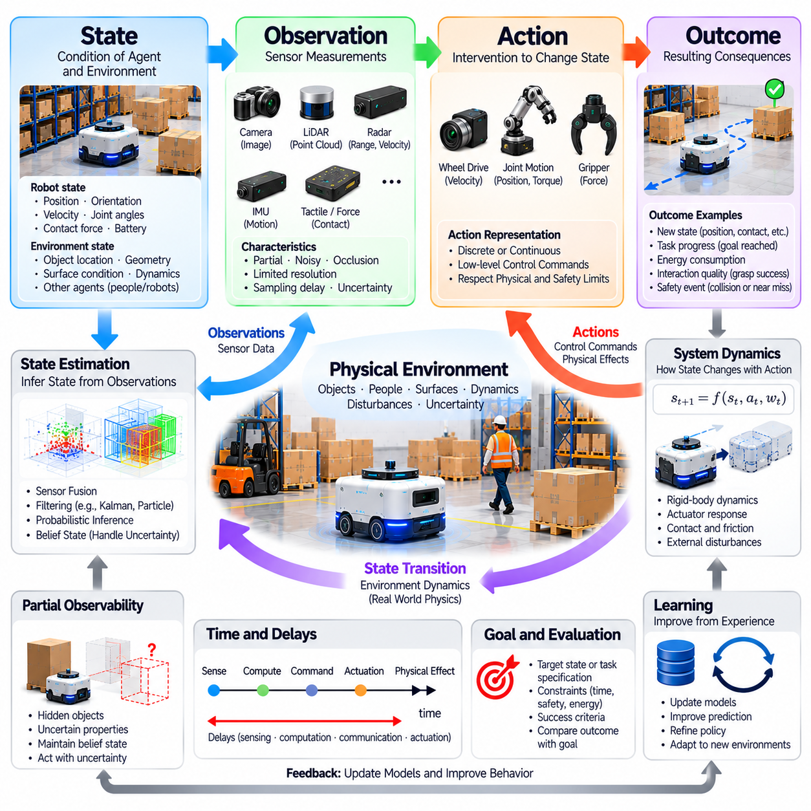{width="7.268055555555556in" height="7.268055555555556in"}

상태(State), 관측(Observation), 행동(Action), 결과(Outcome)는 피지컬 AI(Physical AI) 시스템이 물리적 세계(Physical World)와 상호작용하는 방식을 설명하는 기본 개념(Fundamental Concepts)이다. 상태는 에이전트(Agent)와 환경(Environment)의 조건을 나타내고, 관측은 해당 조건에 관한 측정 가능한 정보(Measurable Information)를 제공하며, 행동은 개입(Intervention)을 설명하고, 결과는 그에 따른 영향(Consequences)을 나타낸다. 이러한 요소들은 의사결정(Decision-Making), 환경 동역학(Environmental Dynamics), 목표 지향적 물리 행동(Goal-Directed Physical Behavior)을 이해하기 위한 프레임워크(Framework)를 형성한다.

상태(State)는 특정 시점(Particular Moment)에서 물리 시스템(Physical System)의 관련 특성(Relevant Properties)을 설명한다. 여기에는 로봇 위치(Robot Position), 방향(Orientation), 속도(Velocity), 관절 구성(Joint Configuration), 객체 위치(Object Locations), 접촉 조건(Contact Conditions), 환경 변수(Environmental Variables)가 포함될 수 있다. 적절한 상태 표현(State Representation)은 작업(Task)과 요구되는 정밀도(Required Precision)에 따라 달라진다. 내비게이션 시스템(Navigation System)은 공간 위치(Spatial Position)와 움직임(Motion)을 강조할 수 있지만, 조작 시스템(Manipulation System)은 객체 기하학(Object Geometry)과 접촉력(Contact Forces)에 관한 상세한 정보가 필요할 수 있다.

완전한 물리적 상태(Complete Physical State)를 지능형 에이전트(Intelligent Agent)가 직접 이용할 수 있는 경우는 드물다. 일부 특성은 숨겨져 있거나 측정하기 어렵거나 센서 한계(Sensor Limitations)의 영향을 받는다. 로봇은 자신의 대략적인 위치(Approximate Location)를 알고 있어도 바닥의 정확한 마찰계수(Precise Friction Coefficient)는 알지 못할 수 있다. 마찬가지로 매니퓰레이터(Manipulator)는 객체를 관측하더라도 내부 질량 분포(Internal Mass Distribution)는 알지 못할 수 있다. 따라서 피지컬 AI는 세계의 실제 상태(Actual State)와 의사결정에 사용할 수 있는 정보(Available Information)를 구분해야 한다.

관측(Observation)은 센서(Sensors)나 기타 측정 메커니즘(Measurement Mechanisms)을 통해 획득한 정보를 의미한다. 카메라(Cameras)는 이미지(Images)를 생성하고, 라이다(LiDAR)는 공간 측정값(Spatial Measurements)을 제공하며, 관성 센서(Inertial Sensors)는 움직임 관련 물리량(Motion-Related Quantities)을 보고하고, 힘 센서(Force Sensors)는 기계적 상호작용(Mechanical Interactions)을 측정한다. 관측값(Observations)은 물리적 상태(Physical States)로부터 생성되지만 반드시 해당 상태를 완전하게 드러내지는 않는다. 측정 잡음(Measurement Noise), 가림 현상(Occlusion), 제한된 해상도(Limited Resolution), 샘플링 지연(Sampling Delays)은 실제 현실(Reality)과 관측 정보(Observed Information) 사이의 차이를 발생시킬 수 있다.

상태 추정(State Estimation)은 관측값(Observations)을 현재 물리적 상황(Current Physical Situation)에 대한 추론된 표현(Inferred Representation)으로 변환한다. 알고리즘(Algorithms)은 여러 센서의 측정값을 운동 모델(Motion Models) 및 이전 추정값(Previous Estimates)과 결합할 수 있다. 필터링(Filtering), 센서 융합(Sensor Fusion), 확률적 추론(Probabilistic Inference)과 같은 기법은 모호성(Ambiguity)을 줄이고 일관성(Consistency)을 향상시키는 데 도움이 된다. 이렇게 생성된 추정값은 계획(Planning)과 제어(Control)를 지원하지만, 정확도(Accuracy)는 센서 품질(Sensor Quality), 모델링 가정(Modeling Assumptions), 환경 조건(Environmental Conditions)에 따라 달라진다.

상태(State)와 관측(Observation)의 구분은 부분 관측 가능성(Partial Observability)이 존재하는 상황에서 특히 중요하다. 에이전트(Agent)는 관련 객체(Relevant Objects)가 일시적으로 가려져 있거나 환경 특성(Environmental Properties)이 불확실한 상태에서도 행동해야 할 수 있다. 신념 상태(Belief State)를 유지하면 시스템은 가능한 조건(Possible Conditions)과 이에 연관된 신뢰도(Associated Confidence)를 표현할 수 있다. 이러한 접근법은 불확실한 측정값(Uncertain Measurements)을 의심할 여지가 없는 사실(Unquestionable Facts)로 취급하지 않고 불완전한 지식(Incomplete Knowledge)을 고려한 의사결정을 지원한다.

행동(Action)은 에이전트나 환경의 물리적 상태(Physical State)에 영향을 미칠 수 있는 의사결정(Decision)을 나타낸다. 행동에는 바퀴 속도(Wheel Velocities) 명령, 로봇 관절(Robotic Joints) 이동, 파지력(Gripping Forces) 적용, 조향각(Steering Angles) 조정, 운영 설정(Operational Settings) 변경이 포함될 수 있다. 행동의 표현(Action Representation)은 이산형(Discrete), 연속형(Continuous), 계층형(Hierarchical)일 수 있다. 적절한 행동 공간(Action Space)은 기계적 능력(Mechanical Capabilities), 제어 아키텍처(Control Architecture), 작업 목표(Task Objectives), 운영 제약(Operational Constraints)에 따라 결정된다.

행동(Actions)은 그에 따른 물리적 결과(Physical Consequences)와 동일하지 않다. 명령된 움직임(Commanded Movement)은 마찰(Friction), 액추에이터 한계(Actuator Limitations), 예상하지 못한 접촉(Unexpected Contact), 외부 외란(External Disturbances)으로 인해 예상과 다른 변위(Displacement)를 발생시킬 수 있다. 객체가 미끄러지거나 기하학적 구조(Geometry)가 예상과 다르면 파지 명령(Grasp Command)이 실패할 수 있다. 따라서 피지컬 AI는 시스템 동작(System Behavior)을 평가할 때 의도한 행동(Intended Actions), 실행된 제어 신호(Executed Control Signals), 실제 환경 변화(Actual Environmental Changes)를 구분해야 한다.

상태(State)와 행동(Action) 사이의 관계는 시스템 동역학(System Dynamics)을 통해 설명된다. 동역학(Dynamics)은 행동과 외부 영향(External Influences)이 가해졌을 때 물리 시스템(Physical System)이 어떻게 변화하는지를 결정한다. 이러한 관계에는 강체 역학(Rigid-Body Mechanics), 액추에이터 응답(Actuator Response), 접촉력(Contact Forces), 환경 상호작용(Environmental Interactions)이 포함될 수 있다. 수학적 모델(Mathematical Models)은 상태 전이(State Transitions)를 근사할 수 있지만, 실제 세계의 불확실성(Real-World Uncertainty)으로 인해 동일한 명령(Identical Commands)이 항상 동일한 결과(Identical Outcomes)를 생성하는 것은 아니다.

결과(Outcome)는 하나의 행동 또는 일련의 행동(Action Sequence)에 따른 관측되거나 평가된 영향(Observed or Evaluated Consequence)을 나타낸다. 결과에는 새로운 물리적 상태(New Physical State), 작업 진행 정도(Task Progress), 에너지 소비(Energy Consumption), 상호작용 품질(Interaction Quality), 안전 관련 사건(Safety-Related Event)이 포함될 수 있다. 결과는 선택된 행동(Selected Behavior)이 의도한 목적(Intended Purpose)을 달성했는지에 관한 증거(Evidence)를 제공한다. 성공적인 결과(Successful Outcome)는 액추에이터(Actuator)가 명령을 실행했는지만으로 판단할 수 없으며 작업 요구사항(Task Requirements)에 따라 평가해야 한다.

상태 전이(State Transitions)는 연속적인 물리적 상호작용(Physical Interaction)의 시점들을 연결한다. 각 단계에서 에이전트(Agent)는 추정된 상태(Estimated State)에서 시작하여 행동(Action)을 선택하고, 시스템 동역학(System Dynamics)과 외란(Disturbances)의 영향을 받은 결과 상태(Resulting State)에 도달한다. 새로운 관측값(New Observations)은 실제로 발생한 전이(Actual Transition)에 관한 증거를 제공한다. 이러한 반복적인 관계(Recurring Relationship)는 피드백 제어(Feedback Control), 순차적 의사결정(Sequential Decision-Making), 적응형 피지컬 AI 행동(Adaptive Physical AI Behavior)의 기반을 형성한다.

시간(Time)은 상태(State), 관측(Observation), 행동(Action), 결과(Outcome)의 필수적인 차원(Essential Dimension)이다. 센서 측정값(Sensor Measurements)은 서로 다른 시점의 조건을 나타낼 수 있으며, 명령(Commands)은 액추에이터(Actuators)에 도달하여 효과를 발생시키기까지 시간이 필요하다. 에이전트는 샘플링 간격(Sampling Intervals), 통신 지연(Communication Delays), 계산 시간(Computation Time), 기계적 응답(Mechanical Response)을 고려해야 한다. 시간적 일관성(Temporal Consistency)이 없으면 정확한 측정값이라도 표현된 조건이 이미 오래된 정보(Outdated Information)이기 때문에 부적절한 의사결정을 초래할 수 있다.

상태 표현(State Representations)은 완전성(Completeness)과 계산 효율성(Computational Efficiency) 사이의 균형을 유지해야 한다. 측정 가능한 모든 변수(Measurable Variables)를 포함하면 불필요한 복잡성(Unnecessary Complexity)이 발생할 수 있으며, 중요한 정보를 제외하면 예측(Prediction)과 제어(Control)의 성능이 저하될 수 있다. 실용적인 표현(Practical Representation)은 작업 의사결정(Task Decisions)과 물리적 결과(Physical Outcomes)에 실질적인 영향을 미치는 특성을 보존해야 한다. 따라서 서로 다른 처리 계층(Processing Layers)은 즉각적인 제어(Immediate Control), 지역 계획(Local Planning), 장기 추론(Long-Term Reasoning)에 적합한 별도의 표현을 유지할 수 있다.

관측(Observations)은 에이전트의 행동(Agent Behavior)에 의해 능동적으로 영향을 받을 수도 있다. 로봇은 가려진 객체(Occluded Object)를 검사하기 위해 카메라를 움직이거나, 자기 위치 추정(Localization)을 개선하기 위해 위치를 변경하거나, 표면 저항(Surface Resistance)을 추정하기 위해 작은 힘(Small Force)을 가할 수 있다. 이러한 행동은 물리적 조건(Physical Conditions)을 변화시키면서 정보를 수집한다. 능동적 인식(Active Perception)은 감지(Sensing)와 행동(Action)이 완전히 분리된 지능형 운영(Intelligent Operation)의 단계가 아니라 상호 연결된 과정(Interconnected Processes)임을 보여준다.

예측(Prediction)은 추정된 상태(Estimated States)와 후보 행동(Candidate Actions)을 사용하여 가능한 결과(Possible Outcomes)를 예상한다. 내비게이션 시스템(Navigation System)은 미래 위치(Future Positions)와 충돌 위험(Collision Risks)을 추정할 수 있으며, 매니퓰레이터(Manipulator)는 접촉력(Contact Forces)과 객체 움직임(Object Motion)을 예측할 수 있다. 이러한 예측은 에이전트가 실행 전에 대안(Alternatives)을 비교하도록 한다. 모델 정확도(Model Accuracy)에는 한계가 있으므로 예측 결과(Predicted Outcomes)는 새롭게 관측된 증거(Newly Observed Evidence)와 적절한 불확실성 추정값(Uncertainty Estimates)을 사용하여 지속적으로 업데이트해야 한다.

계획(Planning)은 원하는 결과(Desired Outcomes)와 사용 가능한 제약 조건(Available Constraints)에 따라 행동을 선택한다. 로봇은 더 높은 안전성(Safety)을 제공한다면 더 긴 경로(Longer Route)를 선호할 수 있으며, 자기 위치 추정 불확실성(Localization Uncertainty)이 증가하면 이동 속도(Movement Speed)를 낮출 수 있다. 상태(State), 행동(Action), 결과(Outcome) 사이의 관계는 계획 알고리즘(Planning Algorithms)이 진행 정도(Progress), 효율성(Efficiency), 위험(Risk) 사이의 절충 관계(Tradeoffs)를 평가하도록 한다. 효과적인 계획(Effective Planning)은 즉각적인 결과(Immediate Consequences)뿐 아니라 작업 완료(Task Completion)에 미치는 장기적인 영향(Longer-Term Effects)도 고려해야 한다.

피드백(Feedback)은 의도한 결과(Intended Outcomes)와 실제 결과(Actual Outcomes) 사이의 관계를 폐루프(Closed Loop)로 연결한다. 행동이 실행된 후 에이전트(Agent)는 새로운 관측값(New Observations)을 예상된 변화(Expected Changes)와 비교하고 관련 편차(Relevant Deviations)를 식별한다. 이러한 차이는 제어 명령(Control Commands), 상태 추정값(State Estimates), 미래 계획(Future Plans)의 수정을 유발할 수 있다. 반복적인 피드백(Repeated Feedback)은 불완전한 모델(Imperfect Models), 변화하는 환경(Changing Environments), 외란(Disturbances)에도 시스템이 목표(Objectives)와의 일치성을 유지하도록 한다.

학습(Learning)은 상태(State), 관측(Observation), 행동(Action), 결과(Outcome)의 연속적인 기록(Sequences)을 활용하여 미래 의사결정(Future Decisions)을 개선할 수 있다. 기록된 경험(Recorded Experiences)은 예측이 실패한 사례를 포함하여 명령(Commands)과 물리적 결과(Physical Consequences) 사이의 관계를 드러낸다. 이러한 데이터는 시스템 식별(System Identification), 모델 개선(Model Refinement), 모방 학습(Imitation Learning), 강화 학습(Reinforcement Learning)을 지원할 수 있다. 그러나 학습된 관계(Learned Relationships)는 안전 필수 물리적 운영(Safety-Critical Physical Operations)에서 신뢰하기 전에 반드시 검증(Validation)되어야 한다.

안전(Safety)을 위해서는 어떤 상태(States), 행동(Actions), 결과(Outcomes)가 허용 가능한지 명시적으로 고려해야 한다. 안전하지 않은 상태(Unsafe States)에는 과도한 속도(Excessive Speed), 불안정한 구성(Unstable Configurations), 사람과의 위험한 근접(Hazardous Proximity to People)이 포함될 수 있다. 안전하지 않은 행동(Unsafe Actions)은 힘 제한(Force Limits)을 초과하거나 운영 경계(Operational Boundaries)를 위반할 수 있다. 안전 메커니즘(Safety Mechanisms)은 가능한 경우 금지된 상태 전이(Prohibited Transitions)를 방지하고, 예상하지 못한 조건(Unexpected Conditions)이 발생하면 일반적인 작업 최적화(Ordinary Task Optimization)와 독립적으로 보호 대응(Protective Responses)을 제공해야 한다.

피지컬 AI의 평가(Evaluation)는 개별 행동 정확도(Isolated Action Accuracy) 이상의 측정을 요구한다. 상태 추정 오차(State-Estimation Error), 관측 품질(Observation Quality), 상태 전이 예측 오차(Transition Prediction Error), 실행 신뢰성(Execution Reliability), 결과 일관성(Outcome Consistency)은 모두 시스템 성능(System Performance)에 기여한다. 작업 완료(Task Completion)와 안전성(Safety)도 현실적인 운영 조건(Realistic Operating Conditions)에서 평가되어야 한다. 올바른 명령(Correct Commands)을 생성하더라도 허용할 수 없는 결과(Unacceptable Outcomes)를 반복적으로 발생시키는 시스템은 신뢰성 있는 지능(Reliable Intelligence)을 갖추었다고 평가할 수 없다.

궁극적으로 상태(State), 관측(Observation), 행동(Action), 결과(Outcome)는 지능형 물리 상호작용(Intelligent Physical Interaction)을 설명하기 위한 공통 언어(Common Language)를 제공한다. 상태는 관련 물리적 조건(Relevant Physical Conditions)을 나타내고, 관측은 증거(Evidence)를 제공하며, 행동은 목적성 있는 개입(Purposeful Intervention)을 수행하고, 결과는 실제로 발생한 상황(What Actually Happened)을 드러낸다. 이들의 지속적인 관계(Continuous Relationship)는 인식(Perception), 예측(Prediction), 계획(Planning), 제어(Control), 학습(Learning)을 지원한다. 피지컬 AI는 이러한 요소들이 신뢰성 있는 피드백(Reliable Feedback)과 목표 지향적 적응(Goal-Directed Adaptation)을 통해 일관되게 연결될 때 효과적으로 작동한다.

## 01.09. Closed Loop Intelligence

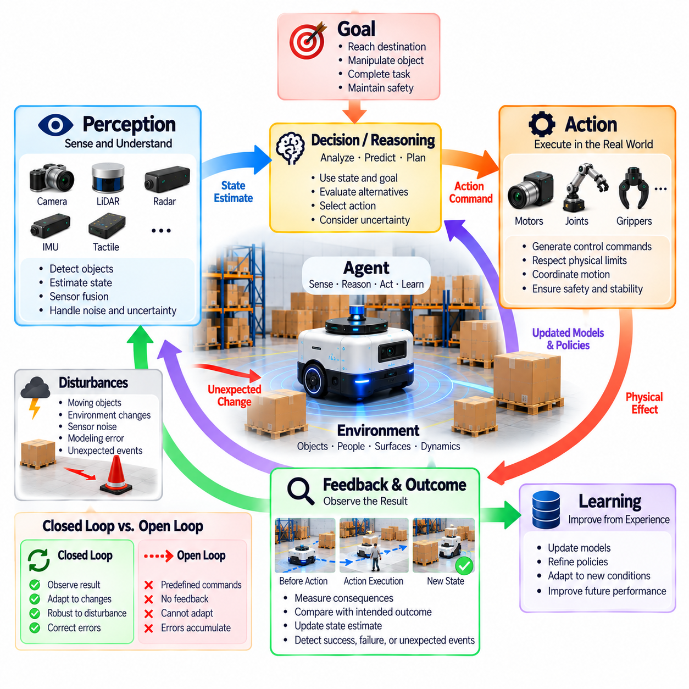{width="7.268055555555556in" height="7.268055555555556in"}

폐루프 지능(Closed-Loop Intelligence)은 지능형 행동(Intelligent Behavior)이 인식(Perception), 의사결정(Decision-Making), 행동(Action), 환경 피드백(Environmental Feedback)을 지속적으로 연결하는 과정에 의존하기 때문에 피지컬 AI(Physical AI)의 핵심 원리(Defining Principle)이다. 명령의 결과를 평가하지 않고 실행하는 시스템과 달리, 폐루프 에이전트(Closed-Loop Agent)는 자신의 행동이 미치는 영향(Effects)을 관측하고 이후의 행동을 조정한다. 이러한 반복 과정(Recurring Process)은 물리 시스템(Physical Systems)이 불확실성(Uncertainty), 외란(Disturbances), 변화하는 운영 조건(Changing Operating Conditions) 속에서도 목표를 추구할 수 있도록 한다.

폐루프(Closed Loop)는 에이전트(Agent)가 환경을 측정하고 물리 시스템(Physical System)의 현재 상태(Current State)를 추정하는 과정에서 시작된다. 센서(Sensors)는 위치(Position), 움직임(Motion), 객체(Objects), 접촉 조건(Contact Conditions), 운영 상태(Operational Status)에 관한 관측값(Observations)을 제공한다. 이러한 관측값은 원하는 상태(Desired State) 또는 작업 목표(Task Objective)를 기준으로 해석된다. 이후 에이전트는 행동(Action)을 선택하고 물리적 액추에이터(Physical Actuators)를 통해 실행하며, 발생한 변화를 측정하여 수정이 필요한지 판단한다.

개루프 운영(Open-Loop Operation)은 폐루프 운영(Closed-Loop Operation)과 중요한 대조를 이룬다. 개루프 제어기(Open-Loop Controller)는 실행 중 측정된 결과(Measured Outcomes)를 사용하여 행동을 수정하지 않고 사전에 결정된 명령(Predetermined Commands)을 실행한다. 이러한 제어는 환경 조건(Environmental Conditions)과 시스템 동역학(System Dynamics)의 예측 가능성이 높을 때 효과적일 수 있다. 그러나 마찰(Friction), 적재 하중(Payload), 액추에이터 응답(Actuator Response), 외력(External Forces)의 변화는 예상하지 못한 결과(Unexpected Results)를 발생시킬 수 있다. 폐루프 운영은 측정된 피드백(Measured Feedback)을 반영하여 이러한 편차(Deviations)를 보상한다.

피드백(Feedback)은 의도한 행동(Intended Behavior)을 실제 물리적 결과(Actual Physical Consequences)와 연결하는 메커니즘(Mechanism)이다. 로봇이 목표 지점(Target)을 향해 이동할 때 위치 측정값(Position Measurements)은 실제 궤적(Actual Trajectory)이 계획된 경로(Planned Path)와 일치하는지를 보여준다. 매니퓰레이터(Manipulator)가 객체를 파지할 때 힘 측정값(Force Measurements)과 촉각 측정값(Tactile Measurements)은 접촉이 안정적으로 유지되는지를 나타낸다. 이러한 관측값을 통해 제어기(Controller)는 편차를 식별하고 작은 오차(Small Errors)가 작업 실패(Task Failures)로 확대되기 전에 보정 행동(Corrective Actions)을 생성할 수 있다.

폐루프 지능(Closed-Loop Intelligence)은 인식(Perception), 예측(Prediction), 추론(Reasoning), 적응(Adaptation)을 통합함으로써 기존의 피드백 제어(Conventional Feedback Control)를 넘어선다. 전통적인 제어기(Traditional Controller)는 사전에 정의된 수학적 관계(Mathematical Relationships)를 사용하여 속도(Velocity)나 위치(Position)를 조절할 수 있다. 반면 지능형 에이전트(Intelligent Agent)는 복잡한 장면(Complex Scenes)을 해석하고, 숨겨진 조건(Hidden Conditions)을 추정하며, 목표(Goals)를 재검토하고, 전략(Strategies)을 수정할 수 있다. 핵심적인 특징은 알고리즘의 복잡성(Algorithmic Complexity) 자체가 아니라 환경적 증거(Environmental Evidence)를 지속적으로 활용하여 물리적 행동을 결정한다는 점이다.

상태 추정(State Estimation)은 피드백 측정값(Feedback Measurements)이 현실(Reality)을 완전하게 설명하는 경우가 드물기 때문에 필수적이다. 센서 잡음(Sensor Noise), 가림 현상(Occlusion), 지연 시간(Latency), 보정 오차(Calibration Errors)는 관측값(Observations)을 왜곡할 수 있다. 에이전트(Agent)는 사용 가능한 측정값을 이전 추정값(Previous Estimates) 및 시스템 동역학 모델(System Dynamics Models)과 결합하여 현재 상태(Current Condition)를 추론한다. 신뢰성 있는 폐루프 행동(Reliable Closed-Loop Behavior)은 이후 의사결정에 영향을 미칠 수 있는 불확실성(Uncertainty)을 인식하면서 충분히 정확한 상태 추정값(State Estimates)을 유지하는 데 달려 있다.

피드백의 시간적 구조(Temporal Structure)는 시스템 성능(System Performance)에 큰 영향을 미친다. 센서(Sensors)는 유한한 샘플링 간격(Sampling Intervals)으로 물리적 조건을 측정하고, 계산(Computation)에는 처리 시간(Processing Time)이 필요하며, 액추에이터(Actuators)는 기계적 지연(Mechanical Delays)을 수반한다. 과도한 지연 시간(Excessive Latency)은 관련 조건이 이미 변화한 후에 보정 명령(Corrective Commands)이 도달하도록 만들 수 있다. 따라서 폐루프 지능은 안정적이고 반응성이 높은 행동(Stable and Responsive Behavior)을 유지하기 위해 감지(Sensing), 통신(Communication), 계산(Computation), 구동(Actuation) 사이의 조정된 시간 관리(Coordinated Timing)를 요구한다.

서로 다른 물리적 과정(Physical Processes)은 서로 다른 피드백 주기(Feedback Rates)를 필요로 한다. 모터 전류(Motor Current)와 관절 토크(Joint Torque)는 빠른 조절(Rapid Regulation)이 필요할 수 있지만, 경로 계획(Route Planning)이나 작업 일정 관리(Task Scheduling)는 더 느린 주기로 작동할 수 있다. 따라서 로봇은 서로 다른 주파수(Frequencies)로 작동하는 여러 개의 상호 연결된 제어 루프(Interconnected Control Loops)를 포함할 수 있다. 고속 루프(Fast Loops)는 즉각적인 물리적 안정성(Physical Stability)을 유지하고, 저속 루프(Slower Loops)는 환경 이해(Environmental Understanding)를 업데이트하고 계획을 수정하며 장기 목표(Long-Term Objectives)를 조정한다.

예측(Prediction)은 에이전트가 후보 행동(Candidate Actions)의 결과를 미리 예상하도록 하여 폐루프 지능(Closed-Loop Intelligence)을 강화한다. 이동 로봇(Mobile Robot)은 장애물(Obstacle)에 접근하기 전에 제동 거리(Braking Distance)를 추정할 수 있으며, 매니퓰레이터(Manipulator)는 접촉 중 객체 움직임(Object Motion)을 예측할 수 있다. 예측 모델(Predictive Models)은 순수한 반응형 보정(Reactive Corrections)을 넘어 선제적인 의사결정(Proactive Decisions)을 지원한다. 이러한 모델의 유용성은 예측 결과(Predicted Outcomes)를 실제 관측값(Actual Observations)과 비교하고 불일치(Discrepancies)가 발생할 때 가정(Assumptions)을 업데이트하는 능력에 달려 있다.

모델 예측 제어(Model Predictive Control)는 예측(Prediction)과 피드백(Feedback)이 함께 작동하는 방식을 보여준다. 각 의사결정 단계(Decision Step)에서 제어기(Controller)는 현재 상태(Current State)를 추정하고, 가능한 미래 궤적(Future Trajectories)을 예측하며, 목표(Objectives)와 제약 조건(Constraints)에 따라 행동을 선택한다. 계획의 일부를 실행한 후 새로운 측정값(New Measurements)을 획득하고 최적화(Optimization)를 반복한다. 이러한 반복적 재계획(Repeated Replanning)은 외란(Disturbances)에 대응하는 데 도움이 되지만, 효과는 모델 품질(Model Quality)과 계산 가능성(Computational Feasibility)에 따라 달라진다.

폐루프 지능(Closed-Loop Intelligence)은 미래 관측(Future Observations)을 개선하기 위한 목적으로 행동을 선택하는 능동적 인식(Active Perception)도 지원한다. 로봇은 가려진 객체(Occluded Object)를 검사하기 위해 카메라 위치를 변경하거나, 자기 위치 추정 불확실성(Localization Uncertainty)을 줄이기 위해 기준 지형지물(Landmark)에 더 가까이 이동할 수 있다. 이러한 행동은 환경(Environment)과 이후 의사결정에 사용할 수 있는 정보(Available Information) 모두에 영향을 미친다. 따라서 인식(Perception)과 제어(Control)는 통합된 지능형 과정(Integrated Intelligent Process)에서 상호 의존적인 구성 요소(Mutually Dependent Components)가 된다.

외란 억제(Disturbance Rejection)는 폐루프 물리 시스템(Closed-Loop Physical Systems)의 핵심 능력(Central Capability)이다. 외력(External Forces), 변화하는 지형(Changing Terrain), 예상하지 못한 장애물(Unexpected Obstacles), 객체 특성(Object Properties)의 변화는 계획된 행동(Planned Actions)을 방해할 수 있다. 피드백(Feedback)을 통해 에이전트는 편차(Deviations)를 감지하고 사용 가능한 기계적 한계(Mechanical Limits) 내에서 행동을 조정할 수 있다. 효과적인 외란 억제를 위해서는 복구 가능한 변화(Recoverable Variations)와 시스템의 안전 운영 능력(Safe Operating Capabilities)을 초과하는 조건을 구분해야 한다.

학습(Learning)은 경험(Experience)을 통해 모델(Models), 정책(Policies), 피드백 응답(Feedback Responses)을 개선함으로써 폐루프 행동(Closed-Loop Behavior)을 향상시킬 수 있다. 반복적인 상호작용(Repeated Interactions)은 체계적인 예측 오차(Systematic Prediction Errors), 액추에이터 특성(Actuator Characteristics), 환경 패턴(Environmental Patterns)을 드러낸다. 에이전트는 관측된 결과(Observed Outcomes)를 바탕으로 제어 매개변수(Control Parameters)를 조정하거나 행동 선택(Action Selection)을 개선할 수 있다. 그러나 학습 메커니즘(Learning Mechanisms)은 특히 실제 환경 배포(Real-World Deployment) 과정에서 안정성 요구사항(Stability Requirements)과 안전 제약(Safety Constraints)을 준수해야 한다.

강건성(Robustness)은 모델(Models)과 측정값(Measurements)이 불완전한 상황에서도 허용 가능한 성능(Acceptable Performance)을 유지하는 능력에 달려 있다. 폐루프 시스템(Closed-Loop System)은 불안정하거나 과도한 보정(Unstable or Excessive Corrections)을 발생시키지 않으면서 합리적인 수준의 불확실성(Reasonable Uncertainty)을 견뎌야 한다. 강건 제어 기법(Robust Control Methods), 불확실성 인지 계획(Uncertainty-Aware Planning), 보호 한계(Protective Limits)는 이러한 목표를 지원할 수 있다. 피드백 자체가 신뢰성을 보장하는 것은 아니며, 잘못된 측정값(Incorrect Measurements)이나 부적절하게 설계된 제어기(Poorly Designed Controllers)는 외란을 증폭시킬 수 있다.

안전 모니터링(Safety Monitoring)은 폐루프 지능(Closed-Loop Intelligence)의 필수적인 부분을 구성한다. 에이전트(Agent)는 자신의 행동이 허용된 속도(Speed), 힘(Force), 거리(Distance), 안정성(Stability)의 한계 내에 있는지를 평가해야 한다. 위험 조건(Hazardous Conditions)이 감지되면 보호 제어(Protective Control)는 움직임을 줄이거나 계획을 수정하거나 안전 정지(Safe Stop)를 시작할 수 있다. 특히 물리적 피해(Physical Harm)를 방지하기 위해 신속한 개입(Rapid Intervention)이 필요한 경우, 안전 필수 대응(Safety-Critical Responses)은 고수준 추론(High-Level Reasoning)에만 의존해서는 안 된다.

인간 감독(Human Supervision)도 폐루프 아키텍처(Closed-Loop Architecture)에 참여할 수 있다. 운영자(Operators)는 시스템 상태(System Status)를 관측하고, 목표(Objectives)를 수정하며, 민감한 행동(Sensitive Actions)을 승인하거나 자율성(Autonomy)의 신뢰성이 저하될 때 개입할 수 있다. 운영자에게 반환되는 정보(Returned Information)는 로봇 내부 제어 과정(Internal Control Processes)의 상위에 감독 피드백 루프(Supervisory Feedback Loop)를 형성한다. 효과적인 통합(Effective Integration)을 위해서는 시스템 의도(System Intentions), 불확실성(Uncertainty), 운영 경계(Operating Boundaries), 개입 권한(Intervention Authority)을 명확하게 전달해야 한다.

분산형 피지컬 AI 시스템(Distributed Physical AI Systems)은 개별 로봇(Individual Robots), 엣지 컴퓨터(Edge Computers), 공유 기반시설(Shared Infrastructure)에 걸쳐 피드백 루프(Feedback Loops)를 구성할 수 있다. 로컬 제어기(Local Controllers)는 즉각적인 물리적 응답(Immediate Physical Responses)을 관리하고, 상위 서비스(Higher-Level Services)는 작업을 조정하며 더 넓은 환경 정보(Broader Environmental Information)를 해석한다. 통신 지연(Communication Delays)과 네트워크 중단(Network Interruptions)은 책임의 신중한 분배(Careful Allocation of Responsibilities)를 요구한다. 안전 필수 제어(Safety-Critical Control)는 원격 조정(Remote Coordination)이 일시적으로 불가능해지더라도 효과적으로 유지되어야 한다.

폐루프 지능(Closed-Loop Intelligence)의 평가는 시스템이 현실적인 조건(Realistic Conditions)에서 오류를 얼마나 일관되게 감지하고 행동을 수정하는지를 검토해야 한다. 관련 지표(Relevant Measures)에는 추종 정확도(Tracking Accuracy), 응답 시간(Response Time), 안정성(Stability), 복구 성공률(Recovery Success), 외란 허용 능력(Disturbance Tolerance), 작업 완료(Task Completion)가 포함된다. 시험(Testing)에는 대표적인 불확실성(Representative Uncertainty), 센서 성능 저하(Sensor Degradation), 환경 변화(Environmental Variation)가 포함되어야 한다. 신뢰성 있는 성능(Reliable Performance)은 알고리즘의 정교함(Algorithmic Sophistication)만으로 추론하는 것이 아니라 실제 물리적 결과(Physical Outcomes)를 통해 입증되어야 한다.

궁극적으로 폐루프 지능(Closed-Loop Intelligence)은 피지컬 AI를 에이전트(Agent)와 환경(Environment) 사이의 적응적 관계(Adaptive Relationship)로 전환한다. 인식(Perception)은 증거(Evidence)를 제공하고, 상태 추정(State Estimation)은 상황적 맥락(Context)을 확립하며, 추론(Reasoning)은 행동(Actions)을 선택하고, 피드백(Feedback)은 그 결과(Consequences)를 드러낸다. 예측(Prediction)과 학습(Learning)은 시간이 지남에 따라 이러한 과정을 개선하며, 안전 제약(Safety Constraints)은 허용 가능한 행동(Acceptable Behavior)을 정의한다. 효과적인 피지컬 AI는 조정되고 신뢰성 있는 피드백(Coordinated and Reliable Feedback)을 통해 의도한 목표(Intended Objectives)와 관측된 물리적 현실(Observed Physical Reality) 사이의 차이를 지속적으로 조정한다.

## 01.10. Uncertainty and Partial Observability

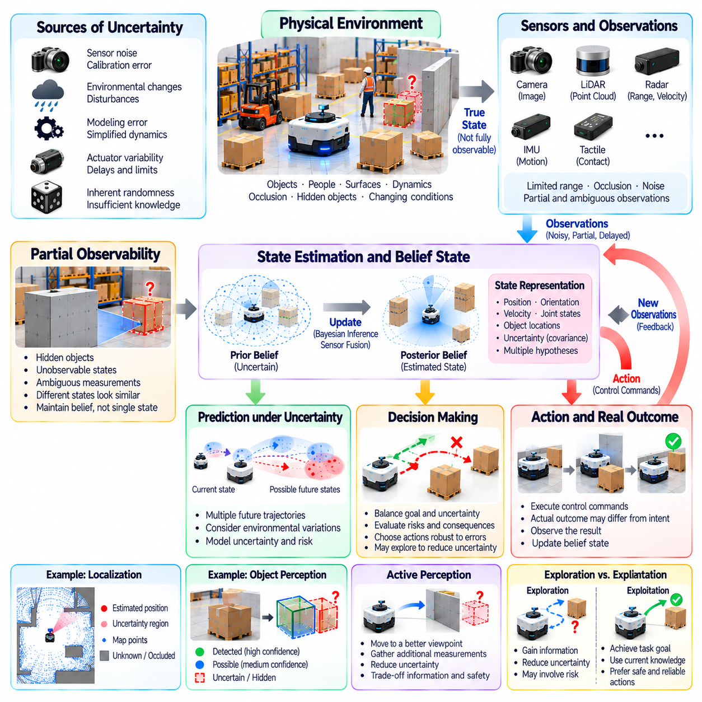{width="7.268055555555556in" height="7.268055555555556in"}

불확실성(Uncertainty)과 부분 관측 가능성(Partial Observability)은 지능형 에이전트(Intelligent Agent)가 환경(Environment)에 대한 완전하고 정확한 지식(Complete and Accurate Knowledge)을 확보하는 경우가 드물기 때문에 피지컬 AI(Physical AI)의 근본적인 조건(Fundamental Conditions)이다. 센서(Sensors)는 제한된 측정값(Limited Measurements)을 제공하고, 물리적 과정(Physical Processes)에는 예측하기 어려운 변동(Unpredictable Variations)이 존재하며, 행동(Actions)은 예상하지 못한 결과(Unexpected Consequences)를 발생시킬 수 있다. 따라서 신뢰성 있는 지능(Reliable Intelligence)은 알려진 정보를 표현하고, 불확실한 요소를 식별하며, 불완전한 정보(Incomplete Information) 속에서도 적절한 행동을 선택할 수 있어야 한다.

불확실성(Uncertainty)은 물리적 상호작용(Physical Interaction)의 여러 단계에서 다양한 원인으로 발생한다. 측정 잡음(Measurement Noise), 센서 보정 오차(Sensor Calibration Errors), 환경 외란(Environmental Disturbances), 불완전한 모델(Imperfect Models), 액추에이터 변동성(Actuator Variability)은 시스템 동작(System Behavior)에 영향을 미칠 수 있다. 일부 불확실성은 본질적인 무작위성(Inherent Randomness)에서 발생하지만, 다른 불확실성은 지식 부족(Insufficient Knowledge)을 반영한다. 이러한 원인을 구분하면 향상된 감지(Improved Sensing), 정교한 모델링(Better Modeling), 추가 관측(Additional Observations), 보수적인 제어(Conservative Control) 중 어떤 방법이 영향을 줄일 수 있는지 판단하는 데 도움이 된다.

부분 관측 가능성(Partial Observability)은 에이전트(Agent)가 의사결정(Decisions)에 필요한 모든 변수(Variables)를 직접 관측할 수 없는 상황을 설명한다. 이동 로봇(Mobile Robot)은 눈에 보이는 장애물(Visible Obstacles)을 감지하면서도 벽 뒤에 있는 객체(Objects Behind Walls)는 인식하지 못할 수 있다. 매니퓰레이터(Manipulator)는 객체의 형상(Object Shape)을 추정하더라도 내부 질량 분포(Internal Mass Distribution)는 알지 못할 수 있다. 정교한 센서(Sophisticated Sensors)를 사용하더라도 가림 현상(Occlusion), 제한된 감지 범위(Limited Range), 접근할 수 없는 물리적 특성(Inaccessible Physical Properties)은 완전한 환경 이해(Complete Environmental Understanding)를 방해한다.

물리적 상태(Physical State)와 관측(Observation)의 구분은 불확실성 아래에서 추론(Reasoning Under Uncertainty)하기 위해 필수적이다. 실제 상태(True State)는 관련된 모든 환경 조건(Environmental Conditions)과 내부 조건(Internal Conditions)을 포함하지만, 관측값(Observations)은 측정을 통해 이용할 수 있는 정보만 포함한다. 서로 다른 물리적 상태(Different Physical States)가 유사한 센서 측정값(Similar Sensor Readings)을 생성할 수 있으므로 직접적인 해석(Direct Interpretation)에 모호성(Ambiguity)이 발생한다. 따라서 지능형 에이전트(Intelligent Agent)는 관측값이 현실을 완벽하게 설명한다고 가정하지 않고 가능한 상태(Possible States)를 추론해야 한다.

센서 불확실성(Sensor Uncertainty)은 측정 분포(Measurement Distributions), 신뢰구간(Confidence Intervals), 추정 오차 범위(Estimated Error Bounds)를 통해 표현할 수 있다. 카메라(Camera)는 불확실한 객체 분류(Object Classifications)를 제공할 수 있으며, 자기 위치 추정 시스템(Localization System)은 관련 공분산(Associated Covariance)을 포함한 위치 추정값(Position Estimate)을 보고할 수 있다. 이러한 표현은 이용 가능한 정보(Available Information)의 신뢰성(Reliability)을 전달한다. 그러나 수치적 신뢰도(Numerical Confidence)가 실제 오차(Actual Error)와 일치하지 않으면 후속 의사결정(Downstream Decisions)을 잘못 유도할 수 있으므로 적절한 보정(Calibration)이 중요하다.

신념 상태(Belief State)는 이용 가능한 관측값(Available Observations)과 이전 행동(Previous Actions)을 바탕으로 가능한 물리적 상태(Possible Physical States)를 확률적으로 표현(Probabilistic Representation)한다. 에이전트(Agent)는 하나의 가정된 조건(Assumed Condition)만 유지하는 대신 여러 대안적 설명(Alternative Explanations)에 걸친 불확실성(Uncertainty)을 추적한다. 새로운 측정값(New Measurements)이 확보되면 추가된 증거(Evidence)에 따라 이러한 표현을 업데이트한다. 신념 상태 기반 추론(Belief-State Reasoning)은 관측값이 모호하거나 간헐적이거나 현재 상황을 유일하게 결정하기에 불충분한 경우 특히 유용하다.

베이지안 추론(Bayesian Inference)은 불확실한 지식(Uncertain Knowledge)을 업데이트하기 위한 수학적 기반(Mathematical Foundation)을 제공한다. 사전 추정값(Prior Estimates)은 기존 신념(Existing Beliefs)을 설명하고, 관측 모델(Observation Models)은 측정값의 우도(Likelihood)를 설명하며, 사후 추정값(Posterior Estimates)은 새로운 증거(New Evidence)를 반영한다. 재귀적 추정 기법(Recursive Estimation Techniques)은 운영 중 이러한 원리를 반복적으로 적용한다. 그러나 정확도(Accuracy)는 적절한 확률 모델(Probability Models)과 센서 동작(Sensor Behavior), 시스템 동역학(System Dynamics), 환경 조건(Environmental Conditions)에 대한 가정에 달려 있다.

칼만 필터링(Kalman Filtering), 입자 필터링(Particle Filtering), 확률적 센서 융합(Probabilistic Sensor Fusion)과 같은 상태 추정 방법(State Estimation Methods)은 불완전한 정보(Incomplete Information) 아래에서 의사결정을 지원한다. 각 기법은 선형성(Linearity), 잡음(Noise), 상태 분포(State Distributions)에 대해 서로 다른 가정을 적용한다. 카메라(Camera), 관성 센서(Inertial Sensors), 휠 엔코더(Wheel Encoders), 라이다(LiDAR)의 측정값을 결합하면 자기 위치 추정의 강건성(Localization Robustness)을 향상시킬 수 있다. 그러나 상관된 오차(Correlated Errors)나 잘못된 모델(Incorrect Models)은 여러 센서가 일치하더라도 오해를 유발하는 신뢰도(Misleading Confidence)를 생성할 수 있다.

불확실성(Uncertainty)은 미래 물리적 상태(Future Physical States)의 예측에도 영향을 미친다. 마찰 변화(Friction Changes), 액추에이터 지연(Actuator Delays), 이동 장애물(Moving Obstacles), 예측하기 어려운 인간 행동(Unpredictable Human Actions)은 실제 궤적(Actual Trajectories)이 예상 궤적(Expected Trajectories)과 달라지게 할 수 있다. 따라서 예측 모델(Predictive Models)은 하나의 명목상 미래(Nominal Future)만 제시하기보다 발생 가능한 결과 범위(Plausible Ranges of Outcomes)를 설명해야 한다. 여러 가능성(Multiple Possibilities)을 고려하면 환경 조건이 예상에서 벗어나더라도 허용 가능한 행동(Acceptable Actions)을 식별하는 데 도움이 된다.

부분 관측 가능성(Partial Observability) 아래에서의 의사결정(Decision-Making)은 목표를 향한 진행(Progress Toward Goals)과 불확실성의 결과(Consequences of Uncertainty) 사이의 균형을 요구한다. 로봇은 자기 위치 추정 신뢰도(Localization Confidence)가 낮을 때 더 느린 경로(Slower Route)를 선택하거나 객체 자세(Object Pose)를 더 정확하게 추정할 때까지 조작(Manipulation)을 지연할 수 있다. 이러한 결정은 예상 작업 성능(Expected Task Performance)과 잘못된 가정(Incorrect Assumptions)에 따른 위험(Risk)을 모두 고려한다. 효과적인 자율성(Effective Autonomy)은 에이전트의 현재 해석(Current Interpretation)이 틀렸을 때 발생할 수 있는 상황까지 고려한다.

부분 관측 마르코프 의사결정 과정(Partially Observable Markov Decision Process, POMDP)은 숨겨진 상태(Hidden States)가 존재하는 순차적 의사결정(Sequential Decisions)을 위한 공식적인 프레임워크(Formal Framework)를 제공한다. 이 프레임워크는 신념 상태(Belief States)를 통해 불확실성(Uncertainty)을 표현하면서 상태 전이(State Transitions), 관측(Observations), 행동(Actions), 보상(Rewards)을 설명한다. 정책(Policy)은 실제 상태(True State)에 직접 접근하는 대신 이용 가능한 신념(Beliefs)을 기반으로 행동을 선택한다. 정확한 해법(Exact Solutions)은 계산 비용(Computational Cost)이 높을 수 있으므로 실제 피지컬 AI 시스템은 근사 기법(Approximations)과 계층적 의사결정(Hierarchical Decision-Making)을 사용하는 경우가 많다.

능동적 인식(Active Perception)은 에이전트가 목적성 있는 물리적 행동(Purposeful Physical Actions)을 통해 불확실성(Uncertainty)을 줄이도록 한다. 로봇은 가려진 객체(Occluded Object)를 확인하기 위해 시점(Viewpoint)을 변경하거나, 자기 위치 추정(Localization)을 개선하기 위해 기준 지형지물(Landmark)에 접근하거나, 저항(Resistance)을 추정하기 위해 표면(Surface)을 부드럽게 탐색할 수 있다. 이러한 행동은 주요 작업(Primary Task)을 즉시 진전시키지는 않지만 이후 의사결정에 필요한 정보(Information)를 개선한다. 따라서 지능형 행동(Intelligent Behavior)에는 즉각적인 진행(Immediate Progress)보다 정보 획득(Knowledge Acquisition)이 더 가치 있는 시점을 판단하는 능력도 포함된다.

탐색(Exploration)은 정보 획득(Obtaining Information)과 안전 유지(Maintaining Safety) 사이의 절충 관계(Tradeoff)를 발생시킨다. 익숙하지 않은 표면(Unfamiliar Surface)을 시험하면 견인력(Traction)에 대한 추정값을 개선할 수 있지만, 공격적인 탐색(Aggressive Exploration)은 미끄러짐(Slipping)이나 충돌(Collision)을 유발할 수 있다. 매니퓰레이터(Manipulator)는 접촉(Contact)을 통해 객체 특성(Object Properties)을 학습할 수 있지만 과도한 힘(Excessive Force)은 객체를 손상시킬 수 있다. 안전한 탐색(Safe Exploration)을 위해서는 제한된 행동(Bounded Actions), 불확실성 모니터링(Uncertainty Monitoring), 허용할 수 없는 물리적 결과(Unacceptable Physical Consequences)를 제한하는 보호 메커니즘(Protective Mechanisms)이 필요하다.

강건한 계획(Robust Planning)은 행동을 선택할 때 불확실성(Uncertainty)을 명시적으로 고려한다. 에이전트(Agent)는 가장 가능성이 높은 조건(Most Likely Conditions)에 대해서만 최적화하는 대신 대안적 시나리오(Alternative Scenarios), 불확실성 범위(Uncertainty Bounds), 최악의 결과(Worst-Case Outcomes)를 평가할 수 있다. 내비게이션 계획기(Navigation Planner)는 위치 추정값(Position Estimates)의 신뢰성이 낮을 때 장애물(Obstacles) 주변에 추가적인 이격 거리(Additional Clearance)를 확보할 수 있다. 이러한 보수적인 의사결정(Conservative Decisions)은 즉각적인 효율성(Immediate Efficiency)을 낮출 수 있지만 성공적이고 안전한 작업 완료(Successful and Safe Task Completion)의 가능성을 높인다.

불확실성 인지 제어(Uncertainty-Aware Control)는 상태 추정값(State Estimates)과 예측(Predictions)에 대한 신뢰도(Confidence)에 따라 물리적 행동(Physical Behavior)을 조정한다. 관측값(Observations)의 신뢰성이 저하되면 제어기(Controller)는 속도(Speed)를 줄이고, 안전 여유(Safety Margins)를 확대하거나, 보다 보수적인 운영 모드(Conservative Operating Mode)로 전환할 수 있다. 이후 피드백 측정값(Feedback Measurements)을 통해 정상 운영(Normal Operation)을 재개할 수 있는지 판단한다. 이러한 적응(Adaptations)은 임의의 임계값(Arbitrary Thresholds)에만 의존하지 않고 불확실성과 운영 위험(Operational Risk)에 비례해야 한다.

알려지지 않은 조건(Unknown Conditions)은 에이전트가 자신의 모델(Models)이나 학습 경험(Training Experience)에 포함되지 않은 상황을 마주할 수 있다는 점에서 일반적인 측정 불확실성(Measurement Uncertainty)과 다르다. 익숙하지 않은 객체(Unfamiliar Objects), 손상된 센서(Damaged Sensors), 예상하지 못한 지형(Unexpected Terrain), 새로운 상호작용(Novel Interactions)은 기존 가정(Established Assumptions)을 무효화할 수 있다. 분포 외 관측값(Out-of-Distribution Observations)이나 일관되지 않은 예측(Inconsistent Predictions)을 감지하면 이러한 상황을 식별하는 데 도움이 된다. 모델의 한계(Model Limitations)를 인식하는 것은 자율적 행동(Autonomous Behavior)에 대한 정당화되지 않은 확신(Unjustified Confidence)을 방지하기 위해 필수적이다.

불확실성(Uncertainty)이 시스템의 신뢰성 있는 의사결정 능력(Reliable Decision-Making Ability)을 초과하면 인간 감독(Human Supervision)이 중요해진다. 에이전트(Agent)는 관측값이 허용 가능한 행동 선택(Acceptable Action Selection)을 뒷받침하지 못할 때 명확한 지시(Clarification)를 요청하거나, 제어권(Control)을 이전하거나, 안전 상태(Safe State)에 진입할 수 있다. 효과적인 감독(Effective Supervision)을 위해서는 무엇이 불확실한지, 그것이 왜 중요한지, 어떤 의사결정에 지원(Assistance)이 필요한지를 전달해야 한다. 불확실성 보고(Uncertainty Reporting)는 구조화되지 않은 경고(Unstructured Warnings)로 운영자(Operators)에게 부담을 주기보다 충분한 정보에 기반한 개입(Informed Intervention)을 지원해야 한다.

학습(Learning)은 축적된 경험(Accumulated Experience)을 통해 인식 모델(Perception Models), 시스템 식별(System Identification), 예측(Predictions)을 개선함으로써 불확실성(Uncertainty)을 줄일 수 있다. 반복적인 관측(Repeated Observations)은 반복적으로 나타나는 패턴(Recurring Patterns)을 드러내고 체계적인 오차(Systematic Errors)와 무작위 변동(Random Variation)을 구분하는 데 도움이 된다. 그러나 배포 환경(Deployed Environments)이 학습 조건(Training Conditions)과 다르면 학습 자체가 새로운 불확실성(New Uncertainty)을 도입할 수 있다. 적응(Adaptation)이 이전에 신뢰할 수 있었던 행동(Previously Reliable Behavior)의 성능을 저하시키지 않도록 지속적인 평가(Continuous Evaluation)와 통제된 업데이트(Controlled Updates)가 필요하다.

안전 평가(Safety Evaluation)는 불확실성(Uncertainty)이 인식(Perception), 예측(Prediction), 계획(Planning), 제어(Control)를 통해 어떻게 전파되는지 검토해야 한다. 작은 추정 오차(Small Estimation Errors)도 지연된 피드백(Delayed Feedback)이나 공격적인 움직임(Aggressive Motion)과 결합하면 심각한 영향을 미칠 수 있다. 시험(Testing)에는 센서 성능 저하(Sensor Degradation), 가림 현상(Occlusion), 환경 외란(Environmental Disturbances), 예상하지 못한 상호작용(Unexpected Interactions)이 포함되어야 한다. 신뢰성 있는 시스템(Reliable Systems)은 정상 조건(Nominal Conditions)에서의 정확한 행동뿐 아니라 정보가 불완전하거나 오해를 유발할 때도 예측 가능한 대응(Predictable Responses)을 보여주어야 한다.

궁극적으로 불확실성(Uncertainty)과 부분 관측 가능성(Partial Observability)은 완전히 제거할 수 있는 일시적인 문제가 아니라 지능형 물리적 운영(Intelligent Physical Operation)의 지속적인 특성(Permanent Characteristics)이다. 피지컬 AI(Physical AI)는 숨겨진 조건(Hidden Conditions)을 지속적으로 추정하고, 신뢰도(Confidence)를 평가하며, 대안적 결과(Alternative Outcomes)를 예상하고, 새로운 증거(New Evidence)를 활용하여 의사결정(Decisions)을 수정해야 한다. 효과적인 지능(Effective Intelligence)은 에이전트가 자신의 지식 한계(Limits of Knowledge)를 인식하고, 그러한 한계에도 불구하고 목적성(Purposefulness), 적응성(Adaptability), 안전성(Safety)을 갖춘 행동을 유지할 때 구현된다.

## 01.11. Memory Prediction and Planning

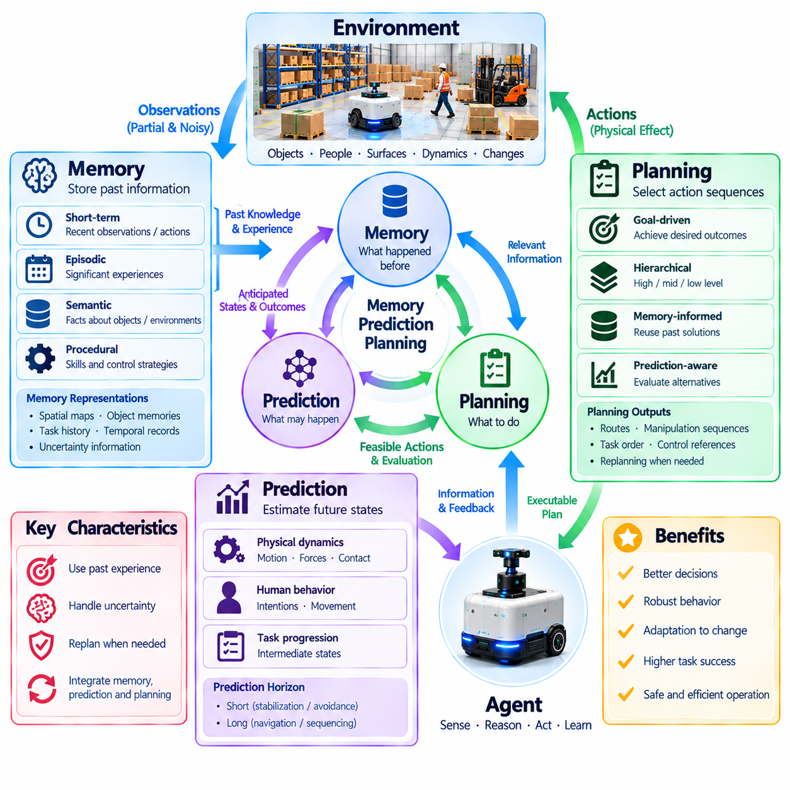{width="7.268055555555556in" height="7.268055555555556in"}

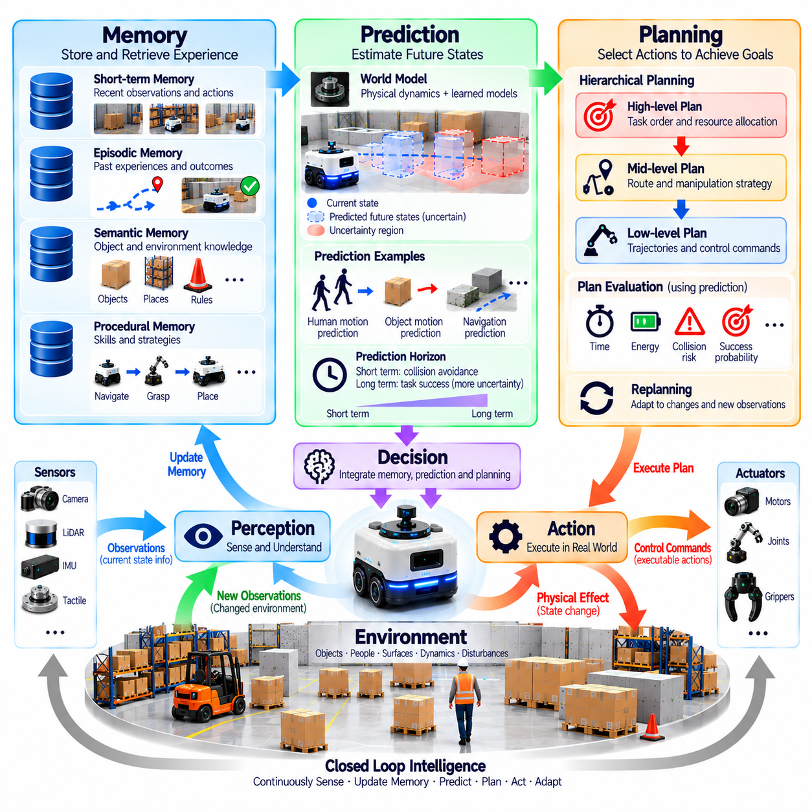{width="7.268055555555556in" height="7.268055555555556in"}

기억(Memory), 예측(Prediction), 계획(Planning)은 지능형 에이전트(Intelligent Agent)가 과거 경험(Past Experiences), 현재 조건(Present Conditions), 미래 결과(Future Consequences)를 연결해야 하기 때문에 피지컬 AI(Physical AI)의 필수적인 능력(Essential Capabilities)이다. 기억은 즉각적인 관측(Immediate Observations)을 넘어 정보를 보존하고, 예측은 물리적 상황(Physical Situations)이 어떻게 변화할 수 있는지를 추정하며, 계획은 원하는 목표(Desired Objectives)를 향해 행동을 구성한다. 이러한 능력의 통합(Integration)은 에이전트가 들어오는 센서 측정값(Sensor Measurements)마다 독립적으로 반응하는 대신 시간에 걸쳐 일관된 의사결정(Coherent Decisions)을 수행하도록 한다.

기억(Memory)은 환경 정보(Environmental Information)가 불완전하거나 일시적으로 이용할 수 없는 상황에서도 연속성(Continuity)을 제공한다. 이동 로봇(Mobile Robot)은 장애물(Obstacle)이 카메라 시야(Field of View)에서 사라진 후에도 그 위치를 기억할 수 있으며, 매니퓰레이터(Manipulator)는 객체의 이전 위치(Previous Position)에 관한 정보를 유지할 수 있다. 이러한 정보는 일관된 상태 추정(State Estimation)과 의사결정(Decision-Making)을 지원한다. 기억이 없으면 에이전트는 익숙한 조건(Familiar Conditions)을 반복적으로 재발견하거나 부분적으로 완료된 작업(Partially Completed Tasks)의 진행 상태를 놓칠 수 있다.

피지컬 AI 시스템(Physical AI Systems)은 서로 다른 목적을 위해 다양한 형태의 기억(Forms of Memory)을 사용한다. 단기 기억(Short-Term Memory)은 최근 관측값(Recent Observations)과 행동(Actions)을 유지하고, 일화 기억(Episodic Memory)은 중요한 경험(Significant Experiences)을 기록하며, 의미 기억(Semantic Memory)은 객체와 환경에 관한 학습된 사실(Learned Facts)을 표현한다. 절차 기억(Procedural Memory)은 재사용 가능한 기술(Reusable Skills)과 제어 전략(Control Strategies)을 인코딩할 수 있다. 이러한 범주는 별도의 저장 메커니즘(Storage Mechanisms)을 반드시 요구하는 것이 아니라 기능적 구분(Functional Distinctions)이며, 실제 시스템에서는 서로 결합하여 사용할 수 있다.

기억 표현(Memory Representations)은 물리적 행동(Physical Behavior)과 관련된 정보를 보존해야 한다. 공간 지도(Spatial Maps)는 환경의 기하학적 구조(Environmental Geometry)를 설명하고, 객체 기억(Object Memories)은 식별 정보(Identities)와 특성(Properties)을 기록하며, 작업 이력(Task Histories)은 완료되었거나 대기 중인 작업(Completed or Pending Operations)을 저장한다. 시간적 기록(Temporal Records)은 관측값을 해당 관측이 발생한 조건(Conditions)과 연결한다. 효과적인 기억 관리(Effective Memory Management)는 객체가 이동하거나 환경이 변화하면 저장된 정보가 부정확해질 수 있으므로 불확실성(Uncertainty)도 고려해야 한다.

예측(Prediction)은 현재 지식(Current Knowledge), 이전 경험(Previous Experiences), 후보 행동(Candidate Actions)을 바탕으로 미래 상태(Future States)와 결과(Outcomes)를 추정한다. 내비게이션 시스템(Navigation System)은 주변 사람들의 움직임(Movement)을 예상할 수 있으며, 로봇 팔(Robotic Arm)은 가해진 힘(Applied Force)에 객체가 어떻게 반응할지를 추정할 수 있다. 이러한 예측은 물리적 결과(Physical Consequences)가 발생하기 전에 의사결정을 지원한다. 예측은 특히 반응 지연(Delayed Reactions)이 충돌(Collisions), 불안정한 움직임(Unstable Motion), 조작 실패(Failed Manipulation)를 초래할 수 있는 상황에서 중요하다.

예측 모델(Predictive Models)은 물리적 동역학(Physical Dynamics), 객체 상호작용(Object Interactions), 인간 행동(Human Behavior), 작업 진행(Task Progress)을 표현할 수 있다. 일부 모델은 확립된 기계적 관계(Established Mechanical Relationships)에 의존하지만, 다른 모델은 기록된 경험(Recorded Experience)에서 패턴(Patterns)을 학습한다. 하이브리드 접근법(Hybrid Approaches)은 물리적 제약(Physical Constraints)과 데이터 기반 추정(Data-Driven Estimates)을 결합한다. 구현 방식과 관계없이 예측 모델은 관측된 결과(Observed Outcomes)를 기준으로 평가되어야 하며, 부정확한 예측(Inaccurate Forecasts)은 다른 측면에서 합리적인 계획(Reasonable Plans)까지 저해할 수 있다.

예측 지평(Prediction Horizon)은 에이전트가 미래의 조건(Future Conditions)을 얼마나 먼 시점까지 예상하려 하는지를 결정한다. 짧은 예측 지평(Short Horizons)은 즉각적인 안정화(Immediate Stabilization)와 충돌 회피(Collision Avoidance)를 지원하며, 긴 예측 지평(Longer Horizons)은 내비게이션(Navigation)과 작업 순서 결정(Task Sequencing)을 지원한다. 예측 지평이 길어질수록 일반적으로 불확실성(Uncertainty)과 계산 요구량(Computational Demands)이 증가한다. 따라서 실제 시스템은 예측의 상세 수준(Predictive Detail), 사용 가능한 처리 자원(Processing Resources), 관련 의사결정의 시간 척도(Time Scale) 사이에서 균형을 유지한다.

계획(Planning)은 기억(Memory)과 예측(Prediction)을 사용하여 목표(Goal)를 진전시키는 일련의 행동(Action Sequences)을 선택한다. 자율 로봇(Autonomous Robot)은 목적지(Destination)를 식별하고, 경로(Routes)를 평가하며, 장애물(Obstacles)을 회피하고, 다른 작업(Operations)과 도착 시점을 조정해야 할 수 있다. 계획은 행동의 실행 가능성(Feasibility)뿐 아니라 이후의 기회(Subsequent Opportunities)에 미치는 영향도 고려한다. 이러한 특성은 의도적인 작업 수행(Deliberate Task Execution)을 즉각적인 관측에 대한 개별적인 반응(Isolated Responses)과 구별한다.

계층적 계획(Hierarchical Planning)은 복잡한 목표(Complex Objectives)를 관리 가능한 추상화 수준(Levels of Abstraction)으로 구성한다. 고수준 계획(High-Level Planning)은 작업 순서(Task Order)와 자원 할당(Resource Allocation)을 결정하고, 중간 수준 계획(Intermediate Planning)은 경로(Routes)나 조작 전략(Manipulation Strategies)을 선택한다. 저수준 계획(Low-Level Planning)은 실행 가능한 궤적(Executable Trajectories)과 제어 기준값(Control References)을 생성한다. 물리적 제약(Physical Constraints)이 더 추상적인 수준에서 내려진 의사결정을 무효화할 수 있으므로 이러한 계층들은 정보를 교환해야 한다.

기억(Memory)은 이전에 경험한 조건(Previously Encountered Conditions)과 성공적인 전략(Successful Strategies)에 관한 정보를 제공하여 계획(Planning)을 개선한다. 로봇은 알려진 경로(Known Route)를 재사용하거나, 반복적인 실패(Repeated Failures)와 관련된 위치를 회피하거나, 유사한 객체(Similar Object)에 효과적이었던 파지 구성(Grasp Configuration)을 검색할 수 있다. 그러나 기억된 해결책(Remembered Solutions)은 현재 관측값(Current Observations)을 기준으로 검증해야 한다. 환경 조건(Environmental Conditions)이나 작업 요구사항(Task Requirements)이 달라지면 과거의 성공(Past Success)이 현재의 실행 가능성(Present Feasibility)을 보장하지 않기 때문이다.

예측(Prediction)은 계획 알고리즘(Planning Algorithms)이 실행 전에 대안적 행동(Alternative Actions)을 비교할 수 있도록 한다. 후보 궤적(Candidate Trajectories)은 이동 시간(Travel Time), 에너지 소비(Energy Consumption), 충돌 위험(Collision Risk), 작업 완료 확률(Task Completion Probability)을 기준으로 평가할 수 있다. 매니퓰레이터(Manipulator)는 예상 접촉 안정성(Expected Contact Stability)과 객체 변위(Object Displacement)를 기준으로 파지 접근 방식(Grasp Approaches)을 비교할 수 있다. 이러한 평가는 충분한 정보에 기반한 절충 결정(Informed Tradeoffs)을 지원하지만, 예측은 하나의 보장된 결과(Single Guaranteed Outcome)를 가정하기보다 불확실성(Uncertainty)을 반영해야 한다.

모델 기반 계획(Model-Based Planning)은 시스템 동역학(System Dynamics)의 표현을 명시적으로 사용하여 가능한 미래 상태 전이(Future Transitions)를 시뮬레이션한다. 탐색 알고리즘(Search Algorithms), 궤적 최적화(Trajectory Optimization), 모델 예측 제어(Model Predictive Control)는 목표(Objectives)와 제약 조건(Constraints)을 충족하는 행동을 식별할 수 있다. 반면 모델 프리 정책(Model-Free Policies)은 학습된 경험(Learned Experience)에서 직접 행동을 선택할 수 있다. 피지컬 AI 아키텍처(Physical AI Architectures)는 작업에 따라 적응성(Adaptability), 계산 효율성(Computational Efficiency), 해석 가능성(Interpretability) 사이에서 서로 다른 균형이 필요할 때 이러한 접근법을 결합할 수 있다.

재계획(Replanning)은 물리적 환경(Physical Environments)이 예측한 대로 정확하게 변화하는 경우가 드물기 때문에 필요하다. 이동 장애물(Moving Obstacles), 액추에이터 지연(Actuator Delays), 예상하지 못한 접촉(Unexpected Contact), 작업 우선순위(Task Priorities)의 변화는 기존 계획(Existing Plan)을 무효화할 수 있다. 에이전트(Agent)는 예상 진행 상태(Expected Progress)를 새로운 관측값(New Observations)과 비교하고 중요한 편차(Significant Deviations)가 발생하면 전략(Strategy)을 수정해야 한다. 효과적인 재계획(Effective Replanning)은 유용한 이전 의사결정(Previous Decisions)을 유지하면서 새롭게 확보된 정보(Newly Available Information)에 적응한다.

기억(Memory)과 예측(Prediction)은 지속적인 모델 업데이트(Continuous Model Updating)를 통해 상호작용한다. 기록된 결과(Recorded Outcomes)는 이전 예상(Earlier Expectations)이 정확했는지를 보여주며, 예측 오차(Prediction Errors)는 저장된 가정(Stored Assumptions)의 약점을 식별한다. 반복적인 불일치(Repeated Discrepancies)는 마찰 변화(Changing Friction), 센서 성능 저하(Sensor Degradation), 이전에 알려지지 않았던 객체 특성(Unknown Object Properties)을 나타낼 수 있다. 이러한 증거(Evidence)를 바탕으로 모델을 업데이트하면 미래 의사결정(Future Decisions)을 개선할 수 있지만, 시스템은 지속적인 변화(Persistent Changes)와 일시적인 외란(Temporary Disturbances)을 구분해야 한다.

불확실성(Uncertainty)은 기억(Memory), 예측(Prediction), 계획(Planning)의 세 가지 능력 모두에 영향을 미친다. 기억된 정보(Memories)는 오래되었을 수 있고, 예측(Predictions)은 확률적(Probabilistic)일 수 있으며, 계획(Plans)은 불완전한 지식(Incomplete Knowledge)에 의존할 수 있다. 따라서 지능형 에이전트(Intelligent Agent)는 신뢰도 추정값(Confidence Estimates)을 유지하고 대안적 시나리오(Alternative Scenarios)를 고려해야 한다. 불확실성이 높을 때는 즉각적인 실행(Immediate Execution)보다 정보 수집 행동(Information-Gathering Actions)이나 보수적인 계획(Conservative Plans)이 바람직할 수 있다. 신뢰성 있는 추론(Reliable Reasoning)을 위해서는 저장된 지식(Stored Knowledge)이 반드시 현재의 진실(Current Truth)을 의미하지는 않는다는 점을 인식해야 한다.

계산 제약(Computational Constraints)과 시간 제약(Timing Constraints)은 실제 기억, 예측, 계획 아키텍처(Memory, Prediction, and Planning Architectures)의 구조를 결정한다. 대규모 기억(Large Memories)은 효율적인 검색(Efficient Retrieval)이 필요하고, 상세한 예측(Detailed Predictions)은 처리 자원(Processing Resources)을 소비하며, 복잡한 계획(Complex Planning)은 사용 가능한 의사결정 시간(Available Decision Time)을 초과할 수 있다. 엣지 시스템(Edge Systems)은 즉각적인 안전(Immediate Safety)과 작업 성능(Task Performance)에 관련된 정보와 계산을 우선해야 한다. 계층적 처리(Hierarchical Processing), 선택적 업데이트(Selective Updates), 제한된 계획 지평(Bounded Planning Horizons)은 실시간 응답성(Real-Time Responsiveness)을 유지하는 데 도움이 된다.

안전(Safety)은 미래 지향적 지능(Future-Oriented Intelligence)에 추가적인 요구사항(Additional Requirements)을 부과한다. 계획(Plans)은 기계적 한계(Mechanical Limits), 충돌 제약(Collision Constraints), 인간과의 근접성(Human Proximity), 운영 경계(Operational Boundaries)를 준수해야 한다. 예측(Predictions)은 발생 확률(Estimated Probability)이 낮더라도 위험한 가능성(Hazardous Possibilities)을 식별해야 한다. 기억(Memory)은 이전 사고(Prior Incidents)와 알려진 제한 구역(Known Restricted Regions)을 보존할 수 있다. 안전 메커니즘(Safety Mechanisms)은 예상하지 못한 물리적 위험(Unexpected Physical Risks)이 발생하면 계획된 행동(Planned Behavior)을 중단할 수 있어야 한다.

다중 에이전트 피지컬 AI(Multi-Agent Physical AI)는 공유 기억(Shared Memory), 조정된 예측(Coordinated Prediction), 협력적 계획(Collaborative Planning)을 도입한다. 공통 공간(Common Spaces)에서 작동하는 로봇들은 지도(Maps), 작업 상태(Task Status), 의도한 궤적(Intended Trajectories)을 교환할 수 있다. 공유 정보(Shared Information)는 중복 탐색(Redundant Exploration)을 줄이고 자원 할당(Resource Allocation)을 개선할 수 있다. 그러나 통신 지연(Communication Delays)과 일관되지 않은 관측값(Inconsistent Observations)은 서로 충돌하는 표현(Conflicting Representations)을 생성할 수 있으므로 동기화(Synchronization)와 오래된 정보(Outdated Information)에 대비한 로컬 안전장치(Local Safeguards)가 필요하다.

이러한 능력의 평가(Evaluation)는 물리적 성능(Physical Performance)에 미치는 통합적인 영향(Combined Effect)을 검토해야 한다. 기억 정확도(Memory Accuracy), 예측 오차(Prediction Error), 계획 성공률(Planning Success), 계산 지연 시간(Computational Latency), 복구 효율성(Recovery Efficiency), 안전 결과(Safety Outcomes)는 상호 보완적인 평가 근거(Complementary Evidence)를 제공한다. 시험(Testing)에는 변화하는 환경(Changing Environments), 불완전한 관측(Incomplete Observations), 예상하지 못한 외란(Unexpected Disturbances)이 포함되어야 한다. 시스템은 예상을 수정하고 신뢰성 있는 작업 진행(Reliable Task Progress)을 유지할 수 있을 때 효과적인 미래 지향적 지능(Effective Future-Oriented Intelligence)을 보여준다.

궁극적으로 기억(Memory)은 피지컬 AI(Physical AI)를 과거(Past)와 연결하고, 예측(Prediction)은 가능한 미래(Possible Futures)에 대한 기대를 형성하며, 계획(Planning)은 이러한 예상을 목적성 있는 행동(Purposeful Action)으로 전환한다. 피드백(Feedback)은 발생한 결과(Resulting Outcomes)를 이후의 기억 업데이트(Memory Updates)와 의사결정(Decisions)에 연결한다. 이러한 능력은 기억하기(Remembering), 예상하기(Anticipating), 행동하기(Acting), 학습하기(Learning)의 지속적인 순환 과정(Continuous Cycle)을 형성한다. 이들의 조정된 작동(Coordinated Operation)은 지능형 물리 에이전트(Intelligent Physical Agents)가 현재 현실(Present Reality)에 대한 반응성을 유지하면서 장기 목표(Long-Term Objectives)를 추구할 수 있도록 한다.

## 01.12. Learning Adaptation and Generalization

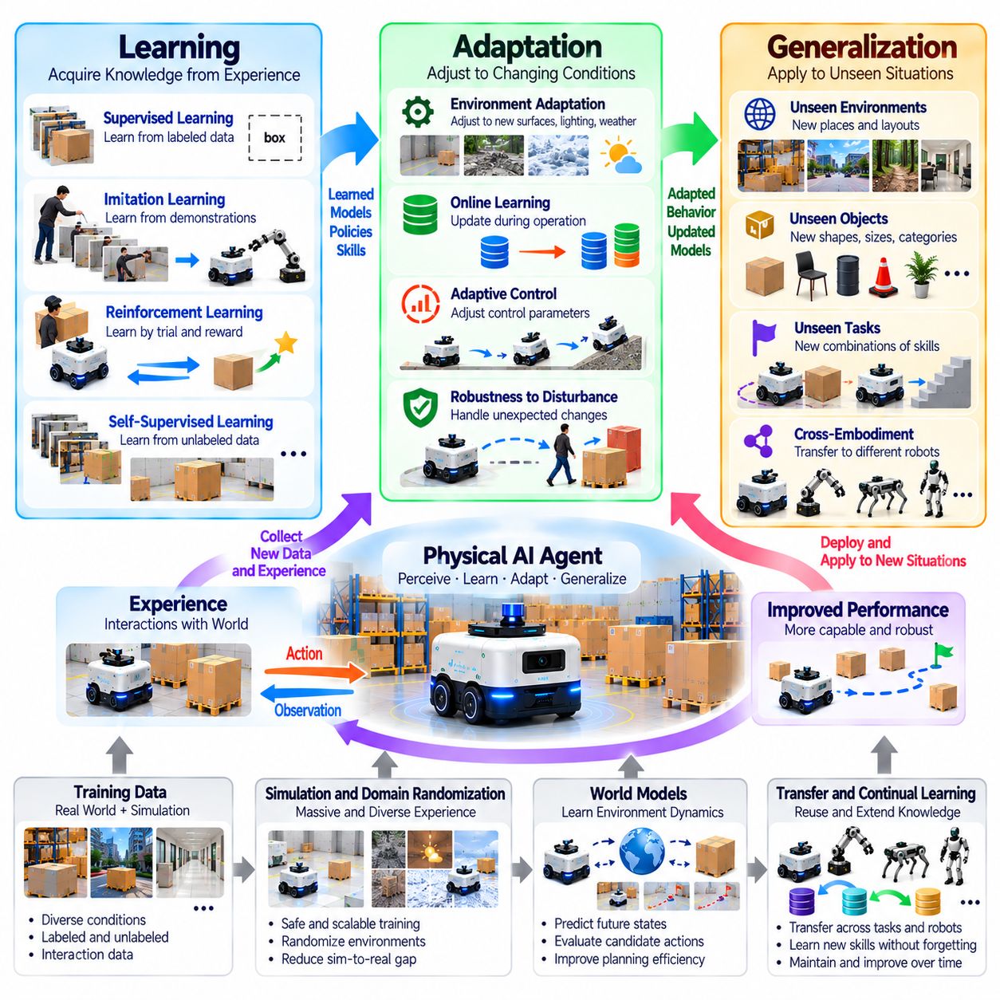{width="7.268055555555556in" height="7.268055555555556in"}

학습(Learning), 적응(Adaptation), 일반화(Generalization)는 피지컬 AI(Physical AI) 시스템이 경험(Experience)을 통해 행동을 개선하고 좁게 사전 정의된 조건(Narrowly Predefined Conditions)을 넘어 작동할 수 있도록 한다. 학습은 관측(Observations)과 행동(Actions)에서 유용한 패턴(Useful Patterns)을 추출하고, 적응은 상황이 변화할 때 행동을 조정하며, 일반화는 습득한 능력(Acquired Capabilities)을 익숙하지 않은 상황(Unfamiliar Situations)에 적용한다. 이러한 과정은 물리적 지능(Physical Intelligence)을 고정된 자동화(Fixed Automation)에서 점진적인 개선(Progressive Improvement)이 가능한 시스템으로 전환한다.

피지컬 AI의 학습(Learning in Physical AI)은 행동이 실제 물리적 결과(Real Physical Consequences)를 발생시킨다는 점에서 순수한 디지털 학습(Purely Digital Learning)과 다르다. 로봇은 이동(Movement), 접촉(Contact), 조작(Manipulation), 환경 상호작용(Environmental Interaction)을 통해 지식을 습득할 수 있다. 각각의 경험은 시스템 동역학(System Dynamics), 객체 특성(Object Properties), 작업 결과(Task Outcomes)에 관한 정보를 제공한다. 그러나 물리적 실험(Physical Experimentation)은 에너지(Energy)를 소비하고 기계적 마모(Mechanical Wear)를 발생시키며, 학습 과정을 제한하는 안전 위험(Safety Risks)을 초래할 수 있다.

지도 학습(Supervised Learning)은 관측값(Observations)과 이에 대응하는 목표 레이블(Target Labels) 또는 값(Values)이 포함된 예제(Examples)를 사용하여 모델을 개발한다. 로보틱스(Robotics)에서는 객체 인식(Object Recognition), 자세 추정(Pose Estimation), 지형 분류(Terrain Classification), 물리적 특성 예측(Physical Property Prediction)을 지원한다. 모델 성능(Model Performance)은 학습 데이터의 품질(Training Data Quality)과 포괄 범위(Coverage)에 따라 달라진다. 기록된 데이터셋(Recorded Datasets)에서 정확한 예측을 수행하더라도 센서(Sensors), 조명(Lighting), 관측 시점(Viewpoints), 환경(Environments)이 변화할 때 신뢰성 있는 행동이 자동으로 보장되는 것은 아니다.

모방 학습(Imitation Learning)은 에이전트(Agent)가 전문가 시연(Expert Demonstrations)으로부터 행동을 습득하도록 한다. 인간 운영자(Human Operator)나 기존 제어기(Established Controller)는 특정 조건(Particular Conditions)에서 수행하는 행동의 예제를 제공한다. 에이전트는 시연된 행동(Demonstrated Behavior)을 근사하는 정책(Policy)을 학습하며, 이를 통해 비용이 많이 드는 탐색(Costly Exploration)의 필요성을 줄일 수 있다. 그러나 학습된 정책(Learned Policy)이 시연에 포함되지 않은 상태(States)를 마주하면 오류가 누적될 수 있으므로 복구 행동(Recovery Behavior)과 평가(Evaluation)가 필수적이다.

강화 학습(Reinforcement Learning)은 상호작용(Interaction)과 작업 성능(Task Performance)에 대한 피드백(Feedback)을 통해 행동 정책(Action Policies)을 개발한다. 에이전트는 행동(Actions)을 선택하고, 그에 따른 상태(Resulting States)를 관측하며, 원하는 결과(Desired Outcomes)와 연관된 보상(Rewards)을 받는다. 반복적인 경험(Repeated Experience)은 내비게이션(Navigation), 조작(Manipulation), 보행(Locomotion), 협응 제어(Coordinated Control)를 개선할 수 있다. 보상 설계(Reward Design)는 실제 작업 목표(Actual Task Objectives)를 반영해야 하며, 부적절하게 정의된 보상(Poorly Specified Rewards)은 의도하지 않거나 안전하지 않은 행동(Unintended or Unsafe Behavior)을 유도할 수 있다.

자기지도 학습(Self-Supervised Learning)은 광범위한 수동 레이블링(Manual Labeling) 없이 센서 관측값(Sensor Observations)에서 유용한 표현(Useful Representations)을 추출한다. 로봇은 연속된 이미지(Consecutive Images), 이동 명령(Movement Commands), 그에 따른 환경 변화(Resulting Environmental Changes) 사이의 관계를 학습할 수 있다. 누락된 정보(Missing Information)나 미래 관측값(Future Observations)을 예측하면 물리적 구조(Physical Structure)와 동역학(Dynamics)에 대한 표현을 개선할 수 있다. 이러한 학습된 특징(Learned Features)은 여러 후속 작업(Downstream Tasks)을 지원할 수 있지만, 실제 활용 가치(Practical Value)는 검증(Validation)을 통해 확인해야 한다.

적응(Adaptation)은 변화하는 운영 조건(Changing Operating Conditions)에 대응하여 행동(Behavior)이나 내부 모델(Internal Models)을 수정하는 것을 의미한다. 이동 로봇(Mobile Robot)은 바닥 마찰(Floor Friction)이 변화할 때 운동 제어(Motion Control)를 조정할 수 있으며, 매니퓰레이터(Manipulator)는 익숙하지 않은 객체(Unfamiliar Objects)에 맞추어 파지력(Gripping Force)을 변경할 수 있다. 적응에는 매개변수 업데이트(Parameter Updates), 정책 선택(Policy Selection), 계획 전략(Planning Strategy)의 변경이 포함될 수 있다. 적응의 효과(Effectiveness)는 일시적인 외란(Temporary Disturbances)에 과도하게 반응하지 않으면서 의미 있는 변화(Meaningful Changes)를 감지하는 능력에 달려 있다.

온라인 학습(Online Learning)은 운영 중 새롭게 수집된 경험(Newly Collected Experiences)을 사용하여 모델(Models)을 업데이트한다. 이러한 능력은 환경(Environments)이 초기 학습 조건(Initial Training Conditions)과 다를 때 성능을 개선할 수 있다. 그러나 통제되지 않은 업데이트(Uncontrolled Updates)는 불안정성(Instability)을 발생시키거나 이전에 신뢰할 수 있었던 행동(Previously Reliable Behavior)의 성능을 저하시키거나 안전 제약(Safety Constraints)을 위반할 수 있다. 실제 시스템은 신속한 운영 조정(Rapid Operational Adjustment)과 배포 전에 평가(Evaluation) 및 승인(Authorization)이 필요한 느린 모델 업데이트(Slower Model Updates)를 분리하는 경우가 많다.

일반화(Generalization)는 학습 중 경험하지 못한 조건(Conditions Not Encountered During Training)에 학습된 지식(Learned Knowledge)을 적용하는 능력을 설명한다. 여러 객체 형상(Object Shapes)을 인식하도록 학습된 로봇은 관련된 새로운 객체(Unfamiliar Objects)를 식별할 수 있으며, 내비게이션 정책(Navigation Policy)은 이전에 보지 못한 공간 배치(Unseen Layouts)에서도 작동할 수 있다. 성공적인 일반화(Successful Generalization)는 특정 예제(Specific Examples)를 암기하는 대신 전이 가능한 관계(Transferable Relationships)를 학습하는 데 달려 있다. 일반화의 한계(Limits)는 작업(Tasks)과 환경(Environments)의 의미 있는 변화(Meaningful Variations)를 대상으로 측정해야 한다.

전이 학습(Transfer Learning)은 하나의 작업(Task), 환경(Environment), 체화 형태(Embodiment)에서 습득한 지식(Knowledge)을 재사용하여 다른 상황에서의 학습을 가속한다. 광범위한 이미지 데이터(Image Collections)로 학습된 인식 모델(Perception Models)은 로봇 비전(Robotic Vision)을 지원할 수 있으며, 시뮬레이션(Simulation)에서 학습된 제어 표현(Control Representations)은 실제 물리적 배포(Physical Deployment)에 도움이 될 수 있다. 전이 효과(Transfer Effectiveness)는 원천 조건(Source Conditions)과 목표 조건(Target Conditions) 사이의 유사성(Similarities)에 따라 달라진다. 동역학(Dynamics), 감지(Sensing), 기계적 능력(Mechanical Capabilities)의 차이는 성능을 저하시킬 수 있다.

시뮬레이션(Simulation)은 실제 물리적 배포(Physical Deployment) 전에 경험(Experiences)을 생성하기 위한 효율적인 환경을 제공한다. 에이전트는 다양한 시나리오(Diverse Scenarios)를 탐색하고, 드물게 발생하는 사건(Rare Events)을 반복하며, 실제 장비(Real Equipment)를 모든 실패 상황(Failure)에 노출하지 않고 정책(Policies)을 평가할 수 있다. 도메인 무작위화(Domain Randomization)는 시뮬레이션된 특성(Simulated Properties)을 변화시켜 다양한 조건에 대한 강건성(Robustness)을 높인다. 그러나 시뮬레이션과 현실 사이의 격차(Simulation-to-Reality Gap)로 인해 물리적 검증(Physical Validation)이 필요하며, 시뮬레이션된 접촉(Contact), 감지(Sensing), 동역학(Dynamics)은 여전히 불완전한 근사(Imperfect Approximations)에 머무른다.

세계 모델(World Models)은 행동(Actions)에 대응하여 환경(Environments)이 어떻게 변화하는지를 표현함으로써 학습(Learning)을 지원한다. 에이전트는 학습된 동역학(Learned Dynamics)을 사용하여 미래 관측값(Future Observations)을 예측하고, 후보 행동(Candidate Behaviors)을 평가하며, 계획 효율성(Planning Efficiency)을 개선할 수 있다. 이러한 모델은 의사결정(Decision-Making)에 필요한 물리적 시행 횟수(Physical Trials)를 줄일 수 있다. 세계 모델의 유용성(Usefulness)은 변화하는 조건(Changing Conditions)에서도 정확도(Accuracy)를 유지하고 예측(Predictions)의 신뢰성이 저하되는 상황을 인식하는 능력에 달려 있다.

지속 학습(Continual Learning)은 이전에 학습한 지식(Previously Learned Knowledge)을 잃지 않으면서 새로운 능력(New Capabilities)을 습득하는 과제를 다룬다. 피지컬 AI 시스템은 운영 수명(Operational Lifetime) 동안 새로운 객체(Objects), 환경(Environments), 작업(Tasks)을 경험할 수 있다. 이러한 경험에 맞추어 모델(Models)을 업데이트하면 이전 성능(Earlier Performance)이 저하되는 파국적 망각(Catastrophic Forgetting)이 발생할 수 있다. 리플레이 메커니즘(Replay Mechanisms), 매개변수 제약(Parameter Constraints), 모듈형 아키텍처(Modular Architectures)는 기존에 확립된 능력(Established Capabilities)을 보존하는 데 도움이 될 수 있다.

소수 샷 적응(Few-Shot Adaptation)은 제한된 예제(Limited Examples)나 상호작용(Interactions)만을 사용하여 행동을 조정하는 것을 목표로 한다. 이러한 능력은 물리적 시행(Physical Trials)에 많은 비용이 들거나 운영 조건(Operational Conditions)이 예상하지 못하게 변화할 때 유용하다. 로봇은 소수의 관측값(Small Number of Observations)만으로 익숙하지 않은 객체의 취급 요구사항(Handling Requirements)을 추론할 수 있다. 그러나 제한된 증거(Limited Evidence)는 불확실성(Uncertainty)을 증가시키므로 까다로운 물리적 작업(Demanding Physical Operations)을 시도하기 전에 신중한 행동 선택(Cautious Action Selection)과 명시적인 검증(Explicit Verification)이 필요하다.

체화(Embodiment)는 학습된 능력(Learned Capabilities)이 시스템 간에 전이될 수 있는 범위에 영향을 미친다. 바퀴형 로봇(Wheeled Robot)과 다족보행 로봇(Legged Robot)은 환경 표현(Environmental Representations)을 공유할 수 있지만 서로 다른 이동 정책(Movement Policies)이 필요하다. 관절 구성(Joint Configurations)이 다른 매니퓰레이터(Manipulators)는 유사한 작업을 수행하더라도 서로 다른 제어 매핑(Control Mappings)이 필요할 수 있다. 따라서 체화 형태 간 일반화(Generalization Across Embodiments)를 위해서는 전이 가능한 작업 지식(Transferable Task Knowledge)과 플랫폼별 기계적 제약(Platform-Specific Mechanical Constraints)을 분리해야 한다.

학습 효율성(Learning Efficiency)은 물리적 경험(Physical Experience)에 측정 가능한 비용(Measurable Costs)이 수반되기 때문에 특히 중요하다. 학습(Training)은 배터리 에너지(Battery Energy), 장비 수명(Equipment Lifetime), 운영자 주의(Operator Attention), 귀중한 운영 시간(Operational Time)을 소비할 수 있다. 샘플 효율적 방법(Sample-Efficient Methods)은 더 적은 상호작용(Fewer Interactions)으로 유용한 개선을 달성하는 것을 목표로 한다. 오프라인 데이터셋(Offline Datasets), 시연(Demonstrations), 시뮬레이션(Simulation), 모델 기반 학습(Model-Based Learning)은 실험 요구량(Experimentation Requirements)을 줄일 수 있지만, 수집된 데이터(Collected Data)는 관련 물리적 조건(Relevant Physical Conditions)을 충분히 대표해야 한다.

강건한 적응(Robust Adaptation)을 위해서는 환경 변화(Environmental Change)를 센서 고장(Sensor Failure)이나 모델 오류(Model Error)와 구분해야 한다. 예상하지 못한 관측값(Unexpected Observations)은 지형(Terrain)이나 객체 특성(Object Properties)의 실제 변화를 반영할 수 있지만, 보정 드리프트(Calibration Drift)나 손상된 하드웨어(Damaged Hardware)로 인해 발생할 수도 있다. 잘못된 적응(Incorrect Adaptation)은 기존 문제(Existing Problems)를 증폭시킬 수 있다. 진단 모니터링(Diagnostic Monitoring)과 불확실성 추정(Uncertainty Estimation)은 시스템이 행동을 업데이트해야 하는지, 지원을 요청해야 하는지, 안전 상태(Safe State)에 진입해야 하는지를 판단하는 데 도움이 된다.

안전(Safety)은 개발(Development)과 배포(Deployment)의 모든 단계에서 학습(Learning)을 제한하는 조건으로 작용해야 한다. 탐색 정책(Exploration Policies)은 충돌 경계(Collision Boundaries), 힘 제한(Force Limits), 운영 제한(Operational Restrictions)을 준수해야 한다. 새롭게 학습된 행동(Newly Learned Behaviors)은 실행 권한(Execution Authority)을 부여받기 전에 대표적인 위험(Representative Hazards)에 대한 시험(Testing)을 거쳐야 한다. 가능한 경우 안전 모니터링(Safety Monitoring)은 실험적 정책(Experimental Policies)과 독립적으로 유지되어야 하며, 성능 개선(Performance Improvement)이 기본적인 물리적 보호 요구사항(Fundamental Physical Protection Requirements)을 무시하지 못하도록 해야 한다.

학습(Learning), 적응(Adaptation), 일반화(Generalization)의 평가는 학습 정확도(Training Accuracy)나 누적 보상(Cumulative Reward)을 측정하는 것 이상을 요구한다. 관련 평가 근거(Relevant Evidence)에는 미경험 조건(Unseen Conditions)에서의 작업 성공률(Task Success), 적응 속도(Adaptation Speed), 샘플 효율성(Sample Efficiency), 이전 기술의 유지(Retention of Previous Skills), 강건성(Robustness), 안전 성능(Safety Performance)이 포함된다. 평가는 익숙한 시나리오(Familiar Scenarios)와 실제로 새로운 조건(Genuinely Novel Conditions)을 구분해야 한다. 반복적인 물리적 시행(Repeated Physical Trials)은 개선 효과(Improvements)가 통제된 벤치마크(Controlled Benchmarks)를 넘어 신뢰성 있게 유지되는지를 확인하는 데 도움이 된다.

궁극적으로 학습(Learning)은 피지컬 AI(Physical AI)에 축적된 경험(Accumulated Experience)을 제공하고, 적응(Adaptation)은 변화하는 조건(Changing Conditions)에 대한 대응을 가능하게 하며, 일반화(Generalization)는 초기 학습 상황(Original Training Situations)을 넘어 능력을 확장한다. 이러한 기능은 인식(Perception), 행동(Action), 예측(Prediction), 기억(Memory), 피드백(Feedback)을 통해 작동한다. 이들의 조정된 발전(Coordinated Development)은 성능 개선(Improvement)이 측정 가능(Measurable)하고 계산적으로 실행 가능(Computationally Feasible)하며 안전 요구사항(Safety Requirements)과 일치한다는 조건 아래에서 점진적으로 더 높은 능력을 갖춘 물리 에이전트(Physical Agents)를 구현하도록 한다.

## 01.13. Real Time and Physical Constraints

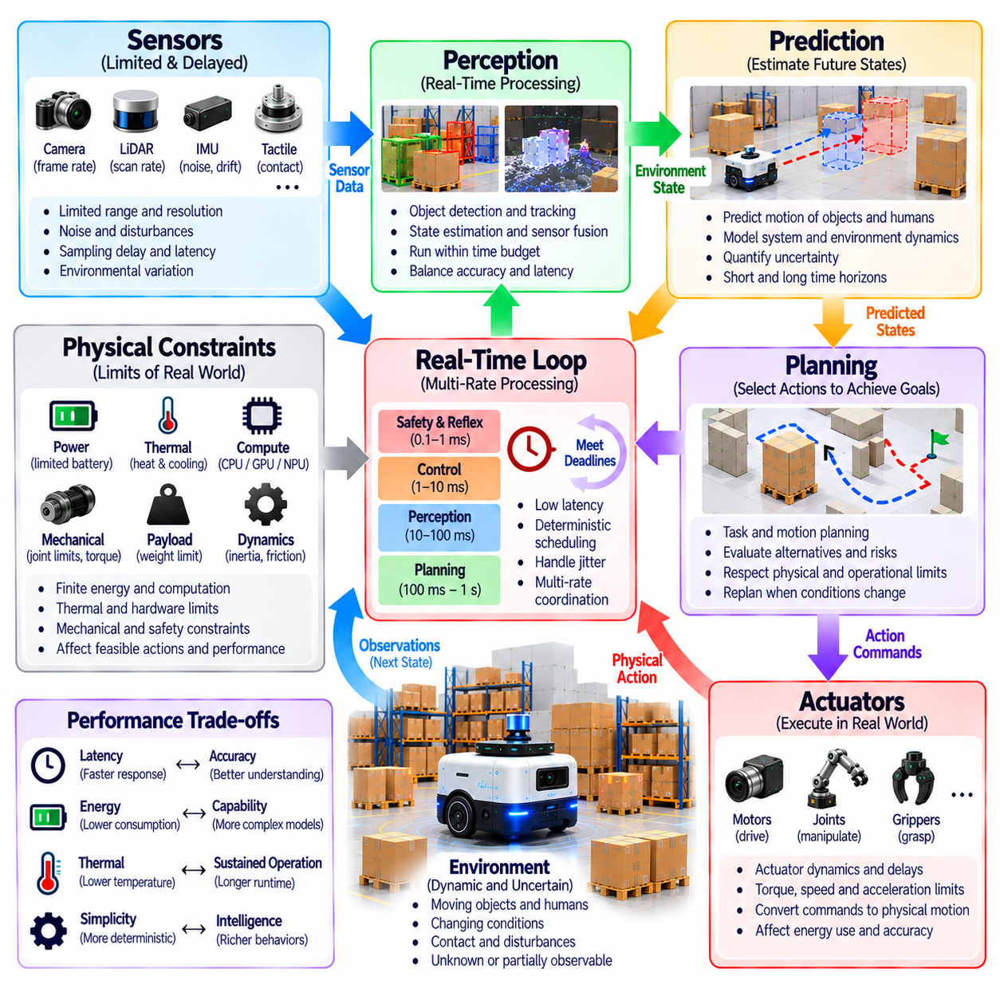{width="7.268055555555556in" height="7.268055555555556in"}

실시간 운영(Real-Time Operation)과 물리적 제약(Physical Constraints)은 지능형 에이전트(Intelligent Agents)가 물리적 세계(Physical World)의 시간 및 자원 한계(Timing and Resource Limits) 내에서 행동해야 하기 때문에 피지컬 AI(Physical AI)의 근본적인 특성(Fundamental Characteristics)이다. 지연된 응답(Delayed Responses)을 허용할 수 있는 디지털 시스템(Digital Systems)과 달리 물리적 에이전트(Physical Agents)는 지속적으로 변화하는 환경(Continuously Evolving Environments)과 상호작용한다. 따라서 의사결정(Decisions)은 기계적(Mechanical), 전기적(Electrical), 계산적(Computational), 안전 관련 제약(Safety Limitations)을 준수하면서 실제 사건에 영향을 미칠 수 있을 만큼 신속하게 이루어져야 한다.

실시간 지능(Real-Time Intelligence)은 단순히 높은 계산 속도(High Computational Speed) 이상의 능력을 요구한다. 시스템은 물리적 과정(Physical Processes)과 운영 요구사항(Operational Requirements)에 의해 결정되는 마감시간(Deadlines) 내에 적절한 결과를 제공해야 한다. 내비게이션 제어기(Navigation Controller)는 안정적인 움직임(Stable Motion)을 유지하기 위해 빈번한 업데이트가 필요할 수 있으며, 비상 보호 메커니즘(Emergency Protection Mechanism)은 훨씬 짧은 응답 시간(Response Interval)을 요구할 수 있다. 중요한 마감시간(Critical Deadline)을 놓치면 최종 계산 결과(Computational Result)가 정확하더라도 안전성(Safety)이 저하될 수 있다.

피지컬 AI 시스템(Physical AI Systems)은 여러 시간 척도(Multiple Time Scales)에 걸쳐 작동한다. 모터 제어(Motor Control)는 빠른 주기적 업데이트(Rapid Periodic Updates)가 필요할 수 있고, 인식 알고리즘(Perception Algorithms)은 상대적으로 낮은 주파수(Lower Frequencies)에서 관측값을 처리하며, 작업 계획기(Task Planners)는 더 긴 시간 간격(Longer Intervals)으로 작동할 수 있다. 이러한 과정은 서로 다른 실행 속도(Execution Rates)에도 불구하고 조정된 상태를 유지해야 한다. 계층적 스케줄링(Hierarchical Scheduling)과 비동기 통신(Asynchronous Communication)은 신뢰성 있는 물리적 행동(Reliable Physical Behavior)에 필요한 시간적 관계(Timing Relationships)를 유지하면서 계산 책임(Computational Responsibilities)을 분산하는 데 도움이 된다.

지연 시간(Latency)은 사건(Event)이 발생한 시점부터 시스템이 이에 대응하는 응답(Response)을 생성하기까지의 지연을 나타낸다. 여기에는 센서 데이터 획득(Sensor Acquisition), 데이터 전송(Data Transmission), 전처리(Preprocessing), 추론(Inference), 계획(Planning), 명령 전달(Command Delivery), 액추에이터 응답(Actuator Response)이 포함될 수 있다. 따라서 종단 간 지연 시간(End-to-End Latency)은 개별 알고리즘(Single Algorithm)의 실행 시간보다 중요하다. 빠른 신경망(Fast Neural Network)을 사용하더라도 통신 지연(Communication Delays)이나 기계적 응답 시간(Mechanical Response Times)이 전체 과정(Overall Process)을 지배하면 적시 행동(Timely Behavior)을 보장할 수 없다.

일반적으로 지터(Jitter)라고 부르는 시간 변동성(Timing Variability)은 물리적 제어(Physical Control)에 추가적인 문제를 발생시킨다. 평균 지연 시간(Average Latency)이 허용 가능한 수준이더라도 실행 간격(Execution Intervals)이 일정하지 않으면 궤적 추종(Trajectory Tracking)의 성능이 저하되고 피드백 루프(Feedback Loops)가 불안정해질 수 있다. 따라서 실시간 시스템(Real-Time Systems)은 최악 실행 시간(Worst-Case Execution Time), 마감시간 준수(Deadline Compliance), 스케줄링 예측 가능성(Scheduling Predictability)을 고려해야 한다. 지연된 행동(Delayed Actions)이 충돌(Collisions)이나 과도한 기계적 힘(Excessive Mechanical Forces)을 발생시킬 수 있는 상황에서는 결정론적 동작(Deterministic Behavior)이 특히 중요하다.

하드 실시간 요구사항(Hard Real-Time Requirements)과 소프트 실시간 요구사항(Soft Real-Time Requirements)은 마감시간을 놓쳤을 때 발생하는 결과(Consequences)에 따라 구분된다. 하드 실시간 기능(Hard Real-Time Functions)은 정확성(Correctness)이나 안전성(Safety)을 유지하기 위해 지정된 시간 제약(Timing Constraints)을 반드시 충족해야 하지만, 소프트 실시간 기능(Soft Real-Time Functions)은 성능 저하(Reduced Performance)를 감수하면서 간헐적인 지연(Occasional Delays)을 허용할 수 있다. 비상 보호(Emergency Protection)와 일부 저수준 제어 기능(Low-Level Control Functions)은 엄격한 보장(Strict Guarantees)이 필요할 수 있다. 반면 고수준 계획(High-Level Planning)이나 비핵심 분석(Noncritical Analytics)은 상대적으로 유연한 실행 일정(Execution Schedules)을 허용할 수 있다.

계산 자원(Computational Resources)은 인식(Perception), 예측(Prediction), 의사결정(Decision-Making)에 실질적인 한계(Practical Limits)를 부과한다. 신경망(Neural Networks), 기하학적 추론(Geometric Reasoning), 최적화 알고리즘(Optimization Algorithms), 세계 모델(World Models)은 처리 용량(Processing Capacity)과 메모리 대역폭(Memory Bandwidth)을 공유하기 위해 경쟁한다. 모델 복잡도(Model Complexity)를 높이면 정확도(Accuracy)가 향상될 수 있지만 추론 지연 시간(Inference Latency)과 에너지 소비(Energy Consumption)도 증가할 수 있다. 시스템 설계(System Design)는 사용 가능한 하드웨어 제약(Hardware Constraints) 아래에서 지능의 품질(Intelligence Quality)과 예측 가능한 실행(Predictable Execution) 사이의 균형을 유지해야 한다.

엣지 컴퓨팅(Edge Computing)은 지능 처리(Intelligence Processing)를 센서(Sensors)와 액추에이터(Actuators) 가까이에 배치하여 원격 인프라(Remote Infrastructure)에 대한 의존성을 줄인다. 로컬 처리(Local Processing)는 빠른 피드백(Rapid Feedback)을 지원하고, 네트워크 중단(Network Interruptions) 중에도 운영을 유지하며, 통신 오버헤드(Communication Overhead)를 제한할 수 있다. 그러나 임베디드 프로세서(Embedded Processors)와 엣지 가속기(Edge Accelerators)는 계산 용량(Computational Capacity), 메모리(Memory), 열적 여유(Thermal Headroom)가 제한되어 있다. 효과적인 아키텍처(Effective Architectures)는 지연 민감도(Latency Sensitivity), 자원 가용성(Resource Availability), 운영 중요도(Operational Criticality)에 따라 작업 부하(Workloads)를 분산한다.

전력 소비(Power Consumption)는 이동형 및 자율 시스템(Mobile and Autonomous Systems)의 주요 물리적 제약(Physical Constraint)이다. 계산(Computation), 감지(Sensing), 통신(Communication), 이동(Locomotion), 조작(Manipulation)은 제한된 에너지 공급원(Limited Energy Supplies)에서 에너지를 소비한다. 고성능 추론(High-Performance Inference)은 사용 가능한 운영 시간(Operating Time)을 줄일 수 있으며, 공격적인 움직임(Aggressive Movement)은 에너지 소비와 열적 스트레스(Thermal Stress)를 모두 증가시킬 수 있다. 에너지 인지 지능(Energy-Aware Intelligence)은 자원을 할당하기 전에 배터리 상태(Battery Condition), 작업 긴급도(Task Urgency), 추가 계산의 예상 가치(Expected Value of Additional Computation)를 고려한다.

열적 제약(Thermal Constraints)은 지속적인 성능(Sustained Performance)과 하드웨어 신뢰성(Hardware Reliability)에 영향을 미친다. 프로세서(Processors), 가속기(Accelerators), 모터(Motors), 전력 전자 장치(Power Electronics)는 작동 중 열(Heat)을 발생시킨다. 과도한 온도(Excessive Temperature)는 동작 주파수 감소(Frequency Reduction), 액추에이터 출력 저하(Reduced Actuator Output), 보호 종료(Protective Shutdown)를 유발할 수 있다. 짧은 시연(Short Demonstrations)에서 시간 요구사항(Timing Requirements)을 충족한 시스템도 지속적인 작업 부하(Sustained Workloads)에서는 실패할 수 있다. 따라서 열 인지 스케줄링(Thermal-Aware Scheduling)과 현실적인 내구성 시험(Realistic Endurance Testing)은 실제 배포(Deployment)에 필수적이다.

기계적 제약(Mechanical Constraints)은 물리적으로 실행 가능한 행동(Physically Feasible Actions)을 정의한다. 관절 한계(Joint Limits), 액추에이터 토크(Actuator Torque), 가속도(Acceleration), 탑재 하중(Payload Capacity), 마찰(Friction), 구조적 강도(Structural Strength)는 이동(Motion)과 조작(Manipulation)을 제한한다. 계획 알고리즘(Planning Algorithms)은 수학적으로는 유효하지만 기계적으로 실행할 수 없는 궤적(Mathematically Valid but Mechanically Impossible Trajectories)을 생성하지 않도록 이러한 경계를 준수해야 한다. 정확한 물리 모델(Accurate Physical Models)은 장비 마모(Equipment Wear)와 운영 여유(Operational Margins)를 고려하면서 추상적인 목표(Abstract Objectives)를 실행 가능한 행동(Executable Behavior)으로 변환하는 데 도움이 된다.

액추에이터 동역학(Actuator Dynamics)은 명령된 움직임(Commanded Motion)과 실제 구현된 움직임(Realized Motion) 사이에 지연과 한계를 발생시킨다. 모터(Motors)는 속도(Speed)를 즉시 변경할 수 없으며, 제동(Braking)에는 일정한 거리(Finite Distance)가 필요하고, 유연한 기구(Compliant Mechanisms)는 하중(Load)을 받으면 변형될 수 있다. 제어기(Controllers)는 관성(Inertia), 백래시(Backlash), 포화(Saturation), 접촉력(Contact Forces)을 고려해야 한다. 이러한 특성을 무시하면 인식(Perception)과 고수준 계획(High-Level Planning)이 정확하더라도 불안정한 움직임(Unstable Movement)이나 부정확한 조작(Inaccurate Manipulation)이 발생할 수 있다.

센서 한계(Sensor Limitations) 역시 실시간 지능(Real-Time Intelligence)의 구조를 결정한다. 카메라(Cameras)는 노출(Exposure)과 프레임 속도(Frame Rate)에 제약이 있고, 라이다(LiDAR) 시스템은 스캔 간격(Scanning Intervals)을 가지며, 관성 센서(Inertial Sensors)는 잡음(Noise)과 드리프트(Drift)의 영향을 받는다. 측정값(Measurements)은 비동기적으로 도착하거나 서로 다른 시점(Different Moments in Time)을 나타낼 수 있다. 오래되었거나 시간적으로 정렬되지 않은 관측값(Outdated or Misaligned Observations)이 잘못된 제어 결정(Incorrect Control Decisions)을 유발하지 않도록 정확한 타임스탬프(Accurate Timestamping), 동기화(Synchronization), 상태 추정(State Estimation)이 필요하다.

통신 네트워크(Communication Networks)는 대역폭 제한(Bandwidth Limits), 패킷 손실(Packet Loss), 가변적인 전송 지연(Variable Transmission Delays)을 발생시킨다. 분산 로봇(Distributed Robots)은 유선 또는 무선 연결(Wired or Wireless Connections)을 통해 센서 데이터(Sensor Data), 궤적(Trajectories), 조정 메시지(Coordination Messages)를 교환할 수 있다. 네트워크 혼잡(Network Congestion)은 시간에 민감한 정보 교환(Time-Sensitive Information Exchange)을 방해할 수 있으며, 연결 장애(Connectivity Failures)는 개별 에이전트(Individual Agents)를 고립시킬 수 있다. 강건한 시스템(Robust Systems)은 중요한 메시지(Critical Messages)에 우선순위를 부여하고 원격 조정(Remote Coordination)을 사용할 수 없을 때도 안전한 로컬 동작(Safe Local Behavior)을 유지한다.

실시간 계획(Real-Time Planning)은 사용 가능한 의사결정 시간 범위(Available Decision Window)가 종료되기 전에 유용한 행동(Useful Actions)을 생성해야 한다. 복잡한 최적화(Complex Optimization)는 고품질의 해결책(High-Quality Solutions)을 찾을 수 있지만 물리적 조건(Physical Conditions)이 허용하는 시간보다 더 많은 시간을 소비할 수 있다. 애니타임 알고리즘(Anytime Algorithms), 제한된 탐색(Bounded Search), 계층적 계획(Hierarchical Planning), 단순화된 대체 정책(Simplified Fallback Policies)은 실용적인 대안을 제공할 수 있다. 적절한 해결책은 반드시 수학적으로 최적인 계획(Mathematically Optimal Plan)이 아니라 실행 가능하고(Feasible), 적시에 제공되며(Timely), 충분히 안전한(Sufficiently Safe) 계획이다.

예측(Prediction)은 행동이 실제로 효과를 나타내기 전에 환경(Environment)이 어떻게 변화할지를 추정하여 감지 지연(Sensing Delays)과 실행 지연(Execution Delays)을 보완하는 데 도움이 된다. 이동하는 장애물(Moving Obstacle)에 접근하는 로봇은 마지막으로 관측된 위치(Last Observed Location)만이 아니라 예상 위치(Anticipated Position)를 고려해야 한다. 예측 제어(Predictive Control)는 응답성(Responsiveness)을 개선할 수 있지만 불확실성(Uncertainty)과 예측 지평(Horizon Length)이 증가할수록 예측 오차(Forecasting Errors)도 커진다. 따라서 예상 움직임(Expected Motion)과 실제 움직임(Actual Motion) 사이의 편차(Deviations)를 수정하기 위해 피드백(Feedback)이 계속 필요하다.

여러 지능형 기능(Intelligent Functions)이 동시에 작동하면 자원 관리(Resource Management)는 더욱 복잡해진다. 인식(Perception), 자기 위치 추정(Localization), 지도 작성(Mapping), 계획(Planning), 학습(Learning)은 공유 가속기(Shared Accelerators)와 메모리(Memory)를 사용하기 위해 경쟁할 수 있다. 통제되지 않은 자원 경합(Uncontrolled Contention)은 중요한 작업(Critical Tasks)에 예측할 수 없는 지연(Unpredictable Delays)을 발생시킬 수 있다. 우선순위 스케줄링(Priority Scheduling), 작업 부하 격리(Workload Isolation), 모델 압축(Model Compression), 선택적 계산(Selective Computation)은 비필수 처리(Nonessential Processing)가 안전 관련 기능(Safety-Related Functions)을 방해하지 않도록 하면서 응답성을 유지하는 데 도움이 된다.

안전 제약(Safety Constraints)은 계산 자원(Computational Resources)이 소진되거나 통신(Communication)이 실패하더라도 유효하게 유지되어야 한다. 독립적인 보호 메커니즘(Independent Protection Mechanisms), 워치독 타이머(Watchdog Timers), 제한된 명령(Bounded Commands), 안전 상태 전환(Safe-State Transitions)은 위험한 행동(Hazardous Behavior)을 제한할 수 있다. 성능 저하 운영 모드(Degraded Operating Modes)는 필수 제어(Essential Control)를 유지하면서 속도(Speed)를 줄이거나 복잡한 작업(Complex Tasks)을 중단할 수 있다. 이러한 메커니즘은 고도화된 지능(Advanced Intelligence)이 물리적 고장(Physical Failure)에 대비한 신뢰성 있는 보호(Dependable Protection)를 대체할 수 없다는 점을 반영한다.

실시간 피지컬 AI(Real-Time Physical AI)의 평가는 평균 추론 벤치마크(Average Inference Benchmarks)에만 의존하지 않고 현실적인 운영 조건(Realistic Operating Conditions)에서 성능을 측정해야 한다. 관련 지표(Relevant Metrics)에는 종단 간 지연 시간(End-to-End Latency), 마감시간 미준수(Deadline Misses), 지터(Jitter), 에너지 소비(Energy Consumption), 열적 안정성(Thermal Stability), 제어 정확도(Control Accuracy), 복구 행동(Recovery Behavior)이 포함된다. 스트레스 시험(Stress Tests)은 최대 작업 부하(Peak Workloads), 센서 성능 저하(Sensor Degradation), 통신 중단(Communication Interruptions), 장시간 운영(Prolonged Operation)을 결합하여 정상 시험(Nominal Testing)에서는 드러나지 않는 실패(Failures)를 식별해야 한다.

궁극적으로 실시간 및 물리적 제약(Real-Time and Physical Constraints)은 지능(Intelligence)이 현실 세계(Real World)에서 효과적으로 작동할 수 있는지를 결정한다. 인식(Perception), 예측(Prediction), 계획(Planning), 제어(Control)는 제한된 시간(Time), 에너지(Energy), 계산 능력(Computation), 기계적 용량(Mechanical Capacity) 내에서 작동해야 한다. 신뢰성 있는 피지컬 AI(Reliable Physical AI)는 이러한 한계를 부차적인 최적화 문제(Secondary Optimization Concerns)가 아니라 아키텍처 요구사항(Architectural Requirements)으로 취급할 때 구현된다. 지능형 행동(Intelligent Behavior)은 정확하고(Accurate) 적응적(Adaptive)이어야 할 뿐 아니라 적시에 수행되고(Timely), 물리적으로 실행 가능하며(Executable), 안전해야(Safe) 한다.

## 01.14. Safety as a Core Property

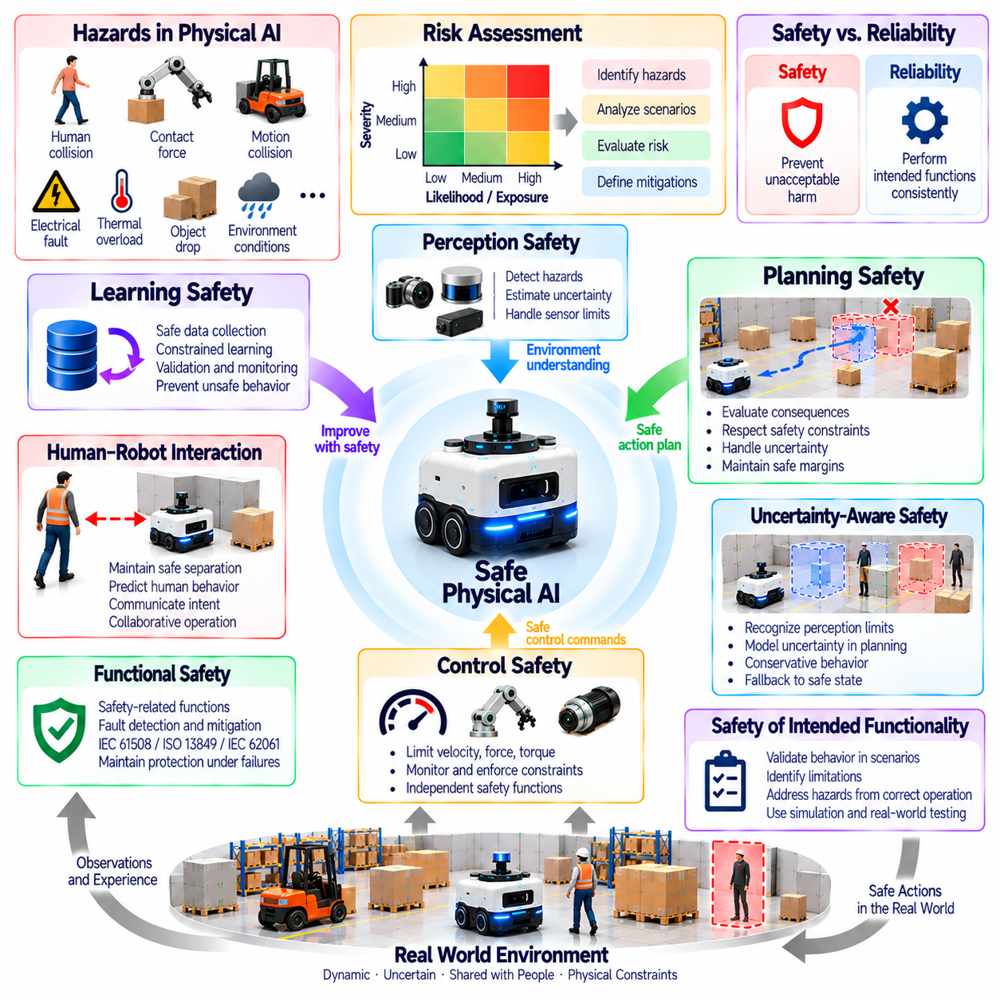{width="7.268055555555556in" height="7.268055555555556in"}

안전(Safety)은 지능형 행동(Intelligent Actions)이 사람(People), 장비(Equipment), 인프라(Infrastructure), 주변 환경(Surrounding Environment)에 직접적인 영향을 미칠 수 있기 때문에 피지컬 AI(Physical AI)의 핵심 속성(Core Property)이다. 순수한 디지털 오류(Purely Digital Errors)와 달리 물리적 고장(Physical Failures)은 인명 피해(Injury), 재산 피해(Property Damage), 되돌릴 수 없는 결과(Irreversible Consequences)를 초래할 수 있다. 따라서 안전은 시스템 개발(System Development)의 초기 단계부터 인식(Perception), 의사결정(Decision-Making), 계획(Planning), 제어(Control), 학습(Learning)에 영향을 미쳐야 한다. 안전은 자율 기능(Autonomous Capabilities)이 구현된 이후 추가하는 선택적 기능(Optional Feature)으로 취급할 수 없다.

피지컬 AI 안전(Physical AI Safety)은 움직임(Motion), 접촉(Contact), 에너지(Energy), 환경 상호작용(Environmental Interaction)과 관련된 위험요인(Hazards)을 인식하는 것에서 시작한다. 이동 로봇(Mobile Robot)은 보행자(Pedestrian)와 충돌할 수 있으며, 매니퓰레이터(Manipulator)는 과도한 힘(Excessive Force)을 가하거나 객체(Object)를 예상하지 못하게 놓칠 수 있다. 전기적 결함(Electrical Faults), 열 과부하(Thermal Overload), 통신 장애(Communication Failures)는 추가적인 위험(Risks)을 발생시킨다. 위험요인 식별(Hazard Identification)은 정상 운영(Normal Operation), 예측 가능한 오용(Foreseeable Misuse), 성능 저하 상태(Degraded Conditions), 시스템 구성요소(System Components) 간 상호작용을 고려해야 한다.

안전(Safety)과 신뢰성(Reliability)은 밀접하게 관련되어 있지만 서로 다른 개념이다. 신뢰성은 시스템이 의도된 기능(Intended Functions)을 일관되게 수행하는지를 의미하며, 안전은 허용할 수 없는 피해(Unacceptable Harm)가 예방되는지를 의미한다. 로봇은 위험한 명령(Dangerous Command)을 신뢰성 있게 실행할 수도 있고, 구성요소 고장(Component Failure)이 발생하더라도 위험한 상황(Hazardous Situation)을 만들지 않을 수도 있다. 효과적인 엔지니어링(Effective Engineering)은 기능적 정확성(Functional Correctness)과 부정확하거나 예상하지 못한 행동(Incorrect or Unexpected Behavior)의 물리적 결과(Physical Consequences)를 모두 평가해야 한다.

위험성 평가(Risk Assessment)는 잠재적 피해(Potential Harm)의 심각도(Severity)와 위험 사건(Hazardous Events)에 관련된 발생 가능성(Likelihood) 또는 노출 조건(Exposure Conditions)을 결합한다. 엔지니어(Engineers)는 적절한 보호 조치(Protective Measures)를 결정하기 위해 운영 시나리오(Operational Scenarios), 고장 메커니즘(Failure Mechanisms), 인간과의 근접성(Human Proximity), 환경 특성(Environmental Characteristics)을 검토한다. 위험(Risk)을 항상 완전히 제거할 수는 없지만, 본질적으로 안전한 설계(Inherently Safer Design), 보호 시스템(Protective Systems), 운영 제한(Operational Restrictions), 검증된 절차(Validated Procedures)를 통해 감소시킬 수 있다.

설계 단계부터의 안전(Safety-by-Design)은 외부 비상 메커니즘(External Emergency Mechanisms)에만 의존하지 않고 보호 요구사항(Protective Requirements)을 시스템 아키텍처(System Architecture)에 통합한다. 기계적 한계(Mechanical Limits), 제어된 가속도(Controlled Acceleration), 제한된 운영 영역(Restricted Operating Regions), 예측 가능한 움직임 프로파일(Predictable Motion Profiles)은 내재된 위험요인(Inherent Hazards)을 줄일 수 있다. 하드웨어(Hardware)와 소프트웨어(Software)는 고도화된 지능(Advanced Intelligence)의 고장이 필수 보호 기능(Essential Protection)을 자동으로 무력화하지 않도록 구성해야 한다. 안전 요구사항(Safety Requirements)은 개발과 배포(Deployment)의 전 과정에서 추적 가능성(Traceability)을 유지해야 한다.

기능 안전(Functional Safety)은 전기(Electrical), 전자(Electronic), 프로그래밍 가능한 시스템(Programmable Systems)의 오작동(Malfunction)에서 발생하는 위험요인(Hazards)을 다룬다. 안전 관련 기능(Safety-Related Functions)은 속도(Speed), 이격 거리(Separation Distance), 액추에이터 토크(Actuator Torque), 비상 정지 조건(Emergency-Stop Conditions)을 감시할 수 있다. 요구되는 안전 무결성(Required Safety Integrity)은 적용 분야(Application)와 위험성 평가(Risk Assessment)에 따라 달라진다. IEC 61508, ISO 13849, IEC 62061과 같은 표준(Standards)은 관련 프레임워크(Frameworks)를 제공하지만, 적용 가능성(Applicability)과 준수 요구사항(Compliance Requirements)은 기계(Machine)와 운영 환경(Operating Context)에 따라 달라진다.

의도된 기능의 안전성(Safety of the Intended Functionality)은 구성요소(Components)가 설계된 대로 작동하더라도 발생할 수 있는 위험요인(Hazards)을 다룬다. 인식 시스템(Perception System)은 익숙하지 않은 객체(Unfamiliar Object)를 잘못 해석할 수 있으며, 계획기(Planner)는 환경에 대한 가정(Environmental Assumptions)이 불완전하여 안전하지 않은 행동(Unsafe Action)을 선택할 수 있다. 이러한 문제는 하드웨어 고장 감지(Hardware Fault Detection)만으로 해결할 수 없다. 피해(Harm)로 이어질 수 있는 한계(Limitations)를 식별하기 위해 시나리오 분석(Scenario Analysis), 불확실성 평가(Uncertainty Evaluation), 의도된 행동의 검증(Validation of Intended Behavior)이 필요하다.

인식 안전(Perception Safety)은 환경 위험요인(Environmental Hazards)과 이용 가능한 관측값(Available Observations)의 한계를 모두 인식할 것을 요구한다. 카메라(Cameras), 라이다(LiDAR), 레이더(Radar), 기타 센서(Sensors)는 가림 현상(Occlusion), 간섭(Interference), 기상 조건(Weather), 불리한 기하학적 구조(Unfavorable Geometry)로 인해 객체를 감지하지 못할 수 있다. 신뢰도 추정값(Confidence Estimates)과 센서 융합(Sensor Fusion)은 상황 인식(Awareness)을 개선할 수 있지만, 센서 간 일치(Agreement Between Sensors)가 반드시 정확성을 보장하지는 않는다. 시스템은 인식 성능 저하(Degraded Perception)를 식별하고 불확실성(Uncertainty)이 허용할 수 없는 위험(Unacceptable Risk)을 발생시키기 전에 행동을 조정해야 한다.

계획 안전(Planning Safety)은 실행 전에 후보 행동(Candidate Actions)의 결과(Consequences)를 평가할 것을 요구한다. 내비게이션 계획기(Navigation Planner)는 충돌 경계(Collision Boundaries), 정지 거리(Stopping Distance), 인간의 움직임(Human Movement), 접근 가능한 탈출 경로(Accessible Escape Paths)를 고려해야 한다. 조작 계획(Manipulation Planning)은 탑재 하중 한계(Payload Limits), 접촉력(Contact Forces), 객체 안정성(Object Stability)을 반영해야 한다. 안전한 계획(Safe Planning)은 특히 예측(Predictions)이 불확실하거나 환경 조건(Environmental Conditions)이 변화할 때 보호 여유(Protective Margins)를 확보하기 위해 효율성(Efficiency)을 일부 희생할 수 있다.

제어 안전(Control Safety)은 보호 요구사항(Protective Requirements)을 강제 가능한 물리적 행동(Enforceable Physical Behavior)으로 변환한다. 제어기(Controllers)는 속도(Velocity), 가속도(Acceleration), 토크(Torque), 힘(Force), 작업 공간 경계(Workspace Boundaries)에 제한을 적용할 수 있다. 감시 기능(Monitoring Functions)은 명령된 행동(Commanded Actions)을 허용된 운영 조건(Permitted Operating Conditions)과 비교하고 제약 조건(Constraints)을 위반하면 개입한다. 학습 기반 정책(Learning-Based Policies)이나 복잡한 계획기(Complex Planners)가 가능한 모든 출력(Possible Outputs)에 대해 충분한 보장(Guarantees)을 제공하지 못하는 경우 독립적인 보호 메커니즘(Independent Protective Mechanisms)이 특히 중요하다.

인간-로봇 상호작용(Human-Robot Interaction)은 인간 행동(Human Behavior)을 정확하게 예측하기 어렵기 때문에 추가적인 안전 책임(Safety Responsibilities)을 발생시킨다. 사람은 제한 구역(Restricted Areas)에 진입하거나 예상하지 못하게 움직이거나 로봇의 의도(Robot Intentions)를 잘못 이해할 수 있다. 안전한 상호작용(Safe Interaction)을 위해서는 적절한 이격 거리(Separation), 속도 제어(Speed Control), 가시성(Visibility), 시스템 상태(System Status)의 전달이 필요하다. 협업 운영(Collaborative Operation)은 낮은 속도(Low Speed)만으로 안전이 보장된다고 가정하지 않고 실제 적용 분야(Actual Application), 접촉 조건(Contact Conditions), 적용 가능한 안전 요구사항(Applicable Safety Requirements)을 고려해야 한다.

학습 기반 시스템(Learning-Based Systems)은 학습(Training), 적응(Adaptation), 배포(Deployment) 과정에서 모델 동작(Model Behavior)이 변화할 수 있기 때문에 안전 문제(Safety Challenges)를 발생시킨다. 익숙한 시나리오(Familiar Scenarios)에서 우수한 성능을 보이는 정책(Policy)도 익숙하지 않은 조건(Unfamiliar Conditions)을 만나면 예상하지 못한 행동(Unexpected Actions)을 생성할 수 있다. 탐색(Exploration) 역시 물리적 위험요인(Physical Hazards)을 발생시킬 수 있다. 안전 제약 학습(Safety-Constrained Learning), 통제된 업데이트(Controlled Updates), 독립적인 감시(Independent Monitoring), 대표적인 시나리오(Representative Scenarios)에 대한 검증(Validation)은 성능 최적화(Performance Optimization)가 보호 요구사항(Protective Requirements)을 무시하지 않도록 하는 데 도움이 된다.

불확실성 인지 안전(Uncertainty-Aware Safety)은 불완전한 정보(Incomplete Information)가 겉으로는 합리적으로 보이는 의사결정(Apparently Reasonable Decisions)을 위험하게 만들 수 있음을 인식한다. 자기 위치 추정 신뢰도(Localization Confidence)가 감소하거나 객체 특성(Object Properties)이 알려지지 않은 경우 에이전트(Agent)는 속도(Speed)를 줄이고, 이격 거리(Clearance)를 늘리고, 지원(Assistance)을 요청하거나, 작업(Operation)을 중단할 수 있다. 이러한 대응(Responses)은 발생 가능한 결과(Possible Consequences)의 심각도(Severity)를 반영해야 한다. 안전한 시스템(Safe System)은 이용 가능한 증거(Available Evidence)가 자율 행동(Autonomous Action)의 지속을 정당화하기에 불충분한 시점을 인식해야 한다.

결함 허용(Fault Tolerance)은 개별 구성요소(Individual Components)가 고장 나더라도 피지컬 AI 시스템(Physical AI Systems)이 보호 기능(Protection)을 유지할 수 있도록 한다. 중복 센서(Redundant Sensors), 진단 모니터링(Diagnostic Monitoring), 워치독 메커니즘(Watchdog Mechanisms), 통제된 대체 운영 모드(Controlled Fallback Modes)는 단일 구성요소(Single Components)에 대한 의존성을 줄일 수 있다. 그러나 중복성(Redundancy)은 공통 원인 고장(Common-Cause Failures)과 공유된 설계 가정(Shared Design Assumptions)을 고려해야 한다. 대체 전략(Fallback Strategy)은 어떤 기능(Functions)을 계속 사용할 수 있는지, 어떤 작업(Operations)을 중단해야 하는지, 시스템이 안전한 상태(Safe Condition)에 어떻게 도달하는지를 정의해야 한다.

비상 정지(Emergency Stopping)는 중요한 보호 기능(Protective Function)이지만 포괄적인 안전 엔지니어링(Comprehensive Safety Engineering)을 대체하지는 않는다. 정지 동작(Stopping Behavior)은 기계적 관성(Mechanical Inertia), 제동 거리(Braking Distance), 하중 안정성(Load Stability), 즉각적인 전원 차단(Immediate Power Removal)이 추가적인 위험요인(Additional Hazards)을 발생시킬 가능성을 고려해야 한다. 적용 분야에 따라 제어된 정지(Controlled Stopping)나 특정 기능(Selected Functions)에 대한 전원 유지(Maintained Power)가 필요할 수 있다. 비상 조치(Emergency Measures)는 실제 물리적 시스템(Actual Physical System)에 맞게 설계되고 검증되어야 한다.

안전 검증(Safety Verification)은 구현된 기능(Implemented Functions)이 명시된 요구사항(Specified Requirements)을 충족하는지 판단하며, 안전 타당성 확인(Safety Validation)은 전체 시스템(Overall System)이 의도된 용도(Intended Use)에 충분히 안전한지를 검토한다. 시험(Testing)에는 결함 주입(Fault Injection), 센서 성능 저하(Sensor Degradation), 예상하지 못한 장애물(Unexpected Obstacles), 통신 중단(Communication Interruptions), 비정상적인 액추에이터 동작(Abnormal Actuator Behavior)이 포함될 수 있다. 시뮬레이션(Simulation)은 광범위한 시나리오 포괄 범위(Scenario Coverage)를 지원하지만 실제 접촉 동역학(Real Contact Dynamics)과 하드웨어 한계(Hardware Limitations)를 평가하기 위해서는 물리적 시험(Physical Testing)이 여전히 필요하다.

운영 안전(Operational Safety)은 배포(Deployment) 이후에도 점검(Inspection), 유지보수(Maintenance), 모니터링(Monitoring), 사고 분석(Incident Analysis)을 통해 지속된다. 센서(Sensors)에는 드리프트(Drift)가 발생할 수 있고, 기계적 구성요소(Mechanical Components)는 마모될 수 있으며, 환경(Environments)은 초기 가정(Original Assumptions)을 넘어 변화할 수 있다. 로그(Logs)와 진단 기록(Diagnostic Records)은 고장(Failures)과 아차사고(Near Misses)의 조사(Investigation)를 지원한다. 소프트웨어 업데이트(Software Updates)와 학습된 모델의 변경(Learned Model Changes)은 이전에 확립된 안전 근거(Safety Evidence)를 무효화할 수 있으므로 적절한 검토(Review)를 거쳐야 한다.

안전 거버넌스(Safety Governance)는 요구사항(Requirements), 위험 수용(Risk Acceptance), 변경 관리(Change Control), 운영 감독(Operational Oversight)에 대한 책임(Responsibility)을 할당한다. 개발자(Developers), 통합 담당자(Integrators), 운영자(Operators), 유지보수 담당자(Maintenance Personnel)는 서로 다른 형태의 근거(Evidence)와 책무성(Accountability)을 제공한다. 문서화(Documentation)는 식별된 위험요인(Identified Hazards)을 보호 조치(Protective Measures) 및 검증 결과(Verification Results)와 연결해야 한다. 운영 중단(Stopping Operation)이나 안전하지 않은 변경(Unsafe Changes)의 거부에 관한 명확한 권한(Clear Authority)은 상업적 목표(Commercial Objectives)나 성능 목표(Performance Objectives)가 필수 보호(Essential Protection)보다 우선하지 않도록 하는 데 도움이 된다.

안전 성능(Safety Performance)은 보고된 사고(Reported Accidents)가 없다는 사실만을 넘어서는 근거(Evidence)를 사용하여 평가해야 한다. 관련 지표(Relevant Indicators)에는 위험 사건 발생 빈도(Hazardous-Event Frequency), 보호 응답 시간(Protective Response Time), 제약 조건 위반(Constraint Violations), 진단 범위(Diagnostic Coverage), 성능 저하 조건(Degraded Conditions)에서의 성능이 포함된다. 드물지만 심각한 시나리오(Rare but Severe Scenarios)는 일반적인 운영 통계(Ordinary Operational Statistics)만으로 드러나지 않을 수 있으므로 의도적인 검토(Deliberate Examination)가 필요하다. 지속적인 평가(Continuous Evaluation)는 새로운 위험(Emerging Risks)이 물리적 피해(Physical Harm)를 발생시키기 전에 이를 식별해야 한다.

궁극적으로 안전(Safety)은 지능(Intelligence)과 분리된 요소가 아니라 책임 있는 물리적 자율성(Responsible Physical Autonomy)을 정의하는 핵심 요구사항(Defining Requirement)이다. 인식(Perception)은 자신의 한계(Limitations)를 인식해야 하고, 예측(Prediction)은 위험한 결과(Hazardous Outcomes)를 고려해야 하며, 계획(Planning)은 제약 조건(Constraints)을 준수해야 하고, 제어(Control)는 보호 경계(Protective Boundaries)를 강제해야 한다. 학습(Learning)과 적응(Adaptation)은 능력(Capabilities)이 발전하더라도 이러한 속성을 유지해야 한다. 피지컬 AI(Physical AI)는 목적성 있는 행동(Purposeful Action)이 사람과 물리적 세계(People and the Physical World)에 대한 입증 가능한 보호(Demonstrable Protection)의 범위 내에서 일관되게 수행될 때 신뢰할 수 있는 기술(Trustworthy Technology)이 된다.

## 01.15. Minimal Physical AI Agent [w/Code]

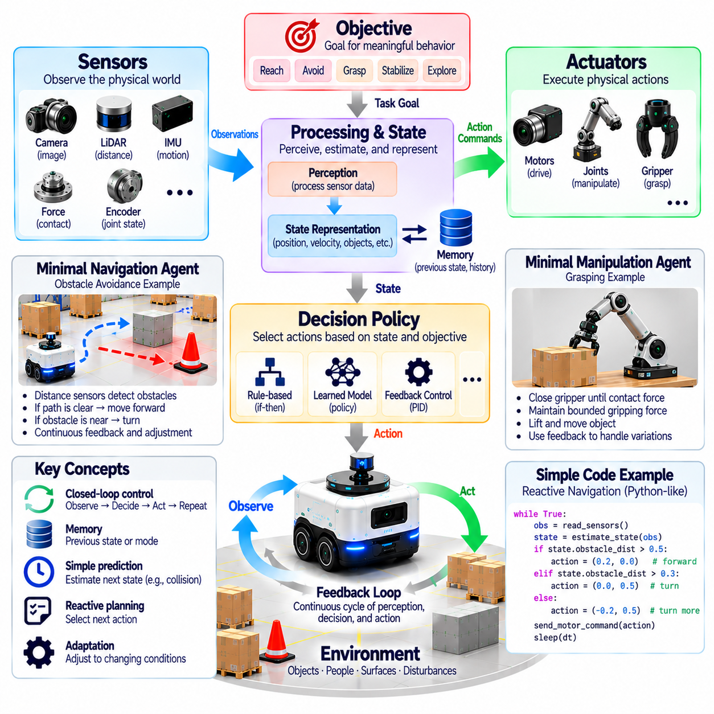{width="7.268055555555556in" height="7.268055555555556in"}

최소 피지컬 AI 에이전트(Minimal Physical AI Agent)는 물리적 조건(Physical Conditions)을 인식하고, 목적성 있는 행동(Purposeful Actions)을 선택하며, 피드백(Feedback)을 통해 환경(Environment)에 영향을 미칠 수 있는 가장 단순한 기능적 시스템(Functional System)이다. 인간 수준의 추론(Human-Level Reasoning), 광범위한 언어 이해(Extensive Language Understanding), 대규모 파운데이션 모델(Large Foundation Models)이 반드시 필요한 것은 아니다. 최소 피지컬 AI 에이전트의 핵심 특성(Defining Characteristic)은 감지(Sensing), 의사결정(Decision-Making), 물리적 행동(Physical Action)을 폐루프 상호작용(Closed Interaction Loop) 내에서 통합하는 것이다. 이러한 최소 구조(Minimal Structure)는 더욱 발전된 자율 시스템(Autonomous Systems)의 개념적 기반(Conceptual Foundation)을 제공한다.

최소 에이전트(Minimal Agent)의 필수 구성요소(Essential Components)에는 환경(Environment), 센서(Sensors), 내부 처리 메커니즘(Internal Processing Mechanism), 의사결정 정책(Decision Policy), 액추에이터(Actuators)가 포함된다. 센서는 물리적 조건에 관한 정보(Information)를 획득하고, 처리 과정(Processing)은 측정값(Measurements)을 활용 가능한 표현(Usable Representations)으로 변환하며, 정책(Policy)은 적절한 행동(Actions)을 결정한다. 액추에이터는 환경이나 에이전트의 물리적 상태(Physical State)를 변화시키는 명령(Commands)을 실행한다. 이후 관측값(Subsequent Observations)은 이러한 행동의 결과(Consequences)를 보여준다.

최소 피지컬 AI 에이전트(Minimal Physical AI Agent)는 행동에 의미를 부여하는 목표(Objective)를 가져야 한다. 목표는 목적지 도달(Reaching a Destination), 안전거리 유지(Maintaining a Safe Distance), 기구 안정화(Stabilizing a Mechanism), 객체 위치 조정(Positioning an Object) 등이 될 수 있다. 목표가 없다면 감지(Sensing)와 움직임(Movement)은 목적성 있는 지능(Purposeful Intelligence)이 아니라 서로 분리된 활동(Disconnected Activities)에 머무른다. 목표가 복잡할 필요는 없지만, 선택된 행동(Selected Actions)이 의도된 결과(Intended Outcome)에 기여하는지를 평가할 수 있는 기준(Basis)을 제공해야 한다.

인식(Perception)은 에이전트가 관련된 물리적 조건(Relevant Physical Conditions)을 구분하는 데 필요한 정보를 제공한다. 단순한 이동 로봇(Simple Mobile Robot)은 거리 센서(Distance Sensors)를 사용하여 주변 장애물(Nearby Obstacles)을 감지할 수 있으며, 로봇 그리퍼(Robotic Gripper)는 힘 측정값(Force Measurements)을 통해 접촉(Contact)을 인식할 수 있다. 인식에 반드시 상세한 장면 이해(Detailed Scene Understanding)가 필요한 것은 아니다. 거리(Distance), 속도(Velocity), 접촉 상태(Contact State), 위치(Position)를 포함하는 간결한 표현(Compact Representation)만으로도 작업(Task)에 필요한 의사결정을 지원할 수 있다면 충분하다.

상태 표현(State Representation)은 원시 관측값(Raw Observations)을 의사결정(Decision-Making)에 유용한 변수(Variables)로 변환한다. 최소 내비게이션 에이전트(Minimal Navigation Agent)는 추정 위치(Estimated Position), 진행 방향(Heading), 장애물 거리(Obstacle Distance), 이동 상태(Movement Status)를 유지할 수 있다. 이러한 변수는 행동을 선택하는 데 필요한 조건(Conditions)을 요약한다. 상태 표현은 불완전하거나 불확실할 수 있지만 목표(Objective)와 관련된 정보를 보존해야 한다. 더욱 정교한 표현(More Elaborate Representations)은 작업 복잡도(Task Complexity)가 요구하는 경우에만 필요하다.

의사결정 정책(Decision Policy)은 이용 가능한 정보(Available Information)를 행동(Actions)에 대응시킨다. 단순한 에이전트(Simple Agent)에서 이러한 정책은 조건부 규칙(Conditional Rules), 유한 상태 기계(Finite-State Machine), 피드백 제어기(Feedback Controller), 소형 학습 모델(Compact Learned Model)로 구성될 수 있다. 예를 들어 로봇은 진행 경로(Path)가 확보되면 전진하고, 장애물(Obstacle)이 정의된 안전 영역(Safety Region)에 진입하면 회전할 수 있다. 이러한 정책은 변화하는 조건(Changing Conditions)에서 의사결정이 지속적으로 목표(Objective)를 지원할 때 기능적 의미의 지능(Intelligence in a Functional Sense)을 갖는다.

물리적 행동(Physical Action)은 피지컬 AI 에이전트(Physical AI Agent)를 정보를 분석하기만 하는 시스템(System)과 구별한다. 모터(Motors), 바퀴(Wheels), 관절(Joints), 그리퍼(Grippers), 기타 액추에이터(Actuators)는 명령(Commands)을 물리적 효과(Physical Effects)로 변환한다. 이러한 효과는 기계적 동역학(Mechanical Dynamics), 에너지 가용성(Energy Availability), 환경 상호작용(Environmental Interaction)에 따라 달라진다. 명령된 움직임(Commanded Movement)은 마찰(Friction), 하중 변화(Load Variation), 장애물(Obstacles) 때문에 예상한 변위(Expected Displacement)를 발생시키지 못할 수 있다. 따라서 에이전트는 완벽한 실행(Perfect Execution)을 가정하지 않고 실제 결과(Actual Outcomes)를 관측해야 한다.

폐루프 피드백(Closed-Loop Feedback)은 최소 피지컬 AI 에이전트(Minimal Physical AI Agent)의 핵심 운영 원리(Central Operating Principle)이다. 에이전트는 환경(Environment)을 관측하고, 관련 조건(Relevant Conditions)을 추정하며, 행동(Action)을 선택하고, 그 결과로 발생한 변화(Resulting Change)를 측정한다. 각 순환 주기(Cycle)는 다음 의사결정(Next Decision)에 필요한 정보를 제공한다. 행동의 효과(Effects)를 고려하지 않고 사전에 결정된 명령(Predetermined Commands)을 실행하는 개루프 자동화(Open-Loop Automation)와 달리 폐루프 운영(Closed-Loop Operation)은 외란(Disturbances)과 예상하지 못한 물리적 결과(Unexpected Physical Outcomes)에 대응하여 행동을 조정할 수 있도록 한다.

단순한 장애물 회피 로봇(Simple Obstacle-Avoidance Robot)은 이러한 아키텍처(Architecture)를 설명하는 사례이다. 거리 센서(Distance Sensors)는 주변 객체(Nearby Objects)를 측정하고, 제어기(Controller)는 측정값을 안전 임계값(Safety Thresholds)과 비교하며, 바퀴 모터(Wheel Motors)는 이동 방향(Movement Direction)을 조정한다. 로봇이 이동하는 동안 새로운 측정값(New Measurements)은 계속 전진할지, 감속할지, 회전할지를 결정한다. 이러한 행동은 단순할 수 있지만 시스템은 물리적 인식(Physical Perception), 행동 선택(Action Selection), 환경에 대한 영향(Environmental Influence), 지속적인 피드백(Continuous Feedback)을 보여준다.

최소 조작 에이전트(Minimal Manipulation Agent)는 또 다른 사례를 제공한다. 그리퍼(Gripper)는 힘 센서(Force Sensor)가 충분한 접촉(Sufficient Contact)을 감지할 때까지 닫힌 다음, 객체(Object)를 들어 올리는 동안 제한된 파지력(Bounded Gripping Force)을 유지할 수 있다. 피드백(Feedback)은 객체 크기(Object Dimensions)나 기계적 유연성(Mechanical Compliance)의 차이를 보상한다. 시스템이 객체의 모든 특성(Properties)을 이해할 필요는 없다. 물리적 제약(Physical Constraints)을 준수하면서 의도된 조작(Intended Manipulation)을 실행할 수 있을 만큼의 정보만 필요하다.

기억(Memory)은 최소 에이전트(Minimal Agent)에 유용하지만 반드시 광범위할 필요는 없다. 시스템은 안정적인 의사결정(Stable Decisions)을 지원하기 위해 이전 센서 측정값(Previous Sensor Reading), 이동 방향(Movement Direction), 운영 상태(Operating State)를 유지할 수 있다. 유한 상태 제어기(Finite-State Controller)는 접근(Approaching), 회전(Turning), 파지(Grasping), 해제(Releasing) 중 어떤 상태에 있는지를 기억할 수 있다. 이러한 제한된 기억(Limited Memory)은 모순된 행동(Contradictory Actions)을 방지하고 연속성(Continuity)을 지원한다. 더욱 정교한 일화 기억(Episodic Memory)이나 의미 기억(Semantic Memory)은 작업이 긴 이력(Longer Histories)과 폭넓은 환경 지식(Broader Environmental Knowledge)을 요구할 때 가치가 높아진다.

예측(Prediction) 역시 최소한의 형태(Minimal Form)로 구현할 수 있다. 제어기(Controller)는 이동을 계속하면 장애물과의 이격 거리(Obstacle Clearance)가 감소할지, 가해진 힘(Applied Force)이 안전 한계(Safe Limit)를 초과할지를 추정할 수 있다. 이러한 예측은 복잡한 학습 기반 세계 모델(Complex Learned World Models)이 아니라 단순한 물리적 관계(Simple Physical Relationships)에 기반할 수 있다. 제한적인 예측(Limited Anticipation)만으로도 물리적 응답(Physical Responses)이 지연되는 상황에서 행동 선택(Action Selection)을 개선할 수 있다. 예측의 정교함(Predictive Sophistication)은 환경(Environment)의 요구 수준에 따라 높여야 한다.

최소 에이전트(Minimal Agent)의 계획(Planning)은 긴 행동 순서(Extended Action Sequence)를 생성하는 대신 다음 행동(Next Action)을 선택하는 것으로 구성될 수 있다. 반응형 제어기(Reactive Controller)는 로컬 관측값(Local Observations)이 충분한 지침(Guidance)을 제공할 때 유용한 행동을 수행할 수 있다. 더 복잡한 작업(Complex Tasks)에는 중간 목표(Intermediate Goals), 경로 선택(Route Selection), 조정된 행동 순서(Coordinated Action Sequences)가 필요하다. 이러한 구분은 절대적인 것이 아니라 아키텍처상의 구분(Architectural Distinction)이다. 최소 에이전트는 단순한 규칙(Simple Rules)으로 작동할 수 있으며, 고급 에이전트(Advanced Agents)는 점점 더 정교한 계획 메커니즘(Planning Mechanisms)을 통합한다.

모든 최소 폐루프 제어기(Minimal Closed-Loop Controller)에 반드시 학습(Learning)이 필요한 것은 아니다. 고정 정책(Fixed Policies)은 제약된 환경(Constrained Environments)에서 유용한 작업을 수행할 수 있지만, 이를 자동으로 적응형 지능(Adaptive Intelligence)으로 간주해서는 안 된다. 학습 능력을 갖춘 최소 에이전트(Learning-Capable Minimal Agent)는 제어 매개변수(Control Parameter)를 조정하거나, 장애물 임계값(Obstacle Threshold)을 개선하거나, 반복적인 경험(Repeated Experience)을 통해 추정값(Estimate)을 업데이트할 수 있다. 이러한 메커니즘은 대규모 학습 인프라(Large-Scale Training Infrastructure)나 광범위한 신경망(Extensive Neural Networks) 없이도 적응(Adaptation)을 도입한다.

불확실성(Uncertainty)은 단순한 시스템(Simple Systems)에서도 여전히 중요하다. 거리 측정값(Distance Measurements)에는 잡음(Noise)이 포함되고, 액추에이터(Actuators)는 불완전하게 반응하며, 환경 조건(Environmental Conditions)은 예상하지 못하게 변화할 수 있다. 최소 에이전트(Minimal Agent)는 필터링(Filtering), 보수적인 임계값(Conservative Thresholds), 반복 관측(Repeated Observations), 제한된 행동(Bounded Actions)을 통해 불확실성을 관리할 수 있다. 신중하게 행동하기 위해 완전한 확률 모델(Complete Probabilistic Model)이 반드시 필요한 것은 아니다. 그러나 성능(Performance)을 해석하거나 익숙하지 않은 조건(Unfamiliar Conditions)으로 운영 범위를 확장할 때는 시스템의 한계(Limitations)를 인식해야 한다.

실시간 제약(Real-Time Constraints)은 최소 에이전트(Minimal Agent)가 효과적인 상호작용(Effective Interaction)을 유지할 수 있는지를 결정한다. 센서 업데이트(Sensor Updates), 처리(Processing), 의사결정(Decisions), 액추에이터 명령(Actuator Commands)은 물리적 작업(Physical Task)에 충분할 만큼 빠르게 수행되어야 한다. 느린 장애물 감지기(Slow Obstacle Detector)는 정지된 플랫폼(Stationary Platform)에서는 적절할 수 있지만 빠르게 이동하는 로봇(Rapidly Moving Robot)에는 안전하지 않을 수 있다. 따라서 계산적 단순성(Computational Simplicity)은 필요한 기능(Necessary Functionality)을 희생하지 않으면서 지연 시간(Latency)을 줄이고 예측 가능한 실행(Predictable Execution)을 개선할 때 장점이 될 수 있다.

안전(Safety)은 에이전트가 기본적인 작업(Elementary Tasks)만 수행하더라도 반드시 통합되어야 한다. 이동 제한(Movement Limits), 비상 정지(Emergency Stopping), 힘 제한(Force Restrictions), 보호 운영 경계(Protective Operating Boundaries)는 단순한 의사결정(Simple Decisions)이 허용할 수 없는 결과(Unacceptable Consequences)를 발생시키지 않도록 한다. 최소 에이전트(Minimal Agent)는 센서 고장(Sensor Failures), 유효하지 않은 측정값(Invalid Measurements), 사용할 수 없는 명령(Unavailable Commands)에 예측 가능하게 대응해야 한다. 단순한 기구(Uncomplicated Mechanisms)도 물리적 피해(Physical Harm)를 발생시킬 수 있으므로 기본적인 지능(Basic Intelligence)이 취약한 보호 수준(Weak Protection)을 정당화하지는 않는다.

최소 피지컬 AI 에이전트(Minimal Physical AI Agent)와 일반 자동화(Ordinary Automation)의 구분은 어떤 능력(Capabilities)을 갖추었다고 주장하는지에 따라 달라진다. 고정 순서 제어기(Fixed Sequence Controller)는 환경 피드백(Environmental Feedback)을 해석하지 않고 물리적 행동(Physical Actions)을 수행할 수 있지만, 반응형 에이전트(Reactive Agent)는 관측된 조건(Observed Conditions)에 따라 행동을 조정한다. 그러나 피드백 제어(Feedback Control)만으로 학습(Learning), 일반화(Generalization), 고급 추론(Advanced Reasoning)이 입증되는 것은 아니다. 따라서 분류(Classification)는 센서(Sensors)나 모터(Motors)가 존재한다는 이유만으로 지능을 암시하기보다 실제로 입증된 능력(Demonstrated Capabilities)을 설명해야 한다.

최소 에이전트(Minimal Agent)의 평가는 관련 물리적 조건(Relevant Physical Conditions)에서 목표(Objective)를 달성하는지를 측정해야 한다. 작업 성공률(Task Success), 응답 시간(Response Time), 제어 안정성(Control Stability), 제약 조건 준수(Constraint Compliance), 외란으로부터의 복구(Recovery from Disturbances)는 실질적인 평가 근거(Practical Evidence)를 제공한다. 시험(Testing)에는 센서 측정값(Sensor Readings), 환경의 기하학적 구조(Environmental Geometry), 액추에이터 동작(Actuator Behavior)의 변화가 포함되어야 한다. 최소 시스템(Minimal System)은 제한된 아키텍처(Limited Architecture)로 반복 가능하고(Repeatable), 목적성 있으며(Purposeful), 충분히 안전한(Sufficiently Safe) 물리적 행동(Physical Behavior)을 생성할 때 성공적이라고 평가할 수 있다.

궁극적으로 최소 피지컬 AI 에이전트(Minimal Physical AI Agent)는 점점 더 높은 능력을 갖춘 자율 시스템(Autonomous Systems)을 이해하기 위한 기반(Foundation)을 확립한다. 인식(Perception)은 정보를 제공하고, 상태 표현(State Representation)은 이를 구조화하며, 의사결정(Decision-Making)은 행동을 선택하고, 구동(Actuation)은 물리적 결과(Physical Consequences)를 발생시킨다. 피드백(Feedback)은 이러한 기능을 지속적인 순환 과정(Continuous Cycle)으로 연결한다. 이후 기억(Memory), 예측(Prediction), 계획(Planning), 학습(Learning)은 작업 요구사항(Task Requirements)에 따라 확장될 수 있으며, 물리적 제약(Physical Constraints)과 안전(Safety)은 모든 능력 수준(Capability Levels)에서 근본적인 요소로 유지된다.
