**Volume 02. Physical AI Foundations and Definitions**

# Chapter 02. Physical AI vs Digital AI

## 02.01. Digital AI and Physical AI

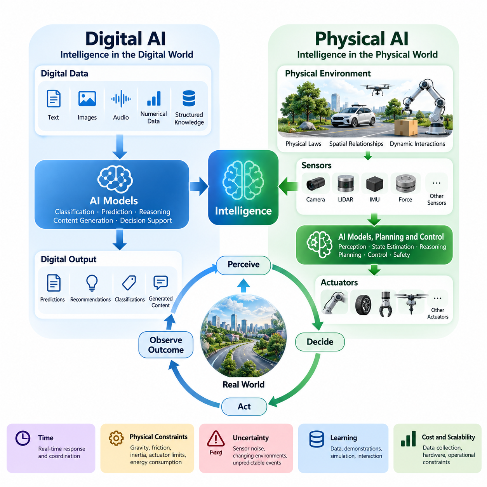{width="7.268055555555556in" height="7.268055555555556in"}

디지털 인공지능(Digital Artificial Intelligence, Digital AI)은 주로 디지털 환경(Digital Environment)에서 정보를 처리하고, 해석하고, 생성하고, 변환하는 지능형 컴퓨팅 시스템(Intelligent Computing System)을 의미한다. 이러한 시스템은 텍스트(Text), 이미지(Image), 오디오(Audio), 수치 데이터(Numerical Data), 구조화된 지식(Structured Knowledge)과 같은 표현을 기반으로 작동한다. 주요 기능에는 분류(Classification), 예측(Prediction), 추론(Reasoning), 콘텐츠 생성(Content Generation), 의사결정 지원(Decision Support)이 포함되며, 일반적으로 물리적 프로세스(Physical Process)를 직접 제어하지 않는다.

피지컬 인공지능(Physical Artificial Intelligence, Physical AI)은 인공지능을 물리 법칙(Physical Laws), 공간적 관계(Spatial Relationships), 동적 상호작용(Dynamic Interactions)이 지배하는 환경으로 확장한 개념이다. 이를 통해 기계는 주변 환경을 인식하고, 환경 조건을 해석하며, 의사결정을 수행하고, 물리적 메커니즘(Physical Mechanism)을 통해 행동을 실행할 수 있다. 정보 처리에 국한된 시스템과 달리 피지컬 AI는 운동(Motion), 힘(Force), 접촉(Contact), 불확실성(Uncertainty), 현실 세계에서 발생하는 행동의 결과를 고려해야 한다.

디지털 AI와 피지컬 AI의 근본적인 차이는 지능(Intelligence)과 작동 환경(Operating Environment) 사이의 관계에 있다. 디지털 AI는 일반적으로 정보를 다른 형태의 정보로 변환하는 반면, 피지컬 AI는 컴퓨팅 지능(Computational Intelligence)을 물리적 상태(Physical State) 및 행동(Action)과 연결한다. 언어 모델(Language Model)은 물체를 이동시키기 위한 지침을 생성할 수 있지만, 로봇 시스템(Robotic System)은 이러한 지침을 실행 가능한 움직임으로 변환하면서 실제 결과를 관찰해야 한다.

디지털 AI는 일반적으로 소프트웨어 애플리케이션(Software Application), 클라우드 플랫폼(Cloud Platform), 데이터베이스(Database), 컴퓨팅 서비스(Computing Service)를 통해 작동한다. 입력은 디지털 신호(Digital Signal) 또는 데이터 구조(Data Structure)로 표현되며, 출력은 주로 예측, 추천, 분류 또는 생성된 콘텐츠로 구성된다. 이러한 출력이 인간의 의사결정이나 외부 자동화 시스템을 통해 물리적 활동에 영향을 줄 수 있지만, AI 시스템 자체가 반드시 물리적 상호작용(Physical Interaction)을 직접 제어하는 것은 아니다.

피지컬 AI에는 센싱(Sensing), 컴퓨팅(Computing), 의사결정(Decision-Making), 구동(Actuation)을 연결하는 통합 아키텍처(Integrated Architecture)가 필요하다. 카메라(Camera), 라이다(LiDAR), 관성측정장치(Inertial Measurement Unit, IMU), 힘 센서(Force Sensor) 및 기타 장치는 환경에 대한 관측 정보(Observation)를 제공한다. AI 모델(AI Model)은 이러한 관측 정보를 해석하고, 계획 및 제어 알고리즘(Planning and Control Algorithm)은 적절한 대응을 결정한다. 이후 액추에이터(Actuator)는 컴퓨팅 기반 의사결정을 기계적 움직임이나 기타 물리적 효과로 변환한다.

피지컬 AI의 핵심적인 특징은 변화하는 환경과 지속적으로 상호작용한다는 점이다. 물리적 조건은 컴퓨팅 시스템과 독립적으로 변화하며, 시스템의 행동은 예상하지 못한 방식으로 환경을 변경할 수 있다. 따라서 지능형 물리 에이전트(Intelligent Physical Agent)는 주변 환경을 반복적으로 관찰하고, 관련 상태를 추정하며, 행동을 선택하고, 결과를 평가해야 한다. 이러한 반복 과정은 지능과 물리적 현실(Physical Reality) 사이에 폐루프 관계(Closed-Loop Relationship)를 형성한다.

디지털 AI 시스템은 사전에 정의된 데이터셋(Dataset)이나 사용자가 제공한 입력에 대해 추론(Inference)을 수행하는 경우가 많다. 모델은 문서를 분석하거나 이미지에서 객체를 인식하거나 질문에 답하면서도 기본 환경을 변경하지 않을 수 있다. 반면 피지컬 AI는 자체적인 움직임과 상호작용을 통해 정보를 획득하는 경우가 많다. 로봇은 카메라 위치를 변경하거나, 익숙하지 않은 물체에 접근하거나, 물체를 조작하여 이전에는 확보할 수 없었던 관측 정보를 얻을 수 있다.

두 시스템의 차이는 상태(State)와 행동(Action)의 표현 방식에서도 나타난다. 디지털 AI는 정보를 표현하기 위해 토큰(Token), 임베딩(Embedding), 특징 벡터(Feature Vector), 기호 구조(Symbolic Structure)를 자주 사용한다. 피지컬 AI는 여기에 위치(Position), 자세(Orientation), 속도(Velocity), 가속도(Acceleration), 접촉(Contact), 공간적 관계(Spatial Relationship)에 대한 표현이 추가로 필요하다. 이러한 표현은 측정 가능한 물리량(Physical Quantity)과 연결되어야 하며, 실제 시스템의 제약 조건에서도 실행 가능한 의사결정을 지원해야 한다.

피지컬 AI는 시간(Time)을 지능의 필수적인 속성으로 고려해야 한다. 대화형 애플리케이션(Conversational Application)에서 응답 지연(Response Delay)은 사용자 만족도를 낮출 수 있지만, 자율주행차(Autonomous Vehicle)에서 제동 명령(Braking Command)이 지연되면 즉각적인 위험이 발생할 수 있다. 따라서 로봇 시스템은 AI 추론, 통신(Communication), 센싱, 제어 사이의 조정이 필요하다. 컴퓨팅 아키텍처(Computing Architecture)는 허용 가능한 정확도(Accuracy)와 신뢰성(Reliability)을 유지하면서 운영상의 시간 제약(Operational Deadline)을 충족해야 한다.

물리적 세계(Physical World)는 많은 디지털 애플리케이션에서 존재하지 않거나 상대적으로 중요성이 낮은 제약 조건을 부과한다. 중력(Gravity), 마찰(Friction), 관성(Inertia), 기계적 유연성(Mechanical Compliance), 액추에이터 한계(Actuator Limits), 에너지 소비(Energy Consumption)는 실현 가능한 행동에 직접적인 영향을 미친다. AI가 생성한 동작 계획(Motion Plan)은 논리적으로 일관성이 있다는 이유만으로 성공적으로 실행될 수 없다. 해당 계획은 플랫폼의 기계적 성능과 환경의 물리적 특성도 충족해야 한다.

불확실성(Uncertainty)은 디지털 AI와 피지컬 AI 모두에 영향을 미치지만, 운영상의 결과는 상당히 다르다. 디지털 시스템은 모호한 언어(Ambiguous Language), 불완전한 정보(Incomplete Information), 분포 변화(Distribution Shift)에 직면할 수 있다. 피지컬 시스템은 여기에 센서 잡음(Sensor Noise), 보정 오차(Calibration Error), 조명 변화(Changing Illumination), 예측하기 어려운 장애물(Unpredictable Obstacles), 불확실한 접촉 조건(Uncertain Contact Conditions)을 추가로 경험한다. 이러한 교란(Disturbance)은 인식, 계획, 제어 과정으로 전파되어 안전하지 않거나 비효율적인 행동을 유발할 수 있다.

학습 메커니즘(Learning Mechanism)은 두 시스템을 비교하는 또 다른 중요한 관점이다. 디지털 AI는 일반적으로 문서, 웹사이트, 이미지 및 기타 정보원에서 수집된 대규모 데이터셋(Large-Scale Dataset)을 활용한다. 피지컬 AI는 시연(Demonstration), 원격조작(Teleoperation), 시뮬레이션(Simulation), 직접적인 상호작용(Direct Interaction)을 통해 추가로 학습할 수 있다. 학습 데이터에는 관측 정보, 로봇 상태(Robot State), 행동, 보상(Reward), 물리적 결과(Physical Outcome)가 포함될 수 있으며, 이를 통해 모델은 의사결정과 그 결과 사이의 관계를 학습한다.

물리적 경험(Physical Experience)을 획득하는 과정은 디지털 정보를 수집하는 것보다 비용이 많이 들고 운영상의 제약도 큰 경우가 많다. 실제 환경에서의 실험(Real-World Experiment)에는 하드웨어(Hardware), 통제된 환경(Controlled Environment), 유지보수(Maintenance), 감독(Supervision), 안전 예방조치(Safety Precaution)가 필요하다. 반복적인 행동은 에너지를 소비하거나 장비를 손상시키거나 위험을 발생시킬 수 있다. 따라서 피지컬 AI 개발은 기록된 데이터셋, 시뮬레이션 환경(Simulated Environment), 신중하게 통제된 실제 환경 실험을 결합하는 경우가 많다.

시뮬레이션(Simulation)은 디지털 AI 방법론(Digital AI Methodology)과 피지컬 AI 개발을 연결하는 중요한 수단이다. 물리 엔진(Physics Engine)과 가상 환경(Virtual Environment)을 활용하면 로봇 에이전트(Robot Agent)가 실제 장비를 즉각적인 위험에 노출하지 않고 인식, 내비게이션(Navigation), 조작(Manipulation), 제어를 학습할 수 있다. 그러나 시뮬레이션 환경은 모든 현실 조건을 완벽하게 재현할 수 없다. 동역학(Dynamics), 센싱, 접촉, 환경적 변동성(Environmental Variability)의 차이는 시뮬레이션에서 현실로의 전이(Simulation-to-Reality Transfer)에 어려움을 발생시킨다.

파운데이션 모델(Foundation Model)은 디지털 AI와 피지컬 AI가 점차 융합되고 있음을 보여준다. 대규모 언어 모델(Large Language Model, LLM)과 멀티모달 모델(Multimodal Model)은 의미 이해(Semantic Understanding), 명령 해석(Instruction Interpretation), 고수준 추론(High-Level Reasoning)을 제공할 수 있다. 이러한 기능을 로봇 아키텍처(Robotic Architecture)에 통합하면 작업 계획(Task Planning)과 상황 기반 의사결정(Contextual Decision-Making)을 지원할 수 있다. 그러나 언어 이해 능력만으로 물리적으로 실행 가능한 행동이나 실제 환경에서의 신뢰성 높은 제어가 보장되는 것은 아니다.

비전-언어-행동 모델(Vision-Language-Action Model, VLA)은 디지털 표현(Digital Representation)과 물리적 행동(Physical Behavior)을 연결하는 접근 방식 중 하나이다. 이러한 모델은 시각적 관측 정보(Visual Observation)와 언어 명령(Language Instruction)을 로봇 시스템을 제어할 수 있는 행동 표현(Action Representation)과 연관시킨다. 목표는 폭넓은 인식 및 의미 이해 능력을 물리적 작업으로 이전하는 것이다. 성공적인 배포(Deployment)를 위해서는 여전히 신체 구조의 호환성(Embodiment Compatibility), 행동 제약(Action Constraint), 피드백 메커니즘(Feedback Mechanism), 시스템 수준의 안전성 보증(System-Level Safety Assurance)이 필요하다.

체화(Embodiment)는 피지컬 AI를 순수한 정보 기반 지능(Information-Based Intelligence)과 구별하는 추가적인 차원을 제공한다. 에이전트의 물리적 구조(Physical Structure)는 환경을 관찰하고, 이동하고, 조작하고, 상호작용하는 방식을 결정한다. 이동 로봇(Mobile Robot), 산업용 매니퓰레이터(Industrial Manipulator), 휴머노이드(Humanoid), 사족보행 로봇(Quadruped), 무인항공기(Unmanned Aerial Vehicle, UAV)는 서로 다른 기계적 능력을 가진다. 따라서 각 시스템의 지능은 컴퓨팅 기반 의사결정과 체화 형태별 제약 조건(Embodiment-Specific Constraint) 사이의 관계를 고려해야 한다.

안전 요구사항(Safety Requirement)은 피지컬 AI의 엔지니어링 우선순위(Engineering Priority)를 더욱 명확하게 구별한다. 디지털 AI의 오류는 부정확한 정보, 부적절한 추천 또는 기타 중대한 결과를 초래할 수 있다. 피지컬 AI의 고장은 여기에 충돌(Collision), 기계적 손상(Mechanical Damage), 인명 피해(Injury), 환경적 피해(Environmental Disruption)를 추가로 발생시킬 수 있다. 안전한 운영을 위해서는 위험 분석(Hazard Analysis), 운영 한계(Operational Limit), 고장 감지(Fault Detection), 비상 대응(Emergency Response), 모델의 예측과 독립적으로 위험한 행동을 제한하는 메커니즘이 필요하다.

컴퓨팅 자원(Computational Resource) 역시 서로 다른 실무적 요구사항을 부과한다. 디지털 AI 애플리케이션은 상당한 처리 능력을 갖춘 대규모 클라우드 인프라(Cloud Infrastructure)를 활용할 수 있지만, 대화형 서비스(Interactive Service) 역시 지연시간(Latency)과 비용 제약(Cost Constraint)을 가진다. 피지컬 AI는 임베디드 프로세서(Embedded Processor), 엣지 가속기(Edge Accelerator), 분산 컴퓨팅 아키텍처(Distributed Computing Architecture)에 의존하는 경우가 많다. 이러한 플랫폼은 모델 성능(Model Performance)과 전력 소비(Power Consumption), 열적 한계(Thermal Limitation), 통신 신뢰성(Communication Reliability), 실시간 실행(Real-Time Execution) 사이의 균형을 유지해야 한다.

디지털 AI의 평가(Evaluation)는 일반적으로 예측 정확도(Prediction Accuracy), 분류 성능(Classification Performance), 추론 품질(Reasoning Quality), 작업별 출력 정확성(Task-Specific Output Correctness)과 같은 지표를 강조한다. 피지컬 AI의 평가에는 작업 완료율(Task Completion Rate), 궤적 정확도(Trajectory Accuracy), 물리적 안정성(Physical Stability), 충돌 회피(Collision Avoidance), 에너지 효율(Energy Efficiency), 운영 강건성(Operational Robustness)이 추가로 포함되어야 한다. 성공적인 컴퓨팅 결과가 반드시 성공적인 물리적 실행을 의미하지 않으므로, 현실적인 환경 변화 조건에서 성능을 평가해야 한다.

디지털 AI와 피지컬 AI는 상호 배타적인 기술 범주(Mutually Exclusive Technological Category)로 이해해서는 안 된다. 많은 피지컬 시스템은 인식, 언어 이해, 예측, 계획을 위해 디지털 지능(Digital Intelligence)에 광범위하게 의존한다. 반대로 디지털 시스템도 연결된 인프라(Connected Infrastructure)와 자동화 서비스(Automated Service)를 통해 물리적 프로세스에 영향을 미칠 수 있다. 중요한 구별 기준은 지능이 물리적 상태에 직접 영향을 미치고 그 변화에 대응하는 운영 루프(Operational Loop)에 통합되어 있는지 여부이다.

자율이동로봇(Autonomous Mobile Robot, AMR)은 이러한 관계를 보여주는 실질적인 사례이다. 디지털 AI 기능은 배송 명령(Delivery Instruction)을 해석하고, 객체를 식별하며, 작업 우선순위(Task Priority)를 최적화할 수 있다. 피지컬 AI 기능은 이러한 능력을 위치 추정(Localization), 장애물 감지(Obstacle Detection), 동작 계획(Motion Planning), 모터 제어(Motor Control)와 통합한다. 전체 시스템은 고수준 목표(High-Level Objective)와 변화하는 물리적 조건을 지속적으로 조정해야 하며, 이를 통해 디지털 추론이 물리적 환경에 기반한 지능(Physically Situated Intelligence)으로 전환되는 과정을 보여준다.

산업용 조작(Industrial Manipulation)은 정보 처리에서 물리적 실행으로 전환되는 또 다른 사례이다. AI 모델은 부품(Component)을 인식하고 조립 순서(Assembly Sequence)를 결정할 수 있지만, 로봇 시스템은 객체 자세(Object Pose)를 추정하고, 실행 가능한 궤적(Feasible Trajectory)을 생성하며, 접촉력(Contact Force)을 조절하고, 배치 성공 여부를 검증해야 한다. 인식이나 보정 과정에서 발생하는 작은 오차도 작업 결과에 영향을 미칠 수 있으므로, 소프트웨어와 하드웨어 전반에 걸친 지속적인 피드백과 조정된 운영이 필요하다.

따라서 피지컬 AI의 개발은 단순히 로봇 내부에 AI 모델을 설치하는 것 이상의 의미를 가진다. 인식(Perception), 추론(Reasoning), 예측(Prediction), 계획(Planning), 제어(Control), 하드웨어(Hardware), 안전 엔지니어링(Safety Engineering)을 시스템 수준에서 통합해야 한다. 각 구성요소는 지능형 행동(Intelligent Behavior)에 기여하지만, 전체 성능은 이들 사이의 조정된 상호작용(Coordinated Interaction)에 따라 결정된다. 피지컬 지능(Physical Intelligence)은 현실 세계의 제약 조건 아래에서 컴퓨팅 기반 이해를 신뢰할 수 있는 행동으로 전환하는 능력에서 나타난다.

인공지능이 발전함에 따라 디지털 추론(Digital Reasoning)과 물리적 상호작용(Physical Interaction) 사이의 경계는 점차 긴밀하게 연결되고 있다. 멀티모달 파운데이션 모델(Multimodal Foundation Model), 학습 기반 월드 모델(Learned World Model), 적응 제어(Adaptive Control), 로봇 학습(Robot Learning)은 더욱 범용적인 물리적 능력(General Physical Capability)을 구현할 기회를 제공한다. 그러나 물리적 세계는 인과성(Causality), 시간적 제약(Timing), 체화(Embodiment), 강건성(Robustness), 안전성(Safety)에 관한 근본적인 요구사항을 지속적으로 부과하며, 이러한 문제는 컴퓨팅 규모(Computational Scale)의 확대만으로 해결할 수 없다.

궁극적으로 디지털 AI와 피지컬 AI는 지능형 시스템(Intelligent System)의 상호 보완적인 두 차원을 나타낸다. 디지털 AI는 정보의 해석과 변환에 중점을 두는 반면, 피지컬 AI는 물리적 동역학(Physical Dynamics)이 지배하는 환경과의 지능적 상호작용(Intelligent Interaction)을 강조한다. 두 기술의 융합(Convergence)은 기계가 세계를 이해하고 설명하는 수준을 넘어, 실제 세계에서 행동하고, 행동의 결과를 평가하며, 의미 있는 물리적 목표(Physical Objective)를 달성하기 위해 자신의 행동을 적응적으로 조정할 수 있도록 한다.

## 02.02. Digital World vs Physical World

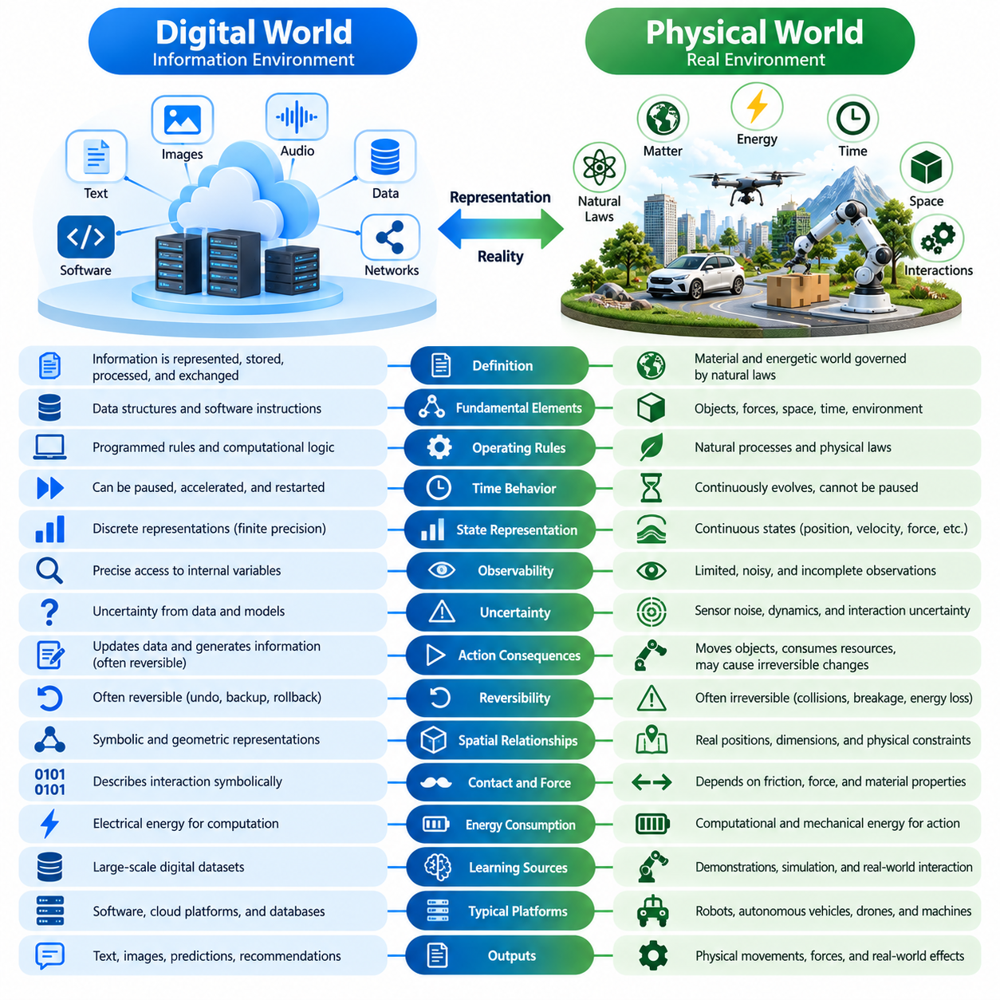{width="7.268055555555556in" height="7.268055555555556in"}

디지털 세계(Digital World)는 컴퓨팅 시스템(Computational System)을 통해 정보(Information)가 표현되고, 저장되고, 처리되고, 교환되는 환경이다. 디지털 세계의 기본 구성요소에는 데이터 구조(Data Structure), 소프트웨어 명령(Software Instruction), 통신 프로토콜(Communication Protocol), 가상 표현(Virtual Representation)이 포함된다. 이러한 환경에서는 프로그래밍된 규칙(Programmed Rule)과 컴퓨팅 논리(Computational Logic)에 따라 연산이 수행되므로, 물리적 객체나 환경을 직접 변화시키지 않고도 정보를 조작할 수 있다.

물리적 세계(Physical World)는 자연 법칙(Natural Law)의 지배를 받는 물질(Matter), 에너지(Energy), 공간(Space), 시간(Time), 상호작용(Interaction)으로 구성된다. 객체(Object)는 질량(Mass), 위치(Position), 속도(Velocity), 온도(Temperature), 기계적 저항(Mechanical Resistance)과 같이 측정 가능한 특성을 가진다. 디지털 표현과 달리 물리적 객체는 기호적 설명(Symbolic Description)을 변경하는 것만으로 수정할 수 없다. 객체의 행동은 힘(Force), 환경 조건(Environmental Condition), 재료 특성(Material Property), 주변 시스템의 동역학(Dynamics)에 따라 결정된다.

두 환경의 핵심적인 차이는 표현(Representation)과 현실(Reality) 사이의 관계에 있다. 디지털 세계에서 변수(Variable)는 객체의 위치를 나타낼 수 있지만, 해당 변수를 변경한다고 해서 실제 객체가 반드시 이동하는 것은 아니다. 물리적 세계에서 위치를 변경하려면 실제 움직임(Motion), 에너지 소비(Energy Expenditure), 물리적 제약(Physical Constraint)과의 상호작용이 필요하다. 피지컬 인공지능(Physical Artificial Intelligence, Physical AI)은 내부 표현(Internal Representation)을 외부 현실(External Reality)에서 관찰 가능한 변화와 연결해야 한다.

디지털 환경(Digital Environment)은 일반적으로 명시적으로 정의된 컴퓨팅 규칙(Computational Rule)을 기반으로 구성된다. 소프트웨어 개발자(Software Developer)는 변수의 변화 방식, 정보 접근 방식, 연산 실행 방식을 결정한다. 복잡한 디지털 시스템은 예측하기 어려운 행동을 보일 수 있지만, 기본적인 실행 과정은 구현된 메커니즘(Implemented Mechanism)을 따른다. 반면 물리적 환경(Physical Environment)은 소프트웨어 명령으로 중단하거나 재정의할 수 없는 자연적 과정(Natural Process)에 따라 작동한다.

시간(Time)은 디지털 연산(Digital Operation)과 물리적 연산(Physical Operation)에서 서로 다른 특성을 나타낸다. 디지털 시뮬레이션(Digital Simulation)은 일시 정지하거나, 가속하거나, 재시작하거나, 동일한 초기 조건(Initial Condition)에서 반복 실행할 수 있다. 그러나 물리적 프로세스(Physical Process)는 지능형 시스템(Intelligent System)이 계산을 중단하더라도 계속 변화한다. 움직이는 장애물(Moving Obstacle)은 로봇의 계산이 완료될 때까지 기다리지 않으므로, 시간적 인식(Temporal Awareness)과 적시 대응(Timely Response)은 피지컬 AI의 필수 요구사항이 된다.

물리적 세계는 연속적인 상태(Continuous State)와 동적 상태 전이(Dynamic Transition)를 특징으로 한다. 위치, 속도, 힘, 온도는 연속적으로 변화할 수 있지만, 센서(Sensor)와 컴퓨터(Computer)는 이를 이산적인 측정값(Discrete Measurement)을 통해 관찰한다. 디지털 시스템은 일반적으로 유한한 수치 정밀도(Finite Numerical Precision)와 이산적인 컴퓨팅 연산(Discrete Computational Operation)을 사용하여 정보를 표현한다. 피지컬 AI는 이러한 표현을 연속적인 환경 변화 및 피할 수 없는 측정 한계(Measurement Limitation)와 조화시켜야 한다.

관측 가능성(Observability)은 또 다른 근본적인 차이를 제공한다. 디지털 시스템은 적절한 인터페이스(Interface)와 접근 권한(Access Permission)이 존재할 경우, 명확하게 정의된 내부 변수(Internal Variable), 데이터베이스(Database), 컴퓨팅 상태(Computational State)에 접근할 수 있다. 반면 물리적 시스템(Physical System)은 실제 환경 상태(Environmental State)에 대한 완전한 접근을 제공하는 경우가 드물다. 센서는 제한적이고 잡음이 포함되며 때로는 모호한 관측 정보(Observation)를 수집하므로, 지능형 에이전트(Intelligent Agent)는 불완전한 정보(Incomplete Information)를 바탕으로 숨겨진 상태(Hidden State)를 추정해야 한다.

물리적 환경은 센싱(Sensing), 동역학(Dynamics), 상호작용(Interaction)을 통해 불확실성(Uncertainty)을 발생시킨다. 카메라(Camera)는 가림 현상(Occlusion)으로 인해 객체를 감지하지 못할 수 있으며, 이동 로봇(Mobile Robot)은 바퀴 미끄러짐(Wheel Slip)이나 예상하지 못한 마찰(Friction)을 경험할 수 있다. 디지털 환경에서도 특히 분산 시스템(Distributed System)과 확률 모델(Probabilistic Model)에서 불확실성이 존재할 수 있다. 그러나 피지컬 AI는 재료의 거동(Material Behavior)과 불완전한 물리적 측정(Imperfect Physical Measurement)에서 발생하는 불확실성을 명시적으로 처리해야 한다.

행동(Action)의 결과는 디지털 환경과 물리적 환경에서 상당히 다르게 나타난다. 디지털 연산은 데이터베이스를 갱신하거나, 문서를 수정하거나, 예측 결과를 생성할 수 있으며, 소프트웨어 메커니즘(Software Mechanism)을 통해 수정할 수 있는 경우가 많다. 반면 물리적 행동(Physical Action)은 장비를 이동시키거나, 재료를 변형시키거나, 자원을 소비하거나, 복구할 수 없는 손상(Irreversible Damage)을 발생시킬 수 있다. 따라서 피지컬 AI는 행동이 목표(Objective)를 달성하는지뿐만 아니라 그 결과가 허용 가능한 범위(Acceptable Range)에 있는지도 평가해야 한다.

가역성(Reversibility)은 두 환경을 비교할 때 특히 중요한 요소이다. 디지털 시스템은 실행 취소(Undo), 백업(Backup), 스냅샷(Snapshot), 트랜잭션 롤백(Transaction Rollback)을 지원할 수 있지만, 모든 디지털 행동이 되돌릴 수 있는 것은 아니다. 물리적 프로세스에서는 충돌(Collision), 파손(Breakage), 화학 반응(Chemical Reaction), 에너지 소산(Energy Dissipation)과 같이 되돌릴 수 없는 변화가 자주 발생한다. 지능형 물리 시스템(Intelligent Physical System)은 잠재적으로 위험한 행동을 실행하기 전에 이러한 결과를 예측해야 한다.

공간적 관계(Spatial Relationship)는 물리적 지능(Physical Intelligence)의 핵심 요소이다. 객체는 특정 위치를 차지하고, 크기(Dimension)를 가지며, 기하학적 제약(Geometric Constraint)과 기계적 제약(Mechanical Constraint)을 통해 상호작용한다. 창고를 이동하는 로봇은 거리(Distance), 장애물 경계(Obstacle Boundary), 통과 가능한 여유 공간(Available Clearance), 실행 가능한 궤적(Feasible Trajectory)을 고려해야 한다. 디지털 시스템은 이러한 관계를 수학적으로 표현할 수 있지만, 피지컬 AI는 계산된 공간 배치(Spatial Arrangement)가 실제 환경 조건과 일치하는지 확인해야 한다.

물리적 상호작용(Physical Interaction)을 위해서는 접촉(Contact)과 힘(Force)에 대한 이해도 필요하다. 디지털 모델(Digital Model)은 로봇 그리퍼(Robotic Gripper)가 객체를 잡는 동작을 설명할 수 있지만, 성공적인 파지(Grasping)는 마찰(Friction), 접촉 기하학(Contact Geometry), 가해지는 힘(Applied Force), 객체 특성(Object Property)에 따라 결정된다. 과도한 힘은 객체를 손상시킬 수 있으며, 부족한 힘은 미끄러짐(Slipping)을 유발할 수 있다. 이러한 관계는 물리적 지능이 정확한 기호적 표현(Symbolic Representation)이나 시각적 표현(Visual Representation) 이상의 능력을 필요로 한다는 사실을 보여준다.

에너지 소비(Energy Consumption)는 또 다른 중요한 차이를 형성한다. 디지털 컴퓨팅(Digital Computing)에도 전기 에너지(Electrical Energy)가 필요하지만, 정보 처리 목표(Information-Processing Objective)는 물리적 환경을 변화시키는 데 필요한 에너지와 별도로 평가되는 경우가 많다. 피지컬 AI는 컴퓨팅 에너지(Computational Energy)와 기계적 에너지(Mechanical Energy)를 모두 고려해야 한다. 이동 로봇, 매니퓰레이터(Manipulator), 비행체(Aerial Vehicle)는 배터리(Battery), 액추에이터(Actuator), 열적 제약(Thermal Constraint), 전력 제한(Power Limitation) 아래에서 작동하며, 이러한 요소는 실행 가능한 행동에 직접적인 영향을 미친다.

환경적 변동성(Environmental Variability)은 물리적 작업을 더욱 복잡하게 만든다. 조명 조건(Lighting Condition), 표면 특성(Surface Characteristic), 날씨(Weather), 인간 행동(Human Behavior), 예상하지 못한 장애물(Unanticipated Obstacle)은 작업 실행 중에도 변화할 수 있다. 디지털 환경은 시뮬레이션(Simulation)이나 절차적 생성(Procedural Generation)을 통해 선택된 변화를 재현할 수 있지만, 실제 환경에는 개발 과정에서 예상하지 못한 조건의 조합이 존재한다. 피지컬 AI는 운영 조건이 개발 과정에서 경험한 조건과 달라지더라도 유용한 성능을 유지해야 한다.

시뮬레이션(Simulation)은 컴퓨팅 모델(Computational Model)을 통해 물리적 프로세스를 표현함으로써 디지털 환경과 물리적 환경을 연결하는 역할을 한다. 물리 엔진(Physics Engine)은 운동(Motion), 충돌(Collision), 마찰(Friction) 및 기타 상호작용을 근사하여 가상 실험(Virtual Experimentation)을 가능하게 한다. 그러나 모든 시뮬레이션은 가정(Assumption)과 근사(Approximation)에 의존한다. 시뮬레이션 조건과 실제 조건 사이의 차이는 현실 격차(Reality Gap)를 발생시키며, 이를 해결하기 위해 검증(Validation), 적응(Adaptation), 실제 환경 테스트(Real-World Testing)가 필요하다.

디지털 트윈(Digital Twin)은 물리적 자산(Physical Asset), 프로세스(Process), 환경(Environment)에 대한 컴퓨팅 표현을 유지함으로써 이러한 관계를 확장한다. 센서 관측 정보(Sensor Observation)는 이러한 표현을 갱신할 수 있으며, 분석 모델(Analytical Model)은 모니터링(Monitoring), 예측(Prediction), 계획(Planning)을 지원한다. 그러나 디지털 트윈은 여전히 물리적 시스템의 근사 모델(Approximate Model)이다. 신뢰성(Reliability)은 데이터 품질(Data Quality), 동기화(Synchronization), 모델 정확도(Model Accuracy), 관련 환경 변화를 표현하는 능력에 따라 결정된다.

인과성(Causality)은 물리적 세계를 이해하는 데 필수적이다. 하나의 행동은 기계적(Mechanical), 전기적(Electrical), 열적(Thermal), 환경적(Environmental) 프로세스를 통해 전파되는 결과를 발생시킬 수 있다. 피지컬 AI는 데이터에서 관찰된 상관관계(Correlation)와 실제 결과를 결정하는 인과관계(Causal Relationship)를 구별해야 한다. 힘, 행동, 환경 조건이 미래 상태(Future State)에 어떤 영향을 미치는지 이해하면 더욱 신뢰성 높은 계획을 수립할 수 있으며, 피상적인 통계적 패턴(Superficial Statistical Pattern)에 대한 의존도를 줄일 수 있다.

디지털 세계에서는 정보와 컴퓨팅 실험(Computational Experiment)을 대규모로 복제하는 것이 가능한 경우가 많다. 모델(Model), 데이터셋(Dataset), 소프트웨어 환경(Software Environment)은 비교적 낮은 추가 비용(Marginal Cost)으로 여러 컴퓨터에 복제할 수 있다. 반면 물리적 실험(Physical Experiment)에는 장비(Equipment), 공간(Space), 유지보수(Maintenance), 운영 자원(Operational Resource)이 필요하다. 이러한 차이는 피지컬 AI 시스템이 경험(Experience)을 수집하고, 대안 행동(Alternative Action)을 평가하며, 학습(Learning)을 통해 능력을 향상시키는 방식에 영향을 미친다.

인간과의 상호작용(Human Interaction)은 물리적 환경에 추가적인 복잡성을 도입한다. 인간의 움직임(Human Movement), 의도(Intention), 반응(Reaction)은 특히 공유 작업공간(Shared Workspace)에서 정확하게 예측하기 어렵다. 서비스 로봇(Service Robot)은 개인 공간(Personal Space), 변화하는 보행자 궤적(Pedestrian Trajectory), 예상하지 못한 행동을 고려해야 한다. 순수한 디지털 인터페이스(Digital Interface)와 달리 물리적 상호작용은 즉각적인 공간적·기계적 결과(Spatial and Mechanical Consequence)를 수반하므로, 지속적인 모니터링과 적응형 대응(Adaptive Response)이 필요하다.

실시간 운영(Real-Time Operation)은 환경 동역학(Environmental Dynamics)과 컴퓨팅 요구사항(Computational Requirement)을 연결한다. 물리적 에이전트(Physical Agent)는 환경 변화 속도에 따라 결정되는 시간 제한(Deadline) 내에서 인식(Perception), 상태 추정(State Estimation), 계획(Planning), 제어(Control)를 완료해야 한다. 과도한 처리 지연(Processing Delay)은 이전에 유효했던 의사결정을 더 이상 유효하지 않게 만들 수 있다. 따라서 피지컬 AI 아키텍처(Physical AI Architecture)는 컴퓨팅 성능(Computational Performance)을 센싱 주파수(Sensing Frequency), 통신 지연시간(Communication Latency), 액추에이터 응답 특성(Actuator Response Characteristic)과 조정해야 한다.

안전성(Safety)은 지능이 물리적 환경에서 작동할 때 핵심적인 요구사항이 된다. 잘못된 디지털 출력(Digital Output)은 심각한 정보적(Informational), 재정적(Financial), 운영적(Operational) 피해를 발생시킬 수 있지만, 물리적 행동은 충돌(Collision), 부상(Injury), 장비 손상(Equipment Damage)과 관련된 추가적인 위험을 초래한다. 따라서 피지컬 AI에는 보호 메커니즘(Protective Mechanism), 운영 경계(Operational Boundary), 고장 감지(Fault Detection), 복구 전략(Recovery Strategy)이 필요하며, 이러한 기능은 학습된 모델(Learned Model)이 예상과 다르게 작동하는 경우에도 효과적으로 유지되어야 한다.

디지털 세계와 물리적 세계 사이의 관계는 점차 양방향(Bidirectional)으로 발전하고 있다. 센서는 물리적 현상(Physical Phenomenon)을 디지털 관측 정보(Digital Observation)로 변환하고, 액추에이터는 컴퓨팅 명령(Computational Command)을 물리적 효과(Physical Effect)로 변환한다. 이러한 지속적인 정보 교환(Continuous Exchange)을 통해 지능형 기계(Intelligent Machine)는 내부 표현(Internal Representation)을 유지하고, 환경 변화를 예측하며, 자신의 행동을 조정할 수 있다. 신뢰할 수 있는 피지컬 AI는 컴퓨팅 기반 이해(Computational Understanding)와 실제 물리적 조건(Actual Physical Condition) 사이의 일관성(Consistency)을 유지하는 데 달려 있다.

궁극적으로 디지털 세계와 물리적 세계의 차이는 피지컬 AI의 근본적인 엔지니어링 과제(Fundamental Engineering Challenge)를 규정한다. 디지털 지능(Digital Intelligence)은 표현(Representation)을 조작하는 반면, 물리적 지능(Physical Intelligence)은 자연 법칙(Natural Law)의 지배를 받는 실제 상호작용(Real Interaction)을 통해 작동해야 한다. 두 환경을 연결하기 위해서는 인식(Perception), 상태 추정(State Estimation), 예측 모델링(Predictive Modeling), 계획(Planning), 제어(Control), 안전 메커니즘(Safety Mechanism)이 필요하며, 이를 통해 컴퓨팅 기반 의사결정(Computational Decision)을 효과적이고 신뢰할 수 있는 물리적 행동(Physical Behavior)으로 전환할 수 있다.

## 02.03. Static Data vs Interactive Experience

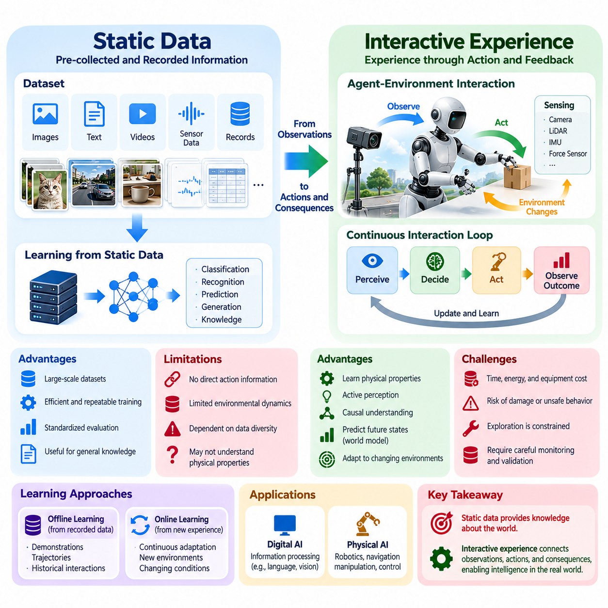{width="7.268055555555556in" height="7.268055555555556in"}

정적 데이터(Static Data)는 인공지능(Artificial Intelligence, AI) 시스템이 학습(Learning)이나 추론(Inference)을 수행하기 전에 수집, 기록, 저장된 정보를 의미한다. 이러한 데이터에는 이미지(Image), 텍스트(Text), 비디오(Video), 센서 측정값(Sensor Measurement), 구조화된 기록(Structured Record)이 포함될 수 있다. 전통적인 기계학습(Machine Learning)은 관측 정보(Observation)가 이를 생성한 원래 행동(Action)과 분리된 사전 정의 데이터셋(Predefined Dataset)에 의존하는 경우가 많으며, 이로 인해 환경의 동역학(Environmental Dynamics)에 직접 접근하는 데 한계가 발생한다.

상호작용 경험(Interactive Experience)은 에이전트(Agent)가 환경(Environment)과 지속적으로 상호작용하면서 획득하는 정보를 의미한다. 지능형 시스템(Intelligent System)은 관측 정보를 수동적으로 수신하는 대신 행동을 선택하고, 그 결과로 발생하는 변화를 관찰하며, 자신의 이해를 갱신한다. 이러한 상호작용은 인식(Perception), 의사결정(Decision-Making), 환경 피드백(Environmental Feedback) 사이에 지속적인 관계를 형성하며, 지능이 자신의 행동 결과를 통해 발전할 수 있도록 한다.

정적 데이터와 상호작용 경험의 차이는 피지컬 인공지능(Physical Artificial Intelligence, Physical AI)에서 특히 중요하다. 기록된 이미지로 학습한 디지털 모델(Digital Model)은 객체가 물리적 조작(Physical Manipulation)에 어떻게 반응하는지 이해하지 못하더라도 객체를 정확하게 인식할 수 있다. 반면 로봇 에이전트(Robotic Agent)는 객체를 밀거나, 들어 올리거나, 회전시키거나, 파지(Grasping)하면서 발생하는 움직임을 관찰할 수 있다. 이러한 경험은 시각적 외형(Visual Appearance)만으로는 파악하기 어려운 물리적 특성(Physical Property)에 대한 정보를 제공한다.

정적 데이터셋(Static Dataset)은 확장 가능한 학습(Scalable Learning)에 상당한 이점을 제공한다. 대규모 사례 집합(Large Collection of Examples)을 반복적으로 처리할 수 있으므로 효율적인 최적화(Efficient Optimization), 재현 가능한 실험(Reproducible Experiment), 표준화된 평가(Standardized Evaluation)가 가능하다. 연구자는 동일한 학습 및 테스트 조건(Training and Testing Conditions)에서 알고리즘(Algorithm)을 비교할 수 있다. 그러나 결과적으로 생성된 모델은 기록된 관측 정보의 다양성(Diversity), 정확성(Accuracy), 대표성(Representativeness)에 의존한다.

상호작용 학습(Interactive Learning)은 데이터(Data)와 행동(Behavior) 사이에 다른 형태의 관계를 형성한다. 에이전트의 행동은 어떤 관측 정보를 획득할 수 있는지와 어떤 상황을 경험하게 되는지에 영향을 미친다. 익숙하지 않은 장애물(Obstacle)에 접근하는 이동 로봇(Mobile Robot)은 정지 상태를 유지하는 로봇과 다른 정보를 획득한다. 따라서 학습 과정(Learning Process)은 사용 가능한 데이터를 해석하는 것뿐만 아니라 어떤 경험을 획득하는 것이 유용한지 결정하는 과정도 포함한다.

미래의 관측 정보(Future Observation)에 영향을 미치는 이러한 능력은 능동적 인식(Active Perception)과 밀접하게 관련된다. 지능형 에이전트는 불확실성(Uncertainty)을 줄이기 위해 카메라(Camera)를 이동하거나, 관찰 각도(Viewing Angle)를 변경하거나, 자신의 신체 위치(Body Position)를 조정할 수 있다. 이러한 행동은 인식을 수동적인 정보 수신(Passive Information Reception)에서 목표 지향적 정보 수집(Goal-Directed Information Gathering)으로 전환한다. 따라서 피지컬 AI 시스템은 주변 환경과의 관계를 의도적으로 변경함으로써 환경에 대한 이해를 향상시킬 수 있다.

상호작용 경험은 인과성(Causality)에 대한 학습도 지원한다. 정적 관측 정보는 객체, 행동, 결과 사이의 상관관계(Correlation)를 보여줄 수 있지만, 특정 사건이 발생하는 원인을 항상 규명하지는 못한다. 에이전트는 통제된 상호작용(Controlled Interaction)을 통해 행동이 물리적 상태(Physical State)에 어떤 영향을 미치는지 조사할 수 있다. 밀기(Pushing), 당기기(Pulling), 힘 가하기(Applying Force)를 포함하는 반복 실험(Repeated Experiment)은 개입(Intervention)과 환경 반응(Environmental Response) 사이의 관계를 밝혀낼 수 있다.

물리적 상호작용(Physical Interaction)은 시간적으로 연결된 관측 정보, 행동, 결과의 연속적인 시퀀스(Sequence)를 생성한다. 이러한 시퀀스는 환경 상태(Environmental State)가 시간에 따라 어떻게 변화하는지에 대한 정보를 제공한다. 용기(Container)를 조작하는 방법을 학습하는 로봇은 초기 위치(Initial Position)를 관찰하고, 힘을 가한 다음, 발생한 변위(Displacement)를 측정할 수 있다. 이러한 경험은 현재 상태(Current State)와 선택된 행동(Selected Action)을 가능한 미래 상태(Possible Future State)와 연결하는 예측 모델(Predictive Model)의 개발을 지원한다.

월드 모델(World Model)은 상호작용 경험을 예측 지능(Predictive Intelligence)으로 전환하기 위한 프레임워크(Framework)를 제공한다. 월드 모델은 다양한 행동과 조건에서 환경이 어떻게 변화할 수 있는지 추정한다. 학습 데이터(Training Data)에는 기록된 궤적(Recorded Trajectory), 시뮬레이션 상호작용(Simulated Interaction), 실제 환경 관측 정보(Real-World Observation)가 포함될 수 있다. 행동 의존적 상태 전이(Action-Dependent Transition)를 학습함으로써 피지컬 AI 시스템은 물리적 환경에서 행동을 실행하기 전에 잠재적인 결과(Potential Consequence)를 평가할 수 있다.

강화학습(Reinforcement Learning, RL)은 지능형 행동(Intelligent Behavior)에서 상호작용 경험이 갖는 중요성을 보여준다. 에이전트는 행동을 선택하고, 관측 정보와 보상(Reward)을 수신하며, 축적된 경험(Accumulated Experience)에 따라 정책(Policy)을 조정한다. 주로 고정된 입력과 출력 사례(Fixed Input-Output Example)에 기반하는 지도학습(Supervised Learning)과 달리, 강화학습은 의사결정이 미래 상태(Future State)와 보상에 어떤 영향을 미치는지 명시적으로 고려한다. 이러한 특성으로 인해 내비게이션(Navigation), 조작(Manipulation), 이동 운동(Locomotion), 적응 제어(Adaptive Control)에 적합하다.

그러나 상호작용 학습은 상당한 실무적 과제(Practical Challenge)를 수반한다. 물리적 실험(Physical Experiment)은 시간(Time), 에너지(Energy), 장비 자원(Equipment Resource)을 소비하며, 실패한 행동(Unsuccessful Action)은 객체를 손상시키거나 안전 위험(Safety Hazard)을 발생시킬 수 있다. 로봇은 운영 제약(Operational Constraint)을 고려하지 않고 모든 가능한 행동을 탐색할 수 없다. 따라서 효과적인 피지컬 AI 개발은 상호작용을 통해 얻는 정보적 이점(Informational Benefit)과 새로운 경험을 획득하는 데 필요한 비용 및 위험 사이의 균형을 유지해야 한다.

오프라인 학습(Offline Learning)은 이러한 비용을 줄이기 위한 중요한 메커니즘(Mechanism)을 제공한다. 로봇 시스템은 물리적 하드웨어(Physical Hardware)를 지속적으로 작동시키지 않고도 이전에 수집된 시연(Demonstration), 궤적(Trajectory), 상호작용 기록(Interaction Record)으로부터 학습할 수 있다. 오프라인 강화학습(Offline Reinforcement Learning)과 모방학습(Imitation Learning)은 과거 경험(Historical Experience)에서 유용한 행동을 추출할 수 있다. 그러나 실제 배포(Deployment) 환경이 사용 가능한 학습 데이터와 상당히 다른 경우 성능이 저하될 수 있다.

온라인 학습(Online Learning)은 지능형 시스템이 운영 중 새롭게 획득한 경험을 활용하여 행동을 갱신할 수 있도록 한다. 이러한 능력은 변화하는 환경(Changing Environment), 익숙하지 않은 객체(Unfamiliar Object), 물리적 동역학의 변동(Variation in Physical Dynamics)에 대한 적응을 지원할 수 있다. 그러나 검증되지 않은 모델 갱신(Unverified Model Update)은 예상하지 못한 행동을 유발할 수 있으므로 지속적인 적응(Continuous Adaptation)은 신중하게 통제되어야 한다. 안전한 배포(Safe Deployment)를 위해서는 모니터링(Monitoring), 검증(Validation), 잠재적으로 위험한 탐색(Hazardous Exploration)에 대한 제한이 필요하다.

시뮬레이션(Simulation)은 대규모 상호작용 경험을 생성하기 위한 실용적인 환경을 제공한다. 가상 에이전트(Virtual Agent)는 실제 장비를 즉각적인 위험에 노출하지 않고도 많은 행동을 실행하고, 다양한 조건을 경험하며, 상태 전이 데이터(State-Transition Data)를 수집할 수 있다. 병렬 시뮬레이션(Parallel Simulation)은 학습을 가속하고 체계적인 탐색(Systematic Exploration)을 지원할 수 있다. 그러나 학습된 정책(Learned Policy)을 실제 환경으로 전이하기 전에 시뮬레이션 동역학(Simulated Dynamics)과 실제 환경의 거동(Real-World Behavior) 사이의 차이를 해결해야 한다.

정적 데이터셋과 상호작용 경험의 결합은 더욱 포괄적인 학습 전략(Comprehensive Learning Strategy)을 형성한다. 정적 데이터는 이전에 관찰된 상황에 대한 폭넓은 범위(Broad Coverage)를 제공하는 반면, 상호작용은 불확실하거나 익숙하지 않은 조건에 대한 목표 지향적 증거(Targeted Evidence)를 제공한다. 로봇은 처음에 기록된 이미지로 객체 인식(Object Recognition)을 학습한 다음, 물리적 시행(Physical Trial)을 통해 조작 전략(Manipulation Strategy)을 개선할 수 있다. 이러한 학습 과정은 상호 배타적(Mutually Exclusive)이 아니라 상호 보완적(Complementary)이다.

인간 시연(Human Demonstration)은 기록된 데이터와 상호작용 지능(Interactive Intelligence)을 연결하는 또 다른 수단이다. 원격조작(Teleoperation)과 직접 시연(Direct Demonstration)은 현실적인 환경에서 성공적으로 수행된 행동의 사례를 제공한다. 이러한 기록에는 관측 정보, 의사결정, 물리적 결과 사이의 관계가 포함된다. 로봇은 이러한 사례를 활용하여 초기 행동(Initial Behavior)을 설정할 수 있으며, 이를 통해 독립적으로 유용한 작업을 수행하기 전에 필요한 탐색량(Amount of Exploration)을 줄일 수 있다.

상호작용 경험은 환경에 숨겨진 물리적 특성(Hidden Physical Property)이 존재할 때 특히 유용하다. 시각적 관측 정보만으로는 객체의 질량(Mass), 마찰계수(Friction Coefficient), 강성(Stiffness), 안정성(Stability)을 파악하기 어려울 수 있다. 로봇은 객체를 안전하게 이동시킬 수 있는지 추정하기 위해 작고 통제된 힘(Controlled Force)을 가해야 할 수 있다. 이러한 상호작용은 물리적 지능이 외형(Appearance)에만 의존하는 것이 아니라 행동을 통해 정보를 수집하는 능력에 기반한다는 사실을 보여준다.

탐색 전략(Exploration Strategy)은 에이전트가 유용한 경험(Informative Experience)을 획득하는 방식을 결정한다. 무작위 탐색(Random Exploration)은 익숙하지 않은 조건을 발견할 수 있지만, 물리적 환경에서는 비효율적이거나 안전하지 않을 수 있다. 목표 지향적 탐색(Goal-Directed Exploration)은 불확실성을 줄이거나 예상 작업 성능(Expected Task Performance)을 향상시키는 행동을 선택한다. 능동학습(Active Learning)과 불확실성 인식 계획(Uncertainty-Aware Planning)은 운영 및 안전 제약을 준수하면서 유용한 정보를 제공하는 상호작용의 우선순위를 결정하는 데 도움이 된다.

경험은 개별 로봇 플랫폼(Robotic Platform) 사이의 차이에 적응하는 데에도 기여한다. 기계적 설계(Mechanical Design)가 유사한 두 로봇이라도 액추에이터 응답(Actuator Response), 센서 보정(Sensor Calibration), 마찰(Friction), 탑재하중 특성(Payload Characteristic)에서 차이가 발생할 수 있다. 기록된 학습 데이터는 이러한 차이를 완전히 반영하지 못할 수 있다. 각 플랫폼은 통제된 상호작용을 통해 관련 운영 특성(Operating Characteristic)을 추정하고 행동을 조정함으로써 정확도(Accuracy)와 신뢰성(Reliability)을 향상시킬 수 있다.

장기 자율성(Long-Term Autonomy)을 확보하려면 개별적인 경험을 수집하는 것 이상의 능력이 필요하다. 피지컬 AI 시스템은 관측 정보와 결과를 기억(Memory), 예측(Prediction), 미래 의사결정(Future Decision-Making)을 지원하는 표현(Representation)으로 구성해야 한다. 반복적인 작업을 통해 축적된 경험은 지속적인 환경 패턴(Persistent Environmental Pattern)과 반복적인 실패(Recurring Failure)를 밝혀낼 수 있다. 효과적인 기억 메커니즘(Memory Mechanism)은 에이전트가 동일한 물리적 관계를 반복해서 다시 발견하는 대신 관련 지식을 재사용할 수 있도록 한다.

플릿 규모 학습(Fleet-Scale Learning)은 상호작용 경험을 단일 로봇을 넘어 확장한다. 여러 로봇 시스템은 서로 다른 환경, 작업, 운영 조건에서 관측 정보와 행동 결과(Action Outcome)를 수집할 수 있다. 이러한 경험을 집계(Aggregation)하면 공유 모델(Shared Model)의 강건성(Robustness)과 일반화 성능(Generalization)을 향상시킬 수 있다. 그러나 플랫폼 간 지식 전이(Knowledge Transfer)를 수행할 때는 하드웨어(Hardware), 데이터 품질(Data Quality), 환경적 맥락(Environmental Context), 운영 정책(Operational Policy)의 차이를 고려해야 한다.

평가 방법(Evaluation Method) 역시 정적 데이터셋에서의 성능과 물리적 상호작용 중에 나타나는 역량(Competence)을 구별해야 한다. 기록된 관측 정보에 대한 높은 예측 정확도(Prediction Accuracy)가 에이전트가 환경을 변화시키는 상황에서의 성공적인 행동을 보장하지는 않는다. 상호작용 평가(Interactive Evaluation)는 작업 완료(Task Completion), 적응(Adaptation), 교란으로부터의 복구(Recovery from Disturbances), 시간에 따른 행동의 결과(Consequences of Actions)를 검토한다. 이러한 측정은 학습된 지능(Learned Intelligence)이 신뢰할 수 있는 물리적 운영(Reliable Physical Operation)을 지원하는지 더욱 직접적으로 평가할 수 있도록 한다.

정적 데이터에서 상호작용 경험으로의 전환은 인공지능의 광범위한 발전 방향(Broader Evolution)을 반영한다. 피지컬 AI는 지능을 단순히 기록된 정보에서 패턴(Pattern)을 추출하는 능력으로만 이해하지 않고, 관측(Observation), 개입(Intervention), 피드백(Feedback), 적응(Adaptation)을 통한 학습을 강조한다. 정적 데이터셋은 확장 가능한 학습(Scalable Training)에 여전히 필수적이지만, 상호작용 경험은 학습된 표현(Learned Representation)을 물리적 환경의 인과적 특성(Causal Property) 및 동적 특성(Dynamic Property)과 연결한다.

궁극적으로 정적 데이터와 상호작용 경험은 피지컬 AI를 구성하는 상호 보완적인 기반(Complementary Foundation)이다. 정적 데이터는 폭넓은 지식 획득(Broad Knowledge Acquisition)과 효율적인 모델 개발(Efficient Model Development)을 가능하게 하며, 상호작용 경험은 에이전트가 자신의 행동이 세계에 어떤 영향을 미치는지 발견하도록 한다. 두 접근 방식의 통합(Integration)은 환경 조건을 인식하고, 결과를 예측하고, 불확실성에 적응하며, 통제된 물리적 상호작용을 통해 개선되는 시스템을 지원한다. 이를 통해 수동적 패턴 인식(Passive Pattern Recognition)은 점차 높은 역량을 갖춘 체화 지능(Embodied Intelligence)으로 발전한다.

## 02.04. Passive Inference vs Active Interaction

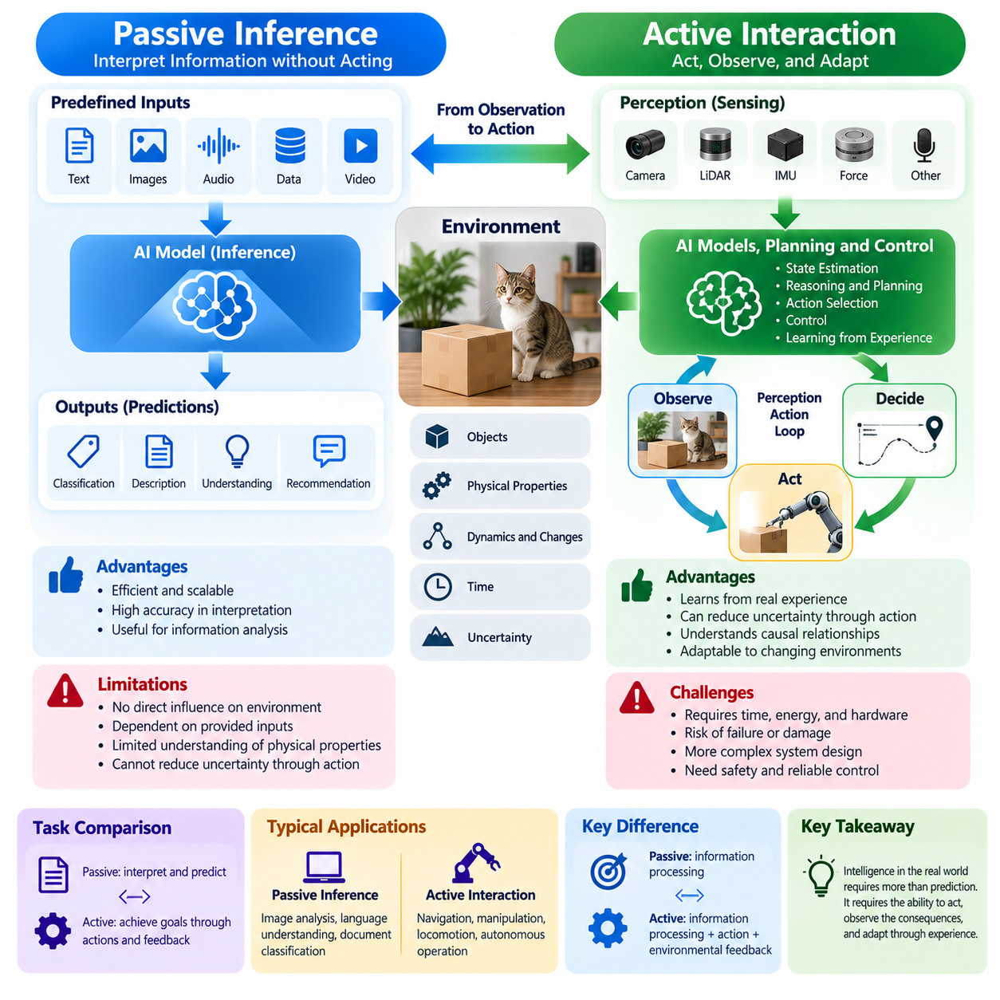{width="7.268055555555556in" height="7.268055555555556in"}

수동적 추론(Passive Inference)은 인공지능(Artificial Intelligence, AI) 시스템이 정보의 출처가 되는 환경(Environment)에 직접적인 영향을 미치지 않고 정보를 해석하고 예측(Prediction)을 생성하는 능력을 의미한다. 시스템은 사전에 정의된 입력(Predefined Input)을 수신하고, 컴퓨팅 모델(Computational Model)을 통해 이를 처리하며, 분류(Classification), 설명(Description), 추천(Recommendation)과 같은 출력을 생성한다. 이러한 지능은 주로 환경에 대한 개입(Environmental Intervention)보다는 정보 처리(Information Processing)를 통해 발현된다.

능동적 상호작용(Active Interaction)은 에이전트(Agent)가 주변 환경에 영향을 미치는 행동(Action)을 수행할 수 있도록 함으로써 지능을 관측(Observation)과 예측의 범위를 넘어 확장한다. 에이전트는 행동을 선택하고, 그 결과를 관찰하며, 환경 피드백(Environmental Feedback)에 따라 후속 의사결정(Subsequent Decision)을 조정한다. 이러한 과정은 인식(Perception), 추론(Reasoning), 행동(Action), 학습(Learning) 사이에 지속적인 관계를 형성하며, 지능이 변화하는 물리적 조건(Physical Condition) 속에서 작동할 수 있도록 한다.

수동적 추론과 능동적 상호작용의 차이는 피지컬 인공지능(Physical Artificial Intelligence, Physical AI)의 근본적인 특성이다. 비전 모델(Vision Model)은 문(Door)을 식별하고, 위치를 추정하며, 열려 있는지 닫혀 있는지를 분류할 수 있다. 그러나 로봇 에이전트(Robotic Agent)는 추가로 문에 접근하는 방법을 결정하고, 손잡이를 조작하며, 적절한 힘(Force)을 가하고, 그 결과로 발생하는 움직임을 확인해야 한다. 따라서 물리적 수행 능력(Physical Competence)은 인식적 이해(Perceptual Understanding)를 실행 가능한 행동(Executable Action)과 연결해야 한다.

수동적 추론은 일반적으로 관측 정보가 모델의 즉각적인 의사결정(Immediate Decision)과 독립적으로 제공된다고 가정한다. 이미지(Image), 문서(Document), 센서 기록(Sensor Recording)은 원래의 정보 출처를 변경하지 않고 분석할 수 있다. 반면 능동적 상호작용에서는 에이전트의 행동이 미래 관측 정보(Future Observation)에 영향을 미치므로 서로 다른 의존 관계(Dependency)가 형성된다. 객체에 접근하거나, 카메라 각도(Camera Angle)를 변경하거나, 표면(Surface)을 접촉하는 행동은 이전에 확보할 수 없었던 정보를 드러낼 수 있다.

행동(Action)과 관측(Observation) 사이의 이러한 관계는 능동적 인식(Active Perception)의 핵심이다. 지능형 에이전트(Intelligent Agent)는 가시성(Visibility)을 개선하고, 모호성(Ambiguity)을 해결하거나, 불확실성(Uncertainty)을 줄이기 위해 센서(Sensor)나 신체(Body)의 위치를 의도적으로 변경할 수 있다. 부분적으로 가려진 장애물(Partially Occluded Obstacle)을 만난 이동 로봇(Mobile Robot)은 측면으로 이동하여 더욱 명확한 시야를 확보할 수 있다. 시스템은 불완전한 관측 정보를 그대로 받아들이는 대신, 더 나은 의사결정을 지원하기 위해 센싱 조건(Sensing Condition)을 능동적으로 변경한다.

능동적 상호작용에는 행동 결과(Action Consequence)에 대한 추론도 필요하다. 수동적 모델(Passive Model)은 객체의 외형(Appearance)을 바탕으로 깨지기 쉬운 물체인지 예측할 수 있지만, 물리적 에이전트(Physical Agent)는 어느 정도의 힘을 안전하게 가할 수 있는지 고려해야 한다. 에이전트는 촉각 센싱(Tactile Sensing), 제어된 움직임(Controlled Motion), 피드백(Feedback)을 활용하여 추정값(Estimate)을 개선할 수 있다. 이러한 상호작용은 추상적 예측(Abstract Prediction)을 측정 가능한 물리적 반응(Measurable Physical Response) 및 운영 제약(Operational Constraint)과 연결한다.

인식-행동 루프(Perception-Action Loop)는 능동적 피지컬 AI(Active Physical AI)의 기본적인 운영 구조(Operational Structure)를 제공한다. 센서는 관측 정보를 수집하고, 컴퓨팅 모델은 환경 상태(Environmental State)를 추정하며, 의사결정 메커니즘(Decision-Making Mechanism)은 행동을 선택한다. 액추에이터(Actuator)는 이러한 결정을 실행하여 새로운 관측 정보를 생성하는 변화를 발생시킨다. 이 루프를 반복적으로 실행하면 시스템은 오류(Error)를 수정하고, 교란(Disturbance)에 대응하며, 목표 지향적 행동(Goal-Directed Behavior)을 유지할 수 있다.

수동적 추론은 작업(Task)이 개입(Intervention)보다 해석(Interpretation)을 요구할 때 매우 효과적일 수 있다. 의료 영상 분석(Medical Image Analysis), 문서 분류(Document Classification), 언어 번역(Language Translation), 시각 인식(Visual Recognition)은 직접적인 물리적 제어(Physical Control) 없이도 가치 있는 결과를 생성할 수 있다. 그러나 내비게이션(Navigation), 조작(Manipulation), 이동 운동(Locomotion), 자율 운영(Autonomous Operation)이 포함된 작업에서는 예측 결과만이 아니라 행동이 환경에 미치는 영향을 통해 의사결정을 평가해야 한다.

능동적 상호작용은 개별적인 추론 작업(Isolated Inference Task)에서는 상대적으로 두드러지지 않는 시간적 의존성(Temporal Dependency)을 도입한다. 하나의 행동은 이후 의사결정이 이루어지는 조건을 변경하며, 서로 연결된 상태(State)와 결과(Outcome)의 연속적인 시퀀스(Sequence)를 형성한다. 장애물을 우회하는 로봇은 새로운 정보가 확보됨에 따라 이동 궤적(Trajectory)을 지속적으로 갱신해야 한다. 이전 행동은 에이전트의 현재 위치(Current Position)뿐만 아니라 미래의 행동 가능성(Future Opportunity)에도 영향을 미친다.

불확실성(Uncertainty)은 수동적 추론과 능동적 상호작용을 더욱 명확하게 구별한다. 수동적 시스템(Passive System)은 일반적으로 사용 가능한 관측 정보와 학습된 통계적 관계(Statistical Relationship)를 바탕으로 불확실성을 추정한다. 반면 능동적 에이전트(Active Agent)는 목적이 있는 행동(Purposeful Action)을 통해 불확실성을 줄일 수 있다. 로봇은 익숙하지 않은 객체에 접근하여 기하학적 구조(Geometry)를 조사하거나, 작은 힘을 가하여 이동 가능성(Mobility)을 추정할 수 있으며, 이를 통해 불확실성 감소(Uncertainty Reduction)를 명시적인 행동 목표(Behavioral Objective)로 전환한다.

이러한 능력은 정보 수집 행동(Information-Gathering Action) 및 탐색(Exploration)과 밀접하게 관련된다. 에이전트는 주요 작업(Primary Task)을 즉각적으로 진전시키기 때문이 아니라, 이후 의사결정에 필요한 지식을 향상시키기 위해 특정 행동을 선택할 수 있다. 이러한 행동에는 작업 진행(Task Progress), 정보 가치(Information Value), 실행 비용(Execution Cost), 안전성(Safety) 사이의 균형이 필요하다. 따라서 능동적 피지컬 AI는 물리적 목표(Physical Objective)와 유용한 관측 정보의 획득(Acquisition of Useful Observations)에 관한 의사결정을 통합한다.

인과적 이해(Causal Understanding)는 지능이 환경에 직접 영향을 미칠 때 더욱 중요해진다. 수동적 추론은 관측된 조건과 결과 사이의 상관관계(Correlation)를 식별할 수 있지만, 개입(Intervention)이 어떻게 변화를 발생시키는지 반드시 규명하는 것은 아니다. 능동적 상호작용을 통해 에이전트는 선택된 행동의 효과(Effect)를 조사할 수 있다. 통제된 실험(Controlled Experiment)은 가해진 힘(Applied Force), 움직임(Movement), 환경 수정(Environmental Modification)이 이후의 물리적 상태(Physical State)에 어떤 영향을 미치는지 밝혀낼 수 있다.

월드 모델(World Model)은 후보 행동(Candidate Action)에 대한 가능한 환경 반응(Environmental Response)을 예측함으로써 능동적 상호작용을 지원한다. 에이전트는 현재 관측 정보만 평가하는 대신, 대안적 행동(Alternative Behavior)이 미래 상태(Future State)를 어떻게 변화시킬 수 있는지 추정할 수 있다. 이러한 예측은 계획(Planning), 위험 평가(Risk Assessment), 행동 선택(Action Selection)을 지원한다. 예측의 신뢰성(Reliability)은 물리적 동역학(Physical Dynamics), 불확실성(Uncertainty), 행동과 결과 사이의 관계를 정확하게 표현하는 능력에 달려 있다.

강화학습(Reinforcement Learning, RL)은 상호작용을 통해 정책(Policy)을 개발하기 위한 프레임워크(Framework)를 제공한다. 에이전트는 행동을 실행하고, 상태 전이(State Transition)를 관찰하며, 보상(Reward)을 수신하고, 예상되는 장기 성능(Expected Long-Term Performance)을 개선하도록 행동을 조정한다. 개별적인 예측 작업과 달리 강화학습은 의사결정의 결과를 부분적으로 활용하여 의사결정을 평가한다. 물리적 시스템에 강화학습을 적용하려면 탐색(Exploration), 안전성(Safety), 실제 환경 경험(Real-World Experience)의 비용을 신중하게 관리해야 한다.

모방학습(Imitation Learning)은 상호작용 능력(Interactive Capability)을 획득하기 위한 또 다른 접근 방식이다. 로봇은 인간(Human)이나 다른 제어기(Controller)가 수행한 관측 정보와 해당 행동을 포함하는 시연(Demonstration)으로부터 학습할 수 있다. 이러한 사례는 인식된 조건(Perceived Condition)과 적절한 행동(Appropriate Behavior) 사이의 초기 관계(Initial Relationship)를 제공한다. 그러나 성공적인 배포(Deployment)를 위해서는 로봇이 시연에 포함된 상황과 다른 조건을 만났을 때도 피드백과 적응(Adaptation)이 필요하다.

능동적 상호작용은 체화(Embodiment)의 영향을 크게 받는다. 로봇의 물리적 구조(Physical Structure)는 어떤 행동이 가능한지, 그리고 해당 행동이 주변 환경에 어떤 영향을 미치는지를 결정한다. 바퀴형 로봇(Wheeled Robot)은 가시성을 개선하기 위해 자신의 위치를 변경할 수 있으며, 매니퓰레이터(Manipulator)는 숨겨진 표면(Hidden Surface)을 조사하기 위해 객체를 회전시킬 수 있다. 비행 로봇(Aerial Robot)은 고도(Altitude)와 관찰 방향(Viewing Direction)을 변경할 수 있다. 각각의 체화 형태는 정보를 수집하고 물리적 상태에 영향을 미치는 서로 다른 기회를 제공한다.

물리적 제약(Physical Constraint)은 지능형 에이전트가 사용할 수 있는 행동도 제한한다. 액추에이터 성능(Actuator Capability), 기계적 형상(Mechanical Geometry), 마찰(Friction), 관성(Inertia), 가용 에너지(Available Energy), 환경 장애물(Environmental Obstacle)은 제안된 행동의 실행 가능성을 결정한다. AI 모델은 추상적 표현(Abstract Representation)에서는 유익해 보이지만 기계적으로 실행할 수 없는 움직임을 추천할 수 있다. 따라서 능동적 피지컬 AI는 학습 기반 의사결정(Learned Decision-Making)을 실행 가능한 동작 생성(Feasible Motion Generation) 및 제어(Control)와 통합해야 한다.

물리적 환경은 행동이 실행되는 동안에도 변화하므로 실시간 피드백(Real-Time Feedback)이 필수적이다. 객체를 파지하는 로봇은 미끄러짐(Slipping)을 감지하고 안전한 한계(Safe Limit) 내에서 파지력(Grip Force)을 증가시킬 수 있다. 이동 플랫폼(Mobile Platform)은 예상하지 못한 보행자(Pedestrian)를 만나면 경로(Path)를 조정할 수 있다. 이러한 대응에는 적시에 수행되는 센싱(Sensing), 상태 추정(State Estimation), 제어(Control)가 필요하다. 피드백 지연(Feedback Delay)은 원래 합리적이었던 의사결정을 비효율적이거나 위험한 결정으로 만들 수 있다.

안전성 고려사항(Safety Consideration)은 에이전트가 환경을 능동적으로 변화시킬 때 특히 중요해진다. 잘못된 수동적 예측(Incorrect Passive Prediction)은 심각한 후속 결과(Downstream Consequence)를 초래할 수 있지만, 부적절한 물리적 행동(Inappropriate Physical Action)은 충돌(Collision), 부상(Injury), 장비 손상(Equipment Damage)을 직접 발생시킬 수 있다. 능동적 피지컬 AI에는 운영 경계(Operational Boundary), 충돌 회피(Collision Avoidance), 고장 감지(Fault Detection), 복구 메커니즘(Recovery Mechanism)이 필요하다. 탐색과 적응은 적절한 안전 제약(Safety Constraint)을 준수해야 한다.

시뮬레이션(Simulation)은 물리적 장비를 모든 실험 위험(Experimental Risk)에 노출하지 않고도 능동적 상호작용을 연구할 수 있도록 한다. 가상 에이전트(Virtual Agent)는 후보 행동을 실행하고, 시뮬레이션 결과(Simulated Consequence)를 관찰하며, 다양한 조건에서 정책을 학습할 수 있다. 그러나 시뮬레이션 상호작용(Simulated Interaction)은 물리적 현실(Physical Reality)에 대한 근사(Approximation)에 의존한다. 시뮬레이션에서 개발된 정책은 실제 환경에서 신뢰할 수 있는 행동을 보장하기 전에 검증(Validation)과 적응(Adaptation)을 거쳐야 한다.

평가(Evaluation)는 예측 정확도(Predictive Accuracy)와 상호작용 수행 능력(Interactive Competence)을 구별해야 한다. 시스템은 장애물을 정확하게 인식하더라도 안전하게 우회하지 못할 수 있다. 마찬가지로 파지 가능한 객체(Graspable Object)를 식별한다고 해서 성공적인 조작(Manipulation)이 보장되는 것은 아니다. 상호작용 평가(Interactive Evaluation)는 작업 완료(Task Completion), 교란에 대한 대응(Response to Disturbances), 행동 효율성(Action Efficiency), 복구 능력(Recovery Capability), 안전성(Safety)을 고려한다. 이러한 지표는 인식 지능(Perceptual Intelligence)이 신뢰할 수 있는 물리적 성능(Reliable Physical Performance)으로 전환되는지 보여준다.

수동적 추론과 능동적 상호작용은 서로 경쟁하는 접근 방식(Competing Approach)이 아니라 상호 보완적인 능력(Complementary Capability)으로 이해해야 한다. 능동적 에이전트는 관측 정보를 해석하고, 상태를 추정하며, 결과를 예측하기 위해 추론에 의존한다. 추론 결과가 환경을 변화시키는 행동을 안내할 때, 추론은 더욱 광범위한 의사결정 과정(Broader Decision Process)의 일부가 된다. 이러한 능력의 통합은 정보 처리(Information Processing)를 상황 기반(Situated), 적응형(Adaptive), 목표 지향적(Goal-Directed) 물리적 지능(Physical Intelligence)으로 전환한다.

궁극적으로 수동적 추론에서 능동적 상호작용으로의 전환은 피지컬 AI를 정의하는 핵심적인 특성(Defining Characteristic)을 나타낸다. 지능은 더 이상 해석의 정확도(Interpretation Accuracy)만으로 평가되지 않으며, 현실 세계에 책임감 있고 효과적으로 영향을 미치는 능력으로도 평가된다. 지속적인 인식(Perception), 예측(Prediction), 행동(Action), 피드백(Feedback)을 통해 피지컬 AI 시스템은 정보를 획득하고, 변화하는 조건에 적응하며, 물리적 현실(Physical Reality)과의 직접적인 상호작용을 요구하는 목표를 달성할 수 있다.

## 02.05. Open Loop vs Closed Loop Intelligence

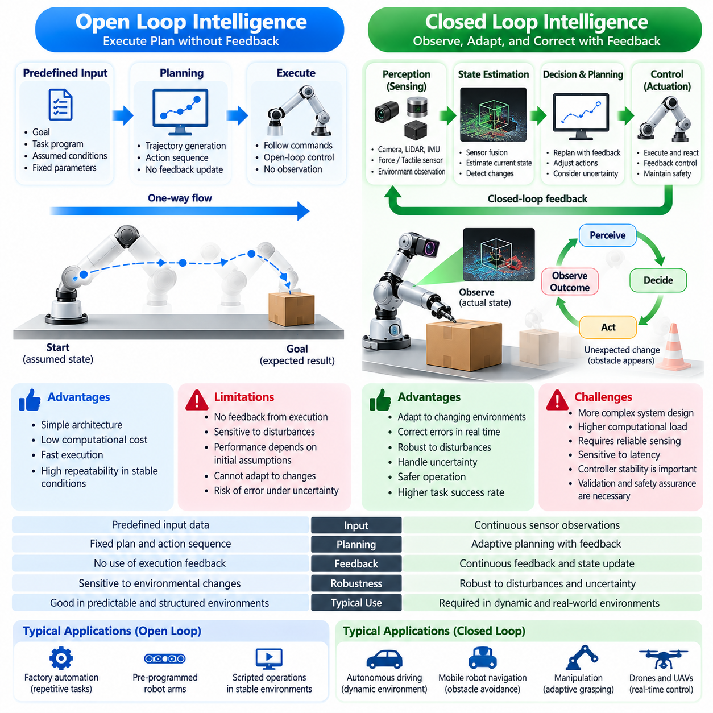{width="7.268055555555556in" height="7.268055555555556in"}

개방 루프 지능(Open-Loop Intelligence)은 행동의 실행 결과로부터 발생하는 피드백(Feedback)을 지속적으로 활용하여 후속 행동을 수정하지 않고 의사결정(Decision-Making)이나 행동(Action)을 생성하는 시스템을 의미한다. 명령(Command)이나 행동 시퀀스(Action Sequence)가 결정되면 시스템은 사전에 정의된 계획(Predefined Plan)에 따라 작동한다. 이러한 접근 방식은 예측 가능한 환경(Predictable Environment)에서 효과적일 수 있지만, 성능은 초기 가정(Initial Assumption)의 정확성과 운영 조건(Operating Condition)의 안정성에 크게 의존한다.

폐쇄 루프 지능(Closed-Loop Intelligence)은 환경에 대한 관측 정보(Observation)와 이전 행동의 결과(Consequence)를 지속적인 의사결정 과정(Ongoing Decision-Making Process)에 반영한다. 시스템은 초기 계획에만 의존하는 대신 관련 조건을 반복적으로 측정하고, 현재 상태(Current State)를 추정하며, 행동을 조정한다. 이러한 피드백 기반 과정(Feedback-Driven Process)을 통해 지능형 에이전트(Intelligent Agent)는 교란(Disturbance)에 대응하고, 편차(Deviation)를 수정하며, 변화하는 물리적 상황(Physical Circumstance)에 적응할 수 있다.

개방 루프 지능과 폐쇄 루프 지능의 차이는 물리적 환경(Physical Environment)이 완벽하게 예측 가능한 상태를 유지하는 경우가 드물기 때문에 피지컬 인공지능(Physical Artificial Intelligence, Physical AI)에서 근본적으로 중요하다. 객체(Object)는 움직이고, 표면(Surface)은 변화하며, 센서(Sensor)는 불완전한 측정값(Measurement)을 생성하고, 액추에이터(Actuator)는 성능 변동(Performance Variation)을 나타낸다. 행동의 결과를 관측할 수 없는 시스템은 부적절한 명령을 계속 실행할 수 있지만, 피드백을 활용하면 편차가 과도해지기 전에 교정 행동(Corrective Behavior)을 수행할 수 있다.

개방 루프 운영(Open-Loop Operation)은 일반적으로 통제된 조건(Controlled Condition)에서 사전에 결정된 명령(Predetermined Instruction)을 실행하는 시스템에서 나타난다. 로봇 매니퓰레이터(Robotic Manipulator)는 가정된 객체 위치(Assumed Object Position)와 보정된 장비(Calibrated Equipment)를 기반으로 프로그래밍된 궤적(Programmed Trajectory)을 따라 움직일 수 있다. 환경이 일정하게 유지된다면 높은 반복 정밀도(Repeatability)를 달성할 수 있다. 그러나 예상하지 못한 위치 변위(Displacement), 기계적 마모(Mechanical Wear), 탑재하중 특성(Payload Characteristic)의 변화는 피드백 기반 보정(Feedback-Based Correction)이 없을 때 정확도를 저하시킬 수 있다.

폐쇄 루프 운영(Closed-Loop Operation)은 목표 결과(Desired Outcome)와 측정된 조건(Measured Condition)을 비교함으로써 이러한 한계를 해결한다. 제어기(Controller)는 로봇 관절(Robotic Joint)의 목표 위치(Target Position)와 관측된 위치(Observed Position) 사이의 차이를 계산할 수 있다. 일반적으로 오차 신호(Error Signal)라고 하는 이러한 차이는 후속 제어 명령(Control Command)을 결정하는 데 사용된다. 반복적인 측정과 보정은 교란과 모델링 부정확성(Modeling Inaccuracy)이 존재하더라도 시스템이 정확한 동작을 유지하도록 지원한다.

피지컬 AI에서 피드백은 전통적인 기계 제어(Mechanical Control)의 범위를 넘어 확장된다. 지능형 시스템은 카메라 이미지(Camera Image), 라이다 측정값(LiDAR Measurement), 힘 센싱(Force Sensing), 촉각 관측(Tactile Observation), 환경 예측(Environmental Prediction)을 의사결정 과정에 통합할 수 있다. 이러한 정보원(Information Source)은 에이전트가 객체, 장애물(Obstacle), 작업 진행 상태(Task Progress)에 대한 이해를 갱신하도록 한다. 따라서 폐쇄 루프 지능은 인식(Perception), 추론(Reasoning), 계획(Planning), 행동(Action)을 지속적인 운영 주기(Operational Cycle) 안에서 연결한다.

이동 로봇(Mobile Robot)은 두 접근 방식의 실질적인 차이를 보여준다. 개방 루프 내비게이션(Open-Loop Navigation)에서는 로봇이 예상하지 못한 장애물이나 위치 추정 오차(Localization Error)에 대한 조정 없이 사전에 결정된 이동 시퀀스(Movement Sequence)를 실행할 수 있다. 폐쇄 루프 내비게이션(Closed-Loop Navigation)에서는 센서 관측 정보가 추정 위치(Estimated Position)와 주변 지도(Surrounding Map)를 지속적으로 갱신한다. 이후 로봇은 환경 조건에 따라 이동 궤적(Trajectory)을 수정하거나, 속도를 줄이거나, 정지할 수 있다.

조작 작업(Manipulation Task)은 또 다른 중요한 사례를 제공한다. 개방 루프 파지 시퀀스(Open-Loop Grasping Sequence)는 이전에 계산된 좌표(Coordinate)에 따라 그리퍼(Gripper)의 위치를 설정하고 손가락(Finger)을 닫을 수 있다. 폐쇄 루프 조작 시스템(Closed-Loop Manipulation System)은 실행 중 접촉력(Contact Force), 손가락 위치(Finger Position), 객체 움직임(Object Movement)을 모니터링할 수 있다. 미끄러짐(Slipping)이나 정렬 불량(Misalignment)이 발생하면 로봇은 설정된 안전 한계(Safety Limit) 내에서 파지력(Grip Force)을 조정하거나 객체의 위치를 다시 설정할 수 있다.

피드백은 물리적 시스템(Physical System)이 불확실성(Uncertainty)에 직면할 때 특히 유용하다. 센서 잡음(Sensor Noise), 마찰 변동(Friction Variation), 액추에이터 지연(Actuator Delay), 예상하지 못한 접촉(Unexpected Contact)은 실제 결과(Actual Outcome)가 예측 결과(Predicted Outcome)와 달라지게 만들 수 있다. 폐쇄 루프 지능은 이러한 불확실성을 제거하지는 못하지만, 그 영향을 감지하고 적절하게 대응하는 메커니즘(Mechanism)을 제공한다. 효과성(Effectiveness)은 관측 품질(Observation Quality), 상태 추정 정확도(State Estimation Accuracy), 교정 행동의 안정성(Stability)에 달려 있다.

상태 추정(State Estimation)은 폐쇄 루프 지능의 핵심 구성요소(Core Component)이다. 물리적 에이전트(Physical Agent)는 모든 관련 변수(Relevant Variable)를 직접 관측할 수 있는 경우가 드물기 때문에, 사용 가능한 측정값과 사전 지식(Prior Knowledge)을 바탕으로 숨겨진 상태(Hidden State)를 추론해야 한다. 센서 융합(Sensor Fusion), 확률적 필터링(Probabilistic Filtering), 학습 기반 추정 모델(Learned Estimation Model)과 같은 기술은 시간에 따른 관측 정보를 결합한다. 그 결과 생성된 상태 추정값(State Estimate)은 부분 관측 가능성(Partial Observability) 조건에서 계획과 제어에 필요한 정보를 제공한다.

피드백의 시간적 특성(Timing)은 폐쇄 루프 성능(Closed-Loop Performance)에 큰 영향을 미친다. 물리적 환경은 측정값을 수집하고, 처리하며, 명령으로 변환하는 동안에도 계속 변화한다. 과도한 지연 시간(Excessive Latency)은 교정 행동이 너무 늦게 도착하거나 이미 오래된 조건(Outdated Condition)에 대응하도록 만들 수 있다. 따라서 피지컬 AI 시스템은 신뢰할 수 있는 실시간 동작(Real-Time Behavior)을 유지하기 위해 센싱 주파수(Sensing Frequency), 연산 실행(Computational Execution), 통신 지연(Communication Delay), 액추에이터 응답(Actuator Response)을 조정해야 한다.

폐쇄 루프 시스템(Closed-Loop System)은 안정성(Stability)에도 세심한 주의를 기울여야 한다. 지나치게 공격적인 보정(Aggressive Correction)은 진동(Oscillation), 오버슈트(Overshoot), 기계적 동역학(Mechanical Dynamics)과의 바람직하지 않은 상호작용을 유발할 수 있다. 특히 측정값에 잡음이 많거나 제어 매개변수(Control Parameter)가 부적절하게 설정된 경우, 피드백이 자동으로 더 나은 성능을 보장하지는 않는다. 신뢰할 수 있는 운영을 위해서는 적절한 제어기 설계(Controller Design), 시스템 식별(System Identification), 불확실성 관리(Uncertainty Management), 예상 운영 조건(Expected Operating Condition)에 대한 검증(Validation)이 필요하다.

예측 모델(Predictive Model)은 현재 오차(Current Error)에만 반응하는 대신 미래 환경 상태(Future Environmental State)를 예측함으로써 폐쇄 루프 지능을 향상시킬 수 있다. 모델 예측 제어(Model Predictive Control, MPC)는 제한된 미래 예측 구간(Future Horizon)에서 가능한 행동 시퀀스를 평가하고, 새로운 관측 정보를 활용하여 의사결정을 반복적으로 갱신한다. 이러한 접근 방식은 예측(Prediction)과 피드백을 결합하여 물리적 에이전트가 제약 조건(Constraint)과 예상 결과(Expected Consequence)를 고려하면서 변화하는 조건에 적응할 수 있도록 한다.

월드 모델(World Model)은 예측 피드백(Predictive Feedback)을 더욱 복잡한 지능형 행동(Intelligent Behavior)으로 확장한다. 학습된 월드 모델(Learned World Model)은 선택된 행동에 따라 객체, 에이전트, 환경 조건이 어떻게 변화할 수 있는지 추정할 수 있다. 예측 결과와 이후 관측 정보를 비교함으로써 시스템은 불일치(Discrepancy)를 식별하고 미래 의사결정을 개선할 수 있다. 이러한 예측 오차 피드백(Prediction-Error Feedback)은 적응형 계획(Adaptive Planning)을 지원하지만, 모델 불확실성(Model Uncertainty)을 명시적으로 고려해야 한다.

계층적 아키텍처(Hierarchical Architecture)는 서로 다른 수준(Level)에서 개방 루프 과정(Open-Loop Process)과 폐쇄 루프 과정(Closed-Loop Process)을 결합하는 경우가 많다. 상위 수준 계획기(High-Level Planner)는 작업 시퀀스(Task Sequence)를 생성할 수 있으며, 하위 수준 제어기(Low-Level Controller)는 움직임과 접촉(Contact)을 지속적으로 조절한다. 개별 행동이 피드백을 통해 보정되는 동안에도 전체 작업 시퀀스는 일정 기간 변경되지 않을 수 있다. 이러한 분리는 즉각적인 물리적 조건에 대한 대응 능력을 유지하면서 효율적인 계획을 지원한다.

모든 행동에 동일한 주파수(Frequency)의 지속적인 피드백이 필요한 것은 아니다. 일부 작업은 동역학(Dynamics)과 환경 조건이 충분히 통제되어 있다면 사전에 결정된 명령으로도 신뢰성 있게 실행할 수 있다. 반면 다른 작업은 교란이나 오차가 빠르게 증가할 수 있으므로 신속한 피드백이 필요하다. 효과적인 피지컬 AI 아키텍처는 작업 복잡도(Task Complexity), 물리적 동역학(Physical Dynamics), 불확실성(Uncertainty), 안전 요구사항(Safety Requirement)에 따라 적절한 피드백 메커니즘을 선택한다.

학습(Learning)은 폐쇄 루프 지능에 또 다른 차원을 추가한다. 물리적 에이전트는 예측 결과와 관측 결과 사이의 차이를 활용하여 시간에 따라 모델(Model)과 정책(Policy)을 개선할 수 있다. 반복적인 상호작용(Repeated Interaction)은 액추에이터 동작(Actuator Behavior), 환경 동역학(Environmental Dynamics), 작업 효과성(Task Effectiveness)에 대한 정보를 제공한다. 그러나 즉각적인 피드백 제어(Immediate Feedback Control)와 장기 학습(Long-Term Learning)은 서로 다른 과정이며, 모델 갱신(Model Update)이 안전 필수 행동(Safety-Critical Behavior)에 영향을 미치기 전에 검증되어야 한다.

강화학습(Reinforcement Learning, RL)은 상호작용을 통해 피드백 의존적 정책(Feedback-Dependent Policy)을 개발하기 위한 프레임워크(Framework)를 제공한다. 에이전트는 환경 상태(Environmental State)를 관측하고, 행동을 선택하며, 후속 관측 정보와 보상(Reward)을 수신하고, 축적된 경험(Accumulated Experience)을 활용하여 정책을 개선한다. 배포 중 학습된 정책(Learned Policy)은 갱신된 관측 정보에 따라 행동을 반복적으로 선택함으로써 폐쇄 루프 방식으로 작동할 수 있다. 그러나 신뢰성(Reliability)은 여전히 학습 범위(Training Coverage), 강건성(Robustness), 적절한 안전 메커니즘(Safety Mechanism)에 의존한다.

폐쇄 루프 지능은 예상하지 못한 사건(Unexpected Event)으로부터의 복구(Recovery)에 필수적이다. 로봇은 막힌 통로(Blocked Passage)를 만나거나, 위치 추정 신뢰도(Localization Confidence)를 잃거나, 객체 파지(Object Grasping)에 실패할 수 있다. 피드백을 통해 시스템은 의도한 결과(Intended Outcome)가 달성되지 않았음을 인식하고 교정 행동(Corrective Behavior)을 시작할 수 있다. 상황에 따라 복구에는 재계획(Replanning), 통제된 행동의 반복(Repeating a Controlled Action), 지원 요청(Requesting Assistance), 안전 상태(Safe State)로의 전환이 포함될 수 있다.

안전성 고려사항(Safety Consideration)은 물리적 시스템에서 피드백의 중요성을 강조한다. 모니터링 센서(Monitoring Sensor)와 런타임 보증 메커니즘(Runtime Assurance Mechanism)은 운영 경계(Operational Boundary)로부터의 이탈을 감지하고 보호 대응(Protective Response)을 실행할 수 있다. 그러나 센서 고장(Sensor Failure)이 발생하거나 제어 행동(Control Action)을 수행할 수 없는 경우에는 피드백만으로 안전을 보장할 수 없다. 따라서 피지컬 AI는 폐쇄 루프 지능을 독립적인 안전 보호장치(Independent Safeguard), 고장 감지(Fault Detection), 비상 정지(Emergency Stopping), 고장 안전 설계(Fail-Safe Design)와 결합해야 한다.

개방 루프 지능과 폐쇄 루프 지능의 평가(Evaluation)에서는 교란과 변화하는 조건에서의 행동을 검토해야 한다. 개방 루프 성능(Open-Loop Performance)은 사전에 정의된 가정(Predefined Assumption) 아래의 실행 정확도(Execution Accuracy)를 통해 평가할 수 있으며, 폐쇄 루프 성능은 추가로 추종 오차(Tracking Error), 외란 억제(Disturbance Rejection), 복구 시간(Recovery Time), 안정성(Stability), 작업 완료(Task Completion)를 고려한다. 피드백 메커니즘이 대표적인 운영 조건(Representative Operating Condition) 전반에서 신뢰성을 향상시키는지 판단하려면 실제 환경 테스트(Real-World Testing)가 필요하다.

디지털 인공지능(Digital AI)과 피지컬 AI는 모두 피드백을 활용할 수 있지만, 운영 요구사항(Operational Requirement)은 상당히 다른 경우가 많다. 디지털 시스템(Digital System)은 반복적 추론(Iterative Reasoning), 사용자 상호작용(User Interaction), 소프트웨어 모니터링(Software Monitoring)을 통해 출력을 수정할 수 있다. 피지컬 AI는 추가로 지속적으로 변화하는 환경 상태와 기계적 행동(Mechanical Action)의 결과에 대응해야 한다. 이러한 요구사항으로 인해 피드백 통합(Feedback Integration)은 단순히 연산 출력(Computational Output)을 개선하기 위한 선택적 기능(Optional Refinement)이 아니라 핵심 아키텍처 특성(Core Architectural Property)이 된다.

궁극적으로 개방 루프 지능과 폐쇄 루프 지능은 의사결정과 환경 피드백 사이의 서로 다른 관계를 나타낸다. 개방 루프 접근 방식(Open-Loop Approach)은 주로 사전 가정(Prior Assumption)에 따라 행동을 실행하는 반면, 폐쇄 루프 접근 방식(Closed-Loop Approach)은 의도한 결과와 관측된 현실(Observed Reality)을 지속적으로 비교하고 조정한다. 두 접근 방식의 적절한 통합(Integration)은 피지컬 AI 시스템이 계획 효율성(Planning Efficiency)과 적응성(Adaptability)을 결합하도록 하며, 역동적인 물리적 환경(Dynamic Physical Environment)에서 신뢰할 수 있고 반응성이 높으며 목표 지향적인 행동(Reliable, Responsive, and Goal-Directed Behavior)을 지원한다.

## 02.06. Tokens vs Physical States and Actions

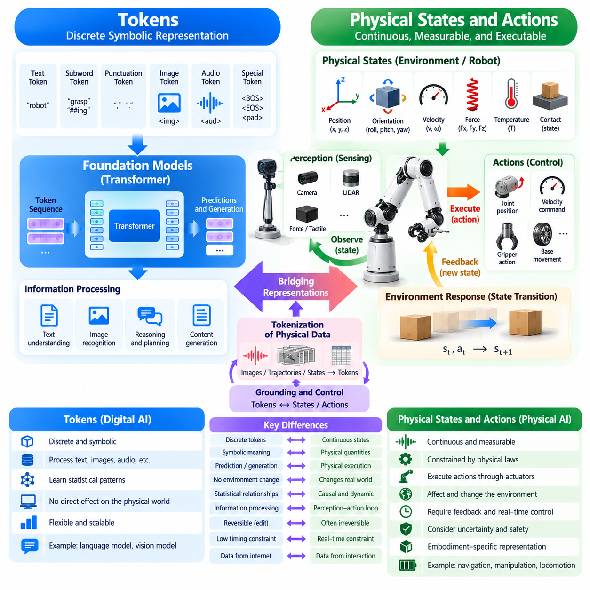{width="7.268055555555556in" height="7.268055555555556in"}

토큰(Token)은 많은 디지털 인공지능(Digital Artificial Intelligence, Digital AI) 시스템이 데이터를 표현하고 처리하기 위해 사용하는 이산적인 정보 단위(Discrete Unit of Information)이다. 언어 모델(Language Model)에서 토큰은 단어(Word), 단어 조각(Word Fragment), 문장부호(Punctuation), 기타 인코딩된 요소(Encoded Element)에 해당할 수 있다. 토큰의 주요 기능은 기호적 정보(Symbolic Information)를 디지털 처리 환경(Digital Processing Environment)에서 예측(Prediction), 생성(Generation), 추론(Reasoning)을 지원하는 컴퓨팅 표현(Computational Representation)으로 변환하는 것이다.

물리적 상태(Physical State)는 특정 시점에서 객체(Object), 에이전트(Agent), 환경(Environment)의 측정되거나 추정된 조건을 나타낸다. 이러한 조건에는 위치(Position), 방향(Orientation), 속도(Velocity), 가속도(Acceleration), 힘(Force), 온도(Temperature), 접촉 관계(Contact Relationship)가 포함될 수 있다. 기호적 토큰과 달리 물리적 상태는 물리 법칙(Physical Law)과 환경 제약(Environmental Constraint)의 지배를 받는 물리량(Physical Quantity)을 표현한다. 이를 해석하려면 측정 단위(Measurement Unit), 기준 좌표계(Reference Frame), 불확실성(Uncertainty), 시간적 변화(Temporal Evolution)를 고려해야 한다.

물리적 행동(Physical Action)은 기계적 과정(Mechanical Process)이나 기타 물리적 과정(Physical Process)을 통해 환경의 상태를 변화시키는 개입(Intervention)을 의미한다. 로봇 행동(Robotic Action)에는 토크(Torque)를 가하거나, 관절(Joint)을 움직이거나, 속도를 조정하거나, 그리퍼(Gripper)를 제어하는 작업이 포함될 수 있다. 행동은 외부 세계(External World)에 즉각적인 결과(Immediate Consequence)를 발생시킬 수 있다는 점에서 설명적 토큰(Descriptive Token)과 다르다. 행동의 실행은 액추에이터 성능(Actuator Capability), 시스템 동역학(System Dynamics), 운영 중 마주하는 조건에 따라 달라진다.

토큰과 물리적 상태의 차이는 디지털 AI에서 피지컬 인공지능(Physical Artificial Intelligence, Physical AI)으로의 전환을 이해하는 데 근본적으로 중요하다. 언어 모델은 로봇이 객체를 어떻게 파지(Grasping)해야 하는지 설명할 수 있지만, 이러한 설명 자체가 파지 동작을 수행하는 것은 아니다. 물리적 실행(Physical Execution)을 위해서는 기호적 의도(Symbolic Intention)를 공간적으로 정합된 명령(Spatially Grounded Command)으로 변환해야 하며, 이 과정에서 기하학적 구조(Geometry), 접촉(Contact), 마찰(Friction), 로봇 플랫폼(Robotic Platform)의 한계를 고려해야 한다.

토큰 기반 모델(Token-Based Model)은 일반적으로 인코딩된 시퀀스(Encoded Sequence) 사이의 통계적 관계(Statistical Relationship)를 학습한다. 이러한 모델의 예측은 언어적 의미(Linguistic Meaning), 시각적 패턴(Visual Pattern), 기타 추상적 구조(Abstract Structure)를 표현할 수 있다. 피지컬 AI는 추가로 관측 정보(Observation), 행동(Action), 그 결과로 발생하는 환경 변화(Environmental Change) 사이의 관계를 모델링해야 한다. 이러한 관계는 인과성(Causality)과 동역학(Dynamics)의 제약을 받으므로, 행동은 실제로 물리적으로 달성할 수 있는 결과를 기준으로 평가되어야 한다.

물리적 상태는 특정 작업(Task)에 관련된 변수를 포함하는 벡터(Vector)로 수학적으로 표현되는 경우가 많다. 이동 로봇(Mobile Robot)의 경우 이러한 표현에는 위치(Position), 진행 방향(Heading), 선속도(Linear Velocity), 각속도(Angular Velocity)가 포함될 수 있다. 매니퓰레이터(Manipulator)의 경우 관절 각도(Joint Angle), 관절 속도(Joint Velocity), 말단효과기 자세(End-Effector Pose)가 포함될 수 있다. 적절한 상태 표현(State Representation)은 시스템의 체화 형태(Embodiment), 사용 가능한 센서(Available Sensor), 제어 목표(Control Objective)에 따라 달라진다.

물리적 행동 역시 구조화된 제어 변수(Structured Control Variable)로 표현할 수 있다. 로봇은 목표 관절 위치(Desired Joint Position), 목표 속도(Target Velocity), 토크 명령(Torque Command), 말단효과기 궤적(End-Effector Trajectory)을 전달받을 수 있다. 이러한 명령은 실행 전에 운동학적 제약(Kinematic Constraint)과 동역학적 제약(Dynamic Constraint)을 충족해야 한다. 행동이 디지털 방식으로 표현되더라도 그 의미는 단순한 기호적 인코딩(Symbolic Encoding)이 아니라 물리적 메커니즘(Physical Mechanism)과의 관계에서 결정된다.

시간적 구조(Temporal Structure)는 또 다른 중요한 차이를 형성한다. 토큰 시퀀스(Token Sequence)는 일반적으로 순서(Ordering)와 문맥적 의존성(Contextual Dependency)을 통해 관계를 표현하는 반면, 물리적 상태는 경과 시간(Elapsed Time)과 시스템 동역학(System Dynamics)에 따라 변화한다. 로봇의 위치와 속도는 관측 사이에서도 연속적으로 변화한다. 따라서 피지컬 AI는 행동을 해석하거나 생성할 때 샘플링 간격(Sampling Interval), 제어 주파수(Control Frequency), 지연 시간(Latency), 행동 지속시간(Action Duration)을 고려해야 한다.

좌표계(Coordinate System)와 측정 단위(Measurement Unit)는 물리적으로 의미 있는 표현(Physically Meaningful Representation)에 필수적이다. 예측된 변위(Predicted Displacement)는 방향(Direction), 크기(Scale), 기준 좌표계(Reference Frame)가 정의되지 않으면 운영상 가치가 거의 없다. 마찬가지로 힘 명령(Force Command)은 적절한 단위와 액추에이터 특성(Actuator Characteristic)에 대응해야 한다. 피지컬 AI 시스템은 행동을 신뢰성 있게 실행하기 위해 센서 좌표계(Sensor Coordinate Frame), 로봇 좌표계(Robot Coordinate Frame), 환경 기준 좌표계(Environmental Reference Frame) 사이에서 일관된 좌표 변환(Coordinate Transformation)을 수행해야 한다.

불확실성(Uncertainty)은 기호적 표현(Symbolic Representation)과 물리적 표현(Physical Representation) 모두에 영향을 미치지만, 그 결과는 서로 다르다. 토큰 예측(Token Prediction)은 시퀀스의 다음 요소(Next Element)에 대한 불확실성을 나타낼 수 있는 반면, 물리적 상태 추정(Physical State Estimation)은 객체의 위치나 속도에 대한 불확실성을 포함할 수 있다. 이러한 불확실성은 충돌 위험(Collision Risk), 제어 정확도(Control Accuracy), 작업 실행 가능성(Task Feasibility)에 직접적인 영향을 미친다. 피지컬 AI는 불완전한 관측 정보(Imperfect Observation) 아래에서 행동을 선택할 때 불확실성을 전파(Propagation)하고 관리해야 한다.

물리적 상태와 행동 사이의 관계는 일반적으로 상태 전이 모델(State-Transition Model)을 통해 설명된다. 이러한 모델은 특정 조건에서 행동이 적용될 때 환경이 어떻게 변화하는지 추정한다. 객체를 미는 로봇은 가해진 힘(Applied Force), 마찰(Friction), 접촉 기하학(Contact Geometry)에 관한 정보를 활용하여 객체의 미래 위치(Future Position)를 예측할 수 있다. 이러한 예측은 컴퓨팅 표현(Computational Representation)을 물리적 상호작용(Physical Interaction)의 인과적 구조(Causal Structure)와 연결한다.

월드 모델(World Model)은 관측 정보와 경험(Experience)으로부터 이러한 상태 전이를 학습하기 위한 메커니즘(Mechanism)을 제공한다. 학습된 월드 모델(Learned World Model)은 현재 상태(Current State)와 후보 행동(Candidate Action)을 조건으로 가능한 미래 상태(Possible Future State)를 예측할 수 있다. 이를 통해 지능형 에이전트(Intelligent Agent)는 행동을 실행하기 전에 대안적 행동(Alternative Behavior)을 비교할 수 있다. 그러나 예측 정확도(Predictive Accuracy)는 관련 동역학(Relevant Dynamics), 접촉 조건(Contact Condition), 익숙하지 않은 환경 상황(Unfamiliar Environmental Situation)을 모델이 얼마나 충분히 포괄하는지에 따라 달라진다.

적절한 표현 방식을 설계하면 토큰도 물리적 정보를 인코딩(Encoding)할 수 있다. 로봇 궤적(Robot Trajectory), 관절 구성(Joint Configuration), 행동 명령(Action Command)을 이산화(Discretization)하여 트랜스포머 기반 모델(Transformer-Based Model)이 처리할 수 있는 시퀀스로 변환할 수 있다. 이러한 표현은 공유 컴퓨팅 아키텍처(Shared Computational Architecture) 내에서 언어(Language), 비전(Vision), 행동(Action)의 통합을 지원한다. 그러나 물리적 변수를 토큰으로 변환하더라도 물리적 일관성(Physical Consistency)과 제어(Control)에 대한 근본적인 요구사항이 사라지는 것은 아니다.

비전-언어-행동 모델(Vision-Language-Action Model, VLA)은 기호적 표현과 물리적 표현 사이의 연결을 보여준다. 이러한 모델은 시각적 관측 정보(Visual Observation)와 언어 명령(Language Instruction)을 결합하여 로봇 시스템을 위한 행동이나 행동 표현(Action Representation)을 생성한다. 선반 위에 객체를 놓으라는 명령은 공간 추론(Spatial Reasoning), 동작 계획(Motion Planning), 실행 가능한 제어(Executable Control)로 변환되어야 한다. 성공적인 행동을 위해서는 학습된 표현(Learned Representation)을 로봇의 실제 환경(Actual Environment)과 수행 능력(Capability)에 기반하도록 연결하는 정합화(Grounding)가 필요하다.

행동 토큰화(Action Tokenization)는 중요한 설계 절충관계(Design Tradeoff)를 수반한다. 이산적 행동 표현(Discrete Action Representation)은 시퀀스 모델링(Sequence Modeling)을 단순화하고 대규모 학습(Large-Scale Training)을 지원할 수 있지만, 양자화(Quantization)는 정밀도(Precision)를 감소시키거나 연속적 관계(Continuous Relationship)를 불명확하게 만들 수 있다. 연속적 행동 표현(Continuous Action Representation)은 수치적 세부 정보(Numerical Detail)를 보존할 수 있지만, 다른 예측 및 최적화 메커니즘(Prediction and Optimization Mechanism)이 필요할 수 있다. 적절한 접근 방식은 작업 요구사항(Task Requirement), 액추에이터 분해능(Actuator Resolution), 모델 아키텍처(Model Architecture), 피드백 가용성(Feedback Availability)에 따라 달라진다.

체화(Embodiment)는 추상적 행동 표현(Abstract Action Representation)이 실행 가능한 행동(Executable Behavior)으로 전환되는 방식을 결정한다. 동일한 명령이라도 바퀴형 매니퓰레이터(Wheeled Manipulator), 휴머노이드 로봇(Humanoid Robot), 로봇 팔이 장착된 사족보행 로봇(Quadruped Robot)에 따라 서로 다른 관절 움직임(Joint Movement)이 필요할 수 있다. 각 플랫폼은 고유한 운동학적 구조(Kinematic Structure), 작업 공간 제약(Workspace Limitation), 제어 특성(Control Characteristic)을 갖는다. 따라서 피지컬 AI는 상위 수준 의도(High-Level Intention)를 실행 가능하고 안전한 플랫폼별 행동(Platform-Specific Action)으로 변환해야 한다.

폐쇄 루프 제어(Closed-Loop Control)는 생성된 행동(Generated Action)을 관측된 물리적 상태(Observed Physical State)와 연결한다. 행동이 실행된 후 센서는 그 결과로 발생한 조건을 측정하고 후속 의사결정(Subsequent Decision-Making)에 필요한 정보를 제공한다. 이러한 과정은 시스템이 의도한 결과(Intended Outcome)와 실제 결과(Actual Outcome) 사이의 편차(Deviation)를 보정할 수 있도록 한다. 피드백이 없다면 그럴듯한 행동 토큰 시퀀스(Action Token Sequence)라도 실제 환경 동역학(Real-World Dynamics)이 생성 과정에서 사용된 가정과 다를 때 신뢰할 수 없는 행동을 유발할 수 있다.

물리적 제약(Physical Constraint)은 행동 생성(Action Generation)의 전 과정에서 고려되어야 한다. 충돌 경계(Collision Boundary), 관절 한계(Joint Limit), 최대 토크(Maximum Torque), 탑재하중 용량(Payload Capacity), 환경 장애물(Environmental Obstacle)은 허용 가능한 행동(Permissible Behavior)의 범위를 제한한다. 모델은 논리적으로 일관되어 보이지만 기계적 실행 가능성(Mechanical Feasibility)을 위반하는 행동 시퀀스를 생성할 수 있다. 따라서 컴퓨팅 예측(Computational Prediction)을 물리적으로 유효한 실행(Physically Valid Execution)으로 변환하려면 제약 인식 계획(Constraint-Aware Planning)과 제어(Control)가 필요하다.

안전성(Safety)은 물리적 행동을 일반적인 기호적 출력(Symbolic Output)과 더욱 명확하게 구별한다. 잘못된 텍스트 예측(Incorrect Textual Prediction)은 사용자에게 잘못된 정보를 제공할 수 있지만, 부적절한 액추에이터 명령(Inappropriate Actuator Command)은 충돌(Collision), 불안정성(Instability), 장비 손상(Equipment Damage)을 직접 유발할 수 있다. 피지컬 AI에는 제안된 행동(Proposed Action)을 검증하고, 실행을 모니터링하며, 필요한 경우 안전 상태(Safe State)로 전환하는 메커니즘이 필요하다. 이러한 안전 보호장치(Safeguard)는 생성 모델(Generative Model)이 나타내는 겉보기 확신도(Apparent Confidence)와 독립적으로 작동해야 한다.

피지컬 AI의 학습(Training)에는 관측 정보, 상태, 행동, 결과 사이의 관계를 보존하는 데이터셋(Dataset)이 필요하다. 정적 이미지(Static Image)나 텍스트 설명(Textual Description)만으로는 물리적 개입(Physical Intervention)의 결과에 관한 충분한 정보를 포함하지 못할 수 있다. 로봇 시연(Robotic Demonstration), 센서 궤적(Sensor Trajectory), 상호작용 기록(Interaction Recording)은 더욱 풍부한 지도 정보(Supervision)를 제공한다. 이러한 데이터의 유용성(Usefulness)은 정확한 동기화(Synchronization), 보정(Calibration), 행동 정의(Action Definition), 환경 맥락(Environmental Context)의 표현에 따라 달라진다.

평가(Evaluation) 역시 기존의 토큰 예측 정확도(Token Prediction Accuracy)를 넘어 확장되어야 한다. 모델은 그럴듯한 행동 시퀀스를 예측하면서도 실제 물리적 작업(Physical Task)을 신뢰성 있게 완료하지 못할 수 있다. 피지컬 AI 평가는 작업 성공률(Task Success), 궤적 정확도(Trajectory Accuracy), 접촉 안정성(Contact Stability), 실행 효율성(Execution Efficiency), 교란으로부터의 복구(Recovery from Disturbances)를 고려한다. 이러한 측정은 생성된 표현(Generated Representation)이 단순히 통계적으로 가능성이 높은 출력(Statistically Likely Output)이 아니라 효과적인 행동(Effective Behavior)에 대응하는지 확인한다.

토큰과 물리적 상태 및 행동의 통합(Integration)은 더욱 폭넓은 형태의 기계 지능(Machine Intelligence)을 가능하게 한다. 기호적 표현(Symbolic Representation)은 언어 이해(Language Understanding), 추상적 추론(Abstract Reasoning), 상위 수준 작업 명세(High-Level Task Specification)를 지원하며, 물리적 표현(Physical Representation)은 공간 인식(Spatial Awareness), 동적 예측(Dynamic Prediction), 실행 가능한 제어(Executable Control)를 지원한다. 이러한 능력을 연결하면 지능형 시스템은 인간의 의도(Human Intention)를 측정 가능한 환경 조건(Measurable Environmental Condition)에 기반한 행동으로 변환할 수 있다.

궁극적으로 이러한 차이는 토큰이 디지털 AI에만 속하고 물리적 상태와 행동이 피지컬 AI에만 속한다는 의미가 아니다. 토큰은 물리적 변수(Physical Variable)를 인코딩할 수 있으며, 물리적 에이전트(Physical Agent) 역시 디지털 표현(Digital Representation)을 일상적으로 활용한다. 핵심적인 차이는 컴퓨팅 출력(Computational Output)이 기호적 예측(Symbolic Prediction)에 머무르는지, 아니면 물리 법칙(Physical Law), 운영 제약(Operational Constraint), 실제 환경 피드백(Real-World Feedback)을 충족해야 하는 물리적으로 정합된 의사결정(Grounded Decision)으로 전환되는지에 있다.

## 02.07. Offline Inference vs Real Time Operation

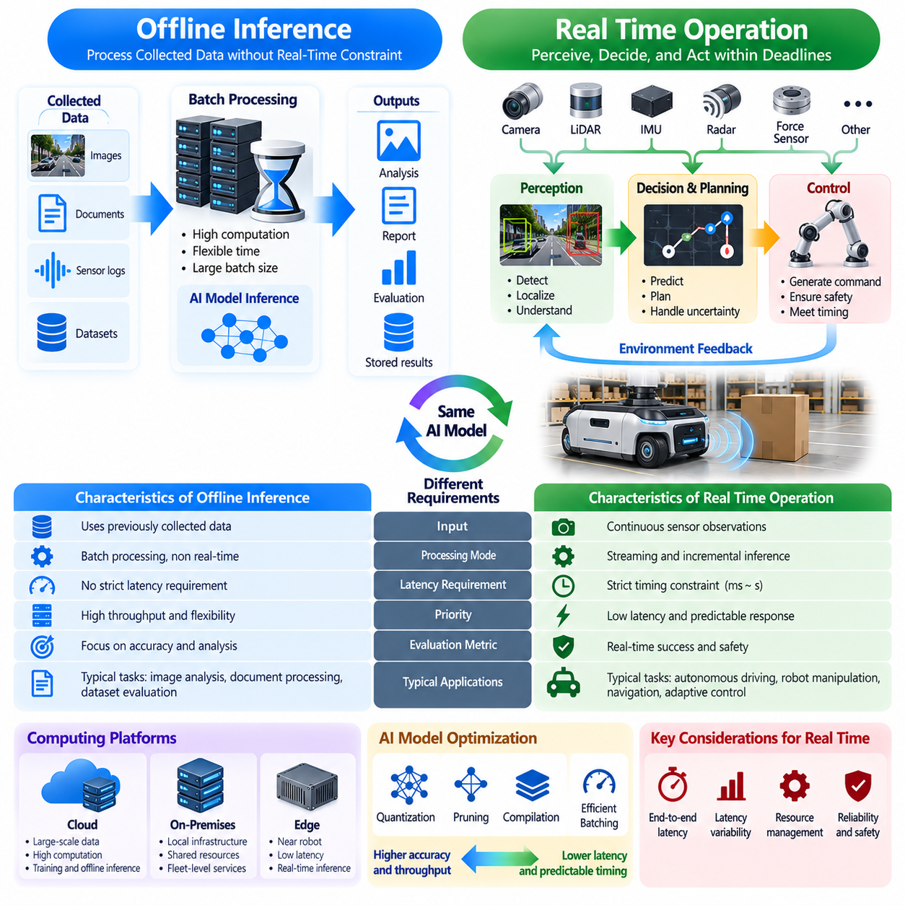{width="7.268055555555556in" height="7.268055555555556in"}

오프라인 추론(Offline Inference)은 지속적으로 변화하는 환경(Continuously Changing Environment)에 즉각적으로 대응할 필요 없이 이전에 수집된 입력 데이터(Previously Collected Input Data)에 대해 인공지능(Artificial Intelligence, AI) 모델을 실행하는 것을 의미한다. 데이터는 배치(Batch) 단위로 처리할 수 있으며, 컴퓨팅 자원(Computational Resource)은 처리량(Throughput)이나 분석 요구사항(Analytical Requirement)에 따라 할당할 수 있다. 이러한 접근 방식은 광범위한 추론(Reasoning)과 평가(Evaluation)를 지원하지만, 출력 결과가 반드시 엄격한 운영 마감시간(Operational Deadline)의 제약을 받는 것은 아니다.

실시간 운영(Real-Time Operation)은 지능형 시스템(Intelligent System)이 정의된 시간 제약(Timing Constraint) 내에서 환경 조건을 인식하고, 의사결정을 수행하며, 행동을 실행하도록 요구한다. 피지컬 인공지능(Physical Artificial Intelligence, Physical AI)에서는 객체(Object), 로봇(Robot), 환경 조건(Environmental Condition)이 지속적으로 변화하기 때문에 지연된 의사결정(Delayed Decision)은 효과를 잃을 수 있다. 따라서 출력 결과의 유용성(Usefulness)은 정확도(Accuracy)뿐만 아니라 물리적 과정(Physical Process)에 안전하게 영향을 미칠 수 있을 만큼 충분히 일찍 도착하는지에 따라 결정된다.

오프라인 추론은 일반적으로 이미지 분석(Image Analysis), 문서 처리(Document Processing), 데이터셋 평가(Dataset Evaluation), 과거 센서 데이터 해석(Retrospective Sensor Interpretation)을 지원한다. 이러한 응용 분야(Application)는 입력 데이터를 반복적으로 검토할 수 있으므로 처리 시간(Processing Time)의 변동을 허용할 수 있다. 모델은 진행 중인 물리적 과정(Physical Process)을 직접 제어하지 않고도 복잡한 정보를 분석할 수 있다. 따라서 즉각적인 응답 시간(Immediate Response Timing)보다 연산 정확도(Computational Accuracy)와 처리량(Throughput)이 더 중요하게 고려되는 경우가 많다.

피지컬 AI는 연산 정확도만으로는 충족할 수 없는 운영 요구사항(Operational Requirement)을 도입한다. 장애물(Obstacle)에 접근하는 이동 로봇(Mobile Robot)은 장애물에 도달하기 전에 위험 요소(Hazard)를 식별하고 적절한 대응을 시작해야 한다. 깨지기 쉬운 객체(Fragile Object)를 다루는 매니퓰레이터(Manipulator)는 손상이 발생하기 전에 접촉력(Contact Force)을 조정해야 한다. 이러한 상황에서는 센싱(Sensing), 추론(Inference), 계획(Planning), 제어(Control)가 물리적 동역학(Physical Dynamics)에 의해 결정되는 마감시간(Deadline) 내에서 작동해야 한다.

실시간 컴퓨팅(Real-Time Computing)은 올바른 결과(Correct Result)를 생성하는 것과 허용 가능한 시간 간격(Acceptable Time Interval) 내에서 그 결과를 생성하는 것을 구별한다. 제어 명령(Control Command)의 수치가 정확하더라도 너무 늦게 도착하면 기능적으로 잘못된 명령이 될 수 있다. 하드 실시간 시스템(Hard Real-Time System)은 명시된 가정 아래에서 마감시간을 반드시 충족해야 하는 반면, 소프트 실시간 시스템(Soft Real-Time System)은 성능 저하를 감수하면서 간헐적인 지연을 허용한다. 피지컬 AI 아키텍처(Physical AI Architecture)는 이러한 두 범주를 모두 포함할 수 있다.

지연 시간(Latency)은 사건(Event), 관측(Observation), 요청(Request)이 발생한 시점부터 이에 대응하는 시스템 응답(System Response)이 이루어질 때까지 경과한 시간을 의미한다. 로봇 시스템(Robotic System)에서 전체 지연 시간(Total Latency)에는 센서 데이터 획득(Sensor Acquisition), 데이터 전송(Data Transmission), 전처리(Preprocessing), 모델 추론(Model Inference), 계획(Planning), 통신(Communication), 액추에이터 실행(Actuator Execution)이 포함될 수 있다. 각 단계는 환경 변화(Environmental Change)와 물리적 반응(Physical Reaction) 사이의 지연에 영향을 미치므로, 추론 시간(Inference Time)만이 아니라 종단 간 지연 시간(End-to-End Latency)이 더욱 중요하다.

처리량(Throughput)과 지연 시간(Latency)은 서로 다른 컴퓨팅 특성(Computational Property)을 나타낸다. 처리량은 단위 시간당 완료되는 작업량(Quantity of Work)을 측정하는 반면, 지연 시간은 개별 작업(Individual Operation)에 수반되는 지연을 측정한다. 배치 처리(Batch Processing)는 가속기 활용률(Accelerator Utilization)과 전체 처리량을 향상시킬 수 있지만, 개별 관측 정보(Individual Observation)의 대기 시간을 증가시킬 수 있다. 실시간 피지컬 AI는 작업 마감시간(Task Deadline)과 사용 가능한 컴퓨팅 자원(Available Computational Resource)에 따라 이러한 특성의 균형을 조정해야 한다.

시간적 변동성(Timing Variability)도 중요한 고려사항이다. 모델은 평균 추론 지연 시간(Average Inference Latency)이 허용 가능한 수준이더라도 간헐적으로 비정상적으로 느린 응답을 생성할 수 있다. 이러한 변동은 제어 주기(Control Cycle)를 방해하고 운영 예측 가능성(Operational Predictability)을 저하시킬 수 있다. 따라서 실시간 성능(Real-Time Performance)을 평가하려면 평균 벤치마크 결과(Average Benchmark Result)에만 의존하지 않고 최악 실행 시간(Worst-Case Execution Time), 지연 시간 분포(Latency Distribution), 스케줄링 간섭(Scheduling Interference), 마감시간 위반(Deadline Violation)을 검토해야 한다.

피지컬 AI 시스템은 서로 다른 기능(Function)에 서로 다른 시간 요구사항(Timing Requirement)이 존재하기 때문에 여러 연산 주기(Computational Rate)를 사용하는 경우가 많다. 모터 제어(Motor Control)는 빠른 주기적 갱신(Periodic Update)이 필요할 수 있지만, 객체 인식(Object Recognition), 의미 지도 작성(Semantic Mapping), 작업 계획(Task Planning)은 상대적으로 낮은 빈도로 실행될 수 있다. 이러한 기능은 느린 연산이 시간에 민감한 제어(Time-Sensitive Control)를 차단하지 않으면서 정보를 교환해야 한다. 적절한 스케줄링(Scheduling)과 아키텍처 분리(Architectural Separation)는 예측 가능한 운영을 유지하는 데 도움이 된다.

엣지 컴퓨팅(Edge Computing)은 통신 지연(Communication Delay)과 원격 인프라(Remote Infrastructure)에 대한 의존성을 줄이는 데 중요한 역할을 한다. 로봇 플랫폼(Robotic Platform) 가까이에서 센서 관측 정보(Sensor Observation)를 처리하면 더 빠른 응답과 네트워크 장애(Network Disruption) 중에도 지속적인 운영을 지원할 수 있다. 클라우드 자원(Cloud Resource)은 대규모 학습(Large-Scale Training), 과거 데이터 분석(Historical Analysis), 연산 집약적 계획(Computationally Intensive Planning)에 여전히 유용하다. 그러나 즉각적인 물리적 개입(Immediate Physical Intervention)이 필요한 기능은 예측하기 어려운 네트워크 왕복 지연(Network Round-Trip Delay)에 의존해서는 안 된다.

온프레미스 컴퓨팅(On-Premises Computing)은 임베디드 장치(Embedded Device)와 원격 클라우드 인프라(Remote Cloud Infrastructure) 사이의 중간 배포 방식(Intermediate Deployment Option)을 제공한다. 로컬 서버(Local Server)는 여러 로봇에 걸쳐 공유 인식(Shared Perception), 협업 조정(Coordination), 연산 요구량이 높은 모델(Computationally Demanding Model)을 지원할 수 있다. 그러나 로컬 네트워킹(Local Networking) 역시 통신 지연과 잠재적인 장애(Potential Failure)를 발생시킨다. 시스템 설계자(System Designer)는 어떤 의사결정을 중앙집중화(Centralization)할 수 있고, 어떤 의사결정은 액추에이터 가까이에서 독립적으로 실행해야 하는지 결정해야 한다.

실시간 추론(Real-Time Inference)은 예측 가능한 메모리 동작(Memory Behavior)과 연산 동작(Computational Behavior)에도 의존한다. 동적 메모리 할당(Dynamic Memory Allocation), 자원 경합(Resource Contention), 과도한 데이터 복사(Excessive Data Copying), 예측하기 어려운 가속기 스케줄링(Accelerator Scheduling)은 지연을 유발할 수 있다. 양자화(Quantization), 가지치기(Pruning), 컴파일(Compilation), 효율적인 배치 처리(Efficient Batching)와 같은 모델 최적화 기법(Model Optimization Technique)은 연산 요구량(Computational Requirement)을 줄일 수 있다. 그러나 이러한 기법의 이점은 정확도(Accuracy), 수치적 안정성(Numerical Stability), 실행 예측 가능성(Execution Predictability)의 잠재적 변화와 함께 평가되어야 한다.

하드웨어 가속(Hardware Acceleration)은 복잡한 인식 모델(Perception Model)과 의사결정 모델(Decision Model)의 응답성(Responsiveness)을 향상시킬 수 있다. 그래픽 처리장치(Graphics Processing Unit, GPU), 신경망 처리장치(Neural Processing Unit, NPU), 전용 추론 가속기(Specialized Inference Accelerator)는 연산 집약적 작업(Computationally Intensive Operation)의 병렬 실행(Parallel Execution)을 가능하게 한다. 그러나 가속기 성능(Accelerator Performance)은 메모리 대역폭(Memory Bandwidth), 모델 구조(Model Structure), 커널 스케줄링(Kernel Scheduling), 동시 실행 작업(Concurrent Workload)에 따라 달라진다. 높은 최대 연산 성능(Peak Computational Capability)이 결정론적 실시간 실행(Deterministic Real-Time Execution)을 자동으로 보장하는 것은 아니다.

폐쇄 루프 제어(Closed-Loop Control)는 각 행동이 갱신된 관측 정보(Updated Observation)에 의존하기 때문에 시간 제약(Timing Constraint)을 특히 중요하게 만든다. 지연된 상태 추정값(Delayed State Estimate)은 제어기(Controller)가 더 이상 존재하지 않는 조건에 대응하도록 만들 수 있다. 예측(Prediction)은 예상 실행 시점(Expected Execution Time)의 시스템 상태(System State)를 추정함으로써 알려진 지연(Known Delay)을 부분적으로 보상할 수 있다. 그러나 과도하거나 예측하기 어려운 지연 시간은 안정성(Stability), 추종 정확도(Tracking Accuracy), 외란 억제(Disturbance Rejection)를 저하시킬 수 있다.

월드 모델(World Model)과 예측 계획(Predictive Planning)은 미래 물리적 상태(Future Physical State)를 예상함으로써 실시간 의사결정(Real-Time Decision-Making)을 개선할 수 있다. 로봇은 사건이 발생할 때까지 기다리는 대신 가능한 궤적(Possible Trajectory)을 추정하고 적절한 대응을 준비할 수 있다. 모델 예측 제어(Model Predictive Control, MPC)는 유한한 예측 구간(Finite Horizon)에서 후보 행동(Candidate Action)을 반복적으로 평가한다. 실제 구현(Practical Implementation)에서는 다음 제어 결정(Control Decision)이 필요한 시점 이전에 계획을 완료할 수 있도록 연산 복잡도(Computational Complexity)를 제한해야 한다.

실시간 운영에서는 컴퓨팅 자원(Computational Resource)이 부족해질 때 점진적 성능 저하(Graceful Degradation)를 지원해야 하는 경우가 많다. 로봇은 인식 해상도(Perception Resolution)를 낮추거나, 더 작은 모델(Smaller Model)로 전환하거나, 계획 과정을 단순화하거나, 일시적으로 움직임을 제한할 수 있다. 이러한 적응(Adaptation)은 연산 요구량을 줄이면서 필수 안전 기능(Essential Safety Function)을 유지해야 한다. 고급 지능 구성요소(Advanced Intelligence Component)에 지연이나 장애가 발생하더라도 핵심 보호 메커니즘(Critical Protective Mechanism)은 계속 사용할 수 있어야 한다.

센서 동기화(Sensor Synchronization)는 서로 다른 주파수(Frequency)로 작동하는 장치에서 관측 정보가 생성될 때 필수적이다. 카메라(Camera), 라이다(LiDAR), 관성 센서(Inertial Sensor), 관절 엔코더(Joint Encoder)는 서로 다른 타임스탬프(Timestamp)와 통신 지연(Communication Delay)을 갖는 측정값을 생성할 수 있다. 일관성이 없는 관측 정보(Inconsistent Observation)를 결합하면 부정확한 상태 추정값(Inaccurate State Estimate)이 생성될 수 있다. 시간 동기화(Time Synchronization), 버퍼링(Buffering), 보간(Interpolation), 타임스탬프 인식 센서 융합(Timestamp-Aware Sensor Fusion)은 물리적 환경에 대한 일관된 표현(Coherent Representation)을 유지하는 데 도움이 된다.

실시간 시스템은 오래된 정보(Stale Information)도 처리해야 한다. 수백 밀리초(Several Hundred Milliseconds) 전에 추정한 객체 위치(Object Location)는 더 이상 현재 위치(Current Position)를 나타내지 않을 수 있다. 피지컬 AI는 관측 정보, 예측, 명령의 경과 시간(Age)과 유효성(Validity)을 추적해야 한다. 정보가 허용 가능한 최신성 한계(Acceptable Freshness Limit)를 초과하면 시스템은 갱신된 측정값(Updated Measurement)을 요청하거나, 운영 속도(Operating Speed)를 줄이거나, 더 안전한 제어 모드(Safer Control Mode)로 전환해야 할 수 있다.

전력 제약(Power Constraint)과 열 제약(Thermal Constraint)은 임베디드 로봇 플랫폼(Embedded Robotic Platform)의 실시간 추론을 더욱 복잡하게 만든다. 지속적인 연산(Sustained Computation)은 에너지를 소비하고 열을 발생시키며, 이로 인해 주파수 스로틀링(Frequency Throttling)이나 운영 시간(Operating Duration)의 감소가 발생할 수 있다. 따라서 모델 선택(Model Selection)에서는 짧은 벤치마크의 최대 성능(Short Benchmark Peak)이 아니라 지속 성능(Sustained Performance)을 고려해야 한다. 효율적인 아키텍처(Efficient Architecture)는 현실적인 작업 부하(Realistic Workload)에서 추론 품질(Inference Quality), 응답 시간(Response Time), 전력 소비(Power Consumption), 열적 안정성(Thermal Stability)의 균형을 유지한다.

안전 필수 운영(Safety-Critical Operation)에서는 시간 요구사항 위반(Timing Failure)을 단순한 성능 문제(Performance Problem)가 아니라 운영 위험(Operational Hazard)으로 취급해야 한다. 마감시간을 놓치면 충돌 회피(Collision Avoidance), 힘 제한(Force Limitation), 비상 대응(Emergency Response)이 의도한 대로 작동하지 못할 수 있다. 런타임 모니터링(Runtime Monitoring)은 과도한 지연 시간(Excessive Latency)을 감지하고 사전에 정의된 보호 행동(Predefined Protective Action)을 실행할 수 있다. 안전 기능(Safety Function)은 연산 집약적인 AI 구성요소(Computationally Intensive AI Component)로부터 적절한 독립성(Independence)을 갖도록 설계되어야 한다.

실시간 피지컬 AI를 테스트하려면 대표적인 작업 부하(Representative Workload)와 현실적인 운영 조건(Realistic Operating Condition)이 필요하다. 실험실 벤치마크(Laboratory Benchmark)는 종단 간 응답 시간(End-to-End Response Time), 마감시간 준수(Deadline Compliance), 스케줄링 지터(Scheduling Jitter), 연산 과부하(Computational Overload) 상황에서의 행동을 측정해야 한다. 하드웨어 인 더 루프 테스트(Hardware-in-the-Loop Testing, HIL Testing)는 소프트웨어(Software), 센서(Sensor), 제어기(Controller), 액추에이터(Actuator) 사이의 상호작용을 드러낼 수 있다. 환경 복잡성(Environmental Complexity)과 동시 실행 작업(Concurrent Workload)이 개별 테스트(Isolated Test)에서는 나타나지 않았던 지연을 발생시킬 수 있으므로 현장 검증(Field Validation)이 여전히 필요하다.

오프라인 추론과 실시간 운영은 상호 배타적(Mutually Exclusive)이 아니라 상호 보완적(Complementary)이다. 오프라인 처리(Offline Processing)는 모델 개발(Model Development), 데이터셋 분석(Dataset Analysis), 정책 최적화(Policy Optimization), 과거 장애 조사(Retrospective Failure Investigation)를 지원할 수 있다. 실시간 실행(Real-Time Execution)은 검증된 지능(Validated Intelligence)을 지속적으로 변화하는 물리적 상황에 적용한다. 실용적인 피지컬 AI 아키텍처는 오프라인 연산(Offline Computation)을 활용하여 모델을 개선하는 동시에, 신중하게 관리되는 배포 메커니즘(Deployment Mechanism)을 통해 예측 가능한 온라인 제어(Online Control)를 유지할 수 있다.

궁극적으로 오프라인 추론에서 실시간 운영으로의 전환은 인공지능 성능(Artificial Intelligence Performance)을 평가하는 방식을 변화시킨다. 예측 품질(Prediction Quality)은 여전히 중요하지만, 적시 실행(Timely Execution), 연산 예측 가능성(Computational Predictability), 피드백 응답성(Feedback Responsiveness), 운영 안전성(Operational Safety)도 동등하게 필수적인 요소가 된다. 피지컬 AI는 의사결정이 의미 있는 물리적 효과(Meaningful Physical Effect)를 발생시킬 수 있는 시간 내에 적절한 결정을 생성할 때 신뢰할 수 있는 자율성(Reliable Autonomy)을 달성할 수 있다.

## 02.08. Digital Error vs Physical Failure

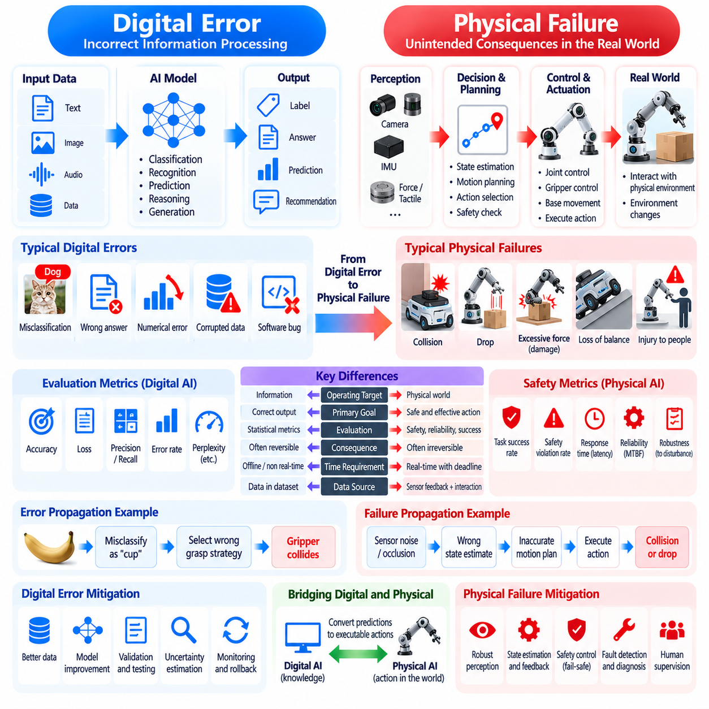{width="7.268055555555556in" height="7.268055555555556in"}

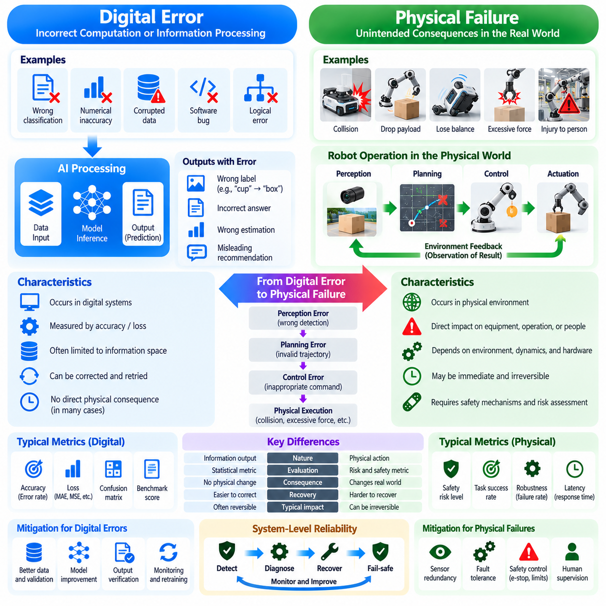{width="7.268055555555556in" height="7.268055555555556in"}

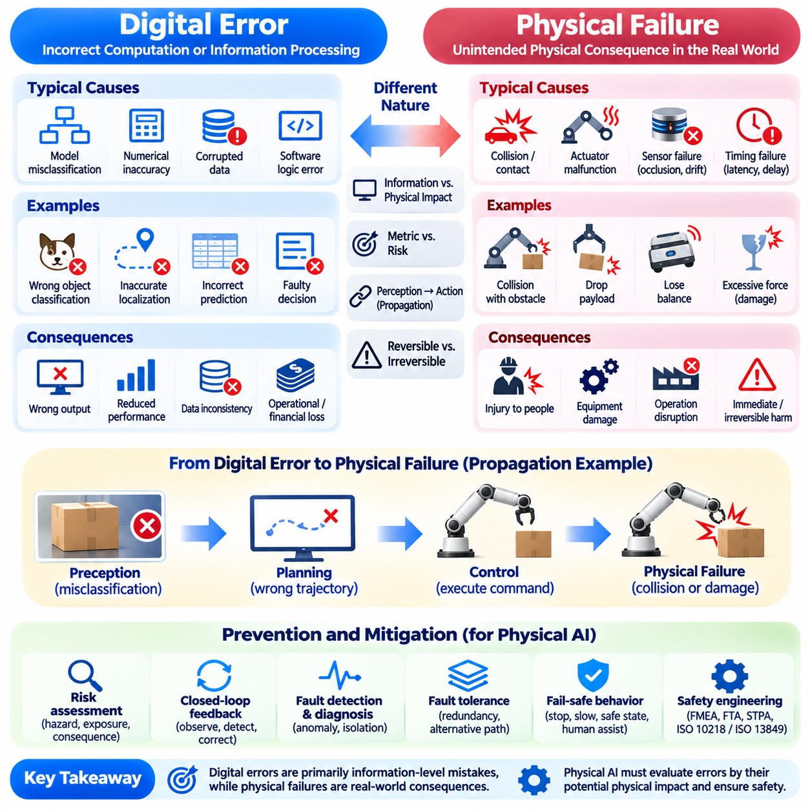{width="7.268055555555556in" height="7.268055555555556in"}

디지털 오류(Digital Error)는 컴퓨팅 시스템(Computational System)이 잘못된 출력(Incorrect Output)을 생성하거나, 정보를 부정확하게 처리하거나, 의도된 소프트웨어 작업(Intended Software Operation)을 실행하지 못할 때 발생한다. 이러한 오류에는 분류 오류(Classification Error), 수치적 부정확성(Numerical Inaccuracy), 데이터 손상(Data Corruption), 잘못된 논리적 의사결정(Faulty Logical Decision)이 포함될 수 있다. 이러한 오류의 결과는 디지털 환경(Digital Environment) 내부에 머무르는 경우가 많지만, 중요한 정보 시스템(Critical Information System)에서 발생한 오류는 상당한 재정적(Financial), 운영적(Operational), 사회적(Societal) 피해를 초래할 수도 있다.

물리적 실패(Physical Failure)는 지능형 시스템(Intelligent System)의 행동이나 구성요소 오작동(Component Malfunction)이 물리적 세계(Physical World)에서 의도하지 않은 결과(Unintended Consequence)를 발생시킬 때 나타난다. 로봇은 장애물(Obstacle)과 충돌하거나, 적재물(Payload)을 떨어뜨리거나, 균형(Balance)을 잃거나, 과도한 힘(Excessive Force)을 가할 수 있다. 순수한 정보적 오류(Informational Error)와 달리 이러한 사건은 장비(Equipment)를 직접 손상시키거나, 운영(Operation)을 중단시키거나, 사람에게 상해(Injury)를 입힐 수 있다. 그 결과는 즉각적(Immediate)이고 비가역적(Irreversible)이며 통제하기 어려울 수 있다.

디지털 오류와 물리적 실패의 차이는 컴퓨팅 의사결정(Computational Decision)이 실제 세계의 메커니즘(Real-World Mechanism)과 연결된다는 점에서 피지컬 인공지능(Physical Artificial Intelligence, Physical AI)의 근본적인 특성이다. 잘못된 객체 분류(Incorrect Object Classification)는 오프라인 데이터셋(Offline Dataset)에서는 단순한 예측 오류(Prediction Error)에 머무를 수 있다. 그러나 동일한 분류 결과가 로봇 그리퍼(Robotic Gripper)를 제어하는 데 사용된다면 부적절한 파지(Inappropriate Grasp)나 충돌(Collision)을 유발할 수 있다. 따라서 피지컬 AI에서는 오류를 잠재적인 운영 결과(Potential Operational Consequence)에 따라 평가해야 한다.

디지털 인공지능(Digital Artificial Intelligence, Digital AI) 시스템은 일반적으로 예측 정확도(Prediction Accuracy), 손실 함수(Loss Function), 통계적 오류 지표(Statistical Error Metric)를 사용하여 평가된다. 이러한 측정 방법은 모델 출력(Model Output)과 기대 결과(Expected Result) 사이의 차이를 정량화한다. 그러나 유용하더라도 물리적 결과(Physical Consequence)의 심각도(Severity)를 직접 표현하지는 못한다. 유사한 수치적 오류(Numerical Error)를 가진 두 예측도 서로 다른 환경 조건(Environmental Condition)에서 로봇 행동(Robotic Action)으로 변환되면 매우 다른 위험(Risk)을 발생시킬 수 있다.

물리적 실패 분석(Physical Failure Analysis)은 위험요인(Hazard), 노출(Exposure), 결과(Consequence) 사이의 관계를 고려해야 한다. 작은 위치 추정 오류(Localization Error)는 개방된 작업 공간(Open Workspace)에서는 무해할 수 있지만, 사람이나 보호되지 않은 가장자리(Unprotected Edge) 근처에서는 위험할 수 있다. 마찬가지로 작은 힘 추정 오류(Force Estimation Error)는 견고한 객체(Robust Object)를 다룰 때 허용될 수 있지만, 정밀한 조작(Delicate Manipulation)에서는 허용되지 않을 수 있다. 따라서 위험 평가(Risk Assessment)는 예측 오류뿐만 아니라 운영 맥락(Operating Context)을 포함해야 한다.

오류는 상호 연결된 피지컬 AI 구성요소(Interconnected Physical AI Component)를 통해 전파(Propagation)될 수 있다. 카메라 보정 오류(Camera Calibration Error)는 객체 위치 추정(Object Localization)을 왜곡하여 계획기(Planner)가 부정확한 궤적(Inaccurate Trajectory)을 생성하도록 만들 수 있다. 이후 제어기(Controller)는 의도하지 않은 접촉(Unintended Contact)을 발생시키는 명령을 실행할 수 있다. 이러한 과정은 인식(Perception), 계획(Planning), 제어(Control)가 충분한 검증(Verification) 없이 작동할 경우 처음에는 작은 컴퓨팅 편차(Computational Discrepancy)가 물리적 실패로 발전할 수 있음을 보여준다.

센서 고장(Sensor Failure)은 또 다른 중요한 위험 원인(Risk Source)을 제공한다. 카메라(Camera)는 가림 현상(Occlusion)을 겪을 수 있고, 라이다(LiDAR) 측정값은 신뢰성이 저하될 수 있으며, 관성 센서(Inertial Sensor)에는 바이어스(Bias)나 드리프트(Drift)가 발생할 수 있다. 이러한 조건은 환경 상태(Environmental State)에 대한 부정확한 추정값(Inaccurate Estimate)을 생성할 수 있다. 견고한 피지컬 AI 시스템(Robust Physical AI System)은 일관성이 없는 측정값(Inconsistent Measurement)을 감지하고, 불확실성(Uncertainty)을 추정하며, 신뢰할 수 없는 센서 정보(Unreliable Sensor Information)를 의심의 여지가 없는 증거로 취급하지 않아야 한다.

액추에이터 고장(Actuator Failure)과 기계적 고장(Mechanical Failure)은 모델 정확도(Model Accuracy)만으로 설명할 수 없는 위험을 발생시킨다. 모터(Motor)는 과열될 수 있고, 브레이크(Brake)는 오작동할 수 있으며, 관절(Joint)은 움직임이 방해받을 수 있고, 기계 구성요소(Mechanical Component)는 시간이 지남에 따라 마모될 수 있다. 올바른 AI 의사결정(Correct AI Decision)이라도 물리적 실행 메커니즘(Physical Execution Mechanism)이 예상과 다르게 작동하면 실패할 수 있다. 따라서 신뢰할 수 있는 자율성(Reliable Autonomy)은 하드웨어 상태 모니터링(Hardware Health Monitoring)과 지능 시스템(Intelligence System) 및 기계적 보호 시스템(Mechanical Protection System)의 협력에 의존한다.

시간적 실패(Timing Failure)는 다른 측면에서는 유효한 의사결정(Valid Decision)을 위험한 행동(Dangerous Action)으로 바꿀 수도 있다. 충돌 회피 명령(Collision Avoidance Command)은 생성 당시에는 정확하더라도 액추에이터에 너무 늦게 도착하면 효과가 없을 수 있다. 네트워크 지연(Network Delay), 프로세서 과부하(Processor Overload), 스케줄링 중단(Scheduling Interruption)은 이러한 실패를 유발할 수 있다. 피지컬 AI는 의사결정의 논리적 정확성(Logical Correctness)과 함께 마감시간 준수(Deadline Compliance) 및 종단 간 응답 시간(End-to-End Response Time)을 평가해야 한다.

폐쇄 루프 피드백(Closed-Loop Feedback)은 의도한 결과(Intended Outcome)와 관측된 물리적 행동(Observed Physical Behavior)을 비교함으로써 컴퓨팅 오류(Computational Error)의 결과를 줄이는 데 도움이 된다. 로봇은 예상하지 못한 움직임(Unexpected Motion), 과도한 힘(Excessive Force), 궤적 편차(Trajectory Deviation)를 감지하고 보정 행동(Corrective Action)을 시작할 수 있다. 그러나 센서를 사용할 수 없거나 외란(Disturbance)이 시스템의 대응 속도보다 빠르게 변화하는 경우에는 피드백만으로 모든 실패를 제거할 수 없다. 따라서 독립적인 보호 메커니즘(Independent Protective Mechanism)이 여전히 필요하다.

결함 감지 및 진단(Fault Detection and Diagnosis)은 비정상적인 시스템 동작(Abnormal System Behavior)을 식별하는 메커니즘을 제공한다. 모니터링 알고리즘(Monitoring Algorithm)은 센서 측정값(Sensor Measurement), 모델 예측(Model Prediction), 예상 액추에이터 응답(Expected Actuator Response)을 비교하여 불일치(Inconsistency)를 식별할 수 있다. 결함(Fault)이 감지되면 시스템은 영향을 받은 구성요소(Affected Component)를 격리하거나 운영 모드(Operating Mode)를 변경할 수 있다. 효과적인 진단(Effective Diagnosis)은 실제 고장(Genuine Failure)을 정상적인 환경 변화(Normal Environmental Variation) 및 측정 잡음(Measurement Noise)과 구별해야 한다.

결함 허용성(Fault Tolerance)은 특정 구성요소 고장(Component Failure)이 발생하더라도 시스템이 필수 기능(Essential Function)을 유지할 수 있도록 한다. 중복 센서(Redundant Sensor), 대체 통신 경로(Alternative Communication Path), 백업 제어 메커니즘(Backup Control Mechanism)은 복원력(Resilience)을 향상시킬 수 있다. 그러나 중복성(Redundancy)은 고장이 충분히 독립적(Independent)일 때만 효과적이다. 공유 전원 공급장치(Shared Power Supply), 공통 소프트웨어 결함(Common Software Defect), 환경 외란(Environmental Disturbance)은 여러 중복 구성요소를 동시에 작동 불능 상태로 만들 수 있다.

고장 안전 동작(Fail-Safe Behavior)은 지속적인 운영을 보장할 수 없을 때 특히 중요하다. 로봇은 속도를 줄이거나, 움직임을 정지하거나, 위험요인에 따라 적재물을 놓거나 유지하거나, 사람의 지원(Human Assistance)을 요청할 수 있다. 적절한 대응은 시스템의 기계적 구성(Mechanical Configuration)과 운영 환경(Operating Environment)에 따라 달라진다. 안전 상태(Safe State)는 즉각적인 시스템 종료(Immediate Shutdown)가 항상 무해하다고 가정하는 대신 위험요인 분석(Hazard Analysis)을 통해 정의되어야 한다.

안전 공학(Safety Engineering)은 고장이 어떻게 발생할 수 있으며 그 결과를 어떻게 통제할 수 있는지 이해하기 위한 구조화된 방법(Structured Method)을 제공한다. 위험요인 분석(Hazard Analysis), 고장 형태 및 영향 분석(Failure Mode and Effects Analysis, FMEA), 결함 트리 분석(Fault Tree Analysis, FTA)은 잠재적인 고장 메커니즘(Potential Failure Mechanism)과 그 상호관계를 검토한다. 이러한 접근 방식은 예측 벤치마크(Prediction Benchmark)나 소프트웨어 테스트(Software Testing)만으로는 확인하기 어려운 시스템 수준 위험(System-Level Risk)을 다룸으로써 AI 모델 평가(AI Model Evaluation)를 보완한다.

기능 안전(Functional Safety)은 위험한 조건(Hazardous Condition)과 명시된 고장(Specified Failure)에 올바르게 대응하는 안전 관련 기능(Safety-Related Function)에 중점을 둔다. 관련 엔지니어링 프레임워크(Engineering Framework)에는 IEC 61508과 적용 가능한 분야별 표준(Application-Specific Standard)이 포함된다. 그러나 모델 성능(Model Performance)만으로 표준 준수(Standards Compliance)를 판단할 수는 없다. 안전성 주장(Safety Claim)에는 문서화된 요구사항(Documented Requirement), 적절한 아키텍처 조치(Architectural Measure), 검증 증거(Verification Evidence), 정의된 운영 조건(Defined Operating Condition)에서의 타당성 확인(Validation)이 필요하다.

피지컬 AI는 구성요소 오작동(Component Malfunction)이 아니라 의도된 기능(Intended Functionality)에서 발생하는 위험요인도 마주한다. 인식 시스템(Perception System)은 설계된 대로 작동하더라도 비정상적인 조명(Unusual Lighting) 아래에서 익숙하지 않은 객체(Unfamiliar Object)를 인식하지 못할 수 있다. 자율 계획기(Autonomous Planner)는 기술적으로 실행 가능한 기동(Technically Feasible Maneuver)을 선택하더라도 예상하지 못한 상황(Unexpected Scenario)에서는 안전하지 않을 수 있다. 따라서 의도된 기능의 안전성(Safety of the Intended Functionality, SOTIF)은 성능 한계(Performance Limitation), 합리적으로 예견 가능한 오사용(Foreseeable Misuse), 불충분한 환경 이해(Insufficient Environmental Understanding)를 검토해야 한다.

불확실성 관리(Uncertainty Management)는 컴퓨팅 실수(Computational Mistake)가 물리적 실패로 발전하는 것을 방지하는 데 필수적이다. 신뢰도 추정(Confidence Estimate), 불확실성 인식 계획(Uncertainty-Aware Planning), 운영 제한(Operational Restriction)은 충분히 이해되지 않은 상황(Poorly Understood Situation)에 대한 노출을 줄일 수 있다. 로봇은 위치 추정 신뢰도(Localization Confidence)가 감소하면 속도를 낮추거나, 특성이 불확실한 객체의 조작을 피할 수 있다. 이러한 대응은 모델 불확실성(Model Uncertainty)을 명시적인 운영 위험 통제(Operational Risk Control)와 연결한다.

시뮬레이션(Simulation)은 모든 실험적 위험(Experimental Risk)에 사람이나 장비를 노출시키지 않고도 엔지니어가 위험한 시나리오(Hazardous Scenario)를 검토할 수 있도록 하여 고장 분석(Failure Analysis)을 지원한다. 외란(Disturbance), 센서 결함(Sensor Fault), 액추에이터 한계(Actuator Limitation), 예상하지 못한 장애물(Unexpected Obstacle)을 체계적으로 도입할 수 있다. 그러나 시뮬레이션 환경(Simulated Environment)은 실제 세계의 모든 고장 메커니즘(Real-World Failure Mechanism)을 완벽하게 재현할 수 없다. 따라서 시스템 동작(System Behavior)에 대한 신뢰를 확보하려면 물리적 테스트(Physical Testing)가 여전히 필요하다.

하드웨어 인 더 루프 테스트(Hardware-in-the-Loop Testing, HIL Testing)는 실제 제어 하드웨어(Actual Control Hardware)를 시뮬레이션된 물리적 과정(Simulated Physical Process)과 연결한다. 이러한 접근 방식은 전체 시스템 배포(Full Deployment) 이전에 통신 결함(Communication Fault), 시간적 문제(Timing Problem), 제어기 불안정성(Controller Instability), 통합 오류(Integration Error)를 발견할 수 있다. 결함 주입(Fault Injection)은 모니터링 및 복구 메커니즘(Monitoring and Recovery Mechanism)이 적절하게 대응하는지 추가로 평가할 수 있다. 테스트 범위(Test Coverage)는 식별된 위험요인(Identified Hazard), 예상 운영 조건(Expected Operating Condition), 발생 가능성이 있는 고장 조합(Credible Failure Combination)을 반영해야 한다.

운영 모니터링(Operational Monitoring)은 초기 배포(Initial Deployment) 이후까지 안전성 보증(Safety Assurance)을 확장한다. 피지컬 AI 시스템은 변화하는 환경(Changing Environment), 하드웨어 성능 저하(Hardware Degradation), 소프트웨어 업데이트(Software Update), 익숙하지 않은 상호작용(Unfamiliar Interaction)을 경험할 수 있다. 진단 정보(Diagnostic Information)를 지속적으로 수집하면 새롭게 나타나는 고장 패턴(Emerging Failure Pattern)을 발견하고 예방 정비(Preventive Maintenance)를 지원할 수 있다. 그러나 기록된 사고(Recorded Incident)가 없다는 사실이 위험의 부재(Absence of Risk)를 입증하는 것은 아니므로 운영 데이터(Operational Data)는 신중하게 해석해야 한다.

인간 감독(Human Oversight)은 자동 복구(Automated Recovery)로 불확실하거나 위험한 상황을 해결할 수 없을 때 여전히 중요하다. 운영자(Operator)는 비정상 사건(Abnormal Event)을 검토하거나, 제한된 행동(Restricted Action)을 승인하거나, 시스템 신뢰도(System Confidence)가 충분하지 않을 때 개입해야 할 수 있다. 효과적인 인간-기계 상호작용(Human-Machine Interaction)은 명확한 상태 정보(Status Information)와 예측 가능한 대응 단계(Escalation Procedure)를 필요로 한다. 인간 개입(Human Intervention) 역시 현실적인 응답 시간(Realistic Response Time)과 운영자 능력(Operator Capability)을 고려하여 설계되어야 한다.

피지컬 AI 평가는 컴퓨팅 정확성(Computational Correctness), 작업 신뢰성(Task Reliability), 운영 안전성(Operational Safety)을 구별해야 한다. 예측 정확도(Prediction Accuracy)는 지능(Intelligence)의 한 측면을 측정하는 반면, 작업 성공(Task Success)은 의도된 목표(Intended Objective)가 달성되었는지 평가한다. 안전성 평가(Safety Assessment)는 허용할 수 없는 결과(Unacceptable Consequence)가 예방되거나 적절하게 통제되는지 검토한다. 이러한 평가 차원(Evaluation Dimension)은 서로 관련되어 있지만 어느 하나가 다른 차원을 대체할 수는 없다.

궁극적으로 디지털 오류와 물리적 실패는 컴퓨팅의 불완전성(Computational Imperfection)이 실제 세계의 결과(Real-World Consequence)와 상호작용하는 방식에서 주로 차이를 보인다. 피지컬 AI 시스템은 정확한 예측(Accurate Prediction)을 생성하는 것뿐만 아니라 오류가 위험한 행동(Hazardous Action)으로 전파되는 것을 방지해야 한다. 견고한 인식(Robust Perception), 신뢰할 수 있는 제어(Dependable Control), 결함 관리(Fault Management), 체계적인 안전 공학(Systematic Safety Engineering)을 통합하면 지능형 기계(Intelligent Machine)가 실질적인 결과(Tangible Consequence)를 수반하는 환경에서 책임감 있게 작동할 수 있다.

## 02.09. Latency Power and Compute Constraints

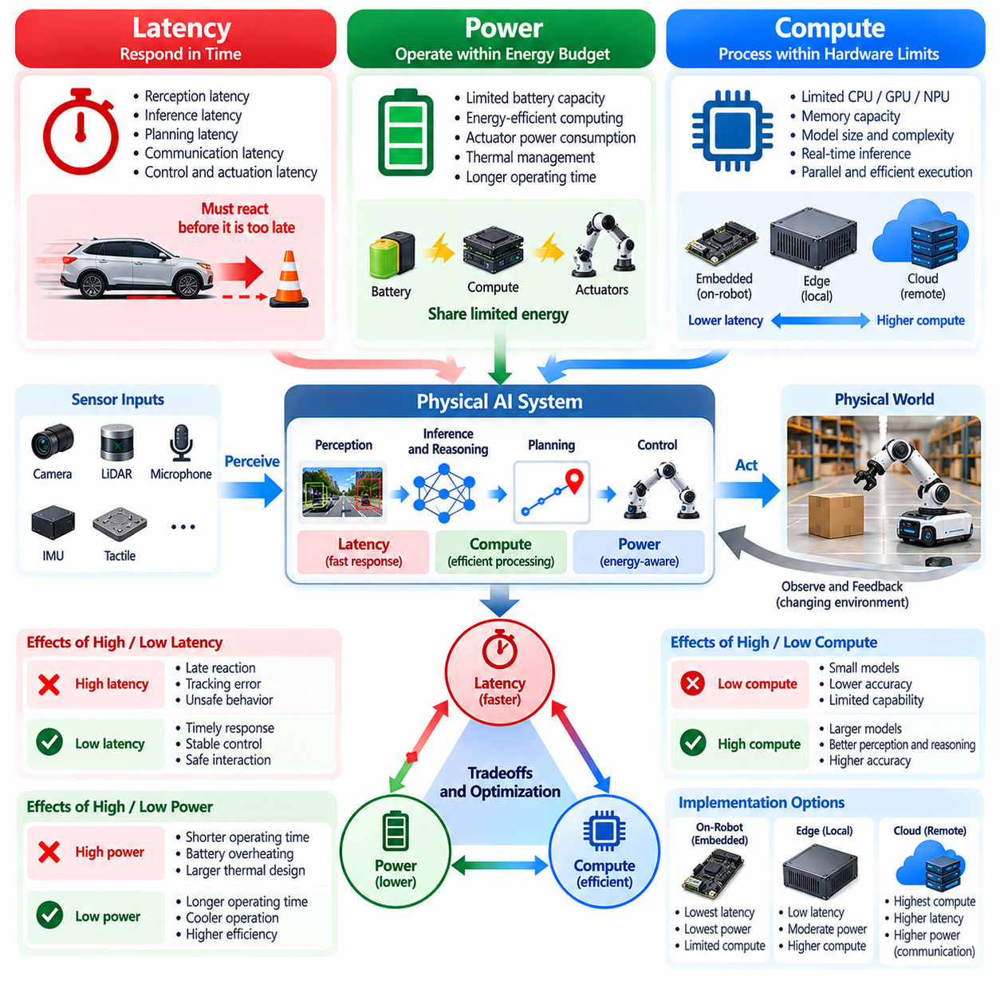{width="7.268055555555556in" height="7.268055555555556in"}

지연 시간(Latency), 전력 소비(Power Consumption), 연산 용량(Computational Capacity)은 피지컬 인공지능(Physical Artificial Intelligence, Physical AI)을 기존의 많은 디지털 인공지능(Digital Artificial Intelligence, Digital AI) 응용 분야와 구별하는 근본적인 제약조건(Fundamental Constraint)이다. 디지털 모델(Digital Model)은 풍부한 자원을 갖춘 원격 서버(Remote Server)에서 작동하면서 예측 정확도(Prediction Accuracy)를 우선시할 수 있다. 반면 피지컬 AI는 지속적으로 변화하는 물리적 환경(Physical Environment)과 상호작용하면서 제한된 시간(Time), 에너지(Energy), 하드웨어 예산(Hardware Budget) 내에서 유용한 의사결정을 생성해야 한다.

지연 시간(Latency)은 사건(Event)을 관측한 시점부터 적절한 응답(Appropriate Response)을 생성하기까지 발생하는 시간적 지연을 의미한다. 로보틱스(Robotics)에서 이러한 지연에는 센서 데이터 획득(Sensor Acquisition), 전처리(Preprocessing), 추론(Inference), 계획(Planning), 통신(Communication), 액추에이터 실행(Actuator Execution)이 포함된다. 각 단계는 전체 반응 시간(Total Reaction Time)에 영향을 미친다. 예측 정확도가 매우 높더라도 환경이 시스템의 대응 속도보다 빠르게 변화하면 예측 결과는 효과를 잃을 수 있다.

전력 소비(Power Consumption)는 자율 기계(Autonomous Machine)가 얼마나 오랫동안 작동할 수 있는지, 그리고 어느 정도의 연산을 지속할 수 있는지를 결정한다. 이동 로봇(Mobile Robot), 드론(Drone), 웨어러블 장치(Wearable Device)는 에너지 용량(Energy Capacity)이 제한된 배터리(Battery)에 의존하는 경우가 많다. 컴퓨팅 하드웨어(Computing Hardware)는 사용 가능한 전력을 확보하기 위해 모터(Motor), 센서(Sensor), 통신 모듈(Communication Module), 보조 장비(Auxiliary Equipment)와 자원을 공유하고 경쟁한다. 따라서 에너지 효율성(Energy Efficiency)은 단순한 최적화 선호사항(Optimization Preference)이 아니라 아키텍처 요구사항(Architectural Requirement)이다.

연산 제약(Computational Constraint)은 처리량(Processing Throughput), 메모리 용량(Memory Capacity), 메모리 대역폭(Memory Bandwidth), 가속기 가용성(Accelerator Availability)의 한계에서 발생한다. 피지컬 AI 시스템은 인식(Perception), 위치 추정(Localization), 지도 작성(Mapping), 예측(Prediction), 계획(Planning), 제어(Control)를 동시에 실행할 수 있다. 이러한 작업 부하(Workload)는 공유 자원(Shared Resource)을 놓고 경쟁하며 서로 간섭할 수 있다. 효과적인 시스템 설계(System Design)를 위해서는 운영 우선순위(Operational Priority)와 시간 요구사항(Timing Requirement)에 따라 연산 용량을 할당해야 한다.

지연 시간과 연산 복잡도(Computational Complexity)는 밀접하게 관련되어 있지만 서로 동일한 개념은 아니다. 더 적은 연산을 요구하는 모델이라도 메모리 전송(Memory Transfer), 비효율적인 커널(Inefficient Kernel), 스케줄링 지연(Scheduling Delay)으로 인해 느리게 응답할 수 있다. 반대로 더 큰 모델이라도 병렬 처리(Parallel Processing)와 전용 하드웨어 가속(Specialized Acceleration)을 통해 허용 가능한 지연 시간을 달성할 수 있다. 따라서 성능 평가(Performance Evaluation)는 이론적인 연산 횟수(Theoretical Operation Count)만이 아니라 전체 실행 파이프라인(Complete Execution Pipeline)을 고려해야 한다.

실시간 제어(Real-Time Control)는 컴퓨팅 자원의 사용 방식을 제한하는 마감시간(Deadline)을 도입한다. 로봇은 모터 명령(Motor Command)을 고정된 주파수(Fixed Frequency)로 갱신하면서 상대적으로 느린 인식 및 계획 프로세스(Perception and Planning Process)를 실행해야 할 수 있다. 제어 마감시간(Control Deadline)을 지키지 못하면 안정성(Stability)이나 추종 성능(Tracking Performance)이 저하될 수 있다. 피지컬 AI 아키텍처는 시간에 민감한 기능(Time-Critical Function)을 실행 시간이 크게 변동하는 작업 부하로부터 분리해야 한다.

전력과 지연 시간은 종종 서로 상충하는 설계 목표(Competing Design Objective)를 형성한다. 프로세서 주파수(Processor Frequency)나 가속기 활용률(Accelerator Utilization)을 높이면 추론 시간(Inference Time)을 줄일 수 있지만 에너지 소비(Energy Consumption)와 발열(Heat Generation)이 증가할 수 있다. 전력 소비를 낮추면 배터리 수명(Battery Life)은 연장되지만 연산 응답성(Computational Responsiveness)이 감소할 수 있다. 최적 구성(Optimal Configuration)은 운영 지속시간(Operating Duration), 작업 복잡도(Task Complexity), 안전 요구사항(Safety Requirement), 사용 가능한 열적 용량(Thermal Capacity)에 따라 달라진다.

열적 제약(Thermal Constraint)은 소형 로봇 플랫폼(Compact Robotic Platform)에서 특히 중요하다. 고성능 프로세서(High-Performance Processor)와 가속기(Accelerator)는 지속적인 추론 작업 부하(Sustained Inference Workload)에서 열을 발생시킨다. 제한된 냉각 용량(Cooling Capacity)은 열 스로틀링(Thermal Throttling)을 유발하여 처리 속도(Processing Speed)를 낮추고 지연 시간을 증가시킬 수 있다. 따라서 짧은 벤치마크 결과(Short Benchmark Result)는 실제 성능(Practical Performance)을 과대평가할 수 있다. 지속 운영(Sustained Operation)은 현실적인 환경 온도(Environmental Temperature)와 기계적 구성(Mechanical Configuration)에서 평가해야 한다.

엣지 컴퓨팅(Edge Computing)은 컴퓨팅 자원을 센서와 액추에이터 가까이에 배치함으로써 원격 인프라(Remote Infrastructure)에 대한 의존성을 줄인다. 로컬 처리(Local Processing)는 통신 지연(Communication Latency)을 감소시키고 네트워크 장애(Network Disruption) 중에도 필수 기능(Essential Function)을 유지할 수 있도록 한다. 그러나 임베디드 엣지 장치(Embedded Edge Device)는 전력 및 냉각 예산(Power and Cooling Budget)이 제한되어 있다. 적절한 모델 선택(Model Selection)을 위해서는 로컬 추론 능력(Local Inference Capability), 에너지 효율성(Energy Efficiency), 신뢰할 수 있는 응답 시간(Dependable Response Timing)의 균형을 유지해야 한다.

온프레미스 인프라(On-Premises Infrastructure)는 시설(Facility) 내부에서 운영되는 여러 로봇에 추가적인 연산 용량(Computational Capacity)을 제공할 수 있다. 공유 서버(Shared Server)는 의미 지도 작성(Semantic Mapping), 로봇 군집 조정(Fleet Coordination), 복잡한 환경 추론(Complex Environmental Reasoning)을 지원할 수 있다. 그러나 통신 과정에서는 지연과 서비스 중단(Service Interruption)이 발생할 수 있다. 즉각적인 안전 대응(Immediate Safety Response)과 필수 저수준 제어(Essential Low-Level Control)는 중앙집중식 컴퓨팅 자원(Centralized Computing Resource)과 독립적으로 작동할 수 있어야 한다.

클라우드 컴퓨팅(Cloud Computing)은 모델 학습(Model Training), 시뮬레이션(Simulation), 대규모 최적화(Large-Scale Optimization), 과거 데이터 분석(Historical Data Analysis)을 위한 확장 가능한 자원(Scalable Resource)을 제공한다. 또한 통신 지연을 허용할 수 있는 비핵심 계획 기능(Noncritical Planning Function)을 지원할 수 있다. 그러나 네트워크 왕복 시간(Network Round-Trip Time)과 서비스 가용성(Service Availability)은 예측하기 어렵게 변동할 수 있다. 피지컬 AI 시스템은 원격 실행(Remote Execution)에 적합한 연산과 로컬에서 시간 제약을 충족하며 처리해야 하는 연산(Local Time-Bounded Processing)을 구별해야 한다.

모델 압축(Model Compression)은 연산 요구량(Computational Demand)을 줄이기 위한 접근 방식 중 하나이다. 양자화(Quantization)는 수치 정밀도(Numerical Precision)를 낮추고, 가지치기(Pruning)는 선택된 매개변수(Parameter)나 구조(Structure)를 제거하며, 지식 증류(Knowledge Distillation)는 모델의 능력을 더 작은 모델(Smaller Model)로 이전한다. 이러한 방법은 메모리 요구량(Memory Requirement)과 추론 비용(Inference Cost)을 줄일 수 있다. 실제 활용 가치(Practical Value)는 의도된 물리적 작업(Physical Task)에 필요한 정확도(Accuracy), 수치적 안정성(Numerical Stability), 강건성(Robustness)을 충분히 유지하는지에 따라 결정된다.

적응형 연산(Adaptive Computation)은 지능형 시스템(Intelligent System)이 환경 복잡도(Environmental Complexity)에 따라 자원을 할당할 수 있도록 한다. 비어 있는 복도(Empty Corridor)를 주행하는 로봇은 혼잡한 작업 공간(Crowded Workspace)에서 운영되는 로봇보다 낮은 수준의 인식 연산(Perception Computation)을 요구할 수 있다. 동적 모델 선택(Dynamic Model Selection), 조정 가능한 센서 해상도(Adjustable Sensor Resolution), 조건부 처리(Conditional Processing)는 불필요한 연산을 줄일 수 있다. 그러나 이러한 적응은 필수 안전 기능(Essential Safety Function)을 손상시키거나 예측하기 어려운 지연을 유발해서는 안 된다.

처리장치(Processing Unit)가 상당한 산술 연산 능력(Arithmetic Capability)을 제공하더라도 메모리 대역폭(Memory Bandwidth)과 데이터 이동(Data Movement)이 중요한 병목현상(Bottleneck)이 될 수 있다. 고해상도 카메라(High-Resolution Camera), 라이다 센서(LiDAR Sensor), 멀티모달 모델(Multimodal Model)은 대량의 중간 데이터(Intermediate Data)를 생성한다. 프로세서와 가속기 사이에서 반복적으로 데이터를 전송하면 지연 시간과 에너지 소비가 증가한다. 효율적인 메모리 배치(Efficient Memory Layout), 데이터 재사용(Data Reuse), 복사 최소화(Minimized Copying)는 전체 시스템 응답성(System Responsiveness)을 향상시킬 수 있다.

센싱 주파수(Sensing Frequency)와 연산 요구량(Computational Demand) 사이의 관계는 신중하게 조정해야 한다. 센서 해상도(Sensor Resolution)나 갱신 주파수(Update Frequency)를 높이면 환경 인식(Environmental Awareness)이 향상될 수 있지만 처리 및 통신 작업 부하(Processing and Communication Workload)도 증가한다. 과도한 데이터 생성(Excessive Data Generation)은 운영상 이점(Operational Benefit)이 비례하여 증가하지 않더라도 추론 파이프라인(Inference Pipeline)에 과부하를 발생시킬 수 있다. 센서 구성(Sensor Configuration)은 각 작업에 실제로 필요한 공간적 정보(Spatial Information)와 시간적 정보(Temporal Information)를 반영해야 한다.

에너지 인식 계획(Energy-Aware Planning)은 연산 효율성(Computational Efficiency)을 물리적 행동(Physical Behavior)까지 확장한다. 로봇은 효율적인 궤적(Efficient Trajectory)을 선택하고, 불필요한 가속(Unnecessary Acceleration)을 피하며, 움직임(Motion)을 센싱 및 연산(Sensing and Computation)과 조정함으로써 전체 에너지 소비(Total Energy Consumption)를 줄일 수 있다. 기하학적으로 가장 짧은 경로(Shortest Geometric Path)가 항상 에너지 효율이 가장 높은 경로(Most Energy-Efficient Route)는 아니다. 피지컬 AI는 기계적 에너지(Mechanical Energy), 연산 에너지(Computational Energy), 작업 지속시간(Task Duration), 환경 제약(Environmental Constraint)을 함께 고려해야 한다.

여러 AI 모델(AI Model)이 동시에 작동하면 자원 스케줄링(Resource Scheduling)은 더욱 복잡해진다. 인식 네트워크(Perception Network), 월드 모델(World Model), 언어 인터페이스(Language Interface), 동작 계획기(Motion Planner)는 GPU나 기타 가속기를 공유할 수 있다. 통제되지 않은 자원 경합(Uncontrolled Resource Contention)은 예측하기 어려운 실행 지연(Execution Delay)을 발생시킬 수 있다. 우선순위 인식 스케줄링(Priority-Aware Scheduling), 작업 부하 격리(Workload Isolation), 자원 예약(Resource Reservation)은 엄격한 시간 요구사항(Strict Timing Requirement)을 가진 기능의 응답성을 유지하는 데 도움이 된다.

신뢰성(Reliability)을 확보하려면 평균 성능(Average Performance)에만 의존하지 않고 최악 조건(Worst-Case Condition)을 평가해야 한다. 시스템은 정상적인 작업 부하(Normal Workload)에서는 효율적으로 작동하더라도 여러 센서가 동시에 높은 처리 요구량을 가진 입력(Demanding Input)을 생성하면 실패할 수 있다. 최대 메모리 소비(Peak Memory Consumption), 지연 시간 변동(Latency Variation), 열 스로틀링(Thermal Throttling), 전력 제한(Power Limitation)을 함께 검토해야 한다. 예측 가능한 성능 저하(Predictable Degradation)는 간헐적으로 달성하는 최대 연산 성능(Maximum Computational Performance)보다 더 높은 가치를 가질 수 있다.

컴퓨팅 자원이 제한되는 상황에서도 안전 메커니즘(Safety Mechanism)은 효과적으로 작동해야 한다. 고급 인식 모델(Advanced Perception Model)이 할당된 처리 예산(Processing Budget)을 초과하면 로봇은 속도를 줄이거나 제한된 운영 모드(Restricted Operating Mode)로 전환해야 할 수 있다. 독립적인 모니터링(Independent Monitoring)은 마감시간 위반(Deadline Violation), 자원 고갈(Resource Exhaustion), 비정상적인 열적 조건(Abnormal Thermal Condition)을 감지할 수 있다. 보호 제어 기능(Protective Control Function)은 자신이 감시하는 과부하 구성요소(Overloaded Component)에 전적으로 의존해서는 안 된다.

하드웨어-소프트웨어 공동 설계(Hardware-Software Co-Design)는 연산 능력(Computational Capability)과 물리적 한계(Physical Limitation)의 균형을 유지하기 위한 체계적인 접근 방식(Systematic Approach)을 제공한다. 모델 아키텍처(Model Architecture), 가속기 선택(Accelerator Selection), 센서 구성(Sensor Configuration), 통신 인터페이스(Communication Interface), 제어 소프트웨어(Control Software)는 상호 연결된 요소(Interconnected Element)로 개발되어야 한다. 단일 구성요소(Single Component)를 최적화하면 병목현상(Bottleneck)이 다른 위치로 이동할 수 있다. 응답성과 효율성(Responsiveness and Efficiency)을 실질적으로 개선하려면 시스템 수준 평가(System-Level Evaluation)가 필요하다.

피지컬 AI 벤치마킹(Physical AI Benchmarking)은 실제 배포 조건(Actual Deployment Condition)을 반영하는 측정값을 요구한다. 관련 지표(Relevant Metric)에는 종단 간 지연 시간(End-to-End Latency), 지속 추론 처리량(Sustained Inference Throughput), 추론당 에너지(Energy per Inference), 최대 전력(Peak Power), 메모리 활용률(Memory Utilization), 마감시간 준수(Deadline Compliance)가 포함된다. 측정에서는 동시 실행 작업 부하(Concurrent Workload)와 액추에이터 동작(Actuator Activity)을 고려해야 한다. 오프라인 정확도(Offline Accuracy)나 가속기 성능(Accelerator Performance)만으로 모델을 비교하면 로봇 적용 적합성(Robotic Suitability)에 대해 잘못된 결론을 도출할 수 있다.

확장성(Scalability)은 개별 로봇이 협력 로봇 군집(Coordinated Fleet)의 일부가 되면서 추가적인 과제를 발생시킨다. 공유 통신 네트워크(Shared Communication Network), 중앙집중식 서비스(Centralized Service), 분산 컴퓨팅 자원(Distributed Computing Resource)은 로봇 군집 규모(Fleet Size)가 증가함에 따라 혼잡(Congestion)을 경험할 수 있다. 자원 할당(Resource Allocation)은 로컬 자율성(Local Autonomy)과 집단적 조정(Collective Coordination)을 모두 수용해야 한다. 확장 가능한 아키텍처(Scalable Architecture)는 시스템 복잡도(System Complexity)의 증가가 개별 기계(Individual Machine)의 응답성을 저해하지 않도록 해야 한다.

궁극적으로 지연 시간(Latency), 전력(Power), 연산 제약(Compute Constraint)은 피지컬 AI 지능(Physical AI Intelligence)의 실질적인 한계(Practical Boundary)를 형성한다. 더 큰 모델(Larger Model)과 더 높은 연산 능력(Greater Computational Capability)이 자동으로 더 나은 물리적 행동(Physical Behavior)을 만들어 내는 것은 아니다. 효과적인 자율성(Effective Autonomy)은 인식(Perception), 추론(Reasoning), 계획(Planning), 제어(Control)가 사용 가능한 자원(Available Resource)과 운영 마감시간(Operational Deadline)에 적절하게 부합할 때 실현된다. 목표는 최대 연산(Maximum Computation)이 아니라 물리적 제약(Physical Constraint) 내에서 충분한 지능(Sufficient Intelligence)을 신뢰성 있게 제공하는 것이다.

## 02.10. Safety Critical Decision Making

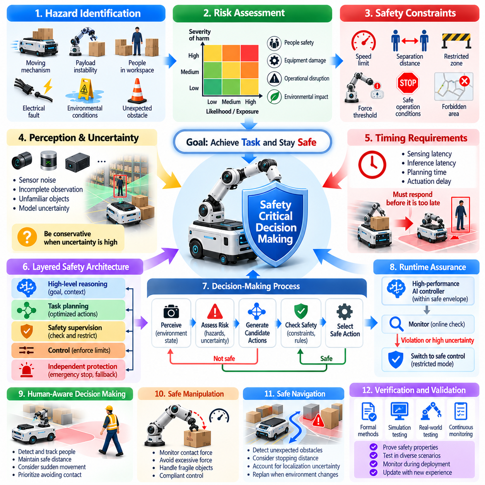{width="7.268055555555556in" height="7.268055555555556in"}

안전 필수 의사결정(Safety-Critical Decision-Making)은 인간의 안전(Human Safety), 장비의 무결성(Equipment Integrity), 환경의 안정성(Environmental Stability)에 영향을 미칠 수 있는 행동을 선택하는 과정을 의미한다. 기존 디지털 인공지능(Digital Artificial Intelligence, Digital AI)에서 잘못된 의사결정은 부정확한 정보(Inaccurate Information)나 운영 중단(Operational Disruption)을 발생시킬 수 있다. 반면 피지컬 인공지능(Physical Artificial Intelligence, Physical AI)에서는 의사결정이 움직이는 기계(Moving Machine)와 물리적 과정(Physical Process)에 직접적인 영향을 미칠 수 있으므로 안전성(Safety)이 지능적 행동(Intelligent Behavior)의 필수 요구사항이 된다.

안전 필수 의사결정은 특정 행동이 의도한 목표(Intended Objective)를 달성하는지뿐만 아니라 허용할 수 없는 위험(Unacceptable Risk)을 발생시키는지도 고려해야 한다. 로봇은 사람에게 위험할 정도로 가까이 지나가는 효율적인 경로(Efficient Route)를 식별할 수 있다. 이러한 경로가 내비게이션 목표(Navigation Objective)를 충족하더라도 안전 요구사항(Safety Requirement)을 위반할 수 있다. 따라서 피지컬 AI는 작업 성능(Task Performance)과 안전 제약(Safety Constraint)을 서로 구별되면서도 상호 연결된 고려사항으로 평가해야 한다.

위험요인 식별(Hazard Identification)은 안전 인식 의사결정(Safety-Aware Decision-Making)의 기초를 제공한다. 위험요인(Hazard)은 움직이는 기계 장치(Moving Mechanism), 불안정한 적재물(Unstable Payload), 예상하지 못한 장애물(Unexpected Obstacle), 전기적 결함(Electrical Fault), 환경 조건(Environmental Condition)에서 발생할 수 있다. 이러한 위험요인을 식별하려면 로봇의 수행 능력(Robot Capability)과 운영 맥락(Operational Context)을 이해해야 한다. 의사결정 시스템(Decision-Making System)은 일반적으로 정상적인 행동이라도 유해한 결과(Harmful Consequence)를 발생시킬 수 있는 상황을 인식해야 한다.

위험 평가(Risk Assessment)는 잠재적 피해의 심각도(Severity of Harm)와 위험 상황(Hazardous Situation)에 관련된 발생 가능성(Likelihood) 또는 노출 조건(Exposure Condition)을 검토한다. 저속으로 이동하는 경량 로봇(Lightweight Robot)의 충돌은 중량 산업용 플랫폼(Heavy Industrial Platform)의 충돌과 다른 위험을 나타낼 수 있다. 따라서 동일한 행동이라도 운영 속도(Operating Speed), 적재하중(Payload), 사람과의 근접성(Proximity to People), 환경 특성(Environmental Characteristic)에 따라 서로 다른 안전 보호조치(Safeguard)가 필요할 수 있다.

안전 제약(Safety Constraint)은 자율적 의사결정(Autonomous Decision)이 유지되어야 하는 경계(Boundary)를 정의한다. 이러한 경계에는 속도 제한(Speed Limit), 이격 거리(Separation Distance), 제한 구역(Restricted Zone), 힘 임계값(Force Threshold), 허용된 운영 조건(Permitted Operating Condition)이 포함될 수 있다. 이러한 제약은 계획 및 제어 알고리즘(Planning and Control Algorithm)에 통합될 수 있다. 그러나 제약의 강제 적용(Constraint Enforcement)이 단일 학습 모델(Single Learned Model)의 신뢰성에만 의존해서는 안 된다.

불확실성(Uncertainty)은 의사결정이 물리적 결과(Physical Consequence)를 수반할 때 특히 중요하다. 센서 잡음(Sensor Noise), 불완전한 관측(Incomplete Observation), 익숙하지 않은 객체(Unfamiliar Object), 불완전한 모델(Imperfect Model)은 환경 이해(Environmental Understanding)에 대한 신뢰도(Confidence)를 낮출 수 있다. 안전 인식 로봇(Safety-Aware Robot)은 불확실성이 증가하면 보수적으로 대응해야 한다. 로봇은 속도를 줄이거나, 장애물 안전 여유거리(Obstacle Margin)를 확대하거나, 추가 관측(Additional Observation)을 요청하거나, 조건이 충분히 명확해질 때까지 행동을 중단할 수 있다.

안전 필수 의사결정은 시간 요구사항(Timing Requirement)의 영향을 크게 받는다. 적절한 대응이라도 위험요인(Hazard)이 대응 가능한 시간 범위(Available Reaction Window)를 넘어 발전한 이후에 생성된다면 효과가 없을 수 있다. 비상 제동(Emergency Braking), 충돌 회피(Collision Avoidance), 힘 제한(Force Limitation)은 예측 가능한 실행 시간(Predictable Execution Time)을 요구한다. 따라서 의사결정 품질(Decision Quality)은 센싱 지연(Sensing Delay), 연산 지연 시간(Computational Latency), 액추에이터 응답(Actuator Response)과 함께 평가되어야 한다.

작업 계획(Task Planning)과 안전 감독(Safety Supervision)의 구별은 신뢰할 수 있는 피지컬 AI 아키텍처(Dependable Physical AI Architecture)의 핵심이다. 지능형 계획기(Intelligent Planner)는 효율성(Efficiency), 생산성(Productivity), 작업 완료(Task Completion)를 최적화하는 행동을 생성할 수 있다. 별도의 안전 메커니즘(Separate Safety Mechanism)은 제안된 명령(Proposed Command)과 운영 조건(Operating Condition)을 모니터링할 수 있다. 행동이 정의된 제약(Defined Constraint)을 위반하면 감독 메커니즘(Supervisory Mechanism)은 해당 행동의 실행을 제한하거나, 수정하거나, 거부할 수 있다.

계층형 안전 아키텍처(Layered Safety Architecture)는 개별 구성요소(Individual Component)에 대한 의존성을 줄인다. 상위 수준 추론(High-Level Reasoning)은 목표(Goal)와 환경 맥락(Environmental Context)을 평가할 수 있으며, 동작 제어기(Motion Controller)는 동역학적 한계(Dynamic Limit)를 강제할 수 있다. 독립적인 보호 기능(Independent Protective Function)은 핵심 위험요인(Critical Hazard)을 감시하고 사전에 정의된 대응(Predefined Response)을 시작할 수 있다. 이러한 계층은 공통 원인 고장(Common-Cause Failure)을 최소화하고 고급 AI 기능(Advanced AI Function)을 사용할 수 없게 되더라도 필수 보호 기능(Essential Protection)을 유지하도록 설계되어야 한다.

정형 기법(Formal Method)은 안전 속성(Safety Property)의 명세(Specification)와 검증(Verification)을 지원할 수 있다. 수학적 제약(Mathematical Constraint)은 허용 가능한 상태(Allowable State), 상태 전이(Transition), 제어 행동(Control Action)을 기술할 수 있다. 도달 가능성 분석(Reachability Analysis)은 특정 가정(Assumption) 아래에서 위험한 상태(Dangerous State)에 도달할 수 있는지를 검토할 수 있다. 이러한 기법은 구조화된 증거(Structured Evidence)를 제공하지만, 그 결론은 시스템 모델(System Model)과 환경 가정(Environmental Assumption)의 정확성에 따라 달라진다.

런타임 보증(Runtime Assurance)은 지능형 의사결정을 지속적인 안전 모니터링(Continuous Safety Monitoring)과 연결한다. 고성능 AI 제어기(High-Performance AI Controller)는 제안한 행동이 검증된 운영 범위(Verified Operating Envelope) 내에 있는 동안 작동할 수 있다. 모니터링 과정에서 제약 위반(Constraint Violation)이나 과도한 불확실성(Excessive Uncertainty)이 감지되면 제어권(Control Authority)을 더 단순하고 신뢰할 수 있는 메커니즘(Trusted Mechanism)으로 이전할 수 있다. 이러한 접근 방식은 허용할 수 없는 행동(Unacceptable Behavior)에 대한 명시적인 경계를 유지하면서 고급 자율성(Advanced Autonomy)을 가능하게 한다.

안전한 의사결정(Safe Decision-Making)은 로봇과 인간 사이의 상호작용(Human-Robot Interaction)을 고려해야 한다. 특히 공유 작업 공간(Shared Workspace)에서는 인간의 움직임(Human Movement)을 완벽하게 예측하기 어렵다. 로봇은 이격 거리(Separation Distance), 상대 속도(Relative Velocity), 가시성(Visibility), 갑작스러운 행동 변화(Sudden Behavioral Change)의 가능성을 고려해야 한다. 인간 인식 계획(Human-Aware Planning)은 예측된 인간 궤적(Predicted Human Trajectory)이 항상 정확할 것이라고 가정하는 대신 유해한 접촉(Harmful Contact)을 방지하는 것을 우선해야 한다.

조작 작업(Manipulation Task)은 로봇이 객체 및 주변 환경과 물리적으로 접촉하기 때문에 추가적인 안전 고려사항(Safety Consideration)을 도입한다. 과도한 파지력(Excessive Gripping Force)은 깨지기 쉬운 재료(Fragile Material)를 손상시킬 수 있으며, 불충분한 힘(Insufficient Force)은 객체 낙하(Dropped Object)를 유발할 수 있다. 사람과의 접촉(Contact with People)은 힘과 움직임(Force and Motion)에 대한 특히 신중한 제어를 요구한다. 안전 인식 조작(Safety-Aware Manipulation)은 객체 이해(Object Understanding), 힘 모니터링(Force Monitoring), 순응 제어(Compliant Control), 작업별 제약(Task-Specific Constraint)을 결합한다.

이동 로봇(Mobile Robot)은 변화하는 공간 조건(Changing Spatial Condition)과 관련하여 안전성을 평가해야 한다. 장애물(Obstacle)이 예상하지 못하게 나타나거나, 통로(Pathway)가 막히거나, 위치 추정 불확실성(Localization Uncertainty)이 증가할 수 있다. 안전한 내비게이션 정책(Safe Navigation Policy)은 정지 거리(Stopping Distance), 사용 가능한 여유 공간(Available Clearance), 실행 가능한 회피 기동(Feasible Escape Maneuver)을 고려해야 한다. 계속 이동하는 것이 설정된 안전 여유거리(Safety Margin)를 위반하는 경우 경로 효율성(Route Efficiency)은 부차적인 목표가 된다.

안전 필수 의사결정은 고장이 발생한 이후에만 대응하는 것이 아니라 고장을 사전에 예측(Anticipating Failure)하는 능력도 요구한다. 예측 모델(Predictive Model)은 미래 충돌(Future Collision), 안정성 상실(Loss of Stability), 과도한 액추에이터 부하(Excessive Actuator Loading)를 추정할 수 있다. 이러한 예측은 위험한 조건(Hazardous Condition)을 피할 수 없게 되기 전에 예방적 행동(Preventive Action)을 수행하도록 한다. 그러나 예측 오류(Prediction Error)를 고려해야 하며, 보호 의사결정(Protective Decision)은 발생 가능한 편차(Plausible Deviation)에도 강건해야 한다.

고장 안전 동작(Fail-Safe Behavior)은 시스템이 허용 가능한 운영 조건(Acceptable Operating Condition)을 유지할 수 없을 때 대응 방식을 제공한다. 응용 분야(Application)에 따라 로봇은 정지하거나, 에너지를 줄이거나, 브레이크(Brake)를 작동시키거나, 제한된 운영 모드(Restricted Operating Mode)로 진입할 수 있다. 특히 하중(Load)을 지지하거나 균형(Balance)을 유지하는 상황에서는 즉각적인 시스템 종료(Immediate Shutdown)가 항상 안전한 것은 아니다. 적절한 대체 동작(Fallback Behavior)은 시스템별 위험요인 분석(System-Specific Hazard Analysis)을 통해 수립되어야 한다.

인간 감독(Human Oversight)은 모호한 조건(Ambiguous Condition)이나 시스템에 허가된 수행 능력(Authorized Capability)을 넘어서는 결과를 수반하는 의사결정에서 여전히 필요하다. 로봇은 제한 구역(Restricted Area)에 진입하거나 익숙하지 않은 위험 객체(Unfamiliar Hazardous Object)를 조작하기 전에 확인(Confirmation)을 요청할 수 있다. 효과적인 감독(Effective Oversight)은 시스템 상태(System Status)와 제안된 행동(Proposed Action)에 대한 명확한 설명을 요구한다. 인간 개입(Human Intervention)은 현실적인 운영자 응답 시간(Operator Response Time)도 고려해야 한다.

안전 인식 AI 모델(Safety-Aware AI Model)을 학습하려면 성공적인 작업 실행(Successful Task Execution)에 대한 시연(Demonstration)만으로는 충분하지 않다. 데이터셋(Dataset)은 가능하고 적절한 범위에서 외란(Disturbance), 사고 직전 상황(Near Miss), 불확실한 관측(Uncertain Observation), 운영 경계(Operational Boundary)를 포함해야 한다. 시뮬레이션(Simulation)은 물리적 위험(Physical Danger)을 반복적으로 발생시키지 않고도 모델을 위험한 시나리오(Hazardous Scenario)에 노출시킬 수 있다. 그러나 학습 데이터의 포괄 범위(Training Coverage)만으로 불안전한 행동(Unsafe Action)이 불가능하다는 사실을 입증할 수는 없다.

평가(Evaluation)는 작업 성공(Task Success)과 안전 성능(Safety Performance)을 구별해야 한다. 로봇은 위험한 조건(Hazardous Condition)에 반복적으로 접근하면서도 주어진 작업을 완료할 수 있다. 관련 안전 지표(Safety Metric)에는 제약 위반(Constraint Violation), 최소 이격 거리(Minimum Separation), 과도한 접촉력(Excessive Contact Force), 비상 개입(Emergency Intervention), 고장 복구 행동(Failure Recovery Behavior)이 포함된다. 테스트(Testing)는 평균적인 운영 성능(Average Operational Performance)에만 의존하지 않고 드물지만 발생 가능성이 있는 시나리오(Rare but Credible Scenario)를 검토해야 한다.

안전 공학 프레임워크(Safety Engineering Framework)는 요구사항(Requirement)을 정의하고, 위험요인(Hazard)을 식별하며, 보호 기능(Protective Function)을 검증하기 위한 체계적인 절차(Systematic Process)를 제공한다. IEC 61508과 관련 로보틱스 분야별 표준(Robotics-Specific Standard)은 특정 응용 분야에 지침을 제공할 수 있다. 이러한 표준의 적용 가능성(Applicability)은 시스템과 운영 영역(Operating Domain)에 따라 달라진다. 표준 준수(Compliance)는 엔지니어링 증거(Engineering Evidence)를 필요로 하며, 모델 정확도(Model Accuracy)나 성공적인 시연(Successful Demonstration)만으로 입증할 수 없다.

운영 안전성(Operational Safety)은 환경(Environment), 하드웨어 상태(Hardware Condition), 소프트웨어 구성(Software Configuration)이 변화하기 때문에 배포(Deployment) 이후에도 지속적으로 유지되어야 한다. 모니터링(Monitoring)은 예상하지 못한 행동(Unexpected Behavior), 성능이 저하된 센서(Degraded Sensor), 새롭게 나타나는 위험요인(Emerging Hazard)을 식별할 수 있다. 소프트웨어 업데이트(Software Update)나 모델 교체(Model Replacement)는 제한 없는 운영(Unrestricted Operation)을 시작하기 전에 적절한 회귀 테스트(Regression Testing)를 거쳐야 한다. 따라서 안전성 보증(Safety Assurance)은 일회성 인증(One-Time Certification)이 아니라 지속적인 생애주기 활동(Continuing Lifecycle Activity)이다.

근본적인 과제(Fundamental Challenge)는 자율성(Autonomy)과 허용 가능한 위험(Acceptable Risk) 사이의 균형을 유지하는 것이다. 지나치게 제한적인 행동(Excessively Restrictive Behavior)은 유용한 작업 수행(Useful Task Execution)을 방해할 수 있으며, 공격적인 최적화(Aggressive Optimization)는 사람과 장비를 불필요한 위험(Unnecessary Danger)에 노출시킬 수 있다. 효과적인 의사결정(Effective Decision-Making)은 정당화된 안전 경계(Justified Safety Boundary) 내에서 목표를 달성하는 행동을 추구한다. 이러한 경계는 예견 가능한 위험요인(Foreseeable Hazard), 운영 요구사항(Operational Requirement), 고장의 결과(Consequence of Failure)를 반영해야 한다.

궁극적으로 안전 필수 의사결정(Safety-Critical Decision-Making)은 효과적인 행동(Effective Action)을 선택하는 데 초점을 맞춘 지능(Intelligence)을 효과적이면서도 허용 가능한 수준으로 안전한 행동(Acceptably Safe Action)을 선택하는 체계로 발전시킨다. 피지컬 AI는 불확실성 관리(Uncertainty Management), 예측 추론(Predictive Reasoning), 제약 기반 제어(Constrained Control), 독립적인 보호 기능(Independent Protection), 체계적인 타당성 확인(Systematic Validation)을 통합해야 한다. 신뢰할 수 있는 자율성(Reliable Autonomy)은 안전성이 인식(Perception), 계획(Planning), 실행(Execution), 운영 감독(Operational Supervision)의 전 과정에 내재화될 때 실현된다.

## 02.11. Embodiment as the Key Difference

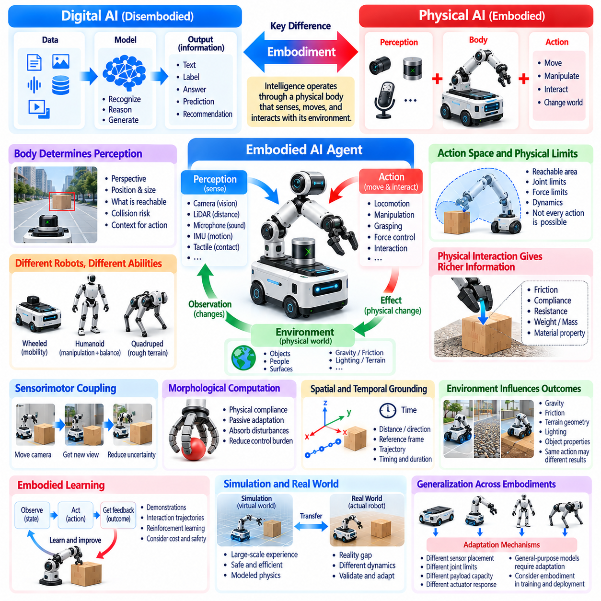{width="7.268055555555556in" height="7.268055555555556in"}

체화(Embodiment)는 지능(Intelligence)이 환경을 감지하고, 움직이며, 상호작용하는 물리적 신체(Physical Body)를 통해 작동하는 상태를 의미한다. 이는 많은 디지털 인공지능(Digital Artificial Intelligence, Digital AI) 시스템과 피지컬 인공지능(Physical Artificial Intelligence, Physical AI)을 구별하는 근본적인 차이점(Fundamental Distinction)이다. 디지털 모델(Digital Model)이 주로 정보를 처리하는 반면, 체화된 시스템(Embodied System)은 인식(Perception)과 추론(Reasoning)을 물리적 능력(Physical Capability), 환경 제약(Environmental Constraint), 현실 세계 행동의 결과(Real-World Action Consequence)와 연결해야 한다.

물리적 신체(Physical Body)는 지능형 에이전트(Intelligent Agent)가 주변 환경을 어떻게 인식하고 영향을 미칠 수 있는지를 결정한다. 센서(Sensor)는 환경 조건(Environmental Condition)에 관한 정보를 제공하며, 액추에이터(Actuator)는 이동(Movement)과 조작(Manipulation)을 가능하게 한다. 이러한 구성요소의 배치(Component Arrangement)는 에이전트의 운영 능력(Operational Capability)을 결정한다. 따라서 지능은 행동을 수행하는 물리적 메커니즘(Physical Mechanism)과 완전히 독립된 것으로 간주할 수 없다.

체화(Embodiment)는 인식(Perception)의 의미에도 영향을 미친다. 카메라 영상(Camera Image)은 디지털 인식 모델(Digital Recognition Model)에서 시각 정보(Visual Information)를 나타낼 수 있지만, 체화된 로봇(Embodied Robot)은 자신의 위치(Position), 크기(Dimension), 이동 능력(Movement Capability)을 기준으로 해당 정보를 해석해야 한다. 장애물(Obstacle)은 단순히 식별된 객체(Identified Object)가 아니라 이동을 제한하거나 충돌 위험(Collision Risk)을 발생시키거나 대체 행동(Alternative Action)을 요구할 수 있는 물리적 조건(Physical Condition)이다.

신체 구조(Body Structure)와 지능의 관계는 서로 다른 로봇 플랫폼(Robotic Platform)을 비교할 때 명확하게 드러난다. 바퀴형 이동 로봇(Wheeled Mobile Robot), 휴머노이드(Humanoid), 사족보행 로봇(Quadruped)은 동일한 내비게이션 명령(Navigation Instruction)을 받더라도 서로 다른 이동 전략(Movement Strategy)을 필요로 한다. 각 플랫폼의 운동학적 구조(Kinematic Structure), 안정성 특성(Stability Characteristic), 액추에이터 구성(Actuator Configuration)은 물리적으로 실행 가능한 행동(Physically Feasible Action)과 해당 행동을 제어하는 방식을 결정한다.

체화는 지능형 시스템(Intelligent System)이 사용할 수 있는 행동 공간(Action Space)도 형성한다. 관절 가동성(Joint Mobility)이 제한된 매니퓰레이터(Manipulator)는 이론적으로 바람직한 모든 궤적(Trajectory)을 실행할 수 없다. 이동 플랫폼(Mobile Platform) 역시 계획 능력(Planning Capability)과 관계없이 모든 표면을 주행할 수 있는 것은 아니다. 피지컬 AI는 로봇의 기계적 설계(Mechanical Design)에 의해 결정되는 도달 가능한 구성(Reachable Configuration), 힘의 한계(Force Limit), 동역학적 능력(Dynamic Capability) 내에서 의사결정을 생성해야 한다.

물리적 상호작용(Physical Interaction)은 수동적 관측(Passive Observation)만으로 항상 파악할 수 없는 정보를 제공한다. 로봇은 시각적 외형(Visual Appearance)을 통해 객체의 재질(Material)이나 무게(Weight)를 추정할 수 있지만, 직접적인 접촉(Direct Contact)을 통해 마찰(Friction), 순응성(Compliance), 저항(Resistance), 질량 관련 거동(Mass-Related Behavior)을 파악할 수 있다. 이러한 특성은 객체를 조작하는 방식에 영향을 미친다. 체화 지능(Embodied Intelligence)은 세계를 관측하는 것뿐만 아니라 세계에 직접 작용함으로써 학습한다.

감각운동 결합(Sensorimotor Coupling)은 감지(Sensing)와 움직임(Movement) 사이의 지속적인 관계를 설명한다. 행동(Action)은 환경이나 에이전트의 관측 시점(Viewpoint)을 변화시키며, 새로운 관측(New Observation)을 생성하여 이후의 의사결정에 영향을 미친다. 카메라 방향을 전환하거나, 객체에 접근하거나, 그리퍼(Gripper)를 조정하는 행동은 불확실성(Uncertainty)을 감소시킬 수 있다. 이러한 상호작용은 인식과 행동이 공동으로 지능적 행동(Intelligent Behavior)을 지원하는 피드백 과정(Feedback Process)을 형성한다.

신체는 물리적 특성(Physical Characteristic)을 통해 연산 추론(Computational Reasoning)을 단순화하거나 복잡하게 만들 수 있다. 기계적 순응성(Mechanical Compliance)은 복잡한 보정 명령(Complex Corrective Command) 없이도 작은 외란(Disturbance)을 흡수할 수 있다. 반대로 불안정한 구조(Unstable Structure)는 빠른 피드백(Fast Feedback)과 정교한 제어(Sophisticated Control)를 요구할 수 있다. 따라서 체화 지능은 연산만으로 형성되는 것이 아니라 소프트웨어(Software), 기계적 설계(Mechanical Design), 센싱(Sensing), 환경 동역학(Environmental Dynamics)의 상호작용에서 나타난다.

형태적 연산(Morphological Computation)은 물리적 구조(Physical Structure)가 유용한 행동(Useful Behavior)에 직접 기여하는 상황을 설명한다. 유연한 재료(Flexible Material), 수동 관절(Passive Joint), 순응 메커니즘(Compliant Mechanism)은 고유한 물리적 특성(Inherent Physical Property)을 통해 힘을 분산하거나 접촉에 적응할 수 있다. 이러한 메커니즘은 명시적 제어 알고리즘(Explicit Control Algorithm)의 부담을 줄일 수 있다. 그러나 물리적 적응(Physical Adaptation)이 센싱(Sensing), 계획(Planning), 안전 감독(Safety Supervision)의 필요성을 제거하는 것은 아니다.

체화는 인공지능에 공간적 기반화(Spatial Grounding)와 시간적 기반화(Temporal Grounding)를 도입한다. 거리(Distance), 방향(Direction), 접촉(Contact), 움직임(Movement)과 같은 개념은 측정 가능한 물리적 관계(Measurable Physical Relationship)에 대응해야 한다. 더 가까이 이동하라는 명령(Command to Move Closer)은 기준 좌표계(Reference Frame), 실현 가능한 궤적(Achievable Trajectory), 장애물에 대한 이해(Obstacle Understanding)를 요구한다. 따라서 명령의 의미(Meaning of Instruction)는 실제 조건(Actual Condition)에서 해당 명령을 실행할 수 있는 신체의 능력(Body Capability)과 연결된다.

환경(Environment) 역시 행동의 결과(Action Consequence)를 형성함으로써 체화 지능에 관여한다. 중력(Gravity), 마찰(Friction), 지형 형상(Terrain Geometry), 조명(Lighting), 객체 특성(Object Property)은 인식과 움직임에 영향을 미친다. 매끄러운 실험실 바닥(Smooth Laboratory Floor)에서 성공한 행동도 고르지 않은 표면(Uneven Surface)에서는 실패할 수 있다. 피지컬 AI는 동일한 연산적 의사결정(Computational Decision)이 모든 장소에서 동일한 결과를 생성한다고 가정하는 대신 이러한 상호작용을 고려해야 한다.

체화 학습(Embodied Learning)은 관측(Observation), 행동(Action), 결과(Outcome)를 연결하는 경험(Experience)에 의존한다. 로봇 시연(Robotic Demonstration)과 상호작용 궤적(Interaction Trajectory)은 행동이 물리적 상태(Physical State)를 어떻게 변화시키는지에 관한 정보를 제공한다. 강화학습(Reinforcement Learning)은 행동을 작업 결과(Task Outcome) 및 환경 피드백(Environmental Feedback)과 추가로 연결할 수 있다. 이러한 학습 방법은 탐색 비용(Exploration Cost), 장비 한계(Equipment Limitation), 물리적 실험의 안전성(Safety of Physical Experimentation)을 신중하게 고려해야 한다.

시뮬레이션(Simulation)은 실제 배포(Deployment) 이전에 체화 지능을 개발하기 위한 실용적인 환경(Practical Environment)을 제공한다. 가상 로봇(Virtual Robot)은 모델링된 객체(Modelled Object), 표면(Surface), 힘(Force)과 상호작용하면서 대량의 학습 경험(Training Experience)을 생성할 수 있다. 그러나 접촉 동역학(Contact Dynamics), 센서 특성(Sensor Characteristic), 기계적 거동(Mechanical Behavior)의 차이는 시뮬레이션과 현실 사이의 격차(Simulation-to-Reality Gap)를 발생시킨다. 성공적인 전이(Successful Transfer)를 위해서는 실제 체화 시스템(Actual Embodied System)을 대상으로 한 타당성 확인(Validation)이 필요하다.

동일한 AI 모델(AI Model)이라도 서로 다른 물리적 구성(Physical Configuration)을 가진 로봇에 배포되면 다르게 작동할 수 있다. 센서 배치(Sensor Placement), 관절 한계(Joint Limit), 적재하중 용량(Payload Capacity), 액추에이터 응답(Actuator Response)의 차이는 생성된 행동(Generated Action)의 해석과 실행에 영향을 미친다. 따라서 범용 피지컬 AI(General-Purpose Physical AI)는 동일한 기계적 거동(Identical Mechanical Behavior)을 가정하지 않으면서 학습된 능력(Learned Capability)을 서로 다른 체화 형태(Different Embodiment)에 적응시키는 메커니즘을 필요로 한다.

체화는 로봇이 자신의 내부 상태(Internal State)를 표현하는 방식에도 영향을 미친다. 관절 위치(Joint Position), 속도(Velocity), 액추에이터 온도(Actuator Temperature), 배터리 잔량(Battery Level), 접촉력(Contact Force)은 물리적 수행 능력(Physical Capability)과 운영 상태(Operating Condition)에 관한 정보를 제공한다. 지능형 시스템은 외부 관측(External Observation)과 함께 이러한 내부 변수(Internal Variable)를 고려해야 한다. 효과적인 의사결정(Effective Decision)은 환경이 요구하는 사항과 신체가 안전하게 수행할 수 있는 행동을 모두 이해하는 데 달려 있다.

인간의 체화(Human Embodiment)는 지능과 물리적 경험(Physical Experience)의 관계를 이해하는 데 유용한 통찰(Insight)을 제공한다. 인간의 객체 및 공간 이해(Object and Spatial Understanding)는 부분적으로 움직임(Movement), 촉각(Touch), 상호작용(Interaction)을 통해 발달한다. 로봇 시스템도 이와 유사하게 감각운동 경험(Sensorimotor Experience)을 통해 작업 관련 지식(Task-Relevant Knowledge)을 획득할 수 있다. 그러나 인공적 체화(Artificial Embodiment)는 센싱(Sensing), 형태(Morphology), 학습 메커니즘(Learning Mechanism), 물리적 한계(Physical Limitation)에서 생물학적 체화(Biological Embodiment)와 상당한 차이가 있다.

체화는 행동이 에너지(Energy)와 힘(Force)을 환경에 전달하기 때문에 안전성(Safety)에도 영향을 미친다. 로봇의 질량(Mass), 속도(Speed), 도달 범위(Reach), 기계적 강성(Mechanical Stiffness)은 의도하지 않은 접촉(Unintended Contact)의 결과에 영향을 미친다. 동일한 제어 오류(Control Error)라도 플랫폼에 따라 서로 다른 위험요인(Hazard)을 발생시킬 수 있다. 따라서 안전 요구사항(Safety Requirement)은 AI 모델의 품질(Model Quality)에만 의존하지 않고 물리적 구성(Physical Configuration)과 운영 맥락(Operating Context)을 반영해야 한다.

체화 자율성(Embodied Autonomy)은 여러 지능 수준(Intelligence Level) 사이의 조정을 요구한다. 상위 수준 추론(High-Level Reasoning)은 목표(Goal)를 설정하고, 작업 계획(Task Planning)은 실행 가능한 순서(Feasible Sequence)를 결정하며, 저수준 제어(Low-Level Control)는 실행 가능한 명령(Executable Command)을 생성한다. 센서 피드백(Sensor Feedback)은 이러한 과정에 지속적으로 정보를 제공한다. 물리적 신체는 이러한 연산 수준(Computational Level)을 현실 세계의 결과(Real-World Outcome)와 연결하므로 신뢰할 수 있는 자율 운영(Dependable Autonomous Operation)을 위해 통합(Integration)이 필수적이다.

언어 기반 지능(Language-Based Intelligence)은 명령(Instruction)을 해석하고 작업 지식(Task Knowledge)을 표현함으로써 체화 시스템(Embodied System)에 기여할 수 있다. 그러나 언어적 이해(Linguistic Understanding)가 자동으로 운동 수행 능력(Motor Competence)이나 물리적 인식(Physical Awareness)을 제공하는 것은 아니다. 로봇은 추상적 명령(Abstract Command)을 물리적 환경에 기반한 목표(Grounded Objective), 실행 가능한 움직임(Feasible Motion), 적절한 접촉 행동(Appropriate Contact Behavior)으로 변환해야 한다. 이러한 변환은 파운데이션 모델(Foundation Model)과 로봇 실행(Robotic Execution)을 통합하는 핵심 과정이다.

체화를 특정한 휴머노이드 형태(Humanoid Form)를 요구하는 개념으로 이해해서는 안 된다. 바퀴형 차량(Wheeled Vehicle), 로봇 팔(Robotic Arm), 사족보행 로봇(Quadruped), 비행 로봇(Aerial Robot), 산업용 기계(Industrial Machine)는 모두 체화 지능(Embodied Intelligence)을 구현할 수 있다. 이들의 신체는 서로 다르지만 각각 인식(Perception), 행동(Action), 환경 상호작용(Environmental Interaction) 사이에 고유한 관계를 형성한다. 피지컬 AI는 하나의 기계적 형태(Mechanical Form)를 우선시하기보다 이러한 다양성을 포괄한다.

따라서 체화 시스템(Embodied System)의 설계에는 인공지능(Artificial Intelligence), 로보틱스(Robotics), 기계공학(Mechanical Engineering), 제어 이론(Control Theory) 사이의 협력이 필요하다. 센서가 관련 조건(Relevant Condition)을 관측할 수 없거나 액추에이터가 필요한 움직임(Required Movement)을 실행할 수 없다면 알고리즘 개선(Algorithm Improvement)의 효과는 제한될 수 있다. 마찬가지로 개선된 하드웨어(Improved Hardware)도 적절한 지능(Suitable Intelligence)이 없다면 충분히 활용되지 못할 수 있다. 효과적인 성능(Effective Performance)은 조정된 시스템 수준 설계(Coordinated System-Level Design)에 달려 있다.

체화 지능(Embodied Intelligence)을 평가하려면 추상적인 예측 품질(Abstract Prediction Quality)뿐만 아니라 실제 상호작용 결과(Actual Interaction Outcome)를 검토해야 한다. 관련 측정 지표(Relevant Measure)에는 작업 완료(Task Completion), 이동 정확도(Movement Accuracy), 접촉 안정성(Contact Stability), 적응성(Adaptability), 에너지 소비(Energy Consumption), 외란 복구(Recovery from Disturbance)가 포함된다. 이러한 결과는 인식과 추론이 유능한 물리적 행동(Competent Physical Behavior)으로 전환되는지를 보여준다. 평가에서는 신체와 환경의 특성(Body and Environmental Characteristic)을 고려해야 한다.

궁극적으로 체화(Embodiment)는 지능을 정보 처리(Information Processing)에서 상황에 기반한 물리적 행위 능력(Situated Physical Agency)으로 전환한다는 점에서 핵심적인 차이점(Defining Difference)이다. 신체는 무엇을 감지할 수 있는지, 어떤 행동이 가능한지, 환경이 어떻게 반응하는지를 결정한다. 피지컬 AI는 연산(Computation), 인식(Perception), 행동(Action), 물리적 구조(Physical Structure)가 통합된 시스템(Integrated System)으로 작동하여 현실 세계(Real World)에서 학습하고 행동할 수 있을 때 실질적인 의미를 갖는다.

## 02.12. From Digital Foundation Models to Physical AI

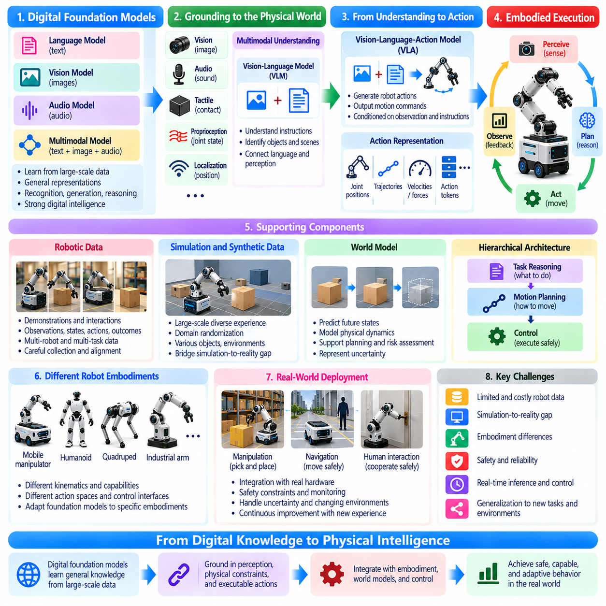{width="7.268055555555556in" height="7.268055555555556in"}

디지털 파운데이션 모델(Digital Foundation Model)은 대규모 데이터셋(Large-Scale Dataset)으로부터 범용 표현(General Representation)을 학습함으로써 인공지능(Artificial Intelligence)을 혁신적으로 발전시켰다. 언어 모델(Language Model), 비전 모델(Vision Model), 멀티모달 아키텍처(Multimodal Architecture)는 복잡한 정보를 해석하고 다양한 추론 작업(Reasoning Task)을 수행할 수 있다. 그러나 이러한 능력을 피지컬 인공지능(Physical Artificial Intelligence, Physical AI)으로 확장하려면 단순히 모델을 로봇에 연결하는 것 이상의 접근이 필요하다. 디지털 지식(Digital Knowledge)은 인식(Perception), 물리적 제약(Physical Constraint), 실행 가능한 행동(Executable Action), 환경 피드백(Environmental Feedback)에 기반을 두어야 한다.

디지털 파운데이션 모델은 주로 텍스트(Text), 이미지(Image), 오디오(Audio), 기타 정보 표현(Information Representation) 사이의 통계적 관계(Statistical Relationship)를 학습한다. 이러한 관계는 인식(Recognition), 생성(Generation), 분류(Classification), 추상적 추론(Abstract Reasoning)을 지원한다. 피지컬 AI는 이러한 표현을 측정 가능한 상태(Measurable State) 및 물리적 결과(Physical Consequence)와 연결해야 한다. 행동에 대한 설명을 이해하는 것과 예측하기 어려운 환경에서 해당 행동을 안전하게 실행하는 것은 근본적으로 다른 문제이다.

이러한 전환은 추상적 개념(Abstract Concept)을 센서 관측(Sensor Observation)과 물리적 상태(Physical State)에 기반화(Grounding)하는 과정에서 시작된다. 파운데이션 모델은 \'객체를 집어 올리라(Pick Up the Object)\'라는 문구를 인식할 수 있지만, 로봇은 대상 객체(Target Object)를 식별하고, 위치(Position)를 추정하며, 파지 가능성(Grasp Feasibility)을 판단하고, 주변 장애물(Surrounding Obstacle)을 평가해야 한다. 명령(Command)은 로봇이 사용 가능한 액추에이터(Actuator)를 통해 관측하고, 예측하고, 영향을 미칠 수 있는 운영 조건(Operational Condition)으로 변환될 때 비로소 실질적인 의미를 갖는다.

멀티모달 파운데이션 모델(Multimodal Foundation Model)은 디지털 지능(Digital Intelligence)과 물리적 상호작용(Physical Interaction)을 연결하는 중요한 가교 역할을 한다. 이러한 모델은 시각 정보(Visual Information), 언어 정보(Linguistic Information), 공간 정보(Spatial Information), 잠재적으로 촉각 정보(Tactile Information)를 결합함으로써 로봇 작업(Robotic Task)에 관련된 표현을 개발할 수 있다. 그러나 멀티모달 이해(Multimodal Understanding)가 자동으로 물리적 수행 능력(Physical Competence)을 보장하는 것은 아니다. 이러한 표현은 신뢰할 수 있는 상태 추정(State Estimation), 행동 선택(Action Selection), 변화하는 환경 조건(Changing Environmental Condition)에 대한 적응(Adaptation)을 지원해야 한다.

비전-언어 모델(Vision-Language Model, VLM)은 시각적 관측(Visual Observation)을 의미적 명령(Semantic Instruction)과 연결하여 로봇이 객체(Object), 장면(Scene), 작업 목표(Task Objective)를 해석할 수 있도록 한다. 로봇은 이러한 모델을 사용하여 요청된 도구(Requested Tool)를 식별하거나 객체의 의도된 목적지(Intended Destination)를 이해할 수 있다. 그러나 의미적 인식(Semantic Recognition)만으로는 객체에 도달할 수 있는지, 파지가 안정적인지, 제안된 움직임(Proposed Motion)이 물리적 안전 제약(Physical Safety Constraint)을 충족하는지를 판단할 수 없다.

비전-언어-행동 모델(Vision-Language-Action Model, VLA)은 멀티모달 추론(Multimodal Reasoning)을 로봇 행동(Robotic Action)의 생성으로 확장한다. 이러한 아키텍처는 로봇 시연(Robotic Demonstration)이나 상호작용 데이터(Interaction Data)로부터 관측(Observation), 명령(Instruction), 행동 궤적(Action Trajectory) 사이의 관계를 학습한다. 출력(Output)은 동작 명령(Motion Command), 목표 자세(Target Pose), 구조화된 행동 시퀀스(Structured Action Sequence)를 나타낼 수 있다. 성공적인 배포(Deployment)를 위해서는 이러한 표현을 특정 로봇의 체화 형태(Robot Embodiment)와 제어 인터페이스(Control Interface)에 정렬해야 한다.

행동 표현(Action Representation)은 파운데이션 모델의 능력을 물리적 시스템(Physical System)으로 이전하는 과정에서 핵심적인 과제이다. 디지털 모델은 일반적으로 이산 토큰(Discrete Token)을 처리하지만, 로봇은 연속적인 위치(Position), 속도(Velocity), 힘(Force), 액추에이터 명령(Actuator Command)을 통해 상호작용한다. 행동 토큰화(Action Tokenization), 궤적 예측(Trajectory Prediction), 계층적 제어(Hierarchical Control)는 이러한 영역을 연결하는 가능한 인터페이스를 제공한다. 각각의 접근 방식은 정밀도(Precision), 응답성(Responsiveness), 일반화(Generalization) 사이의 상충관계(Tradeoff)를 수반한다.

체화(Embodiment)는 서로 다른 로봇이 서로 다른 물리적 능력(Physical Capability)을 갖기 때문에 추가적인 요구사항을 발생시킨다. 이동형 매니퓰레이터(Mobile Manipulator), 휴머노이드(Humanoid), 산업용 로봇 팔(Industrial Arm)은 의미적 작업 지식(Semantic Task Knowledge)을 공유할 수 있지만 반드시 동일한 행동을 실행할 수 있는 것은 아니다. 관절 구성(Joint Configuration), 도달 가능한 작업 공간(Reachable Workspace), 적재하중 한계(Payload Limit), 액추에이터 동역학(Actuator Dynamics)은 실행에 영향을 미친다. 따라서 파운데이션 모델은 전이 가능한 작업 이해(Transferable Task Understanding)와 체화 형태별 제어(Embodiment-Specific Control)를 구별해야 한다.

로봇 데이터셋(Robotic Dataset)은 디지털 표현(Digital Representation)을 물리적 행동(Physical Behavior)과 연결하는 데 중요한 역할을 한다. 시연 데이터(Demonstration Data)는 동기화된 관측(Synchronized Observation), 명령(Instruction), 로봇 상태(Robot State), 행동(Action), 작업 결과(Task Outcome)를 제공할 수 있다. 이러한 데이터는 모델이 환경 조건(Environmental Condition)과 성공적인 조작(Manipulation) 또는 내비게이션(Navigation) 사이의 관계를 학습하도록 한다. 그러나 데이터셋 품질(Dataset Quality)은 시간적 정렬(Temporal Alignment), 행동 일관성(Action Consistency), 센서 보정(Sensor Calibration), 관련 운영 조건(Operating Condition)의 포괄 범위(Coverage)에 따라 달라진다.

대규모 로봇 학습(Large-Scale Robotic Learning)은 인터넷 규모 언어 학습(Internet-Scale Language Training)과 다른 과제에 직면한다. 물리적 시연(Physical Demonstration)에는 장비(Equipment), 운영 시간(Operational Time), 유지보수(Maintenance), 적절한 안전 예방조치(Safety Precaution)가 필요하다. 서로 다른 로봇에서 수집한 데이터는 호환되지 않는 좌표계(Coordinate System)와 행동 정의(Action Definition)를 사용할 수도 있다. 효과적인 학습 파이프라인(Training Pipeline)은 체화 형태(Embodiment), 동역학(Dynamics), 작업 맥락(Task Context)에 관한 정보를 보존하면서 표현을 정규화(Normalization)해야 한다.

시뮬레이션(Simulation)과 합성 데이터(Synthetic Data)는 피지컬 AI 모델이 활용할 수 있는 경험(Experience)의 다양성을 확장할 수 있다. 시뮬레이션 환경(Simulated Environment)은 실제 하드웨어(Real Hardware)를 지속적으로 운영하지 않고도 객체(Object), 장애물(Obstacle), 물리적 과정(Physical Process)과 반복적으로 상호작용할 수 있도록 한다. 도메인 무작위화(Domain Randomization)는 외형(Appearance), 마찰(Friction), 기하학적 구조(Geometry), 센서 특성(Sensor Characteristic)의 변화에 모델을 노출시킬 수 있다. 그러나 시뮬레이션과 현실의 차이(Simulation-to-Reality Difference)는 배포 전에 체계적인 평가(Systematic Evaluation)를 요구한다.

월드 모델(World Model)은 파운데이션 모델의 추론(Foundation-Model Reasoning)과 물리적 지능(Physical Intelligence)을 연결하는 또 다른 접근 방식이다. 월드 모델은 환경 동역학(Environmental Dynamics)의 표현을 학습함으로써 후보 행동(Candidate Action)에 따라 상태(State)가 어떻게 변화할 수 있는지 예측한다. 이러한 예측은 계획(Planning), 위험 평가(Risk Assessment), 미래 결과 예측(Anticipation of Future Outcome)을 지원할 수 있다. 월드 모델의 유용성(Usefulness)은 시간적 정확도(Temporal Accuracy), 물리적 일관성(Physical Consistency), 익숙하지 않은 조건(Unfamiliar Condition)에서 불확실성(Uncertainty)을 표현하는 능력에 달려 있다.

계층적 아키텍처(Hierarchical Architecture)는 추상적 작업 추론(Abstract Task Reasoning)과 시간에 민감한 물리적 제어(Time-Sensitive Physical Control)를 분리할 수 있다. 파운데이션 모델은 달성해야 할 목표(Objective)를 결정하고, 동작 계획기(Motion Planner)는 실행 가능한 궤적(Feasible Trajectory)을 생성하며, 제어기(Controller)는 이를 실행할 수 있다. 이러한 분리는 의미적 지능(Semantic Intelligence)이 모터 제어(Motor Control)와 다른 주파수(Frequency)로 작동할 수 있도록 한다. 신뢰할 수 있는 조정(Reliable Coordination)을 위해서는 명확한 인터페이스(Clear Interface), 상태 피드백(State Feedback), 명시적인 실행 제약(Explicit Execution Constraint)이 필요하다.

폐루프 상호작용(Closed-Loop Interaction)은 생성된 계획(Generated Plan)이 물리적 환경(Physical Environment)이 변하지 않는다고 가정할 수 없기 때문에 필수적이다. 객체가 움직이거나, 파지 시도(Grasp Attempt)가 실패하거나, 예상하지 못한 장애물(Unexpected Obstacle)이 나타날 수 있다. 피지컬 AI 시스템은 자신의 행동 결과(Action Consequence)를 관측하고 이후의 의사결정(Subsequent Decision)을 수정해야 한다. 이러한 피드백(Feedback)은 파운데이션 모델의 출력을 정적인 예측(Static Prediction)에서 적응적이고 목표 지향적인 행동(Adaptive, Goal-Directed Behavior)의 구성요소로 전환한다.

실시간 제약(Real-Time Constraint)은 파운데이션 모델이 로봇 운영(Robotic Operation)에 참여하는 방식에 영향을 미친다. 대규모 모델(Large Model)은 상당한 연산량(Computation)을 요구하고 가변적인 추론 지연(Variable Inference Delay)을 발생시킬 수 있다. 이러한 모델의 추론 능력(Reasoning Capability)은 작업 해석(Task Interpretation)과 전략적 계획(Strategic Planning)에 유용하지만, 즉각적인 제어 기능(Immediate Control Function)은 예측 가능한 시간 특성(Predictable Timing)을 요구한다. 효율적인 추론(Efficient Inference), 모델 압축(Model Compression), 엣지 가속(Edge Acceleration), 비동기 실행(Asynchronous Execution)은 지능과 응답성 사이의 균형을 유지하는 데 도움이 될 수 있다.

안전성(Safety)은 디지털 모델의 출력을 물리적 행동(Physical Action)으로 직접 이전할 때 발생하는 근본적인 한계이다. 언어적으로 타당한 명령(Linguistically Plausible Instruction)이라도 실행 불가능하거나 위험한 기동(Infeasible or Hazardous Maneuver)에 해당할 수 있다. 피지컬 AI 아키텍처는 제안된 행동(Proposed Action)을 기하학적 제약(Geometric Constraint), 동역학적 제약(Dynamic Constraint), 운영 제약(Operational Constraint)에 따라 검증해야 한다. 모델 불확실성(Model Uncertainty), 환경 외란(Environmental Disturbance), 실행 실패(Execution Failure)가 허용할 수 없는 결과(Unacceptable Consequence)를 초래할 수 있는 경우에는 독립적인 보호 메커니즘(Independent Protective Mechanism)이 필요하다.

일반화(Generalization)는 로보틱스용 파운데이션 모델(Foundation Model for Robotics)을 개발하는 주요 동기이다. 연구자들은 모든 작업마다 별도의 모델을 학습시키는 대신 객체(Object), 환경(Environment), 행동(Behavior) 전반에 걸쳐 전이할 수 있는 재사용 가능한 표현(Reusable Representation)을 추구한다. 그러나 익숙한 시연(Familiar Demonstration)에서의 성공이 익숙하지 않은 물리적 조건(Unfamiliar Physical Condition)에서의 신뢰성을 입증하는 것은 아니다. 일반화는 외란(Disturbance), 변동(Variation), 이전에 경험하지 못한 상황(Previously Unseen Situation)을 포함하는 실제 상호작용(Actual Interaction)을 통해 평가해야 한다.

적응 메커니즘(Adaptation Mechanism)은 범용 사전학습 지식(General Pretrained Knowledge)을 특정 로봇 응용 분야(Robotic Application)와 연결하는 데 도움이 될 수 있다. 미세조정(Fine-Tuning), 매개변수 효율적 적응(Parameter-Efficient Adaptation), 모방학습(Imitation Learning), 강화학습(Reinforcement Learning)은 특정 작업(Specific Task)의 성능을 향상시킬 수 있다. 이러한 방법은 시연(Demonstration), 시뮬레이션 경험(Simulation Experience), 신중하게 통제된 물리적 상호작용(Controlled Physical Interaction)을 활용할 수 있다. 적응 과정에서는 대상 플랫폼(Target Platform)의 제약을 준수하면서 유용한 범용 능력(General Capability)을 보존해야 한다.

메모리(Memory)와 지속적인 환경 표현(Persistent Environmental Representation)은 장시간 수행되는 로봇 작업(Extended Robotic Task)의 연속성을 향상시킬 수 있다. 로봇은 객체 위치(Object Location), 완료된 행동(Completed Action), 이전 실패(Previous Failure), 변화하는 작업 공간 조건(Changing Workspace Condition)을 기억해야 할 수 있다. 파운데이션 모델의 추론을 공간 메모리(Spatial Memory) 및 상태 추적(State Tracking)과 결합하면 개별 관측(Individual Observation)을 넘어서는 의사결정을 지원할 수 있다. 이러한 표현은 새로운 증거(New Evidence)가 이전 가정(Earlier Assumption)과 모순될 때 갱신되어야 한다.

파운데이션 모델 기반 피지컬 AI(Foundation-Model-Based Physical AI)의 평가는 언어 정확도(Language Accuracy)나 시각 인식(Visual Recognition)을 넘어서는 지표(Metric)를 요구한다. 작업 성공률(Task Success), 궤적 실행 가능성(Trajectory Feasibility), 접촉 안정성(Contact Stability), 복구 행동(Recovery Behavior), 지연 시간(Latency), 에너지 소비(Energy Consumption), 안전 위반(Safety Violation)은 실제 수행 능력(Practical Competence)에 관한 증거를 제공한다. 테스트(Testing)에는 익숙하지 않은 환경(Unfamiliar Environment)과 현실적인 외란(Realistic Disturbance)이 포함되어야 한다. 모델의 겉보기 추론 능력(Apparent Reasoning Ability)은 일관되게 적절한 물리적 결과(Appropriate Physical Outcome)를 생성하지 못한다면 충분하지 않다.

피지컬 AI 파운데이션 모델(Physical AI Foundation Model)의 개발에는 컴퓨팅 인프라(Computational Infrastructure) 전반의 통합도 필요하다. 클라우드 자원(Cloud Resource)은 대규모 학습(Large-Scale Training)과 시뮬레이션(Simulation)을 지원할 수 있으며, 온프레미스 시스템(On-Premises System)은 공유 추론(Shared Reasoning)과 로봇 군집 수준 서비스(Fleet-Level Service)를 조정할 수 있다. 엣지 프로세서(Edge Processor)는 로봇 하드웨어(Robotic Hardware) 가까이에서 로컬 인식(Local Perception)과 추론(Inference)을 제공한다. 역할 분담(Allocation of Responsibilities)은 통신 신뢰성(Communication Reliability), 운영 마감시간(Operational Deadline), 개인정보 보호(Privacy), 안전 요구사항(Safety Requirement)을 반영해야 한다.

따라서 디지털 AI에서 피지컬 AI로의 전환(Transition from Digital AI to Physical AI)은 단순히 모델 크기(Model Size)를 확장하는 것이 아니라 아키텍처적·과학적 전환(Architectural and Scientific Transformation)으로 이해해야 한다. 언어(Language), 비전(Vision), 행동(Action), 동역학(Dynamics), 제어(Control), 안전성(Safety)은 통합 시스템(Unified System)의 조정된 구성요소가 되어야 한다. 디지털 파운데이션 모델은 가치 있는 지식(Knowledge)과 추론 능력(Reasoning Capability)을 제공하지만, 물리적 지능(Physical Intelligence)은 이러한 능력이 현실 세계의 상호작용(Real-World Interaction)에 기반을 두도록 요구한다.

궁극적인 목표(Ultimate Goal)는 명령(Instruction)을 이해하고, 변화하는 환경(Changing Environment)을 인식하며, 물리적 결과(Physical Consequence)를 예측하고, 신뢰할 수 있는 피드백(Dependable Feedback)을 바탕으로 적절한 행동(Appropriate Action)을 실행할 수 있는 시스템을 개발하는 것이다. 파운데이션 모델(Foundation Model)은 점점 더 범용적인 로봇 지능(General Robotic Intelligence)을 위한 공통 기반(Common Foundation)을 제공할 수 있다. 이러한 모델의 실질적인 성공(Practical Success)은 학습된 표현(Learned Representation)을 체화(Embodiment), 실시간 제어(Real-Time Control), 안전성 보증(Safety Assurance), 물리적 세계와의 지속적인 상호작용(Continuous Interaction with the Physical World)과 결합하는 데 달려 있다.
