**Volume 02. Physical AI Foundations and Definitions**


# Chapter 03. History and Origins

##  

## 03.01. Cybernetics and Feedback Control

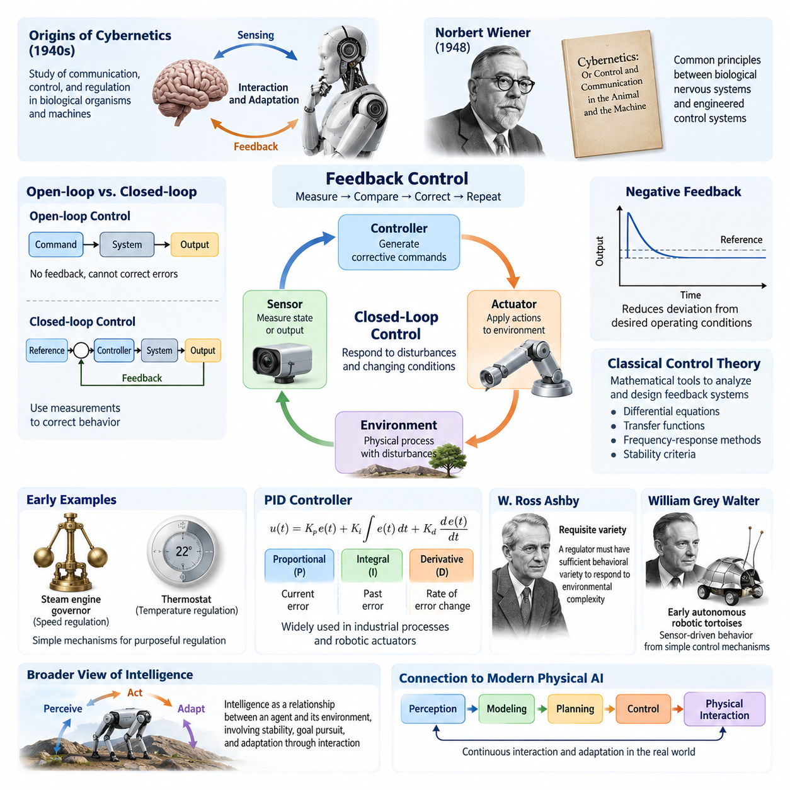{width="7.268055555555556in" height="7.268055555555556in"}

The intellectual foundations of Physical AI can be traced to cybernetics, a field that emerged during the 1940s to investigate communication, control, and regulation in biological organisms and machines. Cybernetics introduced the idea that intelligent behavior could arise from continuous interaction between a system and its environment. Rather than treating machines as isolated mechanisms executing predetermined commands, it emphasized sensing, feedback, correction, and adaptation as fundamental properties of purposeful behavior.

Norbert Wiener played a central role in establishing cybernetics through his 1948 book, Cybernetics: Or Control and Communication in the Animal and the Machine. Wiener recognized that biological nervous systems and engineered control systems shared important organizational principles. Both could receive information about environmental conditions, compare observed behavior with desired outcomes, and adjust their actions accordingly. This perspective provided an early conceptual foundation for autonomous machines and intelligent physical systems.

Feedback control is the central engineering mechanism connecting cybernetics to modern Physical AI. A feedback controller continuously measures the state or output of a physical process, compares the measurement with a desired reference, and generates corrective commands. The resulting actions influence the environment, producing new measurements that initiate another control cycle. This closed-loop structure allows a system to respond to disturbances and changing conditions instead of relying entirely on predetermined action sequences.

The distinction between open-loop and closed-loop control was especially important in the historical development of intelligent machines. Open-loop systems execute commands without using measured outcomes to correct their behavior. Closed-loop systems continuously incorporate observations into subsequent actions. A robot arm operating without feedback may accumulate positioning errors, while a feedback-controlled arm can detect deviations and adjust motor commands. This distinction remains fundamental to reliable physical interaction and autonomous operation.

Negative feedback became a foundational principle because it enables systems to reduce deviations from desired operating conditions. When a measured variable exceeds its reference, the controller produces an action intended to decrease the error. When the variable falls below the reference, the corrective action changes accordingly. Under suitable stability conditions, this process supports accurate regulation, disturbance rejection, and consistent behavior despite uncertainty in the physical environment.

Early feedback mechanisms existed long before cybernetics became a formal discipline. Mechanical governors used in steam engines regulated rotational speed by adjusting energy input according to measured motion. Thermostats similarly maintained temperature by responding to deviations from a target value. These devices demonstrated that purposeful regulation could emerge from relatively simple physical mechanisms, establishing an important technological precedent for increasingly sophisticated autonomous systems.

Classical control theory provided the mathematical tools needed to analyze feedback systems systematically. Differential equations, transfer functions, frequency-response methods, and stability criteria enabled engineers to predict how systems would react to commands and disturbances. Developments associated with James Clerk Maxwell, Harry Nyquist, Hendrik Bode, and other researchers established techniques for understanding dynamic behavior and designing controllers with predictable performance.

The proportional-integral-derivative controller became one of the most influential practical implementations of feedback regulation. Proportional control responds to the current error, integral control accumulates past error, and derivative control responds to the rate of error change. By combining these mechanisms, PID controllers can achieve effective regulation across many industrial processes. Their continued use in robotic actuators illustrates how classical control principles remain essential even when higher-level intelligence is provided by advanced AI models.

Cybernetics also introduced a broader interpretation of intelligence as a relationship between an agent and its environment. Intelligence was not limited to symbolic reasoning or abstract computation but could involve maintaining stability, pursuing goals, and adapting behavior through interaction. This interpretation anticipated later developments in embodied intelligence, autonomous robotics, and situated artificial intelligence, where cognition is understood partly through the consequences of physical action.

The work of W. Ross Ashby further expanded cybernetic thinking by examining adaptation, regulation, and the organization of complex systems. His concept of requisite variety suggested that an effective regulator must possess sufficient behavioral variety to respond to relevant environmental disturbances. For Physical AI, this principle highlights the relationship between environmental complexity and the capabilities required for autonomous adaptation, although practical performance also depends on sensing, modeling, and computational limitations.

Another influential contribution came from William Grey Walter, whose early autonomous robotic tortoises demonstrated simple forms of sensor-driven behavior. These machines used relatively modest electronic circuits to respond to light and environmental conditions. Their behavior suggested that apparently complex interactions could emerge from the coupling of simple control mechanisms with physical surroundings, foreshadowing later approaches to behavior-based robotics and embodied autonomous agents.

The emergence of state-space control during the mid-twentieth century provided a more general framework for describing dynamic systems. Instead of representing a system only through input-output relationships, state-space models describe internal variables that determine future behavior. This formulation enabled the analysis of multivariable systems and supported the development of controllability, observability, optimal control, and estimation methods that became indispensable in advanced robotics.

Rudolf Kalman\'s contributions to modern control theory were particularly important for systems operating with incomplete and noisy measurements. The Kalman filter, introduced in 1960, provided a recursive method for estimating hidden system states from uncertain observations and mathematical models. This approach became fundamental to navigation, tracking, and sensor fusion, establishing a direct connection between classical feedback theory and modern robotic perception and localization.

Optimal control extended feedback design by introducing explicit performance objectives. Instead of merely reducing instantaneous error, a controller could minimize accumulated costs associated with tracking accuracy, energy consumption, control effort, or other operating requirements. Techniques such as linear quadratic regulation demonstrated how mathematical optimization could determine effective control policies, creating conceptual links to planning, decision-making, and reinforcement learning.

Model predictive control introduced another important development by using a mathematical model to forecast future system behavior over a limited planning horizon. At each control cycle, the controller solves an optimization problem, applies an initial action, and updates its plan using new measurements. This repeated prediction-and-correction process resembles the architecture of modern Physical AI systems that combine world modeling, planning, and real-time execution.

The relationship between cybernetics and artificial intelligence developed through both cooperation and intellectual divergence. Classical AI increasingly emphasized symbolic representation, logical reasoning, and abstract problem solving, while cybernetics focused on feedback, dynamics, and interaction. These approaches addressed different aspects of intelligent behavior. Modern Physical AI increasingly reconnects them by combining learned representations and reasoning mechanisms with continuous sensorimotor control.

Feedback control also established the importance of time in intelligent physical systems. Physical processes evolve continuously, and delayed corrective actions may produce instability, oscillation, or degraded performance. Consequently, sensing frequency, computation latency, communication delay, and actuator response must be considered together. Unlike many purely digital inference tasks, Physical AI must generate decisions within temporal constraints imposed by the dynamics of the environment.

The historical progression from mechanical regulation to adaptive control illustrates how feedback systems gradually acquired more sophisticated capabilities. Adaptive controllers can update selected parameters when operating conditions or system characteristics change. Robust controllers address bounded uncertainty and disturbances, while learning-based controllers can improve behavior using accumulated experience. These developments represent successive extensions of the cybernetic principle that action should be informed by observed consequences.

Modern robotics applies feedback at multiple levels of abstraction. Low-level controllers regulate motor current, torque, velocity, and position, while higher-level systems estimate robot state, maintain balance, avoid obstacles, and coordinate complex movements. Autonomous mobile robots continuously correct their trajectories, manipulators regulate contact forces, and legged robots adjust body motion to preserve stability. Each application depends on feedback mechanisms operating within a broader intelligent architecture.

Physical AI extends these principles by integrating learned perception, predictive models, goal-directed reasoning, and adaptive decision-making into the feedback process. Neural networks may estimate environmental states, learned dynamics models may anticipate action consequences, and planning algorithms may select appropriate behaviors. Nevertheless, the system must still observe the physical effects of its decisions and revise subsequent actions, preserving the fundamental closed-loop structure inherited from cybernetics.

A critical distinction is that feedback alone does not constitute comprehensive artificial intelligence. A conventional thermostat exhibits goal-directed regulation but does not necessarily possess semantic understanding, general reasoning, or transferable learning capabilities. Physical AI builds upon feedback control while introducing richer representations, task-level autonomy, and adaptation across changing situations. Cybernetics therefore provides a necessary historical foundation rather than a complete explanation of contemporary intelligent machines.

The cybernetic tradition also helps explain why safety and reliability are inseparable from intelligent physical operation. A controller must remain stable despite disturbances, measurement errors, uncertain dynamics, and actuator limitations. Modern Physical AI introduces additional uncertainties associated with learned models and unfamiliar environments. Feedback monitoring, constrained control, fault detection, and independent safety mechanisms help ensure that intelligent decisions remain compatible with physical operating limits.

Ultimately, cybernetics transformed the understanding of machines from passive mechanisms into systems capable of regulating their behavior through environmental interaction. Its emphasis on communication, feedback, adaptation, and purposeful action established principles that continue to shape robotics and autonomous technology. Contemporary Physical AI represents an expansion of this tradition, combining classical control with machine learning and predictive intelligence to create systems that perceive, reason, act, and continuously adapt in the physical world.

피지컬 인공지능(Physical AI)의 지적 토대는 1940년대에 등장한 사이버네틱스(Cybernetics)에서 찾을 수 있다. 사이버네틱스는 생물학적 유기체(Biological Organism)와 기계(Machine)의 통신(Communication), 제어(Control), 조절(Regulation)을 연구하는 학문이다. 사이버네틱스는 지능적 행동(Intelligent Behavior)이 시스템(System)과 환경(Environment) 사이의 지속적인 상호작용(Interaction)에서 발생할 수 있다는 개념을 제시하였다. 기계를 사전에 정의된 명령을 실행하는 독립적인 장치로 보는 대신, 감지(Sensing), 피드백(Feedback), 보정(Correction), 적응(Adaptation)을 목적 지향적 행동(Goal-Directed Behavior)의 기본 속성으로 강조하였다.

노버트 위너(Norbert Wiener)는 1948년 저서 『사이버네틱스: 동물과 기계의 제어 및 통신(Cybernetics: Or Control and Communication in the Animal and the Machine)』을 통해 사이버네틱스의 확립에 핵심적인 역할을 수행하였다. 위너는 생물학적 신경계(Biological Nervous System)와 공학적 제어 시스템(Engineered Control System)이 중요한 조직 원리를 공유한다는 사실을 인식하였다. 두 시스템 모두 환경 조건에 관한 정보를 수신하고, 관측된 행동을 목표 결과와 비교하며, 그에 따라 동작을 조정할 수 있다. 이러한 관점은 자율 기계(Autonomous Machine)와 지능형 물리 시스템(Intelligent Physical System)의 초기 개념적 토대를 제공하였다.

피드백 제어(Feedback Control)는 사이버네틱스와 현대 피지컬 인공지능(Physical AI)을 연결하는 핵심 공학적 메커니즘(Engineering Mechanism)이다. 피드백 제어기(Feedback Controller)는 물리적 프로세스(Physical Process)의 상태(State) 또는 출력(Output)을 지속적으로 측정하고, 측정값을 목표 기준값(Reference)과 비교하여 보정 명령(Corrective Command)을 생성한다. 이러한 동작은 환경에 영향을 미치며 새로운 측정값을 발생시키고, 다시 다음 제어 주기(Control Cycle)를 시작한다. 이 폐루프 구조(Closed-Loop Structure)를 통해 시스템은 사전에 정의된 동작 순서에만 의존하지 않고 외란(Disturbance)과 변화하는 조건에 대응할 수 있다.

개루프 제어(Open-Loop Control)와 폐루프 제어(Closed-Loop Control)의 구분은 지능형 기계(Intelligent Machine)의 역사적 발전에서 특히 중요하였다. 개루프 시스템(Open-Loop System)은 측정된 결과를 이용하여 행동을 수정하지 않고 명령을 실행한다. 반면 폐루프 시스템(Closed-Loop System)은 관측 결과(Observation)를 후속 동작에 지속적으로 반영한다. 피드백 없이 작동하는 로봇 팔(Robot Arm)은 위치 오차(Positioning Error)가 누적될 수 있지만, 피드백 제어 로봇 팔은 편차(Deviation)를 감지하고 모터 명령(Motor Command)을 조정할 수 있다. 이러한 차이는 신뢰성 있는 물리적 상호작용(Physical Interaction)과 자율 동작(Autonomous Operation)의 기본 원리로 남아 있다.

음의 피드백(Negative Feedback)은 시스템이 목표 운전 조건(Desired Operating Condition)으로부터 발생한 편차를 줄일 수 있도록 하므로 기본적인 제어 원리로 자리 잡았다. 측정 변수가 기준값을 초과하면 제어기는 오차를 감소시키는 방향으로 동작을 생성한다. 반대로 측정 변수가 기준값보다 낮아지면 보정 동작(Corrective Action)도 그에 따라 변경된다. 적절한 안정성 조건(Stability Condition)이 충족되면 이러한 과정은 불확실한 물리 환경에서도 정확한 조절(Accurate Regulation), 외란 억제(Disturbance Rejection), 일관된 동작(Consistent Behavior)을 지원한다.

초기 피드백 메커니즘(Feedback Mechanism)은 사이버네틱스가 정식 학문 분야로 확립되기 훨씬 이전부터 존재하였다. 증기기관(Steam Engine)에 사용된 기계식 조속기(Mechanical Governor)는 측정된 회전 운동에 따라 에너지 입력을 조절하여 회전 속도(Rotational Speed)를 제어하였다. 온도조절기(Thermostat) 역시 목표 온도(Target Temperature)와의 편차에 대응하여 온도를 유지하였다. 이러한 장치들은 비교적 단순한 물리적 메커니즘을 통해 목적 지향적 조절이 가능하다는 사실을 입증하였으며, 더욱 정교한 자율 시스템(Autonomous System)의 중요한 기술적 선례가 되었다.

고전 제어 이론(Classical Control Theory)은 피드백 시스템(Feedback System)을 체계적으로 분석하는 데 필요한 수학적 도구(Mathematical Tool)를 제공하였다. 미분방정식(Differential Equation), 전달함수(Transfer Function), 주파수 응답(Frequency Response), 안정성 판별 기준(Stability Criterion)을 통해 엔지니어는 시스템이 명령과 외란에 어떻게 반응하는지 예측할 수 있게 되었다. 제임스 클러크 맥스웰(James Clerk Maxwell), 해리 나이퀴스트(Harry Nyquist), 헨드릭 보데(Hendrik Bode) 등의 연구는 동적 거동(Dynamic Behavior)을 이해하고 예측 가능한 성능을 갖춘 제어기를 설계하는 기법을 확립하였다.

비례-적분-미분 제어기(Proportional-Integral-Derivative Controller, PID Controller)는 피드백 조절(Feedback Regulation)의 가장 영향력 있는 실용적 구현 방식 중 하나가 되었다. 비례 제어(Proportional Control)는 현재 오차에 대응하고, 적분 제어(Integral Control)는 과거 오차를 누적하며, 미분 제어(Derivative Control)는 오차 변화율에 대응한다. 이러한 메커니즘을 결합하면 PID 제어기는 다양한 산업 공정(Industrial Process)에서 효과적인 조절 성능을 구현할 수 있다. 로봇 구동기(Robotic Actuator)에서 PID 제어기가 지속적으로 사용된다는 사실은 상위 수준의 지능이 첨단 인공지능 모델(Advanced AI Model)에 의해 제공되더라도 고전 제어 원리가 여전히 필수적임을 보여준다.

사이버네틱스는 지능(Intelligence)을 에이전트(Agent)와 환경(Environment) 사이의 관계로 해석하는 더욱 폭넓은 관점도 제시하였다. 지능은 기호적 추론(Symbolic Reasoning)이나 추상적 계산(Abstract Computation)에만 한정되지 않으며, 안정성 유지(Stability Maintenance), 목표 추구(Goal Pursuit), 상호작용을 통한 행동 적응(Behavioral Adaptation)을 포함할 수 있다. 이러한 해석은 이후 체화 지능(Embodied Intelligence), 자율 로보틱스(Autonomous Robotics), 상황 기반 인공지능(Situated Artificial Intelligence)의 발전을 예고하였다. 이들 분야에서는 인지를 물리적 행동의 결과와 연결하여 이해한다.

W. 로스 애슈비(W. Ross Ashby)의 연구는 적응(Adaptation), 조절(Regulation), 복잡계(Complex System)의 조직 원리를 탐구함으로써 사이버네틱스적 사고를 더욱 확장하였다. 그의 필수 다양성의 법칙(Law of Requisite Variety)은 효과적인 조절기가 관련된 환경 외란에 대응할 수 있을 만큼 충분한 행동 다양성(Behavioral Variety)을 갖추어야 한다는 점을 제시하였다. 피지컬 인공지능(Physical AI)에서 이 원리는 환경 복잡성(Environmental Complexity)과 자율 적응(Autonomous Adaptation)에 필요한 능력 사이의 관계를 강조한다. 다만 실제 성능은 감지(Sensing), 모델링(Modeling), 계산 자원(Computational Resource)의 한계에도 영향을 받는다.

윌리엄 그레이 월터(William Grey Walter)의 초기 자율 로봇 거북이(Autonomous Robotic Tortoise) 연구 역시 중요한 기여를 하였다. 이 기계들은 비교적 단순한 전자회로(Electronic Circuit)를 사용하여 빛과 환경 조건에 반응하였다. 이러한 행동은 단순한 제어 메커니즘과 물리적 환경의 결합만으로도 겉보기에 복잡한 상호작용이 나타날 수 있음을 보여주었다. 이는 이후 행동 기반 로보틱스(Behavior-Based Robotics)와 체화 자율 에이전트(Embodied Autonomous Agent) 접근법의 발전을 예고하였다.

20세기 중반에 등장한 상태공간 제어(State-Space Control)는 동적 시스템(Dynamic System)을 설명하기 위한 더욱 일반적인 프레임워크(Framework)를 제공하였다. 시스템을 입력과 출력의 관계만으로 표현하는 대신, 상태공간 모델(State-Space Model)은 미래 동작을 결정하는 내부 상태 변수(Internal State Variable)를 기술한다. 이러한 정식화(Formulation)는 다변수 시스템(Multivariable System)의 분석을 가능하게 하였으며, 제어 가능성(Controllability), 관측 가능성(Observability), 최적 제어(Optimal Control), 상태 추정(State Estimation) 기법의 발전을 지원하였다. 이들 기법은 첨단 로보틱스(Advanced Robotics)에 필수적인 요소가 되었다.

루돌프 칼만(Rudolf Kalman)의 현대 제어 이론(Modern Control Theory)에 대한 기여는 불완전하고 잡음이 포함된 측정값을 이용하여 작동하는 시스템에서 특히 중요하였다. 1960년에 소개된 칼만 필터(Kalman Filter)는 불확실한 관측값(Uncertain Observation)과 수학적 모델(Mathematical Model)을 이용하여 숨겨진 시스템 상태(Hidden System State)를 재귀적으로 추정하는 방법을 제공하였다. 이 접근법은 항법(Navigation), 추적(Tracking), 센서 융합(Sensor Fusion)의 핵심 기술이 되었으며, 고전 피드백 이론과 현대 로봇 인식(Robot Perception) 및 위치 추정(Localization)을 직접 연결하는 기반을 마련하였다.

최적 제어(Optimal Control)는 명시적인 성능 목표(Performance Objective)를 도입함으로써 피드백 설계를 확장하였다. 제어기는 단순히 순간적인 오차를 줄이는 대신 추종 정확도(Tracking Accuracy), 에너지 소비(Energy Consumption), 제어 노력(Control Effort), 기타 운전 요구사항(Operating Requirement)과 관련된 누적 비용(Accumulated Cost)을 최소화할 수 있게 되었다. 선형 이차 조절(Linear Quadratic Regulation, LQR)과 같은 기법은 수학적 최적화(Mathematical Optimization)를 통해 효과적인 제어 정책(Control Policy)을 결정할 수 있음을 보여주었으며, 계획(Planning), 의사결정(Decision-Making), 강화학습(Reinforcement Learning)과의 개념적 연결을 형성하였다.

모델 예측 제어(Model Predictive Control, MPC)는 수학적 모델을 이용하여 제한된 예측 구간(Prediction Horizon)에서 미래 시스템 동작을 예측하는 중요한 발전을 이루었다. 각 제어 주기에서 제어기는 최적화 문제(Optimization Problem)를 해결하고, 초기 제어 동작을 적용한 다음, 새로운 측정값을 이용하여 계획을 갱신한다. 이러한 반복적인 예측 및 보정 과정(Prediction-and-Correction Process)은 세계 모델링(World Modeling), 계획(Planning), 실시간 실행(Real-Time Execution)을 결합하는 현대 피지컬 인공지능 시스템의 구조와 유사하다.

사이버네틱스와 인공지능(Artificial Intelligence)의 관계는 협력과 지적 접근 방식의 분화를 통해 발전하였다. 고전 인공지능(Classical AI)은 점차 기호 표현(Symbolic Representation), 논리적 추론(Logical Reasoning), 추상적 문제 해결(Abstract Problem Solving)을 강조한 반면, 사이버네틱스는 피드백(Feedback), 동역학(Dynamics), 상호작용(Interaction)에 집중하였다. 두 접근법은 지능적 행동의 서로 다른 측면을 다루었다. 현대 피지컬 인공지능은 학습된 표현(Learned Representation)과 추론 메커니즘(Reasoning Mechanism)을 지속적인 감각운동 제어(Sensorimotor Control)와 결합함으로써 이들을 다시 연결하고 있다.

피드백 제어는 지능형 물리 시스템에서 시간(Time)의 중요성도 확립하였다. 물리적 프로세스(Physical Process)는 지속적으로 변화하며, 보정 동작이 지연되면 불안정성(Instability), 진동(Oscillation), 성능 저하(Performance Degradation)가 발생할 수 있다. 따라서 감지 주파수(Sensing Frequency), 계산 지연시간(Computation Latency), 통신 지연(Communication Delay), 구동기 응답(Actuator Response)을 함께 고려해야 한다. 많은 순수 디지털 추론 작업(Digital Inference Task)과 달리 피지컬 인공지능은 환경 동역학(Environmental Dynamics)이 부과하는 시간적 제약(Temporal Constraint) 내에서 의사결정을 생성해야 한다.

기계적 조절(Mechanical Regulation)에서 적응 제어(Adaptive Control)로 이어지는 역사적 발전은 피드백 시스템이 점차 정교한 능력을 획득한 과정을 보여준다. 적응 제어기(Adaptive Controller)는 운전 조건이나 시스템 특성이 변화할 때 일부 매개변수(Parameter)를 갱신할 수 있다. 강인 제어기(Robust Controller)는 제한된 불확실성과 외란을 다루며, 학습 기반 제어기(Learning-Based Controller)는 축적된 경험을 활용하여 동작을 개선할 수 있다. 이러한 발전은 행동이 관측된 결과에 의해 조정되어야 한다는 사이버네틱스 원리를 단계적으로 확장한 것이다.

현대 로보틱스(Modern Robotics)는 여러 추상화 수준(Abstraction Level)에서 피드백을 적용한다. 저수준 제어기(Low-Level Controller)는 모터 전류(Motor Current), 토크(Torque), 속도(Velocity), 위치(Position)를 조절하며, 상위 수준 시스템(Higher-Level System)은 로봇 상태를 추정하고 균형을 유지하며 장애물을 회피하고 복잡한 움직임을 조정한다. 자율 이동 로봇(Autonomous Mobile Robot, AMR)은 이동 궤적(Trajectory)을 지속적으로 보정하고, 매니퓰레이터(Manipulator)는 접촉력(Contact Force)을 조절하며, 다족 보행 로봇(Legged Robot)은 안정성을 유지하기 위해 몸체 움직임을 조정한다. 이러한 모든 응용은 더 넓은 지능형 아키텍처(Intelligent Architecture) 내에서 작동하는 피드백 메커니즘에 의존한다.

피지컬 인공지능(Physical AI)은 학습 기반 인식(Learned Perception), 예측 모델(Predictive Model), 목표 지향적 추론(Goal-Directed Reasoning), 적응형 의사결정(Adaptive Decision-Making)을 피드백 과정에 통합함으로써 기존 원리를 확장한다. 신경망(Neural Network)은 환경 상태를 추정하고, 학습된 동역학 모델(Learned Dynamics Model)은 행동의 결과를 예측하며, 계획 알고리즘(Planning Algorithm)은 적절한 행동을 선택할 수 있다. 그러나 시스템은 여전히 자신의 결정이 물리적으로 미치는 영향을 관측하고 후속 행동을 수정해야 하며, 이를 통해 사이버네틱스에서 계승된 기본적인 폐루프 구조(Closed-Loop Structure)를 유지한다.

중요한 차이점은 피드백만으로 포괄적인 인공지능(Comprehensive Artificial Intelligence)이 구성되지는 않는다는 것이다. 일반적인 온도조절기(Thermostat)는 목표 지향적 조절(Goal-Directed Regulation)을 수행하지만, 반드시 의미적 이해(Semantic Understanding), 일반적 추론(General Reasoning), 전이 가능한 학습(Transferable Learning) 능력을 갖추는 것은 아니다. 피지컬 인공지능은 피드백 제어를 기반으로 더욱 풍부한 표현(Richer Representation), 작업 수준 자율성(Task-Level Autonomy), 변화하는 상황 전반에 대한 적응 능력을 도입한다. 따라서 사이버네틱스는 현대 지능형 기계를 완전히 설명하는 이론이라기보다 필수적인 역사적 토대를 제공한다.

사이버네틱스의 전통은 안전성(Safety)과 신뢰성(Reliability)이 지능형 물리 시스템의 동작에서 분리될 수 없는 이유도 설명한다. 제어기는 외란(Disturbance), 측정 오차(Measurement Error), 불확실한 동역학(Uncertain Dynamics), 구동기 한계(Actuator Limitation)에도 안정성을 유지해야 한다. 현대 피지컬 인공지능은 학습된 모델(Learned Model)과 익숙하지 않은 환경(Unfamiliar Environment)에서 발생하는 추가적인 불확실성을 포함한다. 피드백 모니터링(Feedback Monitoring), 제약 조건 기반 제어(Constrained Control), 고장 감지(Fault Detection), 독립적인 안전 메커니즘(Independent Safety Mechanism)은 지능형 의사결정이 물리적 운전 한계(Physical Operating Limit)와 양립하도록 지원한다.

궁극적으로 사이버네틱스(Cybernetics)는 기계에 대한 이해를 수동적인 메커니즘(Passive Mechanism)에서 환경과의 상호작용을 통해 자신의 행동을 조절할 수 있는 시스템으로 변화시켰다. 통신(Communication), 피드백(Feedback), 적응(Adaptation), 목적 지향적 행동(Goal-Directed Behavior)에 대한 강조는 오늘날에도 로보틱스와 자율 기술(Autonomous Technology)을 형성하는 핵심 원리로 작용한다. 현대 피지컬 인공지능(Physical AI)은 고전 제어(Classical Control), 기계학습(Machine Learning), 예측 지능(Predictive Intelligence)을 결합하여 물리 세계에서 인식하고, 추론하고, 행동하며, 지속적으로 적응하는 시스템을 구현함으로써 이러한 전통을 확장하고 있다.

##  

## 03.02. Early AI and Intelligent Machines

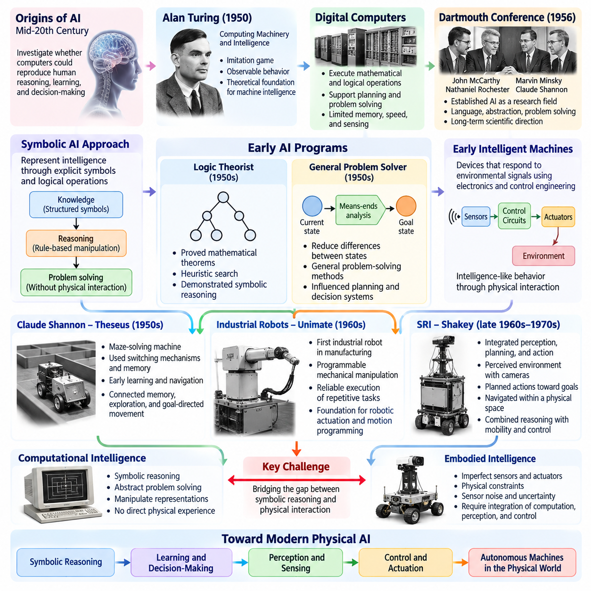{width="7.268055555555556in" height="7.268055555555556in"}

The emergence of artificial intelligence during the mid-twentieth century marked a turning point in the development of intelligent machines. Researchers began investigating whether computational systems could reproduce aspects of human reasoning, learning, and decision-making. While early AI primarily focused on abstract problem solving, its underlying ambition extended toward machines capable of understanding their surroundings and acting autonomously within the physical world.

Alan Turing provided one of the earliest theoretical foundations for machine intelligence through his work on computation and intelligent behavior. His 1950 paper, Computing Machinery and Intelligence, questioned whether machines could exhibit behavior comparable to human intelligence. The imitation game introduced a behavioral perspective on intelligence, emphasizing observable capabilities rather than internal mechanisms. This perspective influenced later discussions about evaluating intelligent autonomous systems.

The development of electronic digital computers created the technological foundation for implementing artificial intelligence. Early programmable machines demonstrated that mathematical operations, logical procedures, and symbolic transformations could be executed automatically. Researchers recognized that computation might support more sophisticated cognitive functions, including planning and problem solving. However, limited memory, processing speed, and sensing technologies constrained practical interaction with physical environments.

The Dartmouth Summer Research Project on Artificial Intelligence in 1956 established artificial intelligence as a recognizable research field. John McCarthy, Marvin Minsky, Nathaniel Rochester, and Claude Shannon proposed investigating how machines might simulate aspects of intelligence. Their research agenda included language, abstraction, problem solving, and self-improvement. Although early ambitions exceeded available technological capabilities, the project established an enduring scientific direction.

Early AI research frequently assumed that intelligence could be represented through explicit symbols and logical operations. Under this approach, knowledge was encoded as structured representations, while reasoning involved manipulating those representations according to defined rules. Systems could solve mathematical problems or perform logical deductions without directly experiencing the physical world. This separation between symbolic intelligence and physical interaction later became an important limitation.

The Logic Theorist, developed by Allen Newell, Herbert Simon, and Cliff Shaw during the 1950s, demonstrated that computers could perform selected forms of symbolic reasoning. The program searched for proofs of mathematical theorems using heuristic strategies. Its success suggested that intelligent problem solving could be formulated as computational search through possible states. These ideas subsequently influenced automated planning, decision systems, and task-level reasoning in robotics.

The General Problem Solver extended this direction by attempting to represent problem-solving processes through general computational principles. Newell, Simon, and Shaw explored methods for reducing differences between current and desired states. Means-ends analysis became an influential strategy for selecting intermediate operations toward a goal. Although these methods struggled with complex real environments, they introduced concepts that remain relevant to goal-directed autonomous behavior.

Early intelligent machines also emerged from developments in electronics, control engineering, and experimental robotics. Researchers constructed devices that could respond to environmental signals and exhibit apparently purposeful behavior. These machines often relied on relatively simple sensors and control circuits rather than sophisticated symbolic reasoning. Their significance lay in demonstrating that intelligence-like behavior could emerge through direct interaction between physical mechanisms and environmental conditions.

Claude Shannon\'s experimental work on maze-solving machines illustrated how electromechanical systems could perform elementary learning and navigation. His maze-solving mouse, commonly known as Theseus, used switching mechanisms and memory to discover routes through a maze. Although limited compared with modern autonomous robots, the demonstration connected memory, environmental exploration, and goal-directed movement within a physical machine.

The distinction between computational intelligence and embodied intelligence became increasingly visible as researchers attempted to transfer abstract reasoning into physical systems. A program could manipulate symbolic descriptions of objects without encountering friction, sensor noise, or unpredictable motion. A physical robot, however, had to operate through imperfect sensors and actuators. This difference revealed that successful autonomous behavior required integrating computation with perception and control.

The development of industrial robots introduced another important dimension to the history of intelligent machines. Unimate, installed in an industrial setting during the early 1960s, demonstrated programmable mechanical manipulation for repetitive manufacturing tasks. These systems emphasized reliable execution rather than autonomous reasoning. Nevertheless, they established practical foundations for robotic actuation, motion programming, and the integration of computational commands with physical machinery.

Research laboratories subsequently began combining computer-based reasoning with mobile robotic platforms. The Stanford Research Institute developed Shakey during the late 1960s and early 1970s as an experimental robot integrating perception, planning, and action. Shakey could interpret simplified environmental information, construct symbolic descriptions, and execute planned movements. It became an influential demonstration of how artificial intelligence could control physical behavior.

Shakey\'s architecture connected several capabilities that later became central to autonomous robotics. Visual perception supplied information about the environment, symbolic representations supported reasoning, and planning algorithms generated action sequences. Low-level control mechanisms translated these plans into movement. Although operation was slow and required highly structured environments, the system demonstrated an early integrated approach to perception, reasoning, and physical action.

The STRIPS planning system emerged from research associated with Shakey and provided a formal method for representing actions through preconditions and effects. A planning algorithm could determine which operations were required to transform an initial state into a desired goal state. This approach became foundational in classical automated planning. Its assumptions about discrete states and predictable actions, however, limited its direct applicability to uncertain and continuously changing environments.

Early machine vision research attempted to provide intelligent systems with meaningful descriptions of visual scenes. Researchers investigated edge detection, geometric interpretation, object recognition, and three-dimensional structure. Initial methods frequently assumed simplified shapes, controlled lighting, and restricted environments. These assumptions made computational interpretation manageable but highlighted the difficulty of developing perception systems capable of functioning reliably in unconstrained physical settings.

Natural language understanding and knowledge representation also shaped early visions of intelligent machines. Researchers imagined robots that could receive human instructions, interpret goals, and perform corresponding actions. Systems operating in restricted symbolic environments demonstrated aspects of language-based reasoning. However, translating linguistic descriptions into reliable physical behavior required grounding words and concepts in observable objects, spatial relationships, and executable actions.

The limitations of early AI became increasingly apparent as researchers confronted computational complexity and environmental uncertainty. Symbolic reasoning systems often depended on carefully constructed knowledge representations and predefined operating assumptions. Real-world environments introduced incomplete information, ambiguous observations, and unexpected events. These challenges revealed that general intelligent behavior could not be achieved simply by expanding collections of logical rules.

Computational resources also imposed substantial restrictions on early intelligent machines. Processors were slow, memory was expensive, and sensing equipment was bulky or unreliable. Planning operations could require considerable computation, while physical robots needed timely responses to environmental changes. These constraints encouraged simplified environments and carefully controlled demonstrations, delaying the development of autonomous systems capable of sustained real-world operation.

Despite these limitations, early AI established several concepts that remain fundamental to Physical AI. State representation, heuristic search, goal-directed planning, knowledge organization, and computational decision-making provided mechanisms for reasoning about possible actions. Early robotics contributed practical understanding of sensing, actuation, and environmental interaction. Together, these developments created the foundations for integrating cognitive computation with physical autonomy.

An important historical lesson was that intelligence cannot be evaluated solely through success in abstract reasoning tasks. Physical systems must translate decisions into actions that produce appropriate outcomes under uncertainty and dynamic constraints. A robot may generate a logically valid plan yet fail because an object moves, a sensor produces incorrect measurements, or an actuator behaves unexpectedly. Effective intelligence therefore requires continuous coordination between reasoning and physical feedback.

The early history of intelligent machines ultimately established two complementary research traditions: computational approaches emphasizing representation and reasoning, and physical approaches emphasizing sensing, control, and interaction. Modern Physical AI brings these traditions together through machine learning, predictive modeling, planning, and real-time feedback. The pioneering work of early AI researchers and robotic engineers remains essential to understanding how autonomous machines evolved toward integrated physical intelligence.

20세기 중반 인공지능(Artificial Intelligence)의 등장은 지능형 기계(Intelligent Machine) 발전의 중요한 전환점이 되었다. 연구자들은 계산 시스템(Computational System)이 인간의 추론(Reasoning), 학습(Learning), 의사결정(Decision-Making)의 일부를 재현할 수 있는지 탐구하기 시작하였다. 초기 인공지능은 주로 추상적 문제 해결(Abstract Problem Solving)에 집중하였지만, 그 근본적인 목표는 주변 환경을 이해하고 물리 세계(Physical World)에서 자율적으로 행동할 수 있는 기계를 구현하는 데까지 확장되어 있었다.

앨런 튜링(Alan Turing)은 계산(Computation)과 지능적 행동(Intelligent Behavior)에 관한 연구를 통해 기계 지능(Machine Intelligence)의 초기 이론적 토대를 제공하였다. 1950년 발표한 논문 『계산 기계와 지능(Computing Machinery and Intelligence)』에서 그는 기계가 인간 지능에 필적하는 행동을 보일 수 있는지 질문하였다. 모방 게임(Imitation Game)은 내부 메커니즘(Internal Mechanism)보다 관찰 가능한 능력(Observable Capability)을 강조하는 행동 중심의 지능 평가 관점을 제시하였다. 이러한 관점은 이후 지능형 자율 시스템(Intelligent Autonomous System)의 평가에 관한 논의에 영향을 미쳤다.

전자식 디지털 컴퓨터(Electronic Digital Computer)의 발전은 인공지능을 구현하기 위한 기술적 기반을 마련하였다. 초기 프로그래밍 가능 기계(Programmable Machine)는 수학적 연산(Mathematical Operation), 논리적 절차(Logical Procedure), 기호 변환(Symbolic Transformation)을 자동으로 실행할 수 있음을 보여주었다. 연구자들은 계산이 계획(Planning)과 문제 해결(Problem Solving)을 포함한 더욱 정교한 인지 기능(Cognitive Function)을 지원할 수 있다고 인식하였다. 그러나 제한된 메모리(Memory), 처리 속도(Processing Speed), 감지 기술(Sensing Technology)은 물리 환경과의 실질적인 상호작용을 제약하였다.

1956년 다트머스 인공지능 하계 연구 프로젝트(Dartmouth Summer Research Project on Artificial Intelligence)는 인공지능을 독립적인 연구 분야(Research Field)로 확립하는 계기가 되었다. 존 매카시(John McCarthy), 마빈 민스키(Marvin Minsky), 너새니얼 로체스터(Nathaniel Rochester), 클로드 섀넌(Claude Shannon)은 기계가 지능의 여러 측면을 어떻게 모사할 수 있는지 연구할 것을 제안하였다. 연구 의제에는 언어(Language), 추상화(Abstraction), 문제 해결(Problem Solving), 자기 개선(Self-Improvement)이 포함되었다. 초기 목표는 당시 기술 수준을 넘어섰지만, 이 프로젝트는 지속적인 과학적 연구 방향을 확립하였다.

초기 인공지능 연구는 지능을 명시적인 기호(Symbol)와 논리 연산(Logical Operation)으로 표현할 수 있다고 가정하는 경우가 많았다. 이러한 접근법에서는 지식(Knowledge)을 구조화된 표현(Structured Representation)으로 부호화하고, 정의된 규칙(Rule)에 따라 표현을 조작하는 방식으로 추론을 수행하였다. 시스템은 물리 세계를 직접 경험하지 않고도 수학 문제를 해결하거나 논리적 연역(Logical Deduction)을 수행할 수 있었다. 그러나 기호적 지능(Symbolic Intelligence)과 물리적 상호작용(Physical Interaction)의 이러한 분리는 이후 중요한 한계로 드러났다.

1950년대 앨런 뉴얼(Allen Newell), 허버트 사이먼(Herbert Simon), 클리프 쇼(Cliff Shaw)가 개발한 논리 이론가(Logic Theorist)는 컴퓨터가 특정 형태의 기호적 추론(Symbolic Reasoning)을 수행할 수 있음을 보여주었다. 이 프로그램은 휴리스틱 전략(Heuristic Strategy)을 사용하여 수학 정리(Mathematical Theorem)의 증명을 탐색하였다. 이러한 성과는 지능적 문제 해결을 가능한 상태(State)들 사이의 계산적 탐색(Computational Search)으로 정식화할 수 있음을 시사하였다. 이 개념은 이후 로보틱스의 자동 계획(Automated Planning), 의사결정 시스템(Decision System), 작업 수준 추론(Task-Level Reasoning)에 영향을 미쳤다.

일반 문제 해결기(General Problem Solver)는 일반적인 계산 원리(Computational Principle)를 통해 문제 해결 과정을 표현하려는 시도로 이러한 연구 방향을 확장하였다. 뉴얼, 사이먼, 쇼는 현재 상태(Current State)와 목표 상태(Desired State) 사이의 차이를 줄이는 방법을 탐구하였다. 수단-목표 분석(Means-Ends Analysis)은 목표 달성을 위한 중간 연산(Intermediate Operation)을 선택하는 영향력 있는 전략이 되었다. 이러한 방법은 복잡한 실제 환경에서 어려움을 겪었지만, 오늘날에도 목표 지향적 자율 행동(Goal-Directed Autonomous Behavior)과 관련된 중요한 개념을 도입하였다.

초기 지능형 기계(Intelligent Machine)는 전자공학(Electronics), 제어공학(Control Engineering), 실험 로보틱스(Experimental Robotics)의 발전에서도 등장하였다. 연구자들은 환경 신호(Environmental Signal)에 반응하고 목적이 있는 것처럼 보이는 행동을 나타내는 장치를 제작하였다. 이러한 기계는 정교한 기호적 추론보다 비교적 단순한 센서(Sensor)와 제어회로(Control Circuit)에 의존하는 경우가 많았다. 이들의 중요성은 물리적 메커니즘(Physical Mechanism)과 환경 조건(Environmental Condition) 사이의 직접적인 상호작용을 통해 지능과 유사한 행동이 발생할 수 있음을 보여주었다는 데 있다.

클로드 섀넌(Claude Shannon)의 미로 해결 기계(Maze-Solving Machine)에 관한 실험 연구는 전기기계 시스템(Electromechanical System)이 기초적인 학습(Learning)과 항법(Navigation)을 수행할 수 있음을 보여주었다. 테세우스(Theseus)라는 이름으로 알려진 그의 미로 탐색 생쥐(Maze-Solving Mouse)는 스위칭 메커니즘(Switching Mechanism)과 메모리(Memory)를 이용하여 미로를 통과하는 경로를 발견하였다. 현대 자율 로봇(Autonomous Robot)과 비교하면 제한적이었지만, 이 실험은 물리적 기계 안에서 기억, 환경 탐색(Environmental Exploration), 목표 지향적 이동(Goal-Directed Movement)을 연결하였다.

계산 지능(Computational Intelligence)과 체화 지능(Embodied Intelligence)의 차이는 연구자들이 추상적 추론(Abstract Reasoning)을 물리 시스템(Physical System)에 적용하려고 시도하면서 더욱 분명해졌다. 프로그램은 마찰(Friction), 센서 잡음(Sensor Noise), 예측하기 어려운 움직임을 경험하지 않고도 객체(Object)의 기호적 설명을 조작할 수 있었다. 반면 물리 로봇(Physical Robot)은 불완전한 센서와 구동기(Actuator)를 통해 작동해야 했다. 이러한 차이는 성공적인 자율 행동(Autonomous Behavior)을 위해 계산(Computation), 인식(Perception), 제어(Control)의 통합이 필요하다는 사실을 드러냈다.

산업용 로봇(Industrial Robot)의 발전은 지능형 기계의 역사에 또 다른 중요한 차원을 도입하였다. 1960년대 초 산업 현장에 설치된 유니메이트(Unimate)는 반복적인 제조 작업(Manufacturing Task)을 위한 프로그래밍 가능한 기계적 조작(Programmable Mechanical Manipulation)을 보여주었다. 이러한 시스템은 자율적 추론(Autonomous Reasoning)보다 신뢰성 있는 실행(Reliable Execution)을 강조하였다. 그럼에도 로봇 구동(Robotic Actuation), 동작 프로그래밍(Motion Programming), 계산 명령(Computational Command)과 물리적 기계 장치의 통합을 위한 실용적인 기반을 확립하였다.

이후 연구기관들은 컴퓨터 기반 추론(Computer-Based Reasoning)과 이동 로봇 플랫폼(Mobile Robotic Platform)을 결합하기 시작하였다. 스탠퍼드 연구소(Stanford Research Institute)는 1960년대 후반부터 1970년대 초반까지 인식(Perception), 계획(Planning), 행동(Action)을 통합하는 실험용 로봇 셰이키(Shakey)를 개발하였다. 셰이키는 단순화된 환경 정보를 해석하고, 기호적 설명(Symbolic Description)을 구성하며, 계획된 움직임을 실행할 수 있었다. 이는 인공지능이 물리적 행동을 제어할 수 있음을 보여준 영향력 있는 초기 사례가 되었다.

셰이키(Shakey)의 아키텍처(Architecture)는 이후 자율 로보틱스(Autonomous Robotics)의 핵심 요소가 되는 여러 능력을 연결하였다. 시각 인식(Visual Perception)은 환경 정보를 제공하고, 기호 표현(Symbolic Representation)은 추론을 지원하며, 계획 알고리즘(Planning Algorithm)은 행동 순서(Action Sequence)를 생성하였다. 저수준 제어 메커니즘(Low-Level Control Mechanism)은 이러한 계획을 실제 움직임으로 변환하였다. 작동 속도가 느리고 고도로 구조화된 환경(Structured Environment)이 필요했지만, 이 시스템은 인식, 추론, 물리적 행동을 통합하는 초기 접근법을 보여주었다.

스트립스 계획 시스템(STRIPS Planning System)은 셰이키 관련 연구에서 등장하였으며, 사전조건(Precondition)과 효과(Effect)를 통해 행동을 표현하는 형식적 방법(Formal Method)을 제공하였다. 계획 알고리즘(Planning Algorithm)은 초기 상태(Initial State)를 목표 상태(Goal State)로 변환하기 위해 어떤 연산이 필요한지 결정할 수 있었다. 이러한 접근법은 고전적 자동 계획(Classical Automated Planning)의 기초가 되었다. 그러나 이산 상태(Discrete State)와 예측 가능한 행동(Predictable Action)에 대한 가정은 불확실하고 지속적으로 변화하는 환경에 직접 적용하는 데 한계를 가져왔다.

초기 기계 시각(Machine Vision) 연구는 지능형 시스템에 시각 장면(Visual Scene)에 대한 의미 있는 설명을 제공하려고 시도하였다. 연구자들은 에지 검출(Edge Detection), 기하학적 해석(Geometric Interpretation), 객체 인식(Object Recognition), 3차원 구조(Three-Dimensional Structure)를 탐구하였다. 초기 방법은 단순화된 형태(Simplified Shape), 통제된 조명(Controlled Lighting), 제한된 환경(Restricted Environment)을 가정하는 경우가 많았다. 이러한 가정은 계산적 해석을 용이하게 하였지만, 제약이 없는 물리 환경에서 신뢰성 있게 작동하는 인식 시스템을 개발하는 것이 얼마나 어려운지 보여주었다.

자연어 이해(Natural Language Understanding)와 지식 표현(Knowledge Representation) 역시 초기 지능형 기계의 비전을 형성하였다. 연구자들은 인간의 명령(Human Instruction)을 수신하고, 목표(Goal)를 해석하며, 그에 상응하는 행동을 수행할 수 있는 로봇을 구상하였다. 제한된 기호 환경(Symbolic Environment)에서 작동하는 시스템은 언어 기반 추론(Language-Based Reasoning)의 일부 능력을 보여주었다. 그러나 언어적 설명(Linguistic Description)을 신뢰성 있는 물리적 행동으로 변환하려면 단어와 개념을 관측 가능한 객체, 공간 관계(Spatial Relationship), 실행 가능한 행동(Executable Action)에 연결하는 것이 필요하였다.

초기 인공지능의 한계는 연구자들이 계산 복잡성(Computational Complexity)과 환경 불확실성(Environmental Uncertainty)에 직면하면서 더욱 명확해졌다. 기호적 추론 시스템(Symbolic Reasoning System)은 정교하게 구성된 지식 표현(Knowledge Representation)과 사전에 정의된 운용 가정(Operating Assumption)에 의존하는 경우가 많았다. 실제 환경은 불완전한 정보(Incomplete Information), 모호한 관측(Ambiguous Observation), 예상하지 못한 사건(Unexpected Event)을 포함하였다. 이러한 문제는 논리 규칙(Logical Rule)의 집합을 단순히 확장하는 것만으로 일반적인 지능적 행동(General Intelligent Behavior)을 구현할 수 없다는 사실을 보여주었다.

계산 자원(Computational Resource) 역시 초기 지능형 기계에 상당한 제약을 부과하였다. 프로세서(Processor)는 느렸고, 메모리(Memory)는 비쌌으며, 감지 장비(Sensing Equipment)는 크고 신뢰성이 낮은 경우가 많았다. 계획 연산(Planning Operation)은 상당한 계산량을 요구할 수 있었지만, 물리 로봇은 환경 변화에 적시에 대응해야 했다. 이러한 제약으로 인해 단순화된 환경과 세심하게 통제된 실험 시연(Controlled Demonstration)이 주로 사용되었으며, 실제 환경에서 지속적으로 작동할 수 있는 자율 시스템(Autonomous System)의 개발이 지연되었다.

이러한 한계에도 불구하고 초기 인공지능은 오늘날 피지컬 인공지능(Physical AI)의 기본이 되는 여러 개념을 확립하였다. 상태 표현(State Representation), 휴리스틱 탐색(Heuristic Search), 목표 지향적 계획(Goal-Directed Planning), 지식 조직화(Knowledge Organization), 계산적 의사결정(Computational Decision-Making)은 가능한 행동을 추론하기 위한 메커니즘을 제공하였다. 초기 로보틱스는 감지(Sensing), 구동(Actuation), 환경 상호작용(Environmental Interaction)에 관한 실질적인 이해를 제공하였다. 이러한 발전은 인지적 계산(Cognitive Computation)과 물리적 자율성(Physical Autonomy)을 통합하기 위한 기반을 형성하였다.

중요한 역사적 교훈은 지능(Intelligence)을 추상적 추론 과제(Abstract Reasoning Task)의 성공만으로 평가할 수 없다는 점이었다. 물리 시스템(Physical System)은 불확실성(Uncertainty)과 동적 제약(Dynamic Constraint) 아래에서 의사결정(Decision)을 적절한 결과를 생성하는 행동으로 변환해야 한다. 로봇이 논리적으로 타당한 계획(Logically Valid Plan)을 생성하더라도 객체가 이동하거나, 센서가 잘못된 측정값을 생성하거나, 구동기가 예상과 다르게 작동하면 실패할 수 있다. 따라서 효과적인 지능은 추론(Reasoning)과 물리적 피드백(Physical Feedback) 사이의 지속적인 조정(Coordination)을 필요로 한다.

초기 지능형 기계의 역사는 궁극적으로 두 가지 상호보완적인 연구 전통(Complementary Research Tradition)을 확립하였다. 하나는 표현(Representation)과 추론(Reasoning)을 강조하는 계산적 접근법(Computational Approach)이고, 다른 하나는 감지(Sensing), 제어(Control), 상호작용(Interaction)을 강조하는 물리적 접근법(Physical Approach)이다. 현대 피지컬 인공지능(Physical AI)은 기계학습(Machine Learning), 예측 모델링(Predictive Modeling), 계획(Planning), 실시간 피드백(Real-Time Feedback)을 통해 이러한 전통을 통합한다. 초기 인공지능 연구자와 로봇 공학자(Robotic Engineer)의 선구적인 연구는 자율 기계(Autonomous Machine)가 통합된 물리 지능(Integrated Physical Intelligence)으로 발전해 온 과정을 이해하는 데 여전히 필수적이다.

##  

## 03.03. Symbolic AI and Classical Robotics

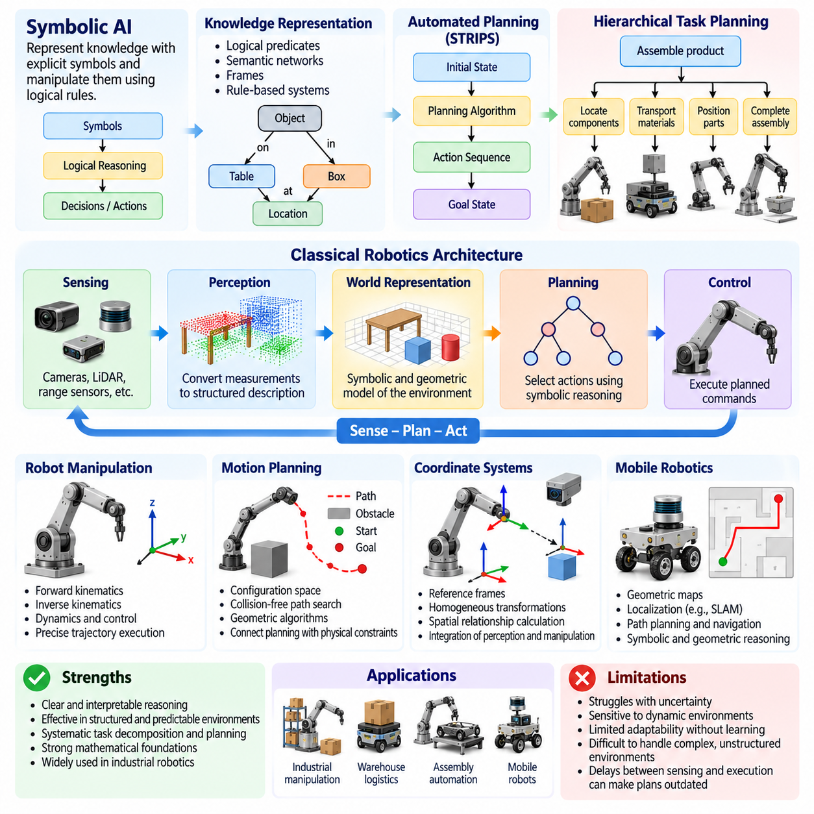{width="7.268055555555556in" height="7.268055555555556in"}

Symbolic artificial intelligence emerged as a dominant approach to machine intelligence during the early decades of AI research. It proposed that intelligent behavior could be produced by representing knowledge through explicit symbols and manipulating those symbols according to logical rules. This perspective strongly influenced classical robotics, where machines were designed to perceive structured environments, construct internal representations, generate plans, and execute actions through predefined computational procedures.

The central assumption of symbolic AI was that reasoning could be expressed as operations over meaningful representations. Objects, locations, relationships, and goals were encoded using symbols that a computer could process systematically. Logical inference mechanisms transformed these representations into conclusions or decisions. In robotics, this approach enabled machines to reason about spatial arrangements, task dependencies, and action sequences without requiring direct learning from extensive physical experience.

Knowledge representation became a fundamental component of symbolic intelligent systems. Researchers developed logical predicates, semantic networks, frames, and rule-based structures to describe objects and their relationships. A robot operating in a warehouse, for example, could represent shelves, containers, and destinations as symbolic entities. Such representations supported explicit reasoning about where objects belonged, which actions were permitted, and how tasks could be organized into executable procedures.

Classical robotics adopted a hierarchical approach in which perception, planning, and control were organized into distinct functional stages. Sensors collected environmental information, perception algorithms converted measurements into structured descriptions, and planning modules selected appropriate actions. Controllers then translated planned commands into physical movement. This sequential architecture provided a clear engineering framework but often struggled when environments changed faster than the system could update its internal model.

The sense-plan-act paradigm became one of the defining architectures of classical intelligent robotics. A robot first observed its surroundings, then constructed or updated a world representation, and finally calculated an action sequence intended to achieve its objectives. This architecture was effective when environments were predictable and sufficiently structured. However, delays between sensing and execution could make plans outdated when obstacles moved or unexpected interactions occurred.

Automated planning provided the computational foundation for converting symbolic goals into sequences of executable actions. Planning systems represented each action through conditions that had to be satisfied before execution and effects expected afterward. Algorithms searched for action sequences capable of transforming an initial state into a desired goal state. These methods introduced systematic task reasoning but frequently assumed that actions produced predictable outcomes within a simplified environment.

The STRIPS framework became particularly influential in symbolic planning for robotics. It described actions through preconditions, addition effects, and deletion effects, allowing planners to reason about discrete state transitions. A robot could determine that moving an object required first reaching its location and establishing an appropriate grasp. Although STRIPS enabled formal reasoning, its simplified assumptions made uncertainty, continuous motion, and unexpected physical interactions difficult to represent directly.

Hierarchical task planning extended symbolic reasoning by decomposing complex objectives into smaller, manageable operations. A high-level instruction such as assembling a product could be divided into locating components, transporting materials, positioning parts, and completing assembly steps. This decomposition improved the organization of complex robotic tasks. It also established conceptual foundations for modern task planners that coordinate multiple skills and low-level controllers.

Classical robotic manipulation developed alongside symbolic planning through advances in kinematics, dynamics, and motion control. Forward kinematics described how joint configurations determine an end-effector position, while inverse kinematics calculated joint configurations required to reach a desired pose. Dynamic models described forces and motion. These mathematical foundations allowed industrial manipulators to execute precise trajectories, although their effectiveness depended on accurate models and controlled operating conditions.

Motion planning introduced methods for determining collision-free paths through geometric environments. Configuration space represented possible robot configurations, while obstacles defined regions that could not be occupied safely. Algorithms searched for feasible paths connecting initial and target configurations. These techniques connected abstract planning with physical constraints, demonstrating that intelligent robotic action required both logical reasoning and mathematical descriptions of geometry and motion.

The development of robotic coordinate systems and geometric transformations was essential for integrating perception with manipulation. Robots needed consistent representations of object positions, sensor measurements, and actuator configurations. Homogeneous transformations and reference frames enabled spatial relationships to be calculated systematically. These methods remain fundamental to robot localization, manipulation, navigation, and the coordination of multiple mechanical components.

Classical mobile robotics similarly relied on geometric maps, localization methods, and path-planning algorithms. Robots represented their environments through landmarks, occupancy descriptions, or structured geometric models. Navigation systems estimated current position and calculated routes toward designated destinations. Early approaches frequently assumed that maps were sufficiently accurate and environmental conditions remained stable, creating difficulties when robots encountered unexpected obstacles or localization errors.

Expert systems contributed another important dimension to symbolic robotics by encoding specialized knowledge as explicit rules. Such systems could represent operational procedures, diagnostic relationships, and decision conditions. In industrial automation, rule-based reasoning supported fault diagnosis, process monitoring, and supervisory control. However, maintaining large rule collections became increasingly difficult as operating environments and system interactions grew more complex.

A major limitation of symbolic AI was the knowledge acquisition bottleneck. Engineers had to define relevant objects, relationships, rules, and exceptions before a system could reason effectively. Real physical environments contain enormous numbers of possible states and interactions, making complete symbolic descriptions impractical. As complexity increased, maintaining accurate knowledge bases required substantial effort and frequently failed to capture unexpected environmental variations.

The symbol grounding problem exposed a deeper challenge in connecting abstract representations with physical experience. A symbolic system might manipulate the concept of a chair without understanding how chairs appear under different lighting conditions or how they can be physically approached. Grounding requires connecting symbols to sensory observations, physical properties, and actionable interactions. This problem became central to later developments in embodied intelligence and learning-based robotic perception.

Classical robotics also faced difficulties associated with uncertainty and partial observability. Sensors generated noisy measurements, objects could become occluded, and physical actions did not always produce their expected effects. Traditional symbolic planning often treated states as discrete and sufficiently known, while real-world operation required continuous estimation and correction. These limitations encouraged the development of probabilistic robotics, feedback-driven architectures, and more adaptive decision-making methods.

Computational complexity further restricted the scalability of symbolic planning. As the number of objects, possible actions, and environmental conditions increased, the search space could grow rapidly. Finding an optimal action sequence became computationally expensive, especially for long-horizon tasks. Heuristic search, abstraction, and hierarchical decomposition reduced some difficulties but did not eliminate the fundamental challenges of planning in large, dynamic physical environments.

Despite these limitations, symbolic AI provided important advantages through interpretability and explicit structure. Rules, goals, and planning assumptions could be inspected and modified by human engineers. Logical constraints could represent operational requirements, while task plans could be analyzed before execution. These characteristics remain valuable in safety-sensitive applications where system behavior must be understandable, auditable, and consistent with defined operating procedures.

The transition toward modern robotics did not eliminate symbolic methods but increasingly combined them with reactive control, probabilistic estimation, and machine learning. Symbolic planners could define high-level objectives while lower-level controllers responded continuously to environmental feedback. Learned perception models supplied structured observations, and adaptive policies handled situations that were difficult to describe through fixed rules. This integration addressed weaknesses of purely sequential reasoning architectures.

Modern Physical AI continues to benefit from the conceptual foundations established by symbolic AI and classical robotics. Task decomposition, logical constraints, geometric reasoning, and structured planning remain important for organizing complex autonomous behavior. However, these capabilities must operate alongside learned representations, predictive world models, uncertainty estimation, and real-time control. Physical intelligence therefore emerges from the integration of explicit reasoning with adaptive interaction rather than from symbolic computation alone.

The historical significance of symbolic AI and classical robotics lies in their systematic treatment of intelligence as a process involving representation, reasoning, planning, and action. They established formal methods for translating abstract objectives into physical operations and clarified the limitations of purely model-driven autonomy. Contemporary Physical AI builds upon these achievements by combining structured reasoning with perception, learning, prediction, and continuous feedback to support increasingly capable autonomous systems.

기호적 인공지능(Symbolic Artificial Intelligence)은 초기 인공지능 연구 시기에 기계 지능(Machine Intelligence)을 구현하기 위한 지배적인 접근법으로 등장하였다. 이 접근법은 지식(Knowledge)을 명시적인 기호(Symbol)로 표현하고, 논리 규칙(Logical Rule)에 따라 이러한 기호를 조작함으로써 지능적 행동(Intelligent Behavior)을 생성할 수 있다고 보았다. 이러한 관점은 고전 로보틱스(Classical Robotics)에 큰 영향을 미쳤으며, 로봇이 구조화된 환경(Structured Environment)을 인식하고, 내부 표현(Internal Representation)을 구성하며, 계획(Plan)을 생성하고, 사전에 정의된 계산 절차(Computational Procedure)를 통해 행동을 실행하도록 설계하는 기반이 되었다.

기호적 인공지능(Symbolic AI)의 핵심 가정은 추론(Reasoning)을 의미 있는 표현(Meaningful Representation)에 대한 연산으로 나타낼 수 있다는 것이었다. 객체(Object), 위치(Location), 관계(Relationship), 목표(Goal)는 컴퓨터가 체계적으로 처리할 수 있는 기호로 부호화되었다. 논리적 추론 메커니즘(Logical Inference Mechanism)은 이러한 표현을 결론이나 의사결정(Decision)으로 변환하였다. 로보틱스에서 이 접근법은 방대한 물리적 경험(Physical Experience)을 통한 직접적인 학습 없이도 공간 배치(Spatial Arrangement), 작업 의존성(Task Dependency), 행동 순서(Action Sequence)를 추론할 수 있도록 하였다.

지식 표현(Knowledge Representation)은 기호 기반 지능형 시스템(Symbolic Intelligent System)의 핵심 구성요소가 되었다. 연구자들은 객체와 객체 사이의 관계를 설명하기 위해 논리 술어(Logical Predicate), 의미망(Semantic Network), 프레임(Frame), 규칙 기반 구조(Rule-Based Structure)를 개발하였다. 예를 들어 창고에서 작동하는 로봇은 선반(Shelf), 컨테이너(Container), 목적지(Destination)를 기호적 개체(Symbolic Entity)로 표현할 수 있었다. 이러한 표현은 객체가 어디에 배치되어야 하는지, 어떤 행동이 허용되는지, 작업을 실행 가능한 절차(Executable Procedure)로 어떻게 구성할 수 있는지에 관한 명시적 추론을 지원하였다.

고전 로보틱스(Classical Robotics)는 인식(Perception), 계획(Planning), 제어(Control)를 서로 구분된 기능 단계(Functional Stage)로 구성하는 계층적 접근법(Hierarchical Approach)을 채택하였다. 센서(Sensor)는 환경 정보를 수집하고, 인식 알고리즘(Perception Algorithm)은 측정값을 구조화된 설명(Structured Description)으로 변환하며, 계획 모듈(Planning Module)은 적절한 행동을 선택하였다. 이후 제어기(Controller)는 계획된 명령을 물리적 움직임으로 변환하였다. 이러한 순차적 아키텍처(Sequential Architecture)는 명확한 공학적 프레임워크(Engineering Framework)를 제공하였지만, 시스템이 내부 모델(Internal Model)을 갱신하는 속도보다 환경이 빠르게 변화하는 경우에는 대응에 어려움을 겪었다.

감지-계획-행동 패러다임(Sense-Plan-Act Paradigm)은 고전 지능형 로보틱스(Classical Intelligent Robotics)를 대표하는 아키텍처 중 하나가 되었다. 로봇은 먼저 주변 환경을 관측하고, 세계 표현(World Representation)을 구성하거나 갱신한 다음, 목표 달성을 위한 행동 순서(Action Sequence)를 계산하였다. 이러한 아키텍처는 환경이 예측 가능하고 충분히 구조화되어 있을 때 효과적이었다. 그러나 감지와 실행 사이의 지연(Delay)으로 인해 장애물이 이동하거나 예상하지 못한 상호작용이 발생하면 계획이 더 이상 유효하지 않게 될 수 있었다.

자동 계획(Automated Planning)은 기호적 목표(Symbolic Goal)를 실행 가능한 행동 순서(Executable Action Sequence)로 변환하기 위한 계산적 기반(Computational Foundation)을 제공하였다. 계획 시스템(Planning System)은 각 행동을 실행 전에 충족되어야 하는 조건(Condition)과 실행 후 예상되는 효과(Effect)로 표현하였다. 알고리즘(Algorithm)은 초기 상태(Initial State)를 원하는 목표 상태(Goal State)로 변환할 수 있는 행동 순서를 탐색하였다. 이러한 방법은 체계적인 작업 추론(Task Reasoning)을 도입하였지만, 단순화된 환경에서 행동이 예측 가능한 결과를 생성한다고 가정하는 경우가 많았다.

스트립스 프레임워크(STRIPS Framework)는 로보틱스의 기호적 계획(Symbolic Planning)에서 특히 큰 영향을 미쳤다. STRIPS는 사전조건(Precondition), 추가 효과(Add Effect), 삭제 효과(Delete Effect)를 통해 행동을 설명함으로써 계획기(Planner)가 이산 상태 전이(Discrete State Transition)를 추론할 수 있도록 하였다. 로봇은 객체를 이동시키기 위해 먼저 해당 위치에 도달하고 적절한 파지(Grasp)를 확보해야 한다고 판단할 수 있었다. STRIPS는 형식적 추론(Formal Reasoning)을 가능하게 하였지만, 단순화된 가정으로 인해 불확실성(Uncertainty), 연속적 움직임(Continuous Motion), 예상하지 못한 물리적 상호작용(Physical Interaction)을 직접 표현하는 데 어려움이 있었다.

계층적 작업 계획(Hierarchical Task Planning)은 복잡한 목표(Objective)를 더 작고 관리 가능한 작업(Operation)으로 분해함으로써 기호적 추론(Symbolic Reasoning)을 확장하였다. 제품 조립(Product Assembly)과 같은 상위 수준 명령(High-Level Instruction)은 부품 탐색(Component Localization), 자재 운반(Material Transportation), 부품 배치(Part Positioning), 조립 단계(Assembly Step)의 완료로 나눌 수 있었다. 이러한 분해(Decomposition)는 복잡한 로봇 작업의 구성을 개선하였다. 또한 여러 기술(Skill)과 저수준 제어기(Low-Level Controller)를 조정하는 현대 작업 계획기(Task Planner)의 개념적 기반을 확립하였다.

고전 로봇 조작(Classical Robotic Manipulation)은 운동학(Kinematics), 동역학(Dynamics), 운동 제어(Motion Control)의 발전과 함께 성장하였다. 순기구학(Forward Kinematics)은 관절 구성(Joint Configuration)이 말단효과기(End-Effector)의 위치를 어떻게 결정하는지 설명하였으며, 역기구학(Inverse Kinematics)은 목표 자세(Desired Pose)에 도달하기 위해 필요한 관절 구성을 계산하였다. 동역학 모델(Dynamic Model)은 힘(Force)과 운동(Motion)을 설명하였다. 이러한 수학적 기반은 산업용 매니퓰레이터(Industrial Manipulator)가 정밀한 궤적(Trajectory)을 실행할 수 있도록 하였지만, 그 효과는 정확한 모델과 통제된 운용 조건(Controlled Operating Condition)에 의존하였다.

운동 계획(Motion Planning)은 기하학적 환경(Geometric Environment)에서 충돌이 없는 경로(Collision-Free Path)를 결정하는 방법을 도입하였다. 구성 공간(Configuration Space)은 가능한 로봇 구성(Robot Configuration)을 표현하였으며, 장애물(Obstacle)은 안전하게 점유할 수 없는 영역을 정의하였다. 알고리즘은 초기 구성(Initial Configuration)과 목표 구성(Target Configuration)을 연결하는 실행 가능한 경로(Feasible Path)를 탐색하였다. 이러한 기법은 추상적 계획(Abstract Planning)과 물리적 제약(Physical Constraint)을 연결하였으며, 지능형 로봇 행동(Intelligent Robotic Action)에 논리적 추론과 기하학 및 운동에 대한 수학적 설명이 모두 필요하다는 사실을 보여주었다.

로봇 좌표계(Robotic Coordinate System)와 기하학적 변환(Geometric Transformation)의 발전은 인식(Perception)과 조작(Manipulation)을 통합하는 데 필수적이었다. 로봇은 객체 위치(Object Position), 센서 측정값(Sensor Measurement), 구동기 구성(Actuator Configuration)에 대한 일관된 표현(Consistent Representation)이 필요하였다. 동차 변환(Homogeneous Transformation)과 기준 좌표계(Reference Frame)는 공간 관계(Spatial Relationship)를 체계적으로 계산할 수 있도록 하였다. 이러한 방법은 오늘날에도 로봇 위치 추정(Robot Localization), 조작, 항법(Navigation), 여러 기계적 구성요소(Mechanical Component)의 조정에 기본적으로 사용된다.

고전 이동 로보틱스(Classical Mobile Robotics) 역시 기하학적 지도(Geometric Map), 위치 추정 방법(Localization Method), 경로 계획 알고리즘(Path-Planning Algorithm)에 의존하였다. 로봇은 랜드마크(Landmark), 점유 정보 표현(Occupancy Representation), 구조화된 기하학적 모델(Structured Geometric Model)을 통해 환경을 표현하였다. 항법 시스템(Navigation System)은 현재 위치(Current Position)를 추정하고 지정된 목적지(Designated Destination)까지의 경로를 계산하였다. 초기 접근법은 지도가 충분히 정확하고 환경 조건이 안정적으로 유지된다고 가정하는 경우가 많았으며, 예상하지 못한 장애물이나 위치 추정 오차(Localization Error)가 발생하면 어려움을 겪었다.

전문가 시스템(Expert System)은 전문 지식(Specialized Knowledge)을 명시적인 규칙(Explicit Rule)으로 부호화함으로써 기호적 로보틱스(Symbolic Robotics)에 또 다른 중요한 요소를 제공하였다. 이러한 시스템은 운용 절차(Operational Procedure), 진단 관계(Diagnostic Relationship), 의사결정 조건(Decision Condition)을 표현할 수 있었다. 산업 자동화(Industrial Automation)에서 규칙 기반 추론(Rule-Based Reasoning)은 고장 진단(Fault Diagnosis), 공정 모니터링(Process Monitoring), 감독 제어(Supervisory Control)를 지원하였다. 그러나 운용 환경과 시스템 상호작용이 복잡해질수록 대규모 규칙 집합(Rule Collection)을 유지하고 관리하는 작업은 점점 어려워졌다.

기호적 인공지능(Symbolic AI)의 주요 한계 중 하나는 지식 획득 병목현상(Knowledge Acquisition Bottleneck)이었다. 엔지니어는 시스템이 효과적으로 추론하기 전에 관련 객체(Object), 관계(Relationship), 규칙(Rule), 예외(Exception)를 정의해야 했다. 실제 물리 환경(Physical Environment)에는 매우 많은 가능한 상태(State)와 상호작용(Interaction)이 존재하므로 완전한 기호적 설명(Symbolic Description)을 작성하는 것은 현실적으로 어려웠다. 복잡성이 증가함에 따라 정확한 지식 기반(Knowledge Base)을 유지하는 데 상당한 노력이 필요했으며, 예상하지 못한 환경 변화(Environmental Variation)를 충분히 반영하지 못하는 경우가 많았다.

기호 접지 문제(Symbol Grounding Problem)는 추상적 표현(Abstract Representation)과 물리적 경험(Physical Experience)을 연결하는 과정에서 더욱 근본적인 문제를 드러냈다. 기호 시스템(Symbolic System)은 의자(Chair)라는 개념을 조작할 수 있지만, 다양한 조명 조건(Lighting Condition)에서 의자가 어떻게 보이는지 또는 물리적으로 어떻게 접근할 수 있는지를 이해하지 못할 수 있다. 기호 접지(Symbol Grounding)는 기호를 감각 관측(Sensory Observation), 물리적 속성(Physical Property), 실행 가능한 상호작용(Actionable Interaction)과 연결하는 것을 요구한다. 이 문제는 이후 체화 지능(Embodied Intelligence)과 학습 기반 로봇 인식(Learning-Based Robotic Perception)의 발전에서 핵심적인 연구 주제가 되었다.

고전 로보틱스(Classical Robotics)는 불확실성(Uncertainty)과 부분 관측 가능성(Partial Observability)에서도 어려움을 겪었다. 센서는 잡음이 포함된 측정값(Noisy Measurement)을 생성하였고, 객체는 가려질 수 있었으며, 물리적 행동이 항상 예상한 효과를 발생시키지는 않았다. 전통적인 기호적 계획(Symbolic Planning)은 상태를 이산적(Discrete)이고 충분히 알려진 것으로 취급하는 경우가 많았지만, 실제 환경에서의 작동에는 지속적인 추정(Continuous Estimation)과 보정(Correction)이 필요하였다. 이러한 한계는 확률적 로보틱스(Probabilistic Robotics), 피드백 기반 아키텍처(Feedback-Driven Architecture), 더욱 적응적인 의사결정(Adaptive Decision-Making) 방법의 발전을 촉진하였다.

계산 복잡성(Computational Complexity)은 기호적 계획(Symbolic Planning)의 확장성(Scalability)을 추가로 제한하였다. 객체(Object), 가능한 행동(Possible Action), 환경 조건(Environmental Condition)의 수가 증가함에 따라 탐색 공간(Search Space)은 빠르게 커질 수 있었다. 특히 장기 작업(Long-Horizon Task)에서 최적의 행동 순서(Optimal Action Sequence)를 찾는 것은 계산 비용(Computational Cost)이 높은 문제가 되었다. 휴리스틱 탐색(Heuristic Search), 추상화(Abstraction), 계층적 분해(Hierarchical Decomposition)는 일부 어려움을 완화하였지만, 규모가 크고 동적으로 변화하는 물리 환경에서 계획을 수행하는 근본적인 문제를 완전히 제거하지는 못하였다.

이러한 한계에도 불구하고 기호적 인공지능(Symbolic AI)은 해석 가능성(Interpretability)과 명시적 구조(Explicit Structure)라는 중요한 장점을 제공하였다. 규칙(Rule), 목표(Goal), 계획 가정(Planning Assumption)은 인간 엔지니어가 검토하고 수정할 수 있었다. 논리적 제약(Logical Constraint)은 운용 요구사항(Operational Requirement)을 표현할 수 있었으며, 작업 계획(Task Plan)은 실행 전에 분석할 수 있었다. 이러한 특성은 시스템 행동(System Behavior)이 이해 가능하고, 감사 가능하며(Auditable), 정의된 운용 절차(Operating Procedure)와 일관성을 유지해야 하는 안전 민감 응용 분야(Safety-Sensitive Application)에서 여전히 가치가 있다.

현대 로보틱스(Modern Robotics)로의 전환은 기호적 방법(Symbolic Method)을 제거한 것이 아니라, 반응형 제어(Reactive Control), 확률적 추정(Probabilistic Estimation), 기계학습(Machine Learning)과 점차 결합하는 과정이었다. 기호적 계획기(Symbolic Planner)는 상위 수준 목표(High-Level Objective)를 정의하고, 저수준 제어기(Low-Level Controller)는 환경 피드백(Environmental Feedback)에 지속적으로 대응할 수 있었다. 학습된 인식 모델(Learned Perception Model)은 구조화된 관측값(Structured Observation)을 제공하였으며, 적응형 정책(Adaptive Policy)은 고정된 규칙으로 설명하기 어려운 상황을 처리하였다. 이러한 통합은 순수한 순차적 추론 아키텍처(Sequential Reasoning Architecture)의 약점을 보완하였다.

현대 피지컬 인공지능(Physical AI)은 기호적 인공지능(Symbolic AI)과 고전 로보틱스(Classical Robotics)가 확립한 개념적 기반으로부터 계속해서 이점을 얻고 있다. 작업 분해(Task Decomposition), 논리적 제약(Logical Constraint), 기하학적 추론(Geometric Reasoning), 구조화된 계획(Structured Planning)은 복잡한 자율 행동(Autonomous Behavior)을 구성하는 데 여전히 중요하다. 그러나 이러한 능력은 학습된 표현(Learned Representation), 예측 세계 모델(Predictive World Model), 불확실성 추정(Uncertainty Estimation), 실시간 제어(Real-Time Control)와 함께 작동해야 한다. 따라서 물리 지능(Physical Intelligence)은 기호적 계산(Symbolic Computation)만으로 형성되는 것이 아니라 명시적 추론(Explicit Reasoning)과 적응적 상호작용(Adaptive Interaction)의 통합을 통해 구현된다.

기호적 인공지능(Symbolic AI)과 고전 로보틱스(Classical Robotics)의 역사적 중요성은 지능(Intelligence)을 표현(Representation), 추론(Reasoning), 계획(Planning), 행동(Action)을 포함하는 과정으로 체계적으로 다루었다는 데 있다. 이들은 추상적 목표(Abstract Objective)를 물리적 작업(Physical Operation)으로 변환하기 위한 형식적 방법(Formal Method)을 확립하였으며, 순수한 모델 기반 자율성(Model-Driven Autonomy)의 한계를 명확히 하였다. 현대 피지컬 인공지능(Physical AI)은 구조화된 추론(Structured Reasoning)을 인식(Perception), 학습(Learning), 예측(Prediction), 지속적인 피드백(Continuous Feedback)과 결합함으로써 이러한 성과를 계승하고, 더욱 높은 능력을 갖춘 자율 시스템(Autonomous System)의 발전을 지원하고 있다.

##  

## 03.04. Behavior Based Robotics

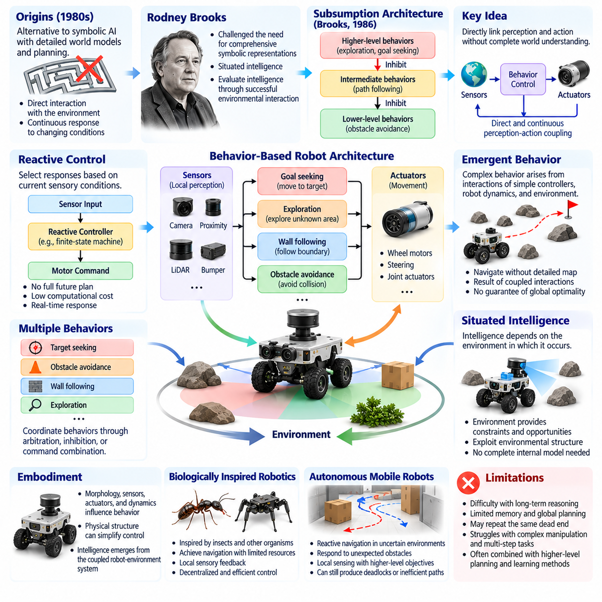{width="7.268055555555556in" height="7.268055555555556in"}

Behavior-based robotics emerged during the 1980s as an alternative to traditional symbolic approaches that depended on detailed world models and sequential planning. Researchers argued that intelligent behavior could arise from direct interactions between sensors, control mechanisms, and the environment. Instead of requiring complete environmental understanding before acting, robots could respond continuously to changing conditions through relatively simple behavioral mechanisms.

Rodney Brooks became a central figure in behavior-based robotics by challenging the assumption that intelligent machines required comprehensive symbolic representations. His research emphasized situated intelligence, where meaningful behavior emerges through continuous engagement with the physical world. This perspective suggested that intelligence should be evaluated through successful environmental interaction rather than exclusively through abstract reasoning or internal computational complexity.

The subsumption architecture, introduced by Brooks in 1986, provided a practical framework for organizing behavior-based robotic systems. It arranged control capabilities into layers that could operate concurrently, with higher layers able to suppress or inhibit selected lower-layer signals. Basic behaviors such as obstacle avoidance remained available while more sophisticated behaviors supported exploration and goal-directed movement. This organization reduced dependence on centralized planning.

A fundamental principle of behavior-based robotics is the close coupling between perception and action. Sensor measurements can directly influence motor commands without requiring complete symbolic interpretation. A mobile robot detecting an obstacle may immediately adjust its steering direction while continuing toward a destination. This rapid response is particularly valuable in dynamic environments where delays associated with extensive planning could reduce safety or operational effectiveness.

Reactive control forms the operational foundation of many behavior-based systems. Rather than calculating an entire future action sequence, a reactive controller selects responses according to current sensory conditions. Such controllers can be implemented through finite-state machines, simple control laws, or sensor-driven rules. Their limited computational requirements make them suitable for robots operating with constrained processors and demanding real-time response requirements.

Behavior-based architectures frequently distribute control responsibilities among multiple specialized behaviors. Obstacle avoidance, wall following, target seeking, and exploration may operate as independent modules. Their outputs must be coordinated through arbitration, inhibition, prioritization, or command combination. This modular organization simplifies individual behaviors but introduces challenges when competing behaviors produce incompatible commands or conflicting objectives.

The concept of emergence became closely associated with behavior-based robotics. Complex system-level behavior can arise from interactions among simple controllers, physical dynamics, and environmental structures. A robot may navigate around obstacles without maintaining a detailed geometric map if local avoidance and goal-seeking mechanisms are appropriately coordinated. However, emergent behavior does not automatically guarantee global efficiency, task completion, or safety under unfamiliar conditions.

Situated intelligence emphasizes that intelligent behavior cannot be understood independently of the environment in which it occurs. The physical world supplies constraints, opportunities, and information that shape an agent\'s actions. Rather than reproducing every environmental detail internally, a robot can exploit environmental structure through direct sensing and interaction. This principle challenged the assumption that comprehensive internal modeling was always necessary for effective autonomy.

Embodiment further strengthened the theoretical foundations of behavior-based robotics. A robot\'s morphology, sensors, actuators, and mechanical dynamics influence which behaviors are possible and how they emerge. Physical structure can simplify control by naturally constraining movement or stabilizing interactions. Consequently, intelligence becomes a property of the coupled robot-environment system rather than an isolated computational process operating independently of physical embodiment.

Biologically inspired robotics provided important examples of behavior-based design. Researchers examined how insects and other organisms achieve navigation, obstacle avoidance, and coordinated movement with limited neural resources. These observations motivated compact control architectures that relied on local sensory feedback. Although biological behavior cannot always be reproduced through simple engineering rules, such approaches demonstrated the potential of decentralized and efficient sensorimotor coordination.

Behavior-based robotics also influenced the development of autonomous mobile robots capable of operating in uncertain environments. Reactive navigation allowed robots to respond to unexpected obstacles without reconstructing complete plans after every environmental change. Local sensing supported immediate movement adjustments, while higher-level behaviors maintained broader objectives. This combination improved practical responsiveness but could still produce deadlocks, oscillations, or inefficient trajectories.

One limitation of purely reactive systems is their difficulty handling tasks that require long-term reasoning or memory. A robot relying exclusively on immediate sensor measurements may repeatedly enter the same dead end or fail to recognize that a temporary detour is necessary. Complex manipulation, multi-step assembly, and strategic navigation often require internal state representations and planning. These limitations encouraged hybrid architectures combining reactive behaviors with deliberative reasoning.

Hybrid deliberative-reactive architectures attempted to preserve the responsiveness of behavior-based control while incorporating structured planning. A deliberative layer could select destinations or task objectives, while reactive modules handled immediate obstacle avoidance and motion correction. Intermediate coordination mechanisms translated abstract goals into executable behaviors. This arrangement became influential in practical autonomous robotics because it balanced strategic reasoning with real-time environmental adaptation.

Behavior-based robotics contributed significantly to the understanding of robustness in autonomous systems. Local feedback can allow a robot to continue functioning when environmental assumptions change or some measurements become unreliable. Modular behaviors may also support graceful degradation when individual capabilities fail. Nevertheless, robustness depends on appropriate behavior coordination, sensor coverage, and system design rather than emerging automatically from decentralization.

The approach also revealed important challenges in verification and performance evaluation. Because behavior emerges through interactions among multiple controllers and environmental conditions, predicting every possible outcome can be difficult. Testing individual modules does not necessarily establish the correctness of the complete system. Reliable deployment therefore requires integrated testing, scenario coverage, safety constraints, and systematic evaluation under realistic operating conditions.

Modern reinforcement learning and robot learning share several conceptual connections with behavior-based robotics. Learned policies frequently map sensory observations directly to actions, resembling reactive sensorimotor control. However, neural policies may encode complex internal representations and exploit experience accumulated across many training episodes. The historical connection lies in emphasizing interaction-driven behavior, while modern learning methods extend the approach through data-driven adaptation and generalization.

Behavior-based principles remain important in contemporary Physical AI architectures. Low-level safety reactions, collision avoidance, balance recovery, and emergency responses often require rapid action without waiting for extensive high-level reasoning. These capabilities can operate alongside learned perception, predictive world models, and task planners. The resulting systems combine immediate responsiveness with more sophisticated anticipation, reasoning, and coordinated decision-making.

The relationship between behavior-based robotics and predictive intelligence illustrates an important architectural distinction. Reactive systems primarily respond to current observations, whereas predictive systems estimate possible future states before selecting actions. Neither approach is universally sufficient. Effective Physical AI frequently requires reactive mechanisms for immediate stabilization and predictive reasoning for anticipating hazards, managing uncertainty, and accomplishing longer-horizon objectives.

Behavior-based robotics also influenced distributed and multi-robot systems by demonstrating how coordinated outcomes can emerge from relatively simple local interactions. Multiple robots may follow local collision-avoidance, spacing, and movement rules while collectively producing organized behavior. Such approaches can reduce centralized coordination requirements, although communication, shared objectives, and conflict resolution remain important for reliable collective operation.

The historical significance of behavior-based robotics lies in its rejection of the assumption that intelligence must begin with complete symbolic understanding. It demonstrated that meaningful autonomous behavior can emerge through continuous sensing, physical interaction, and coordinated control mechanisms. Modern Physical AI extends this foundation by integrating reactive behavior with learning, memory, prediction, and planning, creating systems capable of both immediate adaptation and increasingly sophisticated goal-directed physical intelligence.

행동 기반 로보틱스(Behavior-Based Robotics)는 상세한 세계 모델(World Model)과 순차적 계획(Sequential Planning)에 의존하던 전통적인 기호적 접근법(Symbolic Approach)의 대안으로 1980년대에 등장하였다. 연구자들은 센서(Sensor), 제어 메커니즘(Control Mechanism), 환경(Environment) 사이의 직접적인 상호작용을 통해 지능적 행동(Intelligent Behavior)이 발생할 수 있다고 주장하였다. 로봇은 행동하기 전에 환경을 완전히 이해할 필요 없이 비교적 단순한 행동 메커니즘(Behavioral Mechanism)을 통해 변화하는 조건에 지속적으로 대응할 수 있었다.

로드니 브룩스(Rodney Brooks)는 지능형 기계(Intelligent Machine)에 포괄적인 기호 표현(Symbolic Representation)이 필요하다는 가정에 도전하면서 행동 기반 로보틱스의 핵심 인물로 자리 잡았다. 그의 연구는 물리 세계(Physical World)와의 지속적인 상호작용을 통해 의미 있는 행동이 발생한다는 상황 기반 지능(Situated Intelligence)을 강조하였다. 이러한 관점은 지능(Intelligence)을 추상적 추론(Abstract Reasoning)이나 내부 계산 복잡성(Internal Computational Complexity)만으로 평가하기보다 환경과의 성공적인 상호작용(Environmental Interaction)을 통해 평가해야 한다고 제안하였다.

브룩스가 1986년에 소개한 포섭 아키텍처(Subsumption Architecture)는 행동 기반 로봇 시스템(Behavior-Based Robotic System)을 구성하기 위한 실용적인 프레임워크(Framework)를 제공하였다. 이 아키텍처는 제어 기능(Control Capability)을 동시에 작동할 수 있는 여러 계층(Layer)으로 구성하였으며, 상위 계층이 선택된 하위 계층의 신호를 억제하거나 차단할 수 있도록 하였다. 장애물 회피(Obstacle Avoidance)와 같은 기본 행동은 유지하면서, 더욱 정교한 행동은 탐색(Exploration)과 목표 지향적 이동(Goal-Directed Movement)을 지원하였다. 이러한 구조는 중앙집중식 계획(Centralized Planning)에 대한 의존도를 줄였다.

행동 기반 로보틱스(Behavior-Based Robotics)의 기본 원리 중 하나는 인식(Perception)과 행동(Action) 사이의 긴밀한 결합(Coupling)이다. 센서 측정값(Sensor Measurement)은 완전한 기호적 해석(Symbolic Interpretation)을 거치지 않고도 모터 명령(Motor Command)에 직접 영향을 미칠 수 있다. 장애물을 감지한 이동 로봇(Mobile Robot)은 목적지를 향해 계속 이동하면서 즉시 조향 방향(Steering Direction)을 조정할 수 있다. 이러한 빠른 대응은 복잡한 계획 과정에서 발생하는 지연이 안전성(Safety)이나 운용 효율성(Operational Effectiveness)을 저하시킬 수 있는 동적 환경(Dynamic Environment)에서 특히 중요하다.

반응형 제어(Reactive Control)는 많은 행동 기반 시스템(Behavior-Based System)의 운용 기반을 형성한다. 반응형 제어기(Reactive Controller)는 미래의 전체 행동 순서를 계산하는 대신 현재 감각 조건(Sensory Condition)에 따라 대응 행동(Response)을 선택한다. 이러한 제어기는 유한 상태 기계(Finite-State Machine), 단순 제어 법칙(Control Law), 센서 기반 규칙(Sensor-Driven Rule)을 통해 구현할 수 있다. 계산 자원 요구량(Computational Requirement)이 적기 때문에 제한된 프로세서(Processor)를 사용하면서 엄격한 실시간 응답(Real-Time Response)이 필요한 로봇에 적합하다.

행동 기반 아키텍처(Behavior-Based Architecture)는 여러 전문화된 행동(Specialized Behavior)에 제어 책임(Control Responsibility)을 분산하는 경우가 많다. 장애물 회피(Obstacle Avoidance), 벽면 추종(Wall Following), 목표 추적(Target Seeking), 탐색(Exploration)은 독립적인 모듈(Module)로 작동할 수 있다. 이러한 모듈의 출력(Output)은 중재(Arbitration), 억제(Inhibition), 우선순위 지정(Prioritization), 명령 결합(Command Combination)을 통해 조정되어야 한다. 이러한 모듈식 구성(Modular Organization)은 개별 행동을 단순화하지만, 경쟁하는 행동이 서로 양립할 수 없는 명령이나 충돌하는 목표를 생성할 때 새로운 문제를 발생시킨다.

창발(Emergence)이라는 개념은 행동 기반 로보틱스(Behavior-Based Robotics)와 밀접하게 연결되었다. 단순한 제어기(Simple Controller), 물리 동역학(Physical Dynamics), 환경 구조(Environmental Structure) 사이의 상호작용에서 복잡한 시스템 수준 행동(System-Level Behavior)이 발생할 수 있다. 국소 장애물 회피(Local Obstacle Avoidance)와 목표 추구(Goal Seeking)가 적절히 조정된다면 로봇은 상세한 기하학적 지도(Geometric Map)를 유지하지 않고도 장애물 주변을 이동할 수 있다. 그러나 창발적 행동(Emergent Behavior)이 익숙하지 않은 조건에서 전역적 효율성(Global Efficiency), 작업 완료(Task Completion), 안전성을 자동으로 보장하는 것은 아니다.

상황 기반 지능(Situated Intelligence)은 지능적 행동(Intelligent Behavior)을 행동이 발생하는 환경과 분리하여 이해할 수 없다는 점을 강조한다. 물리 세계(Physical World)는 에이전트(Agent)의 행동을 형성하는 제약(Constraint), 기회(Opportunity), 정보(Information)를 제공한다. 로봇은 모든 환경 세부사항을 내부적으로 재현하는 대신 직접적인 감지(Sensing)와 상호작용(Interaction)을 통해 환경 구조(Environmental Structure)를 활용할 수 있다. 이러한 원리는 효과적인 자율성(Autonomy)을 구현하기 위해 항상 포괄적인 내부 모델(Internal Model)이 필요하다는 가정에 도전하였다.

체화(Embodiment)는 행동 기반 로보틱스(Behavior-Based Robotics)의 이론적 토대를 더욱 강화하였다. 로봇의 형태(Morphology), 센서(Sensor), 구동기(Actuator), 기계적 동역학(Mechanical Dynamics)은 어떤 행동이 가능하며 그러한 행동이 어떻게 발생하는지에 영향을 미친다. 물리적 구조(Physical Structure)는 움직임을 자연스럽게 제한하거나 상호작용을 안정화함으로써 제어(Control)를 단순화할 수 있다. 따라서 지능(Intelligence)은 물리적 체화와 독립적으로 작동하는 고립된 계산 과정(Isolated Computational Process)이 아니라 로봇과 환경이 결합된 시스템(Coupled Robot-Environment System)의 속성으로 이해된다.

생물학적 영감 기반 로보틱스(Biologically Inspired Robotics)는 행동 기반 설계(Behavior-Based Design)의 중요한 사례를 제공하였다. 연구자들은 곤충(Insect)과 기타 생물(Organism)이 제한된 신경 자원(Neural Resource)으로 항법(Navigation), 장애물 회피(Obstacle Avoidance), 협응 운동(Coordinated Movement)을 수행하는 방식을 조사하였다. 이러한 관찰은 국소 감각 피드백(Local Sensory Feedback)에 의존하는 간결한 제어 아키텍처(Compact Control Architecture)의 개발을 촉진하였다. 생물학적 행동(Biological Behavior)을 항상 단순한 공학적 규칙(Engineering Rule)으로 재현할 수 있는 것은 아니지만, 이러한 접근법은 분산형 감각운동 협응(Decentralized Sensorimotor Coordination)의 효율성과 가능성을 보여주었다.

행동 기반 로보틱스(Behavior-Based Robotics)는 불확실한 환경(Uncertain Environment)에서 작동할 수 있는 자율 이동 로봇(Autonomous Mobile Robot)의 발전에도 영향을 미쳤다. 반응형 항법(Reactive Navigation)은 환경이 변화할 때마다 전체 계획을 다시 구성하지 않고도 예상하지 못한 장애물에 대응할 수 있도록 하였다. 국소 감지(Local Sensing)는 즉각적인 움직임 조정(Motion Adjustment)을 지원하였으며, 상위 수준 행동(Higher-Level Behavior)은 더 넓은 목표(Objective)를 유지하였다. 이러한 결합은 실제 대응 능력(Practical Responsiveness)을 향상시켰지만, 교착상태(Deadlock), 진동(Oscillation), 비효율적인 이동 궤적(Inefficient Trajectory)을 발생시킬 가능성은 여전히 존재하였다.

순수 반응형 시스템(Purely Reactive System)의 한계 중 하나는 장기적 추론(Long-Term Reasoning)이나 기억(Memory)이 필요한 작업을 처리하기 어렵다는 점이다. 즉각적인 센서 측정값에만 의존하는 로봇은 동일한 막다른 경로(Dead End)에 반복적으로 진입하거나 일시적인 우회(Detour)가 필요하다는 사실을 인식하지 못할 수 있다. 복잡한 조작(Complex Manipulation), 다단계 조립(Multi-Step Assembly), 전략적 항법(Strategic Navigation)은 내부 상태 표현(Internal State Representation)과 계획(Planning)을 요구하는 경우가 많다. 이러한 한계는 반응형 행동(Reactive Behavior)과 숙고적 추론(Deliberative Reasoning)을 결합한 하이브리드 아키텍처(Hybrid Architecture)의 발전을 촉진하였다.

하이브리드 숙고-반응형 아키텍처(Hybrid Deliberative-Reactive Architecture)는 구조화된 계획(Structured Planning)을 도입하면서 행동 기반 제어(Behavior-Based Control)의 빠른 대응 능력을 유지하려고 시도하였다. 숙고 계층(Deliberative Layer)은 목적지(Destination)나 작업 목표(Task Objective)를 선택하고, 반응형 모듈(Reactive Module)은 즉각적인 장애물 회피와 움직임 보정(Motion Correction)을 처리할 수 있었다. 중간 조정 메커니즘(Intermediate Coordination Mechanism)은 추상적 목표(Abstract Goal)를 실행 가능한 행동(Executable Behavior)으로 변환하였다. 이러한 구성은 전략적 추론(Strategic Reasoning)과 실시간 환경 적응(Real-Time Environmental Adaptation)의 균형을 제공하여 실제 자율 로보틱스(Autonomous Robotics)에 큰 영향을 미쳤다.

행동 기반 로보틱스(Behavior-Based Robotics)는 자율 시스템(Autonomous System)의 강인성(Robustness)을 이해하는 데 중요한 기여를 하였다. 국소 피드백(Local Feedback)을 활용하면 환경에 대한 가정(Environmental Assumption)이 변화하거나 일부 측정값의 신뢰성이 저하되더라도 로봇이 계속 작동할 수 있다. 모듈식 행동(Modular Behavior)은 개별 기능(Capability)에 장애가 발생했을 때 점진적인 성능 저하(Graceful Degradation)를 지원할 수도 있다. 그러나 강인성은 분산화(Decentralization)만으로 자동으로 발생하는 것이 아니라 적절한 행동 조정(Behavior Coordination), 센서 관측 범위(Sensor Coverage), 시스템 설계(System Design)에 따라 결정된다.

이 접근법은 검증(Verification)과 성능 평가(Performance Evaluation)에서 중요한 문제도 드러냈다. 여러 제어기(Controller)와 환경 조건(Environmental Condition) 사이의 상호작용을 통해 행동이 발생하므로 가능한 모든 결과를 예측하기 어려울 수 있다. 개별 모듈(Module)을 시험하는 것만으로 전체 시스템(Complete System)의 정확성(Correctness)이 보장되지는 않는다. 따라서 신뢰성 있는 배포(Reliable Deployment)를 위해서는 통합 시험(Integrated Testing), 시나리오 커버리지(Scenario Coverage), 안전 제약(Safety Constraint), 실제 운용 조건(Realistic Operating Condition)에서의 체계적인 평가(Systematic Evaluation)가 필요하다.

현대 강화학습(Reinforcement Learning)과 로봇 학습(Robot Learning)은 행동 기반 로보틱스(Behavior-Based Robotics)와 여러 개념적 연결점을 공유한다. 학습된 정책(Learned Policy)은 감각 관측(Sensory Observation)을 행동(Action)에 직접 매핑하는 경우가 많으며, 이는 반응형 감각운동 제어(Reactive Sensorimotor Control)와 유사하다. 그러나 신경망 정책(Neural Policy)은 복잡한 내부 표현(Internal Representation)을 부호화하고 수많은 학습 에피소드(Training Episode)에서 축적한 경험을 활용할 수 있다. 역사적 연결점은 상호작용 중심 행동(Interaction-Driven Behavior)을 강조한다는 데 있으며, 현대 학습 방법은 데이터 기반 적응(Data-Driven Adaptation)과 일반화(Generalization)를 통해 이러한 접근법을 확장한다.

행동 기반 원리(Behavior-Based Principle)는 현대 피지컬 인공지능(Physical AI) 아키텍처에서도 여전히 중요하다. 저수준 안전 반응(Low-Level Safety Reaction), 충돌 회피(Collision Avoidance), 균형 회복(Balance Recovery), 비상 대응(Emergency Response)은 복잡한 상위 수준 추론(High-Level Reasoning)을 기다리지 않고 빠르게 행동해야 하는 경우가 많다. 이러한 기능은 학습 기반 인식(Learned Perception), 예측 세계 모델(Predictive World Model), 작업 계획기(Task Planner)와 함께 작동할 수 있다. 그 결과 시스템은 즉각적인 대응 능력(Immediate Responsiveness)과 더욱 정교한 예측(Anticipation), 추론(Reasoning), 협응 의사결정(Coordinated Decision-Making)을 결합하게 된다.

행동 기반 로보틱스(Behavior-Based Robotics)와 예측 지능(Predictive Intelligence)의 관계는 중요한 아키텍처적 차이(Architectural Distinction)를 보여준다. 반응형 시스템(Reactive System)은 주로 현재 관측값(Current Observation)에 대응하는 반면, 예측 시스템(Predictive System)은 행동을 선택하기 전에 가능한 미래 상태(Future State)를 추정한다. 어느 한 접근법만으로 모든 상황을 충분히 처리할 수 있는 것은 아니다. 효과적인 피지컬 인공지능(Physical AI)은 즉각적인 안정화(Immediate Stabilization)를 위한 반응형 메커니즘(Reactive Mechanism)과 위험 예측(Hazard Anticipation), 불확실성 관리(Uncertainty Management), 장기 목표(Long-Horizon Objective) 달성을 위한 예측적 추론(Predictive Reasoning)을 함께 요구하는 경우가 많다.

행동 기반 로보틱스(Behavior-Based Robotics)는 비교적 단순한 국소 상호작용(Local Interaction)에서 협응된 결과(Coordinated Outcome)가 발생할 수 있음을 보여줌으로써 분산 시스템(Distributed System)과 다중 로봇 시스템(Multi-Robot System)의 발전에도 영향을 미쳤다. 여러 로봇은 국소 충돌 회피(Local Collision Avoidance), 간격 유지(Spacing), 이동 규칙(Movement Rule)을 따르면서 집단적으로 조직화된 행동(Organized Behavior)을 생성할 수 있다. 이러한 접근법은 중앙집중식 조정(Centralized Coordination)에 대한 요구를 줄일 수 있지만, 신뢰성 있는 집단 운용(Collective Operation)을 위해서는 통신(Communication), 공유 목표(Shared Objective), 충돌 해결(Conflict Resolution)이 여전히 중요하다.

행동 기반 로보틱스(Behavior-Based Robotics)의 역사적 중요성은 지능(Intelligence)이 완전한 기호적 이해(Symbolic Understanding)에서 시작되어야 한다는 가정을 거부했다는 데 있다. 이 접근법은 지속적인 감지(Continuous Sensing), 물리적 상호작용(Physical Interaction), 협응된 제어 메커니즘(Coordinated Control Mechanism)을 통해 의미 있는 자율 행동(Autonomous Behavior)이 발생할 수 있음을 보여주었다. 현대 피지컬 인공지능(Physical AI)은 이러한 기반 위에 반응형 행동(Reactive Behavior), 학습(Learning), 기억(Memory), 예측(Prediction), 계획(Planning)을 통합함으로써 즉각적인 적응(Immediate Adaptation)과 더욱 정교한 목표 지향적 물리 지능(Goal-Directed Physical Intelligence)을 모두 구현할 수 있는 시스템으로 발전하고 있다.

##  

## 03.05. Probabilistic Robotics and SLAM

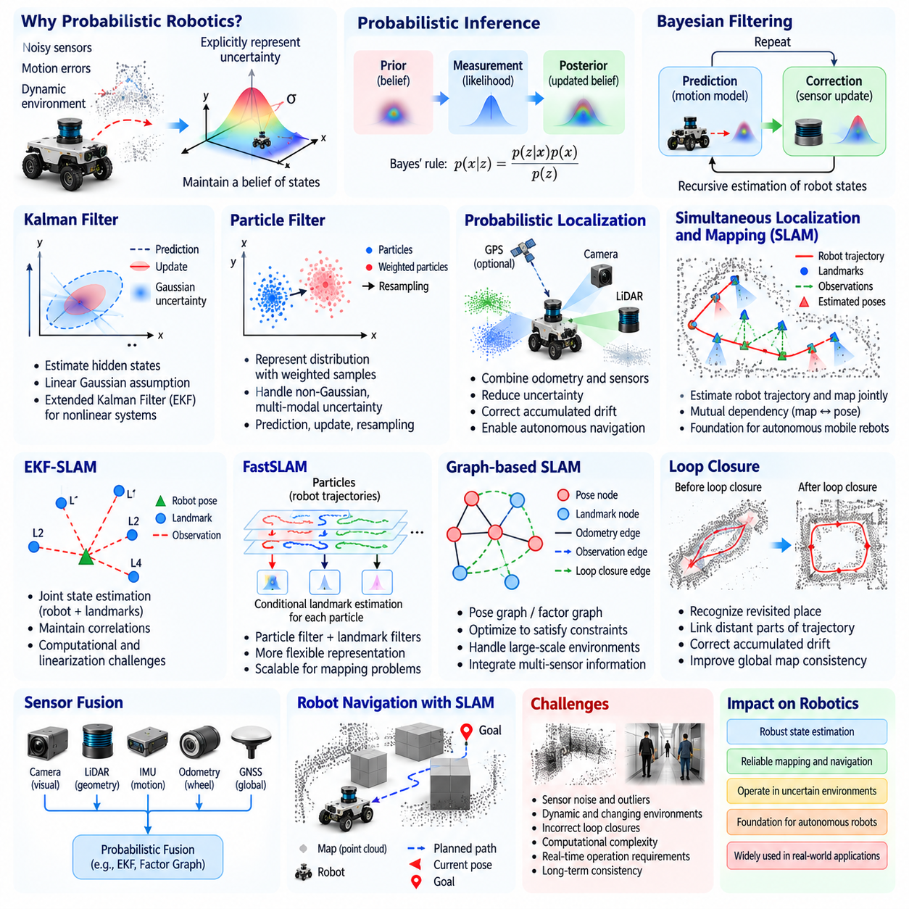{width="7.268055555555556in" height="7.268055555555556in"}

Probabilistic robotics emerged as a major development in autonomous systems by recognizing that physical environments cannot be understood through perfectly accurate measurements or deterministic models. Sensors produce noisy observations, actuators introduce motion errors, and environmental conditions change unpredictably. Instead of assuming complete knowledge, probabilistic robotics represents uncertainty explicitly and uses mathematical inference to estimate the most plausible states of robots and their surroundings.

The theoretical foundation of probabilistic robotics lies in probability theory, Bayesian inference, and stochastic state estimation. A robot maintains a belief about its possible states rather than relying exclusively on a single assumed position or configuration. As new sensor measurements arrive, this belief is updated according to the likelihood of observations and predictions from motion models. Such reasoning enables autonomous systems to operate despite incomplete, ambiguous, or unreliable information.

Bayesian filtering became a central framework for estimating robot states over time. The prediction stage uses a motion model to estimate how the robot\'s state may evolve after an action. The correction stage incorporates sensor observations to revise the predicted distribution. Repeating these operations produces a continuously updated belief state. This recursive structure connects probabilistic inference with the feedback principles that historically shaped autonomous robotics.

The Kalman filter provided an important early foundation for probabilistic state estimation. It combines predictions and measurements to estimate hidden states while accounting for uncertainty under linear Gaussian assumptions. Extended Kalman filters later enabled approximate estimation for nonlinear robotic systems through local linearization. These methods became widely used in navigation, tracking, and sensor fusion, although strong nonlinearities and non-Gaussian uncertainty can limit their accuracy.

Particle filters introduced a more flexible approach by representing probability distributions through collections of weighted samples. Each particle describes a possible robot state, and its weight reflects consistency with available observations. Prediction, measurement updating, and resampling allow the distribution to evolve as the robot moves. Particle filtering is especially useful when uncertainty is multimodal, such as when a robot may occupy several plausible locations.

Probabilistic localization transformed mobile robotics by allowing robots to estimate their positions despite uncertain motion and sensing. Wheel odometry accumulates errors as a robot travels, while cameras, LiDAR, and other sensors provide observations of surrounding structures. By combining these information sources, localization algorithms can reduce uncertainty and correct accumulated drift. Reliable localization became a prerequisite for autonomous navigation in large or changing environments.

Simultaneous Localization and Mapping, commonly called SLAM, addressed the interconnected problem of estimating a robot\'s trajectory while constructing a map of an initially unknown environment. Localization requires a map, while mapping requires knowledge of the robot\'s position. SLAM resolves this dependency by estimating both quantities jointly from motion information and environmental observations. This capability became a foundational technology for autonomous mobile robots and spatial intelligence.

Early SLAM research developed from probabilistic estimation and geometric mapping during the 1980s and 1990s. Researchers recognized that uncertainty in robot position and landmark locations must be considered together. Measurements of shared landmarks create statistical relationships between different estimated states. Maintaining these relationships allows later observations to correct earlier errors, supporting globally consistent maps rather than collections of disconnected local measurements.

Extended Kalman Filter SLAM represented robot poses and landmark positions within a joint probabilistic state estimate. As the robot observed landmarks, the filter updated both their estimated locations and associated uncertainty. This approach demonstrated the importance of preserving correlations between robot and map states. However, increasing map size introduced computational and linearization challenges, motivating alternative formulations for larger environments.

FastSLAM combined particle filtering with conditional landmark estimation to improve flexibility in certain mapping problems. Particles represented possible robot trajectories, while individual landmark estimates were maintained conditionally on those trajectories. This factorization reduced some computational difficulties associated with traditional joint-state filtering. Its development illustrated how probabilistic graphical structure could be exploited to improve robotic estimation algorithms.

Graph-based SLAM introduced another influential representation by expressing robot poses and environmental measurements as a network of constraints. Nodes describe unknown poses or landmarks, while edges represent relative observations and motion relationships. Optimization algorithms seek configurations that best satisfy these constraints. This formulation supports large-scale mapping and provides a natural mechanism for incorporating information collected across extended trajectories.

Loop closure became a critical capability in practical SLAM systems. When a robot revisits a previously observed location, recognizing that place provides constraints linking distant portions of its trajectory. These constraints can correct accumulated drift and improve overall map consistency. Incorrect loop closures, however, may distort an entire map, making reliable place recognition and robust estimation essential components of autonomous spatial understanding.

Visual SLAM expanded mapping capabilities by using cameras to estimate motion and reconstruct environmental structure. Feature-based methods track distinctive image elements across frames, while direct methods exploit image intensity information. Monocular, stereo, and RGB-D cameras offer different tradeoffs in scale estimation, depth measurement, and computational requirements. Visual SLAM became particularly important for compact robots and platforms where cameras provide rich environmental information.

LiDAR-based SLAM uses laser range measurements to estimate geometric structure and robot movement. Scan matching aligns observations collected at different positions, while mapping algorithms accumulate spatial information into consistent representations. LiDAR often provides accurate geometric measurements, although reflective surfaces, sparse features, and dynamic objects introduce challenges. Combining LiDAR with inertial measurements can improve motion estimation and operational robustness.

Sensor fusion became increasingly important because no individual sensor provides complete and reliable environmental information. Cameras offer appearance and semantic cues, LiDAR provides geometric measurements, inertial sensors capture short-term motion, and wheel encoders estimate displacement. Probabilistic fusion combines complementary observations while accounting for their uncertainty. This approach improves localization and mapping when individual sensing modalities become degraded or temporarily unavailable.

Occupancy grid mapping introduced a practical probabilistic representation of free and occupied space. The environment is divided into cells, each associated with an estimated occupancy probability. Sensor observations update these probabilities as the robot explores. Such maps support collision avoidance and path planning without requiring complete semantic understanding of every object. Their probabilistic structure also accommodates uncertainty in measurements and partially observed regions.

Probabilistic robotics changed how autonomous systems interpreted environmental knowledge. Instead of treating a map as an unquestionable description of reality, a robot could maintain estimates with varying confidence. Uncertain regions might require additional observations, while reliable landmarks could support navigation decisions. This perspective established an important connection between perception, uncertainty estimation, and active information gathering.

Active SLAM extended conventional mapping by allowing robots to choose movements that improve both task progress and environmental knowledge. A robot may explore an unfamiliar corridor to reduce map uncertainty or revisit a known landmark to improve localization. Such decisions balance information gain, travel cost, and operational risk. Active SLAM therefore connects probabilistic perception with planning and introduces an early form of uncertainty-aware physical decision-making.

Despite major advances, probabilistic localization and mapping remain sensitive to assumptions about sensor noise, environmental structure, and data association. Dynamic objects can violate static-world assumptions, repetitive environments can confuse place recognition, and long-term environmental changes can invalidate stored maps. Robust systems must therefore detect inconsistent observations, manage uncertainty, and update spatial representations as operating conditions evolve.

The historical significance of probabilistic robotics lies in its replacement of deterministic environmental assumptions with explicit uncertainty-aware inference. SLAM demonstrated that robots could construct useful spatial knowledge while simultaneously estimating their own movement. Modern Physical AI extends these foundations through learned perception, semantic mapping, predictive world models, and adaptive planning. Probabilistic reasoning remains essential for connecting imperfect observations with reliable autonomous action.

확률적 로보틱스(Probabilistic Robotics)는 물리적 환경(Physical Environment)을 완벽하게 정확한 측정값이나 결정론적 모델(Deterministic Model)만으로 이해할 수 없다는 사실을 인식하면서 자율 시스템(Autonomous System)의 주요 발전 방향으로 등장하였다. 센서(Sensor)는 잡음이 포함된 관측값(Noisy Observation)을 생성하고, 구동기(Actuator)는 운동 오차(Motion Error)를 발생시키며, 환경 조건(Environmental Condition)은 예측하기 어렵게 변화한다. 확률적 로보틱스는 완전한 지식(Complete Knowledge)을 가정하는 대신 불확실성(Uncertainty)을 명시적으로 표현하고, 수학적 추론(Mathematical Inference)을 사용하여 로봇과 주변 환경의 가장 가능성 높은 상태를 추정한다.

확률적 로보틱스(Probabilistic Robotics)의 이론적 기반은 확률 이론(Probability Theory), 베이지안 추론(Bayesian Inference), 확률적 상태 추정(Stochastic State Estimation)에 있다. 로봇은 하나의 가정된 위치나 구성(Configuration)에만 의존하지 않고 가능한 상태들에 대한 믿음(Belief)을 유지한다. 새로운 센서 측정값(Sensor Measurement)이 도착하면 관측 가능도(Observation Likelihood)와 운동 모델(Motion Model)의 예측에 따라 이러한 믿음을 갱신한다. 이러한 추론 방식은 불완전하거나 모호하거나 신뢰성이 낮은 정보가 존재하더라도 자율 시스템이 작동할 수 있도록 한다.

베이지안 필터링(Bayesian Filtering)은 시간에 따른 로봇 상태(Robot State)를 추정하기 위한 핵심 프레임워크(Framework)가 되었다. 예측 단계(Prediction Stage)는 운동 모델(Motion Model)을 사용하여 행동 이후 로봇 상태가 어떻게 변화할 수 있는지 추정한다. 보정 단계(Correction Stage)는 센서 관측값(Sensor Observation)을 반영하여 예측된 확률분포(Probability Distribution)를 수정한다. 이러한 연산을 반복하면 지속적으로 갱신되는 믿음 상태(Belief State)가 형성된다. 이 재귀적 구조(Recursive Structure)는 확률적 추론(Probabilistic Inference)을 자율 로보틱스의 역사적 발전을 이끌었던 피드백 원리(Feedback Principle)와 연결한다.

칼만 필터(Kalman Filter)는 확률적 상태 추정(Probabilistic State Estimation)의 중요한 초기 기반을 제공하였다. 칼만 필터는 선형 가우시안 가정(Linear Gaussian Assumption) 아래에서 불확실성을 고려하면서 예측값(Prediction)과 측정값(Measurement)을 결합하여 숨겨진 상태(Hidden State)를 추정한다. 이후 확장 칼만 필터(Extended Kalman Filter)는 국소 선형화(Local Linearization)를 통해 비선형 로봇 시스템(Nonlinear Robotic System)의 근사적 상태 추정을 가능하게 하였다. 이러한 방법은 항법(Navigation), 추적(Tracking), 센서 융합(Sensor Fusion)에 널리 사용되었지만, 강한 비선형성(Nonlinearity)과 비가우시안 불확실성(Non-Gaussian Uncertainty)은 정확도를 제한할 수 있다.

파티클 필터(Particle Filter)는 가중치가 부여된 표본(Weighted Sample)의 집합을 통해 확률분포(Probability Distribution)를 표현하는 더욱 유연한 접근법을 도입하였다. 각 파티클(Particle)은 가능한 로봇 상태(Robot State)를 나타내며, 가중치(Weight)는 이용 가능한 관측값(Observation)과의 일치 정도를 반영한다. 예측(Prediction), 측정값 갱신(Measurement Updating), 재표본추출(Resampling)을 통해 로봇이 이동함에 따라 확률분포가 변화할 수 있다. 파티클 필터링(Particle Filtering)은 로봇이 여러 가능한 위치 중 하나에 존재할 수 있는 상황처럼 불확실성이 다봉형(Multimodal)일 때 특히 유용하다.

확률적 위치 추정(Probabilistic Localization)은 불확실한 운동과 감지 조건에서도 로봇이 자신의 위치를 추정할 수 있도록 하면서 이동 로보틱스(Mobile Robotics)를 변화시켰다. 바퀴 주행거리 추정(Wheel Odometry)은 로봇이 이동하면서 오차가 누적되는 반면, 카메라(Camera), 라이다(LiDAR), 기타 센서(Sensor)는 주변 구조에 대한 관측값을 제공한다. 위치 추정 알고리즘(Localization Algorithm)은 이러한 정보원을 결합하여 불확실성을 줄이고 누적된 표류 오차(Drift)를 보정할 수 있다. 신뢰성 있는 위치 추정(Reliable Localization)은 넓거나 변화하는 환경에서 자율 항법(Autonomous Navigation)을 수행하기 위한 필수 조건이 되었다.

동시적 위치 추정 및 지도 작성(Simultaneous Localization and Mapping, SLAM)은 처음에는 알려지지 않은 환경의 지도를 구축하면서 동시에 로봇의 이동 궤적(Trajectory)을 추정하는 상호 연결된 문제를 해결하였다. 위치 추정(Localization)에는 지도(Map)가 필요하고, 지도 작성(Mapping)에는 로봇의 위치 정보가 필요하다. SLAM은 운동 정보(Motion Information)와 환경 관측값(Environmental Observation)을 이용하여 두 요소를 공동으로 추정함으로써 이러한 상호 의존성(Interdependency)을 해결한다. 이 기술은 자율 이동 로봇(Autonomous Mobile Robot)과 공간 지능(Spatial Intelligence)의 핵심 기반 기술이 되었다.

초기 SLAM 연구는 1980년대와 1990년대에 확률적 추정(Probabilistic Estimation)과 기하학적 지도 작성(Geometric Mapping)을 바탕으로 발전하였다. 연구자들은 로봇 위치(Robot Position)와 랜드마크 위치(Landmark Location)의 불확실성을 함께 고려해야 한다는 사실을 인식하였다. 공통 랜드마크(Shared Landmark)에 대한 측정값은 서로 다른 추정 상태(Estimated State) 사이에 통계적 관계(Statistical Relationship)를 형성한다. 이러한 관계를 유지하면 이후 관측값을 이용해 이전 오차를 보정할 수 있으며, 서로 연결되지 않은 국소 측정값의 집합이 아니라 전역적으로 일관된 지도(Globally Consistent Map)를 구축할 수 있다.

확장 칼만 필터 기반 SLAM(Extended Kalman Filter SLAM, EKF-SLAM)은 로봇 자세(Robot Pose)와 랜드마크 위치(Landmark Position)를 공동 확률 상태 추정(Joint Probabilistic State Estimate)으로 표현하였다. 로봇이 랜드마크를 관측하면 필터(Filter)는 추정된 위치와 관련 불확실성을 함께 갱신하였다. 이 접근법은 로봇 상태와 지도 상태(Map State) 사이의 상관관계(Correlation)를 유지하는 것이 중요하다는 사실을 보여주었다. 그러나 지도 크기가 증가하면서 계산 복잡성(Computational Complexity)과 선형화(Linearization) 문제가 발생하였고, 더 큰 환경을 처리하기 위한 대안적 정식화(Alternative Formulation)의 개발을 촉진하였다.

패스트슬램(FastSLAM)은 특정 지도 작성 문제에서 유연성을 높이기 위해 파티클 필터링(Particle Filtering)과 조건부 랜드마크 추정(Conditional Landmark Estimation)을 결합하였다. 파티클(Particle)은 가능한 로봇 이동 궤적(Robot Trajectory)을 표현하였으며, 개별 랜드마크 추정값(Landmark Estimate)은 해당 궤적을 조건으로 유지되었다. 이러한 인수분해(Factorization)는 전통적인 공동 상태 필터링(Joint-State Filtering)과 관련된 일부 계산상의 어려움을 줄였다. FastSLAM의 발전은 확률적 그래프 구조(Probabilistic Graphical Structure)를 활용하여 로봇 추정 알고리즘(Robotic Estimation Algorithm)을 개선할 수 있음을 보여주었다.

그래프 기반 SLAM(Graph-Based SLAM)은 로봇 자세(Robot Pose)와 환경 측정값(Environmental Measurement)을 제약조건 네트워크(Constraint Network)로 표현하는 또 다른 영향력 있는 방법을 도입하였다. 노드(Node)는 알려지지 않은 자세(Pose)나 랜드마크(Landmark)를 나타내고, 엣지(Edge)는 상대 관측값(Relative Observation)과 운동 관계(Motion Relationship)를 표현한다. 최적화 알고리즘(Optimization Algorithm)은 이러한 제약조건을 가장 잘 만족하는 구성(Configuration)을 탐색한다. 이 정식화는 대규모 지도 작성(Large-Scale Mapping)을 지원하며, 긴 이동 궤적에 걸쳐 수집된 정보를 통합하는 자연스러운 메커니즘을 제공한다.

루프 폐쇄(Loop Closure)는 실제 SLAM 시스템에서 핵심적인 기능이 되었다. 로봇이 이전에 관측했던 위치를 다시 방문하면, 해당 장소를 인식하는 과정은 이동 궤적의 멀리 떨어진 부분들을 연결하는 제약조건(Constraint)을 제공한다. 이러한 제약조건은 누적된 표류 오차(Accumulated Drift)를 보정하고 전체 지도의 일관성(Map Consistency)을 향상시킬 수 있다. 그러나 잘못된 루프 폐쇄(Incorrect Loop Closure)는 지도 전체를 왜곡할 수 있으므로, 신뢰성 있는 장소 인식(Place Recognition)과 강인한 추정(Robust Estimation)은 자율 공간 이해(Autonomous Spatial Understanding)의 필수 구성요소가 되었다.

시각 기반 SLAM(Visual SLAM)은 카메라(Camera)를 사용하여 운동(Motion)을 추정하고 환경 구조(Environmental Structure)를 재구성함으로써 지도 작성 능력을 확장하였다. 특징 기반 방법(Feature-Based Method)은 프레임(Frame) 사이에서 구별 가능한 영상 요소(Image Element)를 추적하며, 직접 방법(Direct Method)은 영상 밝기 정보(Image Intensity Information)를 활용한다. 단안 카메라(Monocular Camera), 스테레오 카메라(Stereo Camera), RGB-D 카메라(RGB-D Camera)는 척도 추정(Scale Estimation), 깊이 측정(Depth Measurement), 계산 요구량(Computational Requirement) 측면에서 서로 다른 장단점을 제공한다. 시각 기반 SLAM은 카메라가 풍부한 환경 정보를 제공하는 소형 로봇과 플랫폼(Platform)에서 특히 중요해졌다.

라이다 기반 SLAM(LiDAR-Based SLAM)은 레이저 거리 측정값(Laser Range Measurement)을 사용하여 기하학적 구조(Geometric Structure)와 로봇의 움직임을 추정한다. 스캔 정합(Scan Matching)은 서로 다른 위치에서 수집된 관측값을 정렬하고, 지도 작성 알고리즘(Mapping Algorithm)은 공간 정보(Spatial Information)를 누적하여 일관된 표현(Consistent Representation)을 구축한다. 라이다는 일반적으로 정확한 기하학적 측정값을 제공하지만, 반사 표면(Reflective Surface), 희소한 특징(Sparse Feature), 동적 객체(Dynamic Object)는 문제를 발생시킬 수 있다. 라이다와 관성 측정값(Inertial Measurement)을 결합하면 운동 추정(Motion Estimation)과 운용 강인성(Operational Robustness)을 향상시킬 수 있다.

센서 융합(Sensor Fusion)은 어떤 단일 센서도 완전하고 신뢰성 있는 환경 정보를 제공하지 못하기 때문에 점점 더 중요해졌다. 카메라(Camera)는 외관(Appearance)과 의미적 단서(Semantic Cue)를 제공하고, 라이다(LiDAR)는 기하학적 측정값(Geometric Measurement)을 제공하며, 관성 센서(Inertial Sensor)는 단기 운동(Short-Term Motion)을 포착하고, 바퀴 엔코더(Wheel Encoder)는 변위(Displacement)를 추정한다. 확률적 융합(Probabilistic Fusion)은 각 관측값의 불확실성을 고려하면서 상호 보완적인 정보를 결합한다. 이러한 접근법은 개별 감지 방식(Sensing Modality)의 성능이 저하되거나 일시적으로 사용할 수 없는 경우에도 위치 추정과 지도 작성의 신뢰성을 향상시킨다.

점유 격자 지도 작성(Occupancy Grid Mapping)은 자유 공간(Free Space)과 점유 공간(Occupied Space)을 표현하기 위한 실용적인 확률적 방법을 도입하였다. 환경은 셀(Cell)로 분할되며, 각 셀에는 추정된 점유 확률(Occupancy Probability)이 부여된다. 로봇이 환경을 탐색하면서 센서 관측값(Sensor Observation)에 따라 이러한 확률이 갱신된다. 이러한 지도는 모든 객체에 대한 완전한 의미적 이해(Semantic Understanding) 없이도 충돌 회피(Collision Avoidance)와 경로 계획(Path Planning)을 지원한다. 또한 확률적 구조(Probabilistic Structure)는 측정값의 불확실성과 부분적으로 관측된 영역(Partially Observed Region)을 표현할 수 있다.

확률적 로보틱스(Probabilistic Robotics)는 자율 시스템(Autonomous System)이 환경 지식(Environmental Knowledge)을 해석하는 방식을 변화시켰다. 로봇은 지도를 의심할 여지 없는 현실의 설명으로 취급하는 대신, 서로 다른 신뢰 수준(Confidence Level)을 가진 추정값(Estimate)을 유지할 수 있게 되었다. 불확실한 영역(Uncertain Region)은 추가 관측(Additional Observation)이 필요할 수 있으며, 신뢰성 있는 랜드마크(Reliable Landmark)는 항법 의사결정(Navigation Decision)을 지원할 수 있다. 이러한 관점은 인식(Perception), 불확실성 추정(Uncertainty Estimation), 능동적 정보 수집(Active Information Gathering) 사이의 중요한 연결을 확립하였다.

능동 SLAM(Active SLAM)은 로봇이 작업 진행(Task Progress)과 환경 지식(Environmental Knowledge)을 모두 개선할 수 있는 움직임을 선택하도록 함으로써 기존 지도 작성 방법을 확장하였다. 로봇은 지도 불확실성(Map Uncertainty)을 줄이기 위해 익숙하지 않은 복도(Corridor)를 탐색하거나, 위치 추정 정확도(Localization Accuracy)를 높이기 위해 알려진 랜드마크를 다시 방문할 수 있다. 이러한 의사결정은 정보 획득량(Information Gain), 이동 비용(Travel Cost), 운용 위험(Operational Risk) 사이의 균형을 고려한다. 따라서 능동 SLAM은 확률적 인식(Probabilistic Perception)과 계획(Planning)을 연결하며, 불확실성을 고려한 물리적 의사결정(Uncertainty-Aware Physical Decision-Making)의 초기 형태를 도입하였다.

중대한 발전에도 불구하고 확률적 위치 추정(Probabilistic Localization)과 지도 작성(Mapping)은 센서 잡음(Sensor Noise), 환경 구조(Environmental Structure), 데이터 연관(Data Association)에 관한 가정에 여전히 민감하다. 동적 객체(Dynamic Object)는 정적 세계 가정(Static-World Assumption)을 위반할 수 있고, 반복적인 환경(Repetitive Environment)은 장소 인식(Place Recognition)을 혼란스럽게 할 수 있으며, 장기적인 환경 변화(Long-Term Environmental Change)는 저장된 지도를 무효화할 수 있다. 따라서 강인한 시스템(Robust System)은 일관되지 않은 관측값(Inconsistent Observation)을 탐지하고, 불확실성을 관리하며, 운용 조건이 변화함에 따라 공간 표현(Spatial Representation)을 갱신해야 한다.

확률적 로보틱스(Probabilistic Robotics)의 역사적 중요성은 결정론적 환경 가정(Deterministic Environmental Assumption)을 명시적으로 불확실성을 고려하는 추론(Uncertainty-Aware Inference)으로 대체했다는 데 있다. SLAM은 로봇이 자신의 움직임을 동시에 추정하면서 유용한 공간 지식(Spatial Knowledge)을 구축할 수 있음을 보여주었다. 현대 피지컬 인공지능(Physical AI)은 학습 기반 인식(Learned Perception), 의미적 지도 작성(Semantic Mapping), 예측 세계 모델(Predictive World Model), 적응형 계획(Adaptive Planning)을 통해 이러한 기반을 확장하고 있다. 확률적 추론(Probabilistic Reasoning)은 불완전한 관측값(Imperfect Observation)을 신뢰성 있는 자율 행동(Reliable Autonomous Action)과 연결하는 데 여전히 필수적인 요소이다.

##  

## 03.06. Machine Learning for Robotics

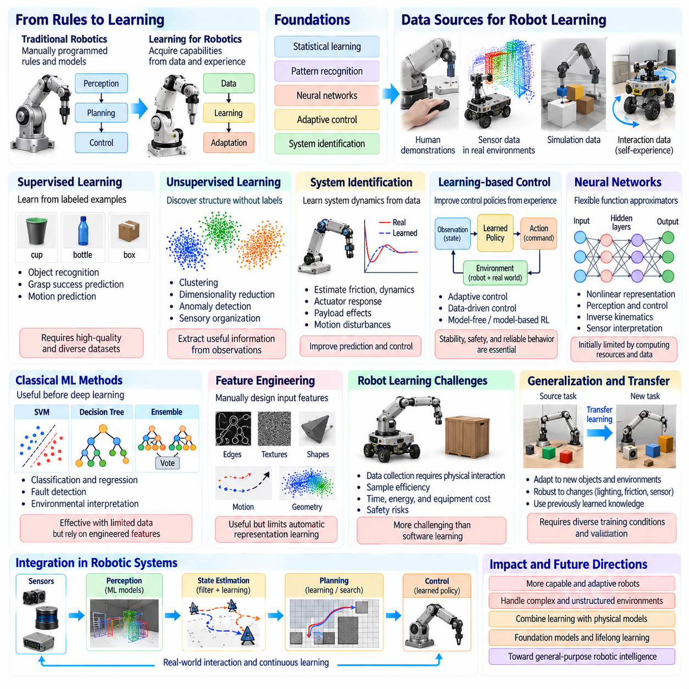{width="7.268055555555556in" height="7.268055555555556in"}

Machine learning introduced a major transformation in robotics by enabling machines to acquire capabilities from data rather than relying entirely on manually programmed rules and mathematical models. Traditional robotic systems required engineers to specify perception algorithms, decision procedures, and control strategies explicitly. Learning-based approaches allowed robots to discover useful patterns from observations, demonstrations, and interactions, creating new opportunities for adaptation in complex physical environments.

The foundations of machine learning for robotics emerged from developments in statistical learning, pattern recognition, neural networks, and adaptive control. Early researchers explored how computational systems could improve performance through experience rather than fixed instructions. In robotics, these ideas were applied to object recognition, motion prediction, system identification, and control optimization. The resulting methods gradually connected statistical inference with physical action and autonomous decision-making.

Supervised learning became an important approach for training robotic perception and prediction systems. Algorithms learned relationships between input measurements and labeled outputs using examples collected from sensors or experimental environments. A robot could learn to classify objects, estimate grasp success, or predict mechanical responses from recorded data. However, supervised learning depended heavily on the quality, diversity, and representativeness of available training datasets.

Unsupervised learning offered methods for discovering structure in robotic data without requiring explicit labels. Clustering algorithms could identify recurring environmental patterns, while dimensionality reduction techniques compressed high-dimensional sensor measurements into manageable representations. These capabilities supported anomaly detection, sensory organization, and exploratory analysis. They also demonstrated how robots could extract useful information from observations without complete human supervision.

System identification became a particularly important application of machine learning in robotics. Instead of assuming that every mechanical parameter was known precisely, researchers estimated dynamic relationships from measured inputs and outputs. Learned models could describe friction, actuator response, payload effects, or motion disturbances. Such models improved prediction and control, although their reliability depended on sufficient excitation, representative operating conditions, and appropriate uncertainty management.

Learning-based control extended classical control theory by allowing control policies or model parameters to improve through experience. Adaptive methods adjusted controller behavior when system dynamics changed, while data-driven approaches learned relationships between observations and suitable actions. These techniques were especially useful when accurate analytical models were unavailable. Nevertheless, stability, safety, and predictable behavior remained essential requirements during learning and deployment.

Artificial neural networks provided flexible function approximators for robotic applications. By combining interconnected computational units, neural networks could represent nonlinear relationships that were difficult to describe through conventional equations. Early robotic applications included sensor interpretation, inverse kinematics approximation, and motor control. Their practical effectiveness was initially constrained by limited computing resources, relatively small datasets, and difficulties in training complex models.

Support vector machines, decision trees, and ensemble learning methods also contributed to robotic intelligence before deep learning became dominant. These algorithms supported classification, regression, fault detection, and environmental interpretation using engineered features. Their comparatively structured training procedures made them useful for applications with limited data. However, performance often depended on careful feature selection and assumptions about the underlying data distribution.

Feature engineering played a central role in early machine-learning-based robotics. Engineers manually designed descriptors representing edges, textures, shapes, motion patterns, or geometric relationships. Learning algorithms then used these features to recognize objects or predict environmental conditions. This separation between feature construction and statistical learning provided practical results but limited the ability of systems to discover complex representations automatically.

Robot learning introduced the additional challenge that data collection frequently requires physical interaction. Unlike software systems that can process stored examples repeatedly, robots may need to move, manipulate objects, or contact surfaces to acquire useful experience. These activities consume time, energy, and equipment resources while introducing safety risks. Consequently, sample efficiency became a fundamental concern in developing practical learning algorithms for physical systems.

Generalization emerged as another central challenge because robots must operate beyond the exact conditions represented in their training data. Changes in lighting, object geometry, surface friction, payload, or sensor placement can reduce model accuracy. A system that performs successfully in a laboratory may fail in an unfamiliar operating environment. Robust robot learning therefore requires diverse training conditions, careful validation, and mechanisms for detecting distribution shifts.

Transfer learning offered a strategy for reusing previously acquired knowledge across related robotic tasks. A model trained on one collection of objects or environments could provide useful representations for another application. Fine-tuning adapted existing parameters using additional task-specific data, reducing the need to train every capability from the beginning. However, differences between robot platforms, sensing configurations, and physical dynamics could limit successful transfer.

Learning from demonstration provided an alternative to manually specifying every robotic behavior. Human operators or expert controllers generated examples of successful actions, which learning algorithms used to construct policies. This approach was particularly attractive for manipulation tasks where precise rules were difficult to formulate. Demonstrations supplied practical knowledge about task execution, although limited coverage and accumulated imitation errors could restrict performance.

Machine learning also strengthened probabilistic robotics by improving perception models, measurement interpretation, and environmental prediction. Learned classifiers could identify landmarks, distinguish objects, or estimate observation reliability. Statistical models could complement geometric localization and mapping algorithms by providing additional semantic information. This integration connected data-driven pattern recognition with uncertainty-aware state estimation and traditional robotic navigation.

The historical importance of machine learning for robotics lies in its transition from explicitly engineered intelligence toward capabilities acquired through experience. It established methods for learning perception, prediction, and control while revealing challenges involving data efficiency, generalization, and physical safety. Modern Physical AI extends these foundations through deep learning, reinforcement learning, foundation models, and world models, integrating learned intelligence with reliable real-world interaction.

기계학습(Machine Learning)은 수작업으로 프로그래밍된 규칙(Manually Programmed Rules)과 수학적 모델(Mathematical Models)에 전적으로 의존하는 대신, 데이터(Data)로부터 능력(Capability)을 습득할 수 있도록 함으로써 로보틱스(Robotics)에 중대한 변화를 가져왔다. 전통적인 로봇 시스템(Traditional Robotic System)은 엔지니어가 인식 알고리즘(Perception Algorithm), 의사결정 절차(Decision Procedure), 제어 전략(Control Strategy)을 명시적으로 정의해야 했다. 학습 기반 접근법(Learning-Based Approach)은 로봇이 관측(Observation), 시연(Demonstration), 상호작용(Interaction)으로부터 유용한 패턴(Pattern)을 발견할 수 있도록 하였으며, 복잡한 물리적 환경(Physical Environment)에서 적응(Adaptation)을 위한 새로운 가능성을 창출하였다.

로보틱스를 위한 기계학습(Machine Learning for Robotics)의 기반은 통계적 학습(Statistical Learning), 패턴 인식(Pattern Recognition), 신경망(Neural Network), 적응 제어(Adaptive Control)의 발전에서 형성되었다. 초기 연구자들은 계산 시스템(Computational System)이 고정된 명령(Fixed Instruction)이 아니라 경험(Experience)을 통해 성능을 개선하는 방법을 탐구하였다. 로보틱스에서는 이러한 개념을 객체 인식(Object Recognition), 운동 예측(Motion Prediction), 시스템 식별(System Identification), 제어 최적화(Control Optimization)에 적용하였다. 그 결과 이러한 방법은 점차 통계적 추론(Statistical Inference)을 물리적 행동(Physical Action) 및 자율적 의사결정(Autonomous Decision-Making)과 연결하였다.

지도학습(Supervised Learning)은 로봇 인식(Robotic Perception)과 예측 시스템(Prediction System)을 학습시키기 위한 중요한 접근법이 되었다. 알고리즘(Algorithm)은 센서(Sensor)나 실험 환경(Experimental Environment)에서 수집한 사례를 이용하여 입력 측정값(Input Measurement)과 정답 레이블이 부여된 출력(Labeled Output) 사이의 관계를 학습하였다. 로봇은 기록된 데이터(Recorded Data)를 통해 객체를 분류(Classification)하거나, 파지 성공 가능성(Grasp Success)을 추정하거나, 기계적 반응(Mechanical Response)을 예측하도록 학습할 수 있었다. 그러나 지도학습은 사용 가능한 학습 데이터셋(Training Dataset)의 품질(Quality), 다양성(Diversity), 대표성(Representativeness)에 크게 의존하였다.

비지도학습(Unsupervised Learning)은 명시적인 레이블(Explicit Label) 없이 로봇 데이터(Robotic Data)의 구조를 발견하는 방법을 제공하였다. 군집화 알고리즘(Clustering Algorithm)은 반복적으로 나타나는 환경 패턴(Environmental Pattern)을 식별할 수 있었으며, 차원 축소 기법(Dimensionality Reduction Technique)은 고차원 센서 측정값(High-Dimensional Sensor Measurement)을 관리 가능한 표현(Representation)으로 압축하였다. 이러한 기능은 이상 탐지(Anomaly Detection), 감각 정보 구성(Sensory Organization), 탐색적 분석(Exploratory Analysis)을 지원하였다. 또한 로봇이 완전한 인간 감독(Human Supervision) 없이도 관측값으로부터 유용한 정보를 추출할 수 있음을 보여주었다.

시스템 식별(System Identification)은 로보틱스에서 기계학습(Machine Learning)의 특히 중요한 응용 분야가 되었다. 연구자들은 모든 기계적 매개변수(Mechanical Parameter)가 정확하게 알려져 있다고 가정하는 대신, 측정된 입력(Input)과 출력(Output)으로부터 동적 관계(Dynamic Relationship)를 추정하였다. 학습된 모델(Learned Model)은 마찰(Friction), 구동기 응답(Actuator Response), 적재하중 효과(Payload Effect), 운동 외란(Motion Disturbance)을 설명할 수 있었다. 이러한 모델은 예측(Prediction)과 제어(Control)를 개선하였지만, 신뢰성(Reliability)은 충분한 시스템 가진(System Excitation), 대표적인 운용 조건(Representative Operating Condition), 적절한 불확실성 관리(Uncertainty Management)에 의존하였다.

학습 기반 제어(Learning-Based Control)는 제어 정책(Control Policy)이나 모델 매개변수(Model Parameter)가 경험을 통해 개선될 수 있도록 함으로써 고전 제어 이론(Classical Control Theory)을 확장하였다. 적응형 방법(Adaptive Method)은 시스템 동역학(System Dynamics)이 변화할 때 제어기 동작(Controller Behavior)을 조정하였으며, 데이터 기반 접근법(Data-Driven Approach)은 관측값(Observation)과 적절한 행동(Action) 사이의 관계를 학습하였다. 이러한 기법은 정확한 해석적 모델(Analytical Model)을 사용할 수 없는 경우에 특히 유용하였다. 그럼에도 학습과 배포(Deployment) 과정에서 안정성(Stability), 안전성(Safety), 예측 가능한 동작(Predictable Behavior)은 필수 요구사항으로 유지되었다.

인공신경망(Artificial Neural Network)은 로봇 응용 분야(Robotic Application)에 유연한 함수 근사기(Function Approximator)를 제공하였다. 서로 연결된 계산 단위(Computational Unit)를 결합함으로써 신경망은 기존 방정식(Conventional Equation)으로 설명하기 어려운 비선형 관계(Nonlinear Relationship)를 표현할 수 있었다. 초기 로봇 응용에는 센서 정보 해석(Sensor Interpretation), 역기구학 근사(Inverse Kinematics Approximation), 모터 제어(Motor Control)가 포함되었다. 그러나 초기에는 제한된 컴퓨팅 자원(Computing Resource), 상대적으로 작은 데이터셋(Dataset), 복잡한 모델(Model)의 학습 어려움으로 인해 실제 효과가 제약되었다.

서포트 벡터 머신(Support Vector Machine), 의사결정 트리(Decision Tree), 앙상블 학습(Ensemble Learning) 방법 역시 딥러닝(Deep Learning)이 지배적인 접근법으로 자리 잡기 전에 로봇 지능(Robotic Intelligence)의 발전에 기여하였다. 이러한 알고리즘은 설계된 특징(Engineered Feature)을 이용하여 분류(Classification), 회귀(Regression), 고장 탐지(Fault Detection), 환경 해석(Environmental Interpretation)을 지원하였다. 비교적 체계적인 학습 절차(Structured Training Procedure)는 데이터가 제한된 응용 분야에서 유용하였다. 그러나 성능(Performance)은 신중한 특징 선택(Feature Selection)과 기저 데이터 분포(Underlying Data Distribution)에 대한 가정에 의존하는 경우가 많았다.

특징 공학(Feature Engineering)은 초기 기계학습 기반 로보틱스(Machine-Learning-Based Robotics)에서 핵심적인 역할을 수행하였다. 엔지니어들은 모서리(Edge), 질감(Texture), 형상(Shape), 운동 패턴(Motion Pattern), 기하학적 관계(Geometric Relationship)를 표현하는 특징 기술자(Feature Descriptor)를 수작업으로 설계하였다. 이후 학습 알고리즘(Learning Algorithm)은 이러한 특징을 이용하여 객체를 인식하거나 환경 조건(Environmental Condition)을 예측하였다. 특징 구성(Feature Construction)과 통계적 학습(Statistical Learning)을 분리하는 방식은 실용적인 결과를 제공하였지만, 시스템이 복잡한 표현(Complex Representation)을 자동으로 발견하는 능력을 제한하였다.

로봇 학습(Robot Learning)은 데이터 수집(Data Collection)에 물리적 상호작용(Physical Interaction)이 자주 필요하다는 추가적인 문제를 제기하였다. 저장된 사례(Stored Example)를 반복적으로 처리할 수 있는 소프트웨어 시스템(Software System)과 달리, 로봇은 유용한 경험(Experience)을 얻기 위해 이동하거나 객체를 조작하거나 표면과 접촉해야 할 수 있다. 이러한 활동은 시간(Time), 에너지(Energy), 장비 자원(Equipment Resource)을 소비하면서 안전 위험(Safety Risk)을 발생시킨다. 따라서 샘플 효율성(Sample Efficiency)은 물리 시스템(Physical System)을 위한 실용적인 학습 알고리즘(Learning Algorithm)을 개발하는 데 근본적인 고려사항이 되었다.

일반화(Generalization)는 로봇이 학습 데이터(Training Data)에 포함된 정확한 조건을 벗어난 환경에서도 작동해야 하기 때문에 또 다른 핵심 과제로 등장하였다. 조명(Lighting), 객체 형상(Object Geometry), 표면 마찰(Surface Friction), 적재하중(Payload), 센서 배치(Sensor Placement)의 변화는 모델 정확도(Model Accuracy)를 저하시킬 수 있다. 실험실(Laboratory)에서 성공적으로 작동하는 시스템이 익숙하지 않은 운용 환경(Operating Environment)에서는 실패할 수 있다. 따라서 강인한 로봇 학습(Robust Robot Learning)을 위해서는 다양한 학습 조건(Diverse Training Condition), 신중한 검증(Validation), 분포 변화(Distribution Shift)를 탐지하는 메커니즘이 필요하다.

전이학습(Transfer Learning)은 관련된 로봇 작업(Robotic Task) 사이에서 이전에 습득한 지식(Knowledge)을 재사용하기 위한 전략을 제공하였다. 특정 객체 집합(Object Collection)이나 환경(Environment)에서 학습된 모델(Model)은 다른 응용 분야에 유용한 표현(Representation)을 제공할 수 있었다. 미세조정(Fine-Tuning)은 추가적인 작업별 데이터(Task-Specific Data)를 이용하여 기존 매개변수(Existing Parameter)를 조정함으로써 모든 기능을 처음부터 학습할 필요성을 줄였다. 그러나 로봇 플랫폼(Robot Platform), 감지 구성(Sensing Configuration), 물리 동역학(Physical Dynamics)의 차이는 성공적인 전이(Transfer)를 제한할 수 있었다.

시연 학습(Learning from Demonstration)은 모든 로봇 행동(Robotic Behavior)을 수작업으로 명시하는 방식의 대안을 제공하였다. 인간 작업자(Human Operator)나 전문가 제어기(Expert Controller)는 성공적인 행동 사례(Action Example)를 생성하였으며, 학습 알고리즘(Learning Algorithm)은 이를 이용하여 정책(Policy)을 구성하였다. 이러한 접근법은 정확한 규칙(Rule)을 공식화하기 어려운 조작 작업(Manipulation Task)에서 특히 매력적이었다. 시연(Demonstration)은 작업 실행(Task Execution)에 관한 실용적 지식(Practical Knowledge)을 제공하였지만, 제한된 상황 포괄 범위(Limited Coverage)와 누적되는 모방 오차(Accumulated Imitation Error)는 성능을 제한할 수 있었다.

기계학습(Machine Learning)은 인식 모델(Perception Model), 측정값 해석(Measurement Interpretation), 환경 예측(Environmental Prediction)을 개선함으로써 확률적 로보틱스(Probabilistic Robotics)도 강화하였다. 학습된 분류기(Learned Classifier)는 랜드마크(Landmark)를 식별하거나, 객체(Object)를 구별하거나, 관측 신뢰성(Observation Reliability)을 추정할 수 있었다. 통계적 모델(Statistical Model)은 추가적인 의미 정보(Semantic Information)를 제공함으로써 기하학적 위치 추정(Geometric Localization)과 지도 작성 알고리즘(Mapping Algorithm)을 보완할 수 있었다. 이러한 통합은 데이터 기반 패턴 인식(Data-Driven Pattern Recognition)을 불확실성을 고려한 상태 추정(Uncertainty-Aware State Estimation) 및 전통적인 로봇 항법(Traditional Robotic Navigation)과 연결하였다.

로보틱스를 위한 기계학습(Machine Learning for Robotics)의 역사적 중요성은 명시적으로 설계된 지능(Explicitly Engineered Intelligence)에서 경험을 통해 습득되는 능력(Experience-Acquired Capability)으로 전환하는 기반을 마련했다는 데 있다. 기계학습은 인식(Perception), 예측(Prediction), 제어(Control)를 학습하는 방법을 확립하는 동시에 데이터 효율성(Data Efficiency), 일반화(Generalization), 물리적 안전성(Physical Safety)에 관한 과제를 드러냈다. 현대 피지컬 인공지능(Physical AI)은 딥러닝(Deep Learning), 강화학습(Reinforcement Learning), 파운데이션 모델(Foundation Model), 세계 모델(World Model)을 통해 이러한 기반을 확장하면서 학습된 지능(Learned Intelligence)을 신뢰성 있는 실제 세계 상호작용(Reliable Real-World Interaction)과 통합하고 있다.

##  

## 03.07. Deep Learning and Robot Perception

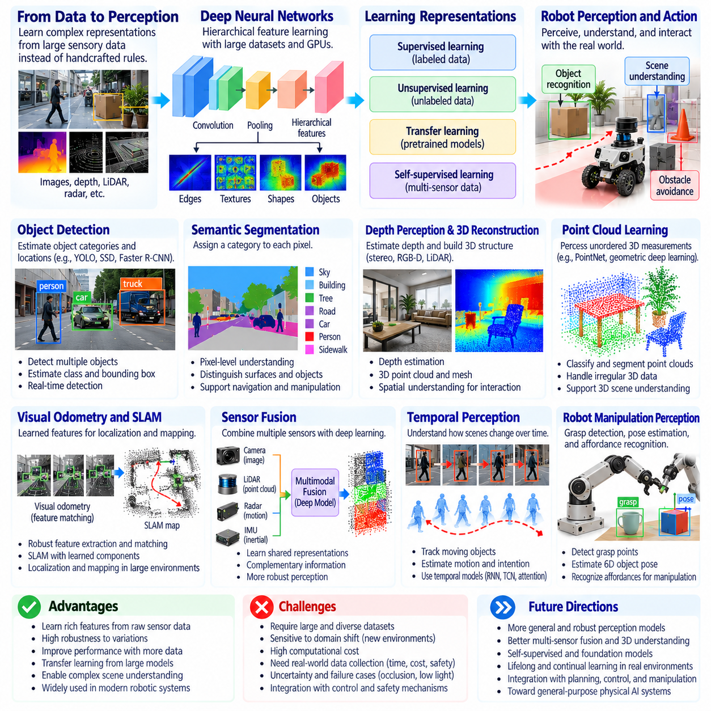{width="7.268055555555556in" height="7.268055555555556in"}

Deep learning transformed robot perception by enabling machines to learn complex representations directly from large collections of sensory data. Earlier robotic systems relied heavily on manually designed features and predefined recognition rules. Deep neural networks instead learned hierarchical patterns from images, depth measurements, and other sensor signals. This transition improved the ability of robots to interpret complex environments and established perception as a central capability of modern Physical AI.

The foundations of deep learning emerged from artificial neural networks, backpropagation, and advances in statistical optimization. Although multilayer neural networks had been investigated for decades, practical progress accelerated with larger datasets, improved algorithms, and graphics processing units. These developments made it possible to train models containing millions of parameters. Robotics benefited from this computational progress as perception systems became increasingly capable of learning from diverse environmental observations.

Convolutional neural networks became particularly influential in visual perception because they exploit spatial relationships within images. Convolutional layers learn local patterns such as edges, textures, and shapes, while deeper layers combine these patterns into more abstract representations. Pooling and hierarchical feature extraction help models recognize objects despite variations in position and appearance. These capabilities reduced dependence on handcrafted visual descriptors in robotic applications.

The success of deep convolutional networks in large-scale image recognition accelerated their adoption in robotics. Models trained on extensive visual datasets demonstrated that learned representations could outperform many traditional feature-engineering approaches. Transfer learning allowed robotic systems to reuse pretrained visual features and adapt them to specialized environments. This strategy reduced training requirements for applications involving industrial objects, warehouse inventory, and service robotics.

Object detection became a major application of deep learning in robotic perception. Detection networks estimate both object categories and their locations within images, providing information needed for navigation and manipulation. Architectures such as Faster R-CNN, SSD, and YOLO introduced different tradeoffs between recognition accuracy and computational speed. Real-time detection became especially important for mobile robots that must identify obstacles, people, and operational targets while moving.

Semantic segmentation extended visual recognition by assigning meaningful categories to individual image pixels. Instead of identifying only object boundaries through rectangular boxes, segmentation models describe the spatial distribution of surfaces and objects. A robot can distinguish floors, walls, machinery, and pedestrians at finer resolution. Instance segmentation further separates individual objects belonging to the same category, supporting grasp planning and scene interpretation.

Depth perception and three-dimensional reconstruction became increasingly important as robots required spatial understanding beyond two-dimensional images. Stereo cameras, RGB-D sensors, and LiDAR provide geometric information that can be processed through learned models. Neural networks estimate depth, reconstruct surfaces, and infer three-dimensional object structure. These capabilities support collision avoidance, manipulation, and navigation, although accuracy remains sensitive to sensor limitations and environmental conditions.

Point cloud learning introduced neural architectures designed to process unordered collections of three-dimensional measurements. Methods such as PointNet and subsequent geometric learning approaches enabled classification and segmentation directly from point clouds. Unlike conventional image networks, these models must account for irregular spatial sampling and geometric relationships. Their development expanded deep perception into autonomous driving, robotic inspection, and three-dimensional scene understanding.

Visual odometry and SLAM also benefited from deep learning through improved feature extraction, matching, and environmental interpretation. Learned visual descriptors can identify correspondences across changing viewpoints and illumination conditions. Neural depth estimation and semantic segmentation provide additional constraints for localization and mapping. However, learned components must still address geometric consistency, uncertainty, and accumulated drift to support reliable long-term navigation.

Sensor fusion became more powerful as deep learning enabled information from cameras, LiDAR, radar, and inertial sensors to be combined within shared representations. Multimodal networks learn complementary patterns across different sensing modalities. Visual information contributes appearance and semantic meaning, while range and motion measurements provide geometric and dynamic constraints. Effective fusion improves robustness, but synchronization errors and sensor failures remain significant engineering challenges.

Temporal perception extended deep learning beyond individual observations by modeling how scenes evolve over time. Recurrent neural networks, temporal convolutional models, and attention mechanisms can integrate sequences of sensory measurements. These approaches help robots track moving objects, estimate motion, and recognize activities. Temporal understanding is particularly important when a single observation cannot reveal an object\'s velocity, intention, or interaction history.

Robot manipulation benefited from deep visual perception through learned grasp detection, object pose estimation, and affordance recognition. Rather than relying exclusively on predefined geometric models, robots could infer suitable grasp locations and interaction possibilities from visual observations. Learned perception supported handling unfamiliar objects and variable arrangements. Nevertheless, reliable manipulation still required accurate calibration, contact feedback, and coordination between perception and control.

Dataset development became a critical factor in advancing deep robotic perception. Large annotated image collections supported object recognition, while specialized datasets provided depth, segmentation, tracking, and three-dimensional labels. Synthetic environments supplemented real-world recordings by generating diverse scenes and controlled variations. However, dataset bias, annotation errors, and differences between simulated and physical environments continued to affect model generalization.

Robustness and safety emerged as major concerns because high recognition accuracy on benchmark datasets does not guarantee dependable operation in physical environments. Lighting changes, motion blur, occlusion, reflective materials, and unfamiliar objects can degrade perception performance. Errors may propagate into planning and control, creating physical risks. Reliable systems therefore require uncertainty estimation, continuous monitoring, validation, and appropriate fallback mechanisms.

The historical significance of deep learning in robot perception lies in its ability to replace many manually engineered representations with learned hierarchical features. It expanded robotic understanding from basic object recognition toward semantic, geometric, and temporal interpretation of complex scenes. Modern Physical AI builds upon these advances by integrating deep perception with multimodal reasoning, world models, and action policies, connecting sensory understanding with adaptive physical behavior.

딥러닝(Deep Learning)은 방대한 감각 데이터(Sensory Data)로부터 복잡한 표현(Complex Representation)을 직접 학습할 수 있도록 함으로써 로봇 인식(Robot Perception)에 혁신적인 변화를 가져왔다. 초기 로봇 시스템(Robotic System)은 수작업으로 설계된 특징(Handcrafted Feature)과 사전에 정의된 인식 규칙(Recognition Rule)에 크게 의존하였다. 반면 심층 신경망(Deep Neural Network)은 이미지(Image), 깊이 측정값(Depth Measurement), 기타 센서 신호(Sensor Signal)로부터 계층적 패턴(Hierarchical Pattern)을 학습하였다. 이러한 전환은 복잡한 환경을 해석하는 로봇의 능력을 향상시켰으며, 인식(Perception)을 현대 피지컬 인공지능(Physical AI)의 핵심 역량으로 확립하였다.

딥러닝(Deep Learning)의 기반은 인공신경망(Artificial Neural Network), 역전파(Backpropagation), 통계적 최적화(Statistical Optimization)의 발전에서 형성되었다. 다층 신경망(Multilayer Neural Network)은 수십 년 동안 연구되어 왔지만, 대규모 데이터셋(Large Dataset), 개선된 알고리즘(Improved Algorithm), 그래픽 처리 장치(Graphics Processing Unit)의 등장으로 실질적인 발전이 가속화되었다. 이러한 기술 발전은 수백만 개의 매개변수(Parameter)를 포함하는 모델(Model)의 학습을 가능하게 하였다. 로보틱스(Robotics)는 이러한 계산 기술의 발전을 활용하여 다양한 환경 관측값(Environmental Observation)으로부터 학습하는 인식 시스템(Perception System)의 능력을 지속적으로 향상시켰다.

합성곱 신경망(Convolutional Neural Network)은 이미지 내부의 공간적 관계(Spatial Relationship)를 활용하기 때문에 시각 인식(Visual Perception)에서 특히 중요한 역할을 하였다. 합성곱 계층(Convolutional Layer)은 모서리(Edge), 질감(Texture), 형상(Shape)과 같은 국소 패턴(Local Pattern)을 학습하며, 더 깊은 계층(Deeper Layer)은 이러한 패턴을 결합하여 더욱 추상적인 표현(Abstract Representation)을 형성한다. 풀링(Pooling)과 계층적 특징 추출(Hierarchical Feature Extraction)은 위치와 외형(Appearance)이 달라지더라도 모델이 객체를 인식하도록 지원한다. 이러한 능력은 로봇 응용 분야에서 수작업으로 설계된 시각 특징 기술자(Handcrafted Visual Descriptor)에 대한 의존도를 줄였다.

대규모 이미지 인식(Large-Scale Image Recognition)에서 심층 합성곱 신경망(Deep Convolutional Network)이 거둔 성공은 로보틱스 분야로의 도입을 가속화하였다. 방대한 시각 데이터셋(Visual Dataset)으로 학습된 모델은 학습된 표현(Learned Representation)이 많은 전통적인 특징 공학(Feature Engineering) 접근법보다 우수한 성능을 제공할 수 있음을 보여주었다. 전이학습(Transfer Learning)은 로봇 시스템이 사전학습된 시각 특징(Pretrained Visual Feature)을 재사용하고 이를 특수한 환경에 맞게 적응시킬 수 있도록 하였다. 이러한 전략은 산업용 객체(Industrial Object), 창고 재고(Warehouse Inventory), 서비스 로보틱스(Service Robotics)와 관련된 응용 분야에서 학습 요구량(Training Requirement)을 줄였다.

객체 탐지(Object Detection)는 로봇 인식(Robotic Perception)에서 딥러닝(Deep Learning)의 주요 응용 분야가 되었다. 탐지 신경망(Detection Network)은 이미지 내부의 객체 범주(Object Category)와 위치(Location)를 함께 추정하여 항법(Navigation)과 조작(Manipulation)에 필요한 정보를 제공한다. Faster R-CNN, SSD, YOLO와 같은 아키텍처(Architecture)는 인식 정확도(Recognition Accuracy)와 계산 속도(Computational Speed) 사이에서 서로 다른 절충관계(Tradeoff)를 제시하였다. 실시간 객체 탐지(Real-Time Object Detection)는 이동 중에 장애물(Obstacle), 사람(Person), 작업 대상(Operational Target)을 식별해야 하는 이동 로봇(Mobile Robot)에 특히 중요해졌다.

의미적 분할(Semantic Segmentation)은 이미지의 개별 픽셀(Pixel)에 의미 있는 범주(Category)를 할당함으로써 시각 인식(Visual Recognition)을 확장하였다. 분할 모델(Segmentation Model)은 직사각형 경계 상자(Bounding Box)를 통해 객체의 경계만 식별하는 대신, 표면(Surface)과 객체(Object)의 공간적 분포(Spatial Distribution)를 설명한다. 로봇은 바닥(Floor), 벽(Wall), 기계 설비(Machinery), 보행자(Pedestrian)를 더욱 세밀한 해상도(Resolution)로 구별할 수 있다. 인스턴스 분할(Instance Segmentation)은 동일한 범주에 속하는 개별 객체를 추가로 구분하여 파지 계획(Grasp Planning)과 장면 해석(Scene Interpretation)을 지원한다.

로봇이 2차원 이미지(Two-Dimensional Image)를 넘어서는 공간 이해(Spatial Understanding)를 필요로 하면서 깊이 인식(Depth Perception)과 3차원 재구성(Three-Dimensional Reconstruction)의 중요성이 더욱 커졌다. 스테레오 카메라(Stereo Camera), RGB-D 센서(RGB-D Sensor), 라이다(LiDAR)는 학습 모델(Learned Model)을 통해 처리할 수 있는 기하학적 정보(Geometric Information)를 제공한다. 신경망(Neural Network)은 깊이(Depth)를 추정하고, 표면(Surface)을 재구성하며, 객체의 3차원 구조(Three-Dimensional Object Structure)를 추론한다. 이러한 능력은 충돌 회피(Collision Avoidance), 조작(Manipulation), 항법(Navigation)을 지원하지만, 정확도(Accuracy)는 센서의 한계(Sensor Limitation)와 환경 조건(Environmental Condition)에 여전히 민감하다.

포인트 클라우드 학습(Point Cloud Learning)은 순서가 없는 3차원 측정값(Unordered Three-Dimensional Measurement)의 집합을 처리하도록 설계된 신경망 아키텍처(Neural Architecture)를 도입하였다. PointNet과 이후의 기하학적 학습(Geometric Learning) 접근법은 포인트 클라우드(Point Cloud)에서 직접 분류(Classification)와 분할(Segmentation)을 수행할 수 있도록 하였다. 기존 이미지 신경망(Image Network)과 달리 이러한 모델은 불규칙한 공간 샘플링(Irregular Spatial Sampling)과 기하학적 관계(Geometric Relationship)를 고려해야 한다. 이러한 발전은 심층 인식(Deep Perception)을 자율주행(Autonomous Driving), 로봇 검사(Robotic Inspection), 3차원 장면 이해(Three-Dimensional Scene Understanding) 분야로 확장하였다.

시각 주행거리 추정(Visual Odometry)과 동시적 위치 추정 및 지도 작성(Simultaneous Localization and Mapping, SLAM) 역시 향상된 특징 추출(Feature Extraction), 특징 정합(Feature Matching), 환경 해석(Environmental Interpretation)을 통해 딥러닝(Deep Learning)의 이점을 얻었다. 학습된 시각 특징 기술자(Learned Visual Descriptor)는 시점(Viewpoint)과 조명 조건(Illumination Condition)이 변화하더라도 대응 관계(Correspondence)를 식별할 수 있다. 신경망 기반 깊이 추정(Neural Depth Estimation)과 의미적 분할(Semantic Segmentation)은 위치 추정(Localization)과 지도 작성(Mapping)에 추가적인 제약조건(Constraint)을 제공한다. 그러나 학습된 구성요소(Learned Component)는 신뢰성 있는 장기 항법(Long-Term Navigation)을 지원하기 위해 기하학적 일관성(Geometric Consistency), 불확실성(Uncertainty), 누적 표류 오차(Accumulated Drift)를 여전히 처리해야 한다.

센서 융합(Sensor Fusion)은 딥러닝(Deep Learning)을 통해 카메라(Camera), 라이다(LiDAR), 레이더(Radar), 관성 센서(Inertial Sensor)의 정보를 공유 표현(Shared Representation)으로 결합할 수 있게 되면서 더욱 강력해졌다. 다중모달 신경망(Multimodal Network)은 서로 다른 감지 양식(Sensing Modality) 사이의 상호 보완적인 패턴(Complementary Pattern)을 학습한다. 시각 정보(Visual Information)는 외형(Appearance)과 의미적 정보(Semantic Meaning)를 제공하며, 거리 측정값(Range Measurement)과 운동 측정값(Motion Measurement)은 기하학적 제약(Geometric Constraint)과 동적 제약(Dynamic Constraint)을 제공한다. 효과적인 융합(Effective Fusion)은 강인성(Robustness)을 향상시키지만, 동기화 오차(Synchronization Error)와 센서 고장(Sensor Failure)은 여전히 중요한 공학적 과제로 남아 있다.

시간적 인식(Temporal Perception)은 시간에 따라 장면(Scene)이 어떻게 변화하는지를 모델링함으로써 딥러닝(Deep Learning)을 개별 관측값(Individual Observation)의 처리 범위를 넘어 확장하였다. 순환 신경망(Recurrent Neural Network), 시간적 합성곱 모델(Temporal Convolutional Model), 어텐션 메커니즘(Attention Mechanism)은 연속적인 감각 측정값(Sensory Measurement)을 통합할 수 있다. 이러한 접근법은 로봇이 움직이는 객체(Moving Object)를 추적하고, 운동(Motion)을 추정하며, 활동(Activity)을 인식하도록 지원한다. 시간적 이해(Temporal Understanding)는 단일 관측값(Single Observation)만으로 객체의 속도(Velocity), 의도(Intention), 상호작용 이력(Interaction History)을 파악할 수 없는 상황에서 특히 중요하다.

로봇 조작(Robot Manipulation)은 학습 기반 파지 탐지(Learned Grasp Detection), 객체 자세 추정(Object Pose Estimation), 어포던스 인식(Affordance Recognition)을 통해 심층 시각 인식(Deep Visual Perception)의 이점을 얻었다. 로봇은 사전에 정의된 기하학적 모델(Predefined Geometric Model)에만 의존하는 대신, 시각 관측값(Visual Observation)으로부터 적절한 파지 위치(Grasp Location)와 상호작용 가능성(Interaction Possibility)을 추론할 수 있게 되었다. 학습 기반 인식(Learned Perception)은 익숙하지 않은 객체(Unfamiliar Object)와 다양한 배치(Variable Arrangement)를 처리하는 능력을 지원하였다. 그러나 신뢰성 있는 조작(Reliable Manipulation)을 위해서는 여전히 정확한 보정(Calibration), 접촉 피드백(Contact Feedback), 인식과 제어 사이의 협응(Coordination)이 필요하였다.

데이터셋 개발(Dataset Development)은 심층 로봇 인식(Deep Robotic Perception)의 발전을 이끄는 핵심 요소가 되었다. 대규모 주석 이미지 집합(Annotated Image Collection)은 객체 인식(Object Recognition)을 지원하였으며, 특수 데이터셋(Specialized Dataset)은 깊이(Depth), 분할(Segmentation), 추적(Tracking), 3차원 레이블(Three-Dimensional Label)을 제공하였다. 합성 환경(Synthetic Environment)은 다양한 장면(Scene)과 통제된 변형(Controlled Variation)을 생성함으로써 실제 환경 기록(Real-World Recording)을 보완하였다. 그러나 데이터셋 편향(Dataset Bias), 주석 오류(Annotation Error), 시뮬레이션 환경과 물리 환경 사이의 차이는 모델 일반화(Model Generalization)에 지속적으로 영향을 미쳤다.

강인성(Robustness)과 안전성(Safety)은 벤치마크 데이터셋(Benchmark Dataset)에서 높은 인식 정확도(Recognition Accuracy)를 달성하더라도 물리적 환경(Physical Environment)에서 신뢰성 있는 작동(Dependable Operation)이 보장되지는 않기 때문에 주요 관심사로 등장하였다. 조명 변화(Lighting Change), 모션 블러(Motion Blur), 가림(Occlusion), 반사 재질(Reflective Material), 익숙하지 않은 객체(Unfamiliar Object)는 인식 성능(Perception Performance)을 저하시킬 수 있다. 이러한 오류(Error)는 계획(Planning)과 제어(Control)로 전파되어 물리적 위험(Physical Risk)을 발생시킬 수 있다. 따라서 신뢰성 있는 시스템(Reliable System)을 위해서는 불확실성 추정(Uncertainty Estimation), 지속적 모니터링(Continuous Monitoring), 검증(Validation), 적절한 대체 대응 메커니즘(Fallback Mechanism)이 필요하다.

로봇 인식에서 딥러닝(Deep Learning)의 역사적 중요성은 수작업으로 설계된 많은 표현(Manually Engineered Representation)을 학습된 계층적 특징(Learned Hierarchical Feature)으로 대체할 수 있게 했다는 데 있다. 딥러닝은 로봇의 이해 능력(Robotic Understanding)을 기본적인 객체 인식(Object Recognition)에서 복잡한 장면(Scene)에 대한 의미적 해석(Semantic Interpretation), 기하학적 해석(Geometric Interpretation), 시간적 해석(Temporal Interpretation)으로 확장하였다. 현대 피지컬 인공지능(Physical AI)은 이러한 발전을 바탕으로 심층 인식(Deep Perception)을 다중모달 추론(Multimodal Reasoning), 세계 모델(World Model), 행동 정책(Action Policy)과 통합하여 감각적 이해(Sensory Understanding)를 적응적 물리 행동(Adaptive Physical Behavior)과 연결하고 있다.

##  

## 03.08. Deep Reinforcement Learning

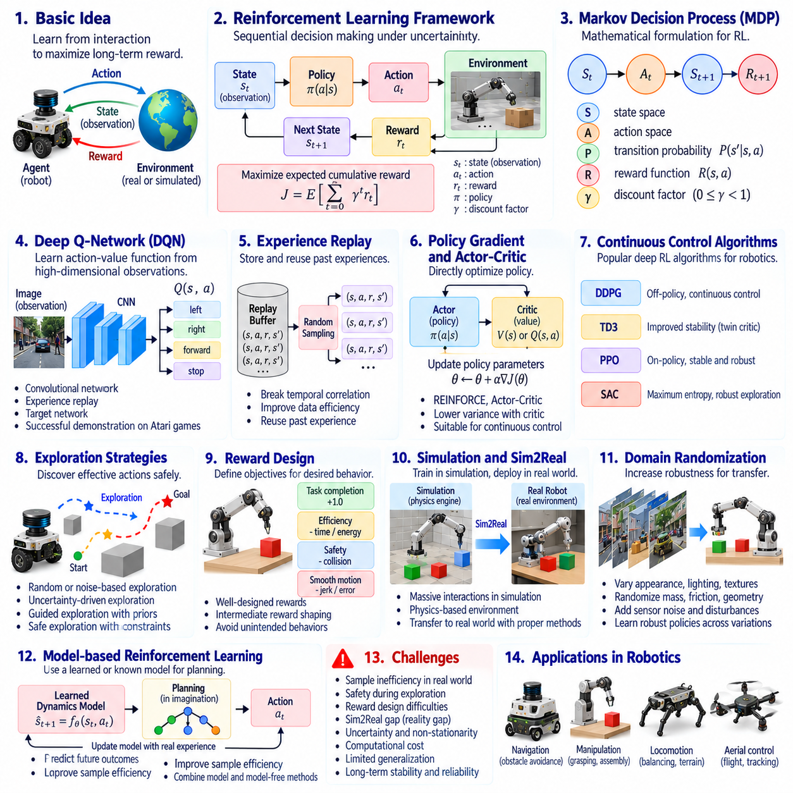{width="7.268055555555556in" height="7.268055555555556in"}

Deep reinforcement learning emerged as a major advancement in artificial intelligence by combining reinforcement learning with deep neural networks. Traditional reinforcement learning enabled agents to improve behavior through rewards and penalties, but struggled with large or continuous state spaces. Deep learning provided powerful function approximation, allowing agents to learn policies directly from complex observations. This integration opened new possibilities for autonomous robotic decision-making.

The theoretical foundations of reinforcement learning originate from sequential decision theory, dynamic programming, and behavioral learning. An agent interacts with an environment by observing its current state, selecting an action, and receiving a reward. The objective is to maximize expected cumulative reward over time rather than optimize each immediate action independently. This formulation established a framework for learning behavior through repeated interaction and delayed consequences.

Markov decision processes provide the mathematical foundation for many reinforcement learning algorithms. A process defines states, actions, transition probabilities, rewards, and a discount factor for future outcomes. The agent learns a policy that determines which actions should be selected under different conditions. Value functions estimate expected future returns, enabling algorithms to compare alternative decisions and improve behavior through experience.

Deep Q-Networks demonstrated that neural networks could approximate action-value functions from high-dimensional sensory inputs. The influential DQN approach combined convolutional networks with experience replay and target networks to improve training stability. Its success on Atari games demonstrated that agents could learn effective control policies from visual observations. Although these environments were simulated, the results encouraged research into learning robotic behavior from raw sensor data.

Experience replay became an important mechanism for improving the efficiency of deep reinforcement learning. Instead of learning exclusively from consecutive interactions, agents store transitions containing observations, actions, rewards, and subsequent states. Randomly sampled experiences reduce temporal correlations and allow previously collected data to support repeated updates. However, replay-based methods must account for changes in data distributions and limitations in exploration coverage.

Policy gradient methods introduced a different approach by optimizing parameterized policies directly. Rather than estimating only the value of individual actions, these algorithms adjust policy parameters according to expected performance improvements. Actor-critic architectures combine a policy model with a value estimator to reduce learning variance. These methods became important for robotic systems requiring continuous control over joint positions, velocities, and actuator commands.

Algorithms such as DDPG, TD3, PPO, and Soft Actor-Critic expanded the practical application of deep reinforcement learning. They introduced different mechanisms for stabilizing optimization, improving exploration, and managing continuous action spaces. Off-policy approaches can reuse stored experience, while on-policy methods generally require newly collected trajectories. Selecting an algorithm involves balancing sample efficiency, stability, computational requirements, and task characteristics.

Exploration remains a fundamental challenge because robots must discover effective actions without exposing themselves to unacceptable risks. Random exploration can be useful in simulation but dangerous when transferred directly to physical machines. Exploration strategies may incorporate uncertainty estimates, action constraints, or previously learned behaviors. Safe reinforcement learning therefore attempts to improve policies while respecting operational limits and avoiding hazardous states.

Reward design strongly influences the behavior acquired through reinforcement learning. A poorly specified reward function may encourage unintended strategies that achieve numerical objectives without satisfying the actual task. Reward shaping can accelerate training by providing intermediate guidance, but may also introduce undesirable incentives. Successful robotic applications require reward definitions that reflect task completion, efficiency, safety, and physical constraints.

Simulation environments became essential for scaling deep reinforcement learning in robotics. Virtual robots can execute millions of interactions without consuming physical equipment or exposing operators to repeated training hazards. Physics engines approximate contact, friction, gravity, and actuator dynamics. Although simulation accelerates experimentation, differences between simulated and real environments create transfer challenges that must be addressed before deployment.

Domain randomization emerged as a strategy for improving transfer from simulation to physical robots. During training, environmental properties such as lighting, mass, friction, geometry, and sensor noise are varied systematically. The resulting policy encounters diverse conditions and may become less dependent on specific simulation assumptions. Nevertheless, randomization cannot guarantee successful transfer when important physical phenomena are missing or inaccurately modeled.

Model-based reinforcement learning seeks to improve sample efficiency by learning or using a predictive model of environmental dynamics. Instead of relying entirely on trial-and-error interaction, an agent can evaluate possible future outcomes before selecting actions. Learned dynamics models support planning and imagined trajectories, potentially reducing physical experimentation. Their effectiveness depends on prediction accuracy, uncertainty management, and the prevention of accumulated model errors.

Deep reinforcement learning has demonstrated promising results in robotic locomotion, manipulation, and navigation. Legged robots can learn balance and movement strategies, while manipulators can optimize grasping or object interaction. Mobile robots can acquire navigation policies adapted to environmental feedback. However, successful demonstrations often depend on carefully designed training conditions, extensive simulation, and additional safety mechanisms during real-world operation.

Hierarchical reinforcement learning addresses complex tasks by organizing decision-making across different temporal scales. High-level policies select objectives or reusable skills, while low-level controllers execute specific movements. This decomposition can improve learning efficiency and support long-horizon behavior. It also creates opportunities to combine learned motor skills with symbolic planning, task scheduling, and structured reasoning within larger robotic architectures.

The historical significance of deep reinforcement learning lies in demonstrating that sophisticated behavior can emerge through interaction-driven optimization rather than explicit programming alone. It expanded machine learning from perception and prediction toward autonomous action selection and control. Modern Physical AI builds upon these foundations by integrating learned policies with world models, multimodal perception, safety constraints, and hierarchical planning to support increasingly adaptive physical intelligence.

심층 강화학습(Deep Reinforcement Learning)은 강화학습(Reinforcement Learning)과 심층 신경망(Deep Neural Network)을 결합함으로써 인공지능(Artificial Intelligence)의 주요 발전으로 등장하였다. 전통적인 강화학습은 에이전트(Agent)가 보상(Reward)과 벌점(Penalty)을 통해 행동(Behavior)을 개선할 수 있도록 하였지만, 규모가 크거나 연속적인 상태 공간(State Space)을 처리하는 데 어려움이 있었다. 딥러닝(Deep Learning)은 강력한 함수 근사(Function Approximation) 능력을 제공하여 에이전트가 복잡한 관측값(Observation)으로부터 정책(Policy)을 직접 학습할 수 있도록 하였다. 이러한 통합은 자율 로봇 의사결정(Autonomous Robotic Decision-Making)의 새로운 가능성을 열었다.

강화학습(Reinforcement Learning)의 이론적 기반은 순차적 의사결정 이론(Sequential Decision Theory), 동적 계획법(Dynamic Programming), 행동 학습(Behavioral Learning)에서 비롯되었다. 에이전트(Agent)는 현재 상태(State)를 관측하고, 행동(Action)을 선택하며, 보상(Reward)을 받는 과정을 통해 환경(Environment)과 상호작용한다. 목표(Objective)는 각각의 즉각적인 행동을 독립적으로 최적화하는 것이 아니라 시간에 따른 기대 누적 보상(Expected Cumulative Reward)을 최대화하는 것이다. 이러한 정식화(Formulation)는 반복적인 상호작용(Repeated Interaction)과 지연된 결과(Delayed Consequence)를 통해 행동을 학습하기 위한 프레임워크(Framework)를 확립하였다.

마르코프 의사결정 과정(Markov Decision Process, MDP)은 많은 강화학습 알고리즘(Reinforcement Learning Algorithm)의 수학적 기반(Mathematical Foundation)을 제공한다. 이 과정은 상태(State), 행동(Action), 상태 전이 확률(Transition Probability), 보상(Reward), 미래 결과(Future Outcome)에 대한 할인율(Discount Factor)을 정의한다. 에이전트(Agent)는 서로 다른 조건에서 어떤 행동을 선택해야 하는지 결정하는 정책(Policy)을 학습한다. 가치 함수(Value Function)는 기대 미래 수익(Expected Future Return)을 추정하여 알고리즘이 대안적 의사결정(Alternative Decision)을 비교하고 경험(Experience)을 통해 행동을 개선할 수 있도록 한다.

심층 Q-네트워크(Deep Q-Network, DQN)는 신경망(Neural Network)이 고차원 감각 입력(High-Dimensional Sensory Input)으로부터 행동 가치 함수(Action-Value Function)를 근사할 수 있음을 보여주었다. 영향력 있는 DQN 접근법은 학습 안정성(Training Stability)을 향상시키기 위해 합성곱 신경망(Convolutional Network), 경험 재현(Experience Replay), 타깃 네트워크(Target Network)를 결합하였다. 아타리 게임(Atari Game)에서의 성공은 에이전트가 시각 관측값(Visual Observation)으로부터 효과적인 제어 정책(Control Policy)을 학습할 수 있음을 보여주었다. 이러한 환경은 시뮬레이션(Simulation)이었지만, 연구 결과는 원시 센서 데이터(Raw Sensor Data)로부터 로봇 행동을 학습하는 연구를 촉진하였다.

경험 재현(Experience Replay)은 심층 강화학습(Deep Reinforcement Learning)의 효율성(Efficiency)을 향상시키는 중요한 메커니즘(Mechanism)이 되었다. 에이전트(Agent)는 연속적인 상호작용(Consecutive Interaction)에서만 학습하는 대신, 관측값(Observation), 행동(Action), 보상(Reward), 다음 상태(Subsequent State)를 포함하는 전이 데이터(Transition)를 저장한다. 무작위로 추출한 경험(Randomly Sampled Experience)은 시간적 상관관계(Temporal Correlation)를 줄이고, 이전에 수집된 데이터를 반복적인 갱신(Update)에 활용할 수 있도록 한다. 그러나 경험 재현 기반 방법(Replay-Based Method)은 데이터 분포(Data Distribution)의 변화와 탐색 범위(Exploration Coverage)의 한계를 고려해야 한다.

정책 경사 방법(Policy Gradient Method)은 매개변수화된 정책(Parameterized Policy)을 직접 최적화하는 다른 접근법을 도입하였다. 이러한 알고리즘은 개별 행동의 가치(Value)만 추정하는 대신, 기대 성능 향상(Expected Performance Improvement)에 따라 정책 매개변수(Policy Parameter)를 조정한다. 액터-크리틱 아키텍처(Actor-Critic Architecture)는 학습 분산(Learning Variance)을 줄이기 위해 정책 모델(Policy Model)과 가치 추정기(Value Estimator)를 결합한다. 이러한 방법은 관절 위치(Joint Position), 속도(Velocity), 구동기 명령(Actuator Command)에 대한 연속 제어(Continuous Control)가 필요한 로봇 시스템(Robotic System)에서 중요해졌다.

DDPG(Deep Deterministic Policy Gradient), TD3(Twin Delayed Deep Deterministic Policy Gradient), PPO(Proximal Policy Optimization), 소프트 액터-크리틱(Soft Actor-Critic, SAC)과 같은 알고리즘은 심층 강화학습(Deep Reinforcement Learning)의 실용적 적용 범위를 확장하였다. 이들은 최적화 안정화(Optimization Stabilization), 탐색 개선(Exploration Improvement), 연속 행동 공간(Continuous Action Space) 관리를 위한 서로 다른 메커니즘을 도입하였다. 오프폴리시 접근법(Off-Policy Approach)은 저장된 경험을 재사용할 수 있는 반면, 온폴리시 방법(On-Policy Method)은 일반적으로 새롭게 수집한 궤적(Trajectory)을 필요로 한다. 알고리즘 선택(Algorithm Selection)에는 샘플 효율성(Sample Efficiency), 안정성(Stability), 계산 요구사항(Computational Requirement), 작업 특성(Task Characteristic) 사이의 균형이 필요하다.

탐색(Exploration)은 로봇이 허용할 수 없는 위험(Unacceptable Risk)에 노출되지 않으면서 효과적인 행동(Effective Action)을 발견해야 하기 때문에 근본적인 과제로 남아 있다. 무작위 탐색(Random Exploration)은 시뮬레이션(Simulation)에서는 유용할 수 있지만, 물리적 기계(Physical Machine)에 직접 적용하면 위험할 수 있다. 탐색 전략(Exploration Strategy)은 불확실성 추정(Uncertainty Estimate), 행동 제약(Action Constraint), 이전에 학습된 행동(Previously Learned Behavior)을 포함할 수 있다. 따라서 안전 강화학습(Safe Reinforcement Learning)은 운용 한계(Operational Limit)를 준수하고 위험 상태(Hazardous State)를 회피하면서 정책(Policy)을 개선하는 것을 목표로 한다.

보상 설계(Reward Design)는 강화학습(Reinforcement Learning)을 통해 습득되는 행동(Behavior)에 큰 영향을 미친다. 잘못 정의된 보상 함수(Reward Function)는 실제 작업(Task)을 충족하지 않으면서 수치적 목표(Numerical Objective)만 달성하는 의도하지 않은 전략(Unintended Strategy)을 유도할 수 있다. 보상 형성(Reward Shaping)은 중간 단계의 지침(Intermediate Guidance)을 제공하여 학습을 가속화할 수 있지만, 바람직하지 않은 유인(Undesirable Incentive)을 도입할 수도 있다. 성공적인 로봇 응용(Robotic Application)을 위해서는 작업 완료(Task Completion), 효율성(Efficiency), 안전성(Safety), 물리적 제약(Physical Constraint)을 반영하는 보상 정의(Reward Definition)가 필요하다.

시뮬레이션 환경(Simulation Environment)은 로보틱스에서 심층 강화학습(Deep Reinforcement Learning)을 확장하는 데 필수적인 요소가 되었다. 가상 로봇(Virtual Robot)은 물리적 장비(Physical Equipment)를 소모하거나 작업자(Operator)를 반복적인 학습 위험(Training Hazard)에 노출하지 않고도 수백만 번의 상호작용(Interaction)을 수행할 수 있다. 물리 엔진(Physics Engine)은 접촉(Contact), 마찰(Friction), 중력(Gravity), 구동기 동역학(Actuator Dynamics)을 근사한다. 시뮬레이션은 실험(Experimentation)을 가속화하지만, 시뮬레이션 환경과 실제 환경 사이의 차이는 배포(Deployment) 전에 해결해야 하는 전이 문제(Transfer Challenge)를 발생시킨다.

도메인 무작위화(Domain Randomization)는 시뮬레이션에서 물리적 로봇(Physical Robot)으로의 전이(Transfer)를 개선하기 위한 전략으로 등장하였다. 학습 과정에서 조명(Lighting), 질량(Mass), 마찰(Friction), 기하학적 구조(Geometry), 센서 잡음(Sensor Noise)과 같은 환경 속성(Environmental Property)을 체계적으로 변화시킨다. 그 결과 정책(Policy)은 다양한 조건을 경험하며 특정 시뮬레이션 가정(Simulation Assumption)에 대한 의존도를 줄일 수 있다. 그러나 중요한 물리 현상(Physical Phenomenon)이 누락되거나 부정확하게 모델링된 경우에는 무작위화(Randomization)만으로 성공적인 전이를 보장할 수 없다.

모델 기반 강화학습(Model-Based Reinforcement Learning)은 환경 동역학(Environmental Dynamics)의 예측 모델(Predictive Model)을 학습하거나 활용함으로써 샘플 효율성(Sample Efficiency)을 향상시키고자 한다. 에이전트(Agent)는 시행착오 상호작용(Trial-and-Error Interaction)에 전적으로 의존하는 대신, 행동을 선택하기 전에 가능한 미래 결과(Future Outcome)를 평가할 수 있다. 학습된 동역학 모델(Learned Dynamics Model)은 계획(Planning)과 상상된 궤적(Imagined Trajectory)을 지원하여 물리적 실험(Physical Experimentation)을 줄일 가능성을 제공한다. 이러한 방법의 효과는 예측 정확도(Prediction Accuracy), 불확실성 관리(Uncertainty Management), 누적 모델 오차(Accumulated Model Error)의 방지에 달려 있다.

심층 강화학습(Deep Reinforcement Learning)은 로봇 보행(Robotic Locomotion), 조작(Manipulation), 항법(Navigation)에서 유망한 결과를 보여주었다. 다족 로봇(Legged Robot)은 균형(Balance)과 이동 전략(Movement Strategy)을 학습할 수 있으며, 매니퓰레이터(Manipulator)는 파지(Grasping)나 객체 상호작용(Object Interaction)을 최적화할 수 있다. 이동 로봇(Mobile Robot)은 환경 피드백(Environmental Feedback)에 적응하는 항법 정책(Navigation Policy)을 습득할 수 있다. 그러나 성공적인 시연(Demonstration)은 신중하게 설계된 학습 조건(Training Condition), 광범위한 시뮬레이션(Extensive Simulation), 실제 환경 운용(Real-World Operation) 중의 추가적인 안전 메커니즘(Safety Mechanism)에 의존하는 경우가 많다.

계층적 강화학습(Hierarchical Reinforcement Learning)은 서로 다른 시간 척도(Temporal Scale)에 걸쳐 의사결정(Decision-Making)을 구성함으로써 복잡한 작업(Complex Task)을 처리한다. 상위 수준 정책(High-Level Policy)은 목표(Objective)나 재사용 가능한 기술(Reusable Skill)을 선택하고, 저수준 제어기(Low-Level Controller)는 구체적인 움직임(Specific Movement)을 실행한다. 이러한 분해(Decomposition)는 학습 효율성(Learning Efficiency)을 향상시키고 장기 행동(Long-Horizon Behavior)을 지원할 수 있다. 또한 대규모 로봇 아키텍처(Robotic Architecture)에서 학습된 운동 기술(Learned Motor Skill)을 기호적 계획(Symbolic Planning), 작업 스케줄링(Task Scheduling), 구조화된 추론(Structured Reasoning)과 결합할 수 있는 가능성을 제공한다.

심층 강화학습(Deep Reinforcement Learning)의 역사적 중요성은 정교한 행동(Sophisticated Behavior)이 명시적인 프로그래밍(Explicit Programming)만이 아니라 상호작용 기반 최적화(Interaction-Driven Optimization)를 통해 발생할 수 있음을 보여주었다는 데 있다. 심층 강화학습은 기계학습(Machine Learning)의 적용 범위를 인식(Perception)과 예측(Prediction)에서 자율적 행동 선택(Autonomous Action Selection)과 제어(Control)로 확장하였다. 현대 피지컬 인공지능(Physical AI)은 이러한 기반 위에서 학습된 정책(Learned Policy)을 세계 모델(World Model), 다중모달 인식(Multimodal Perception), 안전 제약(Safety Constraint), 계층적 계획(Hierarchical Planning)과 통합함으로써 점점 더 적응적인 물리 지능(Adaptive Physical Intelligence)을 구현하고 있다.

##  

## 03.09. Imitation Learning and Robot Demonstrations

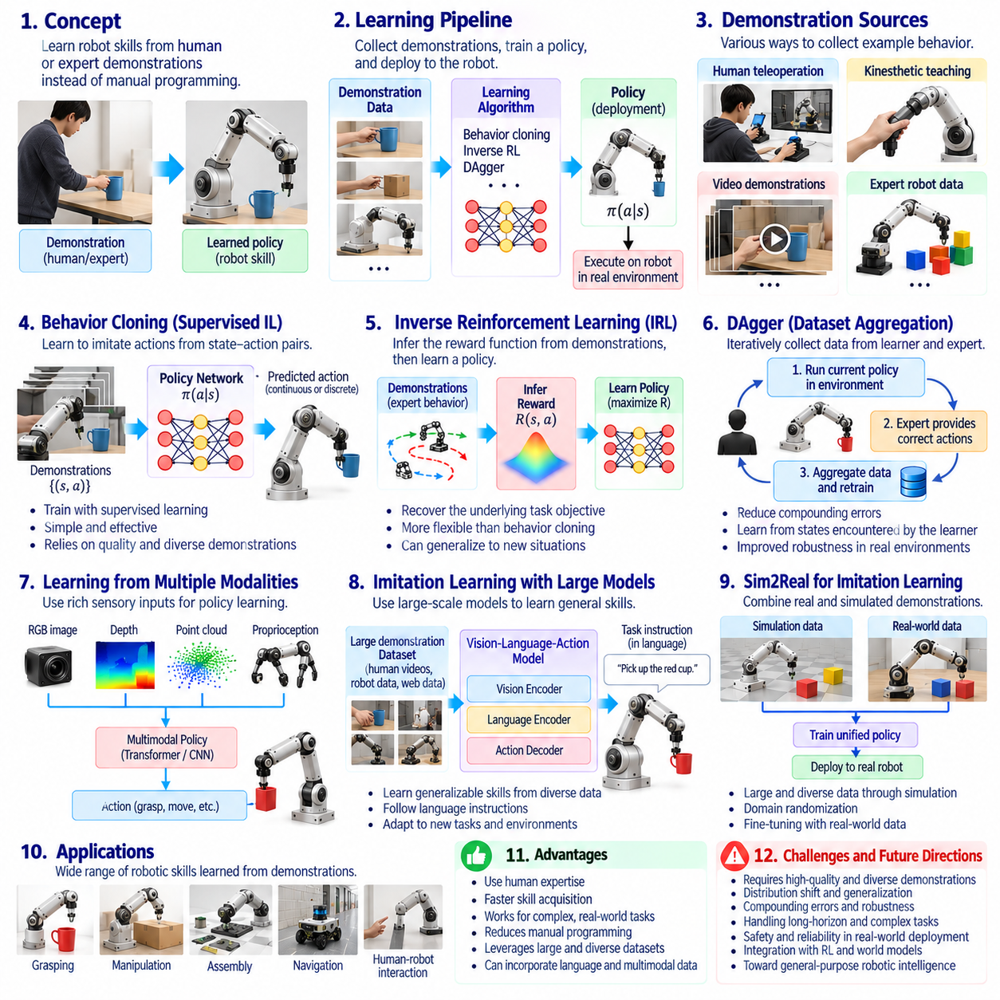{width="7.268055555555556in" height="7.268055555555556in"}

Imitation learning emerged as an important approach to robot intelligence by enabling machines to acquire behaviors from demonstrations rather than relying entirely on manually programmed rules or trial-and-error exploration. Human operators and expert controllers provide examples of successful task execution, allowing robots to learn relationships between observations and actions. This approach reduces the need for explicit behavioral programming and provides a practical foundation for acquiring complex physical skills.

The conceptual foundations of imitation learning originate from observational learning, statistical pattern recognition, and supervised machine learning. Instead of discovering every action independently, a robot observes how an expert responds to particular situations. Demonstrations contain information about task objectives, movement strategies, and environmental interactions. Learning algorithms extract these patterns and construct policies that approximate expert behavior under similar operating conditions.

Behavioral cloning became one of the earliest and most direct methods of imitation learning. It treats demonstrations as supervised training data, where sensory observations serve as inputs and expert actions serve as target outputs. A neural network or statistical model learns to predict appropriate actions from observed states. This method is relatively simple to implement, but its performance depends strongly on demonstration quality and coverage of relevant operating situations.

A major limitation of behavioral cloning is covariate shift, which occurs when a learned policy encounters states that differ from those represented in expert demonstrations. Small prediction errors may cause the robot to enter unfamiliar situations, leading to additional errors that accumulate over time. This problem is especially important in long-horizon tasks. Effective imitation learning therefore requires methods that improve recovery behavior and reduce dependence on ideal demonstration trajectories.

Dataset Aggregation, commonly known as DAgger, addressed distribution mismatch by repeatedly collecting states encountered by the learning policy and obtaining expert actions for those states. The resulting dataset gradually includes situations that the robot is likely to experience during actual execution. This iterative procedure improves robustness compared with purely offline behavioral cloning. However, it requires continued access to expert supervision and careful management of potentially unsafe exploration.

Inverse reinforcement learning introduced a different perspective by attempting to infer the underlying objectives that explain expert demonstrations. Rather than copying individual actions directly, the system estimates a reward function consistent with observed behavior. A policy can then be optimized using the inferred objective. This approach offers potential advantages when multiple action sequences can accomplish the same task, although reward ambiguity and computational complexity remain significant challenges.

Robot demonstrations can be collected through several forms of human-machine interaction. Teleoperation allows an operator to control robot movements remotely, while kinesthetic teaching involves physically guiding a robot through desired motions. Motion capture and wearable sensing systems can record human movements for later adaptation. Each method provides different levels of precision, accessibility, and correspondence between human actions and robot capabilities.

Demonstration quality plays a central role in the performance of imitation learning systems. Recorded trajectories must capture relevant observations, actions, timing, and task outcomes with sufficient accuracy. Inconsistent demonstrations may introduce conflicting behavioral patterns, while narrow datasets can limit generalization. Effective data collection therefore requires attention to calibration, synchronization, environmental diversity, and the representation of successful and unsuccessful task conditions.

Learning from human demonstrations introduces the challenge of embodiment differences between humans and robots. Human hands, joints, sensory capabilities, and movement constraints often differ substantially from robotic mechanisms. Directly reproducing human motion may therefore be impossible or inefficient. Retargeting methods transform demonstrated movements into robot-compatible trajectories, while task-space representations focus on functional objectives rather than exact anatomical correspondence.

Deep learning expanded imitation learning by enabling policies to process high-dimensional observations such as camera images, depth maps, and proprioceptive measurements. Neural networks can learn relationships between visual scenes and motor commands without requiring complete handcrafted representations. Recurrent models and attention mechanisms further support temporal dependencies across demonstrations. These developments enabled more complex visuomotor policies for robotic manipulation and navigation.

Learning from demonstrations became particularly influential in robotic manipulation because grasping and object interaction involve complicated contact dynamics. Human demonstrations provide examples of approach direction, grasp selection, object placement, and corrective movement. Imitation policies can acquire these patterns from recorded trajectories. Nevertheless, successful manipulation still depends on accurate perception, force control, and the ability to recover when physical interactions differ from training examples.

Offline imitation learning allows robots to acquire initial policies from previously collected datasets without repeatedly interacting with physical environments. Large demonstration collections can support training across multiple tasks, objects, and robot platforms. This approach improves data reuse and reduces some physical experimentation costs. However, differences in hardware, control interfaces, and environmental conditions can complicate transferring policies between datasets and deployed robots.

Combining imitation learning with reinforcement learning provides a practical strategy for improving robot performance. Demonstrations can initialize a policy with useful behaviors, reducing the need for extensive random exploration. Reinforcement learning can subsequently refine the policy through interaction and task-specific feedback. This combination is especially valuable when demonstrations provide reasonable starting behaviors but do not fully capture the precision, adaptability, or efficiency required for deployment.

Multitask imitation learning extends individual skill acquisition by training policies across diverse demonstrations and objectives. Shared representations can capture common structures among tasks such as reaching, grasping, transporting, and placing objects. Language instructions and task identifiers can condition policy behavior, enabling a single model to perform multiple operations. These developments contributed to the emergence of generalist robotic policies and large-scale robot foundation models.

The historical significance of imitation learning lies in establishing demonstrations as a direct source of robotic intelligence. It demonstrated that complex physical behaviors could be transferred from human expertise and recorded experience into autonomous control policies. Modern Physical AI extends this foundation through large-scale datasets, multimodal learning, reinforcement learning, and predictive world models, enabling robots to acquire increasingly diverse skills while maintaining the need for safety, generalization, and reliable physical execution.

모방학습(Imitation Learning)은 기계가 수작업으로 프로그래밍된 규칙(Manually Programmed Rules)이나 시행착오 탐색(Trial-and-Error Exploration)에 전적으로 의존하지 않고, 시연(Demonstration)으로부터 행동(Behavior)을 습득할 수 있도록 함으로써 로봇 지능(Robot Intelligence)의 중요한 접근법으로 등장하였다. 인간 작업자(Human Operator)와 전문가 제어기(Expert Controller)는 성공적인 작업 수행(Task Execution)의 사례를 제공하며, 이를 통해 로봇은 관측값(Observation)과 행동(Action) 사이의 관계를 학습한다. 이러한 접근법은 명시적인 행동 프로그래밍(Explicit Behavioral Programming)의 필요성을 줄이고, 복잡한 물리적 기술(Physical Skill)을 습득하기 위한 실용적인 기반을 제공한다.

모방학습(Imitation Learning)의 개념적 기반은 관찰학습(Observational Learning), 통계적 패턴 인식(Statistical Pattern Recognition), 지도 기계학습(Supervised Machine Learning)에서 비롯되었다. 로봇은 모든 행동을 독립적으로 발견하는 대신, 전문가(Expert)가 특정 상황에 어떻게 대응하는지를 관찰한다. 시연(Demonstration)에는 작업 목표(Task Objective), 움직임 전략(Movement Strategy), 환경과의 상호작용(Environmental Interaction)에 관한 정보가 포함된다. 학습 알고리즘(Learning Algorithm)은 이러한 패턴을 추출하고 유사한 운용 조건(Operating Condition)에서 전문가 행동(Expert Behavior)을 근사하는 정책(Policy)을 구성한다.

행동 복제(Behavioral Cloning)는 모방학습(Imitation Learning)의 가장 초기이면서 직접적인 방법 중 하나로 자리 잡았다. 행동 복제는 시연(Demonstration)을 지도학습 데이터(Supervised Training Data)로 취급하며, 감각 관측값(Sensory Observation)을 입력(Input)으로 사용하고 전문가 행동(Expert Action)을 목표 출력(Target Output)으로 사용한다. 신경망(Neural Network)이나 통계 모델(Statistical Model)은 관측된 상태(Observed State)로부터 적절한 행동을 예측하도록 학습한다. 이 방법은 구현이 비교적 간단하지만, 성능은 시연의 품질(Demonstration Quality)과 관련 운용 상황(Operating Situation)의 포괄 범위(Coverage)에 크게 의존한다.

행동 복제(Behavioral Cloning)의 주요 한계는 공변량 이동(Covariate Shift)으로, 학습된 정책(Learned Policy)이 전문가 시연(Expert Demonstration)에 포함된 상태와 다른 상태(State)를 마주할 때 발생한다. 작은 예측 오류(Prediction Error)로 인해 로봇이 익숙하지 않은 상황(Unfamiliar Situation)에 진입할 수 있으며, 이는 시간이 지남에 따라 추가적인 오류를 누적시킬 수 있다. 이러한 문제는 특히 장기 작업(Long-Horizon Task)에서 중요하다. 따라서 효과적인 모방학습(Effective Imitation Learning)을 위해서는 복구 행동(Recovery Behavior)을 개선하고 이상적인 시연 궤적(Ideal Demonstration Trajectory)에 대한 의존도를 줄이는 방법이 필요하다.

일반적으로 DAgger로 알려진 데이터셋 집계(Dataset Aggregation)는 학습 정책(Learning Policy)이 실제로 경험하는 상태를 반복적으로 수집하고, 해당 상태에 대한 전문가 행동(Expert Action)을 확보함으로써 분포 불일치(Distribution Mismatch) 문제를 해결하고자 하였다. 이렇게 구축된 데이터셋(Dataset)에는 로봇이 실제 실행(Actual Execution) 과정에서 경험할 가능성이 높은 상황이 점진적으로 포함된다. 이러한 반복적 절차(Iterative Procedure)는 순수한 오프라인 행동 복제(Offline Behavioral Cloning)보다 강인성(Robustness)을 향상시킨다. 그러나 지속적인 전문가 감독(Expert Supervision)이 필요하며, 잠재적으로 위험한 탐색(Unsafe Exploration)을 신중하게 관리해야 한다.

역강화학습(Inverse Reinforcement Learning)은 전문가 시연(Expert Demonstration)을 설명하는 근본적인 목표(Underlying Objective)를 추론하려는 다른 관점을 도입하였다. 개별 행동(Individual Action)을 직접 복제하는 대신, 시스템은 관측된 행동(Observed Behavior)과 일치하는 보상 함수(Reward Function)를 추정한다. 이후 추론된 목표(Inferred Objective)를 활용하여 정책(Policy)을 최적화할 수 있다. 이러한 접근법은 여러 행동 순서(Action Sequence)가 동일한 작업을 수행할 수 있을 때 잠재적인 이점을 제공하지만, 보상 모호성(Reward Ambiguity)과 계산 복잡성(Computational Complexity)은 여전히 중요한 과제로 남아 있다.

로봇 시연(Robot Demonstration)은 다양한 형태의 인간-기계 상호작용(Human-Machine Interaction)을 통해 수집할 수 있다. 원격조작(Teleoperation)은 작업자가 로봇의 움직임을 원격으로 제어할 수 있도록 하며, 운동감각 교시(Kinesthetic Teaching)는 로봇을 물리적으로 유도하여 원하는 움직임을 수행하도록 하는 방식이다. 동작 포착(Motion Capture)과 웨어러블 센싱 시스템(Wearable Sensing System)은 인간의 움직임을 기록하여 이후 로봇에 맞게 변환할 수 있도록 한다. 각 방법은 정밀도(Precision), 접근성(Accessibility), 인간 행동과 로봇 능력 사이의 대응 관계(Correspondence) 측면에서 서로 다른 특성을 제공한다.

시연 품질(Demonstration Quality)은 모방학습 시스템(Imitation Learning System)의 성능에서 핵심적인 역할을 한다. 기록된 궤적(Recorded Trajectory)은 관련 관측값(Observation), 행동(Action), 시간 정보(Timing), 작업 결과(Task Outcome)를 충분한 정확도로 포함해야 한다. 일관성이 부족한 시연(Inconsistent Demonstration)은 서로 충돌하는 행동 패턴(Conflicting Behavioral Pattern)을 유발할 수 있으며, 제한적인 데이터셋(Narrow Dataset)은 일반화(Generalization)를 저해할 수 있다. 따라서 효과적인 데이터 수집(Data Collection)을 위해서는 보정(Calibration), 동기화(Synchronization), 환경 다양성(Environmental Diversity), 성공 및 실패 작업 조건(Task Condition)의 표현을 고려해야 한다.

인간 시연(Human Demonstration)으로부터 학습하는 과정에서는 인간과 로봇 사이의 신체 구현 차이(Embodiment Difference)를 해결해야 한다. 인간의 손(Hand), 관절(Joint), 감각 능력(Sensory Capability), 움직임 제약(Movement Constraint)은 로봇의 기계적 구조(Robotic Mechanism)와 상당히 다를 수 있다. 따라서 인간의 움직임을 직접 재현하는 것은 불가능하거나 비효율적일 수 있다. 동작 리타기팅(Motion Retargeting) 방법은 시연된 움직임을 로봇과 호환되는 궤적(Robot-Compatible Trajectory)으로 변환하며, 작업 공간 표현(Task-Space Representation)은 정확한 해부학적 대응(Anatomical Correspondence)보다 기능적 목표(Functional Objective)에 초점을 맞춘다.

딥러닝(Deep Learning)은 정책(Policy)이 카메라 이미지(Camera Image), 깊이 지도(Depth Map), 고유수용감각 측정값(Proprioceptive Measurement)과 같은 고차원 관측값(High-Dimensional Observation)을 처리할 수 있도록 함으로써 모방학습(Imitation Learning)을 확장하였다. 신경망(Neural Network)은 완전한 수작업 표현(Handcrafted Representation) 없이도 시각 장면(Visual Scene)과 운동 명령(Motor Command) 사이의 관계를 학습할 수 있다. 순환 모델(Recurrent Model)과 어텐션 메커니즘(Attention Mechanism)은 시연 전반에 걸친 시간적 의존성(Temporal Dependency)을 추가로 지원한다. 이러한 발전은 로봇 조작(Robotic Manipulation)과 항법(Navigation)을 위한 더욱 복잡한 시각-운동 정책(Visuomotor Policy)을 가능하게 하였다.

시연 기반 학습(Learning from Demonstrations)은 파지(Grasping)와 객체 상호작용(Object Interaction)에 복잡한 접촉 동역학(Contact Dynamics)이 포함되기 때문에 로봇 조작(Robotic Manipulation)에서 특히 큰 영향을 미쳤다. 인간 시연(Human Demonstration)은 접근 방향(Approach Direction), 파지 선택(Grasp Selection), 객체 배치(Object Placement), 교정 움직임(Corrective Movement)의 사례를 제공한다. 모방 정책(Imitation Policy)은 기록된 궤적(Recorded Trajectory)으로부터 이러한 패턴을 습득할 수 있다. 그러나 성공적인 조작(Successful Manipulation)은 여전히 정확한 인식(Accurate Perception), 힘 제어(Force Control), 물리적 상호작용이 학습 사례와 다를 때 복구할 수 있는 능력(Recovery Capability)에 의존한다.

오프라인 모방학습(Offline Imitation Learning)은 로봇이 물리적 환경(Physical Environment)과 반복적으로 상호작용하지 않고도 이전에 수집된 데이터셋(Previously Collected Dataset)으로부터 초기 정책(Initial Policy)을 습득할 수 있도록 한다. 대규모 시연 데이터 집합(Large Demonstration Collection)은 다양한 작업(Task), 객체(Object), 로봇 플랫폼(Robot Platform)에 걸친 학습을 지원할 수 있다. 이러한 접근법은 데이터 재사용(Data Reuse)을 향상시키고 일부 물리적 실험 비용(Physical Experimentation Cost)을 줄인다. 그러나 하드웨어(Hardware), 제어 인터페이스(Control Interface), 환경 조건(Environmental Condition)의 차이는 데이터셋과 실제 배포 로봇(Deployed Robot) 사이의 정책 전이(Policy Transfer)를 복잡하게 만들 수 있다.

모방학습(Imitation Learning)과 강화학습(Reinforcement Learning)의 결합은 로봇 성능(Robot Performance)을 향상시키기 위한 실용적인 전략을 제공한다. 시연(Demonstration)은 유용한 행동(Useful Behavior)으로 정책(Policy)을 초기화하여 광범위한 무작위 탐색(Random Exploration)의 필요성을 줄일 수 있다. 이후 강화학습은 상호작용(Interaction)과 작업별 피드백(Task-Specific Feedback)을 통해 정책을 정교화할 수 있다. 이러한 결합은 시연이 합리적인 초기 행동(Initial Behavior)을 제공하지만, 실제 배포(Deployment)에 필요한 정밀도(Precision), 적응성(Adaptability), 효율성(Efficiency)을 완전히 충족하지 못하는 경우에 특히 유용하다.

다중작업 모방학습(Multitask Imitation Learning)은 다양한 시연(Demonstration)과 목표(Objective)에 걸쳐 정책(Policy)을 학습함으로써 개별 기술 습득(Individual Skill Acquisition)을 확장한다. 공유 표현(Shared Representation)은 도달 동작(Reaching), 파지(Grasping), 운반(Transporting), 객체 배치(Object Placement)와 같은 작업 사이의 공통 구조(Common Structure)를 포착할 수 있다. 언어 지시(Language Instruction)와 작업 식별자(Task Identifier)는 정책 행동(Policy Behavior)을 조건화하여 하나의 모델(Single Model)이 여러 작업을 수행할 수 있도록 한다. 이러한 발전은 범용 로봇 정책(Generalist Robotic Policy)과 대규모 로봇 파운데이션 모델(Large-Scale Robot Foundation Model)의 등장에 기여하였다.

모방학습(Imitation Learning)의 역사적 중요성은 시연(Demonstration)을 로봇 지능(Robotic Intelligence)의 직접적인 원천으로 확립하였다는 데 있다. 모방학습은 복잡한 물리적 행동(Complex Physical Behavior)이 인간의 전문성(Human Expertise)과 기록된 경험(Recorded Experience)으로부터 자율 제어 정책(Autonomous Control Policy)으로 이전될 수 있음을 보여주었다. 현대 피지컬 인공지능(Physical AI)은 대규모 데이터셋(Large-Scale Dataset), 다중모달 학습(Multimodal Learning), 강화학습(Reinforcement Learning), 예측 세계 모델(Predictive World Model)을 통해 이러한 기반을 확장하고 있으며, 안전성(Safety), 일반화(Generalization), 신뢰성 있는 물리적 실행(Reliable Physical Execution)의 필요성을 유지하면서 로봇이 점점 더 다양한 기술을 습득할 수 있도록 발전하고 있다.

##  

## 03.10. Simulation and Sim2Real

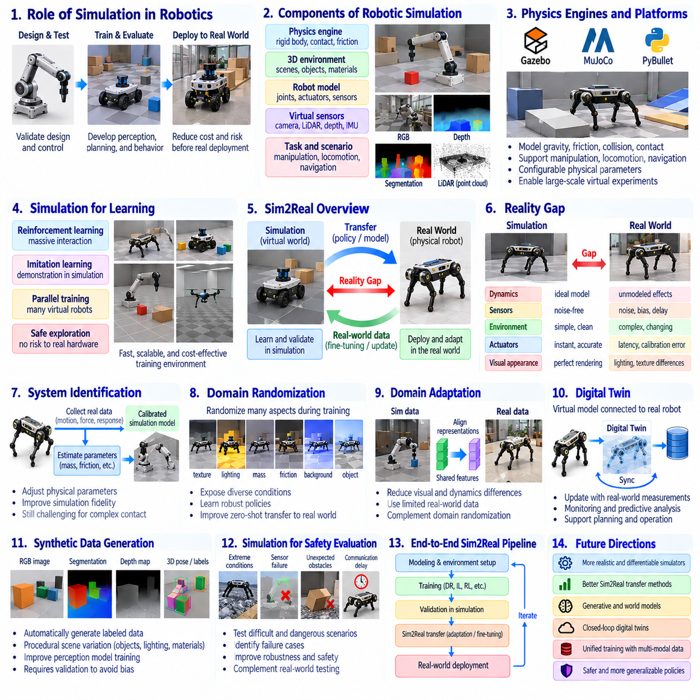{width="7.268055555555556in" height="7.268055555555556in"}

Simulation has played a fundamental role in robotics by providing controlled environments where machines can be designed, tested, and trained before operating in the physical world. Early simulation tools focused on mechanical motion, kinematics, and control-system verification. As computational capabilities improved, simulation evolved into a platform for developing perception, planning, and autonomous behavior. This progression established virtual experimentation as an essential foundation of Physical AI.

The historical foundations of robotic simulation emerged from numerical mechanics, computer graphics, and control engineering. Mathematical models represented rigid-body motion, joint constraints, actuator forces, and environmental interactions. Engineers used these models to predict system responses and identify design limitations before constructing physical prototypes. Simulation consequently reduced development costs while supporting systematic investigation of robotic dynamics and control stability.

Physics engines expanded simulation capabilities by modeling gravity, friction, collisions, and contact interactions. Platforms such as Gazebo, MuJoCo, and PyBullet enabled researchers to investigate complex robotic behaviors under configurable physical conditions. These environments supported manipulation, locomotion, and mobile navigation experiments. However, numerical approximations and incomplete physical models introduced discrepancies between simulated behavior and actual robot performance.

The development of three-dimensional rendering and virtual sensors transformed simulation into a tool for robotic perception research. Simulated cameras, LiDAR systems, depth sensors, and inertial measurement units could generate observations resembling physical sensor outputs. Researchers could construct virtual warehouses, factories, and outdoor environments containing diverse objects and obstacles. This capability enabled perception algorithms to be evaluated before physical deployment.

Simulation became particularly important for reinforcement learning because autonomous agents often require extensive interaction to acquire effective policies. Training directly on physical robots can be expensive, slow, and potentially hazardous. Virtual environments allow repeated experimentation, accelerated execution, and parallel training across multiple simulated robots. These advantages made simulation a practical foundation for learning locomotion, manipulation, and navigation behaviors.

The simulation-to-reality problem, commonly called Sim2Real, arises when models or policies trained in virtual environments perform differently on physical hardware. This discrepancy is known as the reality gap and reflects differences in dynamics, sensing, environmental complexity, and computational execution. A policy that performs reliably in simulation may fail when exposed to unexpected friction, sensor noise, actuator delays, or imperfect mechanical calibration.

System identification provides one approach to reducing the reality gap by estimating physical parameters from measured robot behavior. Engineers collect observations of motion, forces, and actuator responses to calibrate simulated dynamics. Parameters such as mass, inertia, friction coefficients, and motor characteristics can then be adjusted. Accurate identification improves simulation fidelity, although complex contact phenomena and changing operating conditions remain difficult to reproduce.

Domain randomization became a widely adopted strategy for improving the robustness of policies trained in simulation. Instead of representing only one fixed environment, training introduces variations in physical parameters, visual appearance, sensor noise, and object arrangements. A policy learns to operate across diverse simulated conditions rather than memorizing a particular configuration. This approach can improve transfer, but its effectiveness depends on whether training variations cover relevant real-world conditions.

Domain adaptation addresses differences between simulated and real data distributions by transforming representations or learning features that remain useful across environments. Visual adaptation may reduce differences in textures, illumination, and image characteristics, while dynamics adaptation targets discrepancies in physical responses. Some approaches use limited real-world observations to refine simulation-trained models. These methods complement domain randomization but do not eliminate every source of transfer error.

Digital twins introduced a broader relationship between simulation and physical robotic systems. A digital twin represents a physical asset or operational environment and may be updated using measurements from deployed equipment. Unlike an isolated simulation, a connected digital twin can support monitoring, predictive analysis, and operational planning. Its usefulness depends on model accuracy, data synchronization, and the extent to which physical changes are reflected in the virtual representation.

Synthetic data generation expanded the role of simulation in training perception models. Virtual environments can produce annotated images, segmentation masks, depth maps, and object poses without requiring equivalent manual labeling effort. Procedural scene generation introduces variations in lighting, geometry, materials, and object placement. Synthetic datasets can improve training diversity, although realistic validation remains necessary to identify distribution bias and perception failures.

Simulation also supports systematic safety evaluation by reproducing scenarios that would be difficult or dangerous to create physically. Robots can be exposed to sensor failures, unexpected obstacles, communication delays, and abnormal environmental conditions. Scenario-based testing helps identify weaknesses in perception, planning, and control before deployment. Nevertheless, simulated success cannot independently establish physical safety because modeled scenarios never capture every real-world hazard.

Hardware-in-the-loop testing connects real controllers, processors, or communication interfaces to simulated environments. This arrangement allows engineers to evaluate software execution and hardware behavior without requiring a complete physical robot. Timing constraints, communication delays, and controller responses can be examined under repeatable conditions. Hardware-in-the-loop methods therefore bridge purely virtual testing and physical experimentation, although they cannot reproduce all mechanical interactions.

Modern simulation platforms increasingly integrate physics, photorealistic rendering, sensor modeling, and large-scale parallel computation. GPU-accelerated environments support rapid policy training, while standardized robotic interfaces simplify experimentation across different platforms. These developments enable closer integration between perception learning, reinforcement learning, and system validation. However, simulation fidelity must be balanced against computational cost and the requirements of real-time execution.

The historical significance of simulation and Sim2Real lies in transforming virtual experimentation into a central component of robotic intelligence development. Simulation enables scalable learning and controlled evaluation, while Sim2Real methods address the challenges of transferring acquired capabilities into physical environments. Modern Physical AI combines simulation, synthetic data, system identification, domain adaptation, and real-world feedback to develop more reliable autonomous systems grounded in physical interaction.

시뮬레이션(Simulation)은 기계가 물리적 세계(Physical World)에서 작동하기 전에 설계(Design), 시험(Test), 학습(Training)을 수행할 수 있는 통제된 환경(Controlled Environment)을 제공함으로써 로보틱스(Robotics)에서 근본적인 역할을 수행해 왔다. 초기 시뮬레이션 도구(Simulation Tool)는 기계적 운동(Mechanical Motion), 운동학(Kinematics), 제어 시스템 검증(Control-System Verification)에 중점을 두었다. 계산 능력(Computational Capability)이 향상되면서 시뮬레이션은 인식(Perception), 계획(Planning), 자율 행동(Autonomous Behavior)을 개발하기 위한 플랫폼(Platform)으로 발전하였다. 이러한 발전 과정은 가상 실험(Virtual Experimentation)을 피지컬 인공지능(Physical AI)의 필수적인 기반으로 확립하였다.

로봇 시뮬레이션(Robotic Simulation)의 역사적 기반은 수치 역학(Numerical Mechanics), 컴퓨터 그래픽스(Computer Graphics), 제어공학(Control Engineering)에서 형성되었다. 수학적 모델(Mathematical Model)은 강체 운동(Rigid-Body Motion), 관절 제약(Joint Constraint), 구동기 힘(Actuator Force), 환경과의 상호작용(Environmental Interaction)을 표현하였다. 엔지니어(Engineer)는 이러한 모델을 활용하여 물리적 시제품(Physical Prototype)을 제작하기 전에 시스템 응답(System Response)을 예측하고 설계상의 한계(Design Limitation)를 식별하였다. 결과적으로 시뮬레이션은 개발 비용(Development Cost)을 절감하는 동시에 로봇 동역학(Robotic Dynamics)과 제어 안정성(Control Stability)에 대한 체계적인 연구를 지원하였다.

물리 엔진(Physics Engine)은 중력(Gravity), 마찰(Friction), 충돌(Collision), 접촉 상호작용(Contact Interaction)을 모델링함으로써 시뮬레이션의 기능을 확장하였다. Gazebo, MuJoCo, PyBullet과 같은 플랫폼(Platform)은 연구자들이 설정 가능한 물리적 조건(Physical Condition)에서 복잡한 로봇 행동(Robotic Behavior)을 연구할 수 있도록 하였다. 이러한 환경은 조작(Manipulation), 이동 운동(Locomotion), 이동 항법(Mobile Navigation) 실험을 지원하였다. 그러나 수치적 근사(Numerical Approximation)와 불완전한 물리 모델(Incomplete Physical Model)은 시뮬레이션 행동(Simulated Behavior)과 실제 로봇 성능(Actual Robot Performance) 사이의 차이를 발생시켰다.

3차원 렌더링(Three-Dimensional Rendering)과 가상 센서(Virtual Sensor)의 발전은 시뮬레이션을 로봇 인식 연구(Robotic Perception Research)를 위한 도구로 변화시켰다. 시뮬레이션 카메라(Simulated Camera), 라이다 시스템(LiDAR System), 깊이 센서(Depth Sensor), 관성 측정 장치(Inertial Measurement Unit)는 물리적 센서 출력(Physical Sensor Output)과 유사한 관측값(Observation)을 생성할 수 있었다. 연구자들은 다양한 객체(Object)와 장애물(Obstacle)을 포함하는 가상 창고(Virtual Warehouse), 공장(Factory), 실외 환경(Outdoor Environment)을 구성할 수 있었다. 이러한 능력은 물리적 배포(Physical Deployment) 이전에 인식 알고리즘(Perception Algorithm)을 평가할 수 있도록 하였다.

시뮬레이션(Simulation)은 자율 에이전트(Autonomous Agent)가 효과적인 정책(Effective Policy)을 습득하기 위해 광범위한 상호작용(Extensive Interaction)을 필요로 하는 경우가 많기 때문에 강화학습(Reinforcement Learning)에서 특히 중요해졌다. 물리적 로봇(Physical Robot)에서 직접 학습하는 과정은 비용이 많이 들고 속도가 느리며 잠재적으로 위험할 수 있다. 가상 환경(Virtual Environment)은 반복적인 실험(Repeated Experimentation), 가속 실행(Accelerated Execution), 여러 시뮬레이션 로봇(Simulated Robot)에 대한 병렬 학습(Parallel Training)을 가능하게 한다. 이러한 장점은 시뮬레이션을 이동 운동(Locomotion), 조작(Manipulation), 항법(Navigation) 행동 학습을 위한 실용적인 기반으로 만들었다.

일반적으로 심투리얼(Simulation-to-Reality, Sim2Real)이라고 불리는 시뮬레이션-현실 전이 문제(Simulation-to-Reality Problem)는 가상 환경(Virtual Environment)에서 학습된 모델(Model)이나 정책(Policy)이 물리적 하드웨어(Physical Hardware)에서 서로 다른 성능을 보일 때 발생한다. 이러한 불일치는 현실 격차(Reality Gap)라고 하며, 동역학(Dynamics), 감지(Sensing), 환경 복잡성(Environmental Complexity), 계산 실행(Computational Execution)의 차이를 반영한다. 시뮬레이션에서 안정적으로 작동하는 정책이라도 예상하지 못한 마찰(Friction), 센서 잡음(Sensor Noise), 구동기 지연(Actuator Delay), 불완전한 기계적 보정(Mechanical Calibration)에 노출되면 실패할 수 있다.

시스템 식별(System Identification)은 측정된 로봇 행동(Measured Robot Behavior)으로부터 물리적 매개변수(Physical Parameter)를 추정함으로써 현실 격차(Reality Gap)를 줄이는 접근법을 제공한다. 엔지니어는 운동(Motion), 힘(Force), 구동기 응답(Actuator Response)에 관한 관측값(Observation)을 수집하여 시뮬레이션 동역학(Simulated Dynamics)을 보정한다. 이후 질량(Mass), 관성(Inertia), 마찰 계수(Friction Coefficient), 모터 특성(Motor Characteristic)과 같은 매개변수를 조정할 수 있다. 정확한 시스템 식별(Accurate System Identification)은 시뮬레이션 충실도(Simulation Fidelity)를 향상시키지만, 복잡한 접촉 현상(Contact Phenomenon)과 변화하는 운용 조건(Operating Condition)은 여전히 재현하기 어렵다.

도메인 무작위화(Domain Randomization)는 시뮬레이션에서 학습된 정책(Policy)의 강인성(Robustness)을 향상시키기 위한 널리 채택된 전략으로 자리 잡았다. 하나의 고정된 환경(Fixed Environment)만 표현하는 대신, 학습 과정에서 물리적 매개변수(Physical Parameter), 시각적 외형(Visual Appearance), 센서 잡음(Sensor Noise), 객체 배치(Object Arrangement)에 변화를 도입한다. 정책은 특정 구성(Configuration)을 암기하는 대신 다양한 시뮬레이션 조건(Simulated Condition)에서 작동하는 방법을 학습한다. 이러한 접근법은 전이 성능(Transfer Performance)을 향상시킬 수 있지만, 효과는 학습 중의 변화가 실제 환경 조건(Real-World Condition)을 얼마나 충분히 포함하는지에 달려 있다.

도메인 적응(Domain Adaptation)은 표현(Representation)을 변환하거나 서로 다른 환경에서도 유용하게 유지되는 특징(Feature)을 학습함으로써 시뮬레이션 데이터와 실제 데이터 사이의 분포 차이(Distribution Difference)를 해결한다. 시각적 적응(Visual Adaptation)은 질감(Texture), 조명(Illumination), 이미지 특성(Image Characteristic)의 차이를 줄일 수 있으며, 동역학 적응(Dynamics Adaptation)은 물리적 응답(Physical Response)의 불일치를 대상으로 한다. 일부 접근법은 제한된 실제 환경 관측값(Real-World Observation)을 활용하여 시뮬레이션 학습 모델(Simulation-Trained Model)을 정교화한다. 이러한 방법은 도메인 무작위화(Domain Randomization)를 보완하지만 모든 전이 오류(Transfer Error)의 원인을 제거하지는 못한다.

디지털 트윈(Digital Twin)은 시뮬레이션과 물리적 로봇 시스템(Physical Robotic System) 사이의 더욱 광범위한 관계를 도입하였다. 디지털 트윈은 물리적 자산(Physical Asset)이나 운용 환경(Operational Environment)을 표현하며, 배포된 장비(Deployed Equipment)에서 수집한 측정값(Measurement)을 활용하여 갱신될 수 있다. 독립적인 시뮬레이션(Isolated Simulation)과 달리 연결된 디지털 트윈(Connected Digital Twin)은 모니터링(Monitoring), 예측 분석(Predictive Analysis), 운영 계획(Operational Planning)을 지원할 수 있다. 그 유용성은 모델 정확도(Model Accuracy), 데이터 동기화(Data Synchronization), 물리적 변화(Physical Change)가 가상 표현(Virtual Representation)에 반영되는 정도에 달려 있다.

합성 데이터 생성(Synthetic Data Generation)은 인식 모델(Perception Model) 학습에서 시뮬레이션의 역할을 확장하였다. 가상 환경(Virtual Environment)은 동일한 수준의 수작업 레이블링(Manual Labeling) 없이도 주석 이미지(Annotated Image), 분할 마스크(Segmentation Mask), 깊이 지도(Depth Map), 객체 자세(Object Pose)를 생성할 수 있다. 절차적 장면 생성(Procedural Scene Generation)은 조명(Lighting), 기하학적 구조(Geometry), 재질(Material), 객체 배치(Object Placement)에 다양한 변화를 도입한다. 합성 데이터셋(Synthetic Dataset)은 학습 다양성(Training Diversity)을 향상시킬 수 있지만, 분포 편향(Distribution Bias)과 인식 실패(Perception Failure)를 식별하기 위해서는 현실적인 검증(Realistic Validation)이 여전히 필요하다.

시뮬레이션(Simulation)은 물리적으로 재현하기 어렵거나 위험한 시나리오(Scenario)를 반복적으로 구현함으로써 체계적인 안전성 평가(Systematic Safety Evaluation)도 지원한다. 로봇은 센서 고장(Sensor Failure), 예상하지 못한 장애물(Unexpected Obstacle), 통신 지연(Communication Delay), 비정상적인 환경 조건(Abnormal Environmental Condition)에 노출될 수 있다. 시나리오 기반 시험(Scenario-Based Testing)은 배포(Deployment) 전에 인식(Perception), 계획(Planning), 제어(Control)의 취약점을 식별하는 데 도움이 된다. 그러나 모델링된 시나리오가 실제 환경의 모든 위험 요소(Real-World Hazard)를 포착할 수는 없으므로, 시뮬레이션에서의 성공만으로 물리적 안전성(Physical Safety)을 독립적으로 입증할 수는 없다.

하드웨어 인 더 루프 시험(Hardware-in-the-Loop Testing, HIL Testing)은 실제 제어기(Real Controller), 프로세서(Processor), 통신 인터페이스(Communication Interface)를 시뮬레이션 환경(Simulated Environment)에 연결한다. 이러한 구성은 완전한 물리적 로봇(Physical Robot)이 없어도 소프트웨어 실행(Software Execution)과 하드웨어 동작(Hardware Behavior)을 평가할 수 있도록 한다. 시간 제약(Timing Constraint), 통신 지연(Communication Delay), 제어기 응답(Controller Response)을 반복 가능한 조건(Repeatable Condition)에서 검토할 수 있다. 따라서 하드웨어 인 더 루프 방법(Hardware-in-the-Loop Method)은 순수한 가상 시험(Virtual Testing)과 물리적 실험(Physical Experimentation)을 연결하지만, 모든 기계적 상호작용(Mechanical Interaction)을 재현할 수는 없다.

현대 시뮬레이션 플랫폼(Modern Simulation Platform)은 물리 시뮬레이션(Physics Simulation), 사실적 렌더링(Photorealistic Rendering), 센서 모델링(Sensor Modeling), 대규모 병렬 계산(Large-Scale Parallel Computation)을 점점 더 통합하고 있다. GPU 가속 환경(GPU-Accelerated Environment)은 신속한 정책 학습(Policy Training)을 지원하며, 표준화된 로봇 인터페이스(Standardized Robotic Interface)는 서로 다른 플랫폼 간의 실험을 단순화한다. 이러한 발전은 인식 학습(Perception Learning), 강화학습(Reinforcement Learning), 시스템 검증(System Validation) 사이의 더욱 긴밀한 통합을 가능하게 한다. 그러나 시뮬레이션 충실도(Simulation Fidelity)는 계산 비용(Computational Cost) 및 실시간 실행(Real-Time Execution) 요구사항과 균형을 이루어야 한다.

시뮬레이션(Simulation)과 심투리얼(Sim2Real)의 역사적 중요성은 가상 실험(Virtual Experimentation)을 로봇 지능 개발(Robotic Intelligence Development)의 핵심 구성요소로 변화시켰다는 데 있다. 시뮬레이션은 확장 가능한 학습(Scalable Learning)과 통제된 평가(Controlled Evaluation)를 가능하게 하며, 심투리얼 방법(Sim2Real Method)은 습득한 능력(Acquired Capability)을 물리적 환경(Physical Environment)으로 이전하는 과정의 과제를 해결한다. 현대 피지컬 인공지능(Physical AI)은 시뮬레이션, 합성 데이터(Synthetic Data), 시스템 식별(System Identification), 도메인 적응(Domain Adaptation), 실제 환경 피드백(Real-World Feedback)을 결합하여 물리적 상호작용(Physical Interaction)에 기반한 더욱 신뢰성 있는 자율 시스템(Autonomous System)을 개발하고 있다.

##  

## 03.11. Transformers and Multimodal AI

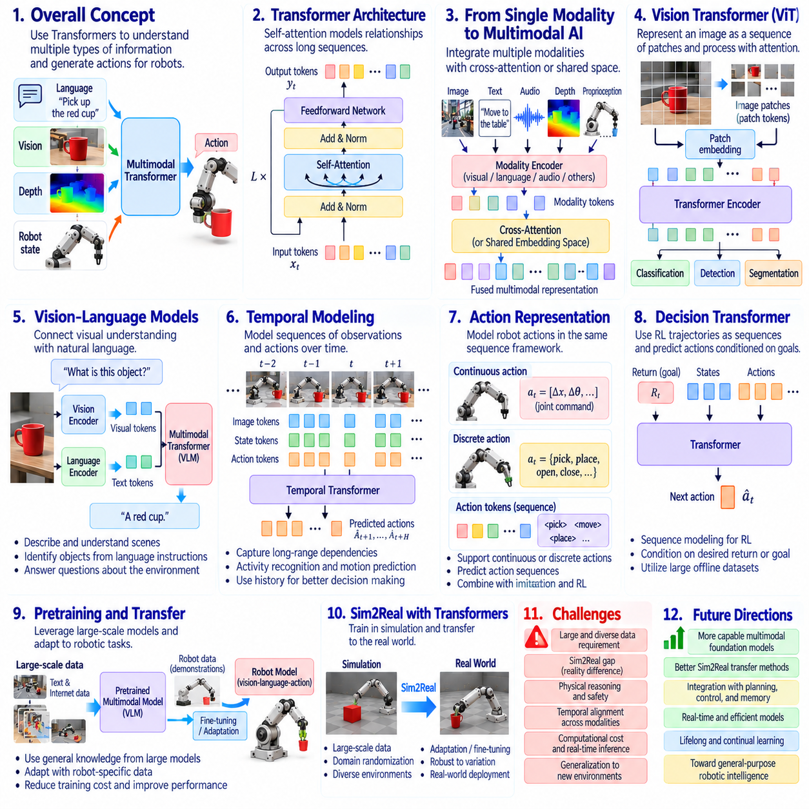{width="7.268055555555556in" height="7.268055555555556in"}

Transformers introduced a major architectural shift in artificial intelligence by enabling neural networks to model relationships across long sequences of information. Earlier recurrent networks processed observations sequentially, often encountering difficulties with long-range dependencies. Transformer architectures use attention mechanisms to identify relevant relationships across inputs. This capability established a foundation for language understanding, visual reasoning, and multimodal intelligence in robotics.

The introduction of the Transformer architecture in 2017 demonstrated that attention-based computation could replace recurrence in many sequence modeling tasks. Self-attention allows each element of an input sequence to incorporate information from other elements according to learned relevance. Positional encoding preserves information about ordering, while feedforward layers transform contextual representations. These mechanisms enabled scalable training and increasingly powerful representation learning.

The success of Transformers in natural language processing accelerated the development of large language models capable of generating, interpreting, and organizing complex information. Training on extensive text collections enabled models to acquire statistical representations of language structure and relationships. For robotics, these capabilities offered new approaches to interpreting instructions, decomposing tasks, and expressing operational knowledge. However, linguistic competence alone does not guarantee physical understanding.

Vision Transformers extended attention-based architectures into image processing by representing images as sequences of patches or visual tokens. Instead of relying exclusively on convolutional operations, these models learn relationships between spatial regions through attention. This approach supports image classification, object recognition, and scene interpretation. Its relevance to robotics increased as visual perception became integrated with language understanding and action-oriented reasoning.

Multimodal artificial intelligence emerged from efforts to combine information across different sensory and symbolic representations. Images, language, audio, depth measurements, and motion signals contain complementary descriptions of environmental conditions. Multimodal models learn relationships between these information sources, allowing one modality to provide context for another. In robotics, this integration supports richer interpretation of objects, activities, and human instructions.

Cross-attention mechanisms provide an important method for connecting information from different modalities. A language representation can attend to visual features, while visual processing can incorporate task-specific linguistic context. Shared embedding spaces offer another approach by positioning related concepts from different modalities near one another. These mechanisms enable models to associate object descriptions with visual observations and support instruction-guided perception.

Vision-language models expanded robotic capabilities by connecting visual recognition with natural language understanding. Such models can describe scenes, identify objects referenced by instructions, and answer questions about observed environments. A robot may use these capabilities to interpret commands involving spatial relationships or object properties. Nevertheless, reliable physical execution requires geometric reasoning, state estimation, and control mechanisms beyond language-based interpretation.

Transformers also influenced temporal modeling by enabling attention across sequences of observations and actions. Robotic behavior depends on how environmental states evolve, not merely on individual sensor readings. Temporal attention can identify relationships among earlier observations, current conditions, and possible future actions. This capability supports activity recognition, motion prediction, and the representation of interaction histories within robotic decision-making systems.

Action representation became an important research direction as Transformer models were adapted from language and vision to robotic control. Robot actions may be represented as continuous vectors, discrete tokens, or structured sequences describing movements and commands. Sequence models can predict actions conditioned on previous observations, goals, and recorded trajectories. This formulation connects imitation learning with scalable architectures originally developed for sequence prediction.

Decision Transformers demonstrated that reinforcement learning trajectories could be modeled through sequence prediction. Instead of learning a conventional value function, these models condition action generation on previous states, actions, and desired returns. This approach illustrates how supervised sequence modeling can contribute to sequential decision-making. However, successful performance depends on dataset coverage, conditioning quality, and the availability of relevant behavioral examples.

Multimodal robotic learning requires careful alignment between sensory observations and physical actions. Camera frames, language instructions, joint measurements, and control commands often operate at different frequencies and resolutions. Temporal synchronization and coordinate consistency are therefore essential for meaningful integration. Without reliable alignment, a model may associate observations with incorrect actions or misunderstand the physical consequences of movement.

Large-scale pretraining introduced opportunities to transfer general visual and linguistic knowledge into robotic systems. Models trained on broad datasets can provide reusable representations that reduce the amount of task-specific training required. Robotic demonstrations and interaction data can subsequently adapt these representations to physical tasks. However, differences between internet-scale data and embodied experience limit the direct transfer of abstract knowledge into reliable motor behavior.

Computational requirements became a central consideration when deploying Transformer-based models on physical robots. Attention processing, memory consumption, and model inference latency can conflict with real-time control constraints. Edge computing platforms must balance model capacity against power consumption, thermal limitations, and response deadlines. Practical architectures may separate high-level multimodal reasoning from low-level control loops that require deterministic execution.

Safety and reliability remain essential because multimodal models can generate plausible interpretations that are inconsistent with physical reality. Visual ambiguity, incomplete observations, and language misunderstandings may produce inappropriate actions. Robotic systems therefore require independent safety constraints, uncertainty monitoring, and continuous environmental feedback. Multimodal intelligence must operate within validated physical control architectures rather than replace essential safety mechanisms.

The historical significance of Transformers and multimodal AI lies in their ability to connect previously separate domains of perception, language, and sequential decision-making. They established architectural foundations for models that interpret instructions, integrate sensory information, and generate action-related representations. Modern Physical AI builds upon these advances by combining multimodal reasoning with world models, robot demonstrations, adaptive policies, and closed-loop control to support increasingly general physical intelligence.

트랜스포머(Transformer)는 신경망(Neural Network)이 긴 정보 시퀀스(Information Sequence)에 걸친 관계를 모델링할 수 있도록 함으로써 인공지능(Artificial Intelligence)에 중대한 아키텍처적 전환(Architectural Shift)을 가져왔다. 이전의 순환 신경망(Recurrent Neural Network)은 관측값(Observation)을 순차적으로 처리하였으며, 장거리 의존성(Long-Range Dependency)을 다루는 데 어려움을 겪는 경우가 많았다. 트랜스포머 아키텍처(Transformer Architecture)는 어텐션 메커니즘(Attention Mechanism)을 사용하여 입력(Input) 전반에 걸친 관련성 높은 관계를 식별한다. 이러한 능력은 로보틱스(Robotics)에서 언어 이해(Language Understanding), 시각적 추론(Visual Reasoning), 다중모달 지능(Multimodal Intelligence)의 기반을 확립하였다.

2017년에 발표된 트랜스포머 아키텍처(Transformer Architecture)는 어텐션 기반 계산(Attention-Based Computation)이 다양한 시퀀스 모델링 작업(Sequence Modeling Task)에서 순환 구조(Recurrence)를 대체할 수 있음을 보여주었다. 자기 어텐션(Self-Attention)은 입력 시퀀스(Input Sequence)의 각 요소가 학습된 관련성(Learned Relevance)에 따라 다른 요소의 정보를 반영할 수 있도록 한다. 위치 인코딩(Positional Encoding)은 순서(Ordering)에 관한 정보를 보존하며, 피드포워드 계층(Feedforward Layer)은 문맥적 표현(Contextual Representation)을 변환한다. 이러한 메커니즘은 확장 가능한 학습(Scalable Training)과 점점 더 강력한 표현 학습(Representation Learning)을 가능하게 하였다.

자연어 처리(Natural Language Processing)에서 트랜스포머(Transformer)가 거둔 성공은 복잡한 정보를 생성(Generation), 해석(Interpretation), 구성(Organization)할 수 있는 대규모 언어 모델(Large Language Model)의 발전을 가속화하였다. 방대한 텍스트 집합(Text Collection)을 활용한 학습은 모델이 언어 구조(Language Structure)와 관계(Relationship)에 대한 통계적 표현(Statistical Representation)을 습득할 수 있도록 하였다. 로보틱스(Robotics)에서는 이러한 능력이 명령 해석(Instruction Interpretation), 작업 분해(Task Decomposition), 운영 지식(Operational Knowledge)의 표현을 위한 새로운 접근법을 제공하였다. 그러나 언어적 능력(Linguistic Competence)만으로 물리적 이해(Physical Understanding)가 보장되는 것은 아니다.

비전 트랜스포머(Vision Transformer)는 이미지를 패치(Patch) 또는 시각 토큰(Visual Token)의 시퀀스로 표현함으로써 어텐션 기반 아키텍처(Attention-Based Architecture)를 이미지 처리(Image Processing) 분야로 확장하였다. 이러한 모델은 합성곱 연산(Convolutional Operation)에만 의존하는 대신 어텐션(Attention)을 통해 공간 영역(Spatial Region) 사이의 관계를 학습한다. 이 접근법은 이미지 분류(Image Classification), 객체 인식(Object Recognition), 장면 해석(Scene Interpretation)을 지원한다. 시각 인식(Visual Perception)이 언어 이해(Language Understanding) 및 행동 지향적 추론(Action-Oriented Reasoning)과 통합되면서 로보틱스에서의 중요성이 더욱 커졌다.

다중모달 인공지능(Multimodal Artificial Intelligence)은 서로 다른 감각적 표현(Sensory Representation)과 기호적 표현(Symbolic Representation)의 정보를 결합하려는 노력에서 등장하였다. 이미지(Image), 언어(Language), 오디오(Audio), 깊이 측정값(Depth Measurement), 운동 신호(Motion Signal)는 환경 조건(Environmental Condition)에 대한 상호 보완적인 설명을 제공한다. 다중모달 모델(Multimodal Model)은 이러한 정보원(Information Source) 사이의 관계를 학습하여 하나의 모달리티(Modality)가 다른 모달리티에 문맥(Context)을 제공할 수 있도록 한다. 로보틱스에서 이러한 통합은 객체(Object), 활동(Activity), 인간의 명령(Human Instruction)에 대한 더욱 풍부한 해석을 지원한다.

교차 어텐션 메커니즘(Cross-Attention Mechanism)은 서로 다른 모달리티(Modality)의 정보를 연결하는 중요한 방법을 제공한다. 언어 표현(Language Representation)은 시각 특징(Visual Feature)에 어텐션을 적용할 수 있으며, 시각 처리(Visual Processing)는 작업별 언어 문맥(Task-Specific Linguistic Context)을 반영할 수 있다. 공유 임베딩 공간(Shared Embedding Space)은 서로 다른 모달리티에서 관련된 개념(Concept)을 서로 가까운 위치에 배치하는 또 다른 접근법을 제공한다. 이러한 메커니즘은 모델이 객체 설명(Object Description)을 시각 관측값(Visual Observation)과 연결하고 명령 기반 인식(Instruction-Guided Perception)을 지원할 수 있도록 한다.

비전-언어 모델(Vision-Language Model, VLM)은 시각 인식(Visual Recognition)과 자연어 이해(Natural Language Understanding)를 연결함으로써 로봇의 능력을 확장하였다. 이러한 모델은 장면(Scene)을 설명하고, 명령에서 언급된 객체(Object)를 식별하며, 관측된 환경(Observed Environment)에 관한 질문에 답할 수 있다. 로봇은 이러한 능력을 활용하여 공간적 관계(Spatial Relationship)나 객체 속성(Object Property)이 포함된 명령(Command)을 해석할 수 있다. 그러나 신뢰성 있는 물리적 실행(Reliable Physical Execution)을 위해서는 언어 기반 해석(Language-Based Interpretation)을 넘어서는 기하학적 추론(Geometric Reasoning), 상태 추정(State Estimation), 제어 메커니즘(Control Mechanism)이 필요하다.

트랜스포머(Transformer)는 관측값(Observation)과 행동(Action)의 시퀀스 전반에 어텐션(Attention)을 적용할 수 있도록 함으로써 시간적 모델링(Temporal Modeling)에도 영향을 미쳤다. 로봇 행동(Robotic Behavior)은 개별 센서 측정값(Sensor Reading)뿐만 아니라 환경 상태(Environmental State)가 시간에 따라 어떻게 변화하는지에 의존한다. 시간적 어텐션(Temporal Attention)은 이전 관측값(Earlier Observation), 현재 조건(Current Condition), 가능한 미래 행동(Possible Future Action) 사이의 관계를 식별할 수 있다. 이러한 능력은 로봇 의사결정 시스템(Robotic Decision-Making System)에서 활동 인식(Activity Recognition), 운동 예측(Motion Prediction), 상호작용 이력(Interaction History)의 표현을 지원한다.

행동 표현(Action Representation)은 트랜스포머 모델(Transformer Model)이 언어(Language)와 비전(Vision)에서 로봇 제어(Robotic Control)로 확장되면서 중요한 연구 방향이 되었다. 로봇 행동(Robot Action)은 연속 벡터(Continuous Vector), 이산 토큰(Discrete Token), 움직임과 명령을 설명하는 구조화된 시퀀스(Structured Sequence)로 표현될 수 있다. 시퀀스 모델(Sequence Model)은 이전 관측값(Previous Observation), 목표(Goal), 기록된 궤적(Recorded Trajectory)을 조건으로 행동을 예측할 수 있다. 이러한 정식화(Formulation)는 모방학습(Imitation Learning)을 원래 시퀀스 예측(Sequence Prediction)을 위해 개발된 확장 가능한 아키텍처(Scalable Architecture)와 연결한다.

디시전 트랜스포머(Decision Transformer)는 강화학습 궤적(Reinforcement Learning Trajectory)을 시퀀스 예측(Sequence Prediction)을 통해 모델링할 수 있음을 보여주었다. 이러한 모델은 전통적인 가치 함수(Value Function)를 학습하는 대신, 이전 상태(Previous State), 행동(Action), 목표 수익(Desired Return)을 조건으로 행동 생성(Action Generation)을 수행한다. 이 접근법은 지도 시퀀스 모델링(Supervised Sequence Modeling)이 순차적 의사결정(Sequential Decision-Making)에 기여할 수 있음을 보여준다. 그러나 성공적인 성능은 데이터셋 포괄 범위(Dataset Coverage), 조건화 품질(Conditioning Quality), 관련 행동 사례(Relevant Behavioral Example)의 가용성에 의존한다.

다중모달 로봇 학습(Multimodal Robotic Learning)을 위해서는 감각 관측값(Sensory Observation)과 물리적 행동(Physical Action) 사이의 신중한 정렬(Alignment)이 필요하다. 카메라 프레임(Camera Frame), 언어 명령(Language Instruction), 관절 측정값(Joint Measurement), 제어 명령(Control Command)은 서로 다른 주파수(Frequency)와 해상도(Resolution)로 작동하는 경우가 많다. 따라서 의미 있는 통합(Meaningful Integration)을 위해서는 시간적 동기화(Temporal Synchronization)와 좌표 일관성(Coordinate Consistency)이 필수적이다. 신뢰성 있는 정렬이 이루어지지 않으면 모델이 관측값을 잘못된 행동과 연결하거나 움직임의 물리적 결과(Physical Consequence)를 잘못 이해할 수 있다.

대규모 사전학습(Large-Scale Pretraining)은 일반적인 시각 지식(Visual Knowledge)과 언어 지식(Linguistic Knowledge)을 로봇 시스템(Robotic System)으로 전이할 수 있는 기회를 제공하였다. 광범위한 데이터셋(Broad Dataset)으로 학습된 모델은 작업별 학습(Task-Specific Training)에 필요한 데이터의 양을 줄이는 재사용 가능한 표현(Reusable Representation)을 제공할 수 있다. 이후 로봇 시연(Robotic Demonstration)과 상호작용 데이터(Interaction Data)를 활용하여 이러한 표현을 물리적 작업(Physical Task)에 맞게 적응시킬 수 있다. 그러나 인터넷 규모 데이터(Internet-Scale Data)와 체화된 경험(Embodied Experience) 사이의 차이는 추상적 지식(Abstract Knowledge)을 신뢰성 있는 운동 행동(Reliable Motor Behavior)으로 직접 전이하는 데 한계를 만든다.

트랜스포머 기반 모델(Transformer-Based Model)을 물리적 로봇(Physical Robot)에 배포할 때 계산 요구사항(Computational Requirement)은 핵심적인 고려사항이 되었다. 어텐션 처리(Attention Processing), 메모리 사용량(Memory Consumption), 모델 추론 지연(Model Inference Latency)은 실시간 제어 제약(Real-Time Control Constraint)과 충돌할 수 있다. 엣지 컴퓨팅 플랫폼(Edge Computing Platform)은 모델 용량(Model Capacity)을 전력 소비(Power Consumption), 열적 한계(Thermal Limitation), 응답 마감시간(Response Deadline)과 균형 있게 조정해야 한다. 실용적인 아키텍처(Practical Architecture)는 상위 수준 다중모달 추론(High-Level Multimodal Reasoning)을 결정론적 실행(Deterministic Execution)이 필요한 저수준 제어 루프(Low-Level Control Loop)와 분리할 수 있다.

다중모달 모델(Multimodal Model)은 물리적 현실(Physical Reality)과 일치하지 않는 그럴듯한 해석(Plausible Interpretation)을 생성할 수 있기 때문에 안전성(Safety)과 신뢰성(Reliability)은 여전히 필수적이다. 시각적 모호성(Visual Ambiguity), 불완전한 관측값(Incomplete Observation), 언어 오해(Language Misunderstanding)는 부적절한 행동(Inappropriate Action)을 유발할 수 있다. 따라서 로봇 시스템(Robotic System)에는 독립적인 안전 제약(Independent Safety Constraint), 불확실성 모니터링(Uncertainty Monitoring), 지속적인 환경 피드백(Continuous Environmental Feedback)이 필요하다. 다중모달 지능(Multimodal Intelligence)은 필수적인 안전 메커니즘(Essential Safety Mechanism)을 대체하는 것이 아니라 검증된 물리적 제어 아키텍처(Validated Physical Control Architecture) 내부에서 작동해야 한다.

트랜스포머(Transformer)와 다중모달 인공지능(Multimodal AI)의 역사적 중요성은 이전에 분리되어 있던 인식(Perception), 언어(Language), 순차적 의사결정(Sequential Decision-Making) 영역을 연결할 수 있게 하였다는 데 있다. 이들은 명령(Instruction)을 해석하고, 감각 정보(Sensory Information)를 통합하며, 행동 관련 표현(Action-Related Representation)을 생성하는 모델의 아키텍처적 기반(Architectural Foundation)을 확립하였다. 현대 피지컬 인공지능(Physical AI)은 이러한 발전을 바탕으로 다중모달 추론(Multimodal Reasoning)을 세계 모델(World Model), 로봇 시연(Robot Demonstration), 적응형 정책(Adaptive Policy), 폐루프 제어(Closed-Loop Control)와 결합하여 점점 더 범용적인 물리 지능(General Physical Intelligence)을 지원하고 있다.

##  

## 03.12. Foundation Models and Generalist Policies

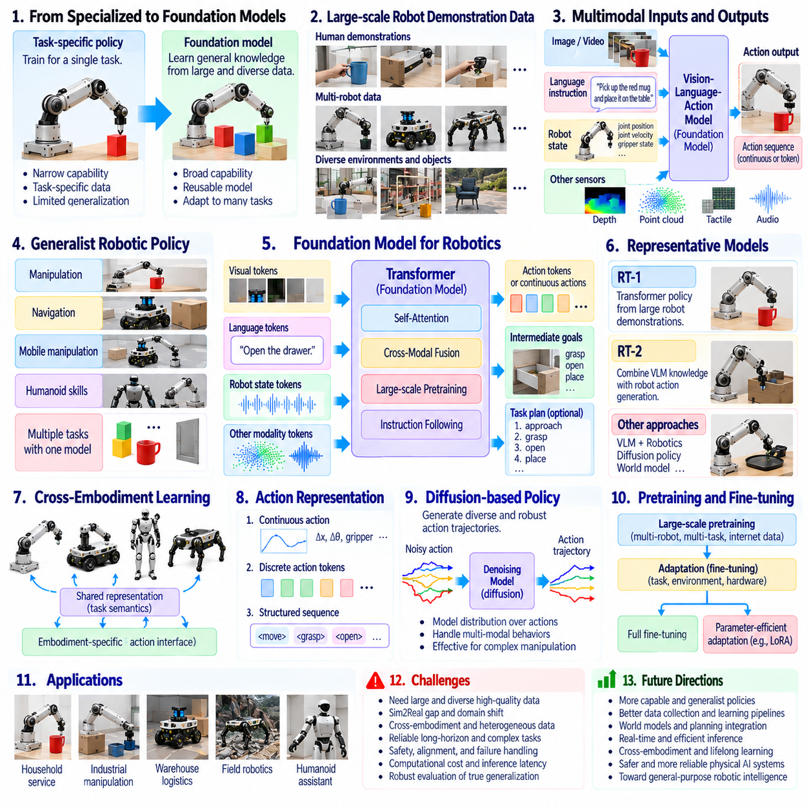{width="7.268055555555556in" height="7.268055555555556in"}

Foundation models represent a major transition in artificial intelligence from narrowly specialized systems toward broadly reusable learning architectures. Traditional robotic policies were usually trained for particular tasks, environments, or hardware configurations. Foundation models instead acquire general representations from large and diverse datasets before adaptation to specific applications. This approach established a pathway toward robotic intelligence capable of supporting multiple tasks through shared knowledge.

The emergence of foundation models was driven by advances in deep learning, Transformer architectures, large-scale pretraining, and computational infrastructure. Language and vision models demonstrated that representations learned from extensive datasets could transfer across many downstream tasks. Robotics researchers began investigating whether similar principles could support physical interaction. The central challenge was extending general representation learning into reliable action generation.

A generalist robotic policy is designed to perform multiple tasks rather than optimize behavior for a single narrowly defined objective. Such policies may accept visual observations, language instructions, robot states, and task descriptions as inputs. Their outputs can include movement commands, action sequences, or intermediate goals. Generalization depends on learning reusable relationships between environmental conditions, task intentions, and physical actions.

Large-scale robot demonstration datasets became essential for developing generalist policies. Data collected from multiple operators, environments, objects, and robot platforms provide examples of diverse physical interactions. These datasets allow models to identify common behavioral structures across tasks. However, differences in sensor configurations, coordinate systems, action representations, and control frequencies complicate the integration of heterogeneous robotic experiences.

Robot foundation models increasingly combine visual perception, language understanding, and action prediction within unified architectures. Vision-language-action models extend multimodal representations by producing actions conditioned on sensory observations and instructions. Such systems can connect semantic task descriptions with physical control objectives. Nevertheless, translating abstract instructions into reliable movements requires geometric awareness, temporal consistency, and accurate state estimation.

The RT-1 research direction demonstrated how Transformer-based architectures could learn diverse manipulation behaviors from large collections of real robotic demonstrations. By representing observations and actions within a sequence-learning framework, these models supported multiple language-conditioned tasks. Their significance was not universal robotic competence, but evidence that scalable policy learning could improve task diversity and instruction responsiveness.

RT-2 extended this direction by incorporating knowledge from vision-language models into robotic action generation. The approach explored whether semantic information learned from broad visual and textual datasets could improve responses to unfamiliar instructions and objects. This development illustrated the potential value of combining internet-scale knowledge with embodied demonstrations. However, physical competence remained dependent on robotic training data and operational constraints.

Cross-embodiment learning emerged as an important objective because robotic platforms differ substantially in mechanical structure and control interfaces. A mobile manipulator, humanoid robot, and industrial arm may share task concepts while requiring different motor commands. Generalist architectures therefore investigate shared task representations and embodiment-specific action interfaces. Effective transfer requires preserving functional meaning without assuming identical physical capabilities.

Action tokenization provides one method for connecting robotic control with sequence-based foundation models. Continuous movement commands can be discretized or represented through structured action sequences compatible with neural architectures. Alternative approaches predict continuous action trajectories directly or employ generative action models. Each representation introduces tradeoffs involving precision, temporal resolution, computational efficiency, and compatibility with low-level controllers.

Diffusion-based policies introduced generative modeling techniques into robot action prediction. Instead of producing only a single deterministic command, these models can learn distributions over possible action trajectories. Iterative denoising supports the generation of complex and multimodal behaviors from demonstrations. Such methods have shown promise in manipulation tasks, although inference latency and closed-loop responsiveness remain important deployment considerations.

Pretraining and fine-tuning became central strategies for adapting foundation models to practical robotic applications. A broadly trained model may provide general visual, linguistic, and behavioral representations, while specialized training improves performance on particular hardware or tasks. Parameter-efficient adaptation can reduce computational requirements. Nevertheless, successful adaptation depends on representative data, appropriate objectives, and rigorous evaluation under physical operating conditions.

Generalist policies introduce significant challenges in measuring performance because success on familiar tasks does not establish reliable generalization. Evaluation must distinguish training-task proficiency from performance on unfamiliar objects, environments, instructions, and embodiments. Robust benchmarks should examine task completion, recovery behavior, safety violations, and sensitivity to distribution shifts. Physical validation remains essential because simulation and offline metrics cannot fully predict real-world reliability.

Computational deployment creates additional constraints for large robotic foundation models. High-capacity architectures may require substantial memory, processing power, and communication bandwidth. Real-time robotic systems must also satisfy strict latency and power requirements. Practical implementations may distribute computation across edge devices, on-premises servers, and cloud infrastructure while retaining safety-critical control locally and managing communication failures.

Safety and controllability remain fundamental limitations of generalist robotic policies. Broad training does not guarantee that a model will recognize every hazardous situation or respect physical constraints. Learned actions must therefore operate within validated motion limits, collision avoidance mechanisms, and independent safety supervision. Uncertainty estimation, monitoring, and fallback procedures are necessary to prevent general-purpose intelligence from compromising dependable operation.

The historical importance of foundation models and generalist policies lies in shifting robotics from isolated task-specific learning toward reusable, scalable behavioral intelligence. They connect perception, language, demonstrations, and action generation within increasingly unified learning systems. Modern Physical AI builds upon these advances by integrating generalist policies with world models, hierarchical planning, closed-loop feedback, and physical safety mechanisms to pursue adaptable intelligence across diverse robotic environments.

파운데이션 모델(Foundation Model)은 인공지능(Artificial Intelligence)이 좁은 범위의 전문화된 시스템(Narrowly Specialized System)에서 폭넓게 재사용할 수 있는 학습 아키텍처(Reusable Learning Architecture)로 전환하는 중요한 변화를 나타낸다. 전통적인 로봇 정책(Robotic Policy)은 일반적으로 특정 작업(Task), 환경(Environment), 하드웨어 구성(Hardware Configuration)에 맞추어 학습되었다. 반면 파운데이션 모델은 특정 응용 분야(Application)에 적응하기 전에 대규모의 다양한 데이터셋(Dataset)으로부터 범용 표현(General Representation)을 습득한다. 이러한 접근법은 공유 지식(Shared Knowledge)을 통해 여러 작업을 지원할 수 있는 로봇 지능(Robotic Intelligence)으로 발전하는 경로를 확립하였다.

파운데이션 모델(Foundation Model)의 등장은 딥러닝(Deep Learning), 트랜스포머 아키텍처(Transformer Architecture), 대규모 사전학습(Large-Scale Pretraining), 계산 인프라(Computational Infrastructure)의 발전에 의해 촉진되었다. 언어 모델(Language Model)과 비전 모델(Vision Model)은 방대한 데이터셋으로부터 학습한 표현(Representation)이 다양한 후속 작업(Downstream Task)으로 전이될 수 있음을 보여주었다. 로보틱스 연구자(Robotics Researcher)들은 유사한 원리가 물리적 상호작용(Physical Interaction)을 지원할 수 있는지 탐구하기 시작하였다. 핵심 과제는 범용 표현 학습(General Representation Learning)을 신뢰성 있는 행동 생성(Reliable Action Generation)으로 확장하는 것이었다.

범용 로봇 정책(Generalist Robotic Policy)은 하나의 좁게 정의된 목표(Objective)에 대한 행동을 최적화하는 대신 여러 작업을 수행하도록 설계된다. 이러한 정책은 시각 관측값(Visual Observation), 언어 명령(Language Instruction), 로봇 상태(Robot State), 작업 설명(Task Description)을 입력(Input)으로 받을 수 있다. 출력(Output)에는 움직임 명령(Movement Command), 행동 시퀀스(Action Sequence), 중간 목표(Intermediate Goal)가 포함될 수 있다. 일반화(Generalization)는 환경 조건(Environmental Condition), 작업 의도(Task Intention), 물리적 행동(Physical Action) 사이의 재사용 가능한 관계(Reusable Relationship)를 학습하는 능력에 달려 있다.

대규모 로봇 시연 데이터셋(Large-Scale Robot Demonstration Dataset)은 범용 정책(Generalist Policy)을 개발하는 데 필수적인 요소가 되었다. 여러 작업자(Operator), 환경(Environment), 객체(Object), 로봇 플랫폼(Robot Platform)에서 수집된 데이터는 다양한 물리적 상호작용(Physical Interaction)의 사례를 제공한다. 이러한 데이터셋은 모델이 작업 간 공통 행동 구조(Common Behavioral Structure)를 식별할 수 있도록 한다. 그러나 센서 구성(Sensor Configuration), 좌표계(Coordinate System), 행동 표현(Action Representation), 제어 주파수(Control Frequency)의 차이는 이질적인 로봇 경험(Heterogeneous Robotic Experience)을 통합하는 과정을 복잡하게 만든다.

로봇 파운데이션 모델(Robot Foundation Model)은 점차 시각 인식(Visual Perception), 언어 이해(Language Understanding), 행동 예측(Action Prediction)을 통합 아키텍처(Unified Architecture) 내부에서 결합하고 있다. 비전-언어-행동 모델(Vision-Language-Action Model, VLA)은 감각 관측값(Sensory Observation)과 명령(Instruction)을 조건으로 행동(Action)을 생성함으로써 다중모달 표현(Multimodal Representation)을 확장한다. 이러한 시스템은 의미적 작업 설명(Semantic Task Description)을 물리적 제어 목표(Physical Control Objective)와 연결할 수 있다. 그러나 추상적 명령(Abstract Instruction)을 신뢰성 있는 움직임(Reliable Movement)으로 변환하려면 기하학적 인식(Geometric Awareness), 시간적 일관성(Temporal Consistency), 정확한 상태 추정(Accurate State Estimation)이 필요하다.

RT-1 연구 방향(RT-1 Research Direction)은 트랜스포머 기반 아키텍처(Transformer-Based Architecture)가 대규모 실제 로봇 시연(Real Robotic Demonstration)으로부터 다양한 조작 행동(Manipulation Behavior)을 학습할 수 있음을 보여주었다. 관측값(Observation)과 행동(Action)을 시퀀스 학습 프레임워크(Sequence-Learning Framework) 내부에서 표현함으로써 이러한 모델은 여러 언어 조건부 작업(Language-Conditioned Task)을 지원하였다. 이 연구의 중요성은 보편적인 로봇 능력(Universal Robotic Competence)을 달성했다는 데 있는 것이 아니라, 확장 가능한 정책 학습(Scalable Policy Learning)이 작업 다양성(Task Diversity)과 명령 대응성(Instruction Responsiveness)을 향상시킬 수 있다는 근거를 제시한 데 있다.

RT-2는 비전-언어 모델(Vision-Language Model)에서 습득한 지식(Knowledge)을 로봇 행동 생성(Robotic Action Generation)에 통합함으로써 이러한 연구 방향을 확장하였다. 이 접근법은 광범위한 시각 및 텍스트 데이터셋(Visual and Textual Dataset)으로부터 학습한 의미적 정보(Semantic Information)가 익숙하지 않은 명령(Unfamiliar Instruction)과 객체(Object)에 대한 대응 능력을 향상시킬 수 있는지 탐구하였다. 이러한 발전은 인터넷 규모 지식(Internet-Scale Knowledge)과 체화된 시연(Embodied Demonstration)을 결합하는 것의 잠재적 가치를 보여주었다. 그러나 물리적 수행 능력(Physical Competence)은 여전히 로봇 학습 데이터(Robotic Training Data)와 운용 제약(Operational Constraint)에 의존하였다.

교차 신체 구현 학습(Cross-Embodiment Learning)은 로봇 플랫폼(Robot Platform)마다 기계적 구조(Mechanical Structure)와 제어 인터페이스(Control Interface)가 상당히 다르기 때문에 중요한 목표로 등장하였다. 이동 매니퓰레이터(Mobile Manipulator), 휴머노이드 로봇(Humanoid Robot), 산업용 로봇 팔(Industrial Arm)은 작업 개념(Task Concept)을 공유할 수 있지만 서로 다른 운동 명령(Motor Command)을 필요로 한다. 따라서 범용 아키텍처(Generalist Architecture)는 공유 작업 표현(Shared Task Representation)과 신체 구현별 행동 인터페이스(Embodiment-Specific Action Interface)를 연구한다. 효과적인 전이(Effective Transfer)를 위해서는 동일한 물리적 능력(Physical Capability)을 가정하지 않으면서 기능적 의미(Functional Meaning)를 보존해야 한다.

행동 토큰화(Action Tokenization)는 로봇 제어(Robotic Control)를 시퀀스 기반 파운데이션 모델(Sequence-Based Foundation Model)과 연결하는 방법 중 하나를 제공한다. 연속적인 움직임 명령(Continuous Movement Command)은 이산화(Discretization)하거나 신경망 아키텍처(Neural Architecture)와 호환되는 구조화된 행동 시퀀스(Structured Action Sequence)로 표현할 수 있다. 다른 접근법은 연속 행동 궤적(Continuous Action Trajectory)을 직접 예측하거나 생성형 행동 모델(Generative Action Model)을 활용한다. 각 표현 방식(Representation Method)은 정밀도(Precision), 시간 해상도(Temporal Resolution), 계산 효율성(Computational Efficiency), 저수준 제어기(Low-Level Controller)와의 호환성(Compatibility) 사이에서 서로 다른 절충관계(Tradeoff)를 형성한다.

확산 기반 정책(Diffusion-Based Policy)은 생성 모델링 기법(Generative Modeling Technique)을 로봇 행동 예측(Robot Action Prediction)에 도입하였다. 이러한 모델은 하나의 결정론적 명령(Deterministic Command)만 생성하는 대신 가능한 행동 궤적(Action Trajectory)에 대한 확률분포(Probability Distribution)를 학습할 수 있다. 반복적 잡음 제거(Iterative Denoising)는 시연(Demonstration)으로부터 복잡하고 다중모달적인 행동(Multimodal Behavior)을 생성하도록 지원한다. 이러한 방법은 조작 작업(Manipulation Task)에서 유망한 가능성을 보여주었지만, 추론 지연(Inference Latency)과 폐루프 응답성(Closed-Loop Responsiveness)은 실제 배포(Deployment)에서 여전히 중요한 고려사항으로 남아 있다.

사전학습(Pretraining)과 미세조정(Fine-Tuning)은 파운데이션 모델(Foundation Model)을 실용적인 로봇 응용 분야(Practical Robotic Application)에 적응시키기 위한 핵심 전략이 되었다. 광범위하게 학습된 모델은 범용 시각 표현(General Visual Representation), 언어 표현(Linguistic Representation), 행동 표현(Behavioral Representation)을 제공할 수 있으며, 전문화된 학습(Specialized Training)은 특정 하드웨어(Hardware)나 작업(Task)에 대한 성능을 향상시킨다. 매개변수 효율적 적응(Parameter-Efficient Adaptation)은 계산 요구사항(Computational Requirement)을 줄일 수 있다. 그러나 성공적인 적응(Successful Adaptation)은 대표성 있는 데이터(Representative Data), 적절한 목표(Appropriate Objective), 물리적 운용 조건(Physical Operating Condition)에서의 엄격한 평가(Rigorous Evaluation)에 달려 있다.

범용 정책(Generalist Policy)은 익숙한 작업(Familiar Task)에서의 성공이 신뢰성 있는 일반화(Reliable Generalization)를 입증하지는 않기 때문에 성능 측정(Performance Measurement)에 상당한 과제를 제기한다. 평가는 학습 작업 숙련도(Training-Task Proficiency)와 익숙하지 않은 객체(Unfamiliar Object), 환경(Environment), 명령(Instruction), 신체 구현(Embodiment)에 대한 성능을 구별해야 한다. 강인한 벤치마크(Robust Benchmark)는 작업 완료(Task Completion), 복구 행동(Recovery Behavior), 안전 위반(Safety Violation), 분포 이동(Distribution Shift)에 대한 민감도를 검토해야 한다. 시뮬레이션(Simulation)과 오프라인 지표(Offline Metric)만으로는 실제 환경 신뢰성(Real-World Reliability)을 완전히 예측할 수 없으므로 물리적 검증(Physical Validation)은 여전히 필수적이다.

계산 환경에서의 배포(Computational Deployment)는 대규모 로봇 파운데이션 모델(Large Robotic Foundation Model)에 추가적인 제약을 발생시킨다. 고용량 아키텍처(High-Capacity Architecture)는 상당한 메모리(Memory), 처리 능력(Processing Power), 통신 대역폭(Communication Bandwidth)을 필요로 할 수 있다. 실시간 로봇 시스템(Real-Time Robotic System)은 엄격한 지연시간(Latency)과 전력 요구사항(Power Requirement)도 충족해야 한다. 실용적인 구현(Practical Implementation)은 안전 필수 제어(Safety-Critical Control)를 로컬(Local)에 유지하고 통신 장애(Communication Failure)를 관리하면서 엣지 장치(Edge Device), 온프레미스 서버(On-Premises Server), 클라우드 인프라(Cloud Infrastructure)에 계산 작업을 분산할 수 있다.

안전성(Safety)과 제어 가능성(Controllability)은 범용 로봇 정책(Generalist Robotic Policy)의 근본적인 한계로 남아 있다. 광범위한 학습(Broad Training)이 모델이 모든 위험 상황(Hazardous Situation)을 인식하거나 물리적 제약(Physical Constraint)을 준수할 것이라고 보장하지는 않는다. 따라서 학습된 행동(Learned Action)은 검증된 운동 한계(Validated Motion Limit), 충돌 회피 메커니즘(Collision Avoidance Mechanism), 독립적인 안전 감독(Independent Safety Supervision) 내부에서 작동해야 한다. 범용 지능(General-Purpose Intelligence)이 신뢰성 있는 운용(Dependable Operation)을 저해하지 않도록 불확실성 추정(Uncertainty Estimation), 모니터링(Monitoring), 대체 대응 절차(Fallback Procedure)가 필요하다.

파운데이션 모델(Foundation Model)과 범용 정책(Generalist Policy)의 역사적 중요성은 로보틱스(Robotics)를 개별적인 작업별 학습(Task-Specific Learning)에서 재사용 가능하고 확장 가능한 행동 지능(Reusable and Scalable Behavioral Intelligence)으로 전환시켰다는 데 있다. 이들은 인식(Perception), 언어(Language), 시연(Demonstration), 행동 생성(Action Generation)을 점점 더 통합된 학습 시스템(Unified Learning System) 내부에서 연결한다. 현대 피지컬 인공지능(Physical AI)은 이러한 발전을 바탕으로 범용 정책을 세계 모델(World Model), 계층적 계획(Hierarchical Planning), 폐루프 피드백(Closed-Loop Feedback), 물리적 안전 메커니즘(Physical Safety Mechanism)과 통합하여 다양한 로봇 환경(Robotic Environment)에서 적응 가능한 지능(Adaptable Intelligence)을 구현하고자 한다.

##  

## 03.13. World Models VLM and VLA

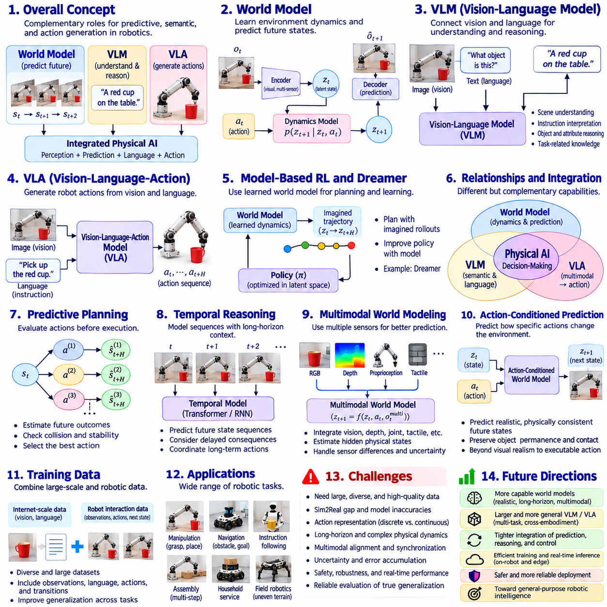{width="7.268055555555556in" height="7.268055555555556in"}

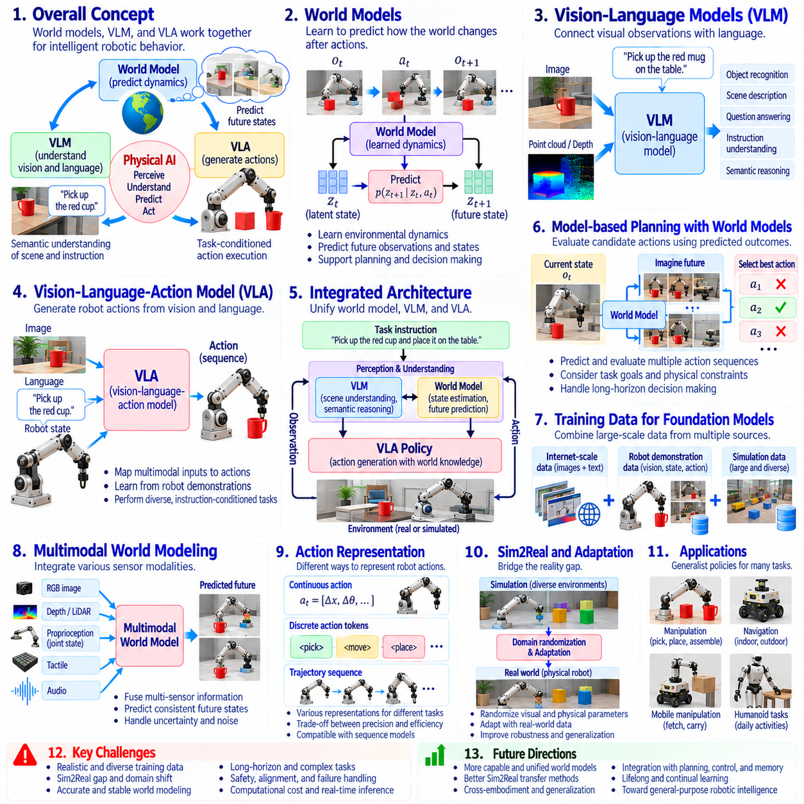{width="7.268055555555556in" height="7.268055555555556in"}

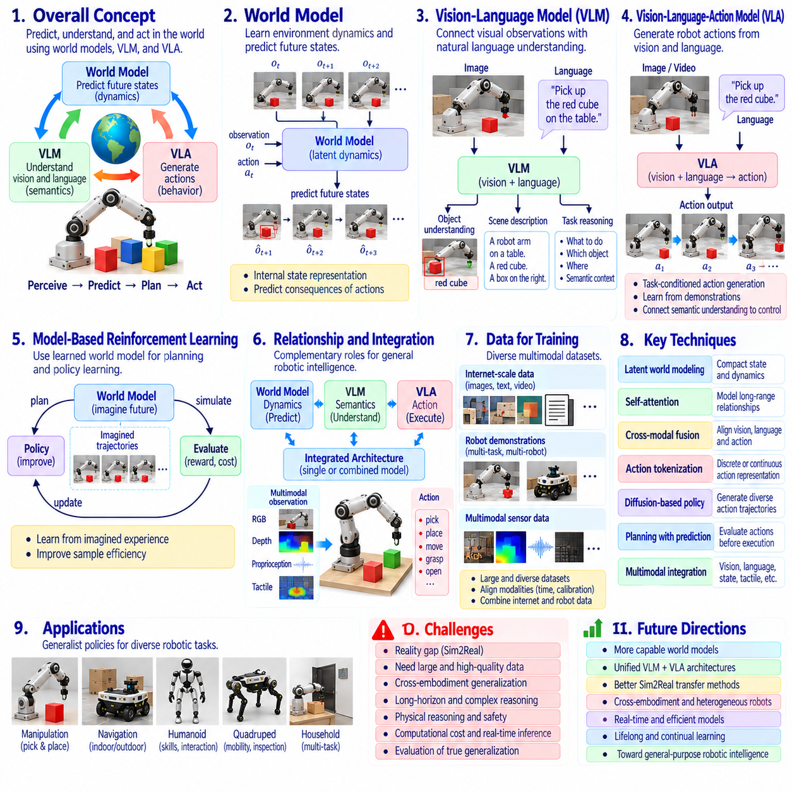{width="7.268055555555556in" height="7.268055555555556in"}

World models represent an important development in Physical AI by enabling intelligent systems to predict how environments may change in response to actions. Traditional perception models primarily recognize objects and estimate current conditions, while world models attempt to represent environmental dynamics and future states. This predictive capability connects perception with planning, allowing robots to evaluate possible outcomes before interacting with the physical world.

The conceptual foundations of world models originate from model-based control, state estimation, reinforcement learning, and predictive simulation. A world model learns relationships among observations, actions, hidden states, and subsequent outcomes. Instead of responding only to immediate sensory inputs, an agent can maintain an internal representation of environmental conditions. This representation supports reasoning about uncertainty, temporal dependencies, and the consequences of alternative actions.

Early learned world models combined visual encoders, recurrent dynamics models, and compact latent representations. Images were transformed into lower-dimensional states, while predictive networks estimated how those states would evolve under different actions. This approach demonstrated that agents could learn useful environmental dynamics from interaction data. Latent-space prediction also reduced the computational burden of reasoning directly over high-dimensional sensory observations.

Model-based reinforcement learning expanded these ideas by using learned dynamics to support policy optimization and planning. Architectures such as Dreamer demonstrated how agents could improve behavior through imagined trajectories generated within learned latent dynamics models. Rather than requiring every learning experience to occur in the physical environment, agents could evaluate hypothetical transitions internally. However, inaccurate predictions may accumulate and degrade decisions over extended horizons.

Vision-language models, commonly called VLMs, introduced another major capability by connecting visual observations with natural language representations. These models learn relationships between images, objects, scenes, and textual descriptions. In robotics, VLMs can interpret instructions, identify relevant objects, and describe environmental conditions. Their semantic understanding supports task reasoning, but does not independently provide the precise motor commands required for physical execution.

Vision-language-action models, or VLAs, extend multimodal learning by connecting visual perception and language instructions directly with robotic actions. A VLA policy receives sensory observations and task descriptions, then predicts movements or action sequences. This architecture links semantic understanding with physical behavior through learned representations. Its effectiveness depends on robotic demonstrations, appropriate action representations, and compatibility with the target robot\'s control system.

The relationship between world models, VLMs, and VLAs reflects three complementary functions within emerging Physical AI architectures. World models estimate environmental dynamics and possible future outcomes, VLMs provide semantic interpretation of observations and instructions, and VLAs generate task-conditioned actions. These capabilities may be integrated into a single model or distributed across specialized components. Their combination supports more informed and adaptable robotic decision-making.

Predictive world models can improve robotic planning by evaluating candidate actions before execution. A robot may estimate whether a movement will cause a collision, whether an object will remain stable, or whether a planned trajectory can reach its intended goal. Predictions can be compared against task objectives and physical constraints. Nevertheless, reliable planning requires uncertainty awareness because learned models cannot perfectly represent every environmental interaction.

Temporal reasoning is essential because physical environments evolve continuously and robot actions have delayed consequences. World models may predict sequences of future states rather than isolated outcomes, while VLA policies generate coordinated action trajectories. VLMs can provide contextual information about objects, activities, and task intentions. Combining these representations enables decisions that account for both semantic goals and expected physical developments over time.

Multimodal world modeling extends prediction beyond images by incorporating depth measurements, proprioception, tactile feedback, and other sensor signals. These modalities describe complementary aspects of geometry, motion, and contact. A model that integrates them may better estimate hidden physical states and interaction dynamics. However, differences in sensor frequency, calibration, and measurement uncertainty create challenges for consistent multimodal prediction.

Action-conditioned prediction distinguishes physical world models from systems that merely generate plausible visual sequences. A useful robotic model must represent how specific actions influence future observations and physical states. Predictions should preserve relevant constraints such as object permanence, contact behavior, and motion feasibility. Visual realism alone is insufficient if generated outcomes violate physical dynamics or fail to correspond to executable robot actions.

Training these systems requires diverse datasets containing sensory observations, language descriptions, actions, and resulting state transitions. Internet-scale visual and textual data can provide broad semantic knowledge, while robotic interaction datasets supply evidence about physical consequences. Combining these sources supports generalization across tasks and environments. However, inconsistent action formats, embodiment differences, and limited coverage of rare events remain major obstacles.

Computational architecture becomes important when integrating world models, VLMs, and VLAs into operational robots. Predictive simulation and multimodal inference may require substantial processing resources, while motor control demands timely and reliable responses. Hierarchical systems can separate high-level reasoning from fast local control. Edge and on-premises computation may support different workloads, provided communication delays and failures do not compromise physical safety.

Safety and validation remain fundamental because learned predictions and generated actions can be incorrect even when their outputs appear convincing. World models may underestimate hazards, VLMs may misinterpret scenes, and VLAs may produce unsuitable movements. Reliable deployment therefore requires independent safety constraints, physical feedback, uncertainty monitoring, and systematic testing. Learned intelligence must remain compatible with verified control and emergency-response mechanisms.

The historical significance of world models, VLMs, and VLAs lies in bringing prediction, semantic understanding, and action generation into a more unified framework for embodied intelligence. Together, they extend robotics beyond recognizing present conditions toward anticipating consequences and selecting purposeful physical actions. Modern Physical AI builds upon this convergence to develop adaptive systems that perceive, predict, reason, act, and continuously correct their behavior through interaction with the real world.

세계 모델(World Model)은 지능형 시스템(Intelligent System)이 행동(Action)에 따라 환경(Environment)이 어떻게 변화할 수 있는지 예측하도록 함으로써 피지컬 인공지능(Physical AI)의 중요한 발전을 나타낸다. 전통적인 인식 모델(Perception Model)은 주로 객체(Object)를 인식하고 현재 조건(Current Condition)을 추정하는 데 중점을 두었지만, 세계 모델은 환경 동역학(Environmental Dynamics)과 미래 상태(Future State)를 표현하고자 한다. 이러한 예측 능력(Predictive Capability)은 인식(Perception)과 계획(Planning)을 연결하여 로봇이 물리적 세계(Physical World)와 상호작용하기 전에 가능한 결과(Possible Outcome)를 평가할 수 있도록 한다.

세계 모델(World Model)의 개념적 기반은 모델 기반 제어(Model-Based Control), 상태 추정(State Estimation), 강화학습(Reinforcement Learning), 예측 시뮬레이션(Predictive Simulation)에서 비롯되었다. 세계 모델은 관측값(Observation), 행동(Action), 숨겨진 상태(Hidden State), 후속 결과(Subsequent Outcome) 사이의 관계를 학습한다. 에이전트(Agent)는 즉각적인 감각 입력(Sensory Input)에만 반응하는 대신 환경 조건(Environmental Condition)에 대한 내부 표현(Internal Representation)을 유지할 수 있다. 이러한 표현은 불확실성(Uncertainty), 시간적 의존성(Temporal Dependency), 대안적 행동(Alternative Action)의 결과에 관한 추론(Reasoning)을 지원한다.

초기의 학습 기반 세계 모델(Learned World Model)은 시각 인코더(Visual Encoder), 순환 동역학 모델(Recurrent Dynamics Model), 압축된 잠재 표현(Compact Latent Representation)을 결합하였다. 이미지(Image)는 저차원 상태(Lower-Dimensional State)로 변환되었으며, 예측 신경망(Predictive Network)은 서로 다른 행동(Action)에 따라 이러한 상태가 어떻게 변화하는지 추정하였다. 이 접근법은 에이전트(Agent)가 상호작용 데이터(Interaction Data)로부터 유용한 환경 동역학(Environmental Dynamics)을 학습할 수 있음을 보여주었다. 잠재 공간 예측(Latent-Space Prediction)은 고차원 감각 관측값(High-Dimensional Sensory Observation)을 직접 처리하여 추론하는 데 필요한 계산 부담(Computational Burden)도 줄였다.

모델 기반 강화학습(Model-Based Reinforcement Learning)은 학습된 동역학(Learned Dynamics)을 정책 최적화(Policy Optimization)와 계획(Planning)에 활용함으로써 이러한 개념을 확장하였다. Dreamer와 같은 아키텍처(Architecture)는 학습된 잠재 동역학 모델(Latent Dynamics Model) 내부에서 생성된 상상 궤적(Imagined Trajectory)을 통해 에이전트가 행동(Behavior)을 개선할 수 있음을 보여주었다. 모든 학습 경험(Learning Experience)이 물리적 환경(Physical Environment)에서 발생할 필요 없이 에이전트는 가상의 상태 전이(Hypothetical Transition)를 내부적으로 평가할 수 있었다. 그러나 부정확한 예측(Inaccurate Prediction)은 누적되어 장기 예측 구간(Extended Horizon)에서 의사결정(Decision-Making)의 품질을 저하시킬 수 있다.

일반적으로 VLM이라고 불리는 비전-언어 모델(Vision-Language Model)은 시각 관측값(Visual Observation)과 자연어 표현(Natural Language Representation)을 연결함으로써 또 다른 중요한 능력을 도입하였다. 이러한 모델은 이미지(Image), 객체(Object), 장면(Scene), 텍스트 설명(Textual Description) 사이의 관계를 학습한다. 로보틱스(Robotics)에서 VLM은 명령(Instruction)을 해석하고, 관련 객체(Relevant Object)를 식별하며, 환경 조건(Environmental Condition)을 설명할 수 있다. 이러한 의미적 이해(Semantic Understanding)는 작업 추론(Task Reasoning)을 지원하지만, 물리적 실행(Physical Execution)에 필요한 정밀한 운동 명령(Precise Motor Command)을 독립적으로 제공하지는 않는다.

비전-언어-행동 모델(Vision-Language-Action Model, VLA)은 시각 인식(Visual Perception)과 언어 명령(Language Instruction)을 로봇 행동(Robotic Action)에 직접 연결함으로써 다중모달 학습(Multimodal Learning)을 확장한다. VLA 정책(VLA Policy)은 감각 관측값(Sensory Observation)과 작업 설명(Task Description)을 입력받아 움직임(Movement)이나 행동 시퀀스(Action Sequence)를 예측한다. 이러한 아키텍처(Architecture)는 학습된 표현(Learned Representation)을 통해 의미적 이해(Semantic Understanding)와 물리적 행동(Physical Behavior)을 연결한다. 그 효과는 로봇 시연(Robotic Demonstration), 적절한 행동 표현(Action Representation), 대상 로봇의 제어 시스템(Control System)과의 호환성(Compatibility)에 달려 있다.

세계 모델(World Model), 비전-언어 모델(VLM), 비전-언어-행동 모델(VLA) 사이의 관계는 새롭게 등장하는 피지컬 인공지능 아키텍처(Physical AI Architecture) 내부의 세 가지 상호 보완적인 기능(Complementary Function)을 반영한다. 세계 모델은 환경 동역학(Environmental Dynamics)과 가능한 미래 결과(Possible Future Outcome)를 추정하고, VLM은 관측값(Observation)과 명령(Instruction)에 대한 의미적 해석(Semantic Interpretation)을 제공하며, VLA는 작업 조건부 행동(Task-Conditioned Action)을 생성한다. 이러한 능력은 하나의 모델(Single Model)에 통합되거나 전문화된 구성요소(Specialized Component)에 분산될 수 있다. 이들의 결합은 더욱 정보에 기반한 적응적 로봇 의사결정(Adaptive Robotic Decision-Making)을 지원한다.

예측 세계 모델(Predictive World Model)은 실행 전에 후보 행동(Candidate Action)을 평가함으로써 로봇 계획(Robotic Planning)을 개선할 수 있다. 로봇은 특정 움직임(Movement)이 충돌(Collision)을 유발하는지, 객체(Object)가 안정적으로 유지되는지, 계획된 궤적(Planned Trajectory)이 의도한 목표(Intended Goal)에 도달할 수 있는지를 추정할 수 있다. 예측 결과(Predicted Outcome)는 작업 목표(Task Objective)와 물리적 제약(Physical Constraint)에 따라 비교될 수 있다. 그러나 학습된 모델(Learned Model)은 모든 환경 상호작용(Environmental Interaction)을 완벽하게 표현할 수 없으므로 신뢰성 있는 계획(Reliable Planning)을 위해서는 불확실성 인식(Uncertainty Awareness)이 필요하다.

물리적 환경(Physical Environment)은 지속적으로 변화하고 로봇 행동(Robot Action)은 지연된 결과(Delayed Consequence)를 발생시키기 때문에 시간적 추론(Temporal Reasoning)은 필수적이다. 세계 모델(World Model)은 개별 결과(Isolated Outcome)가 아니라 미래 상태(Future State)의 시퀀스를 예측할 수 있으며, VLA 정책(VLA Policy)은 조정된 행동 궤적(Coordinated Action Trajectory)을 생성한다. VLM은 객체(Object), 활동(Activity), 작업 의도(Task Intention)에 관한 문맥 정보(Contextual Information)를 제공할 수 있다. 이러한 표현을 결합하면 의미적 목표(Semantic Goal)와 시간에 따른 예상 물리적 변화(Expected Physical Development)를 모두 고려하는 의사결정(Decision-Making)이 가능해진다.

다중모달 세계 모델링(Multimodal World Modeling)은 깊이 측정값(Depth Measurement), 고유수용감각(Proprioception), 촉각 피드백(Tactile Feedback), 기타 센서 신호(Sensor Signal)를 통합함으로써 이미지(Image)를 넘어 예측 범위를 확장한다. 이러한 모달리티(Modality)는 기하학적 구조(Geometry), 운동(Motion), 접촉(Contact)의 상호 보완적인 측면을 설명한다. 이를 통합하는 모델은 숨겨진 물리적 상태(Hidden Physical State)와 상호작용 동역학(Interaction Dynamics)을 더욱 정확하게 추정할 수 있다. 그러나 센서 주파수(Sensor Frequency), 보정(Calibration), 측정 불확실성(Measurement Uncertainty)의 차이는 일관된 다중모달 예측(Consistent Multimodal Prediction)에 어려움을 발생시킨다.

행동 조건부 예측(Action-Conditioned Prediction)은 물리적 세계 모델(Physical World Model)을 단순히 그럴듯한 시각 시퀀스(Plausible Visual Sequence)를 생성하는 시스템과 구별한다. 유용한 로봇 모델(Robotic Model)은 특정 행동(Specific Action)이 미래 관측값(Future Observation)과 물리적 상태(Physical State)에 어떤 영향을 미치는지 표현해야 한다. 예측 결과는 객체 영속성(Object Permanence), 접촉 행동(Contact Behavior), 운동 실현 가능성(Motion Feasibility)과 같은 관련 제약조건(Constraint)을 보존해야 한다. 생성된 결과가 물리 동역학(Physical Dynamics)을 위반하거나 실행 가능한 로봇 행동(Executable Robot Action)과 대응하지 않는다면 시각적 사실성(Visual Realism)만으로는 충분하지 않다.

이러한 시스템의 학습(Training)에는 감각 관측값(Sensory Observation), 언어 설명(Language Description), 행동(Action), 그에 따른 상태 전이(State Transition)를 포함하는 다양한 데이터셋(Dataset)이 필요하다. 인터넷 규모의 시각 및 텍스트 데이터(Internet-Scale Visual and Textual Data)는 광범위한 의미적 지식(Semantic Knowledge)을 제공할 수 있으며, 로봇 상호작용 데이터셋(Robotic Interaction Dataset)은 물리적 결과(Physical Consequence)에 관한 근거를 제공한다. 이러한 정보원을 결합하면 작업(Task)과 환경(Environment) 전반에 걸친 일반화(Generalization)를 지원할 수 있다. 그러나 일관되지 않은 행동 형식(Action Format), 신체 구현 차이(Embodiment Difference), 희귀 사건(Rare Event)에 대한 제한적인 데이터 포괄 범위(Data Coverage)는 여전히 주요 장애물로 남아 있다.

세계 모델(World Model), VLM, VLA를 실제 운용 로봇(Operational Robot)에 통합할 때 계산 아키텍처(Computational Architecture)는 중요한 요소가 된다. 예측 시뮬레이션(Predictive Simulation)과 다중모달 추론(Multimodal Inference)은 상당한 처리 자원(Processing Resource)을 필요로 할 수 있는 반면, 운동 제어(Motor Control)는 적시에 신뢰성 있는 응답(Timely and Reliable Response)을 요구한다. 계층적 시스템(Hierarchical System)은 상위 수준 추론(High-Level Reasoning)을 빠른 로컬 제어(Fast Local Control)와 분리할 수 있다. 엣지 컴퓨팅(Edge Computing)과 온프레미스 컴퓨팅(On-Premises Computing)은 통신 지연(Communication Delay)과 장애(Failure)가 물리적 안전성(Physical Safety)을 저해하지 않는다는 조건에서 서로 다른 작업 부하(Workload)를 지원할 수 있다.

학습된 예측(Learned Prediction)과 생성된 행동(Generated Action)은 출력이 설득력 있어 보이더라도 부정확할 수 있기 때문에 안전성(Safety)과 검증(Validation)은 근본적으로 중요하다. 세계 모델(World Model)은 위험 요소(Hazard)를 과소평가할 수 있고, VLM은 장면(Scene)을 잘못 해석할 수 있으며, VLA는 부적절한 움직임(Unsuitable Movement)을 생성할 수 있다. 따라서 신뢰성 있는 배포(Reliable Deployment)를 위해서는 독립적인 안전 제약(Independent Safety Constraint), 물리적 피드백(Physical Feedback), 불확실성 모니터링(Uncertainty Monitoring), 체계적인 시험(Systematic Testing)이 필요하다. 학습 기반 지능(Learned Intelligence)은 검증된 제어 메커니즘(Verified Control Mechanism) 및 비상 대응 메커니즘(Emergency-Response Mechanism)과 호환성을 유지해야 한다.

세계 모델(World Model), 비전-언어 모델(VLM), 비전-언어-행동 모델(VLA)의 역사적 중요성은 예측(Prediction), 의미적 이해(Semantic Understanding), 행동 생성(Action Generation)을 체화 지능(Embodied Intelligence)을 위한 더욱 통합된 프레임워크(Unified Framework)로 결합하였다는 데 있다. 이들은 로보틱스(Robotics)를 현재 조건(Current Condition)의 인식에서 더 나아가 결과 예측(Consequence Anticipation)과 목적 지향적 물리 행동(Purposeful Physical Action)의 선택으로 확장한다. 현대 피지컬 인공지능(Physical AI)은 이러한 기술적 융합(Technological Convergence)을 바탕으로 실제 세계(Real World)와의 상호작용을 통해 인식(Perception), 예측(Prediction), 추론(Reasoning), 행동(Action), 지속적인 행동 수정(Continuous Behavioral Correction)을 수행하는 적응형 시스템(Adaptive System)을 개발하고 있다.

##  

## 03.14. Emergence of Physical AI

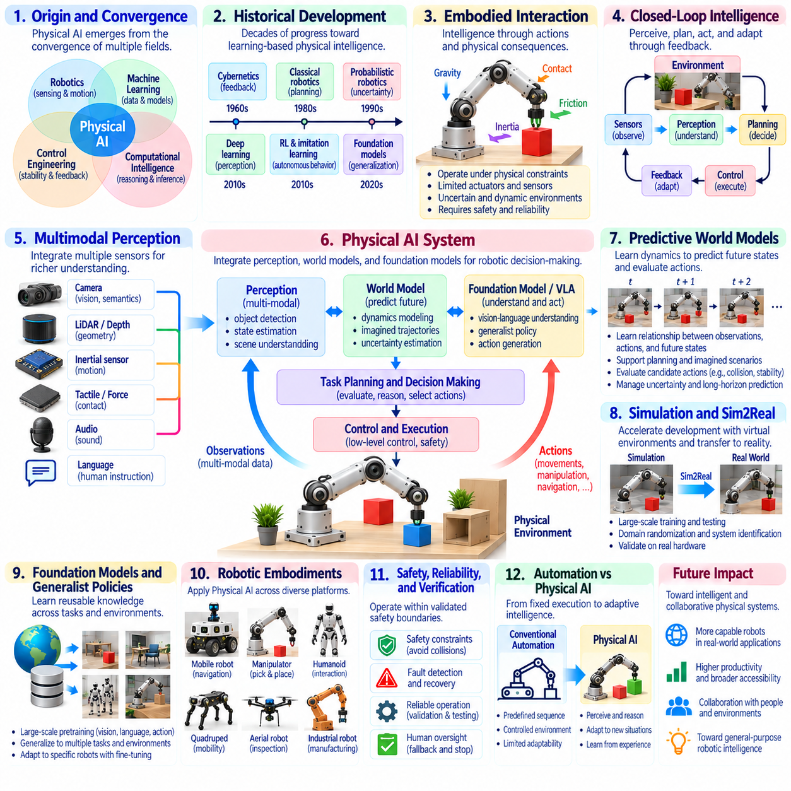{width="7.268055555555556in" height="7.268055555555556in"}

Physical AI emerged from the convergence of robotics, machine learning, control engineering, and computational intelligence. Earlier artificial intelligence systems primarily processed symbolic information or digital data, while robotic systems focused on sensing, motion, and physical control. Physical AI connects these traditions by enabling intelligent machines to perceive environments, reason about physical conditions, select actions, and adapt through continuous interaction with the real world.

The historical development of Physical AI reflects decades of progress across several technological disciplines. Cybernetics established feedback principles, classical robotics introduced geometric planning, and probabilistic robotics addressed uncertainty. Deep learning improved perception, while reinforcement learning and imitation learning expanded autonomous behavior acquisition. These developments gradually transformed robotics from predefined automation toward learning-based physical intelligence.

A defining characteristic of Physical AI is its dependence on embodied interaction. Intelligence is not expressed solely through symbolic reasoning or information generation but through actions that produce measurable physical consequences. A robot must account for gravity, friction, contact, inertia, and environmental uncertainty. Its decisions are constrained by actuator capabilities, sensor limitations, and operational safety requirements, making physical intelligence fundamentally different from purely digital computation.

Closed-loop intelligence provides the operational foundation for Physical AI systems. Sensors observe environmental conditions, perception models interpret incoming information, and planning mechanisms determine appropriate actions. Controllers translate decisions into physical commands, while subsequent observations reveal the consequences of execution. This repeated perception-action-feedback cycle enables continuous correction and adaptation when actual outcomes differ from predicted behavior.

The integration of multimodal perception significantly expanded the environmental understanding available to intelligent robots. Cameras provide visual and semantic information, LiDAR and depth sensors describe geometry, and inertial sensors measure motion. Tactile and force sensors reveal physical contact, while language interfaces communicate human intentions. Combining these modalities enables richer state estimation and supports decisions that cannot be derived reliably from a single information source.

World models introduced predictive capabilities that extend Physical AI beyond reactive behavior. By learning relationships between observations, actions, and future states, these models support reasoning about possible physical outcomes. Robots can evaluate candidate movements, anticipate obstacles, and estimate interaction consequences before execution. However, predictive accuracy depends on training coverage, physical modeling quality, and the management of uncertainty across extended planning horizons.

Foundation models and generalist policies contributed another important transition by introducing reusable knowledge across tasks and environments. Large-scale pretraining allows models to acquire shared representations from diverse visual, linguistic, and robotic experiences. Vision-language-action architectures connect task instructions with physical action generation. Although these approaches improve adaptability, reliable execution still requires robot-specific calibration, feedback control, and validated operational constraints.

Simulation and Sim2Real technologies accelerated the development of Physical AI by supporting large-scale experimentation without requiring every interaction to occur on physical hardware. Virtual environments provide controlled conditions for training policies, evaluating perception, and testing hazardous scenarios. Domain randomization and system identification help reduce differences between simulated and real environments. Physical validation remains necessary because simulation cannot reproduce every contact condition or environmental disturbance.

The emergence of Physical AI also reflects advances in computational infrastructure. Graphics processors, specialized accelerators, and embedded computing platforms support increasingly complex perception and decision models. Edge computing enables time-sensitive inference near physical devices, while on-premises and cloud resources support larger workloads. Effective deployment requires balancing model complexity, communication latency, power consumption, and deterministic control requirements.

Physical AI extends across multiple robotic embodiments, including autonomous mobile robots, industrial manipulators, humanoids, quadrupeds, and unmanned aerial vehicles. These platforms differ in mechanical design, mobility, sensing, and control requirements, yet share common principles of perception, prediction, planning, and feedback. General intelligence architectures must therefore distinguish transferable task knowledge from embodiment-specific movement constraints and actuator capabilities.

Safety, reliability, and verification became central concerns as learning-based systems gained greater physical autonomy. Incorrect perception, uncertain predictions, or unsuitable actions can produce collisions, equipment damage, and risks to people. Physical AI must operate within validated safety boundaries and support fault detection, emergency responses, and controlled fallback behavior. Learning-based intelligence complements rather than replaces established safety engineering and dependable control mechanisms.

The distinction between autonomous automation and Physical AI is particularly important. Conventional automation executes predefined sequences under relatively controlled conditions, while Physical AI aims to interpret changing situations and adapt its behavior accordingly. The distinction is not absolute because advanced automation already incorporates feedback and adaptive control. Physical AI emphasizes broader learning, predictive reasoning, and transferable decision-making grounded in physical interaction.

Human-robot collaboration provides an important application context for emerging Physical AI. Intelligent robots must interpret human instructions, recognize nearby activities, and coordinate actions without compromising safety. Language understanding can support task communication, while perception and motion planning maintain awareness of shared workspaces. Effective collaboration requires predictable behavior, transparent operational boundaries, and mechanisms for human supervision and intervention.

The broader significance of Physical AI lies in transforming artificial intelligence from primarily information-centered computation into systems capable of purposeful physical interaction. Its emergence is not attributable to a single algorithm or platform but to the convergence of sensing, learning, prediction, planning, control, and embodied experience. Future progress depends on integrating these capabilities into reliable closed-loop architectures that operate safely across diverse environments and physical tasks.

피지컬 인공지능(Physical AI)은 로보틱스(Robotics), 기계학습(Machine Learning), 제어공학(Control Engineering), 계산 지능(Computational Intelligence)의 융합을 통해 등장하였다. 초기 인공지능 시스템(Artificial Intelligence System)은 주로 기호 정보(Symbolic Information)나 디지털 데이터(Digital Data)를 처리하였으며, 로봇 시스템(Robotic System)은 감지(Sensing), 운동(Motion), 물리적 제어(Physical Control)에 중점을 두었다. 피지컬 인공지능은 이러한 기술적 전통을 연결하여 지능형 기계(Intelligent Machine)가 환경(Environment)을 인식하고, 물리적 조건(Physical Condition)을 추론하며, 행동(Action)을 선택하고, 실제 세계(Real World)와의 지속적인 상호작용(Continuous Interaction)을 통해 적응할 수 있도록 한다.

피지컬 인공지능(Physical AI)의 역사적 발전은 여러 기술 분야(Technological Discipline)에서 수십 년에 걸쳐 이루어진 진보를 반영한다. 사이버네틱스(Cybernetics)는 피드백 원리(Feedback Principle)를 확립하였고, 고전 로보틱스(Classical Robotics)는 기하학적 계획(Geometric Planning)을 도입하였으며, 확률적 로보틱스(Probabilistic Robotics)는 불확실성(Uncertainty) 문제를 다루었다. 딥러닝(Deep Learning)은 인식(Perception)을 개선하였으며, 강화학습(Reinforcement Learning)과 모방학습(Imitation Learning)은 자율 행동 습득(Autonomous Behavior Acquisition)의 범위를 확장하였다. 이러한 발전은 로보틱스를 사전 정의된 자동화(Predefined Automation)에서 학습 기반 물리 지능(Learning-Based Physical Intelligence)으로 점진적으로 변화시켰다.

피지컬 인공지능(Physical AI)의 핵심적인 특징은 체화된 상호작용(Embodied Interaction)에 의존한다는 점이다. 지능(Intelligence)은 기호적 추론(Symbolic Reasoning)이나 정보 생성(Information Generation)만으로 표현되는 것이 아니라, 측정 가능한 물리적 결과(Measurable Physical Consequence)를 발생시키는 행동(Action)을 통해 구현된다. 로봇은 중력(Gravity), 마찰(Friction), 접촉(Contact), 관성(Inertia), 환경 불확실성(Environmental Uncertainty)을 고려해야 한다. 로봇의 의사결정(Decision-Making)은 구동기 성능(Actuator Capability), 센서 한계(Sensor Limitation), 운용 안전 요구사항(Operational Safety Requirement)에 의해 제약되며, 이러한 특성은 물리 지능(Physical Intelligence)을 순수한 디지털 계산(Digital Computation)과 근본적으로 구별한다.

폐루프 지능(Closed-Loop Intelligence)은 피지컬 인공지능 시스템(Physical AI System)의 운용 기반(Operational Foundation)을 제공한다. 센서(Sensor)는 환경 조건(Environmental Condition)을 관측하고, 인식 모델(Perception Model)은 입력 정보(Incoming Information)를 해석하며, 계획 메커니즘(Planning Mechanism)은 적절한 행동(Action)을 결정한다. 제어기(Controller)는 의사결정(Decision)을 물리적 명령(Physical Command)으로 변환하며, 후속 관측값(Subsequent Observation)은 실행 결과(Execution Consequence)를 보여준다. 이러한 반복적인 인식-행동-피드백 순환(Perception-Action-Feedback Cycle)은 실제 결과(Actual Outcome)가 예측된 행동(Predicted Behavior)과 다를 때 지속적인 수정(Continuous Correction)과 적응(Adaptation)을 가능하게 한다.

다중모달 인식(Multimodal Perception)의 통합은 지능형 로봇(Intelligent Robot)이 활용할 수 있는 환경 이해(Environmental Understanding)의 범위를 크게 확장하였다. 카메라(Camera)는 시각 정보(Visual Information)와 의미적 정보(Semantic Information)를 제공하고, 라이다(LiDAR)와 깊이 센서(Depth Sensor)는 기하학적 구조(Geometry)를 설명하며, 관성 센서(Inertial Sensor)는 운동(Motion)을 측정한다. 촉각 센서(Tactile Sensor)와 힘 센서(Force Sensor)는 물리적 접촉(Physical Contact)을 감지하며, 언어 인터페이스(Language Interface)는 인간의 의도(Human Intention)를 전달한다. 이러한 모달리티(Modality)를 결합하면 더욱 풍부한 상태 추정(State Estimation)이 가능해지고, 단일 정보원(Single Information Source)만으로는 신뢰성 있게 도출하기 어려운 의사결정(Decision-Making)을 지원할 수 있다.

세계 모델(World Model)은 피지컬 인공지능(Physical AI)을 반응적 행동(Reactive Behavior)의 범위를 넘어 확장하는 예측 능력(Predictive Capability)을 도입하였다. 세계 모델은 관측값(Observation), 행동(Action), 미래 상태(Future State) 사이의 관계를 학습함으로써 가능한 물리적 결과(Physical Outcome)에 대한 추론(Reasoning)을 지원한다. 로봇은 실행 전에 후보 움직임(Candidate Movement)을 평가하고, 장애물(Obstacle)을 예측하며, 상호작용의 결과(Interaction Consequence)를 추정할 수 있다. 그러나 예측 정확도(Predictive Accuracy)는 학습 데이터의 포괄 범위(Training Coverage), 물리 모델링 품질(Physical Modeling Quality), 장기 계획 구간(Extended Planning Horizon)에 걸친 불확실성 관리(Uncertainty Management)에 의존한다.

파운데이션 모델(Foundation Model)과 범용 정책(Generalist Policy)은 작업(Task)과 환경(Environment) 전반에 걸쳐 재사용 가능한 지식(Reusable Knowledge)을 도입함으로써 또 다른 중요한 전환에 기여하였다. 대규모 사전학습(Large-Scale Pretraining)은 모델이 다양한 시각 경험(Visual Experience), 언어 경험(Linguistic Experience), 로봇 경험(Robotic Experience)으로부터 공유 표현(Shared Representation)을 습득할 수 있도록 한다. 비전-언어-행동 아키텍처(Vision-Language-Action Architecture)는 작업 명령(Task Instruction)을 물리적 행동 생성(Physical Action Generation)과 연결한다. 이러한 접근법은 적응성(Adaptability)을 향상시키지만, 신뢰성 있는 실행(Reliable Execution)을 위해서는 여전히 로봇별 보정(Robot-Specific Calibration), 피드백 제어(Feedback Control), 검증된 운용 제약(Validated Operational Constraint)이 필요하다.

시뮬레이션(Simulation)과 심투리얼(Simulation-to-Reality, Sim2Real) 기술은 모든 상호작용(Interaction)을 물리적 하드웨어(Physical Hardware)에서 수행하지 않고도 대규모 실험(Large-Scale Experimentation)을 지원함으로써 피지컬 인공지능(Physical AI)의 발전을 가속화하였다. 가상 환경(Virtual Environment)은 정책 학습(Policy Training), 인식 평가(Perception Evaluation), 위험 시나리오 시험(Hazardous Scenario Testing)을 위한 통제된 조건(Controlled Condition)을 제공한다. 도메인 무작위화(Domain Randomization)와 시스템 식별(System Identification)은 시뮬레이션 환경(Simulated Environment)과 실제 환경(Real Environment) 사이의 차이를 줄이는 데 기여한다. 그러나 시뮬레이션은 모든 접촉 조건(Contact Condition)이나 환경 교란(Environmental Disturbance)을 재현할 수 없으므로 물리적 검증(Physical Validation)은 여전히 필요하다.

피지컬 인공지능(Physical AI)의 등장은 계산 인프라(Computational Infrastructure)의 발전도 반영한다. 그래픽 처리 장치(Graphics Processing Unit), 특수 목적 가속기(Specialized Accelerator), 임베디드 컴퓨팅 플랫폼(Embedded Computing Platform)은 점점 더 복잡한 인식 모델(Perception Model)과 의사결정 모델(Decision Model)을 지원한다. 엣지 컴퓨팅(Edge Computing)은 물리적 장치(Physical Device) 가까이에서 시간 민감형 추론(Time-Sensitive Inference)을 수행할 수 있도록 하며, 온프레미스(On-Premises) 및 클라우드 자원(Cloud Resource)은 더 큰 작업 부하(Workload)를 지원한다. 효과적인 배포(Effective Deployment)를 위해서는 모델 복잡도(Model Complexity), 통신 지연(Communication Latency), 전력 소비(Power Consumption), 결정론적 제어 요구사항(Deterministic Control Requirement) 사이의 균형이 필요하다.

피지컬 인공지능(Physical AI)은 자율 이동 로봇(Autonomous Mobile Robot), 산업용 매니퓰레이터(Industrial Manipulator), 휴머노이드(Humanoid), 사족보행 로봇(Quadruped), 무인 항공기(Unmanned Aerial Vehicle)를 포함한 다양한 로봇 신체 구현(Robotic Embodiment)으로 확장된다. 이러한 플랫폼은 기계적 설계(Mechanical Design), 이동성(Mobility), 감지(Sensing), 제어 요구사항(Control Requirement)에서 차이를 보이지만, 인식(Perception), 예측(Prediction), 계획(Planning), 피드백(Feedback)이라는 공통 원리를 공유한다. 따라서 범용 지능 아키텍처(General Intelligence Architecture)는 전이 가능한 작업 지식(Transferable Task Knowledge)을 신체 구현별 움직임 제약(Embodiment-Specific Movement Constraint) 및 구동기 성능(Actuator Capability)과 구별해야 한다.

학습 기반 시스템(Learning-Based System)의 물리적 자율성(Physical Autonomy)이 증가하면서 안전성(Safety), 신뢰성(Reliability), 검증(Verification)은 핵심적인 관심사가 되었다. 잘못된 인식(Incorrect Perception), 불확실한 예측(Uncertain Prediction), 부적절한 행동(Unsuitable Action)은 충돌(Collision), 장비 손상(Equipment Damage), 인명 위험(Risk to People)을 발생시킬 수 있다. 피지컬 인공지능(Physical AI)은 검증된 안전 경계(Validated Safety Boundary) 내부에서 작동해야 하며, 고장 감지(Fault Detection), 비상 대응(Emergency Response), 통제된 대체 대응 행동(Controlled Fallback Behavior)을 지원해야 한다. 학습 기반 지능(Learning-Based Intelligence)은 기존 안전공학(Safety Engineering)과 신뢰성 있는 제어 메커니즘(Dependable Control Mechanism)을 대체하는 것이 아니라 보완한다.

자율 자동화(Autonomous Automation)와 피지컬 인공지능(Physical AI)의 구별은 특히 중요하다. 전통적인 자동화(Conventional Automation)는 비교적 통제된 조건(Controlled Condition)에서 사전에 정의된 시퀀스(Predefined Sequence)를 실행하는 반면, 피지컬 인공지능은 변화하는 상황(Changing Situation)을 해석하고 이에 따라 행동(Behavior)을 적응시키는 것을 목표로 한다. 그러나 고도화된 자동화(Advanced Automation) 역시 피드백(Feedback)과 적응 제어(Adaptive Control)를 포함하므로 이러한 구별이 절대적인 것은 아니다. 피지컬 인공지능은 물리적 상호작용(Physical Interaction)에 기반한 더욱 광범위한 학습(Broader Learning), 예측적 추론(Predictive Reasoning), 전이 가능한 의사결정(Transferable Decision-Making)을 강조한다.

인간-로봇 협업(Human-Robot Collaboration)은 새롭게 발전하는 피지컬 인공지능(Physical AI)의 중요한 응용 맥락(Application Context)을 제공한다. 지능형 로봇(Intelligent Robot)은 안전성(Safety)을 저해하지 않으면서 인간의 명령(Human Instruction)을 해석하고, 주변 활동(Nearby Activity)을 인식하며, 행동(Action)을 조정해야 한다. 언어 이해(Language Understanding)는 작업 의사소통(Task Communication)을 지원할 수 있으며, 인식(Perception)과 운동 계획(Motion Planning)은 공유 작업 공간(Shared Workspace)에 대한 상황 인식(Situational Awareness)을 유지한다. 효과적인 협업(Effective Collaboration)을 위해서는 예측 가능한 행동(Predictable Behavior), 명확한 운용 경계(Transparent Operational Boundary), 인간 감독(Human Supervision)과 개입(Intervention)을 위한 메커니즘이 필요하다.

피지컬 인공지능(Physical AI)의 광범위한 의의는 인공지능(Artificial Intelligence)을 주로 정보 중심의 계산(Information-Centered Computation)에서 목적 지향적인 물리적 상호작용(Purposeful Physical Interaction)을 수행할 수 있는 시스템으로 변화시키는 데 있다. 피지컬 인공지능의 등장은 단일 알고리즘(Single Algorithm)이나 플랫폼(Platform)에 기인하는 것이 아니라 감지(Sensing), 학습(Learning), 예측(Prediction), 계획(Planning), 제어(Control), 체화된 경험(Embodied Experience)의 융합에서 비롯되었다. 향후 발전(Future Progress)은 이러한 능력을 다양한 환경(Environment)과 물리적 작업(Physical Task)에서 안전하게 작동하는 신뢰성 있는 폐루프 아키텍처(Reliable Closed-Loop Architecture)로 통합하는 데 달려 있다.
