**Volume 02. Physical AI Foundations and Definitions**

# Chapter 04. Physical AI Industry Landscape

## 04.01. Global Physical AI Ecosystem

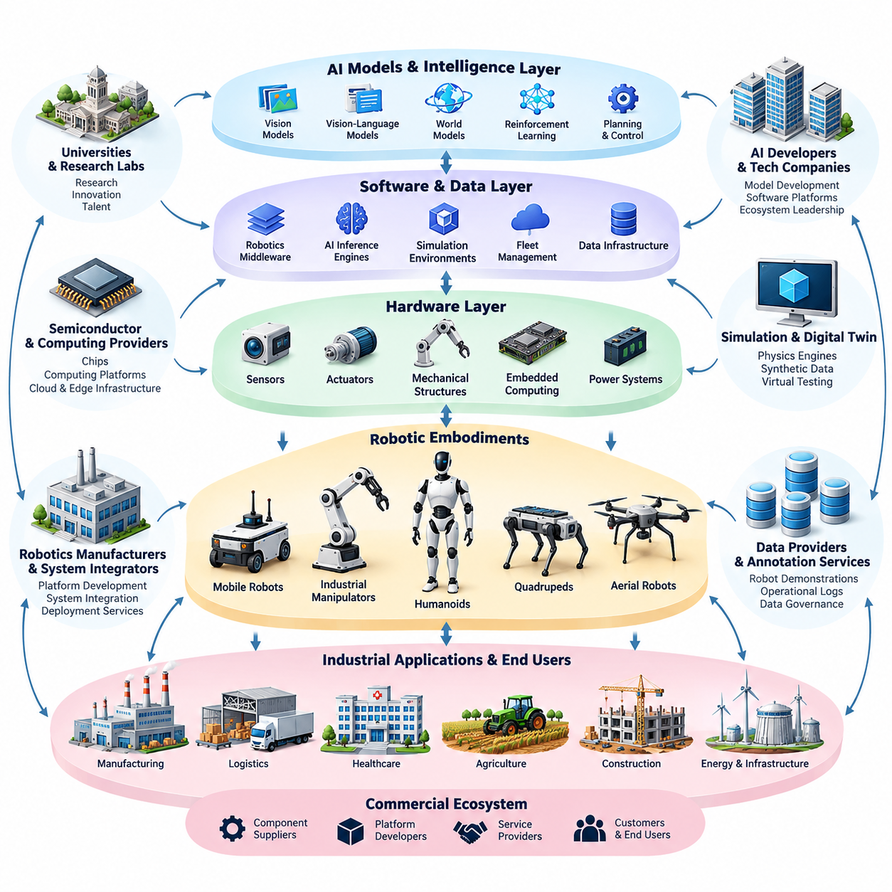{width="7.268055555555556in" height="7.268055555555556in"}

글로벌 피지컬 인공지능 생태계(Global Physical AI Ecosystem)는 인공지능 개발 기업(AI Developers), 로봇 제조업체(Robotics Manufacturers), 반도체 공급업체(Semiconductor Suppliers), 연구기관(Research Institutions), 인프라 제공업체(Infrastructure Providers), 산업 고객(Industrial Customers)이 상호 연결된 네트워크를 의미한다. 기존 디지털 인공지능(Digital AI) 시장과 달리, 이 생태계는 컴퓨팅 지능(Computational Intelligence)과 물리적 기계(Physical Machines)를 통합하여 자율 시스템(Autonomous Systems)이 환경을 인식하고 의사결정을 수행하며 실제 세계의 제약 조건 아래에서 행동하도록 지원한다.

이 생태계는 센서(Sensors), 액추에이터(Actuators), 기계 구조(Mechanical Structures), 임베디드 컴퓨팅 하드웨어(Embedded Computing Hardware)에서 시작하여 여러 기술 계층(Technological Layers)으로 확장된다. 이러한 구성요소는 인식(Perception), 위치 추정(Localization), 동작 계획(Motion Planning), 조작(Manipulation), 피드백 제어(Feedback Control)를 지원한다. 하드웨어 계층(Hardware Layer) 위에서는 소프트웨어 플랫폼(Software Platforms)이 로봇 미들웨어(Robotics Middleware), AI 추론 엔진(AI Inference Engines), 시뮬레이션 환경(Simulation Environments), 플릿 관리 시스템(Fleet Management Systems)을 운영 아키텍처(Operational Architectures)로 통합한다.

지능 계층(Intelligence Layer)에서는 AI 연구기관과 기술 기업이 멀티모달 정보(Multimodal Information)를 해석하고 물리적 행동(Physical Actions)을 생성할 수 있는 머신러닝 모델(Machine Learning Models)을 개발한다. 비전-언어 모델(Vision-Language Models), 비전-언어-행동 모델(Vision-Language-Action Models), 월드 모델(World Models), 강화학습 정책(Reinforcement Learning Policies)은 로봇 지능(Robot Intelligence)에 점점 더 큰 영향을 미치고 있다. 이러한 기술의 실질적 가치는 신뢰성 높은 제어 시스템(Control Systems) 및 물리적 구현체(Physical Embodiments)와 얼마나 효과적으로 통합되는지에 따라 결정된다.

로봇 제조업체(Robotics Manufacturers)는 이러한 기술을 자율이동로봇(Autonomous Mobile Robots, AMR), 산업용 매니퓰레이터(Industrial Manipulators), 휴머노이드(Humanoids), 사족보행 로봇(Quadrupeds), 항공 로봇(Aerial Robots), 특수 목적 자율기계(Specialized Autonomous Machines)로 구현한다. 각 구현체(Embodiment)는 이동성(Mobility), 조작 능력(Dexterity), 적재 능력(Payload Capacity), 환경 적응성(Environmental Adaptability), 인간과의 상호작용(Human Interaction) 등 서로 다른 운영 요구사항을 충족한다. 이러한 다양성은 개별 시장을 형성하는 동시에 공통 지능 아키텍처(Shared Intelligence Architectures)의 발전을 촉진한다.

반도체 및 컴퓨팅 플랫폼 제공업체(Semiconductor and Computing Platform Providers)는 생태계의 또 다른 핵심 계층을 형성한다. 그래픽 처리 장치(Graphics Processing Units, GPUs), 신경망 처리 장치(Neural Processing Units, NPUs), 임베디드 프로세서(Embedded Processors), 실시간 제어기(Real-Time Controllers)는 물리적 기계 내부에서 AI 워크로드(AI Workloads)를 실행하도록 지원한다. 클라우드 인프라(Cloud Infrastructure)는 대규모 학습과 데이터 처리를 담당하며, 엣지 컴퓨팅(Edge Computing)은 네트워크 연결이 제한되거나 불가능한 환경에서도 저지연 추론(Low-Latency Inference)과 로컬 자율성(Local Autonomy)을 제공한다.

시뮬레이션(Simulation)과 디지털 트윈(Digital Twin) 기술은 연구 환경과 실제 물리적 배포(Physical Deployment)를 연결한다. 물리 엔진(Physics Engines), 합성 데이터 생성기(Synthetic Data Generators), 가상 테스트 플랫폼(Virtual Testing Platforms)을 활용하면 개발자는 실제 기계를 작동시키기 전에 자율 행동(Autonomous Behavior)을 학습하고 평가할 수 있다. 시뮬레이션은 개발 비용과 일부 위험을 줄이지만, 가상 환경과 실제 환경 사이의 차이를 해결하기 위해 체계적인 검증(Validation)과 적응(Adaptation)이 필요하다.

데이터 인프라(Data Infrastructure)는 물리적 지능(Physical Intelligence)이 상호작용 경험(Interaction Experience)에 의존하기 때문에 생태계 발전에서 중심적인 역할을 수행한다. 로봇 시연 데이터(Robot Demonstrations), 센서 기록(Sensor Recordings), 원격조작 세션(Teleoperation Sessions), 운영 로그(Operational Logs), 시뮬레이션 생성 궤적(Simulation-Generated Trajectories)은 지능형 정책(Intelligent Policies)을 학습하기 위한 자료를 제공한다. 데이터 품질(Data Quality), 작업 다양성(Task Diversity), 주석 일관성(Annotation Consistency), 데이터 거버넌스(Data Governance)는 모델 성능(Model Performance)과 일반화(Generalization)에 큰 영향을 미친다.

글로벌 생태계(Global Ecosystem)는 서로 다른 산업적 강점을 가진 지역별 혁신 거점(Innovation Centers)으로 구성된다. 미국(United States)은 AI 연구, 컴퓨팅 플랫폼, 로봇 스타트업 분야에서 상당한 역량을 보유하고 있다. 중국(China)은 광범위한 제조 역량을 로봇 개발 및 배포와 결합하고 있다. 일본(Japan), 한국(South Korea), 유럽(Europe)은 산업 자동화(Industrial Automation), 정밀공학(Precision Engineering), 모빌리티(Mobility), 로봇 시스템(Robotic Systems) 분야에서 중요한 전문성을 제공한다.

대학(Universities)과 공공 연구소(Public Research Laboratories)는 기업이 이후 상용 제품에 적용하는 기반 기술(Foundational Technologies)을 제공한다. 주요 연구 성과에는 로봇 학습(Robot Learning), 조작(Manipulation), 인식(Perception), 계획(Planning), 보행(Locomotion), 인간-로봇 상호작용(Human-Robot Interaction)이 포함된다. 공개 연구 논문(Open Research Publications), 벤치마크 데이터셋(Benchmark Datasets), 협력형 소프트웨어 프레임워크(Collaborative Software Frameworks)는 학계와 산업계 사이의 지식 이전(Knowledge Transfer)을 가속화한다.

오픈소스 커뮤니티(Open-Source Communities) 역시 개발 진입 장벽(Development Barriers)을 낮추고 상호운용성(Interoperability)을 촉진함으로써 글로벌 피지컬 AI 생태계에 영향을 미친다. 로봇 미들웨어(Robotics Middleware), 머신러닝 라이브러리(Machine Learning Libraries), 시뮬레이션 도구(Simulation Tools), 재사용 가능한 소프트웨어 구성요소(Reusable Software Components)는 조직이 공통 기술 기반(Shared Technical Foundations)을 활용하도록 지원한다. 그러나 실제 운영 환경에 배포하려면 신뢰성(Reliability), 사이버보안(Cybersecurity), 안전성 보증(Safety Assurance), 하드웨어 호환성(Hardware Compatibility)을 위한 상당한 엔지니어링이 여전히 필요하다.

산업 고객(Industrial Customers)은 피지컬 AI가 해결해야 하는 운영 문제(Operational Problems)를 정의하기 때문에 생태계의 필수 참여자이다. 제조 공장(Manufacturing Plants)은 유연한 자동화(Flexible Automation)를 요구하고, 물류 운영업체(Logistics Operators)는 효율적인 자재 취급(Material Handling)을 추구하며, 의료기관(Healthcare Organizations)은 보조 로봇 기능(Assistive Robotic Capabilities)의 활용 가능성을 검토한다. 농업(Agriculture), 건설(Construction), 에너지(Energy), 인프라(Infrastructure) 분야에서는 환경 불확실성(Environmental Uncertainty), 장비 내구성(Equipment Durability), 자율 운영(Autonomous Operation)과 관련된 추가 요구사항이 발생한다.

생태계의 상업적 구조(Commercial Structure)는 부품 공급업체(Component Suppliers), 플랫폼 개발업체(Platform Developers), 시스템 통합업체(System Integrators), 로봇 제조업체(Robot Manufacturers), 서비스 제공업체(Service Providers), 최종 사용자(End Users)로 구성된다. 가치 창출(Value Creation)은 AI 모델 성능만이 아니라 이러한 참여자 사이의 협력과 조정에 의존한다. 통합 복잡성(Integration Complexity), 설치 비용(Installation Costs), 유지보수 요구사항(Maintenance Requirements), 운영 지원(Operational Support)은 유망 기술이 지속 가능한 상용화(Sustainable Commercialization)에 도달할 수 있는지를 결정하는 주요 요인이다.

피지컬 AI 비즈니스 모델(Physical AI Business Models)은 하드웨어 판매(Hardware Sales)에 소프트웨어 구독(Software Subscriptions), 유지보수 계약(Maintenance Contracts), 플릿 관리 서비스(Fleet Management Services), 사용량 기반 자동화 서비스(Usage-Based Automation Offerings)를 결합하는 방향으로 발전하고 있다. 서비스형 로봇(Robotics-as-a-Service, RaaS)은 고객의 초기 자본 투자(Initial Capital Requirements)를 줄이는 동시에 장비 소유권(Equipment Ownership)과 일부 운영 책임(Operational Responsibilities)을 제공업체로 이전할 수 있다. 그러나 경제적 타당성(Economic Viability)은 설비 활용률(Utilization), 서비스 비용(Service Costs), 신뢰성(Reliability), 측정 가능한 생산성 향상(Measurable Productivity Improvements)에 따라 달라진다.

전략적 파트너십(Strategic Partnerships)은 첨단 자율 시스템(Advanced Autonomous Systems)에 필요한 모든 역량을 단일 조직이 보유하기 어렵기 때문에 특히 중요하다. AI 모델 개발업체(AI Model Developers)는 로봇 제조업체, 반도체 기업, 시뮬레이션 제공업체, 산업 운영업체와 협력한다. 이러한 관계는 실험(Experimentation)과 상용화(Commercialization)를 가속화하지만, 지식재산권(Intellectual Property), 인터페이스(Interfaces), 데이터 접근(Data Access), 기술 공급망(Technology Supply Chains)과 관련된 의존성도 발생시킨다.

안전(Safety), 규제(Regulation), 표준화(Standardization)는 기존 소프트웨어 시장과 다른 방식으로 생태계를 형성한다. 피지컬 AI 시스템은 작업자(Workers), 인프라(Infrastructure), 차량(Vehicles), 잠재적 위험 장비(Potentially Hazardous Equipment)와 직접 상호작용할 수 있다. 따라서 제조업체는 기능 안전(Functional Safety), 운영 위험 평가(Operational Risk Assessment), 사이버보안(Cybersecurity), 인간 감독(Human Oversight), 규제 준수(Regulatory Compliance)를 제품 수명주기(Product Lifecycle) 전반에서 고려해야 하며, 이를 최종 배포 단계의 부가적인 활동으로 취급해서는 안 된다.

글로벌 경쟁(Global Competition)은 컴퓨팅 자원(Computing Resources), 로봇 전문 인력(Robotics Talent), 제조 인프라(Manufacturing Infrastructure), 특수 부품(Specialized Components), 운영 데이터(Operational Data)에 대한 접근성의 영향을 받는다. 대규모 로봇을 배포한 조직은 자율 행동(Autonomous Behavior)을 개선하는 데 유용한 경험을 축적할 수 있다. 그러나 데이터의 양이 많다고 해서 자동으로 우수한 지능이 형성되는 것은 아니며, 대표성 있는 환경(Representative Environments), 신뢰할 수 있는 측정(Reliable Measurements), 효과적인 학습 파이프라인(Effective Learning Pipelines)이 필요하다.

특수 목적 피지컬 AI(Specialized Physical AI)와 범용 피지컬 AI(General-Purpose Physical AI)의 구분 역시 산업 발전 방향을 결정한다. 특수 목적 시스템(Specialized Systems)은 통제된 운영 영역(Controlled Operational Domains)에서 높은 성능을 달성할 수 있으므로 단기 상용화(Near-Term Commercialization)에 유리하다. 범용 시스템(General-Purpose Systems)은 폭넓은 작업 적응성(Task Adaptability)과 환경 간 전이(Cross-Environment Transfer)를 추구하지만, 데이터 범위(Data Coverage), 물리적 추론(Physical Reasoning), 조작(Manipulation), 신뢰성 있는 실행(Dependable Execution)과 관련하여 더 큰 과제에 직면한다.

새롭게 등장하는 로봇 파운데이션 모델(Robot Foundation Models)은 하드웨어 제조업체와 지능 제공업체(Intelligence Providers) 사이의 관계를 점진적으로 변화시킬 수 있다. 재사용 가능한 정책(Reusable Policies)이 여러 로봇 구현체(Multiple Embodiments)에서 작동할 수 있다면 일부 지능 기능(Intelligence Capabilities)은 공통 플랫폼 서비스(Shared Platform Services)로 발전할 수 있다. 그러나 로봇 형태(Morphology), 액추에이터 동역학(Actuator Dynamics), 센싱 구성(Sensing Configurations), 안전 요구사항(Safety Requirements)의 차이로 인해 구현체별 적응(Embodiment-Specific Adaptation)과 검증(Verification)은 계속 필요할 것이다.

생태계의 장기적 발전(Long-Term Development)은 연구실 시연(Laboratory Demonstrations)과 지속적인 산업 운영(Sustained Industrial Operation) 사이의 격차를 해소하는 데 달려 있다. 성공적인 시스템은 반복 가능한 작업 완료(Repeatable Task Completion), 예측 가능한 유지보수(Predictable Maintenance), 허용 가능한 에너지 소비(Acceptable Energy Consumption), 안전한 고장 대응(Safe Failure Behavior), 유리한 총소유비용(Total Cost of Ownership)을 입증해야 한다. 따라서 성능 평가(Performance Evaluation)에는 기존 AI 벤치마크(Conventional AI Benchmarks)뿐 아니라 운영 신뢰성(Operational Reliability)과 경제적 성과(Economic Outcomes)도 포함되어야 한다.

궁극적으로 글로벌 피지컬 AI 생태계(Global Physical AI Ecosystem)는 단순한 로봇 기업의 집합이 아니라 사이버-물리 산업 네트워크(Cyber-Physical Industrial Network)로 이해해야 한다. 이 생태계의 진화는 지능(Intelligence), 물리적 구현(Embodiment), 컴퓨팅(Computing), 시뮬레이션(Simulation), 데이터 인프라(Data Infrastructure), 안전(Safety), 상용화(Commercialization)의 조화로운 발전에 달려 있다. 이러한 역량을 신뢰할 수 있고 경제적으로 유용한 시스템으로 통합하는 조직이 피지컬 AI 확산에서 핵심적인 역할을 수행하게 될 것이다.

## 04.02. AI and Robotics Research Ecosystem

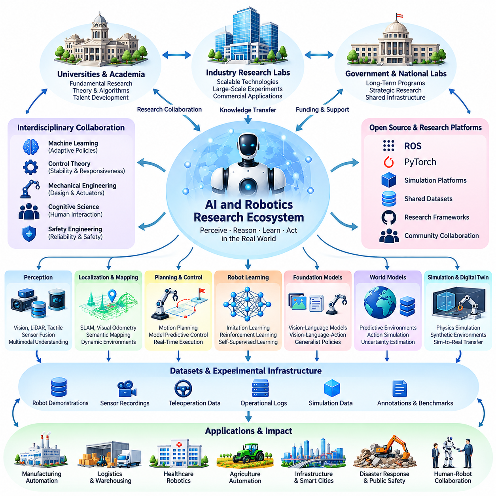{width="7.268055555555556in" height="7.268055555555556in"}

인공지능 및 로봇 연구 생태계(AI and Robotics Research Ecosystem)는 인공지능(Artificial Intelligence), 로봇공학(Robotics), 제어 이론(Control Theory), 인지과학(Cognitive Science), 기계공학(Mechanical Engineering)을 연결하여 피지컬 인공지능(Physical AI)의 과학적 기반을 형성한다. 이 생태계의 핵심 목표는 물리적 환경(Physical Environments)에서 인식(Perception), 추론(Reasoning), 학습(Learning), 행동(Action)을 수행할 수 있는 지능형 시스템(Intelligent Systems)을 개발하는 것이다. 지능적 행동(Intelligent Behavior)은 알고리즘(Algorithms), 하드웨어(Hardware), 주변 세계(Surrounding World)의 상호작용에서 나타나므로 기술 발전에는 여러 학문 분야의 협력이 필요하다.

대학(Universities)과 학술 연구실(Academic Laboratories)은 이론적 이해(Theoretical Understanding)와 실험 방법론(Experimental Methods)을 발전시키는 데 근본적인 역할을 수행한다. 연구자들은 인식(Perception), 위치 추정(Localization), 계획(Planning), 조작(Manipulation), 보행(Locomotion), 자율적 의사결정(Autonomous Decision-Making)을 연구한다. 학술 연구 환경(Academic Research Environments)은 즉각적인 상업적 성과를 창출하지 않더라도 미래 피지컬 AI 시스템을 위한 수학적 원리(Mathematical Principles), 컴퓨팅 아키텍처(Computational Architectures), 실험적 근거(Experimental Evidence)를 확립하는 탐색적 연구(Exploratory Research)를 지원한다.

산업 연구소(Industrial Research Laboratories)는 과학적 발견(Scientific Discoveries)을 확장 가능한 기술(Scalable Technologies) 및 상업적 응용(Commercial Applications)과 연결함으로써 학술 연구를 보완한다. 주요 기술 기업들은 로봇 파운데이션 모델(Robot Foundation Models), 멀티모달 학습(Multimodal Learning), 자율주행 및 자율항법(Autonomous Navigation), 범용 로봇 지능(General-Purpose Robotic Intelligence)을 연구한다. 컴퓨팅 인프라(Computing Infrastructure), 엔지니어링 자원(Engineering Resources), 대규모 데이터셋(Large Datasets)에 대한 접근성은 소규모 연구기관의 역량을 넘어서는 실험을 가능하게 한다.

정부 지원 연구기관(Government-Funded Research Organizations)과 국가 연구소(National Laboratories)는 전략적 기술 과제(Strategic Technological Challenges)를 해결하기 위한 장기 연구 프로그램(Long-Term Research Programs)을 통해 기여한다. 이러한 프로그램은 첨단 제조(Advanced Manufacturing), 자율 모빌리티(Autonomous Mobility), 재난 대응(Disaster Response), 의료 로봇(Healthcare Robotics), 인간-기계 협업(Human-Machine Collaboration)을 지원한다. 공공 투자(Public Investment)는 공동 연구 인프라(Shared Research Infrastructure)를 제공하고, 과학적 또는 사회적 편익이 단기적인 상업적 수익을 넘어서는 연구를 촉진할 수 있다.

학제 간 협력(Interdisciplinary Collaboration)은 로봇 연구가 물리적 구현(Physical Embodiment)과 분리될 수 없기 때문에 필수적이다. 머신러닝 전문가(Machine Learning Specialists)는 적응형 정책(Adaptive Policies)을 개발하고, 제어 엔지니어(Control Engineers)는 안정성(Stability)과 응답성(Responsiveness)을 확보하며, 기계 엔지니어(Mechanical Engineers)는 구조물(Structures)과 액추에이터(Actuators)를 설계한다. 인간공학(Human Factors), 안전공학(Safety Engineering), 인지과학(Cognitive Science) 연구자들은 복잡한 환경에서의 상호작용(Interaction), 불확실성(Uncertainty), 지능적 행동(Intelligent Behavior)에 관한 지식을 제공한다.

로봇 인식(Robot Perception)은 연구 생태계의 주요 연구 분야로 남아 있다. 컴퓨터 비전(Computer Vision), 깊이 센싱(Depth Sensing), 라이다 처리(LiDAR Processing), 촉각 센싱(Tactile Sensing), 센서 융합(Sensor Fusion)은 기계가 환경 상태(Environmental States)를 추정하도록 지원한다. 최근 연구는 기하학적 정보(Geometric Information), 의미론적 정보(Semantic Information), 시간적 정보(Temporal Information)를 결합하는 멀티모달 표현(Multimodal Representations)을 강조하며, 이를 통해 로봇이 변화하는 조건에서도 물체, 표면, 장애물, 인간 활동을 해석하도록 한다.

위치 추정(Localization), 지도 작성(Mapping), 공간 이해(Spatial Understanding)는 또 다른 핵심 연구 기반을 제공한다. 동시적 위치 추정 및 지도 작성(Simultaneous Localization and Mapping, SLAM), 시각 주행거리 추정(Visual Odometry), 기하학적 재구성(Geometric Reconstruction), 의미론적 지도 작성(Semantic Mapping)은 로봇이 자신의 상태와 주변 환경 사이의 관계를 설정하도록 한다. 현재 연구는 동적 환경(Dynamic Environments), 장기 지도 일관성(Long-Term Map Consistency), 불확실성 추정(Uncertainty Estimation), 다중 자율 에이전트(Multiple Autonomous Agents) 사이의 공유 공간 표현(Shared Spatial Representations)을 탐구한다.

계획 및 제어 연구(Planning and Control Research)는 환경 이해(Environmental Understanding)를 물리적 실행(Physical Execution)과 연결한다. 동작 계획(Motion Planning)은 실행 가능한 궤적(Feasible Trajectories)을 결정하고, 피드백 제어(Feedback Control)는 외란(Disturbances)과 모델링 오차(Modeling Errors)를 보상한다. 모델 예측 제어(Model Predictive Control), 궤적 최적화(Trajectory Optimization), 강화학습(Reinforcement Learning), 하이브리드 제어 아키텍처(Hybrid Control Architectures)는 안정성(Stability), 제약 조건 충족(Constraint Satisfaction), 예측 가능한 실시간 동작(Predictable Real-Time Behavior)을 유지하면서 적응성을 향상시키기 위해 연구되고 있다.

로봇 학습(Robot Learning)은 연구 생태계에서 점점 더 중요한 구성요소가 되고 있다. 모방학습(Imitation Learning)은 로봇이 시연(Demonstrations)으로부터 행동을 습득하도록 하며, 강화학습(Reinforcement Learning)은 상호작용(Interaction)과 보상 피드백(Reward Feedback)을 통해 정책(Policies)을 개선한다. 자기지도학습(Self-Supervised Learning)과 오프라인 학습(Offline Learning)은 광범위한 수동 레이블링(Manual Labeling)이나 지속적인 물리적 실험(Physical Experimentation) 없이도 대규모 관측 및 경험 데이터(Observations and Experiences)를 활용하여 기술 습득(Skill Acquisition)을 지원하는 방법을 연구한다.

파운데이션 모델 연구(Foundation Model Research)는 인공지능과 로봇공학 사이의 관계를 확장하고 있다. 비전-언어 모델(Vision-Language Models, VLM)은 의미론적 해석(Semantic Interpretation)과 명령 이해(Instruction Understanding)를 제공하며, 비전-언어-행동 모델(Vision-Language-Action Models, VLA)은 멀티모달 관측(Multimodal Observations)을 로봇 행동(Robot Actions)과 연결한다. 연구자들은 사전학습된 표현(Pretrained Representations)과 범용 정책(Generalist Policies)이 전체 재학습(Complete Retraining) 없이 작업(Tasks), 환경(Environments), 물리적 구현체(Embodiments) 사이에서 지식을 전이할 수 있는지 탐구한다.

월드 모델 연구(World Model Research)는 물리적 환경의 예측 표현(Predictive Representations)을 로봇 지능(Robot Intelligence)에 도입한다. 이러한 모델은 특정 행동 이후 물체(Objects), 에이전트(Agents), 환경 상태(Environmental States)가 어떻게 변화할 수 있는지 추정한다. 가상 결과(Imagined Outcomes)와 행동 조건부 예측(Action-Conditioned Predictions)을 지원함으로써 월드 모델(World Models)은 계획(Planning), 의사결정(Decision-Making), 위험 평가(Risk Assessment)에 기여할 수 있지만, 예측 정확도(Prediction Accuracy)와 불확실성(Uncertainty)은 여전히 중요한 연구 과제로 남아 있다.

시뮬레이션 연구(Simulation Research)는 피지컬 AI 시스템의 개발과 평가를 위한 필수 인프라(Essential Infrastructure)를 제공한다. 물리 시뮬레이터(Physics Simulators), 디지털 트윈(Digital Twins), 합성 환경(Synthetic Environments), 절차적 시나리오 생성기(Procedural Scenario Generators)는 반복 가능한 실험(Repeatable Experiments)과 대규모 정책 학습(Large-Scale Policy Training)을 지원한다. 연구자들은 가상 경험(Virtual Experience)과 실제 로봇 행동(Actual Robot Behavior) 사이의 차이를 줄이기 위해 도메인 무작위화(Domain Randomization), 시스템 식별(System Identification), 시뮬레이션-현실 전이(Simulation-to-Reality Transfer)를 연구한다.

오픈소스 소프트웨어(Open-Source Software)와 공유 연구 플랫폼(Shared Research Platforms)은 재현성(Reproducibility)과 협력 개발(Collaborative Development)을 지원하여 과학적 발전을 가속화한다. ROS, PyTorch, 널리 사용되는 시뮬레이션 환경(Simulation Environments)과 같은 프레임워크(Frameworks)는 실험을 위한 재사용 가능한 구성요소(Reusable Components)를 제공한다. 공유 구현체(Shared Implementations)는 중복된 엔지니어링 작업(Duplicated Engineering Effort)을 줄이지만, 하드웨어 구성(Hardware Configurations), 소프트웨어 버전(Software Versions), 평가 절차(Evaluation Procedures)의 차이는 독립적인 재현(Independent Reproduction)을 어렵게 만들 수 있다.

공개 데이터셋(Public Datasets)과 벤치마크 환경(Benchmark Environments)은 연구 방법을 비교하기 위한 공통 기반(Common Foundations)을 확립한다. 로봇 시연(Robot Demonstrations), 조작 궤적(Manipulation Trajectories), 항법 기록(Navigation Recordings), 인간 활동 데이터셋(Human Activity Datasets), 멀티모달 센서 관측(Multimodal Sensor Observations)은 모델 개발(Model Development)을 지원한다. 효과적인 벤치마크(Effective Benchmarks)는 평균 작업 성공률(Average Task Success)뿐 아니라 강건성(Robustness), 일반화(Generalization), 안전성(Safety), 복구 행동(Recovery Behavior), 익숙하지 않은 환경 조건(Unfamiliar Environmental Conditions)에서의 성능까지 평가해야 한다.

국제 연구 학회(International Research Conferences)와 과학 학술지(Scientific Journals)는 새로운 알고리즘(Algorithms), 실험 결과(Experimental Results), 이론적 통찰(Theoretical Insights)의 교류를 촉진한다. 로봇공학(Robotics), 머신러닝(Machine Learning), 컴퓨터 비전(Computer Vision), 제어 시스템(Control Systems)과 관련된 연구 공동체(Research Communities)는 점점 더 긴밀하게 연결되고 있다. 동료 심사(Peer Review), 공개 기술 토론(Open Technical Discussions), 독립적 재현(Independent Replication)은 의미 있는 과학적 진전(Scientific Advances)과 제한된 실험 조건(Restricted Experimental Conditions)에 크게 의존하는 결과를 구별하는 데 도움을 준다.

연구 협력(Research Collaboration)은 산학협력(Industry-Academia Partnerships)과 다국적 개발 프로그램(Multinational Development Programs)으로도 확장된다. 기업은 로봇 플랫폼(Robotic Platforms), 컴퓨팅 자원(Computing Resources), 운영 환경(Operational Environments), 엔지니어링 전문성(Engineering Expertise)을 제공하고, 대학은 전문 연구 역량(Specialized Research Capabilities)을 기여할 수 있다. 이러한 파트너십은 실제 환경 검증(Practical Validation)의 기회를 창출하지만, 출판 제한(Publication Restrictions), 지식재산권 계약(Intellectual Property Arrangements), 불균등한 자원 접근성(Unequal Resource Access)은 연구 개방성(Research Openness)에 영향을 미칠 수 있다.

연구 생태계에서 지속적으로 나타나는 과제는 실험실 성능(Laboratory Performance)과 신뢰할 수 있는 실제 환경 배포(Reliable Real-World Deployment) 사이의 격차이다. 통제된 조건에서 학습된 로봇은 예상하지 못한 물체(Unexpected Objects), 센서 성능 저하(Sensor Degradation), 기계적 편차(Mechanical Variation), 변화하는 인간 행동(Changing Human Behavior)에 직면할 수 있다. 이러한 한계를 해결하려면 체계적인 강건성 평가(Robustness Evaluation), 불확실성 인식 의사결정(Uncertainty-Aware Decision-Making), 지속적인 모니터링(Continuous Monitoring), 신중하게 설계된 복구 메커니즘(Recovery Mechanisms)이 필요하다.

안전(Safety)과 책임 있는 혁신(Responsible Innovation)은 피지컬 AI 시스템이 사람과 인프라에 직접 영향을 미칠 수 있기 때문에 점점 더 중요한 연구 우선순위가 되고 있다. 연구자들은 안전 강화학습(Safe Reinforcement Learning), 런타임 보증(Runtime Assurance), 해석 가능한 의사결정(Interpretable Decision-Making), 인간 감독(Human Oversight), 자율 행동 검증(Verification of Autonomous Behavior)을 연구한다. 이러한 노력은 학습 능력(Learning Capability)의 향상이 운영 신뢰성(Operational Reliability), 책임성(Accountability), 허용 가능한 위험 범위(Acceptable Risk Boundaries)를 훼손하지 않도록 하는 것을 목표로 한다.

연구 생태계는 자원 효율성(Resource Efficiency)과 접근성(Accessibility)도 해결해야 한다. 첨단 로봇 모델(Advanced Robotic Models)의 학습에는 상당한 컴퓨팅 용량(Computational Capacity), 특수 하드웨어(Specialized Hardware), 광범위한 상호작용 데이터(Extensive Interaction Data)가 필요할 수 있다. 효율적인 학습 알고리즘(Efficient Learning Algorithms), 경량 모델(Compact Models), 분산 실험(Distributed Experimentation), 접근 가능한 연구 플랫폼(Accessible Research Platforms)은 소규모 연구실의 참여를 지원하는 동시에 전력 제약이 있는 엣지 컴퓨팅 시스템(Power-Constrained Edge Computing Systems)에서의 배포를 촉진할 수 있다.

궁극적으로 인공지능 및 로봇 연구 생태계(AI and Robotics Research Ecosystem)는 과학 이론(Scientific Theory), 실험적 검증(Experimental Validation), 공유 인프라(Shared Infrastructure), 산업 경험(Industrial Experience) 사이의 지속적인 상호작용을 통해 피지컬 AI를 발전시킨다. 장기적인 성공은 개별 알고리즘 성과(Isolated Algorithmic Achievements)를 통합된 물리적 지능(Integrated Physical Intelligence)으로 전환하는 능력에 달려 있다. 긴밀한 협력(Strong Collaboration), 재현 가능한 평가(Reproducible Evaluation), 학제 간 엔지니어링(Interdisciplinary Engineering), 책임 있는 배포(Responsible Deployment)는 연구 성과가 얼마나 효과적으로 신뢰할 수 있는 자율 능력(Dependable Autonomous Capability)으로 발전하는지를 결정할 것이다.

## 04.03. AMR and Autonomous Mobility

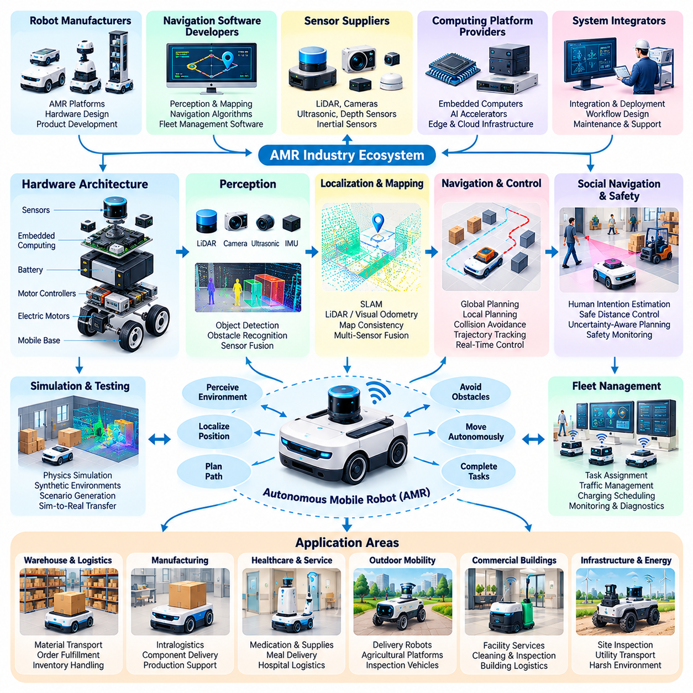{width="7.268055555555556in" height="7.268055555555556in"}

자율이동로봇(Autonomous Mobile Robots, AMRs)과 자율 모빌리티 시스템(Autonomous Mobility Systems)은 인식(Perception), 위치 추정(Localization), 계획(Planning), 제어(Control), 적응형 의사결정(Adaptive Decision-Making)을 결합하는 피지컬 인공지능(Physical AI)의 주요 응용 분야이다. 주로 사전에 정의된 경로를 따라 이동하는 기존 무인운반차량(Automated Guided Vehicles, AGVs)과 달리, AMR은 온보드 센싱(Onboard Sensing)과 컴퓨팅 지능(Computational Intelligence)을 활용하여 변화하는 환경에서 자율적으로 이동할 수 있다. 이러한 능력은 유연한 운송(Flexible Transportation), 자재 취급(Material Handling), 점검(Inspection), 서비스 운영(Service Operations)을 지원한다.

글로벌 AMR 산업(Global AMR Industry)은 로봇 제조업체(Robot Manufacturers), 내비게이션 소프트웨어 개발업체(Navigation Software Developers), 센서 공급업체(Sensor Suppliers), 컴퓨팅 플랫폼 제공업체(Computing Platform Providers), 시스템 통합업체(System Integrators)로 구성된다. 이들 참여자는 창고(Warehouses), 공장(Factories), 병원(Hospitals), 상업용 건물(Commercial Buildings), 실외 시설(Outdoor Facilities)을 위한 자율 모빌리티 솔루션(Autonomous Mobility Solutions)을 제공하기 위해 협력한다. 산업 발전은 로봇 하드웨어(Robotic Hardware), 지능형 내비게이션(Intelligent Navigation), 플릿 협업(Fleet Coordination), 운영 관리(Operational Management)를 결합하는 통합 플랫폼(Integrated Platforms)을 점점 더 강조하고 있다.

AMR 하드웨어 아키텍처(AMR Hardware Architectures)는 일반적으로 모바일 베이스(Mobile Bases), 전기 모터(Electric Motors), 모터 제어기(Motor Controllers), 배터리(Batteries), 센서(Sensors), 임베디드 컴퓨터(Embedded Computers)를 통합한다. 차동 구동(Differential-Drive), 전방향 구동(Omnidirectional Drive), 조향 기반 구성(Steering-Based Configurations)은 서로 다른 이동 특성(Mobility Characteristics)을 제공한다. 플랫폼 선택(Platform Selection)은 적재 요구사항(Payload Requirements), 회전 반경(Turning Radius), 바닥 조건(Floor Conditions), 에너지 효율(Energy Efficiency), 운영 환경(Operating Environments)에 따라 달라지므로 기계 설계(Mechanical Design)는 자율 지능(Autonomous Intelligence)의 필수 구성요소가 된다.

인식 기술(Perception Technologies)은 AMR이 장애물(Obstacles)을 인식하고, 사람(People)을 감지하며, 주행 가능한 표면(Traversable Surfaces)을 식별하고, 주변 구조물(Surrounding Structures)을 해석하도록 지원한다. 라이다(LiDAR), 카메라(Cameras), 초음파 센서(Ultrasonic Sensors), 깊이 센서(Depth Sensors), 관성측정장치(Inertial Measurement Units, IMUs)는 상호 보완적인 환경 정보(Environmental Information)를 제공한다. 센서 융합(Sensor Fusion)은 서로 다른 불확실성 특성(Uncertainty Characteristics)을 가진 측정값을 결합하여 상황 인식(Situational Awareness)을 향상시키지만, 성능은 조명(Lighting), 반사 재질(Reflective Materials), 가려짐(Occlusion), 센서 성능 저하(Sensor Degradation)에 영향을 받는다.

위치 추정(Localization)과 지도 작성(Mapping)은 자율 내비게이션(Autonomous Navigation)을 위한 공간적 기반(Spatial Foundation)을 제공한다. 동시적 위치 추정 및 지도 작성(Simultaneous Localization and Mapping, SLAM)은 로봇이 자신의 위치를 추정하면서 환경 표현(Environmental Representations)을 구축하도록 한다. 산업용 시스템(Industrial Systems)은 라이다 기반 위치 추정(LiDAR Localization), 시각 주행거리 추정(Visual Odometry), 휠 엔코더(Wheel Encoders), 관성 센싱(Inertial Sensing)을 결합할 수 있다. 강건한 위치 추정(Robust Localization)을 위해서는 지도 일관성(Map Consistency), 환경 변화(Environmental Changes), 누적 추정 오차(Accumulated Estimation Errors), 센서 신뢰성(Sensor Reliability)을 지속적으로 평가해야 한다.

내비게이션 시스템(Navigation Systems)은 환경 이해(Environmental Understanding)를 실행 가능한 로봇 이동(Feasible Robot Movement)으로 변환한다. 전역 경로 계획(Global Planning)은 목적지까지의 경로를 결정하고, 지역 경로 계획(Local Planning)은 주변 장애물과 변화하는 조건에 대응한다. 동작 제어기(Motion Controllers)는 운동학적 제약(Kinematic Constraints)과 동역학적 제약(Dynamic Constraints)을 준수하면서 계획된 궤적(Planned Trajectories)을 모터 명령(Motor Commands)으로 변환한다. 신뢰할 수 있는 내비게이션(Reliable Navigation)을 위해서는 인식 정보 갱신(Perception Updates), 충돌 회피(Collision Avoidance), 궤적 추종(Trajectory Tracking), 실시간 피드백(Real-Time Feedback) 사이의 긴밀한 조정이 필요하다.

자율 모빌리티(Autonomous Mobility)는 사람과 다른 기계가 함께 사용하는 환경에서 특히 어려워진다. 보행자(Pedestrians), 지게차(Forklifts), 운반 카트(Carts), 출입문(Doors), 임시 장애물(Temporary Obstacles)은 예측하기 어려운 상호작용(Unpredictable Interactions)을 발생시킨다. AMR은 이동 의도(Movement Intentions)를 추정하고, 적절한 이격 거리(Separation Distances)를 유지하며, 위험하거나 운영을 방해하는 행동 없이 이동 궤적(Trajectories)을 조정해야 한다. 사회적 내비게이션(Social Navigation)과 불확실성 인식 계획(Uncertainty-Aware Planning)은 중요한 연구개발 분야로 남아 있다.

창고 및 물류 자동화(Warehouse and Logistics Automation)는 AMR 기술의 대표적인 상업적 응용 분야이다. 로봇은 재고(Inventory)를 운송하고, 컨테이너(Containers)를 이동시키며, 주문 이행(Order Fulfillment)을 지원하고, 보관 구역(Storage Areas)을 포장 또는 출하 작업장(Packing or Shipping Stations)과 연결한다. 운영 가치(Operational Value)는 처리량(Throughput), 작업 완료율(Task Completion Rates), 교통 효율(Traffic Efficiency), 창고관리시스템(Warehouse Management Systems, WMS)과의 통합에 따라 결정된다. 성공적인 배포(Successful Deployments)를 위해서는 개별 로봇의 내비게이션 성능뿐 아니라 전체 작업 흐름 설계(Coordinated Workflow Design)가 필요하다.

제조 시설(Manufacturing Facilities)은 공장 내 물류(Intralogistics)와 유연한 생산 지원(Flexible Production Support)을 위해 AMR 도입을 확대하고 있다. 모바일 로봇(Mobile Robots)은 부품(Components)을 공급하고, 재공품(Work-in-Progress Materials)을 운송하며, 영구적으로 고정된 컨베이어 시스템(Fixed Conveyor Systems) 없이 생산 설비(Production Stations)를 연결한다. 제조실행시스템(Manufacturing Execution Systems, MES)과의 통합은 작업 동기화(Task Synchronization)와 자재 추적성(Material Traceability)을 지원한다. 그러나 산업 환경(Industrial Environments)은 신뢰성(Reliability), 안전성(Safety), 가동시간(Uptime), 예측 가능한 운영 행동(Predictable Operational Behavior)에 대해 엄격한 요구사항을 부과한다.

의료 및 서비스 환경(Healthcare and Service Environments)은 인간과의 상호작용(Human Interaction)과 운영 민감성(Operational Sensitivity)에 관련된 추가적인 이동 요구사항을 제시한다. AMR은 병원이나 기관 시설(Institutional Facilities) 내부에서 의약품(Medications), 실험실 검체(Laboratory Samples), 식사(Meals), 린넨류(Linens), 기타 물품(Supplies)을 운송할 수 있다. 내비게이션(Navigation)은 혼잡한 복도(Crowded Corridors), 엘리베이터(Elevators), 제한 구역(Restricted Areas), 변화하는 일정(Changing Schedules)에 대응해야 한다. 배포 과정에서는 위생(Hygiene), 개인정보 보호(Privacy), 접근성(Accessibility), 필수 서비스의 연속성(Continuity of Essential Services)도 고려해야 한다.

실외 자율 모빌리티(Outdoor Autonomous Mobility)는 피지컬 AI를 기하학적 및 환경적 불확실성(Geometric and Environmental Uncertainty)이 더 큰 영역으로 확장한다. 배송 로봇(Delivery Robots), 농업용 플랫폼(Agricultural Platforms), 점검 차량(Inspection Vehicles), 산업용 운송 시스템(Industrial Transport Systems)은 불균일한 지형(Uneven Terrain), 기상 조건(Weather Conditions), 가변적인 조도(Variable Illumination), 변화하는 지표면 특성(Changing Surface Properties)에 대응해야 한다. 위치 추정(Localization)은 위성항법시스템(Global Navigation Satellite System, GNSS), 관성항법(Inertial Navigation), 라이다(LiDAR), 시각 인식(Visual Perception)을 결합할 수 있으며, 동작 계획(Motion Planning)은 지형 주행 가능성(Terrain Traversability)과 차량 안정성(Vehicle Stability)을 고려해야 한다.

플릿 관리 시스템(Fleet Management Systems)은 공유 시설(Shared Facilities)에서 운영되는 다수의 AMR을 조정한다. 중앙집중형 또는 분산형 오케스트레이션(Centralized or Distributed Orchestration)은 작업을 할당하고, 교통을 관리하며, 충전 일정을 계획하고, 로봇 상태를 모니터링한다. 효과적인 협업(Effective Coordination)은 혼잡(Congestion)을 줄이고 자원 활용률(Resource Utilization)을 향상시킨다. 플릿 지능(Fleet Intelligence)은 통신 중단(Communication Interruptions), 로봇 고장(Robot Failures), 작업 우선순위(Task Priorities), 서로 다른 능력을 가진 이기종 플랫폼(Heterogeneous Platforms)도 처리해야 한다.

상호운용성(Interoperability)은 시설에서 여러 제조업체의 로봇을 도입함에 따라 점점 더 중요한 문제가 되고 있다. 표준화된 통신 인터페이스(Standardized Communication Interfaces)와 플릿 통합 프레임워크(Fleet Integration Frameworks)는 독점 시스템(Proprietary Systems)에 대한 의존도를 줄일 수 있다. VDA 5050과 같은 프로토콜(Protocols)은 모바일 로봇(Mobile Robots)과 플릿 제어 시스템(Fleet Control Systems) 사이의 통신 일부를 다룬다. 그러나 내비게이션 행동(Navigation Behavior), 안전 구성(Safety Configurations), 운영 능력(Operational Capabilities)의 차이는 보편적인 상호운용성(Universal Interoperability)을 어렵게 만든다.

인공지능(Artificial Intelligence)은 기존 내비게이션 알고리즘(Conventional Navigation Algorithms)을 넘어 AMR의 능력을 확장하고 있다. 학습 기반 인식(Learning-Based Perception)은 환경 해석(Environmental Interpretation)을 개선하며, 강화학습(Reinforcement Learning)과 모방학습(Imitation Learning)은 내비게이션 행동(Navigation Behaviors)을 습득하는 방법을 제공한다. 예측형 월드 모델(Predictive World Models)은 환경 변화(Environmental Changes)와 에이전트 상호작용(Agent Interactions)을 예상하는 데 도움을 줄 수 있다. 이러한 접근법은 결정론적 안전 메커니즘(Deterministic Safety Mechanisms)과 통합되어야 하며 실제 운영 제약(Real-World Operational Constraints)에 대한 검증을 거쳐야 한다.

엣지 컴퓨팅(Edge Computing)은 인식(Perception), 계획(Planning), 제어(Control)가 빈번하게 저지연 실행(Low-Latency Execution)을 요구하기 때문에 자율 모빌리티에서 중요한 역할을 수행한다. 임베디드 GPU(Embedded GPUs)와 특수 AI 가속기(Specialized AI Accelerators)는 지속적인 클라우드 연결(Cloud Connectivity) 없이 온보드 추론(Onboard Inference)을 지원한다. 온프레미스 인프라(On-Premises Infrastructure)는 다수의 로봇을 조정하고 공유 운영 정보(Shared Operational Information)를 유지할 수 있으며, 클라우드 플랫폼(Cloud Platforms)은 분석(Analytics), 소프트웨어 배포(Software Distribution), 대규모 모델 학습(Large-Scale Model Training)을 지원한다.

시뮬레이션(Simulation)과 디지털 트윈(Digital Twins)은 AMR 개발자가 실제 배포 전에 내비게이션 전략(Navigation Strategies)을 평가하도록 지원한다. 가상 환경(Virtual Environments)은 창고 배치(Warehouse Layouts), 보행자 상호작용(Pedestrian Interactions), 교통 혼잡(Traffic Congestion), 센서 조건(Sensor Conditions)을 재현할 수 있다. 시뮬레이션은 회귀 테스트(Regression Testing), 시나리오 생성(Scenario Generation), 플릿 규모 최적화(Fleet-Scale Optimization)를 지원한다. 그러나 실제 마찰(Real-World Friction), 센서 잡음(Sensor Noise), 인간 행동(Human Behavior), 환경 변동성(Environmental Variability)을 완벽하게 재현할 수 없으므로 물리적 검증(Physical Validation)은 여전히 필요하다.

안전공학(Safety Engineering)은 상업용 AMR 배포(Commercial AMR Deployment)의 기본 요소이다. 시스템은 충돌 위험(Collision Risks), 비상 정지(Emergency Stopping), 보호 센싱(Protective Sensing), 속도 제한(Speed Limitations), 예측 가능한 운영 고장(Foreseeable Operational Failures)에 대응해야 한다. 적용 가능한 무인 산업용 트럭(Driverless Industrial Trucks)에 대한 ISO 3691-4를 포함한 관련 안전 표준(Safety Standards)은 중요한 엔지니어링 지침(Engineering Guidance)을 제공한다. 규정 준수(Compliance)는 로봇의 의도된 용도(Intended Application), 운영 환경(Operating Environment), 적용 가능한 규제 요구사항(Applicable Regulatory Requirements)에 따라 달라진다.

AMR 시스템의 상업적 성공(Commercial Success)은 단순한 자율성 시연(Autonomy Demonstrations)이 아니라 측정 가능한 운영 성능(Measurable Operational Performance)에 달려 있다. 주요 고려사항에는 플릿 가용성(Fleet Availability), 내비게이션 성공률(Navigation Success), 개입 빈도(Intervention Frequency), 배터리 활용률(Battery Utilization), 유지보수 요구사항(Maintenance Requirements), 총소유비용(Total Cost of Ownership, TCO)이 포함된다. 조직은 배포 타당성(Deployment Feasibility)을 평가할 때 통합 비용(Integration Expenses), 인프라 변경(Infrastructure Modifications), 작업자와의 상호작용(Workforce Interaction), 장기 유지관리 가능성(Long-Term Serviceability)을 검토해야 한다.

AMR 산업(AMR Industry)은 더욱 적응적이고 협력적인 모빌리티 시스템(Adaptive and Collaborative Mobility Systems)으로 발전하고 있다. 새롭게 등장하는 능력에는 의미론적 내비게이션(Semantic Navigation), 예측형 교통 관리(Predictive Traffic Management), 이기종 플릿 협업(Heterogeneous Fleet Coordination), 로봇 조작(Robotic Manipulation)과의 통합이 포함된다. 이러한 발전은 모바일 로봇이 환경 지식(Environmental Knowledge)을 공유하고 분산된 운영 환경(Distributed Operational Environments)에서 행동을 조정하면서 더욱 복잡한 작업 흐름(Complex Workflows)에 참여하도록 지원할 수 있다.

궁극적으로 자율이동로봇(Autonomous Mobile Robots, AMRs)은 피지컬 AI가 컴퓨팅 지능(Computational Intelligence)을 지속적인 물리적 운영(Sustained Physical Operations)으로 전환하는 방식을 보여준다. AMR의 발전은 로봇공학(Robotics Engineering), 인공지능(Artificial Intelligence), 임베디드 컴퓨팅(Embedded Computing), 산업 시스템 통합(Industrial Integration), 안전성 보증(Safety Assurance)의 융합을 반영한다. 지속적인 발전은 신뢰할 수 있는 자율성(Reliable Autonomy), 확장 가능한 플릿 협업(Scalable Fleet Coordination), 상호운용성(Interoperability), 다양한 실제 환경(Diverse Real-World Environments)에서 측정 가능한 가치(Measurable Value)를 제공하는 능력에 달려 있다.

## 04.04. Mobile Manipulators and Industrial Robots

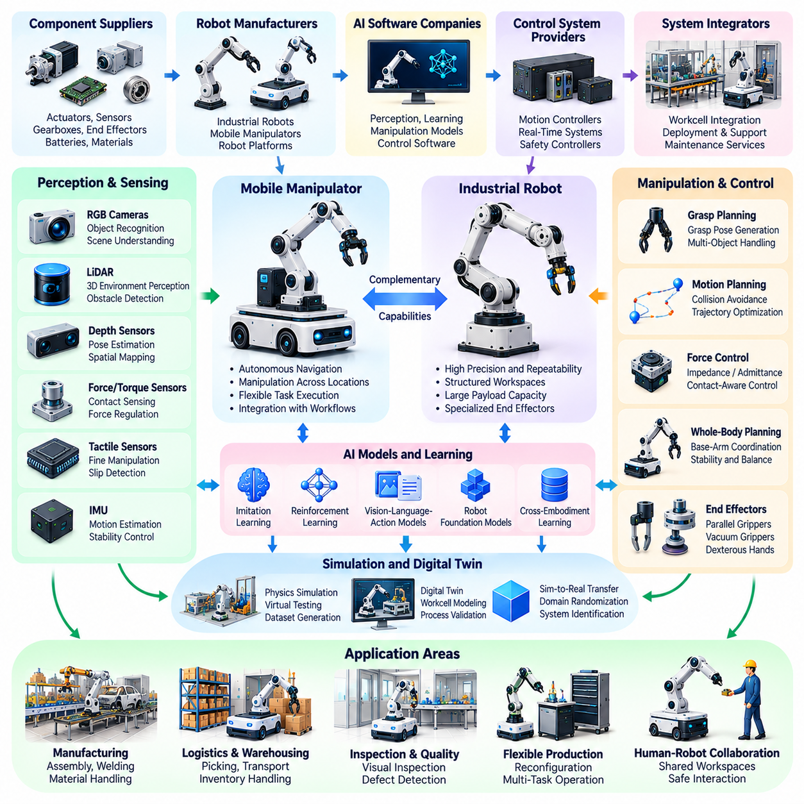{width="7.268055555555556in" height="7.268055555555556in"}

모바일 매니퓰레이터(Mobile Manipulators)와 산업용 로봇(Industrial Robots)은 기계적 정밀성(Mechanical Precision), 지능형 인식(Intelligent Perception), 동작 계획(Motion Planning), 자율 작업 수행(Autonomous Task Execution)을 결합하는 피지컬 인공지능(Physical AI) 생태계의 핵심 구성요소이다. 기존 산업용 로봇(Traditional Industrial Robots)은 주로 구조화된 작업 공간(Structured Workspaces)에서 작동하는 반면, 모바일 매니퓰레이터는 로봇 팔(Robotic Arms)과 자율이동 플랫폼(Autonomous Mobile Platforms)을 통합한다. 이러한 결합은 더욱 넓고 역동적인 환경으로 조작 능력(Manipulation Capabilities)을 확장한다.

산업용 로봇 생태계(Industrial Robotics Ecosystem)는 로봇 제조업체(Robot Manufacturers), 액추에이터 공급업체(Actuator Suppliers), 센서 개발업체(Sensor Developers), 제어 시스템 제공업체(Control System Providers), AI 소프트웨어 기업(AI Software Companies), 시스템 통합업체(System Integrators)로 구성된다. 이들 조직은 제조(Manufacturing), 물류(Logistics), 조립(Assembly), 검사(Inspection), 자재 취급(Material Handling)을 위한 기술을 개발한다. 로봇 하드웨어(Robotics Hardware)와 인공지능(Artificial Intelligence)의 통합이 확대되면서 산업 자동화(Industrial Automation)는 고정된 반복 작업(Fixed Repetitive Operations)에서 적응형 및 상황 인식 물리 시스템(Adaptive and Context-Aware Physical Systems)으로 변화하고 있다.

기존 산업용 로봇(Conventional Industrial Robots)은 일반적으로 다중 자유도(Multiple Degrees of Freedom)를 가진 다관절 로봇 팔(Articulated Arms)을 사용하여 정밀한 위치 결정(Precise Positioning)과 물체와의 제어된 상호작용(Controlled Interaction)을 수행한다. 이러한 아키텍처는 전기 액추에이터(Electric Actuators), 기어 전달장치(Gear Transmissions), 관절 엔코더(Joint Encoders), 제어기(Controllers), 특수 엔드 이펙터(Specialized End Effectors)를 통합한다. 높은 반복 정밀도(High Repeatability), 기계적 강성(Mechanical Stiffness), 가반하중(Payload Capacity), 예측 가능한 동작(Predictable Motion)은 산업 응용 분야에서 중요한 요구사항으로 남아 있다.

모바일 매니퓰레이터(Mobile Manipulators)는 이동(Locomotion)과 조작(Manipulation)을 하나의 통합 플랫폼(Unified Platform)으로 결합하여 산업용 로봇의 능력을 확장한다. 자율이동 베이스(Autonomous Mobile Base)는 하나 이상의 로봇 팔(Robotic Arms)을 작업장(Workstations) 사이로 운반하여 시스템이 분산된 위치(Distributed Locations)에서 작업을 수행하도록 한다. 이러한 아키텍처는 고정형 로봇 설치(Fixed Robotic Installations)가 경제적으로 비효율적이거나 운영상 제약을 초래할 수 있는 유연한 생산 환경(Flexible Production Environments)을 지원한다.

이동성과 조작의 통합(Integration of Mobility and Manipulation)은 복잡한 협조 제어 문제(Coordination Challenges)를 발생시킨다. 로봇 내비게이션(Robot Navigation)은 로봇 팔의 구성(Arm Configuration), 하중 분포(Payload Distribution), 무게중심(Center of Gravity), 충돌 경계(Collision Boundaries)를 고려해야 한다. 조작 계획(Manipulation Planning)은 모바일 베이스의 위치(Base Positioning)와 환경 접근성(Environmental Accessibility)을 고려해야 한다. 전신 계획(Whole-Body Planning)과 협조 제어(Coordinated Control)는 모바일 플랫폼과 로봇 팔이 통합된 물리 시스템(Integrated Physical System)으로 작동하도록 지원한다.

인식 시스템(Perception Systems)은 지능형 조작(Intelligent Manipulation)에 필요한 환경 이해(Environmental Understanding)를 제공한다. RGB 카메라(RGB Cameras), 깊이 센서(Depth Sensors), 라이다(LiDAR), 힘 센서(Force Sensors), 촉각 센싱 장치(Tactile Sensing Devices)는 로봇이 물체를 식별하고, 자세(Pose)를 추정하며, 접촉(Contact)을 감지하고, 작업 공간 조건(Workspace Conditions)을 해석하도록 한다. 멀티모달 센서 융합(Multimodal Sensor Fusion)은 물체가 부분적으로 가려지거나, 기하학적으로 모호하거나, 조명 및 표면 특성이 변화하는 상황에서 강건성(Robustness)을 향상시킨다.

물체 인식(Object Recognition)과 자세 추정(Pose Estimation)은 조작 지능(Manipulation Intelligence)의 핵심 요소이다. 로봇은 목표 물체(Target Objects)를 식별하고 주변 구조물(Surrounding Structures)과의 위치(Positions), 방향(Orientations), 기하학적 관계(Geometric Relationships)를 결정해야 한다. 6자유도 자세 추정(Six-Degree-of-Freedom Pose Estimation)은 파지 계획(Grasp Planning), 조립 정렬(Assembly Alignment), 도구 위치 결정(Tool Positioning)을 지원한다. 신뢰할 수 있는 성능을 확보하려면 익숙하지 않은 물체(Unfamiliar Objects), 복잡하게 배치된 장면(Cluttered Scenes), 반사 표면(Reflective Surfaces), 센서 측정의 불확실성(Uncertainty in Sensor Measurements)을 처리해야 한다.

파지 계획(Grasp Planning)은 물체 인식(Object Perception)을 실행 가능한 조작 행동(Executable Manipulation Actions)으로 변환한다. 알고리즘(Algorithms)은 후보 접촉점(Candidate Contact Points), 그리퍼 구성(Gripper Configurations), 마찰 조건(Friction Conditions), 물체 안정성(Object Stability)을 평가한다. 평행 조 그리퍼(Parallel-Jaw Grippers), 진공 흡착 시스템(Vacuum Systems), 정교한 로봇 손(Dexterous Robotic Hands)은 서로 다른 조작 능력(Manipulation Capabilities)을 제공한다. 학습 기반 파지(Learning-Based Grasping) 접근법은 특히 물리적 특성이 불확실한 다양한 물체를 취급할 때 기하학적 및 해석적 방법(Geometric and Analytical Methods)을 점점 더 보완하고 있다.

산업용 조작(Industrial Manipulation)은 정밀한 힘 조절(Accurate Force Regulation)과 접촉 인식 제어(Contact-Aware Control)를 요구하는 경우가 많다. 힘-토크 센서(Force-Torque Sensors), 임피던스 제어(Impedance Control), 어드미턴스 제어(Admittance Control), 순응형 액추에이터(Compliant Actuators)는 로봇이 과도한 접촉력(Excessive Contact Forces)을 제한하면서 물체 및 표면과 상호작용하도록 한다. 이러한 능력은 위치 기반 제어(Position-Based Control)만으로 충분하지 않을 수 있는 삽입(Insertion), 연마(Polishing), 조립(Assembly), 정밀 취급(Delicate Handling) 작업에서 특히 중요하다.

동작 계획(Motion Planning)과 궤적 최적화(Trajectory Optimization)는 물리적 제약(Physical Constraints)을 준수하면서 로봇 매니퓰레이터(Robotic Manipulators)가 서로 다른 구성(Configuration) 사이를 이동하는 방법을 결정한다. 충돌 회피(Collision Avoidance), 관절 한계(Joint Limits), 속도 제한(Velocity Restrictions), 동역학적 실행 가능성(Dynamic Feasibility)을 동시에 고려해야 한다. 모바일 조작(Mobile Manipulation)에서는 계획기(Planners)가 베이스 이동(Base Movement)과 로봇 팔의 도달 가능성(Arm Reachability)도 조정하여 작업 수행 전반에 걸쳐 목표 물체(Target Objects)에 접근할 수 있도록 해야 한다.

인공지능(Artificial Intelligence)은 수동으로 프로그래밍된 동작 시퀀스(Manually Programmed Motion Sequences)를 넘어 조작 능력을 확장하고 있다. 모방학습(Imitation Learning)은 로봇이 인간 시연(Human Demonstrations)으로부터 기술(Skills)을 습득하도록 하며, 강화학습(Reinforcement Learning)은 상호작용(Interaction)을 통한 정책 개선(Policy Improvement)을 지원한다. 비전-언어-행동 모델(Vision-Language-Action Models, VLA)은 여러 작업에 걸친 명령 조건부 조작(Instruction-Conditioned Manipulation)을 연구한다. 그러나 작은 인식 오차(Perception Errors)도 중대한 물리적 결과(Physical Consequences)를 초래할 수 있으므로 학습된 정책(Learned Policies)은 신중한 검증(Validation)이 필요하다.

로봇 파운데이션 모델(Robot Foundation Models)은 서로 다른 플랫폼(Platforms)과 응용 분야(Applications) 사이에서 조작 지식(Manipulation Knowledge)을 전이할 가능성을 제시한다. 시연(Demonstrations), 시각 관측(Visual Observations), 행동 궤적(Action Trajectories)을 포함하는 대규모 데이터셋(Large-Scale Datasets)은 재사용 가능한 표현(Reusable Representations)의 개발을 지원한다. 구현체 간 학습(Cross-Embodiment Learning)은 작업별 프로그래밍(Task-Specific Programming) 요구사항을 줄일 수 있지만, 운동학(Kinematics), 액추에이터(Actuators), 그리퍼(Grippers), 제어 인터페이스(Control Interfaces)의 차이는 여전히 중요한 과제로 남아 있다.

시뮬레이션 환경(Simulation Environments)은 산업용 로봇 개발(Industrial Robot Development)에서 중요한 역할을 수행한다. 물리 기반 시뮬레이터(Physics-Based Simulators)는 연구자가 실제 장비를 불필요한 위험에 노출하지 않고 파지(Grasping), 조립(Assembly), 충돌 회피(Collision Avoidance), 협조 동작(Coordinated Motion)을 평가하도록 한다. 디지털 트윈(Digital Twins)은 생산 설비 배치(Production Layouts)와 로봇 작업 셀(Robotic Workcells)을 재현할 수 있다. 그러나 정확한 접촉 모델링(Contact Modeling), 마찰 추정(Friction Estimation), 시뮬레이션-현실 전이(Simulation-to-Reality Transfer)는 여전히 해결하기 어려운 엔지니어링 문제이다.

일반적으로 코봇(Cobots)이라고 불리는 협동로봇(Collaborative Robots)은 산업용 로봇 분야의 또 다른 중요한 영역이다. 이러한 시스템은 인간 작업자(Human Workers)와 로봇 장비(Robotic Equipment) 사이의 더욱 긴밀한 상호작용(Close Interaction)을 포함하는 응용 분야를 위해 설계된다. 배포 과정에서는 적절한 위험 평가(Risk Assessment), 보호 조치(Protective Measures), 운영 한계(Operating Limits)가 필요하다. 특히 모바일 베이스(Mobile Bases), 날카로운 도구(Sharp Tools), 무거운 하중(Heavy Payloads), 예상하지 못한 접촉(Unexpected Contact)이 포함되는 경우 협업(Collaboration)이 안전 요구사항(Safety Requirements)을 없애는 것은 아니다.

제조 응용 분야(Manufacturing Applications)에는 공작기계 관리(Machine Tending), 부품 조립(Component Assembly), 용접(Welding), 포장(Packaging), 팔레타이징(Palletizing), 품질 검사(Quality Inspection)가 포함된다. 모바일 매니퓰레이터(Mobile Manipulators)는 이러한 작업을 여러 작업장(Multiple Workstations)으로 확장하여 영구적으로 설치된 로봇 셀(Permanently Installed Robotic Cells)에 대한 의존도를 줄일 수 있다. 효과성(Effectiveness)은 위치 결정 정확도(Positioning Accuracy), 사이클 타임(Cycle Time), 작업 유연성(Task Flexibility), 제조실행시스템(Manufacturing Execution Systems, MES) 및 생산 일정 관리 인프라(Production Scheduling Infrastructure)와의 통합에 따라 달라진다.

물류 및 창고 운영(Logistics and Warehouse Operations)은 피킹(Picking), 분류(Sorting), 적재(Loading), 하역(Unloading), 재고 취급(Inventory Handling)을 위해 모바일 조작(Mobile Manipulation)의 활용을 확대하고 있다. 자율 내비게이션(Autonomous Navigation)과 로봇 파지(Robotic Grasping)를 결합하면 시스템이 단순히 컨테이너(Containers)를 운송하는 것을 넘어 보관된 상품(Stored Goods)과 직접 상호작용할 수 있다. 그러나 물체의 다양성(Object Diversity), 변형 가능한 포장재(Deformable Packaging), 밀집된 보관 구성(Dense Storage Configurations), 가변적인 파지 조건(Variable Grasp Conditions)은 상당한 인식 및 조작 과제(Perception and Manipulation Challenges)를 발생시킨다.

산업용 로봇 아키텍처(Industrial Robot Architectures)는 임베디드 제어기(Embedded Controllers), 엣지 컴퓨팅 플랫폼(Edge Computing Platforms), 온프레미스 인프라(On-Premises Infrastructure), 클라우드 서비스(Cloud Services)에 지능 기능(Intelligence Functions)을 점점 더 분산시키고 있다. 로컬 제어기(Local Controllers)는 결정론적 동작(Deterministic Motion)과 안전 기능(Safety Functions)을 유지하며, AI 가속기(AI Accelerators)는 인식(Perception)과 학습된 정책 추론(Learned Policy Inference)을 지원한다. 상위 시스템(Higher-Level Systems)은 모든 제어 결정이 원격 연결(Remote Connectivity)에 의존하지 않도록 하면서 작업을 조정하고, 생산 정보를 관리하며, 운영 데이터를 분석한다.

안전성(Safety)과 신뢰성(Reliability)은 산업용 조작 시스템(Industrial Manipulation Systems)의 기본 요구사항이다. ISO 10218 및 적용 가능한 경우 ISO/TS 15066을 포함한 관련 표준(Relevant Standards)은 로봇 안전공학(Robot Safety Engineering)과 협동 응용 설계(Collaborative Application Design)에 지침을 제공한다. 모바일 매니퓰레이터(Mobile Manipulators)는 모바일 로봇 안전 요구사항(Mobile Robot Safety Requirements)도 고려해야 할 수 있다. 위험 평가(Risk Assessment)는 내비게이션(Navigation), 로봇 팔 동작(Arm Motion), 하중 취급(Payload Handling), 인간과의 상호작용(Human Interaction)이 결합하면서 발생하는 복합 위험(Combined Hazards)을 다루어야 한다.

상업적 도입(Commercial Adoption)은 생산성 향상(Productivity Improvements)과 지속 가능한 운영 경제성(Sustainable Operational Economics)을 입증하는 데 달려 있다. 중요한 평가 기준(Evaluation Criteria)에는 작업 성공률(Task Success Rate), 사이클 타임(Cycle Time), 위치 결정 정확도(Positioning Accuracy), 개입 빈도(Intervention Frequency), 장비 가용성(Equipment Availability), 총소유비용(Total Cost of Ownership, TCO)이 포함된다. 시스템 통합(System Integration), 유지보수(Maintenance), 작업자 교육(Operator Training), 작업 흐름 재설계(Workflow Redesign)는 배포 결과(Deployment Outcomes)에 상당한 영향을 미칠 수 있으므로 운영 엔지니어링(Operational Engineering)은 알고리즘 성능(Algorithmic Performance)만큼 중요하다.

궁극적으로 모바일 매니퓰레이터(Mobile Manipulators)와 산업용 로봇(Industrial Robots)은 자율 이동(Autonomous Mobility), 물리적 상호작용(Physical Interaction), 지능형 제어(Intelligent Control)의 융합을 보여준다. 이들의 발전은 산업 자동화(Industrial Automation)를 변화하는 작업과 환경에서 작동할 수 있는 더욱 유연하고 적응적인 시스템(Flexible and Adaptive Systems)으로 전환하고 있다. 지속적인 발전은 강건한 인식(Robust Perception), 협조 동작(Coordinated Motion), 전이 가능한 조작 기술(Transferable Manipulation Skills), 신뢰할 수 있는 안전 메커니즘(Dependable Safety Mechanisms), 확장 가능한 산업 시스템 통합(Scalable Industrial Integration)에 달려 있다.

## 04.05. Humanoid Robotics

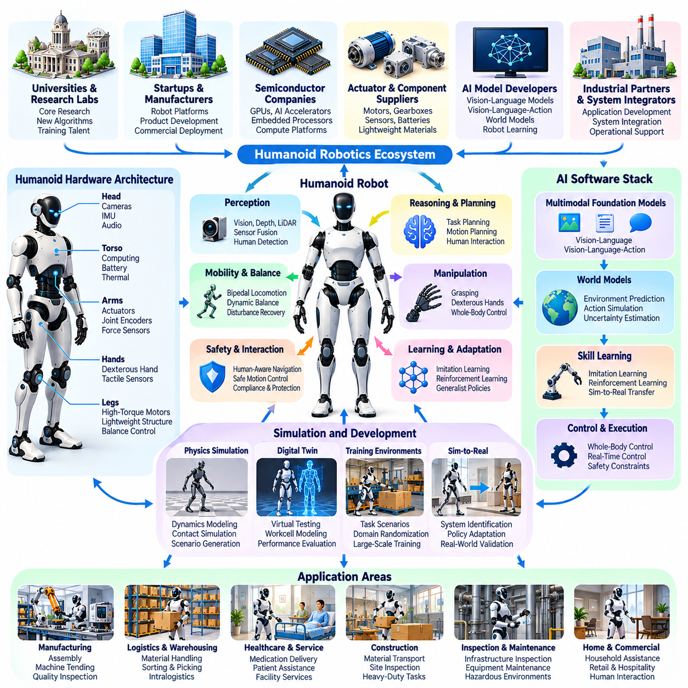{width="7.268055555555556in" height="7.268055555555556in"}

휴머노이드 로봇공학(Humanoid Robotics)은 인간의 신체 구조(Human-Inspired Body Structures)와 움직임 능력(Movement Capabilities)을 모방한 지능형 기계(Intelligent Machines)를 개발하려는 피지컬 인공지능(Physical AI)의 신흥 분야이다. 휴머노이드 로봇(Humanoid Robots)은 일반적으로 관절형 팔다리(Articulated Limbs), 감각 시스템(Sensory Systems), 액추에이터(Actuators), 컴퓨팅 지능(Computational Intelligence)을 결합하여 인간을 위해 설계된 환경에서 작동한다. 이러한 로봇의 개발에는 인식(Perception), 이동(Locomotion), 조작(Manipulation), 추론(Reasoning), 협조적 전신 제어(Coordinated Whole-Body Control)의 발전이 필요하다.

글로벌 휴머노이드 로봇 생태계(Global Humanoid Robotics Ecosystem)는 연구중심 대학(Research Universities), 로봇 스타트업(Robotics Startups), 기존 제조업체(Established Manufacturers), 반도체 기업(Semiconductor Companies), 액추에이터 공급업체(Actuator Suppliers), AI 모델 개발업체(AI Model Developers)로 구성된다. 이들 참여자는 기계 구조(Mechanical Structures)부터 파운데이션 모델(Foundation Models)에 이르기까지 상호 보완적인 기술을 제공한다. 하드웨어 엔지니어링(Hardware Engineering)과 인공지능 연구(Artificial Intelligence Research) 사이의 협력이 확대되면서 더욱 높은 능력을 갖춘 휴머노이드 플랫폼(Humanoid Platforms)에 대한 실험이 가속화되고 있다.

휴머노이드 형태(Humanoid Morphology)는 일반적으로 인간의 주요 신체 기능(Human Physical Functionality)을 모방하도록 구성된 몸통(Torso), 관절형 팔(Articulated Arms), 손(Hands), 다리(Legs)를 포함한다. 이러한 구성은 기존 도구(Tools), 가구(Furniture), 작업대(Workstations), 인프라(Infrastructure)와의 상호작용을 지원할 가능성이 있다. 그러나 인간을 모방한 형태(Human-Inspired Morphology)는 더 단순한 로봇 구현 형태(Robotic Embodiments)에서는 피할 수 있는 기계적 복잡성(Mechanical Complexity), 균형 유지 요구사항(Balance Requirements), 에너지 제약(Energy Constraints)을 발생시킨다.

이족 보행(Bipedal Locomotion)은 휴머노이드 로봇공학(Humanoid Robotics)을 정의하는 핵심 기술 과제 중 하나이다. 보행(Walking)은 관절 움직임(Joint Movements), 지면 접촉력(Ground Contact Forces), 신체 운동량(Body Momentum), 균형 회복(Balance Recovery)의 지속적인 협조를 요구한다. 연구자들은 다양한 지표면(Various Surfaces)과 환경 조건(Environmental Conditions)에서 안정적인 이동(Stable Movement)을 구현하기 위해 모델 예측 제어(Model Predictive Control), 전신 최적화(Whole-Body Optimization), 강화학습(Reinforcement Learning), 하이브리드 제어 방법(Hybrid Control Methods)을 활용한다.

동적 균형(Dynamic Balance)은 휴머노이드 로봇이 상대적으로 높은 무게중심(High Centers of Mass)과 변화하는 지지 구성(Changing Support Configurations)을 가진 상태에서 작동하기 때문에 특히 중요하다. 제어기(Controllers)는 보행(Walking), 회전(Turning), 팔 뻗기(Reaching), 물체 조작(Object Manipulation) 중에도 안정성(Stability)을 유지해야 한다. 외란 억제(Disturbance Rejection), 접촉 추정(Contact Estimation), 회복 계획(Recovery Planning)은 넘어짐(Falls)을 방지하는 데 도움을 주며, 안전 정지(Safe Stopping)와 보호 대응(Protective Responses)은 불가피한 불안정성(Unavoidable Instability)의 영향을 줄인다.

휴머노이드 조작(Humanoid Manipulation)은 팔(Arms), 손(Hands), 몸통(Torso), 이동 시스템(Locomotion Systems) 사이의 협조적 상호작용을 요구한다. 로봇은 물체(Objects)를 식별하고, 기하학적 특성(Geometry)을 추정하며, 파지 구성(Grasp Configurations)을 선택하고, 제어된 움직임(Controlled Movements)을 실행해야 한다. 정교한 로봇 손(Dexterous Hands)은 적응형 조작(Adaptable Manipulation)을 제공할 수 있지만 추가적인 액추에이터(Actuators), 센싱 요구사항(Sensing Requirements), 제어 복잡성(Control Complexity)도 발생시킨다. 물체가 익숙하지 않거나 물리적 특성이 다양한 경우 신뢰할 수 있는 조작(Reliable Manipulation)은 여전히 어려운 과제이다.

인식 시스템(Perception Systems)은 휴머노이드 로봇이 사람(People), 장비(Equipment), 가구(Furniture), 이동 장애물(Moving Obstacles)이 존재하는 환경을 이해하도록 한다. 카메라(Cameras), 깊이 센서(Depth Sensors), 관성측정장치(Inertial Measurement Units, IMUs), 힘-토크 센서(Force-Torque Sensors), 촉각 장치(Tactile Devices)는 상호 보완적인 관측 정보(Complementary Observations)를 제공한다. 멀티모달 센서 융합(Multimodal Sensor Fusion)은 공간 인식(Spatial Awareness), 물체 인식(Object Recognition), 접촉 추정(Contact Estimation), 인간과의 상호작용(Human Interaction)을 지원하지만, 불확실성(Uncertainty)과 센서의 한계(Sensor Limitations)는 여전히 중요한 과제로 남아 있다.

전신 제어(Whole-Body Control)는 이동(Locomotion)과 조작(Manipulation)을 통합된 의사결정 과정(Unified Decision-Making Process)으로 결합한다. 물체를 향해 팔을 뻗는 동작(Reaching for an Object)은 발(Feet), 몸통(Torso), 팔(Arms), 손(Hands)의 협조적인 조정을 요구할 수 있다. 최적화 기반 제어기(Optimization-Based Controllers)는 작업 목표(Task Objectives)와 안정성(Stability), 관절 한계(Joint Limits), 접촉력(Contact Forces), 액추에이터 제약(Actuator Constraints) 사이의 균형을 조정한다. 이러한 협조 제어(Coordinated Control)는 물리적 평형(Physical Equilibrium)을 훼손하지 않으면서 유용한 행동(Useful Actions)을 수행하는 데 필수적이다.

인공지능(Artificial Intelligence)은 학습 기반 인식(Learning-Based Perception), 동작 생성(Motion Generation), 작업 계획(Task Planning)을 통해 휴머노이드 행동(Humanoid Behavior)에 점점 더 큰 영향을 미치고 있다. 모방학습(Imitation Learning)은 로봇이 인간 시연(Human Demonstrations)으로부터 기술(Skills)을 습득하도록 하며, 강화학습(Reinforcement Learning)은 이동 및 조작 정책(Locomotion and Manipulation Policies)의 개발을 지원한다. 학습된 정책(Learned Policies)과 기존 제어 방법(Conventional Control Methods)을 결합하면 필수적인 안정성 및 안전 제약(Stability and Safety Constraints)을 유지하면서 적응성(Adaptability)을 향상시킬 수 있다.

비전-언어 모델(Vision-Language Models, VLMs)과 비전-언어-행동 아키텍처(Vision-Language-Action Architectures, VLA)는 명령 기반 휴머노이드 행동(Instruction-Driven Humanoid Behavior)에 관한 연구를 확대하고 있다. 이러한 모델은 시각 관측(Visual Observations)과 자연어 명령(Natural-Language Commands)을 작업 표현(Task Representations) 또는 물리적 행동(Physical Actions)과 연결한다. 연구자들은 여러 활동을 처리할 수 있는 범용 정책(Generalist Policies)을 연구하고 있지만, 장기 구간 작업 실행(Long-Horizon Execution), 물리적 기반화(Physical Grounding), 불확실성 관리(Uncertainty Management), 신뢰할 수 있는 작업 완료(Dependable Task Completion)는 아직 해결되지 않은 과제로 남아 있다.

월드 모델(World Models)은 휴머노이드 로봇에 물리적 상호작용(Physical Interactions)에 대한 예측적 표현(Predictive Representations)을 제공할 수 있다. 이러한 모델은 행동 이후 물체(Objects), 사람(People), 로봇 상태(Robot States)가 어떻게 변화할 수 있는지 추정함으로써 계획(Planning)과 예측(Anticipation)을 지원한다. 모델의 효과성(Effectiveness)은 접촉 동역학(Contact Dynamics), 환경 불확실성(Environmental Uncertainty), 변화하는 제약(Changing Constraints)을 실시간으로 안전한 의사결정(Safe Decisions)에 활용할 수 있을 만큼 정확하게 표현하는 능력에 달려 있다.

시뮬레이션 환경(Simulation Environments)은 물리적 실험(Physical Experimentation)에 많은 비용이 들고 장비 손상 위험이 존재할 수 있기 때문에 휴머노이드 개발(Humanoid Development)에서 중요한 역할을 수행한다. 물리 시뮬레이터(Physics Simulators)는 보행(Walking), 균형 유지(Balancing), 파지(Grasping), 회복 행동(Recovery Behaviors)의 반복적인 학습을 가능하게 한다. 도메인 무작위화(Domain Randomization)와 시스템 식별(System Identification)은 시뮬레이션-현실 전이(Simulation-to-Reality Transfer)를 개선하는 데 도움을 주지만, 접촉 동역학(Contact Dynamics), 액추에이터 응답(Actuator Response), 기계적 마모(Mechanical Wear)의 차이를 완전히 제거하기는 어렵다.

하드웨어 개발(Hardware Development)은 액추에이터(Actuators), 동력 전달장치(Transmissions), 경량 구조(Lightweight Structures), 배터리(Batteries), 임베디드 컴퓨팅(Embedded Computing), 열 관리(Thermal Management)에 집중한다. 휴머노이드 플랫폼(Humanoid Platforms)은 협조적인 움직임(Coordinated Movements)을 실행하기 위해 충분한 토크(Torque), 출력 밀도(Power Density), 기계적 내구성(Mechanical Durability), 제어 응답성(Control Responsiveness)을 확보해야 한다. 무게(Weight), 강도(Strength), 작동 지속시간(Operating Duration), 제조 비용(Manufacturing Cost) 사이의 엔지니어링 절충관계(Engineering Tradeoffs)는 실제 배포 능력(Practical Deployment Capabilities)에 큰 영향을 미친다.

휴머노이드 로봇 산업(Humanoid Robotics Industry)은 제조(Manufacturing), 물류(Logistics), 점검(Inspection), 서비스 운영(Service Operations) 분야의 응용 가능성을 탐색하고 있다. 잠재적인 작업(Potential Tasks)에는 자재 운송(Material Transportation), 공작기계 관리(Machine Tending), 부품 취급(Component Handling), 인간을 위해 설계된 작업 공간(Human-Designed Workspaces)에서의 반복 활동(Repetitive Activities)이 포함된다. 그러나 제안된 많은 응용 분야는 여전히 실험 단계(Experimental Stage)에 있으며, 상업적으로 유용한 배포(Commercially Useful Deployment)를 위해서는 지속적인 신뢰성(Sustained Reliability), 수용 가능한 생산성(Acceptable Productivity), 관리 가능한 운영 비용(Manageable Operating Costs)에 대한 근거가 필요하다.

휴머노이드 로봇(Humanoid Robots)은 개별 작업을 더욱 효율적으로 수행할 수 있는 특수 목적 로봇 시스템(Specialized Robotic Systems)과 경쟁해야 한다. 고정형 매니퓰레이터(Fixed Manipulators), 모바일 로봇(Mobile Robots), 목적 특화형 자동화(Purpose-Built Automation)는 더 단순한 기계적 아키텍처(Simpler Mechanical Architectures)와 검증된 운영 성능(Established Operational Performance)을 제공하는 경우가 많다. 휴머노이드의 잠재적 장점(Potential Advantage)은 모든 응용 분야에서 우월하다는 보장이 아니라 기존 인간 중심 인프라(Existing Human Infrastructure)와 다양한 작업(Multiple Tasks)에 적응할 수 있다는 점에 있다.

인간-로봇 상호작용(Human-Robot Interaction, HRI)은 의사소통(Communication), 행동 예측 가능성(Behavioral Predictability), 물리적 안전성(Physical Safety)에 관한 추가 요구사항을 발생시킨다. 작업자 근처에서 작동하는 휴머노이드(Humanoids)는 사람의 존재(Human Presence)를 인식하고, 적절한 이격 거리(Appropriate Distances)를 유지하며, 예상하지 못한 접촉(Unexpected Contact)에 안전하게 대응해야 한다. 자연어 인터페이스(Natural-Language Interfaces)는 사용성(Usability)을 개선할 수 있지만, 안전 필수 의사결정(Safety-Critical Decisions)에는 신뢰할 수 있는 센싱(Dependable Sensing), 검증된 제어 메커니즘(Validated Control Mechanisms), 명확하게 정의된 운영 경계(Operational Boundaries)가 필요하다.

안전공학(Safety Engineering)은 넘어짐(Falls), 충돌(Collisions), 관절 움직임(Joint Motion), 파지력(Gripping Forces), 배터리 위험(Battery Hazards), 예상하지 못한 자율 행동(Unexpected Autonomous Behavior)을 다루어야 한다. 위험 평가(Risk Assessment)는 전체 로봇 시스템(Complete Robot System), 의도된 작업(Intended Tasks), 운영 환경(Operating Environment)을 고려해야 한다. 기존 기계 및 로봇 안전 프레임워크(Machinery and Robotics Safety Frameworks)는 관련 지침(Relevant Guidance)을 제공하지만, 휴머노이드 배포(Humanoid Deployments)에 대해서는 응용 분야별 요구사항(Application-Specific Requirements)과 발전 중인 표준(Evolving Standards)을 신중하게 평가해야 한다.

상업적 평가(Commercial Evaluation)는 시각적으로 인상적인 이동(Locomotion)이나 조작(Manipulation)을 시연하는 것 이상의 검증을 요구한다. 중요한 평가 지표(Measures)에는 작업 성공률(Task Success Rate), 개입 빈도(Intervention Frequency), 에너지 소비(Energy Consumption), 유지보수 주기(Maintenance Intervals), 회복 성능(Recovery Performance), 총소유비용(Total Cost of Ownership, TCO)이 포함된다. 산업 고객(Industrial Customers)은 휴머노이드 시스템(Humanoid Systems)이 수용 가능한 안전성(Safety)과 운영 가용성(Operational Availability)을 유지하면서 기존 자동화(Conventional Automation)보다 측정 가능한 이점(Measurable Advantages)을 제공하는지 판단해야 한다.

미래의 휴머노이드 생태계(Future Humanoid Ecosystem)는 로봇 파운데이션 모델(Robot Foundation Models), 전이 가능한 운동 기술(Transferable Motor Skills), 시뮬레이션 인프라(Simulation Infrastructure), 확장 가능한 제조(Scalable Manufacturing) 사이의 더욱 강력한 통합에 의존할 가능성이 높다. 공유 학습 아키텍처(Shared Learning Architectures)는 모든 행동(Behavior)을 개별적으로 프로그래밍해야 하는 필요성을 줄일 수 있다. 그러나 하드웨어 형태(Hardware Morphology), 액추에이터 성능(Actuator Performance), 센싱(Sensing), 물리적 제약(Physical Constraints)의 차이로 인해 플랫폼별 적응(Platform-Specific Adaptation)과 검증(Validation)은 계속 필요할 것이다.

궁극적으로 휴머노이드 로봇공학(Humanoid Robotics)은 범용 피지컬 인공지능(General-Purpose Physical AI)을 구현하려는 목표와 그 어려움을 동시에 보여준다. 인간을 모방한 신체 구현(Human-Inspired Embodiment)은 기존 환경(Existing Environments)에서 작동할 기회를 제공하지만, 유용한 자율성(Useful Autonomy)을 실현하려면 지능(Intelligence), 기계 구조(Mechanics), 제어(Control), 안전성(Safety)의 신뢰할 수 있는 통합이 필요하다. 장기적인 발전(Long-Term Progress)은 인간과 유사한 움직임(Humanlike Movement)의 개별 시연(Isolated Demonstrations)이 아니라 지속적인 실제 환경 성능(Sustained Real-World Performance)을 기준으로 평가될 것이다.

## 04.06. Quadruped and Legged Robotics

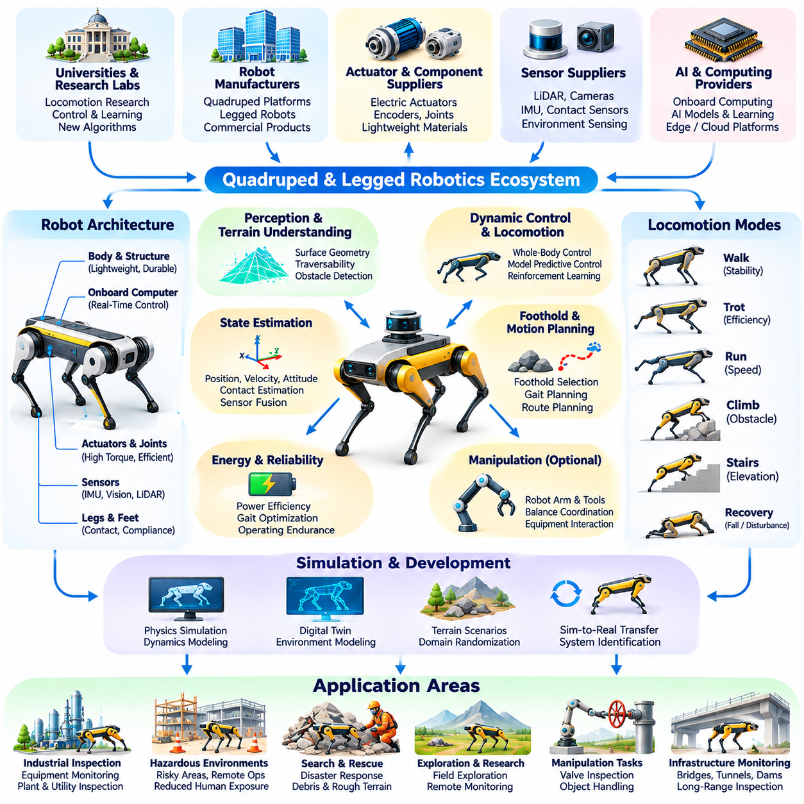{width="7.268055555555556in" height="7.268055555555556in"}

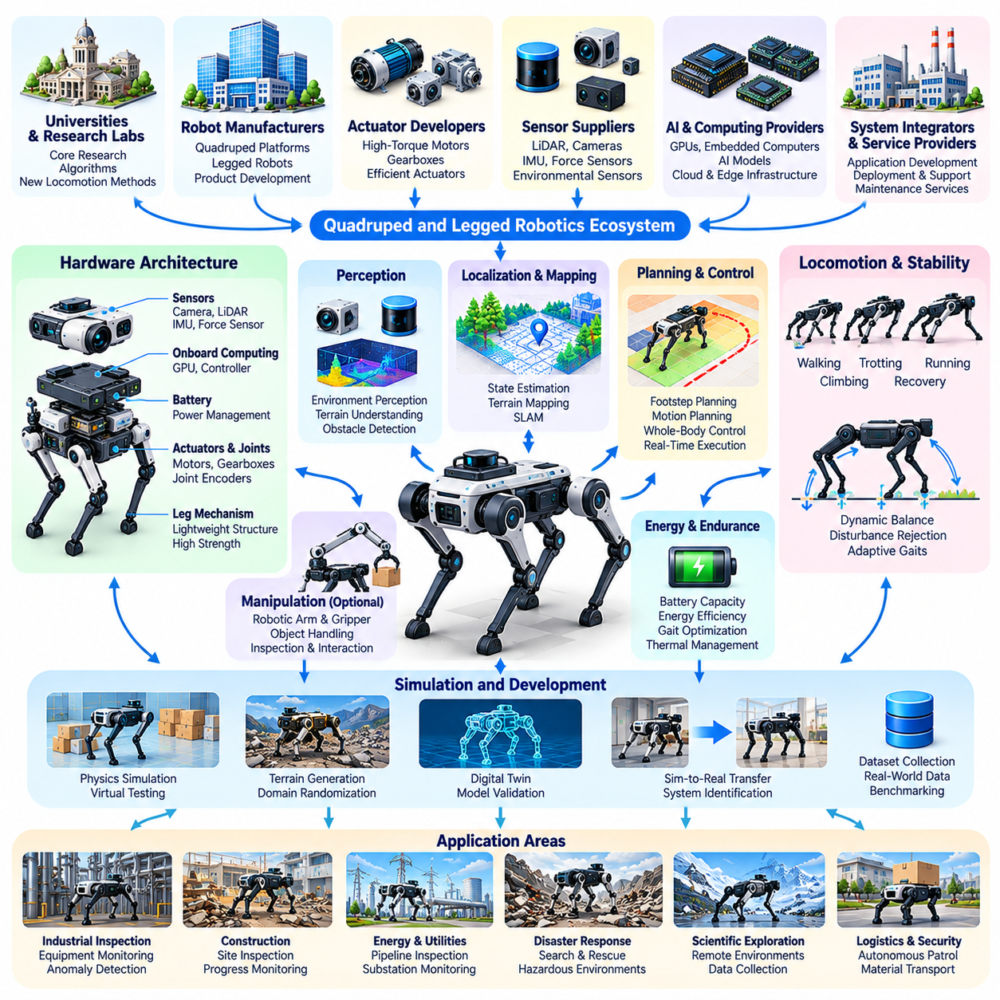{width="7.268055555555556in" height="7.268055555555556in"}

사족보행 및 다족보행 로봇공학(Quadruped and Legged Robotics)은 바퀴(Wheels)나 궤도(Tracks)에만 의존하지 않고 팔다리의 협조적 움직임(Coordinated Limb Motion)을 통해 이동하는 자율 기계(Autonomous Machines)에 초점을 맞춘 피지컬 인공지능(Physical AI)의 중요한 분야이다. 이러한 로봇은 기계 설계(Mechanical Design), 동적 제어(Dynamic Control), 환경 인식(Environmental Perception), 지능형 계획(Intelligent Planning)을 결합하여 복잡한 지형(Complex Terrain)을 이동한다. 이러한 능력은 기존 모바일 플랫폼(Conventional Mobile Platforms)이 접근성(Accessibility)이나 지표면 조건(Surface Conditions)의 한계에 직면하는 환경에서 특히 중요하다.

다족보행 로봇 생태계(Legged Robotics Ecosystem)는 연구기관(Research Institutions), 전문 로봇 제조업체(Specialized Robot Manufacturers), 액추에이터 개발업체(Actuator Developers), 센서 공급업체(Sensor Suppliers), AI 컴퓨팅 제공업체(AI Computing Providers)로 구성된다. 산업 참여자들은 점검(Inspection), 탐사(Exploration), 물류(Logistics), 연구(Research), 위험 환경 작업(Hazardous Environment Operations)을 위한 플랫폼을 개발한다. 상업적 발전(Commercial Progress)은 동적 이동(Dynamic Locomotion)에 관한 실험실 시연(Laboratory Demonstrations)을 실제 현장 조건(Practical Field Conditions)에서 지속적으로 작동할 수 있는 신뢰성 높은 시스템(Reliable Systems)으로 전환하는 데 달려 있다.

사족보행 로봇(Quadruped Robots)은 네 개의 관절형 다리(Articulated Legs)를 사용하여 적응형 지면 접촉(Adaptable Ground Contact)과 동적 안정성(Dynamic Stability)을 제공한다. 기계적 아키텍처(Mechanical Architectures)는 일반적으로 전기 액추에이터(Electric Actuators), 관절 엔코더(Joint Encoders), 관성측정장치(Inertial Measurement Units, IMUs), 온보드 컴퓨터(Onboard Computers), 반복 하중(Repeated Loading)을 견디도록 설계된 구조 부품(Structural Components)을 통합한다. 다리의 기하학적 구조(Leg Geometry), 액추에이터 토크(Actuator Torque), 동력 전달 효율(Transmission Efficiency), 몸체 질량 분포(Body Mass Distribution)는 이동 성능(Locomotion Performance), 가반하중(Payload Capacity), 에너지 소비(Energy Consumption)에 큰 영향을 미친다.

다족보행 이동(Legged Locomotion)은 이동 중 지면 접촉(Ground Contact)이 지속적으로 변화하기 때문에 바퀴 기반 내비게이션(Wheeled Navigation)과 근본적으로 다르다. 로봇은 안정성(Stability)을 유지하면서 발 위치(Foot Placement), 관절 궤적(Joint Trajectories), 접촉력(Contact Forces), 몸체 운동량(Body Momentum)을 협조적으로 제어해야 한다. 걷기(Walking), 속보(Trotting), 등반(Climbing), 회복 행동(Recovery Behaviors)은 서로 다른 제어 전략(Control Strategies)을 요구한다. 성공적인 이동(Successful Locomotion)은 로봇의 물리적 상태(Physical State)를 정확하게 추정하고 환경 외란(Environmental Disturbances)에 대응하는 능력에 달려 있다.

동적 제어(Dynamic Control)는 특히 빠른 이동(Rapid Movement)이나 불규칙한 지형(Irregular Terrain)을 통과할 때 사족보행 로봇의 성능(Quadruped Performance)을 결정하는 핵심 요소이다. 모델 예측 제어(Model Predictive Control), 전신 제어(Whole-Body Control), 최적화 기반 방법(Optimization-Based Methods)은 물리적 제약(Physical Constraints) 아래에서 실행 가능한 움직임(Feasible Motions)을 생성한다. 강화학습(Reinforcement Learning)은 적응형 이동 정책(Adaptive Locomotion Policies)을 습득하기 위한 보완적 접근법을 제공한다. 하이브리드 아키텍처(Hybrid Architectures)는 강건성(Robustness)을 향상시키기 위해 학습된 행동(Learned Behaviors)과 모델 기반 제어기(Model-Based Controllers)를 결합할 수 있다.

지형 인식(Terrain Perception)은 다족보행 로봇이 주행 가능한 표면(Traversable Surfaces)을 장애물(Obstacles) 및 위험 지역(Hazardous Regions)과 구별하도록 한다. 라이다(LiDAR), 스테레오 카메라(Stereo Cameras), 깊이 센서(Depth Sensors), 관성 센싱(Inertial Sensing)은 지표면의 기하학적 구조(Surface Geometry)와 로봇 움직임(Robot Motion)에 관한 정보를 제공한다. 고도 지도(Elevation Maps)와 국소 지형 표현(Local Terrain Representations)은 발 디딤 위치 선정(Foothold Selection)과 경로 계획(Route Planning)을 지원한다. 표면이 반사성이거나, 변형 가능하거나, 미끄럽거나, 부분적으로 가려진 경우 신뢰할 수 있는 인식(Reliable Perception)은 여전히 어렵다.

발 디딤 위치 계획(Foothold Planning)은 로봇이 균형(Balance)을 유지하고 원하는 움직임(Desired Movement)을 달성하기 위해 발을 어디에 놓아야 하는지 결정한다. 계획 알고리즘(Planning Algorithms)은 지형 형상(Terrain Geometry), 마찰(Friction), 도달 가능성(Reachability), 몸체 자세(Body Posture), 예상 접촉력(Expected Contact Forces)을 고려한다. 바퀴 기반 플랫폼(Wheeled Platforms)과 달리 다족보행 로봇(Legged Robots)은 연속적인 지면 지지(Continuous Ground Support) 없이도 틈이나 장애물을 넘어설 수 있는 경우가 있다. 그러나 이러한 장점은 정확한 접촉 추정(Contact Estimation)과 충분한 기계적 능력(Mechanical Capability)에 달려 있다.

상태 추정(State Estimation)은 다족보행 로봇이 접촉 조건(Contact Conditions)과 몸체 방향(Body Orientation)의 빈번한 변화를 경험하기 때문에 필수적이다. 관성 측정값(Inertial Measurements), 관절 엔코더(Joint Encoders), 발 접촉 센서(Foot Contact Sensors), 시각 또는 라이다 주행거리 추정(Visual or LiDAR Odometry)은 위치(Position), 속도(Velocity), 자세(Attitude)를 추정하는 데 기여한다. 추정 오차(Estimation Errors)는 균형(Balance)과 이동 안전성(Locomotion Safety)에 직접적인 영향을 미칠 수 있다. 강건한 시스템(Robust Systems)은 신뢰할 수 없는 접촉(Unreliable Contacts), 센서 드리프트(Sensor Drift), 예상하지 못한 외부 외란(Unexpected External Disturbances)을 감지해야 한다.

에너지 효율(Energy Efficiency)은 다족보행 이동(Legged Mobility)의 중요한 한계로 남아 있다. 관절형 다리(Articulated Limbs)를 반복적으로 들어 올리고, 가속하고, 안정화하는 과정에는 상당한 전력이 필요할 수 있다. 배터리 용량(Battery Capacity), 액추에이터 효율(Actuator Efficiency), 기계적 순응성(Mechanical Compliance), 보행 패턴 선택(Gait Selection)은 작동 지속시간(Operating Duration)에 영향을 미친다. 다족보행 플랫폼(Legged Platforms)은 어려운 지형에서 장점을 제공하지만, 매끄럽고 예측 가능한 표면에서의 운송에는 바퀴 기반 시스템(Wheeled Systems)이 여전히 더 효율적인 경우가 많다.

산업 설비 점검(Industrial Inspection)은 상업용 사족보행 로봇공학(Commercial Quadruped Robotics)의 대표적인 응용 분야이다. 로봇은 산업 플랜트(Industrial Plants), 설비 통로(Utility Corridors), 건설 현장(Construction Sites), 에너지 시설(Energy Facilities)을 이동하면서 시각(Visual), 열(Thermal), 음향(Acoustic), 환경 측정값(Environmental Measurements)을 수집할 수 있다. 자율 점검 작업 흐름(Autonomous Inspection Workflows)은 설비 모니터링(Equipment Monitoring)과 이상 탐지(Anomaly Detection)를 지원할 수 있다. 운영 가치(Operational Value)는 측정 품질(Measurement Quality), 내비게이션 신뢰성(Navigation Reliability), 반복 재현성(Repeatability), 유지보수 시스템(Maintenance Systems)과의 통합에 달려 있다.

위험 환경 작업(Hazardous Environment Operations)은 다족보행 로봇 개발(Legged Robot Development)의 또 다른 중요한 동기이다. 이러한 플랫폼은 불안정한 지표면(Unstable Surfaces), 좁은 통로(Confined Passages), 잠재적으로 위험한 산업 조건(Potentially Dangerous Industrial Conditions)이 존재하는 지역에 진입할 수 있다. 원격 감독(Remote Supervision)과 자율 내비게이션(Autonomous Navigation)은 일부 점검 작업에서 사람이 위험에 직접 노출될 필요성을 줄일 수 있다. 그러나 배포(Deployment)를 위해서는 통신 신뢰성(Communication Reliability), 환경 보호(Environmental Protection), 임무별 안전 제약(Mission-Specific Safety Constraints)을 신중하게 평가해야 한다.

다족보행 로봇(Legged Robots)은 수색 및 구조(Search and Rescue), 과학 탐사(Scientific Exploration), 원격 모니터링(Remote Monitoring) 분야에서도 연구되고 있다. 계단(Stairs), 잔해(Debris), 경사면(Slopes), 불연속적인 지형(Discontinuous Terrain)을 통과하는 능력은 접근하기 어려운 장소로의 이동 가능성을 확대할 수 있다. 그러나 예측하기 어려운 지면 조건(Unpredictable Ground Conditions), 제한된 작동 지속시간(Limited Operating Endurance), 제한적인 가반하중(Restricted Payload Capacity)은 실제 임무(Practical Missions)를 복잡하게 만든다. 강건한 회복 행동(Robust Recovery Behavior)과 신뢰할 수 있는 통신(Reliable Communication)은 현장 배포(Field Deployment)에 필수적이다.

조작 능력(Manipulation Capabilities)은 로봇 팔(Robotic Arms), 그리퍼(Grippers), 특수 도구(Specialized Tools)를 통해 사족보행 플랫폼(Quadruped Platforms)에 점점 더 통합되고 있다. 이러한 시스템은 밸브 점검(Valve Inspection), 장비와의 상호작용(Equipment Interaction), 물체 취급(Object Handling), 제한적인 유지보수 작업(Limited Maintenance Operations)을 수행할 수 있다. 조작(Manipulation)과 다족보행 균형(Legged Balance)을 조정하는 과정에서는 로봇 팔의 움직임(Arm Movement)과 하중 변화(Payload Changes)가 몸체 동역학(Body Dynamics)을 변화시키므로 추가적인 과제가 발생한다. 따라서 전신 계획(Whole-Body Planning)은 안정적인 작업 수행(Stable Task Execution)에 매우 중요하다.

인공지능(Artificial Intelligence)은 학습 기반 이동(Learned Locomotion), 지형 분류(Terrain Classification), 적응형 행동 선택(Adaptive Behavior Selection)을 통해 다족보행 로봇공학(Legged Robotics)을 발전시키고 있다. 시뮬레이션 기반 강화학습(Reinforcement Learning in Simulation)은 제어 정책(Control Policies)을 다양한 지형(Terrain), 외란(Disturbances), 액추에이터 조건(Actuator Conditions)에 노출할 수 있다. 도메인 무작위화(Domain Randomization)와 시스템 식별(System Identification)은 이러한 행동을 실제 로봇(Physical Robots)으로 전이하는 데 도움을 준다. 그러나 학습된 정책(Learned Policies)은 실제 환경의 불확실성(Real-World Uncertainty)과 운영 안전 요구사항(Operational Safety Requirements)에 대해 평가되어야 한다.

시뮬레이션 환경(Simulation Environments)은 다족보행 로봇(Legged Robots)의 개발 및 테스트를 위한 필수 인프라(Essential Infrastructure)를 제공한다. 물리 엔진(Physics Engines)은 강체 동역학(Rigid-Body Dynamics), 접촉 상호작용(Contact Interactions), 액추에이터 동작(Actuator Behavior), 지형 형상(Terrain Geometry)을 재현한다. 개발자는 고가의 하드웨어(Expensive Hardware)를 반복적으로 위험에 노출하지 않고 대규모 이동 시나리오(Locomotion Scenarios)를 생성할 수 있다. 시뮬레이션 충실도(Simulation Fidelity)는 불확실한 마찰(Uncertain Friction), 변형 가능한 지형(Deformable Terrain), 기계적 마모(Mechanical Wear), 불완전한 액추에이터 모델(Imperfect Actuator Models)에 의해 제한된다.

엣지 컴퓨팅(Edge Computing)은 다족보행 플랫폼(Legged Platforms)에서 실시간 인식(Real-Time Perception), 이동 제어(Locomotion Control), 자율 내비게이션(Autonomous Navigation)을 지원한다. 임베디드 프로세서(Embedded Processors)와 AI 가속기(AI Accelerators)는 센서 처리(Sensor Processing)와 학습된 정책(Learned Policies)을 로컬에서 실행하여 지속적인 네트워크 연결(Network Connectivity)에 대한 의존도를 줄인다. 원격 인프라(Remote Infrastructure)는 임무 계획(Mission Planning), 데이터 분석(Data Analytics), 플릿 협업(Fleet Coordination)을 제공할 수 있다. 안전 필수 균형 제어(Safety-Critical Balance Control)와 동작 제어(Motion Control)는 일반적으로 신뢰할 수 있는 온보드 실행(Dependable Onboard Execution)을 요구한다.

안전공학(Safety Engineering)은 넘어짐(Falls), 예상하지 못한 움직임(Unexpected Movements), 충돌(Collisions), 액추에이터 고장(Actuator Failures), 불안정한 접촉 조건(Unstable Contact Conditions)을 고려해야 한다. 사람이나 고가 장비(Valuable Equipment) 근처에서 작동하는 다족보행 로봇(Legged Robots)은 적절한 운영 경계(Operational Boundaries)와 보호 대응(Protective Responses)이 필요하다. 비상 정지(Emergency Stopping) 자체가 안정성 문제(Stability Challenges)를 발생시킬 수 있으므로 안전한 자세(Safe Postures)로의 제어된 전환(Controlled Transitions)이 중요하다. 위험 평가(Risk Assessment)는 플랫폼(Platform), 환경(Environment), 가반하중(Payload), 의도된 작업(Intended Tasks)을 반영해야 한다.

상업적 평가(Commercial Evaluation)는 최대 속도(Maximum Speed)나 인상적인 장애물 극복 시연(Obstacle Demonstrations)을 넘어서는 성능 검토를 요구한다. 중요한 지표에는 지형 통과 성공률(Terrain Traversal Success), 임무 완료율(Mission Completion Rate), 작동 지속시간(Operating Endurance), 개입 빈도(Intervention Frequency), 점검 정확도(Inspection Accuracy), 총소유비용(Total Cost of Ownership, TCO)이 포함된다. 유지보수 요구사항(Maintenance Demands)과 부품 내구성(Component Durability)은 경제적 타당성(Economic Viability)에 큰 영향을 미친다. 산업 고객(Industrial Customers)은 다족보행 시스템(Legged Systems)을 바퀴 기반 로봇(Wheeled Robots) 및 기존 점검 방법(Conventional Inspection Methods)과 비교해야 한다.

다족보행 로봇공학(Legged Robotics)의 미래는 액추에이터 기술(Actuator Technology), 에너지 관리(Energy Management), 멀티모달 인식(Multimodal Perception), 일반화 가능한 이동 정책(Generalizable Locomotion Policies)의 발전과 함께 전개될 것이다. 개선된 지형 이해(Terrain Understanding)와 예측 제어(Predictive Control)는 변화하는 환경(Changing Environments)에서 더욱 신뢰할 수 있는 운영을 가능하게 할 수 있다. 조작(Manipulation) 및 플릿 오케스트레이션(Fleet Orchestration)과의 통합은 응용 기회(Application Opportunities)를 확대할 수 있지만, 기계적 복잡성(Mechanical Complexity)과 에너지 제약(Energy Constraints)은 계속 중요한 고려사항으로 남을 것이다.

궁극적으로 사족보행 및 다족보행 로봇공학(Quadruped and Legged Robotics)은 피지컬 인공지능(Physical AI)이 기존 내비게이션 시스템(Conventional Navigation Systems)에 어려움을 주는 환경으로 자율 모빌리티(Autonomous Mobility)를 확장하는 방식을 보여준다. 이러한 기술의 발전에는 기계공학(Mechanical Engineering), 지능형 제어(Intelligent Control), 인식(Perception), 안전성 보증(Safety Assurance)의 긴밀한 통합이 필요하다. 장기적인 성공(Long-Term Success)은 신뢰할 수 있는 현장 성능(Dependable Field Performance), 효율적인 운영(Efficient Operation), 확장 가능한 배포(Scalable Deployment), 다족보행 이동(Legged Mobility)이 실질적인 장점을 제공하는 응용 분야에서 명확하게 입증된 가치(Demonstrated Value)에 달려 있다.

## 04.07. Autonomous Vehicles and Aerial Robotics

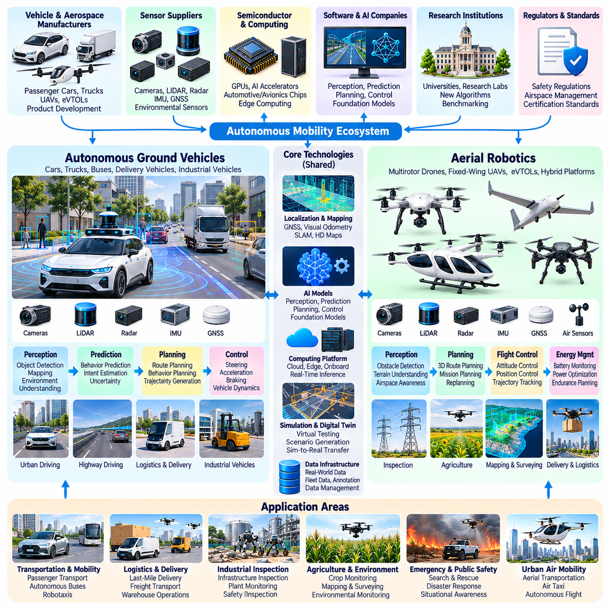{width="7.268055555555556in" height="7.268055555555556in"}

자율주행 차량(Autonomous Vehicles)과 항공 로봇공학(Aerial Robotics)은 지능형 의사결정(Intelligent Decision-Making)을 도로 운송(Road Transportation)과 3차원 비행(Three-Dimensional Flight)으로 확장하는 피지컬 인공지능(Physical AI)의 주요 분야이다. 이러한 시스템은 환경 인식(Environmental Perception), 위치 추정(Localization), 동작 계획(Motion Planning), 피드백 제어(Feedback Control)를 결합하여 역동적인 물리적 환경(Dynamic Physical Environments)에서 작동한다. 이들의 개발에는 인공지능(Artificial Intelligence), 로봇공학(Robotics Engineering), 임베디드 컴퓨팅(Embedded Computing), 안전 필수 시스템 설계(Safety-Critical System Design)의 긴밀한 통합이 필요하다.

자율 모빌리티 생태계(Autonomous Mobility Ecosystem)는 차량 제조업체(Vehicle Manufacturers), 항공우주 기업(Aerospace Companies), 로봇 개발업체(Robotics Developers), 센서 공급업체(Sensor Suppliers), 반도체 제공업체(Semiconductor Providers), 소프트웨어 기업(Software Organizations)으로 구성된다. 연구기관(Research Institutions)과 규제 당국(Regulatory Authorities) 역시 기술 발전(Technological Progress)과 배포 조건(Deployment Conditions)에 영향을 미친다. 상업적 개발(Commercial Development)은 여객 운송(Passenger Transportation), 산업 물류(Industrial Logistics), 배송 서비스(Delivery Services), 인프라 점검(Infrastructure Inspection), 농업 운영(Agricultural Operations), 특수 자율 임무(Specialized Autonomous Missions)에 걸쳐 이루어진다.

자율주행 지상 차량(Autonomous Ground Vehicles)은 카메라(Cameras), 레이더(Radar), 라이다(LiDAR), 위성항법(Satellite Navigation), 관성 센서(Inertial Sensors), 온보드 컴퓨팅 플랫폼(Onboard Computing Platforms)을 통합한다. 이러한 구성요소는 도로 형상(Road Geometry), 주변 교통(Surrounding Traffic), 장애물(Obstacles), 차량 움직임(Vehicle Motion)에 관한 정보를 제공한다. 센서 구성(Sensor Configurations)은 운영 조건(Operating Conditions)과 시스템 목표(System Objectives)에 따라 달라진다. 강건한 인식(Robust Perception)을 위해서는 가려짐(Occlusion), 악천후(Adverse Weather), 변화하는 조명(Changing Illumination), 환경 측정의 불확실성(Uncertainty in Environmental Measurements)을 처리해야 한다.

차량 위치 추정(Vehicle Localization)은 위치 결정 기술(Positioning Technologies)과 환경 관측(Environmental Observations)을 결합하여 위치(Location)와 방향(Orientation)을 추정한다. 위성항법시스템(Global Navigation Satellite Systems, GNSS)은 지리적 기준(Geographic References)을 제공하며, 관성항법(Inertial Navigation), 시각 주행거리 추정(Visual Odometry), 라이다 기반 방법(LiDAR-Based Methods)은 위성 신호(Satellite Signals)의 신뢰성이 낮아지는 상황에서 위치 추정을 지원한다. 고정밀 지도(High-Definition Maps, HD Maps)는 추가적인 맥락 정보(Contextual Information)를 제공할 수 있지만, 지도 의존성(Map Dependence)은 유지관리(Maintenance)와 확장성(Scalability)에 관한 과제를 발생시킨다.

자율주행 시스템(Autonomous Driving Systems)은 일반적으로 의사결정(Decision-Making)을 인식(Perception), 예측(Prediction), 계획(Planning), 제어(Control) 기능으로 구성한다. 인식은 관련 물체(Relevant Objects)와 환경 구조(Environmental Structures)를 식별하고, 예측은 주변 에이전트(Nearby Agents)의 가능한 움직임을 추정한다. 계획은 적절한 차량 행동(Vehicle Behavior)과 실행 가능한 궤적(Feasible Trajectories)을 결정한다. 제어 시스템(Control Systems)은 차량 동역학(Vehicle Dynamics)을 준수하면서 이러한 궤적을 조향(Steering), 가속(Acceleration), 제동(Braking) 명령으로 변환한다.

동작 예측(Motion Prediction)은 보행자(Pedestrians), 자전거 이용자(Cyclists), 인간 운전 차량(Human-Driven Vehicles), 예측하기 어려운 상호작용(Unpredictable Interactions)이 존재하는 도로 환경에서 특히 중요하다. 자율 시스템(Autonomous Systems)은 주변 에이전트가 고정된 궤적(Fixed Trajectories)을 따른다고 가정하는 대신 여러 가능한 미래 행동(Possible Future Behaviors)을 평가해야 한다. 확률적 예측(Probabilistic Prediction)과 불확실성 인식 계획(Uncertainty-Aware Planning)은 더욱 안전한 의사결정을 지원하지만, 비정상적인 상황(Unusual Situations)과 모호한 의도(Ambiguous Intentions)를 해석하는 일은 여전히 어렵다.

운행 설계 영역(Operational Design Domain, ODD)은 자율주행 시스템(Autonomous Driving System)이 작동하도록 설계된 조건을 정의한다. 이러한 조건에는 지리적 영역(Geographic Areas), 도로 유형(Road Types), 기상 제한(Weather Restrictions), 교통 특성(Traffic Characteristics), 속도 제한(Speed Limits)이 포함될 수 있다. 명확하게 정의된 운영 경계(Operational Boundaries)는 시스템 검증(System Validation)과 위험 관리(Risk Management)를 지원한다. 설정된 조건을 넘어 자율성(Autonomy)을 확장하려면 신뢰할 수 있는 성능(Reliable Performance)과 적절한 대체 대응 행동(Fallback Behavior)에 관한 추가적인 근거가 필요하다.

항공 로봇공학(Aerial Robotics)은 차량이 비행 안정성(Flight Stability), 내비게이션(Navigation), 에너지 소비(Energy Consumption)를 지속적으로 관리해야 하는 3차원 환경(Three-Dimensional Environments)으로 자율 모빌리티를 확장한다. 무인항공기(Uncrewed Aerial Vehicles, UAVs)에는 멀티로터 플랫폼(Multirotor Platforms), 고정익 항공기(Fixed-Wing Aircraft), 하이브리드 구성(Hybrid Configurations)이 포함된다. 각 아키텍처는 기동성(Maneuverability), 비행 지속시간(Endurance), 가반하중(Payload Capacity), 운용 거리(Operating Range) 사이에서 서로 다른 절충관계(Tradeoffs)를 제공하므로 플랫폼 선택(Platform Selection)은 임무 요구사항(Mission Requirements)에 크게 좌우된다.

비행 제어 시스템(Flight Control Systems)은 추진(Propulsion), 자세 안정화(Attitude Stabilization), 고도 조절(Altitude Regulation), 궤적 추종(Trajectory Tracking)을 조정한다. 멀티로터 항공기(Multirotor Aircraft)는 로터 추력(Rotor Thrust)을 조절하여 균형을 유지하고 움직임을 생성하는 반면, 고정익 플랫폼(Fixed-Wing Platforms)은 공기역학적 힘(Aerodynamic Forces)과 조종면(Control Surfaces)에 의존한다. 모델 기반 제어기(Model-Based Controllers)와 적응형 기법(Adaptive Techniques)은 변화하는 조건에서 안정적인 비행(Stable Flight)을 지원한다. 바람 외란(Wind Disturbances), 액추에이터 한계(Actuator Limitations), 하중 변화(Payload Variation)는 신뢰할 수 있는 운영을 어렵게 만든다.

항공 인식(Aerial Perception)은 카메라(Cameras), 깊이 센싱(Depth Sensing), 라이다(LiDAR), 관성 측정(Inertial Measurements), 위치 결정 시스템(Positioning Systems)을 결합하여 주변 공역(Surrounding Airspace)과 지형(Terrain)을 해석한다. 자율 드론(Autonomous Drones)은 비행 중 장애물(Obstacles)을 식별하고, 거리(Distances)를 추정하며, 공간 표현(Spatial Representations)을 구축할 수 있다. 시각-관성 주행거리 추정(Visual-Inertial Odometry)과 동시적 위치 추정 및 지도 작성(Simultaneous Localization and Mapping, SLAM)은 위성 위치 결정(Satellite Positioning)이 제한되는 환경에서 내비게이션을 지원할 수 있다. 전선(Wires), 반사 표면(Reflective Surfaces), 복잡한 구조물(Complex Structures) 주변에서 신뢰할 수 있는 장애물 회피(Obstacle Avoidance)를 구현하는 것은 여전히 어려운 과제이다.

자율 임무 계획(Autonomous Mission Planning)은 항공 로봇(Aerial Robots)이 물리적 및 운영상 제약(Physical and Operational Constraints)을 준수하면서 작업을 수행하는 방법을 결정한다. 비행 궤적(Flight Trajectories)은 장애물(Obstacles), 제한 구역(Restricted Areas), 배터리 잔량(Battery Reserves), 기체 능력(Vehicle Capabilities)을 고려해야 한다. 점검 임무(Inspection Missions)는 센서 관측 범위(Sensor Coverage)와 측정 일관성(Measurement Consistency)을 우선시할 수 있으며, 배송 임무(Delivery Missions)는 경로 효율(Route Efficiency)과 목적지 접근성(Destination Accessibility)을 강조한다. 환경 조건(Environmental Conditions)이나 임무 우선순위(Mission Priorities)가 변화하면 재계획(Replanning)이 필요해진다.

산업 설비 점검(Industrial Inspection)은 항공 로봇공학(Aerial Robotics)의 중요한 응용 분야이다. 드론(Drones)은 시각 센싱(Visual Sensing), 열 센싱(Thermal Sensing), 특수 센싱 장비(Specialized Sensing Equipment)를 사용하여 교량(Bridges), 전력 인프라(Power Infrastructure), 산업 시설(Industrial Facilities), 파이프라인(Pipelines), 대규모 건설 현장(Large Construction Sites)을 점검할 수 있다. 자동화된 점검(Automated Inspection)은 접근하기 어려운 장소에 대한 접근성을 개선하고 반복 가능한 데이터 수집(Repeatable Data Collection)을 지원할 수 있다. 그러나 측정 정확도(Measurement Accuracy), 비행 신뢰성(Flight Reliability), 환경 조건(Environmental Conditions), 데이터 통합(Data Integration)이 실제 운영 가치(Practical Operational Value)를 결정한다.

농업 및 환경 응용 분야(Agricultural and Environmental Applications)는 작물 관측(Crop Observation), 지도 작성(Mapping), 식생 평가(Vegetation Assessment), 환경 모니터링(Environmental Monitoring)을 위해 항공 로봇(Aerial Robots)을 활용한다. 다중분광 영상(Multispectral Imaging)과 지리공간 분석(Geospatial Analysis)은 자원 관리(Resource Management)를 지원하는 공간적 패턴(Spatial Patterns)을 밝혀낼 수 있다. 자율 비행 계획(Autonomous Flight Planning)은 넓은 지역에 대한 체계적인 관측(Systematic Coverage)을 가능하게 한다. 그러나 센서 보정(Sensor Calibration), 기상 민감성(Weather Sensitivity), 규제 제한(Regulatory Restrictions), 해석 불확실성(Interpretation Uncertainty)은 배포 효과성(Deployment Effectiveness)에 영향을 미친다.

배송 및 물류 응용 분야(Delivery and Logistics Applications)는 선정된 경로(Selected Routes)를 따라 경량 화물(Lightweight Goods)을 운송하기 위한 자율 항공기(Autonomous Aircraft)의 활용을 연구하고 있다. 잠재적인 장점(Potential Advantages)에는 직접적인 항공 접근(Direct Aerial Access)과 지상 인프라(Ground Infrastructure)에 대한 의존도 감소가 포함된다. 상업적 타당성(Commercial Feasibility)은 가반하중 제한(Payload Limitations), 에너지 효율(Energy Efficiency), 착륙 인프라(Landing Infrastructure), 공역 운항 승인(Airspace Authorization), 운영 경제성(Operational Economics)에 달려 있다. 신뢰할 수 있는 운영을 위해서는 적절한 비상 대응 절차(Contingency Procedures)와 주변 항공 교통(Surrounding Air Traffic)과의 조정도 필요하다.

인공지능(Artificial Intelligence)은 학습 기반 인식(Learned Perception), 행동 예측(Behavior Prediction), 적응형 계획(Adaptive Planning)을 통해 차량 및 항공 자율성(Vehicle and Aerial Autonomy)을 확장하고 있다. 심층 신경망(Deep Neural Networks)은 물체 탐지(Object Detection), 의미론적 이해(Semantic Understanding), 환경 해석(Environmental Interpretation)을 지원한다. 강화학습(Reinforcement Learning)과 모방학습(Imitation Learning)은 제어 및 의사결정 정책(Control and Decision Policies)을 개발하기 위한 접근법을 제공한다. 그러나 데이터 분포 변화(Distribution Shifts)와 예상하지 못한 조건(Unexpected Conditions)이 신뢰성(Reliability)을 저하시킬 수 있으므로 학습 기반 구성요소(Learning-Based Components)는 체계적인 검증(Systematic Validation)이 필요하다.

시뮬레이션(Simulation)과 디지털 트윈(Digital Twins)은 자율주행 차량(Autonomous Vehicles)과 항공 로봇(Aerial Robots)을 위한 필수 개발 인프라(Essential Development Infrastructure)를 제공한다. 가상 환경(Virtual Environments)은 교통 상호작용(Traffic Interactions), 기상 외란(Weather Disturbances), 센서 성능 저하(Sensor Degradation), 드물게 발생하는 위험 시나리오(Rare Hazardous Scenarios)의 테스트를 지원한다. 시나리오 기반 평가(Scenario-Based Evaluation)는 실제 배포 전에 취약점을 발견할 수 있도록 한다. 그러나 시뮬레이션과 현실 사이의 차이(Simulation-to-Reality Differences)로 인해 실제 하드웨어(Actual Hardware)와 대표적인 운영 조건(Representative Operating Conditions)을 활용한 광범위한 테스트가 여전히 필요하다.

엣지 컴퓨팅(Edge Computing)은 지속적인 클라우드 연결(Cloud Connectivity) 없이도 시간 민감형 인식(Time-Sensitive Perception), 계획(Planning), 제어(Control)를 가능하게 한다. 임베디드 AI 가속기(Embedded AI Accelerators)는 물리 시스템(Physical System) 가까이에서 센서 데이터(Sensor Data)를 처리하고 추론(Inference)을 실행한다. 원격 인프라(Remote Infrastructure)는 플릿 모니터링(Fleet Monitoring), 소프트웨어 관리(Software Management), 데이터 분석(Analytics), 대규모 학습(Large-Scale Training)을 지원한다. 통신 아키텍처(Communication Architectures)는 일시적인 네트워크 중단(Temporary Network Interruptions)이 필수 자율 기능(Essential Autonomous Functions)을 손상시키지 않도록 보장해야 한다.

안전성 보증(Safety Assurance)과 규제 준수(Regulatory Compliance)는 배포(Deployment)의 핵심 요소이다. 도로 차량(Road Vehicles)은 기능 안전(Functional Safety), 의도된 기능의 한계(Intended-Functionality Limitations), 사이버보안(Cybersecurity), 적용 가능한 교통 규정(Applicable Transportation Regulations)을 다루어야 한다. 항공 로봇(Aerial Robots)은 공역 접근(Airspace Access), 비행 승인(Flight Authorization), 충돌 회피(Collision Avoidance), 운영 감독(Operational Oversight)에 관한 추가 요구사항에 직면한다. 표준 및 인증 프레임워크(Standards and Certification Frameworks)는 관할 지역(Jurisdiction), 차량 범주(Vehicle Category), 의도된 운영 조건(Intended Operating Conditions)에 따라 달라진다.

상업적 평가(Commercial Evaluation)는 개별적인 자율성 시연(Isolated Autonomy Demonstrations)보다 지속적인 운영 능력(Sustained Operational Capability)을 강조한다. 중요한 지표에는 임무 완료(Mission Completion), 개입 빈도(Intervention Frequency), 에너지 소비(Energy Consumption), 시스템 가용성(System Availability), 안전 성능(Safety Performance), 총소유비용(Total Cost of Ownership, TCO)이 포함된다. 인프라 요구사항(Infrastructure Requirements), 유지보수(Maintenance), 보험(Insurance), 규제 준수(Regulatory Compliance) 역시 경제적 타당성(Economic Viability)에 영향을 미친다. 확장 가능한 배포(Scalable Deployment)를 위해서는 현실적인 운영 시나리오(Realistic Operating Scenarios) 전반에서 반복 가능한 성능(Repeatable Performance)이 필요하다.

궁극적으로 자율주행 차량(Autonomous Vehicles)과 항공 로봇공학(Aerial Robotics)은 피지컬 인공지능(Physical AI)이 지상 및 공중 환경(Ground and Air Environments)에서 지능형 모빌리티(Intelligent Mobility)를 실현하는 방식을 보여준다. 이들의 발전은 강건한 인식(Robust Perception), 예측적 추론(Predictive Reasoning), 신뢰할 수 있는 제어(Reliable Control), 책임 있는 운영 거버넌스(Responsible Operational Governance)의 통합에 달려 있다. 장기적인 발전(Long-Term Progress)은 검증된 안전성(Validated Safety), 효율적인 인프라 통합(Efficient Infrastructure Integration), 자율 모빌리티가 실질적인 장점(Meaningful Advantages)을 제공하는 응용 분야에서 측정 가능한 편익(Measurable Benefits)에 의해 결정될 것이다.

## 04.08. Robot Foundation Model Ecosystem

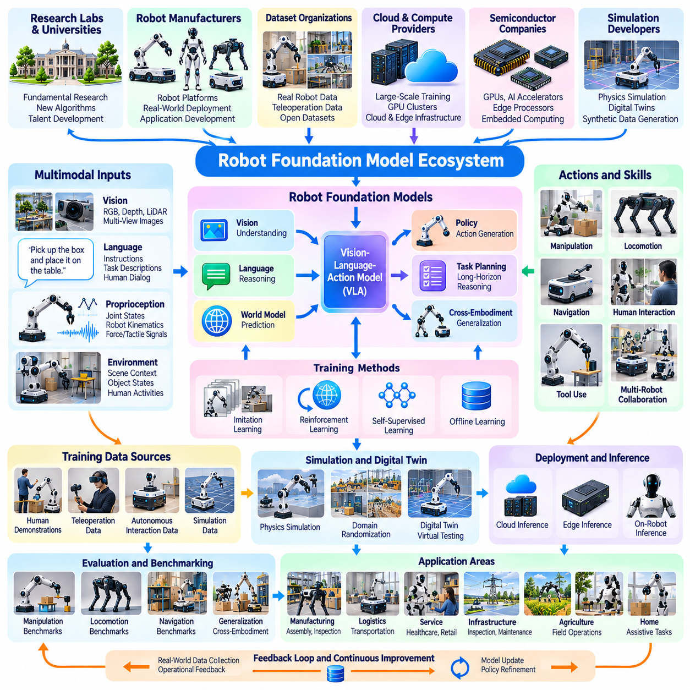{width="7.268055555555556in" height="7.268055555555556in"}

로봇 파운데이션 모델(Robot Foundation Models)은 로봇 작업(Robotic Tasks), 환경(Environments), 신체 구현 형태(Embodiments) 전반에서 재사용 가능한 지능(Reusable Intelligence)을 개발하려는 피지컬 인공지능(Physical AI) 생태계의 새로운 계층이다. 좁게 정의된 작업을 위해 학습되는 기존 시스템(Conventional Systems)과 달리, 파운데이션 모델(Foundation Models)은 다양한 데이터셋(Diverse Datasets)으로부터 일반적인 표현(General Representations)을 학습한다. 이들의 목표는 작업별 프로그래밍(Task-Specific Programming)을 줄이면서 로봇이 변화하는 물리적 환경(Changing Physical Environments)을 인식(Perceive), 추론(Reason), 계획(Plan)하고 행동(Act)할 수 있도록 하는 것이다.

로봇 파운데이션 모델 생태계(Robot Foundation Model Ecosystem)는 AI 연구소(AI Research Laboratories), 로봇 제조업체(Robotics Manufacturers), 클라우드 제공업체(Cloud Providers), 반도체 기업(Semiconductor Companies), 시뮬레이션 개발업체(Simulation Developers), 데이터셋 관련 기관(Dataset Organizations)으로 구성된다. 이들 참여자는 학습 인프라(Training Infrastructure), 로봇 플랫폼(Robotic Platforms), 알고리즘(Algorithms), 평가 방법(Evaluation Methods)을 제공한다. 일반화 가능한 물리적 지능(Generalizable Physical Intelligence)을 개발하려면 상당한 컴퓨팅 자원(Computational Resources)과 다양한 실제 환경 상호작용 데이터(Real-World Interaction Data)가 필요하므로 협력(Collaboration)은 필수적이다.

로봇 파운데이션 모델(Robot Foundation Models)은 대규모 언어 모델(Large Language Models, LLMs), 비전-언어 모델(Vision-Language Models, VLMs), 멀티모달 표현 학습(Multimodal Representation Learning)의 발전을 기반으로 한다. 언어(Language)는 의미론적 이해(Semantic Understanding)와 작업 설명(Task Descriptions)을 제공하고, 시각 정보(Visual Information)는 환경적 맥락(Environmental Context)을 제공한다. 로봇 행동 데이터(Robotic Action Data)는 이러한 표현을 물리적 행동(Physical Behavior)과 연결한다. 이러한 양식(Modality)을 통합하면 시스템이 명령(Instructions)을 해석하고 관측 가능한 물리적 조건(Observable Physical Conditions)에 기반한 행동을 생성할 수 있다.

비전-언어-행동 모델(Vision-Language-Action Models, VLA)은 로봇 행동(Robotic Actions)을 학습 아키텍처(Learning Architectures)에 직접 포함함으로써 멀티모달 지능(Multimodal Intelligence)을 확장한다. 이러한 모델은 카메라 관측(Camera Observations), 자연어 명령(Natural-Language Instructions), 고유수용감각 측정값(Proprioceptive Measurements), 행동 이력(Action Histories)을 처리할 수 있다. 출력은 관절 명령(Joint Commands), 엔드 이펙터 움직임(End-Effector Movements), 중간 행동 목표(Intermediate Action Targets)를 표현할 수 있다. 모델 설계(Model Design)는 로봇 형태(Robot Morphology), 제어 주파수(Control Frequency), 물리적 제약(Physical Constraints)의 차이를 수용해야 한다.

학습 데이터(Training Data)는 로봇 파운데이션 모델 생태계(Robot Foundation Model Ecosystem)의 핵심 자원이다. 데이터셋(Datasets)에는 인간 시연(Human Demonstrations), 원격조작 로봇 궤적(Teleoperated Robot Trajectories), 자율 상호작용 기록(Autonomous Interaction Records), 시뮬레이션 경험(Simulated Experiences)이 포함될 수 있다. 관측값(Observations)은 일반적으로 행동(Actions), 타임스탬프(Timestamps), 작업 정보(Task Information)와 연결된다. 데이터셋 품질(Dataset Quality)은 동기화(Synchronization), 보정(Calibration), 주석 일관성(Annotation Consistency), 행동 다양성(Behavioral Diversity), 기록된 물리적 상호작용의 신뢰성(Reliability of Recorded Physical Interactions)에 달려 있다.

신체 구현 간 학습(Cross-Embodiment Learning)은 하나의 로봇 플랫폼(Robotic Platform)에서 습득한 지식을 다른 플랫폼으로 전이하는 방법을 연구한다. 서로 다른 로봇은 각기 다른 관절 구조(Joint Structures), 그리퍼(Grippers), 센서(Sensors), 행동 공간(Action Spaces)을 가질 수 있다. 공유 표현(Shared Representations)은 특정 하드웨어 구성(Hardware Configurations)에 독립적으로 작업 목표(Task Objectives)와 환경적 관계(Environmental Relationships)를 인코딩할 수 있다. 그러나 학습된 행동(Learned Behavior)을 전이하려면 플랫폼별 운동학(Platform-Specific Kinematics), 동역학(Dynamics), 운영상 한계(Operational Limitations)에 대한 적응이 필요하다.

행동 표현(Action Representation)은 로봇 파운데이션 모델(Robot Foundation Models)의 일반화 능력(Generalization Capabilities)에 큰 영향을 미친다. 정책(Policies)은 저수준 모터 명령(Low-Level Motor Commands), 관절 공간 궤적(Joint-Space Trajectories), 데카르트 좌표계 기반 엔드 이펙터 목표(Cartesian End-Effector Targets), 상위 수준 기술(Higher-Level Skills)을 예측할 수 있다. 각 표현은 정밀도(Precision), 전이 가능성(Transferability), 제어 복잡성(Control Complexity), 계산 비용(Computational Cost) 사이에서 서로 다른 절충관계(Tradeoffs)를 발생시킨다. 계층적 아키텍처(Hierarchical Architectures)는 의미론적 작업 계획(Semantic Task Planning)과 시간 민감형 물리적 실행(Time-Sensitive Physical Execution)을 분리할 수 있다.

모방학습(Imitation Learning)은 시연(Demonstrations)이 성공적인 물리적 행동(Successful Physical Behavior)의 사례를 제공하기 때문에 중요한 학습 접근법으로 남아 있다. 행동 복제(Behavioral Cloning)는 정책(Policies)이 관측된 행동(Observed Actions)을 재현하도록 하며, 더욱 발전된 방법은 멀티모달 행동 분포(Multimodal Action Distributions)와 순차적 의존성(Sequential Dependencies)을 다룬다. 그러나 모방 기반 시스템(Imitation-Based Systems)은 학습 데이터(Training Data)에 존재하지 않는 상태(States)를 마주할 때 어려움을 겪을 수 있다. 상호작용 기반 수정(Interactive Correction)과 추가 경험(Additional Experience)은 강건성(Robustness)을 향상시킬 수 있다.

강화학습(Reinforcement Learning)은 환경과의 상호작용(Environmental Interaction) 및 피드백(Feedback)을 통해 행동을 최적화함으로써 시연 기반 학습(Demonstration-Based Training)을 보완한다. 시뮬레이션 환경(Simulated Environments)은 이동(Locomotion), 조작(Manipulation), 내비게이션(Navigation)을 위한 대규모 경험(Large Volumes of Experience)을 생성할 수 있다. 보상 설계(Reward Design), 탐색(Exploration), 계산 효율(Computational Efficiency)은 학습 결과(Training Outcomes)에 영향을 미친다. 강화학습과 사전학습된 표현(Pretrained Representations)을 결합하면 적응성(Adaptation)을 향상시킬 수 있지만, 학습된 정책(Learned Policies)을 물리 시스템(Physical Systems)에 전이하는 일은 여전히 어렵다.

월드 모델(World Models)은 다양한 행동에 따라 물리적 환경(Physical Environments)이 어떻게 변화하는지에 대한 예측적 표현(Predictive Representations)을 제공한다. 이러한 모델은 미래 관측값(Future Observations), 물체 움직임(Object Movements), 접촉 사건(Contact Events), 로봇 상태(Robot States)를 추정할 수 있다. 예측 능력(Predictive Capabilities)은 계획(Planning), 위험 평가(Risk Assessment), 장기 구간 작업 실행(Long-Horizon Task Execution)을 지원할 수 있다. 실제 효과성(Practical Effectiveness)은 특히 복잡한 접촉 상호작용(Complex Contact Interactions)에서 물리적 일관성(Physical Consistency)을 유지하고 불확실성(Uncertainty)을 표현하는 능력에 달려 있다.

대규모 시뮬레이션(Large-Scale Simulation)은 학습 경험(Training Experiences)의 다양성을 확대함으로써 파운데이션 모델 개발(Foundation Model Development)에서 중요한 역할을 수행한다. 합성 환경(Synthetic Environments)은 물체 형상(Object Geometry), 조명(Lighting), 재질(Materials), 지형(Terrain), 상호작용 조건(Interaction Conditions)을 변화시킬 수 있다. 도메인 무작위화(Domain Randomization)는 개별 연구소가 수집할 수 있는 범위보다 더 넓은 데이터 분포(Broader Distributions)에 모델을 노출하는 데 도움을 준다. 그러나 물리 동역학(Physical Dynamics)과 인간 행동(Human Behavior)을 정확하게 재현하기 어렵기 때문에 시뮬레이션 경험(Simulated Experience)이 실제 환경 데이터(Real-World Data)를 완전히 대체할 수는 없다.

컴퓨팅 인프라(Compute Infrastructure)는 생태계의 또 다른 필수 구성요소이다. 분산 GPU 클러스터(Distributed GPU Clusters)는 대규모 사전학습(Large-Scale Pretraining), 멀티모달 데이터 처리(Multimodal Data Processing), 정책 최적화(Policy Optimization)를 지원한다. 엣지 프로세서(Edge Processors)는 지연시간(Latency)과 전력 제약(Power Constraints)이 중요한 물리적 로봇 가까이에서 추론(Inference)을 실행한다. 따라서 클라우드(Cloud), 온프레미스(On-Premises), 임베디드 컴퓨팅(Embedded Computing) 자원은 모델 개발(Model Development), 배포(Deployment), 지속적인 개선(Continuous Improvement) 전반에서 상호 보완적인 역할을 수행한다.

개방형 연구 이니셔티브(Open Research Initiatives)와 공유 데이터셋(Shared Datasets)은 실험 진입 장벽(Barriers to Experimentation)을 낮춤으로써 발전을 가속화할 수 있다. 공개 모델 체크포인트(Public Model Checkpoints), 표준화된 데이터 형식(Standardized Data Formats), 시뮬레이션 환경(Simulation Environments), 재현 가능한 평가 프로토콜(Reproducible Evaluation Protocols)은 더욱 폭넓은 참여를 가능하게 한다. 그러나 데이터셋 라이선스(Dataset Licensing), 재배포 제한(Redistribution Restrictions), 개인정보 보호 요구사항(Privacy Requirements), 하드웨어 인터페이스(Hardware Interfaces)의 차이는 개방형 협력(Open Collaboration)을 복잡하게 만든다. 책임 있는 재사용(Responsible Reuse)을 위해서는 투명한 문서화(Transparent Documentation)가 필요하다.

상업용 로봇 파운데이션 모델 플랫폼(Commercial Robot Foundation Model Platforms)은 소프트웨어 개발 키트(Software Development Kits, SDKs), 모델 서비스(Model Services), 로봇 통합 프레임워크(Robot Integration Frameworks)를 통해 재사용 가능한 지능(Reusable Intelligence)을 제공하려는 방향으로 발전하고 있다. 잠재적 가치(Potential Value)는 응용 프로그램 개발 시간(Application Development Time)을 줄이고 지원 가능한 작업 범위(Range of Supported Tasks)를 확대하는 데 있다. 그러나 실제 배포(Practical Deployment)를 위해서는 기존 제어기(Existing Controllers), 센서(Sensors), 안전 메커니즘(Safety Mechanisms), 운영 작업 흐름(Operational Workflows)과의 호환성(Compatibility)이 필요하다. 모델 능력(Model Capabilities)만으로 성공적인 산업 시스템 통합(Industrial Integration)이 보장되는 것은 아니다.

평가(Evaluation)는 개별 벤치마크(Isolated Benchmarks)의 성능이 실제 환경(Real Environments)에서의 신뢰성(Reliability)을 예측하지 못할 수 있기 때문에 주요 과제로 남아 있다. 중요한 지표에는 작업 성공률(Task Success), 익숙하지 않은 물체에 대한 일반화(Generalization to Unfamiliar Objects), 오류 회복(Recovery from Errors), 개입 빈도(Intervention Frequency), 실행 효율(Execution Efficiency)이 포함된다. 테스트(Testing)는 환경 변화(Environmental Variation), 신체 구현 형태의 차이(Embodiment Differences), 장기 구간 행동(Long-Horizon Behavior)을 포괄해야 한다. 연구소마다 서로 다른 장비(Equipment)와 절차(Procedures)를 사용하므로 재현 가능한 물리적 평가(Reproducible Physical Evaluation)는 특히 어렵다.

파운데이션 모델(Foundation Models)이 물리적 행동(Physical Actions)을 생성할 때는 안전성(Safety)과 신뢰성(Reliability)에 명시적인 주의가 필요하다. 인식(Perception), 언어 해석(Language Interpretation), 정책 실행(Policy Execution)의 오류는 충돌(Collisions), 불안정한 움직임(Unstable Movements), 의도하지 않은 조작(Unintended Manipulation)을 초래할 수 있다. 안전 아키텍처(Safety Architectures)는 학습된 정책(Learned Policies)을 제약 기반 제어기(Constrained Controllers), 런타임 모니터링(Runtime Monitoring), 독립적인 보호 기능(Independent Protective Functions)과 결합할 수 있다. 검증(Validation)은 불확실성(Uncertainty), 고장 회복(Failure Recovery), 학습 데이터 분포(Training Distribution)를 벗어나는 운영 조건(Operating Conditions)을 다루어야 한다.

데이터 거버넌스(Data Governance)와 모델 수명주기 관리(Model Lifecycle Management)는 로봇 학습 시스템(Robotic Learning Systems)이 확장됨에 따라 점점 더 중요해지고 있다. 조직은 데이터셋 출처(Dataset Provenance), 학습 구성(Training Configurations), 모델 버전(Model Versions), 평가 결과(Evaluation Results), 배포 이력(Deployment Histories)을 추적해야 한다. 지속적인 데이터 수집(Continuous Data Collection)은 변화하는 환경(Changing Environments)에 대한 적응을 지원할 수 있지만, 업데이트(Updates)에는 회귀 테스트(Regression Testing)와 통제된 릴리스 절차(Controlled Release Procedures)가 필요하다. 신뢰할 수 있는 운영(Reliable Operations)은 학습된 행동(Learned Behavior)과 이를 뒷받침하는 근거(Supporting Evidence) 사이의 추적성(Traceability)을 유지하는 데 달려 있다.

로봇 파운데이션 모델 생태계(Robot Foundation Model Ecosystem)의 경제적 구조(Economic Structure)는 상당한 학습 투자(Training Investment)와 반복적인 배포 비용(Recurring Deployment Costs)을 수반한다. 모델 개발업체(Model Developers)는 계산 비용(Computational Expense), 데이터 확보(Data Acquisition), 라이선스(Licensing), 추론 효율(Inference Efficiency), 통합 요구사항(Integration Requirements) 사이의 균형을 조정해야 한다. 로봇 제조업체(Robot Manufacturers)는 독점 지능(Proprietary Intelligence)을 개발하거나 외부 플랫폼(External Platforms)을 도입할 수 있다. 지속 가능한 비즈니스 모델(Sustainable Business Models)은 생산성(Productivity), 적응성(Adaptability), 운영 신뢰성(Operational Reliability)의 입증 가능한 개선에 달려 있다.

미래 개발(Future Development)은 언어 추론(Language Reasoning), 시각적 이해(Visual Understanding), 예측형 월드 모델링(Predictive World Modeling), 물리적 행동 생성(Physical Action Generation)을 결합할 수 있는 통합 모델(Unified Models)에 중점을 둘 수 있다. 신체 구현 간 학습(Cross-Embodiment Learning)의 발전은 모바일 로봇(Mobile Robots), 매니퓰레이터(Manipulators), 휴머노이드(Humanoids), 기타 플랫폼 사이의 지식 공유(Knowledge Sharing)를 가능하게 할 수 있다. 그러나 기계적 능력(Mechanical Capabilities)과 환경적 제약(Environmental Constraints)의 차이로 인해 추가적인 적응(Additional Adaptation) 없이 보편적인 전이(Universal Transfer)를 달성하는 데는 계속 한계가 존재할 것이다.

궁극적으로 로봇 파운데이션 모델 생태계(Robot Foundation Model Ecosystem)는 개별적으로 프로그래밍된 로봇 행동(Individually Programmed Robotic Behaviors)에서 재사용 및 전이가 가능한 물리적 지능(Reusable and Transferable Physical Intelligence)으로의 전환을 보여준다. 이 분야의 발전은 고품질 데이터(High-Quality Data), 확장 가능한 컴퓨팅(Scalable Computing), 강건한 학습 아키텍처(Robust Learning Architectures), 엄격한 실제 환경 검증(Rigorous Real-World Validation)에 달려 있다. 장기적인 성공(Long-Term Success)은 일반화된 모델(Generalized Models)이 다양한 로봇 응용 분야(Diverse Robotic Applications)에서 신뢰할 수 있고(Dependable), 안전하며(Safe), 경제적 가치(Economic Value)가 있는 행동을 제공할 수 있는지에 따라 결정될 것이다.

## 04.09. AI Compute and Edge Platforms

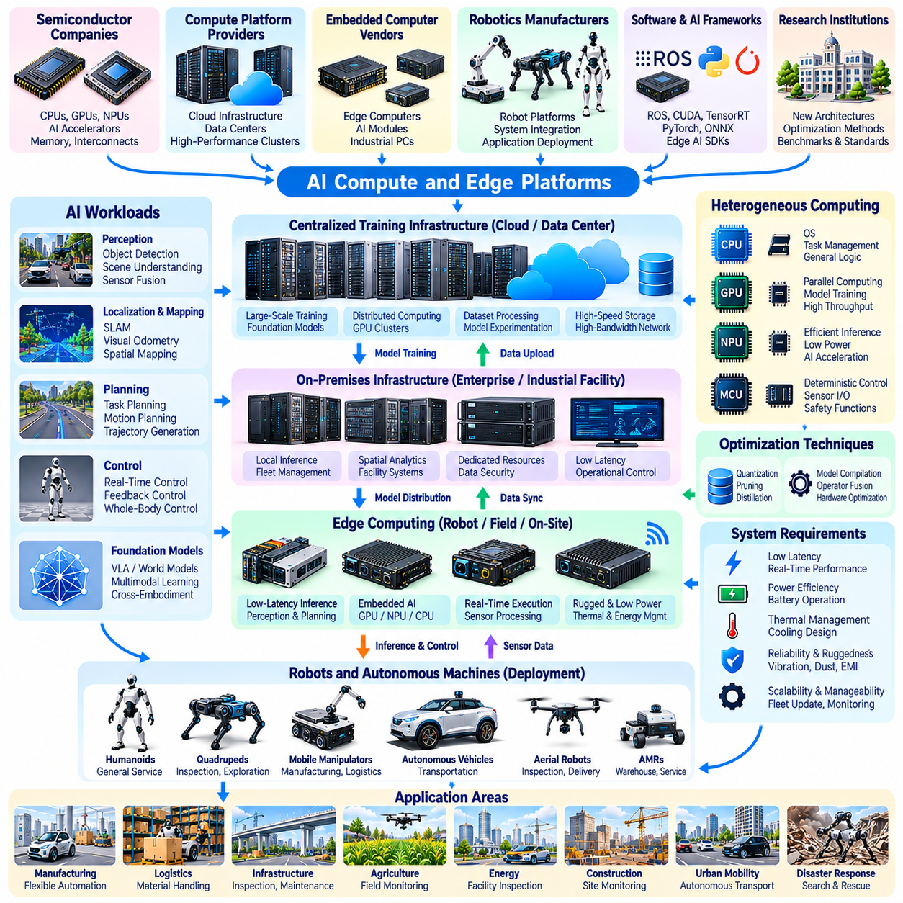{width="7.268055555555556in" height="7.268055555555556in"}

AI 컴퓨팅 및 엣지 플랫폼(AI Compute and Edge Platforms)은 피지컬 인공지능(Physical AI)의 컴퓨팅 기반(Computational Foundation)을 형성하며, 로봇과 자율 기계(Autonomous Machines)가 환경을 인식하고 지능형 정책(Intelligent Policies)을 실행하며 물리적 행동(Physical Actions)을 제어할 수 있도록 한다. 기존 클라우드 애플리케이션(Conventional Cloud Applications)과 달리 피지컬 인공지능 시스템(Physical AI Systems)은 엄격한 지연시간(Latency), 전력(Power), 신뢰성(Reliability) 제약 아래에서 작동해야 하는 경우가 많다. 따라서 이러한 컴퓨팅 아키텍처(Computing Architectures)는 고성능 처리(High-Performance Processing), 임베디드 가속(Embedded Acceleration), 실시간 제어(Real-Time Control), 분산 인프라(Distributed Infrastructure)를 결합한다.

AI 컴퓨팅 생태계(AI Computing Ecosystem)는 반도체 제조업체(Semiconductor Manufacturers), 가속기 개발업체(Accelerator Developers), 임베디드 컴퓨터 공급업체(Embedded Computer Vendors), 클라우드 제공업체(Cloud Providers), 로봇 기업(Robotics Companies), 소프트웨어 프레임워크 관련 기관(Software Framework Organizations)으로 구성된다. 이들 참여자는 프로세서(Processors), 개발 도구(Development Tools), 통신 기술(Communication Technologies), 배포 플랫폼(Deployment Platforms)을 공급한다. 산업 경쟁(Industry Competition)은 점차 계산 처리량(Computational Throughput)뿐만 아니라 에너지 효율(Energy Efficiency), 소프트웨어 호환성(Software Compatibility), 시스템 통합(System Integration), 장기 운영 지원(Long-Term Operational Support)까지 포함하는 방향으로 확대되고 있다.

중앙집중형 AI 인프라(Centralized AI Infrastructure)는 대규모 인식 모델(Large Perception Models), 로봇 파운데이션 모델(Robot Foundation Models), 예측형 월드 모델(Predictive World Models)의 학습에 필요한 계산 능력(Computational Capacity)을 제공한다. GPU 클러스터(GPU Clusters)와 특수 가속기(Specialized Accelerators)는 방대한 데이터셋(Extensive Datasets)을 대상으로 분산 학습 작업(Distributed Learning Workloads)을 실행한다. 고대역폭 상호연결(High-Bandwidth Interconnects)과 스토리지 시스템(Storage Systems)은 효율적인 데이터 이동(Data Movement)을 지원한다. 학습 성능(Training Performance)은 메모리 용량(Memory Capacity), 통신 오버헤드(Communication Overhead), 수치 정밀도(Numerical Precision), 작업 부하 병렬화(Workload Parallelization)에 달려 있다.

클라우드 컴퓨팅(Cloud Computing)은 조직이 모든 학습 인프라(Training Infrastructure)를 자체적으로 유지하지 않고도 확장 가능한 자원(Scalable Resources)에 접근할 수 있도록 한다. 클라우드 플랫폼(Cloud Platforms)은 데이터셋 처리(Dataset Processing), 모델 실험(Model Experimentation), 분산 최적화(Distributed Optimization), 협업 개발(Collaborative Development)을 지원한다. 그러나 반복적으로 발생하는 컴퓨팅 비용(Recurring Computing Costs), 네트워크 의존성(Network Dependencies), 데이터 거버넌스 요구사항(Data Governance Requirements), 지식재산권 문제(Intellectual Property Concerns)는 배포 결정(Deployment Decisions)에 영향을 미친다. 하이브리드 아키텍처(Hybrid Architectures)는 유연성(Flexibility)과 조직의 통제권(Organizational Control) 사이의 균형을 제공할 수 있다.

온프레미스 컴퓨팅(On-Premises Computing)은 로컬 데이터 처리(Local Data Processing), 예측 가능한 자원 가용성(Predictable Resource Availability), 운영 독립성(Operational Independence)이 필요한 조직에 전용 인프라(Dedicated Infrastructure)를 제공한다. 산업 시설(Industrial Facilities)은 모델 추론(Model Inference), 플릿 협업(Fleet Coordination), 공간 분석(Spatial Analytics), 집단적 의사결정 지원(Collective Decision Support)을 위해 AI 서버(AI Servers)를 배포할 수 있다. 로컬 인프라(Local Infrastructure)는 외부 네트워크 의존성(External Network Dependencies)을 줄일 수 있지만, 설치(Installation), 냉각(Cooling), 유지보수(Maintenance), 용량 계획(Capacity Planning)은 여전히 중요한 고려사항이다.

엣지 컴퓨팅(Edge Computing)은 센서(Sensors), 로봇(Robots), 물리적 프로세스(Physical Processes) 가까이에 컴퓨팅 자원(Computational Resources)을 배치한다. 엣지 플랫폼(Edge Platforms)은 통신 지연(Communication Delays)을 줄이면서 인식(Perception), 위치 추정(Localization), 계획(Planning), 추론(Inference)을 실행한다. 이러한 근접성(Proximity)은 변화하는 환경 조건(Changing Environmental Conditions)에 즉각적으로 대응해야 하는 응용 분야를 지원한다. 엣지 배포(Edge Deployment)는 대용량 센서 스트림(High-Volume Sensor Streams)을 지속적으로 전송할 필요성도 줄여 대역폭 효율(Bandwidth Efficiency)과 데이터 통제(Data Control)를 개선할 수 있다.

임베디드 AI 플랫폼(Embedded AI Platforms)은 CPU, GPU, 신경망 처리 장치(Neural Processing Units, NPUs), 전용 가속기(Dedicated Accelerators)를 소형 컴퓨팅 모듈(Compact Computing Modules)에 통합한다. 이러한 장치는 신경망 추론(Neural Network Inference), 센서 융합(Sensor Fusion), 영상 처리(Image Processing), 자율 내비게이션(Autonomous Navigation)을 지원한다. 하드웨어 선택(Hardware Selection)은 계산 성능(Computational Performance), 메모리 대역폭(Memory Bandwidth), 전력 소비(Power Consumption), 열적 한계(Thermal Limits), 지원되는 소프트웨어 환경(Supported Software Environments)에 달려 있다. 물리적 크기(Physical Dimensions)와 환경 내구성(Environmental Durability) 역시 시스템 통합(System Integration)에 영향을 미친다.

이기종 컴퓨팅 아키텍처(Heterogeneous Computing Architectures)는 각 처리 장치(Processing Units)의 특성에 따라 작업 부하(Workloads)를 분산한다. CPU는 일반적으로 운영체제(Operating Systems), 작업 조정(Task Coordination), 범용 논리(General-Purpose Logic)를 처리하고, GPU는 병렬 수치 계산(Parallel Numerical Computation)을 가속한다. 신경망 가속기(Neural Accelerators)는 최적화된 추론 작업(Optimized Inference Workloads)을 실행하며, 마이크로컨트롤러(Microcontrollers)는 결정론적 저수준 기능(Deterministic Low-Level Functions)을 관리한다. 효과적인 스케줄링(Effective Scheduling)과 데이터 교환(Data Exchange)은 전체 성능(Overall Performance)을 확보하는 데 필수적이다.

실시간 요구사항(Real-Time Requirements)은 피지컬 인공지능 컴퓨팅(Physical AI Computing)을 많은 기존 AI 애플리케이션(Conventional AI Applications)과 구별하는 특징이다. 인식 및 계획 파이프라인(Perception and Planning Pipelines)은 로봇 동역학(Robot Dynamics)과 운영 조건(Operating Conditions)에 의해 결정되는 마감시간(Deadlines) 내에 결과를 제공해야 한다. 과도한 지연시간(Excessive Latency)이나 예측할 수 없는 실행시간(Unpredictable Execution Times)은 제어 품질(Control Quality)과 안전성(Safety)을 저하시킬 수 있다. 따라서 시스템 설계자(System Designers)는 최악 조건 응답시간(Worst-Case Response Times), 스케줄링 동작(Scheduling Behavior), 통신 지연(Communication Delays), 종단 간 처리 일관성(End-to-End Processing Consistency)을 평가한다.

AI 추론 최적화(AI Inference Optimization)는 복잡한 모델(Complex Models)이 제한된 엣지 자원(Limited Edge Resources) 내에서 작동할 수 있도록 한다. 양자화(Quantization), 가지치기(Pruning), 지식 증류(Knowledge Distillation), 연산자 융합(Operator Fusion), 하드웨어 특화 컴파일(Hardware-Specific Compilation)은 계산 요구량(Computational Requirements)을 줄일 수 있다. 이러한 기술은 정확도(Accuracy), 지연시간(Latency), 메모리 소비(Memory Consumption), 개발 복잡성(Development Complexity) 사이에서 절충관계(Tradeoffs)를 발생시킨다. 벤치마크 처리량(Benchmark Throughput)만으로 실제 운영 성능(Operational Performance)을 충분히 반영하지 못할 수 있으므로 최적화 결과는 대표적인 작업 부하(Representative Workloads)를 기준으로 검증해야 한다.

메모리 아키텍처(Memory Architecture)는 멀티모달 모델(Multimodal Models)과 파운데이션 모델(Foundation Models)을 배포하는 데 중요한 요소이다. 시각 관측값(Visual Observations), 시간적 이력(Temporal Histories), 모델 매개변수(Model Parameters), 중간 활성화 값(Intermediate Activations)은 상당한 메모리 용량(Memory Capacity)과 대역폭(Bandwidth)을 요구할 수 있다. 효율적인 버퍼링(Efficient Buffering), 메모리 공유(Memory Sharing), 데이터 이동(Data Movement)은 달성 가능한 추론 속도(Achievable Inference Speed)에 영향을 미친다. 시스템은 인식(Perception), 지도 작성(Mapping), 계획(Planning), 통신(Communication)을 포함한 동시 작업 부하(Concurrent Workloads)도 고려해야 한다.

열 관리(Thermal Management)와 전력 효율(Power Efficiency)은 임베디드 배포(Embedded Deployment)에 큰 영향을 미친다. 로봇은 제한된 배터리 용량(Finite Battery Capacity), 협소한 냉각 공간(Restricted Cooling Space), 변화하는 환경 온도(Changing Environmental Temperatures) 조건에서 작동한다. 지속적인 AI 연산(Sustained AI Computation)은 열 스로틀링(Thermal Throttling)을 발생시켜 예측 가능한 성능(Predictable Performance)을 저하시킬 수 있다. 설계자는 예상 운영 조건(Expected Operating Conditions) 전반에서 처리 능력(Processing Capability), 에너지 예산(Energy Budgets), 냉각 방식(Cooling Methods), 인클로저 설계(Enclosure Design), 기계적 신뢰성(Mechanical Reliability) 사이의 균형을 조정해야 한다.

산업용 엣지 컴퓨터(Industrial Edge Computers)는 일반적인 사무용 컴퓨팅 장비(Conventional Office Computing Equipment)보다 높은 수준의 환경 내구성(Environmental Resilience)을 요구하는 경우가 많다. 배포 환경(Deployment Conditions)에는 진동(Vibration), 먼지(Dust), 전자기 간섭(Electromagnetic Interference), 온도 변화(Temperature Variation), 제한된 유지보수 접근성(Limited Maintenance Access)이 포함될 수 있다. 산업용 강화 플랫폼(Ruggedized Platforms)은 보호형 커넥터(Protected Connectors), 산업용 통신 인터페이스(Industrial Communication Interfaces), 특수 냉각 구조(Specialized Cooling Arrangements)를 포함할 수 있다. 하드웨어 신뢰성(Hardware Reliability)은 계산 사양(Computational Specifications)과 함께 평가되어야 한다.

분산 피지컬 인공지능 아키텍처(Distributed Physical AI Architectures)는 로봇 수준의 지능(Robot-Level Intelligence)을 인근 엣지 노드(Nearby Edge Nodes) 및 온프레미스 인프라(On-Premises Infrastructure)와 연결한다. 개별 로봇(Individual Robots)은 필수 동작 제어(Essential Motion Control)와 안전 기능(Safety Functions)을 유지하며, 공유 컴퓨팅 자원(Shared Computing Resources)은 공간 인식(Spatial Perception), 작업 할당(Task Allocation), 협업(Coordination)을 지원할 수 있다. 클라우드 시스템(Cloud Systems)은 더욱 광범위한 분석(Analytics)과 모델 개발(Model Development) 기능을 제공한다. 기능 분할(Functional Partitioning)은 통신 신뢰성(Communication Reliability), 지연시간 예산(Latency Budgets), 고장 발생 시 결과(Failure Consequences)를 반영해야 한다.

네트워킹 기술(Networking Technologies)은 센서(Sensors), 로봇(Robots), 엣지 서버(Edge Servers), 중앙집중형 인프라(Centralized Infrastructure) 사이의 데이터 교환(Data Exchange)을 가능하게 한다. 이더넷(Ethernet), 산업용 네트워크(Industrial Networks), 무선 통신(Wireless Communication), 시간 민감형 네트워킹(Time-Sensitive Networking, TSN)은 서로 다른 운영 요구사항(Operational Requirements)을 지원할 수 있다. 대역폭(Bandwidth), 동기화(Synchronization), 패킷 손실(Packet Loss), 통신 지터(Communication Jitter)는 분산 시스템 성능(Distributed Performance)에 영향을 미친다. 연결 상태(Connectivity)가 저하되거나 사용할 수 없게 되더라도 핵심 기능(Critical Functions)은 적절한 로컬 자율성(Local Autonomy)을 유지해야 한다.

소프트웨어 생태계(Software Ecosystems)는 AI 하드웨어(AI Hardware)의 실질적인 도입에 필수적이다. 로봇 미들웨어(Robotics Middleware), 추론 런타임(Inference Runtimes), 가속기 라이브러리(Accelerator Libraries), 운영체제(Operating Systems), 컨테이너 기술(Container Technologies)은 개발 및 배포(Development and Deployment)에 필요한 인터페이스(Interfaces)를 제공한다. 하드웨어 드라이버(Hardware Drivers), 모델 형식(Model Formats), 애플리케이션 프레임워크(Application Frameworks) 사이의 호환성(Compatibility)은 통합 비용(Integration Costs)에 영향을 미친다. 장기 유지관리성(Long-Term Maintainability)을 위해서는 버전 관리(Version Management), 보안 업데이트(Security Updates), 재현 가능한 소프트웨어 환경(Reproducible Software Environments)이 필요하다.

보안(Security)과 운영 거버넌스(Operational Governance)는 컴퓨팅 인프라(Computing Infrastructure) 전반에 적용되어야 한다. 엣지 장치(Edge Devices)는 민감한 센서 데이터(Sensitive Sensor Data)를 처리하고 물리적 장비(Physical Equipment)에 영향을 미치는 명령을 발행할 수 있다. 보안 부팅(Secure Boot), 인증된 업데이트(Authenticated Updates), 접근 제어(Access Controls), 네트워크 분할(Network Segmentation), 런타임 모니터링(Runtime Monitoring)은 사이버-물리적 위험(Cyber-Physical Risks)을 줄이는 데 도움을 준다. 조직은 분산 자율 시스템(Distributed Autonomous Systems)에 적합한 자산 목록(Asset Inventories), 취약점 관리(Vulnerability Management), 복구 절차(Recovery Procedures)도 갖추어야 한다.

AI 컴퓨팅 플랫폼(AI Computing Platforms)의 평가는 이론적 처리 성능(Theoretical Processing Performance)을 비교하는 것 이상을 요구한다. 관련 지표에는 애플리케이션 지연시간(Application Latency), 지속 처리량(Sustained Throughput), 전력 효율(Power Efficiency), 메모리 활용률(Memory Utilization), 열적 안정성(Thermal Stability), 신뢰성(Reliability), 총소유비용(Total Cost of Ownership, TCO)이 포함된다. 벤치마크 결과(Benchmark Results)는 실제 모델 아키텍처(Actual Model Architectures)와 동시 작업 부하(Concurrent Workloads)를 반영해야 한다. 통합 노력(Integration Effort), 소프트웨어 성숙도(Software Maturity), 부품 가용성(Component Availability) 역시 플랫폼 선택(Platform Selection)에 영향을 미친다.

미래의 AI 컴퓨팅 플랫폼(Future AI Compute Platforms)은 멀티모달 인식(Multimodal Perception), 예측형 월드 모델링(Predictive World Modeling), 대규모 로봇 정책 실행(Large-Scale Robotic Policy Execution)을 점점 더 폭넓게 지원할 것이다. 가속기 아키텍처(Accelerator Architectures), 메모리 시스템(Memory Systems), 상호연결 기술(Interconnects), 모델 압축(Model Compression)의 발전은 와트당 성능(Performance per Watt)을 개선할 수 있다. 분산 추론(Distributed Inference)은 로봇과 공유 인프라(Shared Infrastructure) 사이의 더욱 긴밀한 협력을 가능하게 할 수 있다. 그러나 결정론적 제어(Deterministic Control), 사이버보안(Cybersecurity), 에너지 제약(Energy Limitations)은 계속해서 핵심 공학적 고려사항(Central Engineering Concerns)으로 남을 것이다.

궁극적으로 AI 컴퓨팅 및 엣지 플랫폼(AI Compute and Edge Platforms)은 학습된 지능(Learned Intelligence)이 얼마나 효과적으로 신뢰할 수 있는 물리적 행동(Reliable Physical Behavior)으로 전환되는지를 결정한다. 성공적인 아키텍처(Successful Architectures)는 중앙집중형 학습 능력(Centralized Training Capacity), 공유 로컬 지능(Shared Local Intelligence), 신뢰할 수 있는 온보드 실행(Dependable Onboard Execution)을 결합한다. 장기적인 가치(Long-Term Value)는 다양한 피지컬 인공지능 응용 분야(Diverse Physical AI Applications)에서 계산 능력(Computational Capability), 지연시간(Latency), 에너지 효율(Energy Efficiency), 안전성(Safety), 유지관리성(Maintainability), 확장 가능한 배포(Scalable Deployment) 사이의 균형을 달성하는 데 달려 있다.

## 04.10. Simulation Data and Development Ecosystem

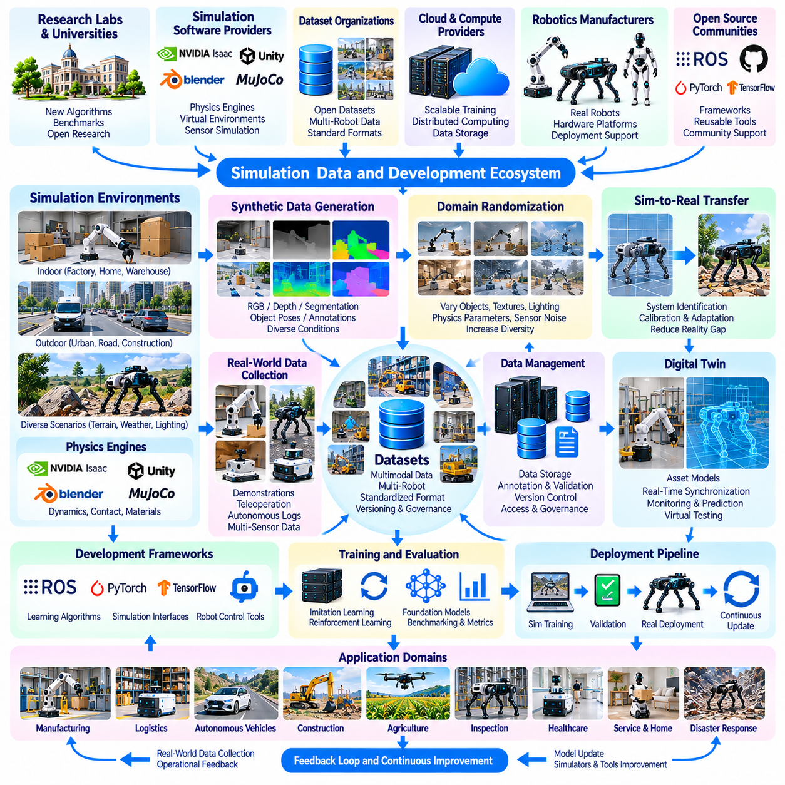{width="7.268055555555556in" height="7.268055555555556in"}

시뮬레이션(Simulation), 데이터(Data), 개발 인프라(Development Infrastructure)는 지능형 기계(Intelligent Machines)가 실제 배포(Deployment) 이전에 학습하고 실험하며 성능을 개선할 수 있도록 지원함으로써 피지컬 인공지능(Physical AI) 생태계의 핵심 기반을 형성한다. 물리적 로봇(Physical Robots)은 기계적 제약(Mechanical Constraints)과 환경적 불확실성(Environmental Uncertainty) 아래에서 작동하므로 직접적인 실험(Direct Experimentation)에는 높은 비용이 발생하고 잠재적인 위험이 수반될 수 있다. 시뮬레이션 플랫폼(Simulation Platforms), 구조화된 데이터셋(Structured Datasets), 통합 개발 도구(Integrated Development Tools)는 이러한 장벽을 낮추면서 체계적인 엔지니어링(Systematic Engineering)과 검증(Validation)을 지원한다.

개발 생태계(Development Ecosystem)는 로봇 연구소(Robotics Laboratories), 시뮬레이션 소프트웨어 제공업체(Simulation Software Providers), 데이터셋 관련 기관(Dataset Organizations), 클라우드 인프라 기업(Cloud Infrastructure Companies), 하드웨어 제조업체(Hardware Manufacturers), 오픈소스 커뮤니티(Open-Source Communities)로 구성된다. 이러한 참여자들은 물리 엔진(Physics Engines), 디지털 환경(Digital Environments), 로봇 인터페이스(Robotic Interfaces), 학습 프레임워크(Learning Frameworks), 평가 도구(Evaluation Tools)를 제공한다. 이들의 결합된 역량(Combined Capabilities)은 연구 시제품(Research Prototypes)이 신뢰할 수 있고 상업적으로 배포 가능한 피지컬 인공지능 시스템(Commercially Deployable Physical AI Systems)으로 얼마나 효율적으로 발전할 수 있는지를 결정한다.

로봇 시뮬레이션(Robotics Simulation)은 운동(Motion), 힘(Forces), 충돌(Collisions), 센서 동작(Sensor Behavior)에 대한 수학적 모델(Mathematical Models)을 통해 물리적 환경(Physical Environments)의 특정 측면을 재현한다. 물리 엔진(Physics Engines)은 강체(Rigid Bodies), 관절형 메커니즘(Articulated Mechanisms), 주변 물체(Surrounding Objects) 사이의 상호작용을 계산한다. 시뮬레이션 정확도(Simulation Accuracy)는 접촉 모델링(Contact Modeling), 수치 적분(Numerical Integration), 재료 특성(Material Properties), 액추에이터 표현(Actuator Representations)에 달려 있다. 어떠한 시뮬레이터(Simulator)도 실제 운영(Real-World Operation)에서 발생하는 모든 물리 현상(Physical Phenomena)을 완벽하게 재현하지는 못한다.

시뮬레이션 환경(Simulation Environments)은 기계 설계(Mechanical Design), 제어공학(Control Engineering), 인식 모델 학습(Perception Training), 시스템 통합(System Integration)을 포함한 로봇 개발(Robot Development)의 여러 단계를 지원한다. 엔지니어(Engineers)는 고가의 시제품(Expensive Prototypes)을 제작하기 전에 대안적인 구성(Alternative Configurations)을 시험할 수 있다. 가상 실험(Virtual Experiments)은 반복 가능한 조건(Repeatable Conditions)에서 알고리즘(Algorithms)을 통제된 방식으로 비교할 수 있도록 한다. 이러한 접근법은 하드웨어 마모(Hardware Wear), 운영 중단(Operational Disruption), 초기 개발 단계 테스트(Early-Stage Testing)에 수반되는 위험을 줄이면서 반복 개발(Iteration)을 가속한다.

디지털 트윈(Digital Twins)은 물리적 자산(Physical Assets), 운영 조건(Operating Conditions), 시스템 동작(System Behavior)에 대한 구조화된 표현(Structured Representations)을 유지함으로써 시뮬레이션(Simulation)을 확장한다. 디지털 트윈은 기하학적 형상(Geometry), 장비 구성(Equipment Configuration), 센서 측정값(Sensor Measurements), 과거 운영 데이터(Historical Operational Data)를 포함할 수 있다. 물리 시스템(Physical Systems)과의 연결은 모니터링(Monitoring)과 예측 분석(Predictive Analysis)을 가능하게 한다. 그러나 디지털 트윈의 정확도(Accuracy)와 유용성(Usefulness)은 모델 유지관리(Model Maintenance), 데이터 동기화(Data Synchronization), 명확하게 정의된 운영 목표(Operational Objectives)에 달려 있다.

합성 데이터 생성(Synthetic Data Generation)은 인식(Perception)과 로봇 학습(Robotic Learning)을 위한 확장 가능한 학습 자원(Scalable Training Resources)을 제공한다. 가상 환경(Virtual Environments)은 주석이 포함된 영상(Annotated Images), 깊이 지도(Depth Maps), 분할 마스크(Segmentation Masks), 물체 자세(Object Poses), 시뮬레이션 센서 측정값(Simulated Sensor Measurements)을 생성할 수 있다. 개발자는 조명(Lighting), 물체 배치(Object Arrangements), 재질(Materials), 카메라 시점(Camera Viewpoints)을 변화시켜 데이터 다양성(Data Diversity)을 높일 수 있다. 합성 데이터셋(Synthetic Datasets)은 실제 환경 데이터에 대한 주석 작업(Real-World Annotation)에 많은 비용이 들거나 드문 시나리오(Rare Scenarios)를 수집하기 어려운 경우 특히 유용하다.

도메인 무작위화(Domain Randomization)는 학습 중 매개변수(Parameters)를 변화시켜 시뮬레이션 환경(Simulated Environments)에서 물리적 로봇(Physical Robots)으로의 전이(Transfer)를 개선하는 데 도움을 준다. 이러한 변화에는 마찰(Friction), 질량(Mass), 조명(Illumination), 액추에이터 응답(Actuator Response), 센서 잡음(Sensor Noise), 물체 형상(Object Geometry)이 포함될 수 있다. 다양한 조건(Diverse Conditions)에 노출된 모델(Models)은 특정 시뮬레이션 가정(Simulation Assumptions)에 대한 의존도가 낮아질 수 있다. 그러나 중요한 물리적 효과(Physical Effects)가 누락되거나 부정확하게 표현된 경우 무작위화(Randomization)만으로 신뢰할 수 있는 전이(Reliable Transfer)를 보장할 수는 없다.

시뮬레이션에서 현실로의 전이(Sim-to-Real Transfer)는 시뮬레이션된 동역학(Simulated Dynamics)과 관측값(Observations)이 실제 운영 조건(Real Operating Conditions)과 다르기 때문에 여전히 핵심 과제로 남아 있다. 접촉력(Contact Forces), 재료 변형(Material Deformation), 센서 보정(Sensor Calibration), 통신 타이밍(Communication Timing)의 오차는 학습된 행동(Learned Behavior)의 성능을 저하시킬 수 있다. 시스템 식별(System Identification)과 실제 환경 보정(Real-World Calibration)은 이러한 차이를 줄이는 데 도움을 준다. 성공적인 전이(Successful Transfer)를 위해서는 시뮬레이션 성능(Simulation Performance)에만 의존하지 않고 대표적인 물리적 조건(Representative Physical Conditions)에서 테스트해야 한다.

실제 로봇 데이터셋(Real-World Robotic Datasets)은 시뮬레이션(Simulation)이 완전히 재현할 수 없는 물리적 상호작용(Physical Interactions)에 관한 근거를 제공한다. 데이터에는 카메라 스트림(Camera Streams), 라이다 측정값(LiDAR Measurements), 관절 상태(Joint States), 힘 신호(Force Signals), 내비게이션 궤적(Navigation Trajectories), 작업자 시연(Operator Demonstrations)이 포함될 수 있다. 시간적 동기화(Temporal Synchronization)와 일관된 좌표계(Consistent Coordinate Frames)는 멀티모달 학습(Multimodal Learning)에 필수적이다. 데이터셋 신뢰성(Dataset Reliability)은 보정 기록(Calibration Records), 작업 정의(Task Definitions), 환경적 맥락(Environmental Context), 문서화 품질(Documentation Quality)에도 달려 있다.

대규모 데이터셋 생태계(Large-Scale Dataset Ecosystems)는 서로 다른 로봇(Robots), 연구소(Laboratories), 운영 환경(Operating Environments)에서 수집한 정보를 점점 더 많이 결합하고 있다. 공유 데이터 형식(Shared Data Formats)과 표준화된 작업 설명(Standardized Task Descriptions)은 플랫폼 간 학습(Cross-Platform Learning)과 더욱 폭넓은 모델 일반화(Model Generalization)를 지원할 수 있다. 그러나 센서 구성(Sensor Configurations), 행동 공간(Action Spaces), 제어 주파수(Control Frequencies), 하드웨어 능력(Hardware Capabilities)의 차이는 통합(Integration)을 복잡하게 만든다. 데이터 조화(Data Harmonization)는 단순히 파일 구조(File Structures)를 표준화하는 데 그치지 않고 의미 있는 물리적 관계(Meaningful Physical Relationships)를 보존해야 한다.

데이터 수집 인프라(Data Collection Infrastructure)는 물리적 로봇(Physical Robots)을 스토리지(Storage), 주석 작업(Annotation), 모델 학습 파이프라인(Model Training Pipelines)과 연결한다. 로깅 시스템(Logging Systems)은 실험(Experiments)이나 배포(Deployment) 과정에서 관측값(Observations), 행동(Actions), 시스템 이벤트(System Events), 실행 결과(Execution Outcomes)를 기록한다. 자동화된 검증(Automated Validation)은 누락된 타임스탬프(Missing Timestamps), 손상된 측정값(Corrupted Measurements), 일관되지 않은 메타데이터(Inconsistent Metadata)를 식별할 수 있다. 효과적인 데이터 관리(Effective Data Management)를 위해서는 버전 관리(Version Control), 출처 추적(Provenance Tracking), 접근 정책(Access Policies), 재현 가능한 전처리 절차(Reproducible Preprocessing Procedures)도 필요하다.

로봇 학습 프레임워크(Robot Learning Frameworks)는 모방학습(Imitation Learning), 강화학습(Reinforcement Learning), 인식 모델 학습(Perception Training), 정책 평가(Policy Evaluation)를 위한 재사용 가능한 구성요소(Reusable Components)를 제공한다. 이러한 프레임워크는 데이터셋(Datasets), 시뮬레이션 환경(Simulation Environments), 신경망 라이브러리(Neural Network Libraries), 로봇 인터페이스(Robot Interfaces)를 연결한다. 모듈형 개발(Modular Development)은 중복되는 엔지니어링 작업(Duplicated Engineering Effort)을 줄이고 통제된 실험(Controlled Experimentation)을 지원한다. 학습된 정책(Trained Policies)을 운영 시스템(Operational Systems)에 전이할 때는 학습 소프트웨어(Learning Software)와 물리적 제어기(Physical Controllers) 사이의 호환성(Compatibility)이 필수적이다.

개발 작업 흐름(Development Workflows)은 지속적 통합(Continuous Integration, CI), 자동화된 테스트(Automated Testing), 재현 가능한 배포 관행(Reproducible Deployment Practices)을 점점 더 많이 도입하고 있다. 소프트웨어 변경(Software Changes)은 단위 테스트(Unit Tests), 시뮬레이션 시나리오(Simulation Scenarios), 회귀 평가(Regression Evaluations), 하드웨어 인 더 루프 실험(Hardware-in-the-Loop Experiments)을 자동으로 실행하도록 할 수 있다. 이러한 프로세스는 현장 배포(Field Deployment) 이전에 의도하지 않은 행동 변화(Unintended Behavioral Changes)를 탐지하는 데 도움을 준다. 그러나 자동화된 테스트(Automated Testing)는 현실적인 고장 조건(Realistic Failure Conditions)을 포함해야 하며, 포괄적인 물리적 검증(Comprehensive Physical Validation)을 대체할 수는 없다.

벤치마킹(Benchmarking)은 로봇 알고리즘(Robotic Algorithms)과 시스템 능력(System Capabilities)을 비교하기 위한 공통 기준점(Common Reference Points)을 제공한다. 평가 환경(Evaluation Environments)은 내비게이션 성공률(Navigation Success), 조작 작업 완료(Manipulation Completion), 충돌 빈도(Collision Frequency), 에너지 소비(Energy Consumption), 회복 성능(Recovery Performance)을 측정할 수 있다. 표준화된 벤치마크(Standardized Benchmarks)는 재현성(Reproducibility)과 과학적 비교(Scientific Comparison)를 지원한다. 그러나 우수한 벤치마크 성능(Strong Benchmark Performance)이 익숙하지 않은 환경(Unfamiliar Environments), 하드웨어 플랫폼(Hardware Platforms), 장시간 임무(Long-Duration Missions) 전반에서의 신뢰성(Reliability)을 반드시 입증하는 것은 아니다.

시나리오 생성(Scenario Generation)은 다양한 환경 조건(Environmental Conditions)과 운영 외란(Operational Disturbances)을 만들어 고정된 벤치마크 작업(Fixed Benchmark Tasks)을 넘어 평가 범위를 확장한다. 개발자는 이동 장애물(Moving Obstacles), 센서 고장(Sensor Failures), 예상하지 못한 접촉(Unexpected Contacts), 통신 중단(Communication Interruptions)을 도입할 수 있다. 발생 빈도는 낮지만 결과가 중대한 사건(Rare but Consequential Events)은 안전 필수 시스템(Safety-Critical Systems)에서 특히 주의해야 한다. 시나리오 커버리지(Scenario Coverage)는 무작위 변화(Random Variation)에만 의존하지 않고 식별된 위험요소(Identified Hazards)와 운영 요구사항(Operating Requirements)을 반영해야 한다.

클라우드 및 온프레미스 인프라(Cloud and On-Premises Infrastructure)는 대규모 시뮬레이션(Large-Scale Simulation), 데이터셋 처리(Dataset Processing), 분산 모델 학습(Distributed Model Training)을 지원한다. GPU 클러스터(GPU Clusters)는 병렬 시뮬레이션 인스턴스(Parallel Simulation Instances)를 실행하고 학습 작업 부하(Learning Workloads)를 가속할 수 있다. 로컬 컴퓨팅 자원(Local Computing Resources)은 민감한 데이터(Sensitive Data)와 특수 하드웨어 인터페이스(Specialized Hardware Interfaces)에 대한 더 높은 수준의 통제권을 제공할 수 있다. 하이브리드 개발 아키텍처(Hybrid Development Architectures)는 확장성(Scalability), 비용(Cost), 데이터 거버넌스(Data Governance), 로봇 실험(Robotic Experimentation)의 실제 요구사항 사이에서 균형을 조정한다.

오픈소스 소프트웨어(Open-Source Software)와 협력 연구 커뮤니티(Collaborative Research Communities)는 공유 도구(Shared Tools), 데이터셋(Datasets), 재현 가능한 구현(Reproducible Implementations)을 통해 생태계 발전(Ecosystem Development)을 가속한다. 공통 미들웨어(Common Middleware)와 시뮬레이션 인터페이스(Simulation Interfaces)는 연구 그룹(Research Groups)과 제조업체(Manufacturers) 사이의 통합 장벽(Integration Barriers)을 낮출 수 있다. 그러나 소프트웨어 의존성(Software Dependencies), 라이선스 제한(Licensing Restrictions), 하드웨어 호환성(Hardware Compatibility), 유지보수 책임(Maintenance Responsibilities)은 신중하게 관리해야 한다. 지속 가능한 협력(Sustainable Collaboration)은 투명한 문서화(Transparent Documentation)와 신뢰할 수 있는 프로젝트 거버넌스(Reliable Project Governance)에 달려 있다.

안전성(Safety), 보안(Security), 데이터 거버넌스(Data Governance)는 개발 수명주기(Development Lifecycle) 전반에 통합되어야 한다. 시뮬레이션 자산(Simulation Assets)과 데이터셋(Datasets)에는 독점적인 시설 정보(Proprietary Facility Information), 개인 관련 관측 정보(Personal Observations), 민감한 운영 기록(Sensitive Operational Records)이 포함될 수 있다. 접근 제어(Access Controls), 라이선스 준수(Licensing Compliance), 안전한 스토리지(Secure Storage)는 이러한 자원을 보호한다. 안전성 검증(Safety Validation)은 시뮬레이션 근거(Simulated Evidence)와 물리적 테스트 결과(Physical Test Results)를 구별하고, 요구사항(Requirements), 실험(Experiments), 배포 결정(Deployment Decisions) 사이의 추적성(Traceability)을 유지해야 한다.

상업용 개발 플랫폼(Commercial Development Platforms)은 시뮬레이션 현실성(Simulation Realism)이나 데이터셋 규모(Dataset Volume) 이상의 기준으로 평가된다. 중요한 고려사항에는 통합 노력(Integration Effort), 계산 비용(Computational Cost), 지원되는 로봇 아키텍처(Supported Robot Architectures), 개발 생산성(Development Productivity), 장기 유지관리성(Long-Term Maintainability)이 포함된다. 조직은 도구가 배포 신뢰성(Deployment Reliability)을 개선하고 엔지니어링 위험(Engineering Risk)을 줄이는지 평가해야 한다. 상호운용성(Interoperability)과 반복 가능한 검증 작업 흐름(Repeatable Validation Workflows)은 실험실 시연(Laboratory Demonstrations)을 넘어 규모를 확장하는 데 특히 중요하다.

궁극적으로 시뮬레이션, 데이터 및 개발 생태계(Simulation, Data, and Development Ecosystem)는 피지컬 인공지능 연구(Physical AI Research)가 얼마나 효과적으로 신뢰할 수 있는 실제 환경 능력(Dependable Real-World Capability)으로 전환되는지를 결정한다. 시뮬레이션(Simulation)은 실험 범위(Experimentation)를 확대하고, 데이터셋(Datasets)은 학습 근거(Learning Evidence)를 제공하며, 엔지니어링 도구(Engineering Tools)는 알고리즘(Algorithms)을 물리적 플랫폼(Physical Platforms)과 연결한다. 지속적인 발전(Continued Progress)을 위해서는 더욱 높은 물리적 충실도(Physical Fidelity), 상호운용 가능한 데이터 인프라(Interoperable Data Infrastructure), 재현 가능한 평가(Reproducible Evaluation), 로봇 개발 수명주기(Robot Development Lifecycle) 전체에 걸친 체계적 검증(Disciplined Validation)이 필요하다.

## 04.11. Physical AI Value Chain and Industry Structure

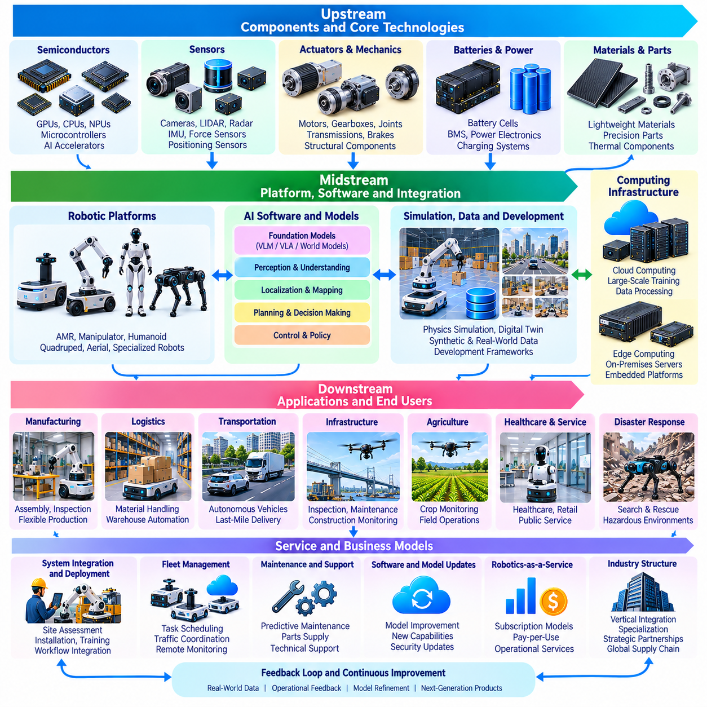{width="7.268055555555556in" height="7.268055555555556in"}

피지컬 인공지능 가치사슬(Physical AI Value Chain)은 지능형 알고리즘(Intelligent Algorithms)을 실제로 작동하는 물리적 시스템(Operational Physical Systems)으로 전환하는 데 필요한 상호 연결된 활동(Interconnected Activities), 기술(Technologies), 조직(Organizations)을 설명한다. 순수 디지털 인공지능 산업(Purely Digital AI Industries)과 달리 피지컬 인공지능(Physical AI)은 하드웨어(Hardware), 소프트웨어(Software), 데이터(Data), 인프라(Infrastructure), 현장 서비스(Field Services)의 협력적 개발에 의존한다. 이러한 산업 구조(Industrial Structure)는 실제 환경의 제약(Real-World Constraints) 아래에서 작동하는 기계 시스템(Mechanical Systems)과 컴퓨팅 지능(Computational Intelligence)을 통합하는 복잡성을 반영한다.

가치사슬의 상류 부문(Upstream Segment)에는 반도체 제조업체(Semiconductor Manufacturers), 센서 공급업체(Sensor Suppliers), 액추에이터 개발업체(Actuator Developers), 배터리 생산업체(Battery Producers), 특수 소재 공급업체(Specialized Material Providers)가 포함된다. 이러한 조직은 인식(Perception), 연산(Computation), 이동(Movement), 에너지 공급(Energy Delivery)에 필요한 핵심 구성요소(Foundational Components)를 제공한다. 부품 성능(Component Performance)은 시스템 비용(System Cost), 신뢰성(Reliability), 기능적 능력(Capability)에 영향을 미친다. 부품 공급 가능성(Supply Availability)과 제조 역량(Manufacturing Capacity) 역시 피지컬 인공지능 제품(Physical AI Products)의 확장성(Scalability)에 영향을 미친다.

반도체(Semiconductors)는 지능형 기계(Intelligent Machines)가 제한된 전력 및 열 환경(Constrained Power and Thermal Environments)에서 상당한 컴퓨팅 능력(Computing Capability)을 필요로 하기 때문에 전략적으로 중요한 위치를 차지한다. GPU, CPU, 신경망 가속기(Neural Accelerators), 마이크로컨트롤러(Microcontrollers)는 서로 다른 처리 기능(Processing Functions)을 지원한다. 반도체 공급업체(Semiconductor Vendors)는 하드웨어와 함께 소프트웨어 라이브러리(Software Libraries), 개발 환경(Development Environments), 참조 아키텍처(Reference Architectures)를 점점 더 많이 제공하고 있다. 이러한 통합(Integration)은 플랫폼 선택(Platform Selection)에 영향을 미치고 장기적인 생태계 의존성(Long-Term Ecosystem Dependencies)을 형성할 수 있다.

센서 제조업체(Sensor Manufacturers)는 지능형 시스템(Intelligent Systems)을 물리적 환경(Physical Environments)과 연결하는 기술을 제공한다. 카메라(Cameras), 라이다(LiDAR), 레이더(Radar), 관성 센서(Inertial Sensors), 힘 센서(Force Sensors), 위치 결정 장치(Positioning Devices)는 상호 보완적인 관측값(Complementary Observations)을 생성한다. 이들의 상업적 가치(Commercial Value)는 측정 정확도(Measurement Accuracy), 환경 강건성(Environmental Robustness), 보정 안정성(Calibration Stability), 통합 호환성(Integration Compatibility)에 달려 있다. 센서 공급업체(Sensor Suppliers)는 신뢰성(Reliability), 임베디드 처리(Embedded Processing), 응용 분야별 특화 기능(Application-Specific Capabilities)을 중심으로 경쟁을 확대하고 있다.

액추에이터(Actuators), 동력 전달 장치(Transmissions), 기계 부품(Mechanical Components)은 컴퓨팅 기반 의사결정(Computational Decisions)을 물리적 움직임(Physical Movement)으로 변환한다. 모터(Motors), 기어박스(Gearboxes), 브레이크(Brakes), 관절(Joints), 구조 조립체(Structural Assemblies)는 가반하중(Payload Capacity), 정밀도(Precision), 내구성(Durability), 에너지 소비(Energy Consumption)를 결정한다. 이러한 요소의 중요성은 모바일 로봇(Mobile Robots), 매니퓰레이터(Manipulators), 휴머노이드(Humanoids), 항공 플랫폼(Aerial Platforms)에 따라 달라진다. 제조 품질(Manufacturing Quality)과 유지보수 요구사항(Maintenance Requirements)은 수명주기 경제성(Lifecycle Economics)과 운영 가용성(Operational Availability)에 큰 영향을 미친다.

중류 부문(Middle Segment)에는 부품을 결합하여 기능하는 기계(Functional Machines)를 만드는 로봇 플랫폼 제조업체(Robotic Platform Manufacturers)와 시스템 통합업체(System Integrators)가 포함된다. 제조업체는 기계적 아키텍처(Mechanical Architectures), 임베디드 전자장치(Embedded Electronics), 제어 시스템(Control Systems), 안전 메커니즘(Safety Mechanisms)을 개발한다. 통합업체는 이러한 플랫폼을 특정 시설(Specific Facilities)과 작업 흐름(Workflows)에 맞게 조정한다. 성공적인 통합(Successful Integration)을 위해서는 센서(Sensors), 컴퓨팅 하드웨어(Computing Hardware), 통신 인터페이스(Communication Interfaces), 운영 소프트웨어(Operational Software) 사이의 호환성(Compatibility)이 필요하다.

AI 소프트웨어 개발업체(AI Software Developers)는 인식 모델(Perception Models), 위치 추정 알고리즘(Localization Algorithms), 계획 시스템(Planning Systems), 제어 정책(Control Policies), 로봇 파운데이션 모델(Robot Foundation Models)을 제공한다. 이러한 기술은 로봇이 환경을 해석하고 적절한 행동을 선택하는 방식을 결정한다. 소프트웨어 차별화(Software Differentiation)는 일반화 능력(Generalization), 신뢰성(Reliability), 계산 효율(Computational Efficiency), 통합 유연성(Integration Flexibility)에 점점 더 크게 의존한다. 그러나 학습된 지능(Learned Intelligence)은 배포된 기계(Deployed Machines)의 물리적 한계(Physical Limitations)와 안전 경계(Safety Boundaries) 내에서 작동해야 한다.

시뮬레이션(Simulation), 데이터(Data), 개발 플랫폼(Development Platforms)은 가치사슬(Value Chain) 전체를 지원하는 계층(Supporting Layer)을 형성한다. 시뮬레이션 제공업체(Simulation Providers)는 가상 테스트(Virtual Testing)를 가능하게 하며, 데이터셋 관련 기관(Dataset Organizations)과 주석 서비스(Annotation Services)는 학습 자원(Training Resources)을 제공한다. 개발 프레임워크(Development Frameworks)는 알고리즘(Algorithms)을 하드웨어 인터페이스(Hardware Interfaces) 및 평가 절차(Evaluation Procedures)와 연결한다. 이러한 기능은 실험 비용(Experimentation Costs)을 줄이고 반복 개발(Iteration)을 가속하지만, 신뢰할 수 있는 배포(Reliable Deployment)를 위해서는 여전히 물리적 테스트(Physical Testing)와 운영 근거(Operational Evidence)가 필요하다.

컴퓨팅 인프라 제공업체(Computing Infrastructure Providers)는 모델 개발(Model Development)과 실행(Execution)을 위한 클라우드 자원(Cloud Resources), 온프레미스 서버(On-Premises Servers), 엣지 플랫폼(Edge Platforms)을 공급한다. 중앙집중형 인프라(Centralized Infrastructure)는 대규모 학습(Large-Scale Training)과 데이터 분석(Analytics)을 지원하며, 로컬 컴퓨팅(Local Computing)은 저지연 인식(Low-Latency Perception)과 협업(Coordination)을 가능하게 한다. 임베디드 프로세서(Embedded Processors)는 로봇 내부에서 필수 기능(Essential Functions)을 실행한다. 컴퓨팅 역할의 분산(Distribution of Computing Responsibilities)은 운영 비용(Operating Cost), 통신 요구사항(Communication Requirements), 데이터 거버넌스(Data Governance), 시스템 복원력(System Resilience)에 영향을 미친다.

하류 부문 참여자(Downstream Participants)에는 산업 고객(Industrial Customers), 물류 운영업체(Logistics Operators), 제조업체(Manufacturers), 인프라 소유자(Infrastructure Owners), 농업 관련 조직(Agricultural Organizations), 서비스 제공업체(Service Providers)가 포함된다. 이러한 사용자들은 생산성(Productivity), 안전성(Safety), 품질(Quality), 운영 유연성(Operational Flexibility)을 개선하기 위해 피지컬 인공지능(Physical AI)을 도입한다. 구매 결정(Purchasing Decisions)은 기술적 시연(Technical Demonstrations) 자체보다 측정 가능한 성과(Measurable Outcomes)에 달려 있다. 기존 장비(Existing Equipment), 인력 작업 절차(Workforce Procedures), 기업 시스템(Enterprise Systems)과의 통합은 도입 성공(Adoption Success)을 결정하는 경우가 많다.

시스템 통합 및 배포 서비스(System Integration and Deployment Services)는 중요한 상업적 가치(Commercial Value)의 원천이다. 피지컬 인공지능 설치(Physical AI Installations)에는 현장 평가(Site Assessment), 지도 작성(Mapping), 네트워크 구성(Network Configuration), 작업 흐름 조정(Workflow Adaptation), 안전성 평가(Safety Evaluation), 운영자 교육(Operator Training)이 필요하다. 배포 복잡성(Deployment Complexity)은 환경 조건(Environmental Conditions)과 조직의 요구사항(Organizational Requirements)에 따라 달라진다. 설치 시간(Installation Time)과 운영 중단(Operational Disruption)을 줄이는 서비스 제공업체는 개별 로봇의 기능을 넘어 상당한 차별화(Substantial Differentiation)를 만들어낼 수 있다.

반복적으로 제공되는 서비스(Recurring Services)는 산업 전반의 비즈니스 모델(Business Models)에 점점 더 큰 영향을 미치고 있다. 플릿 관리(Fleet Management), 원격 모니터링(Remote Monitoring), 예측 유지보수(Predictive Maintenance), 소프트웨어 업데이트(Software Updates), 기술 지원(Technical Support)은 지속적인 고객 관계(Ongoing Customer Relationships)를 형성한다. 서비스형 로봇(Robotics-as-a-Service, RaaS) 모델은 초기 자본 지출(Upfront Capital Expenditure)을 반복적인 운영 비용(Recurring Operational Payments)으로 전환할 수 있다. 이러한 모델의 지속 가능성(Sustainability)은 장비 활용률(Equipment Utilization), 유지보수 비용(Maintenance Cost), 금융 조건(Financing Conditions), 명확하게 정의된 서비스 책임(Service Responsibilities)에 달려 있다.

이 산업에는 다양한 형태의 수직적 통합(Vertical Integration)과 전문화(Specialization)가 존재한다. 일부 기업은 하드웨어(Hardware), AI 소프트웨어(AI Software), 운영 서비스(Operational Services)를 포함한 완전한 로봇 시스템(Complete Robotic Systems)을 개발한다. 다른 기업들은 부품(Components), 파운데이션 모델(Foundation Models), 미들웨어(Middleware), 특화 응용 분야(Specialized Applications)에 집중한다. 수직적 통합은 시스템 최적화(System Optimization)와 책임성(Accountability)을 개선할 수 있으며, 전문화는 공유 기술(Shared Technologies)을 통해 혁신(Innovation)을 가속하고 개발 비용(Development Costs)을 줄일 수 있다.

플랫폼 생태계(Platform Ecosystems)는 애플리케이션 인터페이스(Application Interfaces), 개발 도구(Development Tools), 파트너 네트워크(Partner Networks), 호환성 표준(Compatibility Standards)을 통해 추가적인 경제적 관계(Economic Relationships)를 형성한다. 널리 채택된 플랫폼(Widely Adopted Platform)은 소프트웨어 개발자(Software Developers), 부품 공급업체(Component Suppliers), 시스템 통합업체(System Integrators)를 끌어들일 수 있다. 네트워크 효과(Network Effects)는 공유 인프라(Shared Infrastructure)와 재사용 가능한 애플리케이션(Reusable Applications)의 가치를 높일 수 있다. 그러나 독점 인터페이스(Proprietary Interfaces)와 제한적인 라이선스(Restrictive Licensing)는 공급업체 종속(Vendor Lock-In)을 발생시키고 상호운용성(Interoperability)을 제한할 수 있다.

표준(Standards), 인증(Certification), 규제 기관(Regulatory Institutions)은 안전성(Safety), 사이버보안(Cybersecurity), 통신(Communication), 운영 책임성(Operational Accountability)에 대한 기대 수준을 설정함으로써 산업 발전(Industry Development)에 영향을 미친다. 요구사항(Requirements)은 산업용 로봇(Industrial Robots), 자율주행 차량(Autonomous Vehicles), 항공 시스템(Aerial Systems), 협업 응용 분야(Collaborative Applications)에 따라 달라진다. 규제 준수(Compliance)는 엔지니어링 비용(Engineering Costs)과 문서화 비용(Documentation Costs)을 발생시키지만 고객 신뢰(Customer Confidence)를 높이는 데도 기여할 수 있다. 규제 불확실성(Regulatory Uncertainty)은 새로운 응용 분야(Emerging Application Areas)의 상용화(Commercialization)를 지연시킬 수 있다.

공급망 복원력(Supply Chain Resilience)은 피지컬 인공지능 제품(Physical AI Products)이 서로 다른 제조 주기(Manufacturing Cycles)와 공급 제약(Availability Constraints)을 가진 부품들을 결합하기 때문에 특히 중요하다. 반도체 부족(Semiconductor Shortages), 특수 액추에이터 납기(Specialized Actuator Lead Times), 제한된 공급업체에 대한 의존성(Dependence on Limited Suppliers)은 생산을 방해할 수 있다. 조직은 부품 대체(Component Substitution), 수명주기 지원(Lifecycle Support), 재고 계획(Inventory Planning), 지리적 집중(Geographic Concentration)을 고려해야 한다. 장기적인 배포(Long-Term Deployment)를 위해서는 교체 부품(Replacement Parts)과 유지보수 자원(Maintenance Resources)에 대한 안정적인 접근이 필요하다.

상업적 경쟁력(Commercial Competitiveness)은 시스템 성능(System Performance)과 총소유비용(Total Cost of Ownership, TCO) 사이의 관계에 달려 있다. 도입 비용(Acquisition Cost)은 경제적 가치(Economic Value)를 구성하는 하나의 요소일 뿐이다. 통합(Integration), 에너지 소비(Energy Consumption), 유지보수(Maintenance), 소프트웨어 라이선스(Software Licensing), 가동 중단시간(Downtime), 인간 감독(Human Supervision)은 수명주기 비용(Lifecycle Expenses)에 포함된다. 고객은 자동화(Automation)가 처리량(Throughput), 품질(Quality), 안전성(Safety), 서비스 가용성(Service Availability)을 충분히 개선하여 이러한 비용을 정당화할 수 있는지 평가한다.

투자 및 시장 개발(Investment and Market Development)은 로봇 하드웨어(Robotic Hardware)의 자본집약적 특성(Capital-Intensive Nature)과 고객 도입 속도(Pace of Customer Adoption)의 불확실성에 영향을 받는다. 연구(Research), 시제품 제작(Prototyping), 인증(Certification), 제조(Manufacturing), 현장 지원(Field Support)에는 지속적인 자금 조달(Sustained Funding)이 필요하다. 투자자(Investors)는 배포 실적(Deployment Evidence), 반복 매출(Recurring Revenue), 단위 경제성(Unit Economics), 고객 유지율(Customer Retention)을 점점 더 중요하게 검토하고 있다. 기술적 돌파구(Technical Breakthroughs)만으로는 반복 가능한 상용화 프로세스(Repeatable Commercialization Processes)가 없는 상태에서 지속 가능한 사업(Viable Businesses)을 확립하기 어려울 수 있다.

미래 산업 발전(Future Industry Development)은 하드웨어 인터페이스(Hardware Interfaces)의 표준화(Standardization), 공유 AI 모델(Shared AI Models), 상호운용 가능한 플릿 플랫폼(Interoperable Fleet Platforms), 특화된 배포 서비스(Specialized Deployment Services)의 확대를 포함할 수 있다. 파운데이션 모델(Foundation Models)은 소프트웨어 개발 비용(Software Development Costs)을 줄일 수 있으며, 모듈형 부품(Modular Components)은 제품 차별화(Product Differentiation)를 가속할 수 있다. 그러나 물리적 통합(Physical Integration), 안전성 보증(Safety Assurance), 응용 분야별 엔지니어링(Application-Specific Engineering)은 계속해서 중요한 경쟁우위(Competitive Advantage)의 원천으로 남을 것이다.

궁극적으로 피지컬 인공지능 가치사슬(Physical AI Value Chain)은 하드웨어 및 소프트웨어 공급업체(Hardware and Software Suppliers)의 단순한 순차적 연결이 아니라 상호 연결된 산업 시스템(Interconnected Industrial System)이다. 지속 가능한 성장(Sustainable Growth)을 위해서는 부품 생산업체(Component Producers), AI 개발업체(AI Developers), 플랫폼 제조업체(Platform Manufacturers), 시스템 통합업체(Integrators), 최종 사용자(End Users) 사이의 협력이 필요하다. 장기적인 산업 리더십(Long-Term Industry Leadership)은 신뢰할 수 있는 배포(Reliable Deployment), 경제적 확장성(Economic Scalability), 생태계 협력(Ecosystem Cooperation), 물리적 지능(Physical Intelligence)을 측정 가능한 운영 가치(Measurable Operational Value)로 전환하는 능력에 달려 있다.
