**Volume 02. Physical AI Foundations and Definitions**

# Chapter 05. Physical AI Taxonomy

## 05.01. Why Physical AI Needs a Taxonomy

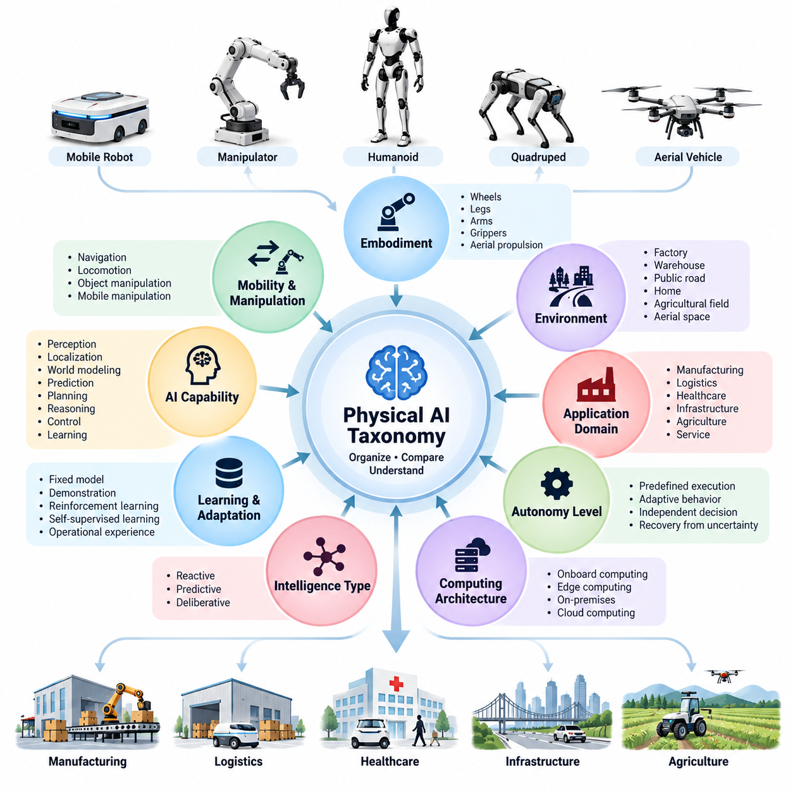{width="7.268055555555556in" height="7.268055555555556in"}

Physical AI encompasses intelligent systems that perceive, reason, decide, and act within the physical world. Unlike conventional digital AI, these systems operate through physical interactions governed by motion, force, uncertainty, and environmental constraints. As Physical AI expands across robotics, autonomous mobility, manufacturing, healthcare, and infrastructure, a systematic taxonomy becomes essential for organizing its diverse technologies and capabilities.

The need for a Physical AI taxonomy arises from the growing complexity of intelligent machines and their operating environments. An autonomous mobile robot, industrial manipulator, humanoid robot, quadruped platform, and unmanned aerial vehicle may share fundamental AI technologies while exhibiting substantially different physical characteristics. Without a common classification framework, comparing these systems becomes inconsistent and often misleading.

A taxonomy provides a structured method for identifying similarities, differences, and relationships among Physical AI systems. It establishes conceptual categories based on observable characteristics, functional capabilities, architectural properties, and operational requirements. Rather than treating Physical AI as a single homogeneous technology, taxonomy recognizes it as a multidimensional field containing different forms of embodiment, intelligence, autonomy, and interaction.

Traditional robotics classifications frequently emphasize mechanical structures, locomotion mechanisms, or industrial applications. Although these categories remain useful, they cannot fully describe modern Physical AI systems incorporating multimodal perception, predictive world models, foundation models, adaptive learning, and autonomous reasoning. A broader taxonomy must therefore integrate physical characteristics with computational intelligence and behavioral capabilities.

Embodiment represents one fundamental dimension of Physical AI classification. Different systems interact with their environments through wheels, legs, arms, grippers, aerial propulsion, or other physical mechanisms. These structures determine reachable spaces, motion constraints, manipulation capabilities, and interaction strategies. Classifying systems by embodiment helps explain why similar AI algorithms may produce different outcomes across physical platforms.

Mobility and manipulation provide another important classification perspective. Some Physical AI systems primarily navigate environments, while others manipulate objects or combine locomotion and manipulation. Autonomous mobile robots emphasize localization, navigation, and obstacle avoidance, whereas robotic manipulators emphasize grasping, force control, and object interaction. Mobile manipulators integrate both capabilities, creating additional coordination and planning requirements.

Environmental conditions also influence Physical AI system design and intelligence requirements. Structured factories, dynamic warehouses, public roads, private homes, agricultural fields, and aerial environments present different levels of uncertainty and physical complexity. A taxonomy based on operating environments clarifies the relationship between environmental predictability, perception requirements, planning complexity, and system robustness.

Application domains introduce another classification dimension because identical physical platforms may perform fundamentally different tasks. A mobile robot operating in logistics may transport materials, while a similar platform in healthcare may deliver medical supplies. Their mechanical configurations may overlap, but safety expectations, operational workflows, human interaction requirements, and performance criteria can differ significantly.

Autonomy level is particularly important because Physical AI systems vary in their dependence on human supervision. Some machines execute predefined sequences, while others independently perceive changing conditions, select actions, and recover from unexpected events. A meaningful taxonomy must distinguish automated execution from adaptive autonomous behavior without assuming that sophisticated hardware or advanced AI models automatically imply greater operational autonomy.

AI capability provides a complementary perspective for understanding differences in system intelligence. Physical AI may incorporate perception, localization, world modeling, prediction, planning, reasoning, control, and learning in different combinations. A system capable of accurate object recognition is not necessarily capable of long-horizon task planning. Separating these capabilities prevents individual technical achievements from being mistaken for general physical intelligence.

The distinction between reactive, predictive, and deliberative intelligence further illustrates why classification is necessary. Reactive systems respond primarily to current observations, predictive systems estimate future states or outcomes, and deliberative systems evaluate possible actions against objectives and constraints. These categories describe different behavioral mechanisms rather than rigid evolutionary stages, and practical systems frequently combine all three approaches.

Learning and adaptation introduce additional complexity into Physical AI classification. Some systems depend on fixed models and manually configured behaviors, whereas others improve through demonstrations, reinforcement learning, self-supervised learning, or operational experience. Their ability to adapt may be limited to specific parameters, environments, tasks, or embodiments. Taxonomy helps distinguish these learning mechanisms from demonstrated generalization capabilities.

Computing architecture is another essential classification dimension because Physical AI intelligence depends on computational resources and communication infrastructure. Systems may perform inference entirely on embedded processors, distribute workloads across edge computers, or rely on cloud services for selected functions. These architectural choices influence latency, energy consumption, reliability, scalability, and the feasibility of operating under intermittent network connectivity.

Physical AI must also be classified according to the organizational structure of intelligent agents. A single autonomous robot makes decisions within its own operational context, while coordinated fleets exchange information and allocate tasks across multiple machines. Swarm systems may rely on distributed interactions that produce collective behavior. These distinctions affect communication requirements, coordination algorithms, fault tolerance, and the distribution of decision-making authority.

The distinction between specialist and generalist Physical AI introduces a broader perspective on intelligence. Specialist systems are optimized for relatively narrow tasks and operating conditions, whereas generalist systems aim to perform multiple tasks across varying situations. Generality should be evaluated through demonstrated task diversity, environmental adaptability, and transfer performance rather than model size, platform appearance, or promotional descriptions.

A major challenge in developing a taxonomy is that its classification dimensions are not mutually exclusive. A humanoid robot may simultaneously be a legged platform, mobile manipulator, learning-based agent, and edge-computing system. Similarly, an autonomous vehicle may combine reactive safety control, predictive trajectory modeling, and deliberative route planning. A multidimensional taxonomy captures these overlapping properties more accurately than a single hierarchical category.

A capability matrix offers a practical method for representing this multidimensional structure. Each Physical AI system can be characterized through attributes describing embodiment, mobility, environment, application, autonomy, intelligence, learning, computing architecture, and coordination. Such a matrix enables systematic comparisons while preserving the distinctions between physical design, algorithmic sophistication, operational capability, and demonstrated performance.

For researchers, a consistent taxonomy improves communication and experimental interpretation. Studies involving different robot platforms or environments can be compared more meaningfully when their underlying characteristics are explicitly identified. It also helps reveal gaps in existing research, including insufficient evaluation of cross-embodiment transfer, limited environmental generalization, or inadequate integration between reasoning and physical control.

For engineers and system architects, taxonomy supports requirements analysis and technology selection. By identifying the dimensions relevant to a target application, development teams can determine appropriate sensing, actuation, computing, autonomy, and learning capabilities. This approach encourages hardware-software-AI co-design and reduces the risk of selecting technologies based on superficial similarities between robot platforms or exaggerated assumptions about intelligence.

For industry stakeholders, classification creates a common language for product positioning, technology assessment, and market analysis. Physical AI products cannot be evaluated solely by their mechanical appearance or advertised AI features. A structured taxonomy helps distinguish platform capabilities from application-specific solutions, identify competitive alternatives, and assess whether a technology is sufficiently mature for its intended operational environment.

Taxonomy also contributes to safety engineering, evaluation, and standardization. Different Physical AI systems face different hazards depending on their mobility, interaction forces, autonomy, and environmental exposure. Classification provides context for selecting suitable evaluation procedures, defining operational boundaries, and identifying relevant safety requirements. However, a taxonomy itself does not establish safety compliance or replace application-specific risk assessment.

A useful Physical AI taxonomy must remain extensible because the field continues to evolve. Emerging foundation models, vision-language-action architectures, predictive world models, and cross-embodiment learning may introduce capabilities that do not fit traditional robotics categories. Classification frameworks should accommodate these developments without repeatedly redefining fundamental concepts or confusing research objectives with validated operational achievements.

Ultimately, the purpose of a Physical AI taxonomy is not merely to assign labels to intelligent machines. Its deeper value lies in establishing a coherent framework for understanding how embodiment, environment, intelligence, autonomy, learning, and computing interact to produce physical behavior. By organizing these dimensions systematically, taxonomy provides the conceptual foundation for comparing systems, designing architectures, evaluating capabilities, and advancing Physical AI as an integrated engineering discipline.

## 05.02. Taxonomy by Embodiment

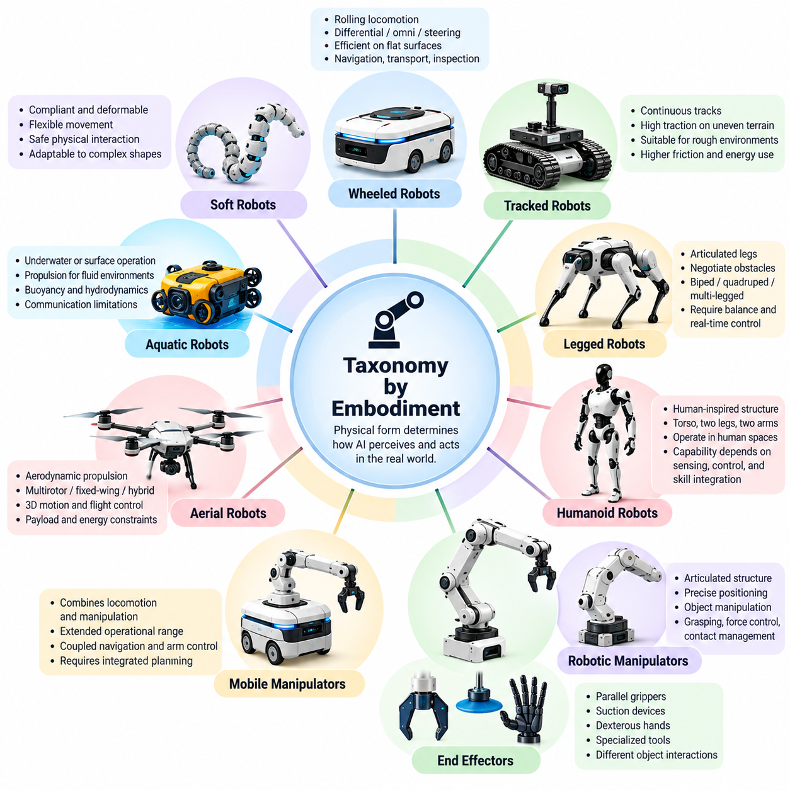{width="7.268055555555556in" height="7.268055555555556in"}

Embodiment is a fundamental dimension of Physical AI taxonomy because intelligence in the physical world depends on the structure through which an agent perceives and acts. Unlike purely digital systems, embodied agents interact with environments through physical mechanisms that impose geometric, dynamic, and energetic constraints. Their bodies determine not only how actions are executed but also which actions are physically possible.

A taxonomy based on embodiment classifies Physical AI systems according to their physical configuration, locomotion structures, manipulation mechanisms, and interaction interfaces. This approach distinguishes the physical characteristics of an intelligent agent from its software architecture or autonomy level. Two systems may employ similar perception and planning algorithms while exhibiting substantially different capabilities because their embodiments support different forms of interaction.

Embodiment should be understood as more than the external appearance of a robot. It includes mechanical geometry, degrees of freedom, actuator placement, sensor configuration, compliance, mass distribution, and contact characteristics. These properties influence perception, control, stability, and energy efficiency. Consequently, embodiment establishes the physical conditions under which intelligence must operate and determines important boundaries of achievable behavior.

Wheeled robots represent a major embodiment category characterized by rolling locomotion and relatively efficient movement across suitable surfaces. Autonomous mobile robots commonly employ differential-drive, omnidirectional, or steering-based configurations. Their physical structures support navigation, transportation, and inspection tasks, but wheel-ground contact and terrain conditions constrain mobility. Intelligent control must account for traction, turning geometry, and dynamic obstacles.

Tracked robots constitute another ground-based embodiment category, using continuous tracks to distribute contact forces across terrain. Their configurations can provide useful traction and mobility over certain uneven or deformable surfaces. However, tracked locomotion introduces challenges involving friction, turning resistance, energy consumption, and mechanical wear. Their suitability depends on terrain properties, operating speed, payload requirements, and environmental constraints.

Legged robots form a distinct embodiment category because locomotion depends on coordinated contact between articulated limbs and the environment. Bipeds, quadrupeds, and multi-legged platforms can negotiate obstacles and terrain that may restrict wheeled systems. Their intelligence must coordinate balance, foothold selection, body motion, and contact forces. These requirements create strong relationships between perception, predictive modeling, and real-time control.

Humanoid robots represent a specialized form of legged embodiment characterized by human-inspired body structures, typically including a torso, two legs, and articulated arms. This configuration can support locomotion and manipulation in environments designed for human activities. Nevertheless, humanoid appearance does not inherently imply human-level intelligence. Actual capability depends on sensing, actuation, control, planning, and the integration of physical skills.

Robotic manipulators constitute an embodiment category focused primarily on physical interaction with objects rather than locomotion. Their articulated structures provide controlled positioning and orientation of end effectors within reachable workspaces. Manipulation intelligence involves grasp selection, trajectory generation, force regulation, and contact management. The robot\'s kinematic structure and mechanical limits directly influence its ability to execute tasks.

End effectors provide an additional embodiment distinction within manipulation systems. Parallel grippers, suction devices, dexterous hands, and specialized tools enable different forms of object interaction. A simple gripper may perform reliable repetitive handling, while a multi-fingered hand can support more varied contact configurations. However, greater mechanical dexterity also increases sensing, coordination, and control requirements.

Mobile manipulators combine locomotion and object manipulation within a unified physical platform. A mobile base extends the operational workspace of an articulated arm, allowing interaction with objects distributed across an environment. This embodiment introduces coupled planning problems involving navigation, positioning, reachability, stability, and manipulation. Successful operation requires coordination between base motion and arm behavior.

Aerial robots represent embodiments that generate lift and control motion through aerodynamic forces or powered propulsion. Multirotor vehicles, fixed-wing aircraft, and hybrid aerial platforms exhibit different flight characteristics and operational constraints. Their intelligence must account for three-dimensional motion, disturbances, energy limitations, and flight stability. Payload capacity and actuator dynamics strongly influence their sensing and interaction capabilities.

Aquatic robots introduce embodiments designed for interaction with underwater or surface environments. Autonomous underwater vehicles, remotely operated vehicles, and autonomous surface vessels employ propulsion and control mechanisms adapted to fluid dynamics. Buoyancy, hydrodynamic resistance, communication limitations, and environmental uncertainty shape their behavior. Their physical structures therefore require specialized perception, navigation, and control strategies.

Soft robots represent an embodiment category in which compliant materials and deformable structures play central roles in movement and interaction. Unlike rigid-link mechanisms, soft bodies may distribute deformation across continuous structures. This compliance can improve adaptation to irregular objects and certain contact conditions. However, nonlinear material behavior and complex deformation introduce challenges for state estimation, modeling, and precise control.

Modular and reconfigurable robots extend embodiment classification by allowing physical structure to change during operation or between tasks. Modules may connect, separate, or rearrange to produce different configurations and capabilities. Such systems require intelligence that accounts for changing kinematics, communication topology, and mechanical constraints. Their embodiment is therefore dynamic rather than permanently fixed.

Hybrid embodiments combine multiple locomotion or interaction mechanisms within a single system. Wheeled-legged robots, aerial-ground vehicles, and platforms integrating tracks with articulated limbs illustrate this category. These configurations can expand operational flexibility by exploiting different mechanisms under different conditions. However, hybrid systems introduce additional mechanical complexity, mode transitions, and coordination requirements.

Embodiment also influences sensor placement and the information available to an intelligent agent. Cameras mounted on a mobile base, sensors integrated into robotic hands, and inertial units distributed across articulated bodies provide different observations of the environment and internal state. Sensor geometry affects visibility, observability, and uncertainty. Thus, perception cannot be evaluated independently of the physical structure supporting it.

Actuation is equally important because motors, hydraulic systems, pneumatic mechanisms, and compliant actuators impose different dynamic characteristics. Torque limits, response bandwidth, transmission efficiency, and mechanical compliance influence achievable movements and interaction forces. These properties determine how planned actions translate into physical behavior. An embodiment taxonomy must therefore consider actuation characteristics alongside external morphology.

The relationship between embodiment and intelligence becomes especially important in learning-based Physical AI. Policies trained for one robot may not transfer directly to another because action spaces, joint configurations, contact dynamics, and sensing arrangements differ. Cross-embodiment learning seeks representations that preserve transferable knowledge while accommodating platform-specific constraints. Classification helps identify which differences require adaptation.

Morphological computation provides another perspective on embodiment by recognizing that physical structure can contribute directly to task performance. Passive compliance, mechanical linkages, and natural dynamics may simplify certain control problems without requiring explicit computation for every movement. In such cases, intelligent behavior emerges through interaction between body mechanics and control policies. Embodiment becomes an active contributor to computation rather than a passive execution mechanism.

A practical embodiment taxonomy should distinguish structural classification from functional capability. A humanoid platform may lack reliable manipulation, while a simple wheeled robot may demonstrate sophisticated navigation and autonomous reasoning. Similarly, a dexterous robotic hand does not guarantee successful manipulation of unfamiliar objects. Physical configuration establishes possibilities and constraints, but demonstrated intelligence must be evaluated separately.

Embodiment classification supports engineering decisions by connecting physical design to task requirements and operating conditions. Selecting between wheeled, legged, aerial, aquatic, or manipulation-oriented platforms requires consideration of terrain, workspace, payload, energy, safety, and interaction demands. Taxonomy provides a consistent framework for comparing alternatives without assuming that one physical configuration is universally superior.

Ultimately, taxonomy by embodiment establishes the physical foundation for understanding diversity within Physical AI. It explains how mechanical structures, sensing arrangements, actuation systems, and environmental interactions shape the capabilities of intelligent agents. By separating embodiment from autonomy, learning, and reasoning while recognizing their interdependence, this classification provides a systematic basis for architecture design, capability evaluation, and cross-platform intelligence development.

## 05.03. Taxonomy by Mobility and Manipulation

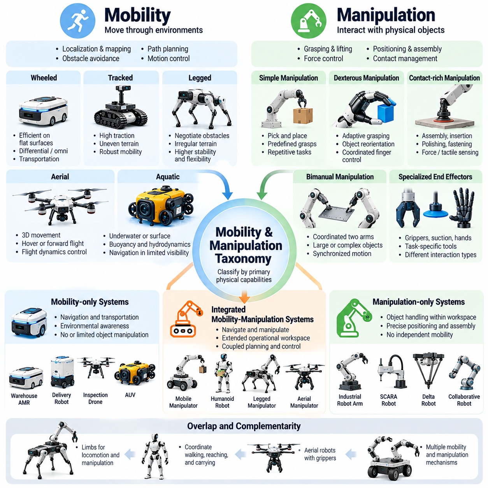{width="7.268055555555556in" height="7.268055555555556in"}

Mobility and manipulation represent two fundamental dimensions of Physical AI because they describe how intelligent systems move through environments and interact with physical objects. Mobility enables an agent to change its position or orientation, while manipulation enables it to modify objects, apply forces, and transform environmental states. Classifying systems along these dimensions provides a functional perspective that complements embodiment-based taxonomy.

A mobility and manipulation taxonomy distinguishes systems according to their primary physical capabilities rather than mechanical appearance alone. Some robots are designed mainly for transportation or navigation, while others perform object handling within fixed workspaces. More advanced platforms combine both functions to execute tasks across distributed environments. These distinctions clarify operational capabilities, planning requirements, and interaction complexity.

Mobility-oriented Physical AI systems emphasize movement through physical space. Their intelligence typically integrates localization, mapping, obstacle detection, path planning, trajectory generation, and motion control. Autonomous mobile robots operating in warehouses illustrate this category by navigating between destinations while avoiding collisions. Their performance depends on environmental awareness, motion efficiency, localization accuracy, and operational reliability.

Ground mobility can be classified according to movement mechanisms and terrain capabilities. Wheeled platforms generally provide efficient transportation on suitable surfaces, while tracked vehicles can offer advantages on certain uneven terrains. Legged systems use articulated limbs to negotiate obstacles and irregular ground. Each configuration imposes different requirements for stability, traction, energy management, and motion planning under uncertain environmental conditions.

Aerial mobility extends Physical AI into three-dimensional environments where movement requires continuous consideration of flight dynamics. Multirotor drones can hover and perform precise positioning, whereas fixed-wing platforms are generally suited to sustained forward flight. Aerial autonomy requires state estimation, trajectory planning, disturbance rejection, and energy-aware control. These capabilities distinguish aerial mobility from conventional ground navigation.

Aquatic mobility introduces additional challenges associated with fluid dynamics, buoyancy, and limited environmental observability. Autonomous underwater vehicles and surface vessels must navigate while accounting for currents, hydrodynamic resistance, and uncertain localization. Communication constraints may limit external supervision, increasing the importance of onboard decision-making. These systems demonstrate how mobility intelligence depends on environmental physics.

Manipulation-oriented Physical AI systems focus on controlling physical interactions with objects and materials. Their primary capabilities include reaching, grasping, lifting, positioning, assembling, and applying controlled forces. Industrial robotic arms represent a common example, operating within defined workspaces to perform repetitive or adaptive tasks. Manipulation intelligence must account for object geometry, contact conditions, actuator limitations, and task objectives.

Manipulation can be classified by the complexity of physical contact and required dexterity. Simple pick-and-place operations may involve predefined grasps and relatively predictable movements. More advanced tasks require adaptive grasp selection, force regulation, object reorientation, and coordinated finger motion. Dexterous manipulation introduces complex contact dynamics and partial observability, demanding more sophisticated perception, planning, and feedback control.

Contact-rich manipulation represents a particularly demanding category because task success depends on continuous interaction forces rather than position control alone. Assembly, insertion, polishing, fastening, and surface following require accurate interpretation of contact conditions. Force and tactile sensing can improve interaction stability and precision. Intelligent controllers must respond to uncertain friction, compliance, alignment, and changing mechanical constraints.

Bimanual manipulation extends object interaction to systems using two coordinated arms or hands. Tasks such as folding flexible materials, carrying large objects, and assembling complex components require synchronized motion and force distribution. The system must reason about shared object constraints, collision avoidance, and coordinated trajectories. Such operations illustrate the increasing complexity associated with multiple manipulation mechanisms.

Mobile manipulation combines navigation and object interaction within a unified operational framework. A mobile manipulator can travel between locations, position its base, reach toward objects, and execute manipulation tasks. This integration expands the accessible workspace beyond the fixed reach of an industrial arm. However, it introduces coupled constraints involving base placement, arm reachability, balance, collision avoidance, and task sequencing.

The relationship between mobility and manipulation is not always a simple separation of functions. Legged robots may use limbs for both locomotion and object interaction, while humanoid systems can coordinate walking, reaching, and carrying. Some aerial robots incorporate grippers for limited physical interaction. These examples demonstrate that mobility and manipulation are complementary capability dimensions that may overlap within the same physical mechanism.

A functional taxonomy can distinguish mobility-only, manipulation-only, and integrated mobility-manipulation systems. However, these categories should not be treated as rigid or mutually exclusive. A transport robot may incorporate lifting mechanisms, while a stationary manipulator may move along an external rail. Classification should therefore describe the actual range of physical capabilities and the degree of coordination between movement and object interaction.

Task planning differs significantly across mobility and manipulation categories. Mobility planning primarily considers traversable space, collision-free routes, dynamic obstacles, and destination constraints. Manipulation planning emphasizes object poses, grasp feasibility, contact sequences, and force requirements. Integrated systems must solve both problems while accounting for dependencies between navigation decisions and manipulation opportunities.

Perception requirements also vary according to functional capability. Mobile robots often prioritize environmental mapping, localization, obstacle recognition, and traversability estimation. Manipulation systems require detailed object geometry, pose estimation, surface properties, and contact information. Mobile manipulators must integrate both perspectives into consistent spatial representations, allowing the agent to connect global navigation with local physical interaction.

Control architectures reflect similar differences. Mobility control typically regulates platform velocity, orientation, trajectory tracking, and stability. Manipulation control regulates joint motion, end-effector position, interaction forces, and contact transitions. Integrated platforms require coordinated control across multiple subsystems. Hierarchical control structures can separate high-level task decisions from motion generation and low-level actuator regulation.

Learning-based approaches introduce additional classification considerations. Mobility policies may learn navigation strategies, obstacle avoidance, and terrain adaptation through demonstrations or reinforcement learning. Manipulation policies may learn grasping, object handling, and contact-sensitive behaviors. Integrated policies must connect spatial navigation with object-centered actions, often requiring multimodal observations and temporally extended decision-making.

Evaluation metrics should reflect the distinct objectives of mobility and manipulation. Mobility performance may be measured through navigation success, path efficiency, localization accuracy, collision frequency, and energy consumption. Manipulation performance may emphasize grasp success, placement accuracy, force regulation, and task completion. Integrated systems require combined evaluation that captures dependencies between movement, positioning, and successful object interaction.

Safety requirements also differ across these functional categories. Mobile platforms must manage collision risks, stopping distances, and navigation around people or obstacles. Manipulators must address pinch points, excessive forces, unintended contact, and dropped objects. Mobile manipulation combines these hazards, requiring coordinated safety monitoring across locomotion and manipulation subsystems throughout task execution.

Ultimately, taxonomy by mobility and manipulation provides a functional foundation for understanding how Physical AI systems produce meaningful actions in the physical world. It distinguishes movement capabilities from object interaction while recognizing their increasing integration in advanced robotic platforms. This classification supports architecture design, task allocation, performance evaluation, and the development of intelligent systems capable of coordinated navigation and manipulation.

## 05.04. Taxonomy by Environment

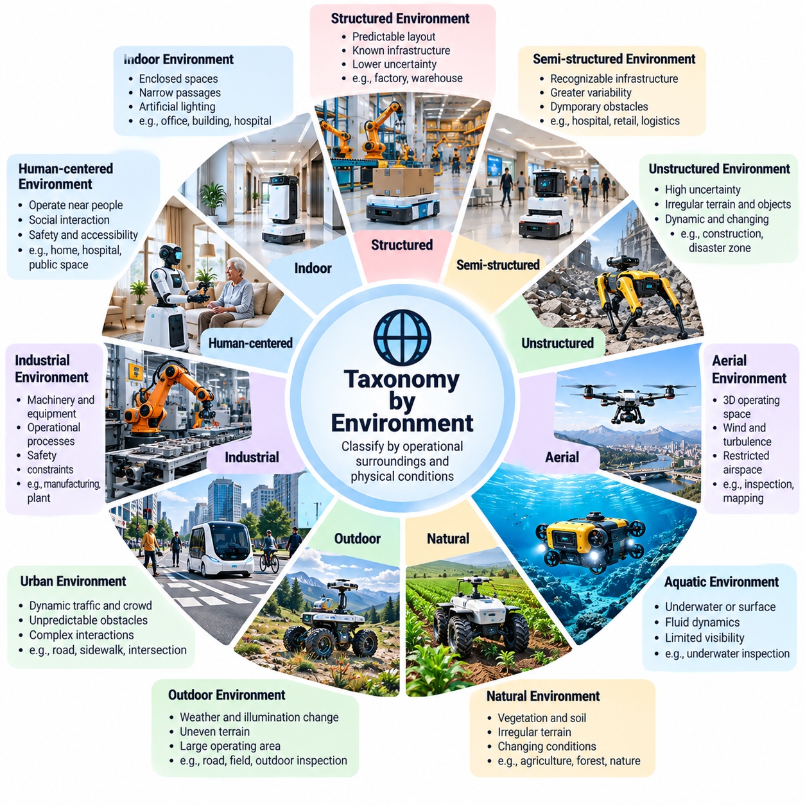{width="7.268055555555556in" height="7.268055555555556in"}

Environment is a fundamental dimension of Physical AI taxonomy because intelligent behavior depends on the physical conditions in which an agent operates. Unlike digital environments, physical environments impose constraints involving geometry, materials, dynamics, visibility, and environmental uncertainty. Classifying Physical AI systems by environment helps explain differences in perception, planning, control, safety, and the ability to generalize across operating conditions.

An environment-based taxonomy organizes Physical AI systems according to the characteristics of their operational surroundings rather than their mechanical embodiment or application alone. The same mobile robot may perform reliably in a structured warehouse but encounter significant difficulties in a crowded public space. Environmental classification therefore provides a framework for understanding how physical context influences intelligence requirements and operational performance.

Structured environments represent operating spaces where geometry, infrastructure, and task conditions are relatively predictable. Manufacturing facilities, automated warehouses, and controlled production lines commonly belong to this category. Their layouts may be mapped in advance, and operating procedures can reduce uncertainty. Nevertheless, moving equipment, changing inventory, and human activities still introduce dynamic conditions requiring continuous perception and adaptation.

Semi-structured environments contain recognizable infrastructure but exhibit greater variability in objects, activities, and operating conditions. Hospitals, commercial buildings, retail facilities, and shared logistics spaces illustrate this category. Robots may navigate known corridors while encountering temporary obstacles, rearranged furniture, and unpredictable human movement. Successful operation requires combining prior environmental knowledge with continuous observation and local replanning.

Unstructured environments present substantial uncertainty in terrain geometry, object distribution, and physical interaction conditions. Construction sites, forests, disaster zones, and agricultural fields frequently exhibit these characteristics. Their surfaces and obstacles may change without warning, making fixed maps insufficient. Physical AI systems operating in such environments require robust perception, terrain understanding, adaptive planning, and reliable responses to unexpected conditions.

Indoor environments introduce constraints associated with enclosed spaces, narrow passages, artificial lighting, and interactions with building infrastructure. Autonomous mobile robots may need to navigate doors, elevators, corridors, and shared workspaces. Localization can rely on visual features, LiDAR observations, or installed infrastructure. Environmental classification must consider spatial accessibility, floor conditions, communication coverage, and the presence of people.

Outdoor environments expose Physical AI systems to weather, illumination changes, uneven terrain, and large operating areas. Autonomous vehicles, agricultural robots, and outdoor inspection platforms must handle rain, fog, dust, sunlight, and seasonal variations. These conditions affect sensor reliability, traction, visibility, and navigation accuracy. Outdoor intelligence therefore requires environmental robustness and adaptation to changing physical conditions.

Urban environments combine structured infrastructure with highly dynamic interactions. Roads, sidewalks, intersections, and public spaces contain vehicles, pedestrians, cyclists, and unpredictable obstacles. Physical AI systems must interpret traffic patterns, social behavior, and operational boundaries while maintaining safe motion. Their intelligence must integrate perception, prediction, planning, and real-time decision-making under significant uncertainty.

Industrial environments introduce specialized physical constraints involving machinery, materials, equipment, and operational processes. Factories and production facilities may contain moving conveyors, robotic arms, automated vehicles, and restricted zones. Physical AI must coordinate with existing infrastructure while respecting safety requirements and production schedules. Environmental classification helps distinguish controlled industrial automation from more adaptive industrial intelligence.

Human-centered environments require particular attention because intelligent systems operate near people whose behavior cannot be fully predicted. Homes, hospitals, offices, and public facilities involve social expectations, personal space, accessibility requirements, and variable human activities. Physical AI must recognize human presence, anticipate movement, and adjust behavior appropriately. Safety and interaction quality become central environmental requirements.

Natural environments present physical conditions shaped by biological processes, terrain variability, and changing weather. Agricultural robots, forestry machines, and environmental monitoring systems operate among vegetation, soil, water, and irregular surfaces. These environments may contain deformable materials and uncertain boundaries. Effective intelligence requires interpreting natural structures and adapting actions to environmental variability without relying exclusively on fixed geometric assumptions.

Aerial environments introduce three-dimensional operating spaces governed by atmospheric conditions and flight dynamics. Unmanned aerial vehicles must account for wind, turbulence, obstacles, altitude constraints, and restricted airspace. Environmental perception may involve terrain, buildings, vegetation, and moving objects. The interaction between environmental disturbances and vehicle dynamics makes prediction, state estimation, and continuous control essential.

Aquatic environments impose constraints involving fluid motion, buoyancy, visibility, pressure, and communication. Underwater robots may encounter limited optical visibility, uncertain localization, and restricted wireless communication. Surface vessels must respond to waves, currents, and moving maritime obstacles. Environmental classification distinguishes these operating conditions from terrestrial environments and highlights the need for specialized sensing and navigation strategies.

Extreme environments represent another important category because physical conditions may exceed those encountered in conventional applications. Space exploration, deep-sea inspection, hazardous industrial facilities, and disaster-response operations can involve radiation, pressure, temperature extremes, or restricted human access. Physical AI systems must emphasize robustness, fault tolerance, autonomous recovery, and operation under limited supervision.

Environmental dynamics provide an additional classification dimension independent of physical location. Static environments change slowly, whereas dynamic environments contain moving agents, shifting obstacles, and evolving task conditions. A warehouse may be highly structured yet dynamically complex because of continuous vehicle and human movement. Distinguishing structural predictability from temporal variability produces a more accurate environmental taxonomy.

Observability is equally important because Physical AI agents rarely possess complete information about their surroundings. Occlusion, sensor noise, limited visibility, and inaccessible regions create partial observability. Systems must estimate hidden states and maintain uncertainty-aware representations of their environments. The degree of observability influences sensor selection, state estimation, world modeling, and the reliability of autonomous decisions.

Environmental uncertainty can arise from unknown geometry, unpredictable motion, changing physical properties, and incomplete task information. Physical AI systems must distinguish uncertainty caused by limited observations from variability inherent in environmental processes. Probabilistic estimation, predictive models, and feedback control help manage these challenges. Environmental classification provides context for determining which uncertainty-handling mechanisms are necessary.

Operational design domains define the conditions under which a Physical AI system is intended to function. These domains may specify geographic boundaries, environmental characteristics, weather limits, lighting conditions, and permitted interactions. A system validated for indoor logistics should not automatically be considered suitable for outdoor public navigation. Environment-based taxonomy therefore supports explicit operational boundaries and evidence-based capability assessment.

Simulation and digital twins benefit from environmental classification because virtual testing must represent the conditions relevant to real-world deployment. Structured factories, crowded indoor spaces, outdoor terrain, and extreme environments require different simulation assumptions. Environmental categories help organize scenario generation, domain randomization, and robustness testing. They also support systematic analysis of gaps between simulated and physical operating conditions.

Evaluation and safety requirements depend strongly on environmental context. Navigation success in a controlled corridor does not demonstrate reliable operation in crowded public areas or irregular outdoor terrain. Benchmarking must therefore account for environmental complexity, dynamic obstacles, visibility, surface conditions, and operational hazards. A consistent taxonomy enables meaningful comparisons while preventing performance claims from being generalized beyond validated conditions.

Ultimately, taxonomy by environment establishes a systematic relationship between physical operating conditions and the intelligence required to manage them. It distinguishes structured, semi-structured, unstructured, human-centered, natural, aerial, aquatic, and extreme environments while recognizing overlapping characteristics. By incorporating dynamics, uncertainty, observability, and operational boundaries, environmental classification supports Physical AI architecture design, evaluation, safety engineering, and reliable real-world deployment.

## 05.05. Taxonomy by Application Domain

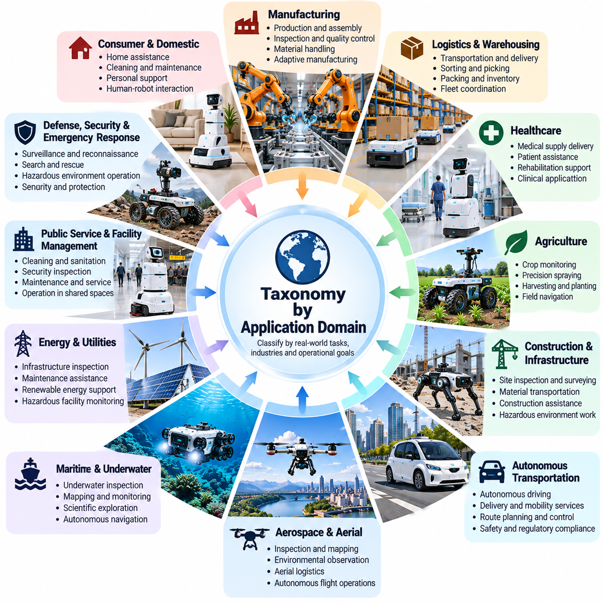{width="7.268055555555556in" height="7.268055555555556in"}

Application domain is a fundamental dimension of Physical AI taxonomy because intelligent systems are developed to perform meaningful tasks within specific industries and operational contexts. Although different applications may share similar hardware and AI algorithms, their objectives, constraints, and performance requirements can differ substantially. Classification by application domain connects technical capabilities with practical purposes and measurable operational outcomes.

An application-based taxonomy organizes Physical AI systems according to the problems they solve rather than their embodiment, mobility, or computing architecture. A wheeled robot may transport goods in a warehouse, deliver supplies in a hospital, or inspect industrial facilities. These applications require different workflows, safety measures, and interaction capabilities. Domain classification therefore provides a functional bridge between engineering design and real-world value.

Manufacturing represents a major application domain where Physical AI supports production, assembly, inspection, and material handling. Intelligent industrial robots can integrate visual perception, motion planning, force control, and adaptive decision-making. Unlike conventional fixed automation, advanced systems may adjust their behavior to variations in components or processes. Reliability, precision, cycle time, and integration with production equipment remain essential requirements.

Logistics and warehousing constitute another important domain involving transportation, sorting, picking, packing, and inventory operations. Autonomous mobile robots navigate facilities, while robotic manipulators handle objects at workstations. Integrated systems may coordinate navigation and manipulation across workflows. Their effectiveness depends on throughput, task completion, fleet coordination, obstacle avoidance, and compatibility with warehouse management systems.

Healthcare applications involve Physical AI systems operating in clinical, rehabilitation, and patient-support environments. Robots may transport medical supplies, assist with rehabilitation exercises, or support selected clinical procedures. These applications demand careful attention to human safety, reliability, hygiene, and operational accountability. The degree of autonomy must correspond to task risk, clinical oversight requirements, and the system\'s validated capabilities.

Agriculture represents a domain characterized by variable terrain, biological uncertainty, and seasonal operating conditions. Physical AI systems may perform crop monitoring, precision spraying, harvesting, planting, and autonomous field navigation. Their perception systems must interpret vegetation, soil conditions, and changing environmental features. Successful deployment requires robustness, energy efficiency, appropriate handling of crops, and adaptation to uncertain outdoor conditions.

Construction and infrastructure applications involve inspection, surveying, material transportation, and selected automated construction activities. Robots may operate on uneven surfaces, around heavy equipment, or within partially completed structures. These conditions require adaptive navigation, environmental understanding, and strong safety controls. Application-specific intelligence must account for changing site layouts, physical hazards, and coordination with human workers.

Autonomous transportation includes road vehicles, delivery platforms, and specialized mobility systems operating across different environments. Physical AI enables localization, scene understanding, behavior prediction, route planning, and vehicle control. These applications require continuous interaction with dynamic surroundings and other road users. Safety, regulatory compliance, operational boundaries, and reliable responses to unexpected events are central evaluation criteria.

Aerospace and aerial applications include inspection, mapping, environmental observation, logistics, and selected autonomous flight operations. Unmanned aerial vehicles use perception, state estimation, and trajectory planning to operate in three-dimensional spaces. Their application requirements depend on flight duration, payload, environmental disturbances, and airspace restrictions. Reliable autonomy must account for communication limitations and flight safety.

Maritime and underwater applications extend Physical AI into environments governed by fluid dynamics and limited observability. Autonomous surface vessels and underwater vehicles may conduct inspection, mapping, monitoring, and scientific exploration. Their intelligence must address uncertain localization, currents, obstacles, and communication constraints. Endurance, navigation reliability, mission recovery, and environmental compatibility become important measures of operational effectiveness.

Energy and utilities represent application domains where Physical AI supports infrastructure inspection, maintenance assistance, and operational monitoring. Robots may inspect power facilities, pipelines, renewable energy installations, or hazardous equipment. These tasks often involve restricted access, complex geometry, and safety-sensitive operations. Intelligent systems must combine reliable sensing with precise navigation and carefully controlled physical interaction.

Public service and facility management applications involve cleaning, security inspection, maintenance, and service delivery in shared spaces. Robots may operate in airports, shopping centers, offices, and public buildings. Their intelligence must accommodate changing pedestrian movement, accessibility requirements, and operational schedules. Service quality depends on task reliability, safe human interaction, and integration with facility workflows.

Consumer and domestic applications introduce Physical AI into homes and personal environments. Household robots may perform cleaning, object retrieval, monitoring, or selected assistance tasks. Unlike controlled industrial settings, homes contain diverse layouts, unfamiliar objects, and unpredictable human activities. Effective systems require adaptability, intuitive interaction, privacy protection, and dependable operation under variable conditions.

Education and research form an application domain focused on experimentation, learning, and technology development. Physical AI platforms support robotics education, algorithm validation, embodied learning, and human-robot interaction studies. Their value often depends on programmability, reproducibility, sensor accessibility, and modular hardware. Research-oriented classification differs from commercial deployment because experimental flexibility may take priority over production throughput.

Defense, disaster response, and hazardous operations represent domains where Physical AI may reduce human exposure to dangerous conditions. Robots can support reconnaissance, inspection, search activities, and selected remote operations. These environments introduce uncertainty, communication limitations, and potentially severe consequences of failure. Classification must distinguish application objectives while emphasizing human oversight, operational constraints, safety, and accountability.

Application domains also differ in their required levels of autonomy and human involvement. Industrial inspection may permit autonomous navigation under defined conditions, whereas patient-facing healthcare tasks may require continuous professional supervision. Similar AI capabilities can therefore support different autonomy configurations depending on operational risk. Domain classification helps relate technical autonomy to actual responsibilities and acceptable operating conditions.

Performance evaluation must reflect application-specific objectives rather than relying exclusively on general AI benchmarks. Manufacturing systems emphasize precision and production consistency, logistics systems prioritize throughput, and healthcare systems require stringent safety and task reliability. Agricultural robots may be evaluated through coverage and crop handling quality. Domain-aware metrics make comparisons meaningful within the intended operational context.

Application-based taxonomy also supports product strategy and system architecture design. By identifying the target domain, engineers can derive requirements for sensing, actuation, computing, communication, and safety. A platform designed for warehouse logistics may require substantial modification before deployment in healthcare or agriculture. Domain classification therefore helps distinguish reusable technical components from application-specific engineering requirements.

Many Physical AI systems operate across multiple application domains, making rigid classification insufficient. An inspection robot may serve manufacturing, energy, construction, and public infrastructure applications with different sensors and operational procedures. Similarly, mobile manipulation technologies may support both logistics and healthcare. A multidimensional taxonomy should therefore permit multiple domain associations while preserving the specific requirements of each deployment.

The evolution of foundation models and generalist robot policies may increase the transferability of Physical AI capabilities across industries. However, shared intelligence does not eliminate domain-specific physical constraints, safety requirements, or validation procedures. A system capable of performing several tasks must still demonstrate reliable behavior in each intended environment. Application taxonomy remains necessary even as underlying AI technologies become more general.

Ultimately, taxonomy by application domain establishes a systematic connection between Physical AI technologies and the economic, industrial, and social purposes they serve. It organizes systems according to operational objectives while recognizing shared capabilities across industries. By relating application requirements to architecture, autonomy, evaluation, and safety, this classification supports practical deployment, technology comparison, and the development of reliable Physical AI solutions.

## 05.06. Taxonomy by Autonomy Level

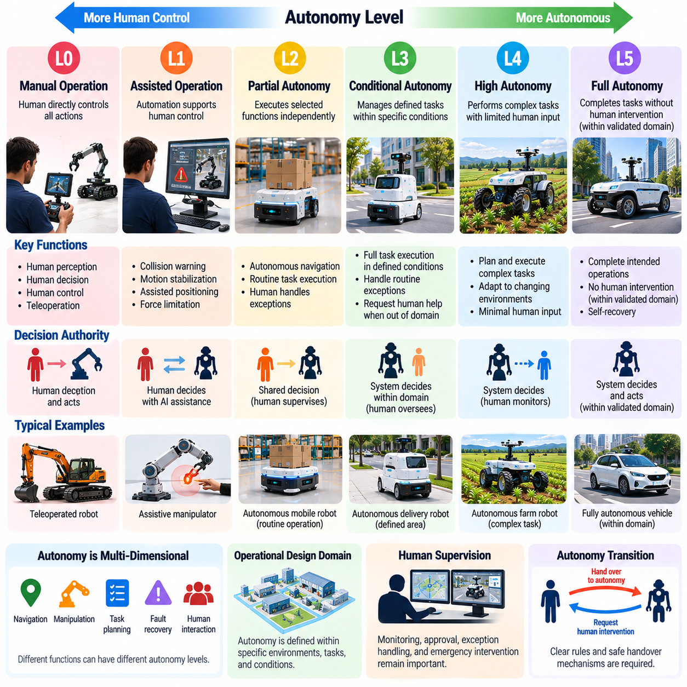{width="7.268055555555556in" height="7.268055555555556in"}

Autonomy level is a fundamental dimension of Physical AI taxonomy because it describes how independently an intelligent system can perceive, decide, and act in the physical world. Autonomy is not simply the absence of human control. It reflects the distribution of responsibilities between human operators and machines, including decision authority, environmental understanding, task execution, and responses to unexpected conditions.

A taxonomy by autonomy level provides a structured way to distinguish manually operated, assisted, partially autonomous, conditionally autonomous, and highly autonomous systems. These categories describe functional independence rather than mechanical complexity or computational performance. A sophisticated robot may require continuous supervision, while a relatively simple platform may perform a narrow task independently within a controlled environment.

At the lowest autonomy level, human operators retain direct responsibility for perception, decision-making, and physical actions. Teleoperated robots illustrate this category because their movements depend primarily on human commands. The system may provide video feedback, sensor measurements, and basic protective functions, but meaningful task decisions remain under human authority. Communication reliability and operator awareness are essential.

Assisted operation introduces automated functions that support human control without replacing human decision authority. Examples include collision warnings, motion stabilization, assisted positioning, and force-limited manipulation. These functions reduce operator workload and improve consistency while preserving human responsibility for task objectives. Assistance may operate continuously, but the system does not independently manage the complete task.

Partial autonomy allows a Physical AI system to execute selected functions independently while humans remain responsible for supervision or complementary activities. A mobile robot may follow a planned route autonomously while an operator handles unusual obstacles or task exceptions. The boundary between automated and human-controlled functions must be explicit. Safe operation depends on reliable monitoring and predictable transitions of control.

Conditional autonomy enables a system to manage defined tasks within specified operating conditions, including some environmental changes and routine exceptions. Human intervention may be required when conditions exceed the validated operating domain. Such systems must recognize their limitations and communicate intervention requests appropriately. Their autonomy is meaningful but remains dependent on operational boundaries and available fallback mechanisms.

High autonomy describes systems capable of planning and executing complex tasks with limited human involvement across a broad range of anticipated conditions. These systems integrate perception, prediction, planning, and feedback control to manage changing environments. However, high autonomy does not imply unrestricted competence. Performance remains bounded by the system\'s validated capabilities, available resources, and safety constraints.

Full autonomy is often discussed as the ability to complete intended operations without human intervention across the entire relevant operating domain. This concept requires careful qualification because no physical system can guarantee successful operation under every conceivable condition. A defensible autonomy claim must specify the tasks, environments, disturbances, and failures covered by validation rather than suggesting unlimited intelligence.

Autonomy should be understood as a multidimensional capability rather than a single universal score. Navigation, manipulation, task planning, fault recovery, and human interaction may exhibit different degrees of independence. A robot may navigate autonomously but require operator approval before manipulating hazardous equipment. Therefore, autonomy classifications should identify the specific functions and conditions to which each level applies.

Operational design domains are essential for interpreting autonomy levels. An autonomous warehouse robot may operate reliably within mapped indoor facilities but lack the capability to navigate unfamiliar outdoor terrain. Its autonomy level cannot be separated from environmental constraints, permitted tasks, and expected disturbances. Classification should distinguish independence within a defined domain from the ability to generalize beyond that domain.

Human supervision remains important even when machines execute tasks independently. Supervisory control may involve monitoring performance, authorizing sensitive actions, managing exceptions, and initiating emergency intervention. The required supervision intensity depends on operational risk and system reliability. Clear responsibility allocation prevents confusion about whether humans or autonomous controllers are expected to detect and resolve failures.

Autonomy transitions introduce particular safety challenges because responsibility may shift between human operators and automated systems. A transition must account for operator awareness, communication delays, system state, and available response time. Poorly designed handovers can create dangerous gaps in control. Effective architectures therefore define explicit intervention conditions, fallback behaviors, and mechanisms for maintaining safe states.

Decision-making autonomy is distinct from motion automation. A robot following a predefined trajectory may execute movements without continuous commands but possess limited ability to select goals or adapt its strategy. Higher decision autonomy involves interpreting task objectives, evaluating alternatives, and modifying plans according to environmental feedback. This distinction prevents repetitive automation from being confused with adaptive physical intelligence.

Learning and adaptation introduce further complexity into autonomy classification. A system may autonomously execute a fixed policy without learning from experience, while another may update its behavior through carefully controlled adaptation. Learning capability does not automatically establish a higher autonomy level. Classification must consider whether policy changes are validated, monitored, reversible, and consistent with operational safety requirements.

Fault handling provides an important indicator of practical autonomy. Systems with limited autonomy may stop and request assistance whenever unexpected conditions occur. More capable systems can diagnose certain faults, replan operations, or recover from disturbances independently. Nevertheless, autonomous recovery must remain within verified limits. When safe recovery is impossible, the system should transition to an appropriate protective state.

Autonomy evaluation requires more than measuring task completion under ideal conditions. Testing should examine environmental variation, unexpected obstacles, sensor degradation, communication interruptions, and operational exceptions. Metrics may include intervention frequency, task success, recovery effectiveness, safety violations, and time spent operating independently. Evidence should demonstrate reliable behavior within clearly stated operational boundaries.

Safety assurance and governance become increasingly significant as autonomy expands. Greater decision authority can increase the consequences of incorrect perception, planning, or control. Physical AI systems therefore require risk assessment, traceable decisions, operational monitoring, and defined accountability. Autonomy should be introduced progressively through testing and validation rather than assumed from model sophistication or marketing descriptions.

Autonomy levels must also be interpreted carefully across industries because task risks and regulatory expectations differ. Autonomous navigation in a controlled warehouse is not equivalent to autonomous operation around patients or public-road users. Domain-specific standards may define their own terminology and criteria. A general Physical AI taxonomy should therefore serve as a conceptual framework rather than replace established industry classifications.

Multi-robot systems introduce collective autonomy, where individual robots and coordinating infrastructure share operational decisions. A fleet may independently allocate tasks, manage routes, and respond to changing resource availability. Individual robots can have different autonomy capabilities from the overall system. Evaluating collective autonomy requires considering coordination reliability, communication dependencies, conflict resolution, and system-level recovery.

Ultimately, taxonomy by autonomy level explains how Physical AI systems distribute perception, decision-making, execution, and responsibility between humans and machines. It distinguishes automated behavior from adaptive independence while emphasizing operational boundaries and safety assurance. A rigorous autonomy classification supports system design, capability evaluation, human supervision, and trustworthy deployment across diverse physical environments.

## 05.07. Taxonomy by AI Capability

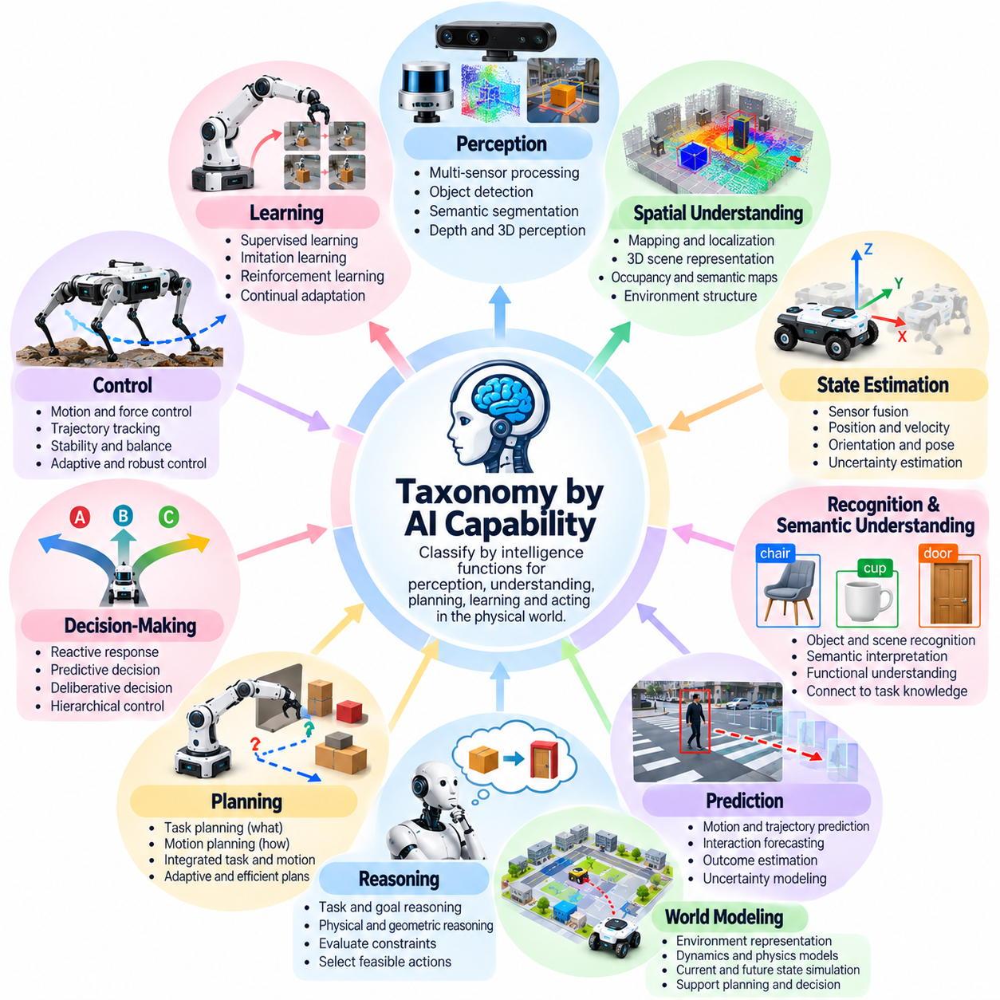{width="7.268055555555556in" height="7.268055555555556in"}

AI capability provides a fundamental dimension for classifying Physical AI systems according to the intelligence functions they can perform. Unlike classifications based on embodiment or application, capability-based taxonomy examines how systems perceive, understand, predict, plan, learn, and act. This perspective helps distinguish simple automation from adaptive intelligence while identifying the functional requirements of increasingly sophisticated physical agents.

A capability-based taxonomy should describe observable system functions rather than assume intelligence from model size or hardware performance. A robot equipped with powerful processors may still execute only predefined routines, while a smaller system may demonstrate advanced environmental adaptation. Meaningful classification therefore depends on validated behaviors, operational conditions, task complexity, and the integration of multiple cognitive and physical capabilities.

Perception is a foundational AI capability because physical agents must interpret sensory information before taking appropriate actions. Perception systems process camera images, LiDAR measurements, depth observations, tactile signals, and other sensor inputs. Their outputs may include object detection, semantic segmentation, pose estimation, and obstacle recognition. Reliable perception enables an agent to maintain awareness of relevant environmental conditions.

Spatial understanding extends perception by representing relationships among objects, surfaces, obstacles, and operating regions. Physical AI systems may construct geometric maps, semantic maps, occupancy representations, or three-dimensional scene models. These representations support localization, navigation, manipulation, and collision avoidance. Spatial intelligence becomes especially important when environments change or observations remain incomplete.

State estimation enables an agent to infer its current condition and the states of surrounding objects from imperfect measurements. Sensor fusion combines information from cameras, inertial sensors, encoders, and other sources to improve reliability. The estimated state may include position, velocity, orientation, contact conditions, and uncertainty. Accurate state estimation supports stable control and informed decision-making.

Recognition and semantic understanding allow Physical AI systems to associate observed entities with meaningful categories, functions, and relationships. Recognizing a door is different from understanding that it provides access between rooms. Semantic intelligence connects physical observations with task-relevant knowledge. This capability supports object selection, environment interpretation, and the execution of instructions expressed in human language.

Prediction is a higher-level capability that estimates how physical states may evolve over time. A robot may predict pedestrian movement, object trajectories, contact outcomes, or the effects of its own actions. Predictive models can support proactive planning and reduce reliance on purely reactive responses. Their usefulness depends on prediction accuracy, uncertainty estimation, and the time horizon relevant to the task.

World modeling integrates perception, state estimation, dynamics, and contextual knowledge into representations of the environment. A world model may describe current conditions while predicting possible future states under alternative actions. Such models support planning, simulation, and decision-making under uncertainty. Their capabilities vary from simple geometric representations to learned models of complex physical interactions.

Reasoning enables Physical AI systems to evaluate relationships, constraints, and possible courses of action. Task reasoning may involve determining prerequisites, interpreting goals, or selecting suitable tools. Physical reasoning considers geometry, gravity, friction, contact, and mechanical feasibility. Effective reasoning must remain connected to sensory evidence and physical constraints rather than relying exclusively on abstract symbolic descriptions.

Planning transforms goals into sequences of actions that can be executed within physical constraints. Task planning determines what activities should occur, while motion planning determines how a system can move safely between configurations. More advanced systems integrate both levels to account for dependencies between decisions and movements. Planning capability is evaluated through feasibility, efficiency, adaptability, and execution success.

Decision-making determines which action a Physical AI system should perform when several alternatives are available. Reactive decisions respond directly to current observations, whereas predictive decisions consider anticipated consequences. Deliberative decisions evaluate longer-term objectives and constraints. These approaches may coexist within hierarchical architectures, allowing rapid responses while preserving consistency with broader operational goals.

Control intelligence converts selected actions into physical movements and interactions. Controllers regulate actuator commands, trajectories, forces, and stability using feedback from sensors. Adaptive or learning-based controllers may compensate for disturbances and changing dynamics. However, intelligent control must operate within verified physical limits, particularly when systems interact with people, equipment, or uncertain environments.

Learning capability describes how Physical AI systems acquire or improve behaviors through data and experience. Supervised learning, imitation learning, reinforcement learning, and self-supervised learning provide different mechanisms for acquiring useful representations or policies. Learning may occur during development or through controlled adaptation after deployment. The presence of learning does not automatically establish general intelligence or operational autonomy.

Adaptation differs from learning because a system may adjust behavior without permanently modifying its underlying model. Online parameter adjustment, replanning, and feedback compensation can provide adaptation to changing conditions. Continual learning may extend these capabilities by updating knowledge over time. Classification should distinguish temporary behavioral adjustment from persistent improvements and evaluate whether changes remain safe and reliable.

Interaction intelligence addresses coordination with humans, robots, and surrounding infrastructure. Human-robot interaction may require interpreting gestures, speech, intentions, and social expectations. Multi-robot coordination involves task allocation, shared information, and conflict resolution. These capabilities extend intelligence beyond individual perception and control toward collaborative behavior within complex operational environments.

Language and multimodal intelligence allow physical agents to connect natural-language instructions with visual observations and executable actions. Vision-language models may support object identification and task interpretation, while vision-language-action models may directly inform action generation. Such capabilities can improve flexibility, but language understanding alone does not guarantee accurate physical execution or safe interaction.

Generalization describes the ability to apply learned capabilities to situations beyond those encountered during training. A system may generalize across object appearances, lighting conditions, layouts, or related tasks. Transfer across different robot embodiments presents additional challenges involving geometry and actuator dynamics. Generalization should be evaluated through controlled tests that distinguish genuine adaptability from performance on familiar conditions.

Capability integration is essential because individual AI functions rarely operate independently in practical Physical AI systems. Perception informs state estimation, world models support prediction, planning selects actions, and control executes them. Feedback continuously updates the process. A system with strong individual models may still perform poorly if interfaces, timing, uncertainty handling, or coordination between components are inadequate.

Capability maturity should be assessed using task-specific evidence rather than broad descriptions such as intelligent or advanced. Relevant measures include perception accuracy, prediction error, planning success, control stability, adaptation effectiveness, and robustness under environmental variation. Evaluation must also examine latency, resource consumption, failure recovery, and safety. These measurements help establish meaningful capability profiles.

Ultimately, taxonomy by AI capability provides a multidimensional framework for understanding the functional intelligence of Physical AI systems. It distinguishes perception, spatial understanding, prediction, reasoning, planning, control, learning, adaptation, and interaction while recognizing their interdependence. This classification supports architecture development, capability benchmarking, technology comparison, and systematic progress toward reliable physical intelligence.

## 05.08. Reactive Predictive and Deliberative AI

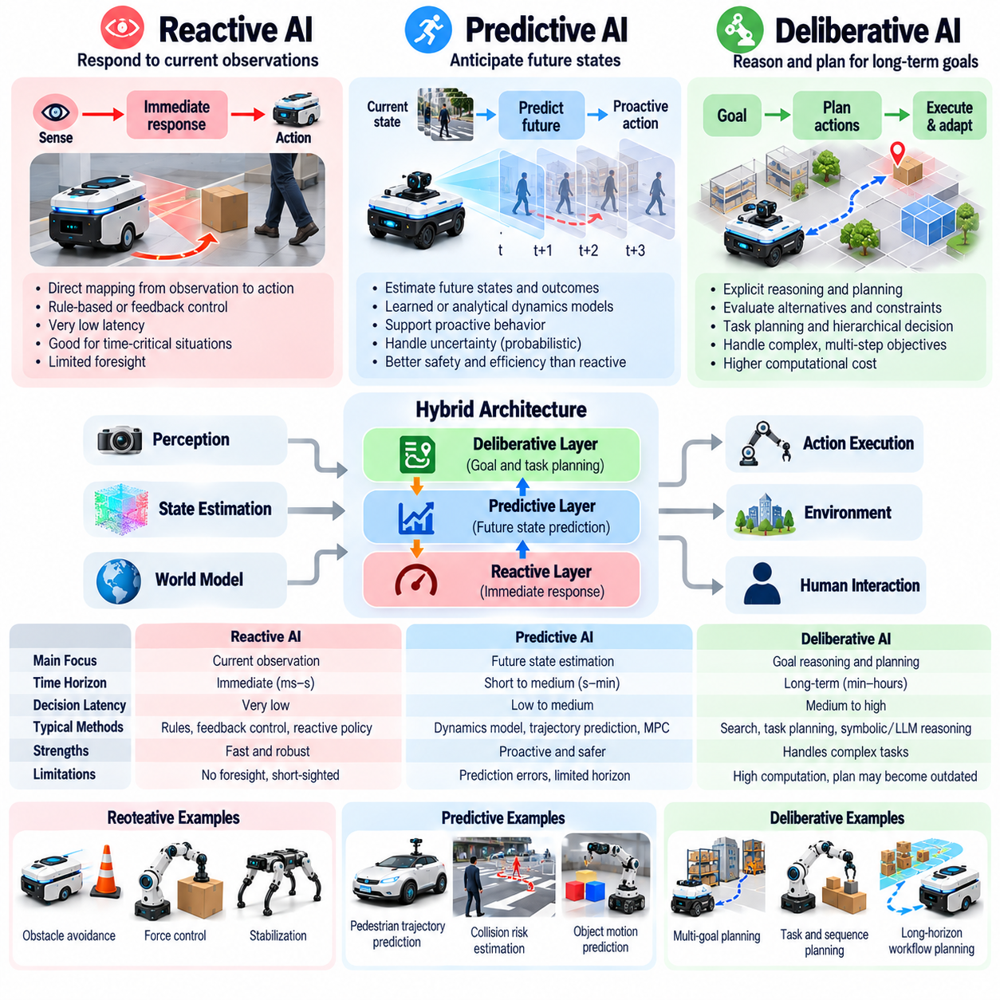{width="7.268055555555556in" height="7.268055555555556in"}

Reactive, predictive, and deliberative AI represent three complementary approaches to decision-making in Physical AI systems. They differ primarily in how an intelligent agent uses current observations, anticipated future states, and explicit reasoning to select actions. This classification provides a foundation for understanding the relationship between response speed, environmental uncertainty, planning complexity, and operational autonomy.

Reactive AI selects actions primarily from current sensory observations and immediate environmental conditions. Its behavior is often governed by predefined rules, feedback controllers, or learned policies that map observations directly to actions. Reactive systems are particularly useful when rapid responses are essential. Obstacle avoidance, collision prevention, and stabilization illustrate applications where immediate action may take priority over extended reasoning.

The principal advantage of reactive intelligence is its relatively low decision latency and direct connection to environmental feedback. A mobile robot can adjust its velocity when an obstacle appears, while a manipulator can reduce applied force after detecting unexpected contact. However, reactive behavior may become inefficient when successful action requires anticipating future events or coordinating several dependent tasks.

Predictive AI extends reactive intelligence by estimating how the physical environment may evolve over time. Instead of responding exclusively to current observations, predictive systems evaluate possible future states and consequences of candidate actions. They may use learned dynamics models, trajectory prediction, or probabilistic estimation. This capability supports proactive behavior when immediate observations do not fully reveal emerging risks.

In autonomous navigation, predictive intelligence can estimate pedestrian trajectories, vehicle movements, and potential collision regions. A robot may reduce speed before a crossing pedestrian enters its path rather than waiting for an immediate obstacle. Such behavior requires uncertainty-aware prediction because human actions and environmental dynamics cannot be known precisely. Prediction quality directly influences planning reliability.

Predictive control provides an important engineering example through model predictive control, commonly called MPC. This approach repeatedly estimates future system behavior over a limited horizon, optimizes candidate control actions, and executes an appropriate initial action. The process is repeated as new observations become available. Its effectiveness depends on model fidelity, optimization speed, constraint handling, and feedback quality.

World models provide another foundation for predictive Physical AI. They represent relevant environmental states and estimate how those states may change under different actions. A manipulation system may predict whether an object will slip, rotate, or collide during handling. Learned world models can support planning under uncertainty, although prediction errors may accumulate over longer horizons or unfamiliar physical conditions.

Deliberative AI emphasizes explicit reasoning about objectives, constraints, alternatives, and action sequences. Rather than selecting only an immediate response, a deliberative system constructs plans that connect current conditions with desired outcomes. Task planning, symbolic reasoning, search algorithms, and hierarchical decision-making are common mechanisms. This approach is particularly valuable when tasks involve dependencies and competing objectives.

A warehouse robot performing several deliveries illustrates deliberative intelligence. The system may determine delivery priorities, choose destinations, allocate resources, and revise its task sequence when operational conditions change. These decisions require consideration of broader goals beyond immediate navigation. Deliberative planning therefore connects local physical actions with long-term operational objectives and workflow constraints.

The main limitation of deliberative AI is the computational and informational cost of evaluating alternative plans. Complex environments may contain too many possible states and actions for exhaustive reasoning. Plans can also become outdated when conditions change unexpectedly. Practical deliberative systems therefore rely on abstractions, hierarchical decomposition, bounded computation, and periodic replanning to maintain operational relevance.

Reactive, predictive, and deliberative approaches should not be interpreted as mutually exclusive intelligence levels. They describe different decision-making mechanisms rather than a universal ranking of system sophistication. A reactive controller may outperform a complex planner in a time-critical stabilization task. Conversely, predictive or deliberative reasoning may be essential when immediate reactions cannot ensure successful completion of a larger objective.

Hybrid architectures combine these approaches to exploit their complementary strengths. A deliberative layer selects goals and task sequences, a predictive layer evaluates future trajectories and constraints, and a reactive layer handles immediate disturbances. Information flows between these layers through observations, state estimates, plans, and feedback. Effective integration requires consistency between high-level intentions and low-level physical execution.

Time horizon provides a useful dimension for comparing the three approaches. Reactive decisions typically address immediate conditions, predictive decisions evaluate possible developments over a defined future interval, and deliberative decisions consider extended task sequences. These horizons may overlap substantially. Classification should therefore examine how future information is represented and used rather than assign rigid timing boundaries to each approach.

Environmental uncertainty affects the suitability of each decision-making strategy. Reactive control can remain effective when rapid feedback is available, while prediction becomes valuable when delays or dynamic obstacles require anticipation. Deliberation supports structured decisions involving multiple constraints. Under severe uncertainty, systems may need to combine conservative reactive safeguards with probabilistic predictions and flexible planning.

Learning-based methods can enhance all three approaches. Reactive policies may be trained through reinforcement learning or imitation learning, predictive models may learn physical dynamics from observations, and deliberative systems may use learned representations to guide search. However, learning does not eliminate the need for validation. Each approach must demonstrate reliable behavior under relevant physical conditions and operational constraints.

Safety engineering benefits from separating immediate protective behavior from predictive and deliberative functions. Emergency stopping, force limitation, and stability protection may require independently assured control mechanisms. Predictive systems can identify emerging hazards, while deliberative systems can select safer task strategies. Safety-critical responses should not depend exclusively on computationally expensive reasoning that may fail to complete within required deadlines.

Evaluation should reflect the distinctive responsibilities of each approach. Reactive intelligence can be assessed through response latency, disturbance rejection, and immediate hazard avoidance. Predictive intelligence requires measurements of forecast accuracy, uncertainty calibration, and trajectory feasibility. Deliberative intelligence can be evaluated through plan validity, task completion, resource efficiency, and replanning effectiveness under changing conditions.

Real-world Physical AI systems must also coordinate decision-making with sensing and actuation limitations. Sensor delays can undermine reactive responses, inaccurate dynamics can degrade prediction, and incomplete task information can weaken deliberation. Computing resources and communication constraints further influence architectural choices. Effective intelligence therefore depends on matching each reasoning mechanism to the physical system\'s timing and reliability requirements.

Multi-robot environments extend these distinctions to collective decision-making. Individual robots may react to nearby obstacles, predict the movement of neighboring agents, and participate in deliberative task allocation. Coordination requires shared information and mechanisms for resolving conflicting plans. A distributed architecture must also tolerate communication delays and temporary disconnections without compromising local safety.

Ultimately, reactive, predictive, and deliberative AI form a complementary framework for understanding how Physical AI systems transform observations and objectives into physical actions. Reactive mechanisms provide immediate responsiveness, predictive mechanisms enable anticipation, and deliberative mechanisms organize purposeful behavior. Their coordinated integration supports intelligent agents capable of operating safely, efficiently, and adaptively in complex physical environments.

## 05.09. Taxonomy by Learning and Adaptation

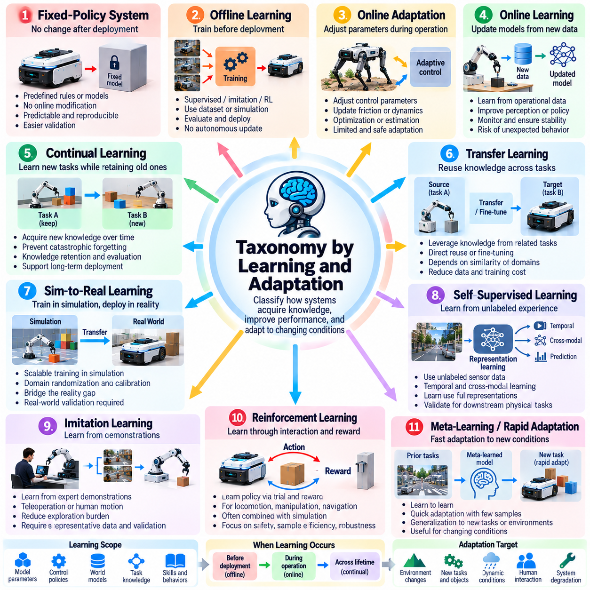{width="7.268055555555556in" height="7.268055555555556in"}

Learning and adaptation provide essential dimensions for classifying Physical AI systems according to how they acquire knowledge, improve performance, and respond to changing physical conditions. Unlike classifications based solely on autonomy or embodiment, this taxonomy examines whether intelligence remains fixed after deployment or evolves through experience. It distinguishes learned capabilities, adaptive behavior, and the mechanisms governing their operational reliability.

Learning refers to acquiring representations, models, or policies from data and experience, while adaptation describes adjustments to behavior under changing conditions. These processes are related but not identical. A robot may adapt through feedback control without updating its learned model, while another may learn improved policies during offline training. Meaningful classification must identify what changes, when changes occur, and how their effects are evaluated.

Fixed-policy systems represent a foundational category in this taxonomy. Their operating rules, model parameters, or control policies remain unchanged during deployment. Such systems may incorporate sophisticated neural networks trained beforehand, but they do not independently modify their learned behavior during operation. Their advantages include predictable configuration management, reproducible testing, and relatively straightforward validation of defined operating conditions.

Offline learning systems acquire capabilities through datasets, simulations, or recorded demonstrations before deployment. Supervised learning may support perception, imitation learning may reproduce expert behavior, and reinforcement learning may optimize task policies. Once training is completed, the resulting model is evaluated and deployed. Improvements generally require a separate training, validation, and release process rather than autonomous modification during field operation.

Online adaptation systems adjust selected parameters or behaviors while operating in the physical environment. Examples include modifying controller gains, updating friction estimates, or changing navigation strategies in response to environmental conditions. These adjustments may rely on optimization or estimation rather than machine learning. Their classification should reflect the scope, speed, reversibility, and safety boundaries of adaptation.

Online learning differs from parameter adaptation because the system updates learned models or policies using newly collected operational data. A robot may refine object recognition, estimate unfamiliar dynamics, or improve task selection from repeated experience. Online learning can increase flexibility but introduces risks involving unstable updates, data quality, and unexpected behavior. Safe deployment requires monitoring, bounded updates, and mechanisms for recovery.

Continual learning addresses the acquisition of new knowledge across successive tasks and operating periods while preserving previously learned capabilities. Physical AI systems may encounter unfamiliar objects, environments, or operating procedures throughout their service lives. A major challenge is catastrophic forgetting, where learning new information degrades earlier performance. Continual learning therefore requires strategies for knowledge retention, evaluation, and controlled integration.

Transfer learning enables knowledge acquired in one task or environment to support another. A perception model trained on diverse objects may be adapted to a specialized industrial setting, while a manipulation policy may transfer between related tasks. Transfer effectiveness depends on similarities in observations, dynamics, and objectives. Classification should distinguish direct reuse, fine-tuning, and adaptation requiring substantial additional training.

Sim-to-real learning concerns the transfer of capabilities developed in simulation to physical systems. Simulated environments provide scalable opportunities for exploration, data generation, and policy optimization without exposing hardware to every training failure. However, differences in friction, sensing, contact dynamics, and actuator behavior create a reality gap. Domain randomization, calibration, and real-world validation help reduce this discrepancy.

Self-supervised learning allows Physical AI systems to extract useful representations from sensor observations without requiring extensive manual labeling. Temporal consistency, cross-modal correspondence, and prediction of missing information can provide learning signals. Such methods are valuable for large collections of robot experience. However, representations learned from observational structure must still be evaluated against the physical tasks they are intended to support.

Imitation learning acquires behavior from expert demonstrations, including teleoperation records, human motion observations, or previously successful robot trajectories. It can reduce the exploration burden associated with learning complex physical skills. Nevertheless, performance may degrade when deployed states differ from demonstrations. Robust imitation learning therefore requires representative training data, appropriate recovery strategies, and validation beyond familiar examples.

Reinforcement learning develops policies through interactions guided by reward signals or task objectives. It can support locomotion, manipulation, navigation, and sequential decision-making. Exploration in physical environments may be expensive or hazardous, so training often combines simulation, offline experience, and controlled hardware trials. Reward design, sample efficiency, constraint satisfaction, and policy robustness are central evaluation concerns.

Meta-learning and rapid adaptation focus on acquiring mechanisms that enable efficient adjustment to unfamiliar tasks or conditions. Instead of learning only a single behavior, a system learns representations or initialization strategies that support faster subsequent learning. Such approaches may benefit robots encountering new objects or changing dynamics. Their practical value depends on adaptation speed, data requirements, and reliability under distribution shifts.

Embodiment-aware learning recognizes that acquired skills depend on physical structure, sensors, actuators, and mechanical constraints. A policy developed for a wheeled robot cannot automatically operate a legged platform, while manipulation strategies may depend on gripper geometry and contact properties. Cross-embodiment learning seeks reusable representations across different platforms. Effective transfer requires explicit consideration of physical compatibility and control limitations.

Fleet learning extends adaptation beyond individual robots by combining experience collected across multiple deployed systems. Shared observations may reveal recurring failures, environmental variations, or opportunities for improved policies. Centralized training can distribute validated updates to selected robots, while federated approaches may limit raw-data exchange. Fleet learning requires data governance, version control, compatibility assessment, and controlled rollout procedures.

Learning and adaptation can also be classified by temporal scale. Fast adaptation may adjust control parameters within milliseconds or seconds, while operational learning may occur across repeated tasks or daily deployments. Long-term learning may require extensive data accumulation and periodic model releases. These categories overlap, but distinguishing response times helps determine computational requirements, validation strategies, and appropriate operational safeguards.

The degree of learning autonomy provides another classification dimension. Some systems only collect data for human-supervised retraining, while others automatically propose model updates for approval. More autonomous systems may perform bounded adaptation during operation. These distinctions concern authority over model modification rather than task execution alone. Approval mechanisms, audit records, and rollback capabilities become increasingly important as update autonomy increases.

Safety and reliability determine whether adaptive capabilities are suitable for real-world deployment. Learning systems must account for distribution shifts, sensor degradation, unsafe exploration, and unexpected interactions. Safety constraints may restrict permissible parameter changes or require fallback to validated policies. Continuous monitoring and staged evaluation help identify performance deterioration before it creates unacceptable physical risks.

Evaluation of learning and adaptation should examine more than improvement on a training benchmark. Relevant measures include adaptation speed, sample efficiency, knowledge retention, transfer success, robustness, and recovery from unsuccessful updates. Testing should include unfamiliar conditions and repeated operational cycles. Reproducibility, model provenance, and performance comparisons against fixed baselines provide evidence of genuine learning benefits.

Ultimately, taxonomy by learning and adaptation distinguishes Physical AI systems according to when they learn, what they modify, how knowledge transfers, and who controls behavioral changes. Fixed policies, offline learning, online adaptation, continual learning, and collective learning represent complementary capability profiles rather than a single progression. This framework supports systematic architecture design, reliable evaluation, and responsible deployment of evolving physical intelligence.

## 05.10. Taxonomy by Compute Architecture

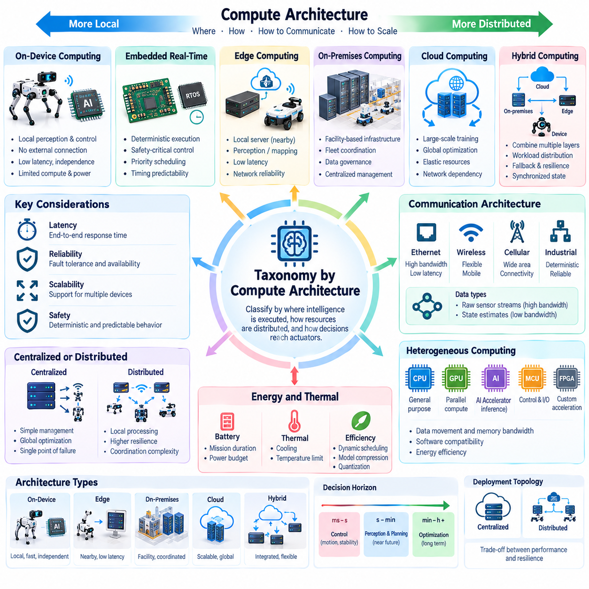{width="7.268055555555556in" height="7.268055555555556in"}

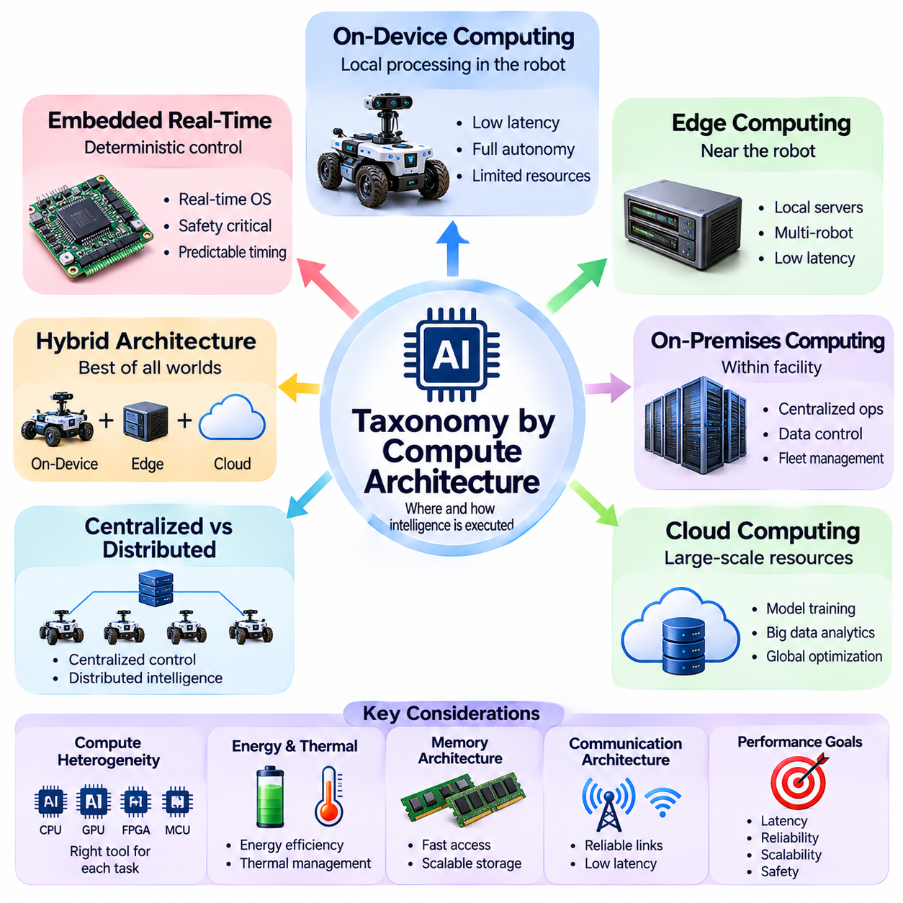{width="7.268055555555556in" height="7.268055555555556in"}

Compute architecture provides a fundamental dimension for classifying Physical AI systems according to where intelligence is executed, how computational resources are distributed, and how decisions reach physical actuators. Unlike capability-based classifications, this taxonomy examines deployment topology, processing locality, communication dependencies, and operational constraints. These factors directly influence latency, reliability, scalability, and safety.

On-device computing places perception, decision-making, and control functions within the robot or physical machine. Embedded processors, microcontrollers, and specialized accelerators execute tasks without requiring continuous external connectivity. This architecture supports predictable response times and local operational independence. However, computing capacity, memory, power consumption, and thermal limits constrain the complexity of deployable models.

Embedded real-time architectures prioritize deterministic execution of safety-critical and motion-control functions. Microcontrollers and real-time processors handle actuator commands, sensor sampling, emergency responses, and feedback loops. Scheduling mechanisms establish deadlines and execution priorities. Their effectiveness depends on worst-case execution time, timing predictability, fault isolation, and compatibility with the physical system\'s control requirements.

Edge computing distributes selected intelligence functions to computing infrastructure located near robots and sensors. Edge servers may perform perception fusion, local mapping, trajectory optimization, or coordination across multiple machines. This arrangement provides additional processing capacity without relying entirely on distant cloud services. Its advantages depend on network reliability, communication latency, and the availability of local computing resources.

On-premises computing uses infrastructure deployed within a facility to support operational intelligence across an industrial environment. Local servers may maintain shared maps, coordinate robot fleets, process sensor streams, and execute computationally demanding models. Data can remain within organizational boundaries when required. This architecture is particularly useful when facilities need centralized coordination while maintaining control over connectivity and information governance.

Cloud computing provides elastic processing resources for model training, large-scale simulation, historical analysis, and fleet-wide optimization. Cloud platforms can aggregate experience across deployments and support computational workloads exceeding local hardware capacity. However, network delays and service availability make remote execution unsuitable as the sole mechanism for time-critical physical control. Cloud functions must therefore be assigned according to operational risk and timing requirements.

Hybrid computing architectures combine on-device, edge, on-premises, and cloud resources within a coordinated system. Immediate control remains close to actuators, while demanding perception or planning workloads may execute on nearby servers. Cloud infrastructure supports longer-term learning and global optimization. Successful hybrid operation requires explicit responsibility boundaries, synchronized state information, and reliable fallback behavior when communication becomes unavailable.

Compute placement should reflect the temporal requirements of each intelligence function. Motor control may require submillisecond or millisecond scheduling, while perception and local planning operate over longer intervals. Fleet coordination and global optimization can tolerate different response times. These examples are workload-dependent rather than universal limits. Architectural design must evaluate end-to-end latency, timing variation, and worst-case behavior.

Communication architecture strongly influences distributed Physical AI performance. Ethernet, industrial networks, wireless links, and cellular connections offer different bandwidth, latency, and reliability characteristics. Transferring raw sensor streams may consume substantial network capacity, whereas transmitting compact state estimates can reduce communication overhead. Designers must balance information fidelity, synchronization accuracy, processing locality, and network resilience.

Centralized architectures consolidate major intelligence functions within a shared computing system. This arrangement simplifies resource management, global optimization, and consistency across connected devices. However, centralized processing may introduce communication bottlenecks and common points of failure. Distributed architectures allocate processing among multiple nodes, improving locality and potentially increasing resilience, although coordination and state consistency become more challenging.

Heterogeneous computing combines processors optimized for different workloads. CPUs handle general-purpose logic and orchestration, GPUs accelerate parallel neural-network operations, and specialized AI accelerators improve selected inference tasks. Microcontrollers and programmable logic may support deterministic control and sensor interfaces. Effective architecture design must consider data movement, software compatibility, memory bandwidth, and energy efficiency alongside raw computational throughput.

Energy and thermal constraints are especially important for mobile Physical AI platforms. High-performance inference can increase battery consumption, cooling requirements, and hardware weight. Dynamic workload scheduling, model compression, quantization, and selective acceleration can reduce resource demands. Computing decisions should account for mission duration, available power, environmental temperature, and the tradeoff between model performance and operational endurance.

Memory architecture also affects the feasibility of deploying advanced AI models. Large perception networks, multimodal models, and world models may require substantial memory capacity and bandwidth. Moving data between sensors, processors, and memory can become a major performance bottleneck. Architectural evaluation should consider model size, intermediate representations, caching, storage access, and whether workloads can execute without exceeding available resources.

Reliability and fault tolerance distinguish practical compute architectures from purely performance-oriented designs. Local safety functions should remain available when remote servers or communication links fail. Redundant components, health monitoring, watchdog mechanisms, and graceful degradation can help preserve essential operations. Fault containment boundaries must prevent failures in noncritical intelligence workloads from disrupting protective functions or deterministic control.

Security requirements vary according to computing location and connectivity. On-device systems require secure boot, protected model storage, and controlled software updates. Distributed systems additionally need authenticated communication, network segmentation, access control, and secure data exchange. Cloud-connected deployments introduce broader identity and service-management concerns. Security architecture must protect both digital information and the physical consequences of compromised commands.

Scalability becomes critical when Physical AI expands from individual robots to coordinated fleets. A single robot may rely on embedded computing, while larger deployments require shared services for scheduling, mapping, monitoring, and optimization. Increasing robot counts can produce nonlinear communication and processing demands. Scalable architectures therefore use workload partitioning, distributed coordination, capacity planning, and selective aggregation of operational information.

Compute architecture also influences the deployment and maintenance of learning systems. Training may occur on centralized accelerators, while validated models are distributed to edge devices for inference. Model registries, version control, staged rollout, and rollback mechanisms help maintain consistency across deployments. Online adaptation requires additional controls to distinguish temporary operational adjustments from persistent changes to deployed model behavior.

Evaluation of compute architectures should extend beyond processor benchmarks. Relevant measures include end-to-end response latency, deadline compliance, inference throughput, energy consumption, memory utilization, network availability, and recovery performance. Tests should examine degraded connectivity, peak workloads, and simultaneous robot operations. A suitable architecture is one that satisfies validated physical requirements rather than simply maximizing computational capacity.

Ultimately, taxonomy by compute architecture describes how Physical AI distributes intelligence across embedded devices, edge infrastructure, on-premises systems, and cloud platforms. Each arrangement offers different tradeoffs in responsiveness, resource availability, operational independence, and coordination. Hybrid designs often combine these strengths, but their success depends on disciplined workload allocation, dependable communication, safety isolation, and measurable system-level performance.

## 05.11. Single Robot Fleet and Swarm Intelligence

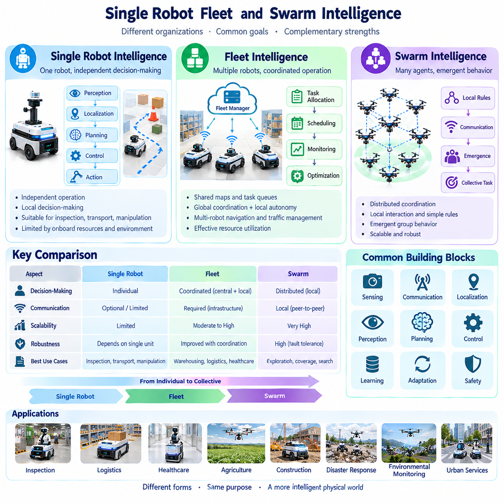{width="7.268055555555556in" height="7.268055555555556in"}

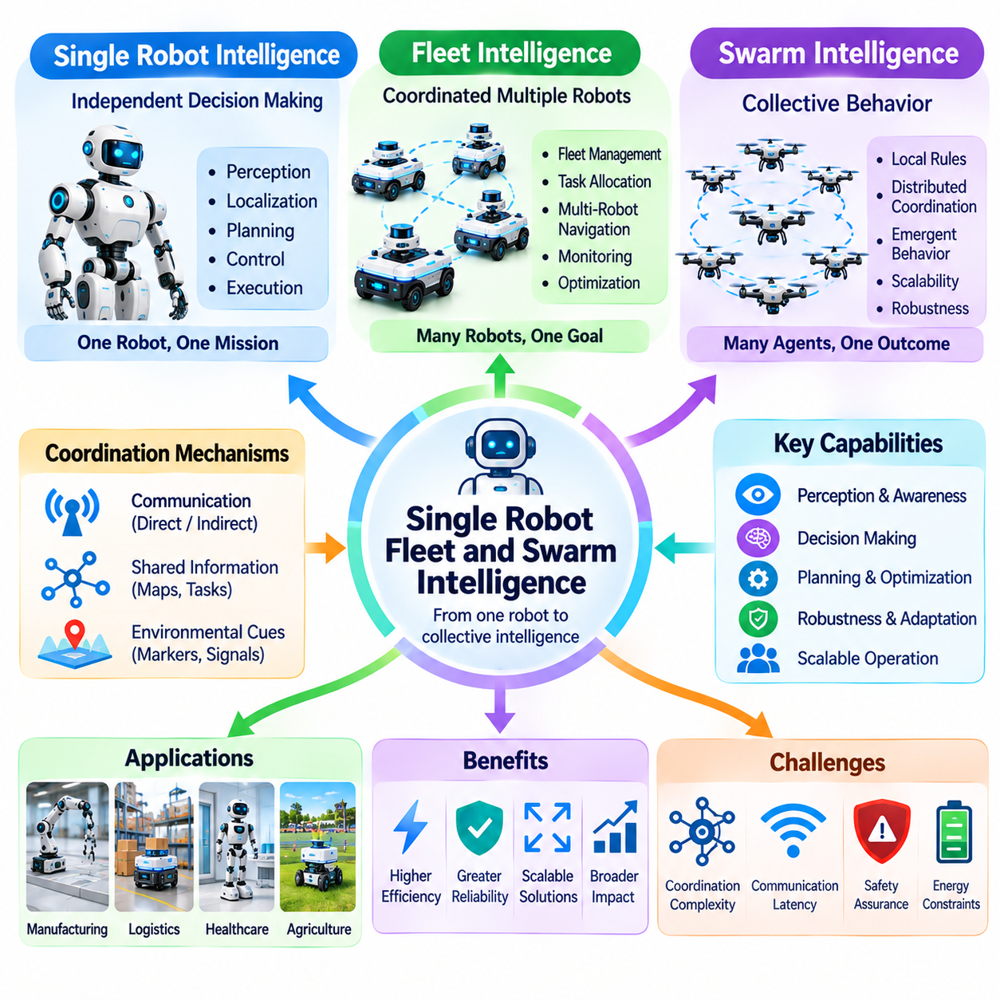{width="7.268055555555556in" height="7.268055555555556in"}

Single-robot, fleet, and swarm intelligence represent distinct organizational forms of Physical AI, classified by how autonomous agents distribute decisions, coordinate actions, and pursue objectives. A single robot operates as an individual decision-making unit, while a fleet coordinates multiple robots through shared management. Swarm intelligence emphasizes collective behavior emerging from local interactions among agents.

Single-robot intelligence integrates perception, localization, planning, and control within one physical platform. The robot observes its surroundings, estimates its state, selects actions, and executes tasks according to its capabilities. External infrastructure may provide assistance, but operational responsibility remains centered on the individual agent. This architecture is suitable for independent inspection, transportation, and manipulation.

The effectiveness of single-robot intelligence depends on the consistency of its internal decision-making processes. Perception errors can affect planning, while control limitations can prevent successful execution. Local feedback helps correct disturbances and unexpected conditions. Although an individual robot may perform complex tasks autonomously, its capabilities remain constrained by onboard resources, environmental knowledge, and physical design.

Fleet intelligence extends individual autonomy through coordinated operation of multiple robots. A fleet management system may assign tasks, schedule missions, monitor status, and optimize resource utilization. Robots retain local control while receiving higher-level instructions from shared infrastructure. This architecture is common in warehouses, manufacturing facilities, hospitals, and logistics environments requiring organized robotic services.

Fleet coordination relies on maintaining a consistent operational view across participating robots. Shared maps, task queues, robot availability, battery levels, and traffic conditions inform allocation decisions. Centralized fleet managers can optimize system-wide objectives, but they also introduce communication dependencies. Effective fleet intelligence balances global coordination with sufficient local autonomy to handle immediate physical conditions.

Task allocation is a central capability of fleet intelligence. Assignments may consider robot location, payload capacity, battery condition, task priority, and expected completion time. Optimization methods can reduce travel distance, idle time, and resource conflicts. Dynamic allocation allows the fleet to respond when robots become unavailable or urgent requests emerge. Allocation quality should be evaluated against overall mission performance.

Multi-robot navigation introduces coordination problems absent from isolated robot operation. Several robots may compete for narrow passages, charging stations, or shared workspaces. Traffic management mechanisms regulate access, prevent deadlocks, and reduce congestion. Local collision avoidance remains necessary even when global routes are coordinated. Reliable operation requires consistent rules for priorities, reservations, and exception handling.

Swarm intelligence differs from conventional fleet management by emphasizing distributed coordination and collective patterns arising from local interactions. Individual agents follow relatively simple behavioral rules, communicate with nearby neighbors, or respond to environmental signals. The resulting group may accomplish tasks without a single controller directing every movement. However, swarm systems can also incorporate limited centralized guidance.

Biological systems provide useful inspiration for swarm intelligence. Ant colonies demonstrate distributed exploration and indirect coordination, while bird flocks illustrate collective motion through local interactions. Robotic swarms adapt selected principles into algorithms for aggregation, dispersion, formation, and cooperative exploration. Biological analogies guide design but do not automatically guarantee stable or efficient robotic behavior.

Swarm coordination may use direct communication, environmental markers, local sensing, or combinations of these mechanisms. Direct communication exchanges information between neighboring agents, while stigmergy coordinates behavior through changes in a shared environment. In digital robotic systems, virtual markers or shared spatial representations may approximate such signals. Communication design affects scalability, robustness, and coordination quality.

Decentralized decision-making is a defining characteristic of many swarm systems. Each agent selects actions using local observations and limited information about neighboring robots. This can reduce dependence on a central coordinator and support adaptation to changing group configurations. Nevertheless, local decisions may create undesirable global outcomes. Swarm algorithms therefore require analysis of convergence, stability, and collective safety.

Emergent behavior describes organized group-level patterns that arise from interactions among individual agents. Formation movement, collective transport, distributed coverage, and coordinated exploration can emerge without detailed centralized commands. Such behavior is not necessarily intelligent merely because it appears complex. Evaluation must establish whether the resulting patterns reliably achieve defined objectives under relevant environmental conditions.

Scalability distinguishes the operational challenges of single robots, fleets, and swarms. A single robot primarily manages internal resources, whereas fleets must coordinate growing numbers of tasks and devices. Swarms must preserve useful collective behavior as agent populations change. Communication overhead, synchronization demands, and computational complexity can limit expansion. Scalability therefore requires empirical validation rather than assumptions based on architecture.

Robustness and fault tolerance also differ across organizational forms. A single robot may stop when a critical component fails, while a fleet can sometimes reassign its tasks to another robot. Swarms may maintain partial functionality despite the loss of several agents. However, redundancy does not eliminate systemic risks. Shared software defects, communication failures, or unstable coordination rules can affect many robots simultaneously.

Collective perception enables multiple robots to combine observations into a broader understanding of their environment. Distributed sensing can improve spatial coverage, reveal hidden obstacles, and update shared maps. Data fusion requires careful treatment of localization errors, measurement uncertainty, and inconsistent timestamps. The benefits depend on sensor diversity, communication capacity, and the ability to reconcile conflicting observations.

Collective planning extends coordination beyond immediate movement toward shared objectives. Fleets may optimize schedules and resource assignments, while swarms may distribute exploration or coverage responsibilities through local interactions. Hybrid systems can combine centralized strategic planning with decentralized execution. The appropriate balance depends on task structure, communication reliability, agent capabilities, and operational risk.

Human supervision remains important across all three categories. Operators may directly supervise individual robots, manage fleet-level priorities, or define collective objectives for swarms. Increasing robot populations can make direct monitoring impractical, requiring dashboards, exception alerts, and aggregate performance indicators. Supervisory interfaces should communicate system limitations, intervention requirements, and the consequences of coordinated actions.

Safety assurance becomes more complex when multiple autonomous agents share physical space. Individual collision avoidance cannot guarantee system-wide safety when coordination failures create congestion or conflicting movements. Verification must consider interactions, communication delays, unexpected agent behavior, and degraded operating conditions. Protective functions should remain effective even when higher-level coordination becomes unavailable.

Evaluation metrics should reflect the organizational form being assessed. Single robots can be measured through task success, navigation accuracy, and intervention frequency. Fleets require throughput, utilization, waiting time, and mission completion measures. Swarms additionally require coverage efficiency, collective convergence, resilience to agent loss, and communication scalability. Comparisons must account for task difficulty and deployment conditions.

Ultimately, single-robot, fleet, and swarm intelligence form a taxonomy of organizational intelligence within Physical AI. Single robots emphasize individual autonomy, fleets emphasize coordinated resource management, and swarms emphasize distributed collective behavior. These categories can overlap in hybrid deployments. Understanding their differences supports appropriate architecture selection, scalable coordination, reliable evaluation, and safe multi-agent operation.

## 05.12. Specialist vs Generalist Physical AI

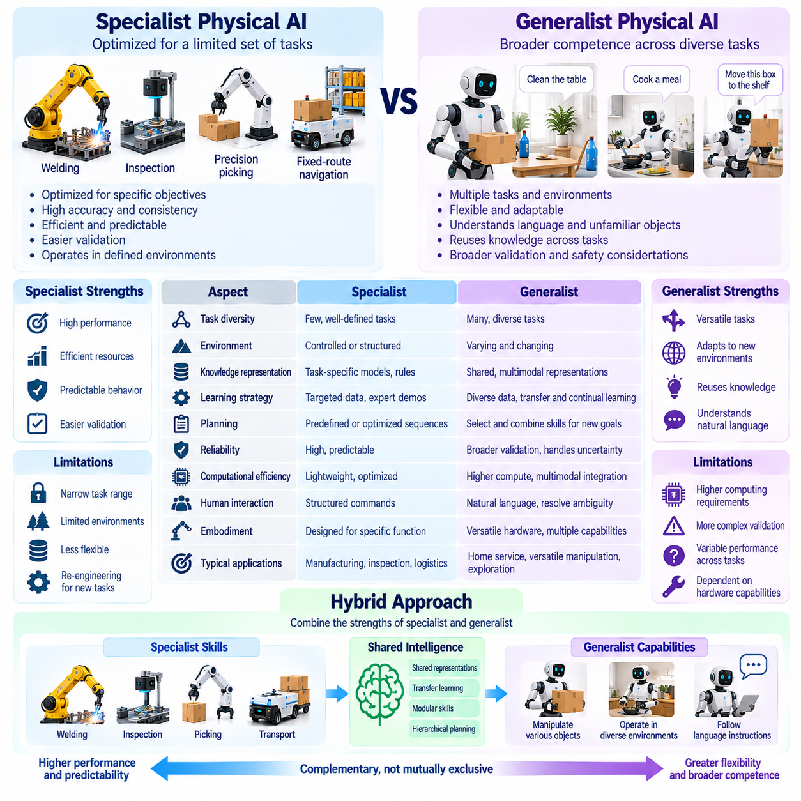{width="7.268055555555556in" height="7.268055555555556in"}

Specialist and generalist Physical AI represent two approaches to designing intelligent systems for physical tasks. Specialist systems concentrate on a limited set of functions, environments, or operating conditions, while generalist systems seek broader competence across diverse tasks and situations. This distinction concerns the scope of usable intelligence rather than robot appearance, hardware complexity, or computational capacity.

Specialist Physical AI is optimized for clearly defined objectives and operational domains. Examples include robotic welding, automated inspection, precision picking, and navigation along established industrial routes. Specialized perception, planning, and control functions can be tuned to known requirements. This focus often enables predictable performance, efficient resource utilization, and systematic validation under specified conditions.

Generalist Physical AI aims to perform multiple tasks without requiring a separately engineered solution for every new objective. A generalist robot may interpret instructions, recognize unfamiliar objects, select tools, and adapt manipulation strategies. Such versatility requires reusable representations and flexible decision-making. However, broad task coverage does not imply unrestricted competence or reliable operation in every physical environment.

Task diversity provides a primary dimension for distinguishing specialist and generalist systems. A specialist may repeatedly perform one manipulation procedure with exceptional accuracy, while a generalist may execute several related procedures with varying performance. Classification should consider the number of supported tasks, differences among them, and the amount of additional engineering required when new tasks are introduced.

Environmental generalization provides another important distinction. Specialist systems may operate effectively in controlled factories, mapped warehouses, or structured laboratories. Generalist systems seek to maintain useful capabilities across changing layouts, object arrangements, and operating conditions. Their performance must be evaluated under meaningful environmental variation rather than inferred from demonstrations in familiar settings.

Knowledge representation strongly influences the ability to generalize. Specialist systems often use task-specific models, predefined rules, and optimized control parameters. Generalist systems increasingly employ shared representations connecting visual observations, language instructions, spatial relationships, and physical actions. These representations can support knowledge transfer, but their usefulness depends on grounding in actual physical constraints.

Learning strategies also differ between the two approaches. Specialist systems commonly rely on targeted datasets, expert demonstrations, or reinforcement learning within defined tasks. Generalist development may combine diverse robot experiences, multimodal training, and transfer learning. Broad training can improve flexibility, yet differences in sensors, actuators, and environments complicate the reuse of learned behaviors.

Robot foundation models are an important research direction for generalist Physical AI. They seek reusable capabilities from large collections of demonstrations, sensory observations, and action sequences. Vision-language-action models may connect natural-language goals with perception and motor behavior. Nevertheless, a foundation model is not automatically a generalist robot, because physical execution requires compatible hardware and validated control.

Embodiment introduces practical limits to generality. A mobile platform without a manipulator cannot perform physical grasping regardless of its reasoning ability. Likewise, a fixed industrial arm cannot independently navigate distant locations. Generalist intelligence must therefore be distinguished from general-purpose hardware. The achievable task range depends jointly on software capabilities, mechanical design, sensing, and actuation.

Planning requirements vary with task specialization. A specialist robot may execute optimized sequences for repeated operations, while a generalist must select and combine skills according to changing goals. Hierarchical planning can organize reusable behaviors into longer task sequences. Successful generalist planning requires recognizing prerequisites, managing uncertainty, and detecting when available skills cannot satisfy a requested objective.

Reliability presents a major tradeoff between specialization and generality. Specialists can be extensively tested against narrow operating conditions, making performance boundaries easier to establish. Generalists face a larger combination of tasks, environments, and interactions. Their validation must therefore examine unfamiliar situations, unexpected task combinations, recovery behavior, and the ability to recognize limitations.

Computational efficiency also affects architectural choices. Specialized models can be compressed and optimized for predictable inference workloads on embedded hardware. Generalist models may require greater memory, processing capacity, and multimodal integration. Hybrid computing can distribute demanding workloads across robots and nearby infrastructure. Model size alone, however, is not a reliable measure of general intelligence.

Human interaction becomes increasingly important as task flexibility expands. Specialist robots often receive structured commands through predefined interfaces. Generalist systems may interpret natural-language requests, resolve ambiguities, and request clarification when objectives are uncertain. Effective interaction requires connecting language to physical feasibility, safety constraints, and available capabilities rather than treating instruction understanding as sufficient.

A hybrid approach combines specialist skills with generalist coordination. A high-level model may interpret goals and select among validated navigation, grasping, inspection, or assembly modules. Specialized controllers then execute physical actions within defined safety limits. This architecture can provide flexibility while preserving predictable execution. Its effectiveness depends on skill interfaces, capability descriptions, and reliable transitions.

Capability boundaries should remain explicit for both categories. A specialist system must identify conditions outside its validated domain, while a generalist must recognize tasks it cannot safely perform. Confidence estimates, feasibility checks, and intervention mechanisms support appropriate behavior. The distinction between specialist and generalist should never be used to imply that a system can operate without operational restrictions.

Evaluation requires more than comparing success rates on a small collection of demonstrations. Specialist systems should be assessed for accuracy, repeatability, throughput, and robustness within their target domains. Generalist systems additionally require measures of task diversity, transfer performance, adaptation cost, and success under unfamiliar conditions. Fair comparisons must account for hardware differences and training exposure.

Economic considerations influence whether specialization or generality is appropriate. Dedicated industrial automation may offer lower operating costs when tasks are repetitive and stable. Generalist systems may become valuable when workloads vary or frequent reconfiguration is required. Deployment decisions should compare integration effort, maintenance, computational cost, safety assurance, and the practical value of supporting additional tasks.

Multi-robot environments can combine specialists and generalists within one coordinated system. Dedicated robots may perform transportation, inspection, or manipulation, while flexible agents handle variable assignments and exceptional situations. Fleet orchestration can allocate work according to individual capabilities. Such arrangements demonstrate that system-level versatility does not require every robot to possess identical general-purpose intelligence.

Ultimately, specialist and generalist Physical AI define complementary positions within a multidimensional capability taxonomy. Specialists emphasize optimized performance within bounded domains, while generalists emphasize transferable competence across diverse tasks. Practical systems may occupy intermediate positions or combine both approaches. Their value depends on demonstrated capabilities, reliable execution, clear operational boundaries, and alignment with real physical requirements.

## 05.13. Physical AI Capability Matrix

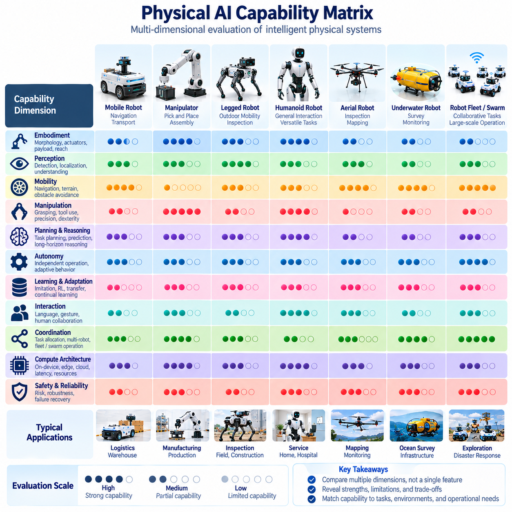{width="7.268055555555556in" height="7.268055555555556in"}

A Physical AI Capability Matrix provides a structured framework for describing, comparing, and evaluating the functional abilities of intelligent physical systems. Rather than classifying robots through a single characteristic, the matrix combines multiple dimensions of intelligence, embodiment, autonomy, and operational performance. Its purpose is to establish a consistent representation of what a system can accomplish under defined physical conditions.

The capability matrix extends multidimensional taxonomy into a practical assessment framework. Categories such as mobility, manipulation, perception, planning, learning, and coordination become measurable dimensions rather than descriptive labels alone. Each dimension represents a distinct aspect of physical competence. Their combined evaluation reveals strengths, limitations, and dependencies that may remain hidden in conventional robot classifications.

Embodiment forms an essential foundation of the matrix because intelligence operates through physical hardware. Robot morphology, actuator configuration, sensor placement, payload capacity, and mechanical reach determine which actions are physically possible. A mobile robot and a stationary manipulator may possess similar planning algorithms but demonstrate different capabilities. Evaluation must therefore distinguish physical feasibility from algorithmic intelligence.

Perception capability describes how effectively a system interprets information from its surroundings. Relevant functions include object detection, localization, semantic understanding, depth estimation, and multimodal sensor fusion. Assessment should consider accuracy, uncertainty, operating range, and environmental robustness. A perception model that performs well in controlled lighting may not provide equivalent reliability under changing physical conditions.

Mobility capability evaluates the ability to navigate and reposition within an environment. Relevant characteristics include localization accuracy, obstacle avoidance, terrain adaptability, path efficiency, and recovery from navigation failures. Wheeled, legged, aerial, and other mobile platforms require different assessment conditions. Comparisons should reflect the operational environment and physical constraints rather than assume identical mobility requirements.

Manipulation capability measures how effectively a system interacts with objects and physical structures. Grasping, lifting, positioning, assembly, tool use, and force-controlled interaction represent different manipulation functions. Evaluation should consider precision, repeatability, dexterity, payload limitations, and task completion reliability. Complex manipulation requires coordination between perception, planning, mechanical design, and feedback control.

Planning and reasoning capability describes the system\'s ability to select actions that satisfy objectives under physical constraints. Reactive responses, predictive planning, task decomposition, and long-horizon reasoning represent different levels of decision complexity. Assessment should examine planning success, computational cost, uncertainty handling, and recovery from unexpected events. Reasoning quality must ultimately be judged through physical outcomes.

Autonomy capability concerns the extent to which a system can operate without continuous human intervention. A robot may independently execute predefined motions while requiring supervision for task selection or exception handling. More advanced autonomy includes adaptive planning, failure detection, and operational recovery. The matrix should distinguish autonomy across individual functions instead of assigning one broad label to the entire system.

Learning and adaptation capability evaluates whether a system can improve or modify behavior through experience. Relevant mechanisms include imitation learning, reinforcement learning, transfer learning, online adaptation, and continual learning. Assessment should distinguish capabilities acquired during offline training from changes made during deployment. Adaptation must also be evaluated for stability, safety, and retention of previously acquired skills.

Interaction capability describes how Physical AI communicates and cooperates with people and other intelligent systems. Natural-language understanding, gesture interpretation, intent recognition, and shared task execution may contribute to this dimension. Effective interaction requires more than recognizing commands. The system must interpret requests in relation to physical feasibility, operational context, safety boundaries, and available actions.

Coordination capability becomes important when multiple robots operate within a shared environment. Task allocation, traffic management, shared mapping, distributed sensing, and cooperative manipulation represent different forms of collective competence. Fleet and swarm systems may achieve coordination through centralized, decentralized, or hybrid mechanisms. Evaluation should consider scalability, communication dependencies, conflict resolution, and collective task performance.

Compute architecture influences the practical availability of every capability represented in the matrix. On-device processing supports local independence, while edge and on-premises infrastructure can provide additional perception, planning, and coordination resources. Cloud systems may support training and global optimization. Capability assessment should identify execution location, resource consumption, latency requirements, and dependence on external connectivity.

Safety and reliability should be treated as cross-cutting evaluation dimensions rather than isolated features. A system may demonstrate advanced manipulation or navigation while remaining unsuitable for deployment if failures create unacceptable risks. Assessment must consider protective functions, fault detection, graceful degradation, and recovery behavior. Safety evidence should remain separate from capability claims while informing operational suitability.

Capability levels require explicit definitions and measurable evidence. A matrix may use descriptive categories, numerical scores, or maturity levels, but these should not be interpreted as universal standards without formal justification. Each rating needs defined test conditions, acceptance criteria, and supporting observations. A high score in one dimension must not automatically imply equivalent competence in another dimension.

Capability dependencies reveal why isolated performance measurements can be misleading. Successful object manipulation depends on sensing, localization, motion planning, actuator control, and physical contact management. A weakness in any supporting function may reduce overall task success. The matrix should therefore capture both individual capability measurements and the relationships that determine integrated system behavior.

Operational context determines whether a capability is sufficient for a specific application. Warehouse transportation, industrial assembly, agricultural inspection, and healthcare assistance impose different requirements for precision, speed, robustness, and supervision. A system optimized for one domain may be unsuitable for another despite possessing similar nominal capabilities. Context-specific thresholds are necessary for meaningful comparisons.

Evidence quality is essential for trustworthy capability assessment. Manufacturer specifications, laboratory benchmarks, simulation results, and field demonstrations provide different forms of information. Claims should identify their evidence sources and distinguish verified performance from projected functionality. Reproducible tests, documented operating conditions, and transparent failure reporting improve confidence in the resulting capability matrix.

The matrix can also support engineering decisions throughout the system lifecycle. During design, it helps identify missing capabilities and architectural tradeoffs. During integration, it clarifies dependencies among hardware, software, and operational infrastructure. During validation, it organizes test coverage and performance evidence. During deployment, it supports configuration decisions, capability monitoring, and structured improvement planning.

Ultimately, the Physical AI Capability Matrix translates multidimensional classification into an evidence-based representation of physical intelligence. It connects embodiment, perception, mobility, manipulation, reasoning, autonomy, learning, interaction, coordination, computing, and safety. Its value lies not in producing a single universal ranking, but in enabling transparent comparisons, identifying operational limitations, and supporting reliable system development.

## 05.14. Multi Dimensional Taxonomy Example [w/Code]

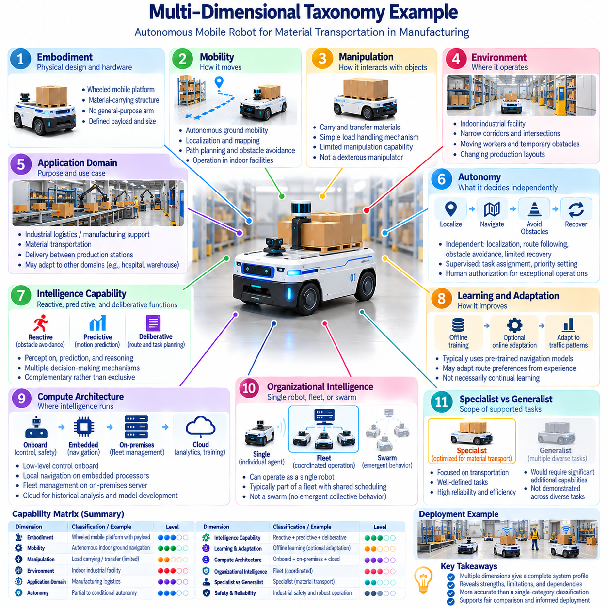{width="7.268055555555556in" height="7.268055555555556in"}

A multidimensional taxonomy provides a practical method for classifying Physical AI systems through several independent yet interconnected characteristics. Instead of assigning a robot to one rigid category, this approach describes embodiment, mobility, manipulation, environment, autonomy, intelligence, learning, and computing architecture together. A worked example demonstrates how these dimensions produce a more accurate representation of system capabilities.

Consider an autonomous mobile robot designed to transport materials within a manufacturing facility. The robot uses a wheeled platform, onboard sensors, navigation software, and a connection to a fleet management system. Its primary function is material transportation between production stations. Although this appears to be a straightforward application, its complete classification requires examination of physical design, operational behavior, and intelligence distribution.

The embodiment dimension identifies the robot as a wheeled mobile platform with a dedicated material-carrying structure. Its mechanical configuration determines payload capacity, turning radius, stability, and access to constrained spaces. Unlike a humanoid or articulated manipulator, this robot does not possess general-purpose arms. Its physical intelligence must therefore operate within the movement and load-handling capabilities permitted by its hardware.

The mobility and manipulation dimensions describe two distinct functional characteristics. The robot demonstrates autonomous ground mobility through localization, path planning, obstacle avoidance, and motion control. Its manipulation capability is limited to carrying or transferring materials through its installed mechanism. This distinction prevents transportation performance from being incorrectly interpreted as dexterous object manipulation or general-purpose physical interaction.

Environmental classification identifies the intended operating domain as an indoor industrial facility. The robot may encounter narrow corridors, intersections, moving workers, temporary obstacles, and changing production layouts. These conditions differ from outdoor roads, agricultural fields, or unstructured terrain. Consequently, successful operation within a factory does not establish equivalent competence across unrelated environments.

Application-domain classification places the robot within industrial logistics and manufacturing support. Its objectives include reliable material delivery, reduced transportation delays, and coordination with production workflows. The same mobile platform might support hospital logistics or warehouse operations after suitable adaptation. However, deployment in another domain requires verification of environmental compatibility, task interfaces, and safety requirements.

Autonomy classification examines which decisions the robot performs independently. It may localize itself, follow planned routes, avoid obstacles, and recover from selected navigation interruptions. A fleet manager may still assign destinations, establish priorities, or authorize exceptional operations. Therefore, autonomy should be described separately for navigation, task selection, exception handling, and recovery rather than reduced to one unsupported numerical level.

The intelligence-capability dimension examines how perception, prediction, and reasoning contribute to operation. Reactive functions handle immediate obstacle avoidance, while predictive functions estimate movement and potential conflicts. Deliberative planning selects routes and coordinates longer task sequences. These functions may coexist within one robot, demonstrating that reactive, predictive, and deliberative intelligence are complementary rather than mutually exclusive categories.

Learning classification considers whether the robot changes its behavior through accumulated experience. A deployed system may use a navigation model trained offline without performing additional learning during operation. Another implementation may adapt route preferences based on observed congestion or changing traffic patterns. Such adaptation should not automatically be classified as continual learning unless persistent model updates and knowledge retention are demonstrated.

Compute-architecture classification identifies where different intelligence functions execute. Low-level motion control and protective functions remain onboard, while local navigation may use embedded processors or accelerators. An on-premises server can coordinate traffic and distribute missions, while cloud infrastructure may support historical analytics and model development. The classification records these dependencies without assuming that all functions require remote computation.

The organizational-intelligence dimension classifies the same robot differently depending on deployment context. Operating alone, it functions as an individual autonomous agent. When coordinated with other mobile robots through shared scheduling and traffic management, it becomes part of a fleet. It should not automatically be classified as a swarm, because centralized fleet coordination does not establish emergent collective behavior arising from decentralized local interactions.

Specialist-versus-generalist classification evaluates the breadth of supported tasks. The example robot is primarily a specialist because its capabilities are optimized for industrial material transportation. Advanced perception or language understanding would not necessarily make it a generalist. Broader classification would require demonstrated competence across meaningfully different tasks, together with evidence that new objectives can be handled without extensive task-specific engineering.

A capability matrix can combine these observations into a structured system profile. Each dimension records the system\'s demonstrated functions, operating limits, and supporting evidence. Mobility may be assessed through navigation success and recovery performance, while coordination may be measured through fleet throughput and conflict resolution. Scores should remain dimension-specific and linked to documented test conditions rather than merged into an unexplained universal rating.

A second example illustrates why multidimensional classification is necessary. A stationary industrial manipulator may possess precise force control, advanced visual perception, and flexible task planning while having no independent mobility. Compared with the mobile transport robot, it demonstrates stronger manipulation capabilities but a narrower movement range. Neither system is universally more intelligent because their capabilities address different physical requirements.

A third example involves a group of small aerial robots performing cooperative environmental inspection. Their embodiment is aerial, their mobility is three-dimensional, and their application domain involves distributed sensing. If agents coordinate through local communication and collective exploration rules, swarm intelligence may be an appropriate classification. Their autonomy, learning capabilities, and computing distribution must still be evaluated independently.

These examples demonstrate that taxonomy dimensions should not be treated as a linear hierarchy. Greater autonomy does not necessarily imply broader manipulation capability, and distributed computing does not automatically produce swarm intelligence. Similarly, a robot with a large foundation model may remain physically specialized. Accurate classification requires separating capability claims from architectural characteristics and identifying their operational dependencies.

Practical implementation can represent each robot as a structured record containing categorical attributes, quantitative measurements, and evidence references. A software-based taxonomy may use a schema with fields for embodiment, mobility, environment, autonomy, learning, and compute placement. Validation rules can check required information and terminology consistency. Such records support searching, comparison, capability matching, and systematic catalog maintenance.

Taxonomy records should also distinguish current capabilities from planned or experimental functions. A manufacturer specification may describe maximum payload, while field tests establish actual transportation reliability. Simulation may demonstrate navigation in hypothetical environments without confirming physical deployment performance. Maintaining evidence provenance, version history, and operating-condition metadata prevents projected capabilities from being confused with validated achievements.

Ultimately, a multidimensional taxonomy example demonstrates how Physical AI systems can be classified without reducing their intelligence to a single label. The method integrates embodiment, functional capabilities, autonomy, learning, computing, and collective organization while preserving their differences. Its practical value lies in transparent comparison, engineering traceability, capability-based deployment decisions, and evidence-driven evaluation across diverse robotic platforms.
