**Volume 02. Physical AI Foundations and Definitions**

# Chapter 06. Relation to Embodied AI and Robotics

## 06.01. Embodied AI and Embodied Intelligence

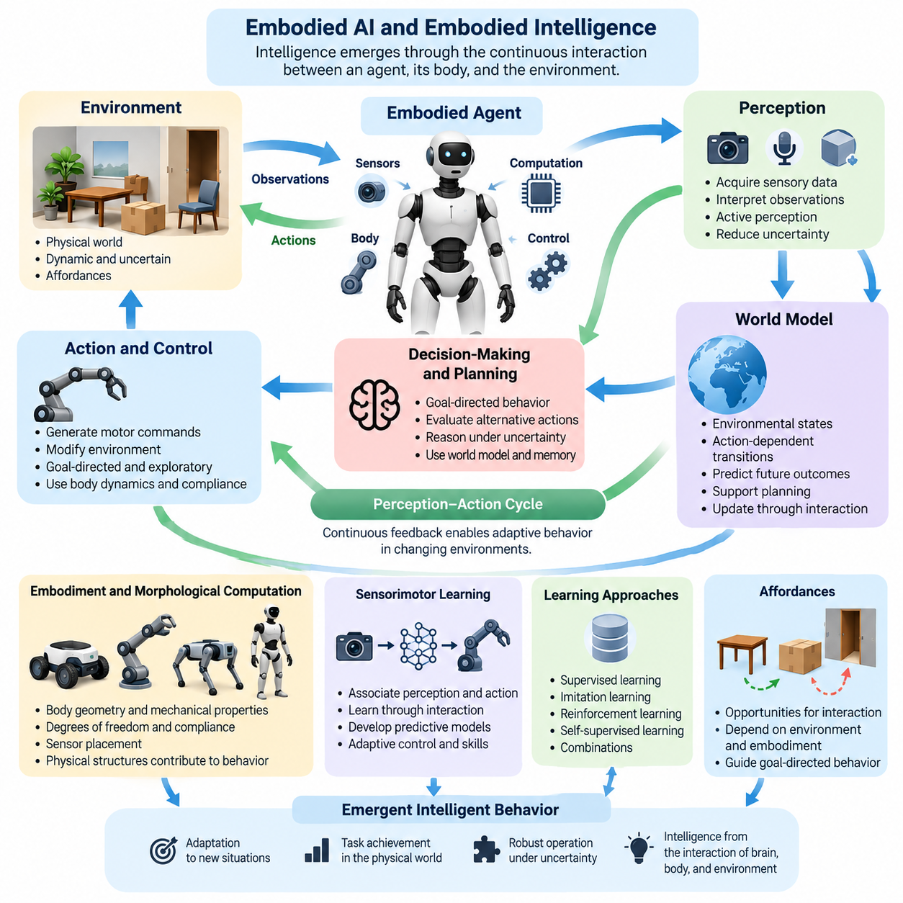{width="7.268055555555556in" height="7.268055555555556in"}

Embodied AI refers to artificial intelligence that develops and expresses intelligent behavior through interaction with an environment using a physical or simulated body. Unlike systems that process information without acting upon the world, embodied agents perceive surroundings, execute actions, and experience consequences. Intelligence emerges through continuous relationships among perception, action, environmental dynamics, and the capabilities of the body.

Embodied intelligence describes the ability of an agent to use its physical structure, sensory systems, motor capabilities, and environmental interactions to achieve meaningful goals. This perspective considers intelligence not merely a property of computational algorithms but a functional outcome of coordinated processes involving the brain, body, and environment. Physical embodiment influences what an agent can perceive, learn, predict, and accomplish.

The theoretical foundations of embodied intelligence challenge the traditional separation between cognition and physical action. Classical artificial intelligence often represents reasoning as symbolic manipulation performed independently of bodily experience. Embodied approaches instead emphasize that cognition is grounded in sensorimotor activity, environmental constraints, and practical interaction. Knowledge develops through experiences that connect observations with possible actions and their consequences.

An embodied agent operates through a continuous perception-action cycle. Sensors acquire information about the environment, computational processes interpret observations, and control systems generate actions that modify physical conditions. These changes produce new sensory information, allowing the agent to update its internal state and adjust subsequent behavior. This feedback relationship enables adaptive operation under changing and uncertain environmental conditions.

The physical body is not simply an output mechanism for intelligent decisions. Its geometry, mechanical properties, degrees of freedom, compliance, and sensor placement determine the structure of possible interactions. A wheeled robot, robotic arm, quadruped, and humanoid may employ similar learning algorithms while developing different behavioral capabilities. Their embodiments establish distinct constraints and opportunities for perception, movement, manipulation, and environmental adaptation.

Embodied intelligence also involves the concept of morphological computation, in which physical structures contribute directly to behavioral organization. Mechanical compliance, passive dynamics, and appropriately designed body geometry can simplify control requirements. A compliant robotic gripper, for example, may accommodate variations in object shape without requiring exact geometric reconstruction. Part of the functional complexity is handled through physical interaction rather than explicit computational reasoning.

Sensorimotor learning provides a fundamental mechanism through which embodied agents acquire practical competence. By associating sensory observations with motor commands and resulting state changes, an agent learns how its actions influence the environment. Repeated interaction can support the development of predictive models, adaptive control policies, and task-specific skills. Such learning establishes relationships between perception and action that cannot always be obtained from passive observation alone.

The concept of affordances further explains how embodied intelligence connects environmental understanding with action possibilities. An affordance represents an opportunity for interaction relative to an agent\'s capabilities. A surface may support walking, a handle may permit grasping, and an opening may allow navigation. These possibilities depend jointly on environmental properties and embodiment, making affordance understanding an important component of goal-directed behavior.

Active perception extends this relationship by recognizing that intelligent agents can deliberately move to improve their observations. A mobile robot may change its viewpoint to resolve an occlusion, while a manipulator may reposition an object to inspect an inaccessible surface. Perception therefore becomes an interactive process rather than passive information collection. Actions can be selected both to accomplish tasks and to reduce uncertainty about the environment.

Embodied intelligence requires reasoning under partial observability because physical agents rarely possess complete information about their surroundings. Sensors introduce noise, objects become occluded, and environmental conditions change during execution. An intelligent agent must combine current observations with memory, predictions, and uncertainty estimates. Effective behavior depends on maintaining sufficiently accurate representations while recognizing when additional observation or corrective action is necessary.

World models provide one approach to organizing this predictive capability. An embodied agent can learn representations of environmental states, action-dependent transitions, and possible future outcomes. These models support anticipation, planning, and evaluation of alternative behaviors before physical execution. Their usefulness depends on how accurately they represent relevant dynamics and how effectively predictions can be updated through interaction with the actual environment.

Learning in embodied systems can involve supervised learning, imitation learning, reinforcement learning, self-supervised learning, and combinations of these approaches. Demonstrations provide examples of successful behavior, while reinforcement learning uses interaction outcomes to improve policies. Self-supervised methods can extract useful structure from sensory experience without extensive manual annotation. Each approach contributes differently to acquiring perception, prediction, and action capabilities.

Simulation plays an important role in embodied AI because physical interaction can be expensive, slow, or hazardous. Simulated environments allow agents to experience diverse situations, practice behaviors, and evaluate policies before deployment. However, differences between simulated and real environments can affect performance. Successful transfer requires attention to physical dynamics, sensor characteristics, environmental variability, and the limitations of simulated experience.

Embodied AI and robotics are closely related but should not be treated as identical concepts. Robotics encompasses mechanical design, actuation, sensing, control, integration, and physical machine operation, including systems that do not use learning-based intelligence. Embodied AI emphasizes intelligent behavior developed through bodily interaction. Their intersection includes robots that perceive, learn, reason, and adapt while performing tasks within physical environments.

Physical AI provides a broader systems perspective for integrating embodied intelligence with practical operation in the physical world. It combines perception, predictive modeling, decision-making, planning, control, computation, and safety within an operational architecture. Embodied AI contributes the conceptual and learning foundations of interactive intelligence, while robotics supplies physical mechanisms and engineering infrastructure through which many Physical AI capabilities are realized.

The distinction becomes particularly important when evaluating autonomy. A robot executing predetermined trajectories may demonstrate sophisticated engineering without substantial adaptive intelligence. An embodied learning agent may demonstrate flexible behavior in simulation without satisfying real-world operational requirements. Physical AI seeks to integrate adaptive capabilities with reliable execution, environmental awareness, physical constraints, and measurable task performance in deployed systems.

Real-time operation introduces additional requirements that distinguish practical embodied intelligence from abstract cognitive models. Physical environments continue evolving while an agent computes decisions, making latency and timing integral to successful behavior. Sensor processing, state estimation, planning, and control must operate within appropriate deadlines. Computational complexity must therefore be balanced against responsiveness, energy consumption, and the stability of physical interaction.

Safety is equally fundamental because embodied actions can create irreversible consequences. An incorrect movement may damage equipment, destabilize a robot, or endanger nearby people. Intelligent behavior must operate within physical limits and appropriate safety constraints, including collision avoidance, actuator restrictions, emergency stopping, and recovery procedures. Learning-based adaptation should complement rather than replace independently justified protective mechanisms.

Embodied intelligence also provides a foundation for understanding generalization across tasks and physical platforms. Skills acquired through interaction may contain reusable knowledge about geometry, contact, movement, and object behavior. Nevertheless, transferring such knowledge between different bodies requires accounting for variations in kinematics, dynamics, sensors, and action spaces. Generalization therefore involves both shared environmental understanding and embodiment-specific adaptation.

Recent approaches involving foundation models and multimodal learning extend the possibilities of embodied AI by connecting language, visual observations, and action representations. Vision-language models can support semantic interpretation and task understanding, while vision-language-action models attempt to connect multimodal inputs with executable behavior. These approaches offer pathways toward more flexible agents, although reliable physical grounding and robust execution remain significant challenges.

Embodied intelligence ultimately emphasizes that intelligent behavior cannot be fully understood independently of interaction with the world. Perception provides information, action generates experience, and physical embodiment shapes both processes. Physical AI builds upon this principle by connecting embodied learning and reasoning with engineered systems capable of dependable operation. Together, these ideas establish a foundation for increasingly adaptive, autonomous, and physically competent intelligent machines.

## 06.02. Physical AI vs Embodied AI

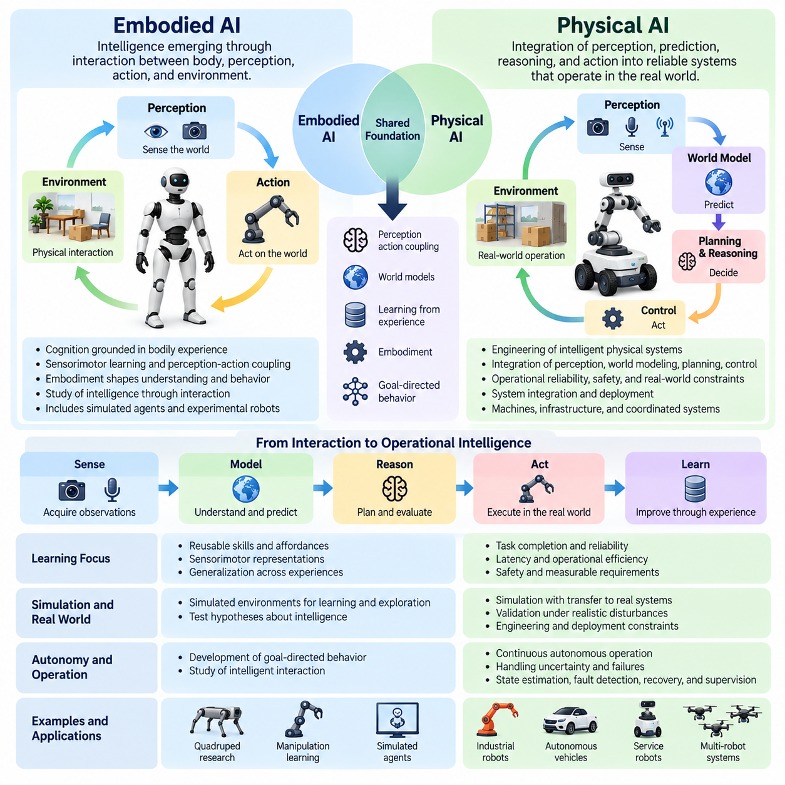{width="7.268055555555556in" height="7.268055555555556in"}

Physical AI and Embodied AI are closely related concepts that describe intelligence operating through interaction with the physical world, but they emphasize different aspects of intelligent systems. Embodied AI focuses on how intelligence develops through the relationship between an agent\'s body, perception, action, and environment. Physical AI emphasizes the integration of these capabilities into operational systems that perceive, predict, decide, and act under real-world constraints.

Embodied AI originates from the principle that cognition cannot be fully separated from bodily experience. An intelligent agent acquires knowledge through sensorimotor interaction, learning how its actions influence environmental conditions. The body\'s morphology, sensing capabilities, and movement limitations shape the agent\'s understanding of the world. Intelligence is therefore interpreted as a process emerging from continuous interaction rather than isolated computation.

Physical AI extends this interaction-centered perspective toward the engineering of intelligent physical systems. Its primary concern is not only how an agent learns from experience but also how intelligence can be implemented reliably within machines, infrastructure, and operational environments. Physical AI combines perception, world modeling, reasoning, planning, control, computation, and safety into architectures capable of sustained physical operation.

The distinction becomes clearer when considering their respective conceptual boundaries. Embodied AI primarily investigates intelligence grounded in bodily interaction, including simulated agents and experimental robotic platforms. Physical AI encompasses embodied intelligence while also addressing system integration, distributed computation, operational coordination, and deployment constraints. These categories overlap substantially, and their boundaries depend on the terminology adopted by researchers and practitioners.

Embodiment is central to Embodied AI because physical structure directly influences perception and behavior. A robot\'s geometry, degrees of freedom, actuator characteristics, and sensor configuration determine which interactions are possible. A humanoid and a wheeled mobile robot may encounter the same environment but experience different action opportunities. Their intelligence develops in relation to their respective physical capabilities and limitations.

Physical AI also recognizes embodiment but treats it as one component within a broader operational architecture. Intelligent behavior depends on the coordination of sensing hardware, computational resources, predictive models, decision mechanisms, and physical actuators. The system must account for communication delays, energy limitations, environmental disturbances, and safety requirements. Successful operation requires both intelligent algorithms and dependable engineering integration.

Embodied AI places particular emphasis on perception-action coupling, the continuous relationship between sensing and movement. Actions change the environment and consequently modify future observations, producing a feedback process through which agents learn and adapt. Perception is not merely passive data acquisition because movement can improve sensory information. This interactive relationship forms a fundamental mechanism for developing grounded intelligence.

Physical AI incorporates perception-action coupling into a larger sense-model-predict-plan-act-learn process. Sensory observations are transformed into environmental representations, predictive models estimate possible outcomes, and planning mechanisms select actions consistent with operational objectives. Feedback supports continuous correction and adaptation. The complete process must remain responsive to physical dynamics and changing environmental conditions.

Learning objectives provide another useful distinction between the two concepts. Embodied AI frequently investigates how agents acquire reusable skills, discover affordances, develop sensorimotor representations, and generalize across experiences. Research may prioritize understanding the mechanisms of intelligent interaction. Physical AI additionally emphasizes whether learned capabilities satisfy measurable requirements for task completion, reliability, latency, safety, and operational efficiency.

Simulation illustrates how their research priorities can differ. Embodied AI commonly uses simulated environments to investigate learning, exploration, navigation, manipulation, and generalization. Such environments provide controlled settings for testing hypotheses about intelligence. Physical AI also uses simulation but places additional emphasis on validating whether learned behaviors transfer reliably to physical systems operating under realistic disturbances and engineering constraints.

World models establish an important connection between Embodied AI and Physical AI. In embodied learning, world models help agents understand relationships among observations, actions, and environmental transitions. They support prediction and the development of internal representations grounded in experience. In Physical AI, these models also serve operational functions, including anticipatory planning, risk assessment, trajectory evaluation, and adaptive control.

The distinction is also visible in the treatment of autonomy. Embodied AI studies how agents develop goal-directed behavior through interaction and learning. Physical AI examines how autonomous capabilities can be maintained during continuous operation despite uncertainty, disturbances, and incomplete information. This requires combining intelligent decision-making with state estimation, fault detection, recovery procedures, and mechanisms for supervising physical execution.

Real-time constraints are particularly significant in practical Physical AI systems. Physical environments evolve continuously, and delayed decisions can reduce performance or create hazardous conditions. Perception, inference, planning, and control must operate within suitable timing requirements. Although Embodied AI also addresses temporal interaction, Physical AI places explicit engineering emphasis on computational scheduling, communication latency, processing capacity, and execution deadlines.

Safety provides another important dimension of comparison. Embodied AI research may examine safe exploration, constrained learning, and behavior under uncertainty. Physical AI must additionally translate safety principles into operational mechanisms that protect people, equipment, and environments. These mechanisms include collision avoidance, actuator limits, emergency stopping, runtime monitoring, and fallback behavior. Safety becomes an architectural requirement rather than solely a learning objective.

Embodied AI often examines intelligence at the level of an individual agent interacting with its surroundings. Physical AI can extend this perspective to coordinated collections of agents, shared infrastructure, and distributed intelligence. Multiple robots may exchange observations, maintain shared environmental representations, and coordinate actions through local or centralized systems. Collective operation introduces communication, synchronization, resource allocation, and system-level reliability requirements.

The relationship between the two fields becomes increasingly important with the development of foundation models. Embodied AI investigates how multimodal representations and learned policies can support flexible interaction across tasks and environments. Physical AI addresses how such models can be integrated with real-time perception, physical control, safety mechanisms, and computational infrastructure. Model intelligence alone does not guarantee dependable physical execution.

Vision-language-action models illustrate this convergence. These models attempt to connect visual observations, language instructions, and action generation within a shared learning framework. From an Embodied AI perspective, they offer mechanisms for grounding semantic understanding in physical behavior. From a Physical AI perspective, they represent components that must be integrated with robot hardware, control systems, operational constraints, and runtime assurance.

Cross-embodiment generalization is another shared research objective. Embodied AI explores whether knowledge acquired through one body can transfer to agents with different morphologies and action capabilities. Physical AI considers the additional engineering requirements for deploying transferable intelligence across heterogeneous platforms. Shared representations must coexist with embodiment-specific control, sensor calibration, mechanical limitations, and platform-dependent safety constraints.

Evaluation methods reflect the complementary priorities of these fields. Embodied AI commonly measures task success, learning efficiency, exploration capability, adaptation, and generalization. Physical AI also considers operational availability, execution latency, energy consumption, failure recovery, safety compliance, and long-term reliability. A system may demonstrate strong learning performance in controlled experiments while remaining unsuitable for sustained real-world deployment.

These differences should not be interpreted as a rigid hierarchy in which one discipline completely replaces the other. Embodied AI and Physical AI share substantial theoretical foundations, algorithms, and experimental methods. Their relationship is better understood as overlapping perspectives with different centers of emphasis. Embodied AI explains how intelligence becomes grounded in interaction, while Physical AI emphasizes how such intelligence functions within engineered physical systems.

Ultimately, Embodied AI contributes the principles of situated learning, sensorimotor intelligence, affordance understanding, and adaptive interaction. Physical AI integrates these principles with predictive reasoning, control, computational infrastructure, safety, and operational engineering. Their convergence supports the development of intelligent machines that move beyond isolated demonstrations toward reliable, adaptive, and increasingly general capabilities in the physical world.

## 06.03. Physical AI vs Classical Robotics

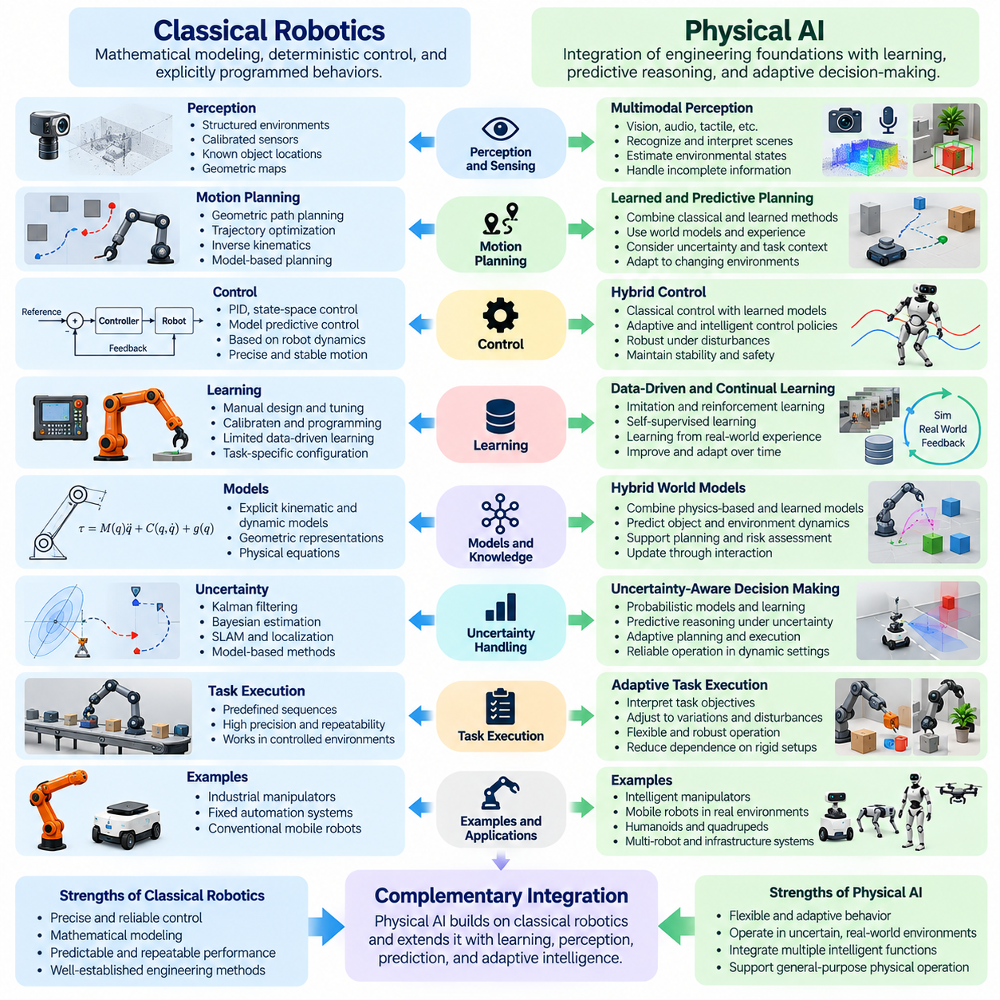{width="7.268055555555556in" height="7.268055555555556in"}

Physical AI and classical robotics share the objective of enabling machines to interact with the physical world, but they differ in how intelligence, adaptability, and autonomy are implemented. Classical robotics traditionally emphasizes mathematical modeling, deterministic control, and explicitly programmed behaviors. Physical AI integrates these engineering foundations with learning, predictive reasoning, environmental understanding, and adaptive decision-making to support more flexible physical operation.

Classical robotics developed around the principles of mechanics, kinematics, dynamics, feedback control, and automated motion. Engineers describe robot behavior through mathematical equations, geometric representations, and predefined operational sequences. A robot executes commands according to programmed rules and measured system states. This approach provides predictable behavior, precise motion, and repeatable performance when operating conditions remain within established assumptions.

Physical AI extends these capabilities by enabling systems to interpret uncertain environments and adjust their behavior according to changing circumstances. Rather than relying exclusively on predefined instructions, Physical AI can incorporate learned representations, probabilistic estimation, and context-dependent policies. Its objective is not to eliminate mathematical control but to combine established engineering methods with adaptive intelligence capable of responding to unfamiliar situations.

The distinction is particularly visible in environmental perception. Classical robotic systems often depend on structured environments, calibrated sensors, known object locations, and explicitly constructed geometric maps. Physical AI can use machine learning and multimodal perception to recognize objects, interpret scenes, estimate environmental states, and identify relevant relationships. These capabilities help robots operate when environmental information is incomplete or continuously changing.

Motion planning provides another important comparison. Classical robotics commonly employs geometric path planning, trajectory optimization, inverse kinematics, and model-based control to generate feasible movements. Physical AI can supplement these methods with learned policies, predictive world models, and experience-driven planning. Such combinations allow systems to evaluate actions in relation to environmental uncertainty, task objectives, and previously encountered situations.

In classical robotics, control algorithms frequently rely on mathematical descriptions of robot dynamics and feedback signals. Proportional-integral-derivative control, state-space control, and model predictive control provide systematic approaches to regulating motion and maintaining stability. Physical AI preserves the importance of these techniques while introducing learned dynamics, adaptive policies, and intelligent supervisory mechanisms where they offer measurable advantages.

Learning represents a major difference in emphasis between the two paradigms. Classical robotic systems are often configured through engineering design, parameter tuning, calibration, and explicit programming. Physical AI increasingly uses data-driven learning to improve perception, prediction, planning, and action selection. Experience collected from demonstrations, simulations, and real-world operation can contribute to behavioral adaptation, although learning does not automatically guarantee generalization.

The relationship between models and experience also changes. Classical robotics generally begins with explicit representations of geometry, motion constraints, and physical dynamics. Physical AI may combine these analytical models with representations learned from observations and interactions. Hybrid approaches are particularly valuable because physical equations provide structure and interpretability, while learned components can capture environmental complexity that is difficult to model manually.

Uncertainty is handled differently in many implementations. Classical robotics includes established probabilistic methods such as Kalman filtering, Bayesian estimation, and simultaneous localization and mapping. Physical AI builds upon these foundations while incorporating uncertainty-aware learning, predictive modeling, and adaptive decision policies. The important distinction is therefore not whether uncertainty is considered, but how uncertainty influences perception, reasoning, planning, and autonomous behavior.

Task execution illustrates the operational implications of these differences. A conventional industrial robot may repeatedly perform a programmed assembly sequence with high precision in a controlled workspace. A Physical AI-enabled system may identify variations in object placement, infer appropriate manipulation strategies, and adjust execution based on observed outcomes. Such flexibility can reduce dependence on rigid environmental arrangements, provided the system has sufficient training and validation.

The concept of autonomy also requires careful interpretation. Classical robotics already includes autonomous navigation, obstacle avoidance, feedback-based adaptation, and sophisticated decision systems. Physical AI does not introduce autonomy as an entirely new capability. Instead, it emphasizes broader environmental understanding, learned behavioral flexibility, predictive reasoning, and the integration of multiple intelligent functions within continuously operating physical systems.

World models provide a particularly important extension. Traditional robotic systems may predict future motion using explicit kinematic and dynamic equations. Physical AI can employ learned or hybrid world models to estimate how objects, agents, and environments may evolve under different actions. These predictions support anticipatory behavior, longer-horizon planning, and evaluation of alternative strategies before physical execution.

Perception-action integration further distinguishes advanced Physical AI architectures. Classical robotics frequently organizes sensing, planning, and control into specialized modules with clearly defined interfaces. Physical AI can preserve this modular organization while introducing shared representations and tightly coupled learning processes. Perception may actively guide exploration, while planned actions generate new observations that improve environmental understanding and subsequent decisions.

Simulation has long been essential to classical robotics for mechanical design, motion verification, controller development, and system testing. Physical AI expands its role into large-scale data generation, policy training, reinforcement learning, and domain randomization. Simulated interaction can expose agents to diverse conditions before deployment. Nevertheless, simulation-to-reality differences require systematic validation because successful simulated behavior may not transfer reliably.

Foundation models introduce another emerging distinction. Classical robotic software is generally designed around specialized algorithms and task-specific programming. Physical AI can incorporate vision-language models, vision-language-action models, and generalist policies to interpret instructions and support multiple tasks. These models may improve flexibility, but their outputs must remain compatible with physical constraints, low-level control, and operational safety requirements.

Real-time performance remains a shared engineering concern. Classical robotics has developed rigorous methods for deterministic scheduling, feedback stability, and predictable control execution. Physical AI introduces additional computational demands through neural inference, multimodal processing, and predictive reasoning. Practical architectures must balance intelligence with latency, processing capacity, energy consumption, and communication constraints without compromising critical control functions.

Safety and reliability also demonstrate why Physical AI should be understood as an extension rather than a replacement of classical robotics. Established robotic engineering provides protective mechanisms, actuator constraints, emergency stopping, and verified control functions. Learning-based components introduce additional uncertainty that requires monitoring, validation, and fallback strategies. Reliable Physical AI depends on combining adaptive capabilities with independently justified safety mechanisms.

Evaluation priorities reflect these complementary strengths. Classical robotics commonly emphasizes positioning accuracy, repeatability, trajectory tracking, stability, and mechanical performance. Physical AI additionally evaluates adaptation to unfamiliar conditions, task generalization, prediction quality, decision robustness, and learning efficiency. Operational assessment must combine these intelligent capabilities with conventional measures of reliability, safety, energy efficiency, and sustained task completion.

The transition from classical robotics to Physical AI is therefore evolutionary rather than absolute. Many advanced robots already integrate probabilistic estimation, machine learning, autonomous planning, and adaptive control. Likewise, Physical AI systems continue to depend on classical robotics for mechanical design, motion execution, feedback regulation, and physical stability. The distinction describes a shift in architectural emphasis rather than a strict separation between generations of machines.

Ultimately, classical robotics establishes the mathematical, mechanical, and control foundations required for dependable physical action. Physical AI builds upon these foundations by integrating learning, world understanding, prediction, reasoning, and adaptive autonomy into operational systems. Their convergence enables robots to retain precision and reliability while developing greater flexibility in uncertain environments, supporting increasingly capable and intelligent physical machines.

## 06.04. Situated and Enactive Intelligence

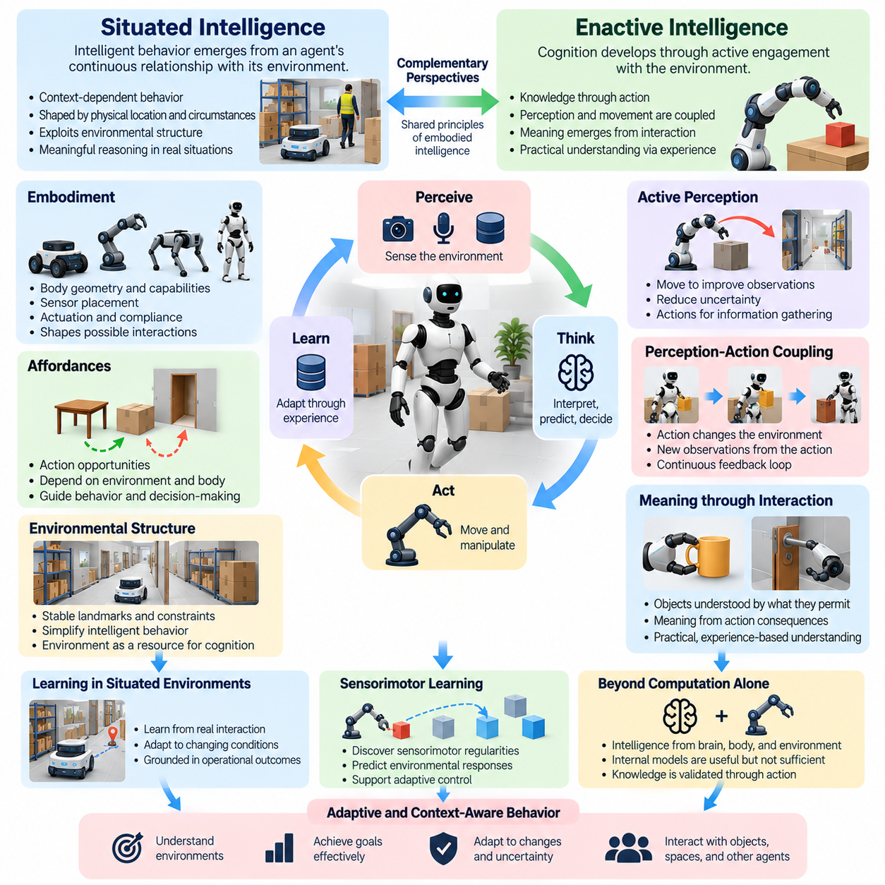{width="7.268055555555556in" height="7.268055555555556in"}

Situated intelligence refers to the principle that intelligent behavior emerges from an agent\'s continuous relationship with its environment, rather than from isolated internal computation. An agent\'s decisions depend on its physical location, surrounding objects, available resources, and immediate circumstances. Intelligence is therefore understood as context-dependent activity in which perception, action, and environmental conditions jointly shape behavior.

The concept of situated intelligence challenges traditional models that treat cognition as a sequence of abstract operations performed independently of the world. Instead, it emphasizes that meaningful reasoning occurs within specific situations involving physical constraints and practical objectives. An autonomous robot navigating a warehouse, for example, must interpret changing obstacles, human movements, and task priorities while continuously adjusting its actions.

Enactive intelligence extends this perspective by proposing that cognition develops through active engagement with the environment. Rather than constructing knowledge solely from passive sensory inputs, an agent generates meaningful experience through its actions. Perception and movement become mutually dependent processes, allowing the agent to develop practical understanding through repeated interaction with objects, surfaces, obstacles, and other agents.

The distinction between situated and enactive intelligence concerns their primary emphasis rather than a strict separation of mechanisms. Situated intelligence highlights the importance of environmental context and the conditions under which behavior occurs. Enactive intelligence emphasizes how agents actively establish meaningful relationships with their surroundings through sensorimotor engagement. Both perspectives reject the assumption that intelligent behavior can be fully explained by computation alone.

Embodiment provides an essential foundation for both situated and enactive intelligence. The physical characteristics of an agent determine how it encounters the environment and which actions it can perform. Body geometry, sensor placement, actuator capabilities, and mechanical compliance influence the structure of interaction. Consequently, two agents operating in identical environments may develop different strategies because their embodiments support different forms of experience.

Perception-action coupling is central to situated and enactive behavior. An agent observes environmental conditions, performs an action, and receives new sensory information resulting from that action. This continuous feedback process allows behavior to remain responsive to changing circumstances. Perception is not merely an input stage preceding decision-making, because actions can deliberately alter what becomes observable and how environmental information is interpreted.

Active perception illustrates the practical significance of these principles. A mobile robot may reposition itself to inspect an occluded passage, while a manipulator may rotate an object to identify a suitable grasping surface. These actions are selected partly to improve knowledge rather than directly accomplish the final task. Intelligence therefore involves controlling the acquisition of information as well as selecting actions that modify the physical environment.

Situated intelligence also emphasizes the role of environmental structure in simplifying intelligent behavior. Agents can exploit stable landmarks, predictable spatial arrangements, and physical constraints instead of maintaining complete internal representations of every environmental detail. A navigation system may use corridors and walls to guide movement, while a manipulation system may exploit supporting surfaces to stabilize objects. Environmental organization becomes a resource for cognition.

Enactive intelligence places additional emphasis on the formation of meaning through interaction. An object is not understood only through its visual appearance or geometric description, but also through the actions it permits and the consequences those actions produce. A handle becomes meaningful through grasping and pulling, while a surface becomes meaningful through supporting movement or contact. Such relationships connect environmental understanding with practical capabilities.

The concept of affordances provides a useful bridge between situated and enactive perspectives. Affordances describe action opportunities that arise from relationships between environmental properties and an agent\'s abilities. A narrow opening may be traversable for a compact mobile robot but inaccessible to a larger platform. Affordance understanding therefore depends on both physical context and embodiment, allowing agents to interpret environments in terms of achievable actions.

Learning within situated environments involves adapting behavior to the conditions encountered during actual interaction. An agent may discover that a particular floor surface reduces traction, that a doorway becomes congested at certain times, or that an object requires additional force to manipulate. These experiences can modify future action selection. Learning becomes grounded in operational consequences rather than exclusively in externally supplied labels.

Enactive learning further emphasizes the development of sensorimotor regularities through repeated action. By exploring how movements influence sensory observations, agents can acquire expectations about environmental responses. Such expectations support prediction, coordination, and adaptive control. The resulting knowledge is closely connected to the agent\'s capabilities, making it particularly useful for tasks involving contact, locomotion, navigation, and manipulation.

Situated and enactive approaches do not necessarily eliminate internal representations or computational models. Instead, they emphasize that representations should remain connected to ongoing interaction and practical action. World models, spatial maps, and predictive representations can support intelligent behavior when continuously updated through sensory feedback. Their value depends on how effectively they guide decisions within the changing conditions of physical environments.

Uncertainty is an unavoidable characteristic of situated operation. Environmental states may be partially observable, sensors may produce noisy measurements, and other agents may behave unpredictably. Intelligent systems must respond by combining current observations with memory, prediction, and additional information-gathering actions. Enactive strategies can reduce uncertainty through purposeful exploration, while situated reasoning evaluates which observations and actions are relevant to immediate circumstances.

These perspectives have important implications for autonomous robotics. Classical control methods can provide precise motion execution, while situated reasoning supports context-sensitive task selection and environmental interpretation. Enactive mechanisms contribute active exploration, interactive learning, and adaptive sensorimotor coordination. Combining these capabilities allows robots to respond to situations that cannot be completely anticipated through predefined operational rules.

Physical AI integrates situated and enactive principles into broader architectures for perception, prediction, planning, control, and learning. Situated intelligence helps determine which environmental conditions matter for a particular task, while enactive intelligence explains how interaction generates useful knowledge. Predictive models and control mechanisms translate this knowledge into executable behavior. The resulting system can adapt its actions while maintaining awareness of physical constraints.

Real-time operation makes situated intelligence particularly important because environmental context changes while decisions are being computed. A robot must respond to moving obstacles, unexpected human activity, and variations in physical conditions without relying on outdated assumptions. Enactive interaction can improve understanding, but exploratory actions must remain compatible with timing requirements and safety constraints. Intelligent adaptation must therefore balance information acquisition with operational responsiveness.

Safety also shapes the application of situated and enactive intelligence. Active exploration may improve environmental understanding, but physical experiments can introduce risks when objects, people, or machinery are nearby. Physical AI systems must constrain exploratory behavior through collision avoidance, force limits, supervised execution, and appropriate fallback mechanisms. Learning through interaction should occur within operational boundaries that protect both the agent and its surroundings.

Multi-agent environments introduce additional dimensions of situated intelligence. Each agent operates within a local context influenced by the actions of other robots, humans, and infrastructure systems. Coordination requires interpreting shared spaces, anticipating interactions, and adapting to collective conditions. Enactive mechanisms can support cooperation through communication and coordinated action, while distributed representations help maintain consistency across participating agents.

Evaluation of situated and enactive intelligence should consider more than isolated task accuracy. Relevant measures include adaptation to environmental changes, effectiveness of active perception, recovery from unexpected disturbances, and the ability to exploit environmental structure. Interaction efficiency, task completion, and robustness under uncertainty provide additional evidence of practical competence. Physical AI evaluation must also account for latency, safety, reliability, and sustained operational performance.

Ultimately, situated intelligence explains why intelligent behavior must be understood within the context of actual environments, while enactive intelligence emphasizes how knowledge and meaning develop through action. Together, they establish a foundation for interactive, adaptive, and physically grounded cognition. Physical AI extends these principles into engineered systems that combine environmental awareness, learning, prediction, and reliable physical execution under real-world constraints.

## 06.05. Perception Action Coupling

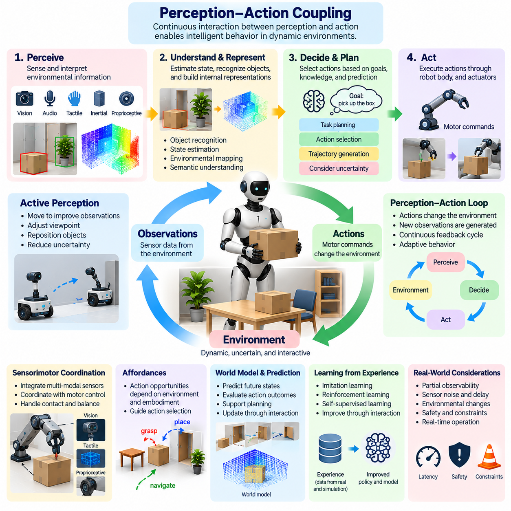{width="7.268055555555556in" height="7.268055555555556in"}

Perception-action coupling describes the continuous relationship between an intelligent agent\'s sensory observations and its physical actions. Perception informs behavior, while behavior changes the environment and influences subsequent observations. This reciprocal process forms a fundamental mechanism of embodied intelligence and Physical AI, allowing agents to interact with dynamic environments rather than merely process sensory information independently of action.

Traditional computational architectures often represent perception and action as separate stages connected through sequential processing. Sensors acquire environmental information, algorithms construct representations, and controllers execute predefined commands. Although such architectures can support effective feedback control, perception-action coupling emphasizes that sensing and acting are mutually dependent processes whose interactions continuously influence intelligent behavior.

The perception-action loop begins when sensors observe environmental conditions and estimate information relevant to a task. An agent interprets these observations, selects an action, and produces a physical change through its actuators. The resulting environmental response generates new sensory measurements, which update the agent\'s understanding. Repeated cycles allow behavior to adapt to disturbances, changing objectives, and unexpected physical interactions.

Closed-loop control provides an important engineering foundation for perception-action coupling. Instead of executing actions without considering their consequences, a closed-loop system continuously compares observed states with desired conditions. Differences between expected and actual outcomes guide corrective behavior. Physical AI extends this principle by incorporating learned representations, predictive reasoning, and adaptive decision policies into the feedback process.

Perception-action coupling also changes how environmental information is acquired. An agent does not need to remain stationary while observing its surroundings because movement can reveal previously unavailable information. A mobile robot may change its viewpoint to inspect an obstructed corridor, while a manipulator may reposition an object to identify a grasping opportunity. Actions therefore serve both operational and information-gathering purposes.

This relationship is closely associated with active perception, in which agents deliberately select actions to improve the quality or relevance of sensory information. Camera orientation, robot position, manipulator movement, and sensor configuration can be adjusted to reduce uncertainty. Effective active perception requires balancing the expected informational benefit of an action against its execution cost, physical feasibility, timing requirements, and safety implications.

Sensorimotor coordination represents another essential aspect of perception-action coupling. Successful movement requires integrating visual, inertial, tactile, proprioceptive, and other sensory signals with motor commands. A robotic arm performing insertion must continuously interpret contact forces and positional deviations. Similarly, a mobile robot must coordinate environmental observations with velocity and steering adjustments to maintain stable and purposeful motion.

The concept of affordances connects perception-action coupling with practical environmental understanding. Objects and surfaces are interpreted not only according to their appearance but also according to the actions they enable. A handle suggests grasping, a flat surface may provide support, and an opening may permit passage. These possibilities depend on the agent\'s embodiment, making action capabilities an important influence on perceptual interpretation.

Embodiment determines the structure and limitations of perception-action coupling. Sensor placement influences observable information, while mechanical geometry and actuator capabilities determine available responses. A wheeled robot, quadruped, and humanoid may perceive similar obstacles but require different movement strategies. Their physical characteristics shape the relationship between sensory information, action selection, and environmental consequences.

Learning enables perception-action relationships to improve through experience. By observing how actions influence subsequent sensory states, an agent can acquire models of environmental dynamics and refine its control policies. Repeated interactions reveal patterns involving motion, contact, friction, and object behavior. These learned relationships support more accurate predictions and increasingly effective action selection under variable operating conditions.

Predictive world models extend perception-action coupling beyond immediate feedback. An agent can estimate how environmental states may evolve after different candidate actions and compare possible outcomes before execution. Such predictions support anticipatory control, obstacle avoidance, and longer-horizon planning. Feedback remains essential because model predictions may differ from actual physical behavior, requiring continuous correction and adaptation.

Partial observability introduces additional complexity into perception-action coupling. Sensors provide incomplete and potentially noisy information, while environmental changes may occur outside the observable region. Agents must combine current measurements with memory, uncertainty estimates, and predictions. When information is insufficient, an agent may select exploratory actions that improve state estimation before committing to a potentially consequential physical operation.

The temporal structure of perception-action coupling is particularly important in real-time systems. Sensor acquisition, computation, communication, and actuator response introduce delays between observation and physical execution. Excessive latency can make decisions depend on outdated environmental information. Physical AI architectures must coordinate processing frequencies, prediction horizons, and control deadlines to maintain responsiveness and stable behavior.

Perception-action coupling operates across multiple temporal and computational scales. Low-level controllers regulate motor behavior through rapid feedback, while higher-level processes interpret scenes, select objectives, and generate plans. Intermediate mechanisms coordinate trajectories and local environmental responses. Effective integration requires these processes to exchange relevant information without allowing slower reasoning components to compromise time-critical control functions.

Simulation provides a practical environment for studying and training perception-action relationships. Agents can repeatedly execute actions, observe consequences, and explore diverse environmental conditions without exposing physical equipment to unnecessary risk. Simulation supports reinforcement learning, imitation learning, and policy evaluation. However, differences in sensor behavior, contact dynamics, and environmental variability can limit transfer to real-world operation.

The integration of learned perception and control introduces both opportunities and challenges. Neural networks can extract useful environmental features and generate adaptive action policies, while conventional controllers provide structured motion regulation. Hybrid architectures combine these capabilities to improve flexibility without abandoning established control principles. Their effectiveness depends on reliable interfaces, appropriate validation, and careful treatment of uncertainty.

Perception-action coupling is also fundamental to manipulation intelligence. Grasping, pushing, insertion, and assembly require continuous interpretation of object motion and contact conditions. Visual observations guide approach trajectories, while tactile and force feedback support contact-sensitive adjustments. Successful manipulation depends on responding to physical interactions as they occur rather than assuming that an initially planned movement will remain valid.

In autonomous navigation, perception-action coupling connects localization, obstacle detection, route planning, and motion execution. A robot continuously updates its understanding of nearby obstacles and traversable space while moving toward a destination. Unexpected pedestrians, moving equipment, or changes in floor conditions may require immediate adjustments. The resulting behavior emerges from repeated coordination between environmental interpretation and physical movement.

Safety imposes essential boundaries on perception-action coupling. Incorrect observations, delayed responses, or unsuitable actions can create hazardous physical consequences. Systems must enforce appropriate speed limits, collision constraints, actuator restrictions, and emergency responses. Runtime monitoring can identify discrepancies between predicted and observed behavior, while fallback mechanisms provide controlled responses when perception or decision-making becomes unreliable.

Multi-agent Physical AI extends perception-action coupling beyond individual robots. One agent\'s actions may change the observations and available choices of other agents sharing the same environment. Coordinated navigation, collaborative manipulation, and fleet operation therefore require awareness of interacting behaviors. Communication and shared environmental representations can support coordination, but local feedback remains necessary when information is delayed or incomplete.

Evaluation of perception-action coupling should examine how effectively an agent transforms observations into appropriate behavior under changing conditions. Relevant measures include response latency, trajectory accuracy, task completion, adaptation to disturbances, and uncertainty reduction. Testing should also consider robustness to sensor degradation and unexpected interactions. Physical AI evaluation combines these measures with safety, reliability, and sustained operational performance.

Ultimately, perception-action coupling establishes intelligence as a continuous process of sensing, acting, observing consequences, and adapting behavior. It connects embodied experience with environmental understanding and transforms perception from passive information processing into an active component of control. Physical AI builds upon this relationship through predictive models, learning, planning, and reliable execution, enabling increasingly adaptive interaction with the physical world.

## 06.06. Sensorimotor Learning

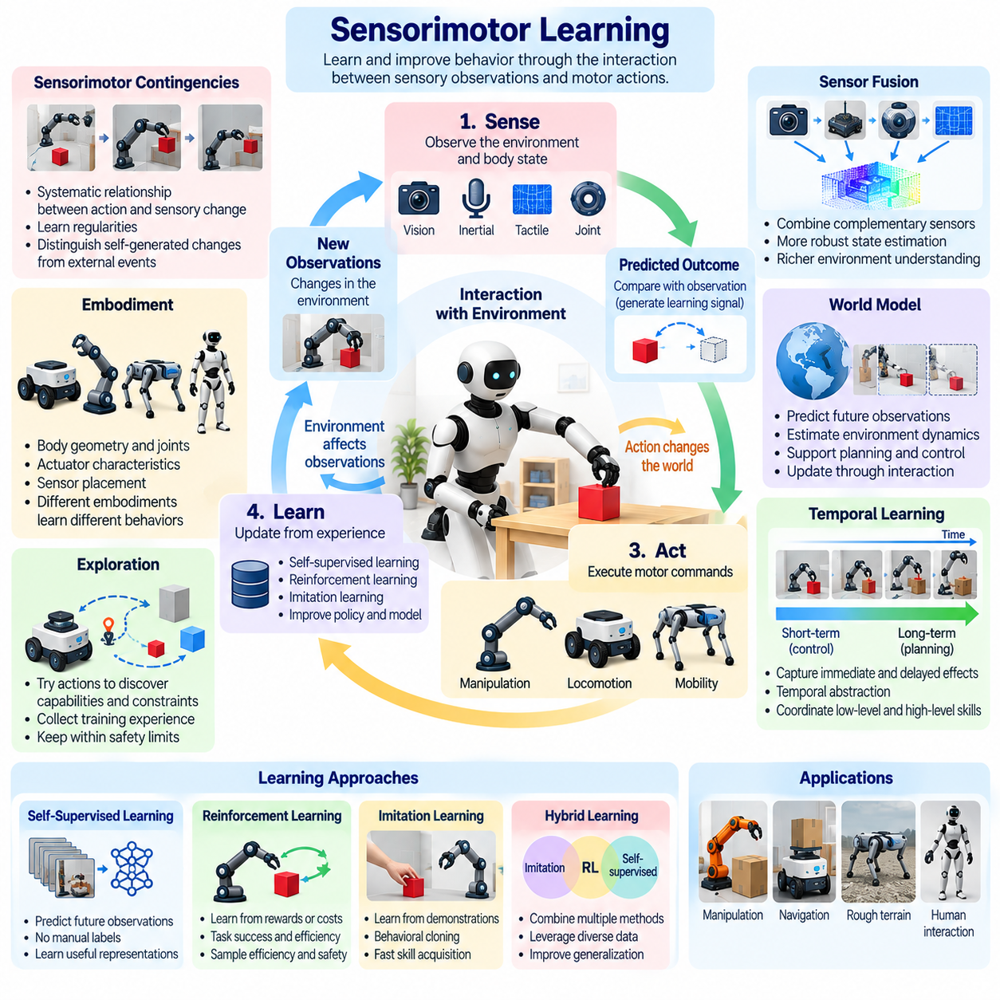{width="7.268055555555556in" height="7.268055555555556in"}

Sensorimotor learning describes how intelligent agents acquire and refine behavior by discovering relationships between sensory observations and motor actions. Through repeated interaction, an agent learns how its movements affect the environment and how resulting sensory changes should influence subsequent decisions. This process connects perception, action, and experience, providing a fundamental mechanism for embodied intelligence and adaptive Physical AI systems.

Unlike learning approaches based exclusively on static datasets, sensorimotor learning emphasizes experience generated through physical interaction. An agent performs actions, observes their consequences, and updates its internal representations or control policies. Learning therefore depends on the dynamics of the agent, its environment, and their interaction. The resulting knowledge is grounded in physical consequences rather than isolated symbolic descriptions.

The sensorimotor learning cycle begins with observations obtained from cameras, inertial sensors, joint encoders, tactile devices, and other sensing mechanisms. These measurements provide information about the agent\'s body and surrounding environment. Motor commands then produce movement or contact, generating new observations. Differences between predicted and observed outcomes supply learning signals that can improve future perception and action.

Embodiment strongly influences sensorimotor learning because an agent\'s physical structure determines its available actions and sensory experiences. Joint arrangements, actuator characteristics, body geometry, and sensor placement constrain the relationships that can be learned. A wheeled robot, robotic arm, and quadruped may encounter the same object but develop different interaction strategies because their movement capabilities and sensory feedback differ.

Sensorimotor contingencies describe systematic relationships between actions and resulting sensory changes. When an agent rotates its camera, visual features shift predictably across the image. When a manipulator contacts an object, force measurements change according to contact conditions. Learning these regularities helps agents distinguish self-generated sensory changes from external events and supports more accurate interpretation of environmental dynamics.

Motor exploration provides an important source of training experience. Agents can execute controlled movements to discover actuator responses, environmental constraints, and interaction possibilities. Early exploration may involve simple motions, while later behavior combines learned skills into more complex sequences. Exploration must remain bounded by physical safety constraints, particularly when robots interact with fragile objects, machinery, or people.

Self-supervised learning is especially relevant because physical interaction naturally produces paired observations and actions. An agent can learn to predict future sensor readings, estimate movement consequences, or reconstruct missing observations without requiring manually labeled examples. Prediction errors provide training signals that refine learned representations. Such methods can reduce annotation requirements while improving understanding of physical relationships.

Reinforcement learning provides another framework for sensorimotor adaptation. Agents select actions, receive feedback through rewards or costs, and improve policies according to experienced outcomes. Reward functions may represent task completion, energy efficiency, stability, or interaction quality. However, successful reinforcement learning requires careful consideration of exploration safety, sample efficiency, reward design, and transfer to real environments.

Imitation learning allows agents to acquire sensorimotor skills from demonstrations performed by humans or other robots. Demonstrations connect sensory conditions with corresponding actions, providing examples of effective behavior. Behavioral cloning and related methods can accelerate initial skill acquisition. Nevertheless, imitation policies may struggle with unfamiliar states, requiring additional interaction, corrective feedback, or adaptive learning.

Predictive models play a central role in advanced sensorimotor learning. By estimating how actions change future observations, an agent can anticipate environmental responses before executing movements. Learned dynamics models may support trajectory planning, contact prediction, and adaptive control. These models must be updated when operating conditions change because inaccurate predictions can produce unsuitable actions or unstable behavior.

Representation learning helps transform raw sensory measurements into information useful for action selection. Visual features, joint states, contact forces, and motion estimates can be integrated into compact representations of relevant physical conditions. Effective representations preserve information needed for control while reducing unnecessary complexity. Their usefulness depends on whether they support reliable prediction, generalization, and task execution.

Temporal learning is essential because sensorimotor relationships unfold across different timescales. Rapid feedback regulates balance and contact, while slower processes support navigation, manipulation sequences, and strategic planning. Learning systems must capture immediate consequences as well as delayed effects. Temporal abstraction can organize repeated action patterns into reusable skills, allowing agents to coordinate low-level movements with higher-level objectives.

Sensor fusion strengthens sensorimotor learning by combining complementary information sources. Cameras provide visual context, inertial sensors estimate motion, joint encoders describe body configuration, and tactile sensors reveal contact conditions. Integrated observations can improve state estimation and reduce ambiguity. Learning algorithms must also account for differences in sampling frequency, measurement uncertainty, calibration, and communication delay.

Contact-rich manipulation illustrates the importance of sensorimotor learning in Physical AI. Grasping, insertion, pushing, and assembly involve complex relationships between motion, force, friction, and object geometry. An agent may learn to adjust grip strength when an object begins slipping or modify insertion trajectories when unexpected resistance occurs. Such adaptation depends on interpreting sensory consequences during physical interaction.

Locomotion provides another important application. Legged robots must coordinate body motion, ground contact, balance, and terrain adaptation under changing conditions. Sensorimotor learning can help develop movement policies that respond to slopes, uneven surfaces, and disturbances. Wheeled platforms can similarly learn traction-sensitive control strategies. These capabilities complement analytical dynamics models and established feedback controllers.

Simulation enables sensorimotor learning through repeated interaction without requiring every experiment to occur on physical hardware. Virtual environments can generate diverse terrain conditions, object configurations, and dynamic disturbances. Domain randomization and simulated sensor noise may improve robustness. Nevertheless, differences in friction, contact dynamics, actuator behavior, and perception require careful simulation-to-reality validation.

Transfer learning addresses the challenge of applying acquired sensorimotor skills to new environments, objects, or robotic platforms. Shared representations and adaptable policies may support reuse across related tasks. However, differences in embodiment, actuator limits, and sensor configurations can restrict transfer. Successful adaptation often requires calibration, additional experience, or explicit consideration of platform-specific physical constraints.

Continual sensorimotor learning allows agents to refine behavior after deployment as environments and operating conditions evolve. Robots may encounter new surfaces, changing payloads, component wear, or unfamiliar object arrangements. Online adaptation can improve performance, but uncontrolled model updates may introduce instability or degrade previously acquired skills. Practical systems therefore require monitoring, controlled updates, and mechanisms for preserving reliable behavior.

Safety remains a fundamental requirement because sensorimotor learning directly influences physical actions. Exploration and policy adaptation must respect collision constraints, force limits, workspace boundaries, and emergency procedures. Supervisory controllers can restrict unsafe commands while learning components improve within permitted operating regions. Validation must examine both expected performance and behavior under unexpected sensory or environmental conditions.

Multi-agent sensorimotor learning extends these principles to coordinated physical systems. Robots may learn how their actions affect shared objects, surrounding agents, and collective task outcomes. Cooperative manipulation and fleet navigation require interpreting both individual sensory feedback and interaction effects. Communication can support shared learning, although delayed or incomplete information makes robust local adaptation essential.

Evaluation of sensorimotor learning should measure more than training accuracy or accumulated reward. Relevant criteria include task success, adaptation speed, sample efficiency, prediction accuracy, disturbance recovery, and transfer performance. Testing must also examine robustness to sensor degradation and changes in physical dynamics. Physical AI systems require evidence that learned behavior remains safe, reliable, and effective during sustained operation.

Ultimately, sensorimotor learning establishes a direct connection between physical experience and intelligent behavior. It enables agents to discover action consequences, develop predictive representations, refine motor skills, and adapt to changing environments. Physical AI integrates these capabilities with perception, world modeling, planning, and established control methods, supporting increasingly autonomous systems whose intelligence develops through interaction with the physical world.

## 06.07. Affordances and Active Perception

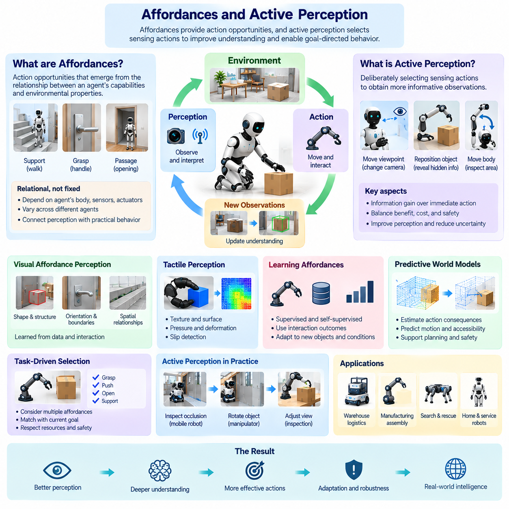{width="7.268055555555556in" height="7.268055555555556in"}

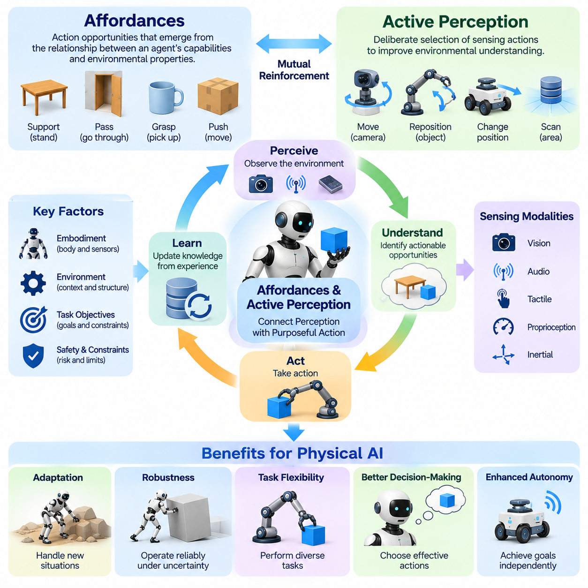{width="7.268055555555556in" height="7.268055555555556in"}

Affordances describe the opportunities for action that emerge from relationships between an agent\'s capabilities and environmental properties. A surface may support movement, a handle may permit grasping, and an opening may allow passage. These possibilities are not determined by objects alone because the agent\'s body, sensors, actuators, and current objectives influence which actions are feasible. Affordance understanding connects perception directly with practical behavior.

The concept of affordances originates in ecological approaches to perception, which emphasize how organisms interpret environments through possibilities for interaction. Rather than viewing perception solely as the reconstruction of objective geometric descriptions, this perspective considers what environmental features enable an agent to accomplish. Physical AI extends this principle into robotic systems that must identify actionable opportunities under changing physical conditions.

Affordances are relational rather than fixed properties of objects. A staircase may support locomotion for a legged robot but remain inaccessible to a conventional wheeled platform. A container may be graspable by one manipulator but exceed another robot\'s payload capacity. Consequently, affordance perception requires knowledge of both environmental characteristics and embodiment, including mechanical constraints, sensor limitations, and available control capabilities.

Active perception describes the deliberate selection of sensing actions to improve environmental understanding. An agent may move its camera, reposition its body, or manipulate an object to obtain more informative observations. Unlike passive sensing, active perception treats information acquisition as part of intelligent behavior. The agent determines not only how to respond to observations but also which actions can reveal information needed for subsequent decisions.

Affordance understanding and active perception reinforce one another. An agent may identify a possible grasping region but remain uncertain about its geometry or accessibility. By changing its viewpoint or touching the object, the agent can gather evidence about the proposed action. Improved observations refine affordance estimates, while candidate affordances guide further sensing. This reciprocal process connects environmental interpretation with purposeful exploration.

Visual affordance perception involves recognizing features associated with possible actions. Shape, orientation, surface structure, object boundaries, and spatial relationships may indicate grasping, pushing, supporting, or traversing opportunities. Modern Physical AI systems can learn these associations from demonstrations and interaction data. However, visual appearance alone may be insufficient when successful action depends on friction, mass, compliance, or hidden geometry.

Tactile perception contributes information that cameras cannot always provide. Contact sensors can reveal surface texture, local deformation, pressure distribution, and slipping behavior. During manipulation, these measurements help determine whether an object can be held securely or whether additional adjustment is required. Combining visual and tactile information supports affordance estimates grounded in actual physical interaction rather than appearance alone.

Active perception can be formulated as a decision problem involving uncertainty and information value. An agent evaluates whether additional observations are likely to improve its understanding enough to justify the required movement, time, or energy. A mobile robot may inspect a narrow passage before entering, while a manipulator may rotate an unfamiliar object before grasping it. The preferred sensing action depends on expected information gain and operational constraints.

The relationship between affordances and task objectives is particularly important. An object may support several possible actions, but only some are relevant to the current goal. A box may be pushed, lifted, opened, or used as a temporary support. Physical AI systems must evaluate which opportunities contribute to task completion while respecting available resources and safety requirements. Affordance selection therefore connects perception with planning and decision-making.

Learning affordances requires associating environmental observations with action outcomes. Through repeated interaction, an agent can discover which grasps succeed, which surfaces provide traction, and which openings permit safe navigation. Successful and unsuccessful attempts both provide useful evidence. Learning methods can update affordance representations according to observed consequences, enabling adaptation to unfamiliar objects and changing environmental conditions.

Self-supervised learning provides a practical approach to affordance discovery. Robots can collect observations before and after controlled interactions and use resulting changes as learning signals. A grasp attempt may reveal object stability, while a pushing action may expose friction or mobility. These experiences generate supervision without requiring complete manual annotation. Nevertheless, exploration must remain within validated physical and operational boundaries.

Predictive world models can strengthen affordance reasoning by estimating the consequences of candidate actions. Before pushing an object, an agent may predict its displacement, possible collisions, and resulting accessibility. Before traversing a surface, it may estimate stability and traction. Such predictions help distinguish actions that appear feasible from those likely to succeed under actual conditions. Feedback remains necessary to correct inaccurate models.

Active perception is especially valuable in partially observable environments. Occlusions, poor lighting, reflective surfaces, and sensor noise can conceal properties relevant to action. An agent may reposition itself, combine different sensor modalities, or perform limited exploratory contact to reduce uncertainty. These actions transform perception into an adaptive process in which the agent actively determines what information is required for reliable execution.

Embodiment places important boundaries on affordance interpretation. Robot geometry, reachability, joint limits, actuator strength, and mobility determine whether an apparent opportunity is executable. The same environment can therefore present different affordances to different platforms. Physical AI must connect learned environmental representations with platform-specific constraints, preventing action selection from relying on abstract possibilities that cannot be physically realized.

Affordance-based planning organizes behavior around achievable interactions rather than isolated geometric destinations. A robot may approach an object from a direction that enables grasping, move an obstacle to create passage, or position itself to improve manipulation stability. Planning can therefore involve sequences in which one action creates new opportunities for subsequent actions. This perspective supports adaptive task execution in complex physical environments.

Active perception and affordance learning also influence navigation. Traversability depends on terrain geometry, surface conditions, robot dimensions, and dynamic obstacles. A navigation agent may examine uncertain ground, adjust its viewpoint, or select a route that provides better visibility. These decisions combine movement feasibility with information acquisition. The resulting behavior can improve robustness when maps are incomplete or environmental conditions change.

Manipulation provides another important application. Successful grasping requires identifying contact regions, estimating object properties, and adapting to uncertain placement. A robot may use visual observations to propose a grasp and tactile feedback to confirm stability. If slipping occurs, the system can modify grip force or contact position. Affordance reasoning identifies possible interactions, while active perception improves confidence during their execution.

Simulation enables robots to learn affordance relationships across diverse objects, surfaces, and task configurations. Virtual interaction can generate examples of successful and unsuccessful actions while supporting large-scale policy training. Domain randomization may improve robustness to environmental variation. However, inaccurate contact dynamics and material properties can distort learned affordances, making real-world validation essential before deployment.

Safety is central because exploratory actions and incorrect affordance estimates can produce harmful physical consequences. An apparently graspable object may be fragile, unstable, or hazardous, while a seemingly traversable surface may not support the robot\'s weight. Physical AI systems must apply force limits, collision constraints, uncertainty thresholds, and supervised exploration. Reliable operation requires distinguishing plausible opportunities from sufficiently verified actions.

Multi-agent environments introduce affordances that depend on cooperation and shared resources. Two robots may jointly lift an object that neither can move independently, while coordinated positioning may create new navigation opportunities. Active perception can help agents observe partner actions and maintain shared situational awareness. Communication and collective planning support these interactions, although local sensing remains important when shared information is incomplete.

Evaluation of affordance understanding should measure whether predicted action opportunities correspond to successful physical execution. Relevant criteria include grasp success, traversability prediction, manipulation reliability, information gain, and adaptation to unfamiliar objects. Active perception should also be assessed through uncertainty reduction, sensing efficiency, and task improvement. Safety, latency, and robustness remain essential indicators of practical Physical AI performance.

Ultimately, affordances connect environmental perception with the actions an embodied agent can realistically perform, while active perception enables the agent to acquire information through purposeful movement and interaction. Together, they transform perception from passive observation into an adaptive component of intelligent behavior. Physical AI integrates these principles with learning, predictive modeling, planning, and control to support flexible and reliable action in uncertain physical environments.

## 06.08. Robot Learning and Interaction Driven Learning

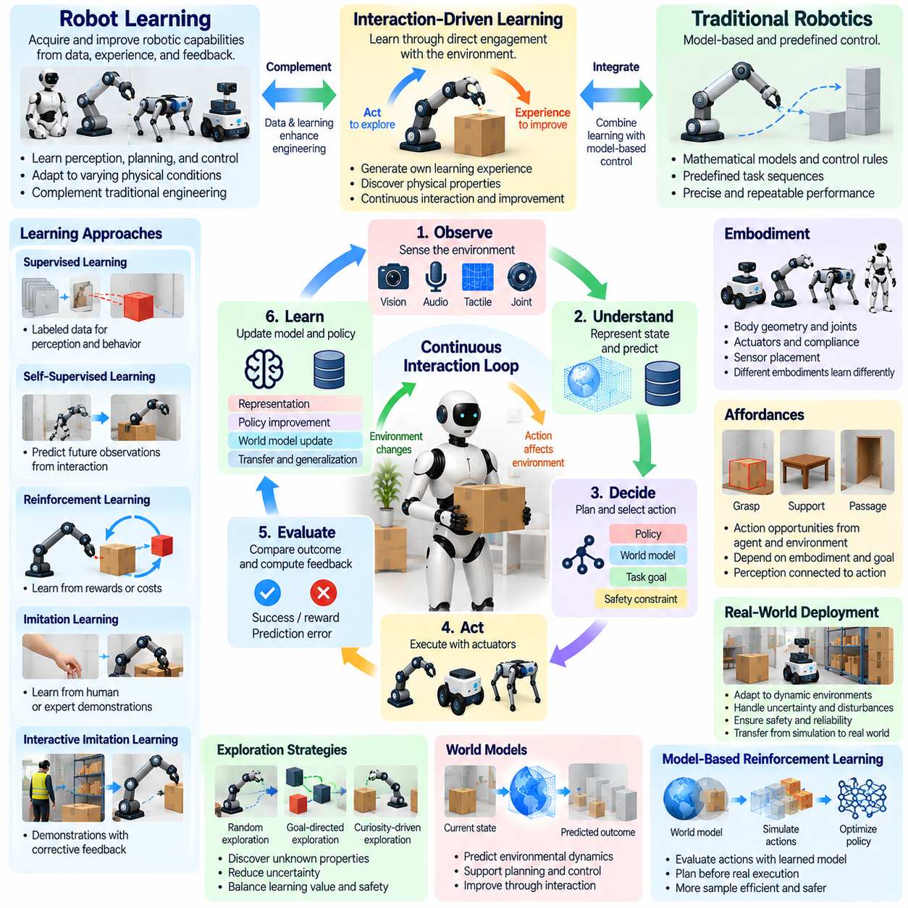{width="7.268055555555556in" height="7.268055555555556in"}

Robot learning refers to the acquisition and improvement of robotic capabilities through data, experience, and feedback rather than exclusively through explicit programming. It enables robots to develop perception, planning, and control strategies that adapt to varying physical conditions. Interaction-driven learning emphasizes experience generated through direct engagement with the environment, allowing intelligent behavior to emerge from the consequences of physical actions.

Traditional robotic engineering often relies on mathematical models, predefined control rules, and carefully designed task sequences. Robot learning complements these methods by discovering useful patterns from demonstrations, simulations, and operational experience. Interaction-driven approaches extend this process by allowing robots to influence the data they collect. Learning becomes a continuous relationship between observation, action, environmental response, and behavioral improvement.

The robot learning process generally involves observing environmental states, selecting actions, evaluating outcomes, and updating behavioral representations. Sensors provide information about objects, motion, contact, and surrounding conditions. Actions change the physical environment and generate additional observations. Learning algorithms use these experiences to refine predictions and policies, improving the robot\'s ability to perform tasks under uncertain conditions.

Interaction-driven learning differs from passive dataset training because the agent participates in generating its own learning experiences. A robot may push an unfamiliar object to estimate its mobility or adjust its position to improve visual observations. These actions provide information unavailable through static images alone. Consequently, the quality of learning depends on both the selected actions and the resulting environmental feedback.

Supervised learning provides an important foundation for robot perception and behavior prediction. Labeled datasets can support object recognition, pose estimation, grasp detection, and movement classification. However, supervised learning depends on the availability and quality of annotated examples. Interaction-driven learning can supplement these datasets by generating observations that reveal physical properties and action consequences through direct experimentation.

Self-supervised learning reduces dependence on manually labeled data by extracting training signals from interactions themselves. Robots can predict future observations, estimate action outcomes, or reconstruct missing sensory information. Differences between predictions and actual measurements provide feedback for representation learning. These methods help agents acquire knowledge of environmental dynamics while using experience collected during ordinary operation.

Reinforcement learning provides a framework in which robots improve behavior by maximizing expected cumulative reward. An agent interacts with its environment, receives feedback, and adjusts its policy according to experienced outcomes. Applications include locomotion, navigation, grasping, and manipulation. Practical challenges include sample efficiency, reward specification, exploration safety, and the difficulty of transferring learned policies to physical hardware.

Imitation learning allows robots to acquire skills from human demonstrations or expert controllers. Demonstrations provide examples of appropriate actions under particular sensory conditions, reducing the need for extensive initial exploration. Behavioral cloning and inverse reinforcement learning represent different approaches to extracting useful behavior. However, imitation alone may not address unfamiliar situations or errors that accumulate during autonomous execution.

Interactive imitation learning introduces corrective feedback during policy development. Human operators or supervisory systems can intervene when a robot encounters uncertain states or unsuitable actions. These corrections expand the training distribution and help reduce repeated mistakes. Such methods combine the efficiency of demonstrations with the adaptability of experience-driven learning, although human involvement can limit scalability.

Exploration is central to interaction-driven learning because agents must discover how unfamiliar environments respond to their actions. Random exploration may generate diverse experiences but can be inefficient or unsafe. Goal-directed exploration selects actions according to expected learning value, uncertainty reduction, or task relevance. Physical AI systems must balance exploration with operational requirements, resource limitations, and safety constraints.

Curiosity-driven learning provides an additional mechanism for autonomous exploration. An agent may prioritize experiences that produce unexpected observations or reveal poorly understood dynamics. Prediction errors and information gain can serve as intrinsic learning signals. However, novelty does not always correspond to useful knowledge, so curiosity mechanisms must be aligned with meaningful tasks and constrained by physical safety requirements.

World models strengthen robot learning by representing how environmental states evolve under different actions. Learned dynamics models can predict object motion, contact outcomes, and future sensory observations. These predictions support planning and reduce the need for repeated physical experimentation. Interaction-driven learning improves world models through new experience, while updated models guide the selection of informative and effective actions.

Model-based reinforcement learning combines predictive environmental models with policy optimization. Instead of relying exclusively on direct trial and error, an agent can evaluate candidate actions using simulated or predicted outcomes. This approach may improve data efficiency, particularly when physical experiments are expensive. Nevertheless, inaccurate models can introduce planning errors, making continuous validation against real observations essential.

Representation learning supports robot learning by converting high-dimensional sensory data into compact information relevant to action. Images, depth measurements, joint states, and tactile signals can be integrated into learned state representations. Effective representations capture task-relevant physical relationships while reducing unnecessary complexity. Their usefulness is determined by how well they support prediction, decision-making, control, and generalization.

Skill learning organizes repeated interactions into reusable behavioral capabilities. A robot may acquire separate skills for approaching objects, grasping, lifting, transporting, and placing them. Hierarchical learning combines these capabilities into longer task sequences. Temporal abstraction allows high-level policies to select skills while lower-level controllers manage detailed movements. This organization improves scalability and supports increasingly complex physical tasks.

Simulation plays a major role in robot learning by providing environments where agents can experience numerous interactions without repeatedly using physical equipment. Reinforcement learning, imitation learning, and exploratory policy training can all benefit from simulated experience. Domain randomization exposes agents to varied conditions. However, differences in contact dynamics, sensor behavior, and actuator performance require careful simulation-to-reality evaluation.

Transfer learning and generalization determine whether acquired capabilities remain useful beyond the original training conditions. A manipulation policy trained on particular objects may need adaptation to new shapes, materials, or placements. Differences between robot embodiments can further complicate transfer. Shared representations, adaptable policies, and targeted fine-tuning can improve reuse, but physical compatibility and task-specific validation remain necessary.

Continual learning allows robots to improve after deployment as environments, equipment, and operational requirements change. New interactions can reveal unfamiliar obstacles, altered surface properties, or previously unseen object configurations. Updating learned models may improve performance, but uncontrolled adaptation can produce catastrophic forgetting or unstable behavior. Reliable systems require controlled updates, performance monitoring, and mechanisms for preserving established capabilities.

Safety is especially important because interaction-driven learning involves actions that may produce uncertain physical consequences. Exploration must respect collision limits, workspace boundaries, actuator constraints, and human safety requirements. Supervisory control can restrict unsafe behavior while learning proceeds within permitted regions. Training and deployment procedures should distinguish experimental policies from validated operational policies and provide reliable fallback mechanisms.

Multi-robot learning extends interaction-driven approaches to systems in which several agents share environments and tasks. Robots may exchange observations, demonstrations, learned representations, or policy improvements. Collaborative manipulation and coordinated navigation generate experiences involving interdependent actions. Distributed learning can improve collective capabilities, but communication delays, inconsistent observations, and differing embodiments complicate coordination.

Evaluation of robot learning should extend beyond training reward or prediction accuracy. Important measures include task success, sample efficiency, adaptation speed, generalization, robustness, and recovery from disturbances. Interaction-driven methods should also be assessed through exploration efficiency and information gained per physical action. Safety, latency, reliability, and sustained performance determine whether learned capabilities are suitable for deployment.

Ultimately, robot learning transforms experience into improved physical competence, while interaction-driven learning emphasizes the active generation of that experience through environmental engagement. Together, they connect perception, action, prediction, and adaptation within a continuous learning process. Physical AI integrates these capabilities with world models, planning, and established control methods to support increasingly flexible and autonomous robotic systems.

## 06.09. World Models for Embodied Systems

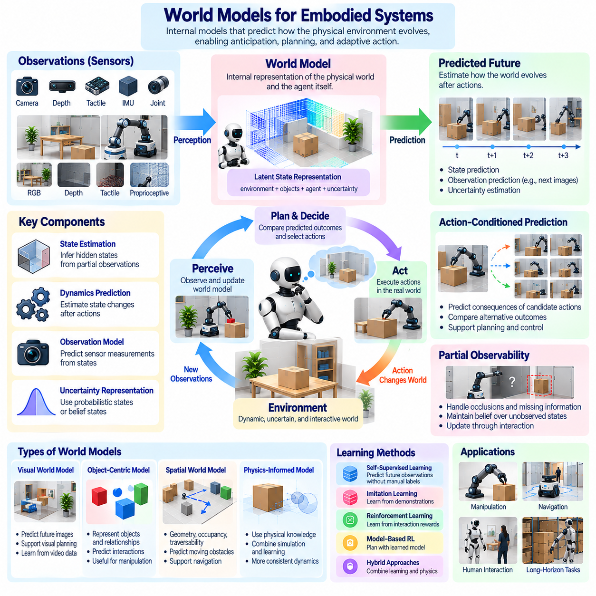{width="7.268055555555556in" height="7.268055555555556in"}

World models provide embodied systems with internal representations of how physical environments evolve over time. They connect sensory observations, estimated states, actions, and predicted consequences within a unified computational framework. Rather than reacting only to immediate inputs, an embodied agent can use a world model to anticipate future conditions, compare possible actions, and adapt its behavior. This capability supports predictive intelligence in Physical AI.

An embodied world model differs from a purely visual or symbolic representation because it must account for physical interaction. Objects possess geometry, motion, mass, and contact properties that influence action outcomes. The agent\'s own body also participates in these dynamics through movement, force, and sensing. A useful model therefore represents relationships between environmental states, agent capabilities, and the consequences of physical interventions.

World models commonly include mechanisms for state estimation, dynamics prediction, and observation generation. State estimation converts incomplete sensor measurements into representations of relevant environmental conditions. Dynamics prediction estimates how states change following actions or external events. Observation models describe how physical states produce sensor measurements. Together, these components support reasoning under uncertainty and enable predictions beyond current observations.

Partial observability is a fundamental challenge for embodied systems. Cameras cannot directly reveal every surface, hidden object, or physical property, while tactile sensors provide information only through contact. A world model must therefore maintain estimates of unobserved conditions using previous observations and learned regularities. Belief states or probabilistic representations can express uncertainty and support decisions when complete environmental information is unavailable.

Temporal prediction allows an agent to estimate how the environment may evolve across different future horizons. Short-term predictions can support collision avoidance, balance, and contact control. Longer horizons can support navigation, manipulation planning, and task coordination. Prediction accuracy generally becomes more difficult to maintain over extended periods because uncertainty accumulates and environmental interactions become increasingly complex.

Action-conditioned prediction is particularly important because embodied agents actively influence their surroundings. A model should estimate not only what may happen naturally but also what will happen if the agent executes a particular action. Pushing an object, opening a door, or changing direction produces different future states. By comparing these possibilities, an agent can select actions according to expected outcomes, operational constraints, and task objectives.

Learning world models requires experience that connects observations with actions and subsequent environmental changes. Interaction datasets may contain images, depth measurements, joint states, tactile signals, and executed commands. Training objectives can include next-state prediction, observation reconstruction, and multi-step forecasting. The resulting model should capture physically meaningful relationships rather than merely reproduce statistical patterns in recorded observations.

Latent world models represent complex sensory information within compact learned state spaces. Instead of predicting every pixel directly, a model may encode observations into latent variables that preserve information relevant to dynamics and control. This approach can reduce computational requirements and support efficient planning. However, compressed representations must retain critical details concerning obstacles, contacts, object identity, and safety-relevant changes.

Visual world models predict future image observations or structured scene representations from current conditions and actions. They can support object tracking, motion anticipation, and visual planning. Video prediction models may learn useful regularities from large observation datasets. Nevertheless, visually plausible predictions do not necessarily preserve physical consistency, particularly when interactions involve hidden forces, friction, deformation, or complex contact dynamics.

Physics-informed world models incorporate knowledge of mechanical relationships, conservation principles, or established dynamics equations. Such models may combine analytical components with learned corrections for uncertain effects. Hybrid approaches can improve data efficiency and physical consistency when suitable assumptions are available. Their effectiveness depends on whether the modeled physics adequately represents the actual robot, objects, and operating environment.

Object-centric world models organize environmental information around individual objects and their relationships. These representations may describe positions, velocities, attributes, and interactions among scene elements. Relational models can estimate how moving one object affects nearby objects or available pathways. Object-centered reasoning is useful for manipulation and task planning, although reliable object identification and interaction modeling remain challenging.

Spatial world models support navigation by representing geometry, occupancy, traversability, and environmental changes. They may combine mapping with predictions of moving obstacles and future free space. For mobile robots, useful representations must connect spatial structure with robot dimensions, motion constraints, and localization uncertainty. Predictive spatial reasoning enables agents to plan routes that account for both current obstacles and anticipated environmental dynamics.

World models also support manipulation by predicting contact events, object displacement, and possible grasp outcomes. A manipulator may simulate candidate actions before attempting a physical interaction. Predictions can help identify stable grasps, suitable approach directions, and likely collision conditions. Because contact dynamics are difficult to estimate precisely, feedback from force, tactile, and visual sensors remains essential during execution.

Model-based planning uses world models to evaluate possible action sequences before selecting a behavior. An agent can generate candidate trajectories, predict their consequences, and compare them against task objectives. Model predictive control repeatedly updates plans as new observations become available. This closed-loop approach reduces dependence on long, uncorrected predictions and helps compensate for uncertainty or changing environmental conditions.

Uncertainty estimation is essential because learned world models can produce incorrect predictions outside their training distributions. Unfamiliar objects, unusual contact conditions, and sensor failures may invalidate model assumptions. Probabilistic predictions, confidence estimates, and disagreement among model ensembles can help identify uncertain outcomes. Agents should use this information to request additional observations, reduce action aggressiveness, or activate safer fallback behavior.

Active perception and world modeling form a reciprocal relationship. A model can identify missing information that limits reliable planning, while sensing actions can reduce uncertainty about relevant environmental properties. An agent may change its viewpoint to inspect an occluded obstacle or perform controlled contact to estimate object resistance. The resulting observations update the world model and improve subsequent action predictions.

Simulation provides a major source of experience for learning and evaluating world models. Virtual environments can generate trajectories involving different objects, terrains, sensor conditions, and interaction outcomes. Simulated experience supports controlled experimentation and broad scenario coverage. However, discrepancies between simulated and physical dynamics can produce systematic prediction errors, making real-world calibration and validation necessary.

Continual world model adaptation allows embodied systems to respond to changing operating conditions. Robots may encounter new payloads, worn actuators, altered surfaces, or unfamiliar environments. Updated observations can refine model parameters and improve future predictions. Nevertheless, unrestricted adaptation may degrade previously reliable knowledge, requiring controlled updates, regression testing, and monitoring of prediction quality.

Multi-agent world models extend prediction to environments containing several interacting robots or humans. Such models may estimate individual trajectories, shared object dynamics, and the consequences of coordinated actions. Collective representations can support fleet navigation and cooperative manipulation. However, differences in observations, communication delays, and uncertain intentions make prediction more difficult, requiring robust local reasoning and periodic model synchronization.

Safety-aware world modeling requires explicit attention to prediction errors and their physical consequences. Models used for planning must account for collision risks, actuator limitations, contact forces, and uncertainty boundaries. Safety controllers should remain capable of restricting actions even when learned predictions are unreliable. World models can support risk assessment, but they do not replace independent safety mechanisms or systematic physical validation.

Evaluation should examine prediction accuracy, physical consistency, planning effectiveness, and generalization across environments. Relevant measurements include trajectory error, state estimation quality, multi-step prediction reliability, computational latency, and task success. Testing should also measure robustness under distribution shifts and unexpected interactions. A visually accurate model is insufficient if its predictions fail to support safe and effective physical decisions.

Ultimately, world models provide embodied systems with a predictive understanding of their environments and the consequences of their actions. They transform accumulated experience into representations that support anticipation, planning, adaptation, and control. Physical AI combines these models with perception, sensorimotor learning, and feedback mechanisms to develop agents capable of reasoning about possible futures while remaining grounded in actual physical interaction.

## 06.10. Foundation Models VLM and VLA

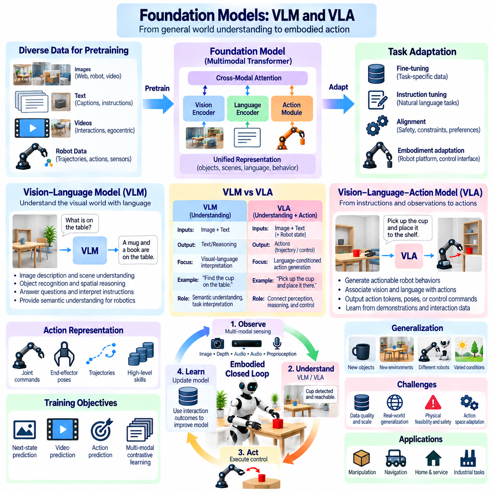{width="7.268055555555556in" height="7.268055555555556in"}

Foundation models are large-scale machine learning systems trained on diverse datasets to acquire representations that can support many downstream tasks. In embodied intelligence, they provide reusable knowledge about objects, environments, language, and behavior. Their significance for Physical AI lies in connecting general-purpose understanding with perception and action, potentially reducing the need to develop separate models for every robotic task.

Traditional robotic learning often produces specialized models designed for particular environments, objects, or control objectives. Foundation models instead seek transferable capabilities through large-scale pretraining and subsequent adaptation. They may recognize unfamiliar objects, interpret instructions, or support task planning across varied situations. However, broad statistical knowledge does not automatically guarantee physical competence or reliable execution.

Vision-Language Models, commonly called VLMs, integrate visual observations with natural language representations. They can interpret images, describe scenes, answer questions about visible objects, and relate linguistic instructions to environmental information. For embodied systems, VLMs provide a bridge between human communication and robotic perception. Their outputs can support semantic understanding, task interpretation, and high-level decision-making.

A VLM may help a robot identify a requested object, interpret spatial relationships, or determine which environmental features are relevant to a task. For example, an instruction to retrieve a container requires connecting language with visual evidence about object identity and location. Nevertheless, visual-language understanding alone does not establish whether the robot can physically grasp, transport, or manipulate the identified object.

Vision-Language-Action models, or VLAs, extend multimodal learning toward physical behavior by associating visual observations and language instructions with robotic actions. These models seek to transform task descriptions and sensory inputs into executable action representations. Depending on their architecture, outputs may include action tokens, target poses, or sequences of motor commands. VLA systems therefore connect semantic understanding with learned control behavior.

The distinction between VLMs and VLAs concerns their primary outputs and training objectives. VLMs generally emphasize visual-language interpretation and reasoning, whereas VLAs explicitly learn relationships between observations, instructions, and actions. A VLM may recommend grasping an object, while a VLA may generate a corresponding action sequence. Neither approach inherently guarantees feasibility, stability, or safety without appropriate physical validation.

Foundation model architectures frequently employ transformers to process sequences of multimodal information. Visual encoders extract image features, language components represent instructions, and action modules produce behavioral outputs. Cross-modal attention can connect objects, words, and task-relevant observations. Architectural choices influence computational requirements, temporal understanding, and the ability to represent continuous physical actions.

Training data strongly determines the capabilities and limitations of embodied foundation models. Internet-scale images and text can provide broad semantic knowledge, while robot demonstrations supply examples of physical behavior. Additional sources may include videos, trajectories, proprioceptive measurements, and interaction outcomes. Effective training requires connecting these heterogeneous sources without confusing visual plausibility with physically executable behavior.

Action representation is a major design challenge for VLA systems. Robotic commands may describe joint positions, velocities, end-effector poses, gripper states, or higher-level skills. Different platforms have different actuator configurations and control interfaces. A model trained on one action space may therefore require adaptation before operating another robot. Consistent action semantics and embodiment-aware interfaces are essential for reliable transfer.

Temporal reasoning is equally important because robotic tasks unfold through sequences of observations and actions. A robot must maintain task context, interpret changes caused by previous movements, and adjust behavior as new information becomes available. Models that process isolated images may miss important dynamics. Incorporating action histories, temporal observations, and predictive representations can improve continuity across extended manipulation and navigation tasks.

Language conditioning enables users to specify goals without manually programming every movement. Instructions such as sorting objects or clearing a workspace can guide task selection and behavior generation. However, natural language is frequently ambiguous or incomplete. Physical AI systems must resolve references, identify missing constraints, and verify environmental conditions before converting instructions into actions with real-world consequences.

Generalization is a central objective of embodied foundation models. Ideally, learned representations should support new objects, environments, instructions, and combinations of familiar skills. Large-scale pretraining may improve such transfer, but performance can decline under unfamiliar lighting, geometry, materials, or robot configurations. Claims of general-purpose capability must therefore be evaluated across meaningful physical variations rather than language benchmarks alone.

Fine-tuning and adaptation connect pretrained foundation models with specific robotic platforms and operating environments. Demonstration data, task-specific trajectories, and corrective interaction feedback can improve execution quality. Parameter-efficient adaptation may reduce computational and data requirements. Nevertheless, updates must preserve previously useful capabilities while accounting for hardware constraints, safety requirements, and changing environmental conditions.

World models can complement VLMs and VLAs by predicting the consequences of proposed actions. A language-conditioned policy may generate a manipulation sequence, while a predictive model estimates object movement, contact events, or possible collisions. This separation can improve planning and verification. However, learned predictions remain uncertain, so physical feedback and independent safety controls are necessary during execution.

Hierarchical architectures offer a practical method for integrating foundation models with established robotic control. A VLM or language model may interpret goals and select tasks, while a VLA or specialized policy generates action targets. Lower-level controllers then manage trajectory tracking, force regulation, and actuator constraints. Such decomposition allows broad reasoning capabilities to coexist with deterministic control and explicit safety mechanisms.

Computational deployment presents additional challenges because large multimodal models can demand substantial memory, processing power, and communication bandwidth. Cloud execution may support complex reasoning but introduce network dependence and variable latency. Edge deployment can reduce communication delays but faces resource limitations. Practical Physical AI architectures must distribute computation according to response-time requirements, reliability, and operational constraints.

Safety and reliability remain unresolved challenges for foundation-model-driven robotics. Models may misidentify objects, misunderstand instructions, generate unsuitable actions, or behave unpredictably outside familiar conditions. Confidence estimates alone cannot establish physical safety. Systems require action validation, collision checking, supervisory control, operational boundaries, and emergency procedures that remain effective independently of model-generated recommendations.

Evaluation must distinguish semantic competence from physical task performance. Relevant measurements include instruction understanding, object grounding, action success, generalization, execution latency, and recovery from failures. Testing should examine unfamiliar environments, ambiguous commands, sensor degradation, and unexpected contact events. Benchmark results become more meaningful when they include reproducible physical trials and clearly defined safety conditions.

Data governance also influences the development of embodied foundation models. Training datasets may contain copyrighted material, sensitive environmental recordings, proprietary demonstrations, or inconsistent action labels. Responsible development requires appropriate data permissions, provenance tracking, quality assessment, and documented limitations. Dataset diversity and transparent evaluation are important for understanding where learned capabilities may fail.

Multi-robot foundation models seek reusable representations across different embodiments and task domains. Shared visual-language knowledge may transfer more easily than low-level motor commands because robots differ in geometry, mobility, and actuation. Embodiment-conditioned policies and standardized skill interfaces may improve cross-platform reuse. However, successful transfer requires explicit validation of physical feasibility and platform-specific execution constraints.

Continual improvement may combine large-scale pretraining with interaction-driven learning after deployment. Operational experience can reveal new objects, unfamiliar conditions, and systematic policy errors. Carefully validated updates may improve performance over time. However, unrestricted online adaptation can introduce regressions or unsafe behavior. Controlled data collection, evaluation, version management, and rollback procedures are therefore essential.

Ultimately, foundation models, VLMs, and VLAs provide complementary capabilities for embodied intelligence. Foundation models offer transferable representations, VLMs connect language with visual understanding, and VLAs extend multimodal learning toward physical action. Physical AI integrates these capabilities with world models, sensorimotor learning, planning, feedback control, and safety engineering to support more adaptable robotic systems grounded in real-world interaction.

## 06.11. Robot Agents and Physical Agents

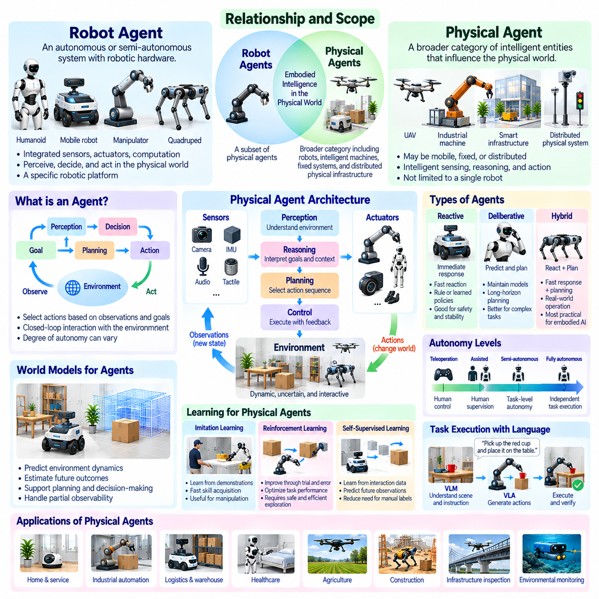{width="7.268055555555556in" height="7.268055555555556in"}

Robot agents are autonomous or semi-autonomous systems that perceive their surroundings, make decisions, and execute actions through robotic hardware. Physical agents represent a broader category of intelligent entities capable of influencing the physical world through sensing, reasoning, and action. Both concepts emphasize closed-loop interaction, but their scope may differ according to embodiment, actuation, autonomy, and the distribution of intelligence across physical infrastructure.

A robot agent typically combines sensors, actuators, computation, and control mechanisms within an identifiable robotic platform. Mobile robots, manipulators, humanoids, and quadrupeds are common examples. A physical agent need not correspond to a single mobile robot. It may include intelligent machinery, fixed sensing and actuation systems, or distributed components that collectively perform physical tasks under coordinated decision-making.

The defining characteristic of an agent is its capacity to select actions according to observations, objectives, and operating conditions. Unlike a passive sensor or predetermined mechanical sequence, an intelligent agent evaluates available information and determines suitable behavior. Agency therefore involves perception, state estimation, decision-making, execution, and feedback, although the degree of autonomy may vary substantially between implementations.

Robot agents operate through a continuous perception-action loop. Sensors capture environmental and internal conditions, computational processes estimate relevant states, and policies or planners select actions. Actuators then modify the robot or its surroundings, producing new observations. This feedback cycle enables adaptation to disturbances and uncertainty while connecting abstract decisions with measurable physical consequences.

Physical agency depends on the relationship between intelligence and physical capability. An agent may correctly identify a desired outcome but lack the actuators, mobility, or mechanical reach required to achieve it. Conversely, powerful hardware without appropriate perception and decision-making cannot demonstrate adaptive intelligence. Effective Physical AI requires coordination between computational reasoning, available actions, environmental constraints, and execution feedback.

Autonomy is not a binary property of robot agents. Some systems follow predefined routes while adapting locally to obstacles, whereas others select tasks, plan trajectories, and recover from unexpected events. Human supervision may remain necessary for hazardous or uncertain operations. Degrees of autonomy should therefore be evaluated according to decision authority, environmental complexity, task responsibility, and the ability to handle failures.

Agent architectures commonly separate perception, reasoning, planning, and control into interacting functional components. Perception identifies relevant environmental conditions, while reasoning interprets goals and constraints. Planning selects action sequences, and control converts selected behaviors into actuator commands. Feedback mechanisms connect these components during execution. Modular architectures can improve maintainability, verification, and integration with established robotics software.

Reactive agents select actions primarily from current observations and learned or predefined response rules. Deliberative agents maintain representations that support prediction and planning before execution. Hybrid agents combine rapid reactions with longer-horizon reasoning. Physical environments frequently require hybrid operation because collision avoidance and balance demand fast responses, while navigation and manipulation benefit from structured planning.

World models enhance physical agents by providing estimates of environmental dynamics and future action consequences. An agent can evaluate alternative movements, anticipate contact events, or predict changes in object positions. Such models support informed decisions under partial observability. However, their predictions remain uncertain, making continuous sensing and feedback essential for maintaining reliable behavior during physical execution.

Learning enables robot agents to improve their behavior through demonstrations, simulation, and operational experience. Reinforcement learning can optimize policies according to task outcomes, while imitation learning transfers skills from examples. Self-supervised methods extract knowledge from sensory interaction. These approaches complement engineered control systems, but learned policies require validation against hardware constraints, distribution shifts, and safety requirements.

Task-oriented agents connect high-level objectives with executable physical operations. A request to relocate an object may require identifying the target, checking accessibility, navigating to a suitable position, grasping the object, and verifying successful placement. The agent must coordinate these stages while responding to changing conditions. Task execution therefore depends on integrating semantic interpretation with physical feasibility and feedback-based control.

Language-enabled robot agents can interpret human instructions and translate them into structured goals or action plans. Vision-language models may support scene understanding, while vision-language-action models can associate instructions and observations with motor behavior. These capabilities improve task flexibility but introduce uncertainty from ambiguous commands and model errors. Physical validation remains necessary before consequential actions are executed.

Hierarchical agency provides a practical structure for complex robotic behavior. High-level components interpret goals and select tasks, intermediate components organize reusable skills, and low-level controllers regulate motion and force. Different layers operate at different timescales and computational requirements. This separation helps preserve rapid physical control while enabling more flexible reasoning and adaptation at higher levels.

Distributed physical agents extend intelligence beyond individual robotic platforms. Fixed sensors, projection systems, edge computers, and mobile robots may share environmental observations and coordinate actions. Some components provide perception or prediction without directly actuating the environment. Their collective operation can support physical agency when decisions are connected to authorized actuators and observable outcomes.

Multi-agent systems introduce coordination among independently acting robots or physical devices. Agents may exchange state estimates, negotiate task assignments, and cooperate around shared resources. Fleet navigation and collaborative manipulation require managing interactions between individual objectives and collective constraints. Communication supports coordination, but each agent must also handle delayed messages, incomplete information, and local safety requirements.

An important distinction exists between an intelligent agent and an ordinary automated device. Automation may execute a predetermined sequence whenever specified conditions occur, whereas an intelligent agent can evaluate alternatives and adapt its behavior to uncertain situations. Nevertheless, the boundary is gradual rather than absolute. Many practical robotic systems combine deterministic automation with adaptive decision-making and learned components.

Physical agents must operate within explicit boundaries of authority and responsibility. An autonomous system should not assume that every technically possible action is permitted. Task permissions, workspace restrictions, human proximity, and equipment limitations influence acceptable behavior. Supervisory control and authorization mechanisms ensure that intelligent decisions remain consistent with operational rules and safety obligations.

Safety engineering is fundamental because agent decisions can create immediate physical consequences. Incorrect perception, unsuitable plans, communication failures, or actuator faults may lead to collisions or equipment damage. Independent safety controllers, emergency stopping, collision monitoring, and validated fallback behavior reduce these risks. Learned reasoning should complement rather than replace safety-critical control mechanisms.

Computational placement influences the design of robot agents and physical agents. Onboard processors support immediate sensing and control, while nearby edge infrastructure can provide shared perception and predictive computation. On-premises systems may coordinate multiple platforms, and cloud resources can support broader learning and analysis. The allocation of responsibilities must reflect latency, connectivity, resilience, and safety constraints.

Evaluation of agent capability should examine more than isolated perception accuracy or planning quality. Relevant measures include task completion, decision latency, recovery from disturbances, environmental adaptation, and resource efficiency. Multi-agent systems additionally require coordination and communication metrics. Physical validation must demonstrate that the complete perception-decision-action process remains reliable under realistic operating conditions.

General physical agency requires capabilities that extend beyond executing a fixed collection of predefined tasks. Agents must interpret unfamiliar situations, transfer knowledge between related activities, and select actions according to changing objectives. They must also recognize uncertainty and limitations. Progress toward generality depends on combining transferable representations with robust physical skills, predictive models, and reliable control.

Ultimately, robot agents and physical agents provide complementary perspectives on intelligent interaction with the physical world. Robot agents emphasize intelligence embodied within robotic platforms, while physical agents encompass broader configurations of sensing, computation, and actuation. Physical AI connects these forms of agency through perception, learning, reasoning, planning, and controlled execution, enabling increasingly adaptive and coordinated physical systems.

## 06.12. From Embodied AI to General Physical Intelligence

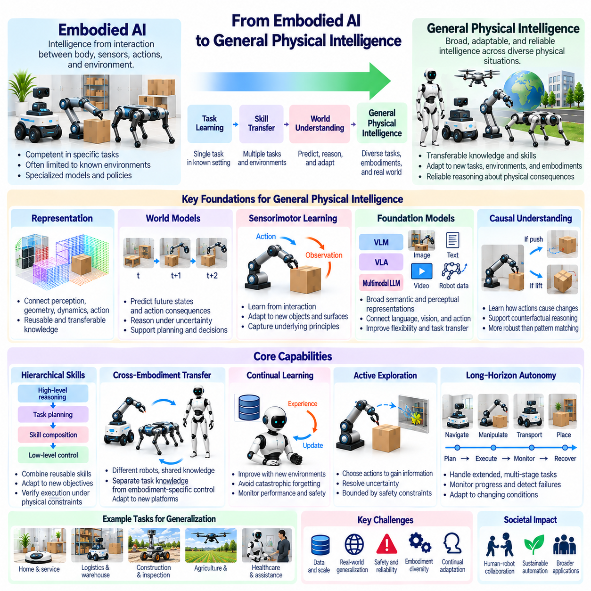{width="7.268055555555556in" height="7.268055555555556in"}

Embodied AI studies intelligence emerging from the interaction between an agent\'s body, sensory systems, actions, and environment. General Physical Intelligence extends this perspective toward systems capable of understanding and acting across diverse physical situations. The transition requires more than improved perception or control. It demands transferable knowledge, adaptive behavior, and reliable reasoning about physical consequences under changing conditions.

Traditional embodied systems often demonstrate competence within narrowly defined tasks, environments, or robotic platforms. A navigation policy may perform well in familiar buildings but fail in unfamiliar terrain. A manipulation system may handle known objects yet struggle with different materials or geometries. General Physical Intelligence seeks to overcome such specialization by developing capabilities that remain useful across tasks, embodiments, and operating conditions.

Generality should not be confused with unlimited autonomy or universal competence. A physically intelligent system may possess broad transferable capabilities while remaining constrained by its hardware, available sensors, and authorized operating domain. Meaningful generality concerns the ability to interpret unfamiliar situations, combine existing skills, and adapt to new requirements. Physical limitations and uncertainty remain fundamental characteristics of embodied operation.

The development of general physical capabilities depends on representations that connect perception, geometry, dynamics, and action. Rather than memorizing isolated responses, an agent must identify relationships that remain meaningful across different environments. Object permanence, spatial structure, contact behavior, and causal dependencies provide reusable knowledge. These representations support adaptation when familiar principles appear in unfamiliar physical configurations.

World models are important because general intelligence requires anticipating consequences beyond immediate observations. Predictive representations can help agents estimate future states, compare candidate actions, and reason about uncertainty. A transferable world model should capture regularities shared across environments while accommodating differences in materials, dynamics, and embodiment. Its usefulness must ultimately be judged by improvements in real physical decisions.

Sensorimotor learning provides another foundation for general physical capabilities. Through repeated interaction, an agent discovers relationships between motor commands, sensory feedback, and environmental changes. Such experience supports adaptation to unfamiliar loads, surfaces, and object properties. Generalization becomes more practical when learning captures underlying interaction principles rather than reproducing fixed movement sequences tied to particular training conditions.

Transfer across embodiments presents a major challenge because different robots possess different mechanical structures and action spaces. A wheeled robot, manipulator, quadruped, and humanoid cannot directly share identical motor commands. Nevertheless, they may reuse knowledge about spatial relationships, object behavior, and task objectives. General Physical Intelligence therefore requires separating transferable task knowledge from embodiment-specific execution mechanisms.

Foundation models may contribute broad semantic and perceptual representations acquired from diverse data sources. Vision-language models can connect instructions with environmental observations, while vision-language-action models extend multimodal learning toward robotic behavior. These approaches may improve flexibility and task transfer. However, linguistic competence and visual understanding cannot substitute for physical experience, grounded control, or verified execution.

Hierarchical skill organization enables complex tasks to be assembled from reusable behavioral components. High-level reasoning identifies objectives, intermediate planning selects suitable skills, and low-level control executes movements under physical constraints. A system may combine navigation, grasping, transport, and placement to accomplish unfamiliar objectives. Such composition supports generality when skills can be adapted and verified rather than applied as rigid sequences.

Continual learning allows physical agents to improve as they encounter new environments, objects, and operational requirements. Experience can refine predictive models, perception systems, and action policies. However, unrestricted adaptation may introduce catastrophic forgetting, unstable behavior, or unsafe decisions. Reliable continual learning requires controlled updates, evaluation against previous capabilities, and mechanisms for detecting performance degradation.

Active exploration contributes to general intelligence by allowing agents to gather information that passive observation cannot provide. A robot may inspect an occluded region, test an object\'s resistance, or adjust its viewpoint to resolve uncertainty. Such actions transform sensing into an intentional part of decision-making. Exploration must remain bounded by safety constraints because physical experiments can damage equipment, disturb environments, or endanger nearby people.

Causal understanding distinguishes robust physical reasoning from superficial pattern recognition. An agent should learn how actions produce changes and how environmental properties influence outcomes. Recognizing that an object moved is less informative than understanding which applied force caused the displacement. Causal models can support counterfactual reasoning, enabling agents to consider what might happen under alternative actions or changed physical conditions.

Long-horizon autonomy introduces additional demands because complex objectives require many interconnected decisions. Errors in perception, planning, or execution can accumulate across extended tasks. General Physical Intelligence must maintain task context, detect deviations, revise plans, and recover from failures. Reliable performance therefore depends on feedback-driven execution and the ability to reassess goals when environmental conditions invalidate earlier assumptions.

General physical capabilities may emerge from coordinated systems rather than isolated robots alone. Distributed sensors, edge computation, mobile platforms, and shared environmental representations can extend the information available to individual agents. Collective learning may enable experience acquired by one platform to benefit others. However, distributed intelligence introduces challenges involving communication delays, inconsistent observations, synchronization, and responsibility for physical actions.

The relationship between autonomy and generality requires careful distinction. An agent may operate independently within a narrow domain without possessing broadly transferable intelligence. Conversely, a system may demonstrate general reasoning while requiring human supervision for consequential actions. Progress should therefore be evaluated along separate dimensions of adaptability, task diversity, decision authority, and operational reliability rather than through a single autonomy label.

Safety becomes increasingly important as physical systems encounter unfamiliar tasks and environments. Generalization can expose agents to situations outside validated training distributions, where prediction errors may produce immediate physical consequences. Independent safety mechanisms, uncertainty monitoring, action constraints, and human intervention pathways remain essential. Greater intelligence should expand useful capabilities without weakening established requirements for safe physical operation.

Evaluation of General Physical Intelligence requires benchmarks that extend beyond isolated perception accuracy or single-task success. Relevant assessments include cross-task transfer, adaptation to unfamiliar objects, robustness under environmental changes, and recovery from unexpected disturbances. Testing should distinguish previously trained conditions from genuinely novel situations. Reproducible physical trials and clearly defined operating boundaries are necessary for credible comparisons.

Scalability depends on combining diverse experience with efficient computation and transferable representations. Simulation can generate broad interaction datasets, while real-world operation provides evidence about physical feasibility and model limitations. Edge systems may support immediate control, and larger computing infrastructure may assist training and shared learning. Effective architectures must balance computational cost, response latency, reliability, and the physical demands of execution.

Human collaboration remains central to the development and deployment of general physical systems. People define objectives, communicate preferences, establish permissions, and evaluate acceptable outcomes. Intelligent agents must interpret these requirements while recognizing ambiguity and uncertainty. Transparent behavior, understandable limitations, and appropriate human oversight help align physical actions with operational expectations and social responsibilities.

Progress toward General Physical Intelligence is likely to involve multiple complementary advances rather than a single model or algorithm. Improvements in multimodal perception, world modeling, robot learning, planning, and control address different aspects of physical competence. Their integration is essential because successful behavior depends on maintaining consistency between knowledge, decisions, and actual environmental interactions across varied situations.

A useful developmental perspective distinguishes specialized physical competence from transferable and adaptive capabilities. Early systems may perform predefined tasks under controlled conditions, while more advanced systems can reuse skills, interpret novel goals, and coordinate across platforms. Broader generality requires robust adaptation and reliable operation under increasing uncertainty. These distinctions describe capability progression without implying that a universally accepted scale already exists.

Ultimately, the transition from Embodied AI to General Physical Intelligence represents a shift from task-specific interaction toward adaptable understanding and action across the physical world. Its objective is not unrestricted machine autonomy but dependable intelligence grounded in perception, prediction, learning, and physical execution. Achieving this vision requires integrating transferable knowledge with embodiment-aware control, continuous feedback, systematic evaluation, and rigorous safety engineering.
