**Volume 02. Physical AI Foundations and Definitions**

# Chapter 07. Relation to AMR Manipulator Humanoid Quadruped UAV

## 07.01. Physical AI Across Robot Embodiments

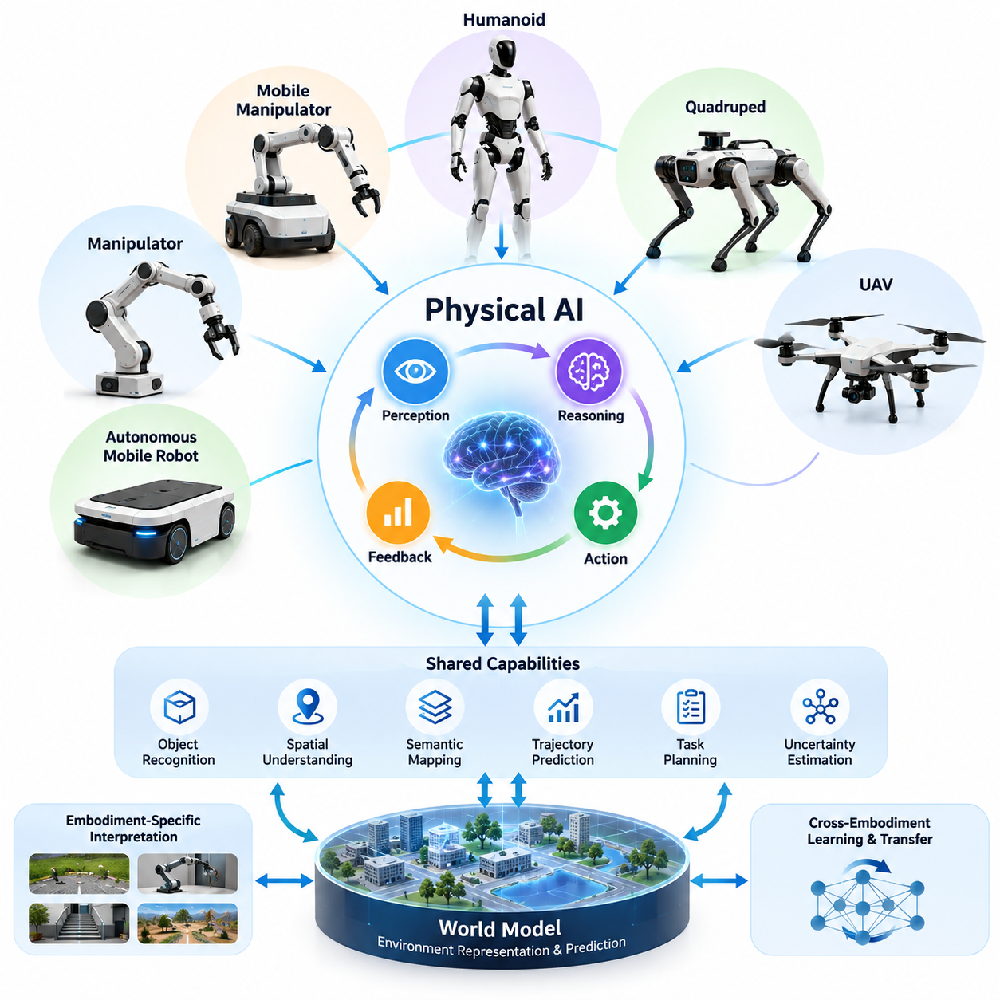{width="7.268055555555556in" height="7.268055555555556in"}

Physical AI represents a unified approach to intelligence operating through diverse robotic embodiments. Autonomous mobile robots, manipulators, humanoids, quadrupeds, and unmanned aerial vehicles possess different mechanical structures and operational capabilities, yet all interact with the physical world through sensing, reasoning, and action. Their common foundation is the ability to perceive environmental conditions, select appropriate behaviors, and adapt actions according to physical feedback.

Robot embodiment determines how an intelligent system observes, moves through, and modifies its environment. Wheels provide efficient movement across suitable surfaces, robotic arms enable object manipulation, articulated legs support movement across irregular terrain, and aerial propulsion enables three-dimensional mobility. These differences influence the available actions, sensor configurations, control requirements, and environmental constraints that Physical AI must understand.

Physical AI should therefore be distinguished from any particular robot morphology. It is not restricted to humanoid robots or machines capable of complex manipulation. A warehouse mobile robot that predicts pedestrian movement, a robotic arm that adapts its grasp to an unfamiliar object, and an aerial robot that navigates uncertain environments can all demonstrate Physical AI capabilities when intelligence is integrated with physical interaction.

Across embodiments, the fundamental intelligence process follows a closed-loop relationship between perception, reasoning, action, and feedback. Sensors collect observations, computational models estimate relevant environmental states, decision mechanisms select actions, and controllers translate decisions into physical movements. Subsequent observations reveal the consequences of those movements, allowing the system to correct errors and respond to changing conditions.

Autonomous mobile robots, commonly called AMRs, illustrate Physical AI through navigation and mobility intelligence. Their primary challenge is to move safely and efficiently while accounting for obstacles, pedestrians, spatial constraints, and uncertain localization. Physical AI extends conventional navigation by incorporating predictive environmental understanding, adaptive route selection, semantic interpretation, and decision-making based on changing operational objectives.

Robotic manipulators express Physical AI through direct interaction with objects and materials. Their intelligence must account for geometry, contact forces, friction, object properties, and the consequences of physical movement. Successful manipulation requires more than accurate joint positioning because objects may deform, slip, rotate, or behave unexpectedly. Perception and control must cooperate continuously to achieve reliable grasping and manipulation.

Mobile manipulators combine locomotion and object interaction within a single robotic embodiment. These systems must coordinate base movement, arm positioning, object accessibility, and environmental constraints. A mobile manipulator retrieving an object from a shelf must determine where to position its base, how to approach the object, and whether the planned grasp remains feasible throughout execution. This coordination illustrates the integrated nature of Physical AI.

Humanoid robots introduce a broader combination of locomotion, manipulation, balance, and interaction within environments largely designed for humans. Their anthropomorphic structure may provide access to stairs, doors, tools, and workspaces without extensive infrastructure modification. However, humanoid morphology also creates substantial control complexity because whole-body stability, coordinated movement, and physical interaction must be managed simultaneously.

Quadruped robots demonstrate how Physical AI adapts to locomotion involving multiple articulated limbs. Their intelligence must consider terrain geometry, foothold selection, body stability, contact conditions, and changing surface properties. Unlike wheeled robots operating primarily on continuous support surfaces, quadrupeds repeatedly establish and release ground contact, requiring coordinated perception, prediction, and dynamic control.

Unmanned aerial vehicles, or UAVs, represent another distinct embodiment in which Physical AI operates through flight. Aerial robots must manage three-dimensional navigation, attitude stabilization, environmental disturbances, and limited energy reserves. Their operating conditions may change rapidly because of wind, moving obstacles, or restricted visibility. Intelligent flight therefore depends on timely perception, predictive planning, and reliable control under uncertainty.

Although these robotic platforms differ physically, they share important computational capabilities. Object recognition, spatial understanding, semantic mapping, trajectory prediction, task planning, and uncertainty estimation can contribute to multiple embodiments. A representation identifying humans, obstacles, and accessible regions may support both ground and aerial navigation, although its geometric interpretation and resulting actions must be adapted to each platform.

World models provide a particularly important connection between different embodiments. A world model represents relevant environmental states and may predict how those states change under particular actions. For a mobile robot, predictions may concern obstacle movement and traversability. For a manipulator, they may concern object motion and contact outcomes. For a quadruped or UAV, they may concern terrain interaction or flight dynamics.

The possibility of sharing intelligence across embodiments does not imply that identical control policies can operate successfully on every robot. Mechanical configurations, actuator limits, observation spaces, and action representations vary considerably. A command appropriate for a robotic arm cannot be directly applied to an aerial vehicle. Cross-embodiment intelligence consequently requires mechanisms that separate transferable knowledge from embodiment-specific execution constraints.

A useful architectural distinction exists between high-level reasoning and low-level physical control. High-level intelligence may interpret instructions, identify goals, recognize objects, and construct task plans using representations that are relatively independent of robot morphology. Lower-level controllers must respect the robot\'s kinematics, dynamics, actuator characteristics, and safety limitations when converting these intentions into executable physical actions.

For example, the instruction to inspect an industrial machine can be interpreted similarly by a wheeled robot, quadruped, humanoid, or UAV. Each platform must nevertheless produce a different physical execution strategy. A wheeled robot approaches through accessible pathways, a quadruped may traverse uneven surfaces, a humanoid may manipulate inspection equipment, and a UAV may observe elevated components from the air.

Learning across embodiments offers opportunities to improve the efficiency and generality of Physical AI development. Visual representations, semantic knowledge, task descriptions, and selected interaction patterns may transfer between platforms. However, differences in sensing, contact dynamics, mobility, and action spaces can reduce transfer effectiveness. Successful adaptation requires evaluating which learned representations remain valid under the target embodiment\'s physical constraints.

Simulation environments provide a practical foundation for studying these relationships. Researchers can construct different robot morphologies within shared virtual environments and evaluate how perception, planning, and control architectures respond to changing embodiment characteristics. Simulation also enables controlled investigation of sensor configurations, actuator limitations, environmental disturbances, and task variations before physical deployment.

Safety requirements remain universal even though their implementation differs by embodiment. Mobile robots must avoid collisions, manipulators must regulate contact forces, humanoids and quadrupeds must manage instability, and UAVs must address flight hazards. Physical AI must incorporate these constraints into planning and execution rather than treating safety as an independent function added after intelligent behavior has been developed.

Heterogeneous robot fleets extend the relationship between embodiments from individual intelligence to coordinated physical operations. A facility may employ mobile robots for transportation, manipulators for handling, quadrupeds for inspection, and UAVs for elevated observation. Shared environmental information and task coordination can improve collective performance, provided that communication reliability, resource allocation, and operational safety are adequately managed.

The long-term significance of Physical AI across robot embodiments lies in establishing reusable intelligence without ignoring physical diversity. Common perception, reasoning, prediction, and learning capabilities can support multiple robotic platforms, while embodiment-specific controllers preserve mechanical feasibility and operational reliability. This combination provides a foundation for increasingly adaptable, interoperable, and capable physical intelligent systems.

## 07.02. AMR and Autonomous Mobility

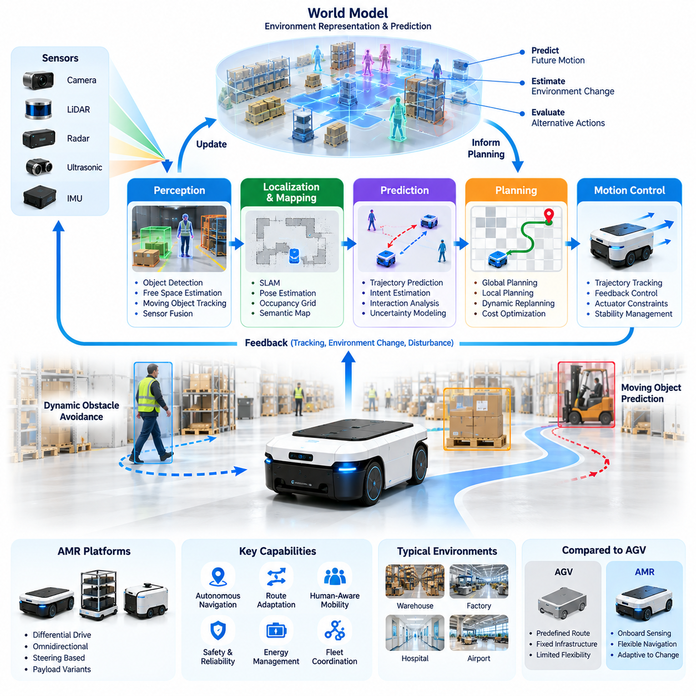{width="7.268055555555556in" height="7.268055555555556in"}

Autonomous Mobile Robots (AMRs) represent one of the most established embodiments of Physical AI, combining mobility, environmental perception, decision-making, and real-time control. Unlike machines restricted to predetermined movements, AMRs can interpret surrounding conditions and adapt their navigation behavior. Their intelligence emerges from continuously connecting sensor observations, spatial understanding, motion planning, and physical execution within changing environments.

Autonomous mobility refers to the capability of a robotic system to move toward operational goals without requiring continuous human control. This capability involves more than following a predefined route because real environments contain uncertainty, obstacles, moving agents, and unexpected disturbances. Physical AI enables autonomous mobility by integrating perception, localization, prediction, planning, and feedback control into a coordinated decision-making process.

Traditional Automated Guided Vehicles (AGVs) generally depend on predefined guidance infrastructure or constrained routes, while AMRs typically use onboard sensing and computational navigation to operate with greater flexibility. This distinction is not absolute, since advanced AGVs may incorporate autonomous functions and AMRs may follow predefined pathways. The essential difference concerns how independently a system interprets its environment and adjusts movement.

The perception system of an AMR provides the information necessary to understand surrounding physical conditions. Cameras, LiDAR, ultrasonic sensors, radar, and inertial measurement units can contribute complementary observations. Sensor fusion combines these measurements to estimate obstacles, free space, moving objects, and robot motion. Reliable perception requires accounting for sensor noise, occlusion, changing illumination, reflective surfaces, and incomplete environmental information.

Localization determines the robot\'s estimated position and orientation relative to its operating environment. Wheel odometry, inertial measurements, visual observations, and LiDAR-based matching can support this process. Simultaneous Localization and Mapping (SLAM) allows a robot to construct or update environmental representations while estimating its own pose. Localization uncertainty must remain visible to the navigation system because inaccurate estimates can compromise planning and safety.

Mapping transforms sensor observations into spatial representations suitable for navigation and decision-making. Occupancy grids describe traversable and occupied regions, while geometric maps represent environmental structures. Semantic maps extend these representations by identifying doors, corridors, workstations, storage areas, and other meaningful features. Physical AI can combine geometric and semantic information to support navigation that reflects both physical feasibility and operational purpose.

Path planning determines a feasible route between the robot\'s current position and its intended destination. Global planning typically considers the larger environment, while local planning responds to nearby obstacles and immediate movement constraints. Algorithms may evaluate distance, travel time, collision risk, energy consumption, and operational priorities. Effective navigation requires continuously revising planned movements when environmental conditions differ from previous assumptions.

Motion planning converts navigational intentions into trajectories that respect the robot\'s physical capabilities. Differential-drive, omnidirectional, and steering-based mobile platforms have different kinematic constraints. Their acceleration limits, turning characteristics, braking distances, and payload conditions influence feasible motion. Physical AI must connect abstract navigation decisions with these mechanical realities to prevent plans that cannot be executed safely.

Dynamic obstacle avoidance is a central challenge in autonomous mobility because humans, vehicles, and other robots move unpredictably. An AMR must distinguish stationary structures from moving agents and estimate potential future interactions. Predictive navigation considers possible trajectories rather than reacting only to current positions. This enables earlier adjustments, smoother movement, and improved coordination in environments where multiple agents share limited space.

Human-aware navigation extends obstacle avoidance by considering human behavior and social expectations. A robot operating near workers should account for personal space, pedestrian flow, visibility, and the possibility of sudden movement. The shortest geometric route may not be the most appropriate operational choice. Physical AI can incorporate contextual reasoning to select movement patterns that are understandable, predictable, and compatible with human activities.

World models provide AMRs with representations of environmental conditions and their possible evolution over time. Rather than treating every sensor observation as an isolated event, a predictive world model can estimate how obstacles, accessible regions, and operational states may change. Such models support anticipatory planning, uncertainty-aware decisions, and evaluation of alternative actions before physical execution.

Autonomous mobility also depends on maintaining a reliable relationship between high-level decisions and low-level control. Navigation software may request a target velocity or trajectory, but motor controllers must execute commands under actuator and stability constraints. Feedback from wheel encoders, inertial sensors, and other measurements supports continuous correction. This hierarchical relationship allows intelligent planning while preserving responsive physical control.

Real-time performance is essential because navigation decisions lose value when environmental conditions change faster than the system can respond. Perception processing, localization updates, trajectory generation, communication, and control introduce computational delays. Edge computing reduces dependence on remote connectivity for immediate decisions. System designers must allocate computational resources according to response requirements, energy limitations, and safety-critical functions.

Safety in autonomous mobility requires more than successful obstacle detection. A dependable AMR must monitor localization confidence, sensor availability, braking capability, controller health, and operational boundaries. Protective functions should respond appropriately to hazardous conditions, including communication failures and unexpected obstructions. Learning-based navigation can improve adaptability, but safety mechanisms must remain effective when learned predictions are incorrect.

Learning enables AMRs to improve navigation performance through accumulated operational experience. Reinforcement learning, imitation learning, and supervised learning can contribute to obstacle avoidance, route selection, and behavior prediction. However, learned policies must be evaluated against environmental variability and safety constraints. Combining data-driven intelligence with established planning and control methods often provides a practical development approach.

Simulation plays an important role in developing autonomous mobility capabilities before deployment. Virtual environments can reproduce warehouse layouts, pedestrian interactions, sensor limitations, and dynamic obstacles. Domain randomization exposes navigation models to varied conditions, while digital twins can represent particular operational facilities. Simulation results nevertheless require real-world validation because physical sensing, friction, and human behavior cannot be reproduced perfectly.

AMRs operating in industrial and logistics environments must coordinate navigation with broader operational processes. Transport requests, workstation availability, charging schedules, access restrictions, and production priorities influence movement decisions. An autonomous robot therefore requires both physical navigation intelligence and task-level operational awareness. Integration with fleet management and enterprise systems connects individual mobility to facility-wide productivity.

Multi-robot navigation introduces additional complexity because each robot becomes a moving participant in the shared environment. Fleet coordination may allocate tasks, manage traffic, prevent congestion, and resolve resource conflicts. Shared maps and operational information can improve efficiency, but communication delays and inconsistent state estimates create challenges. Distributed autonomy should allow robots to maintain safe local behavior even when centralized coordination becomes unavailable.

The performance of autonomous mobility should be evaluated through multiple dimensions rather than navigation success alone. Relevant measures include task completion rate, localization accuracy, collision frequency, travel efficiency, energy consumption, recovery capability, and operational availability. Evaluation should also examine performance under uncertainty, crowded environments, and unexpected disturbances. These measures reveal whether intelligent navigation remains dependable during sustained physical operation.

The evolution of AMRs illustrates the broader transition from rule-based automation toward adaptive Physical AI. Future autonomous mobility systems are expected to combine richer semantic understanding, predictive world models, long-horizon planning, and continual improvement from operational experience. Their fundamental objective remains consistent: transforming environmental observations into safe, purposeful, and reliable physical movement while adapting to the complexity of real-world conditions.

## 07.03. Outdoor AMR and Unstructured Environments

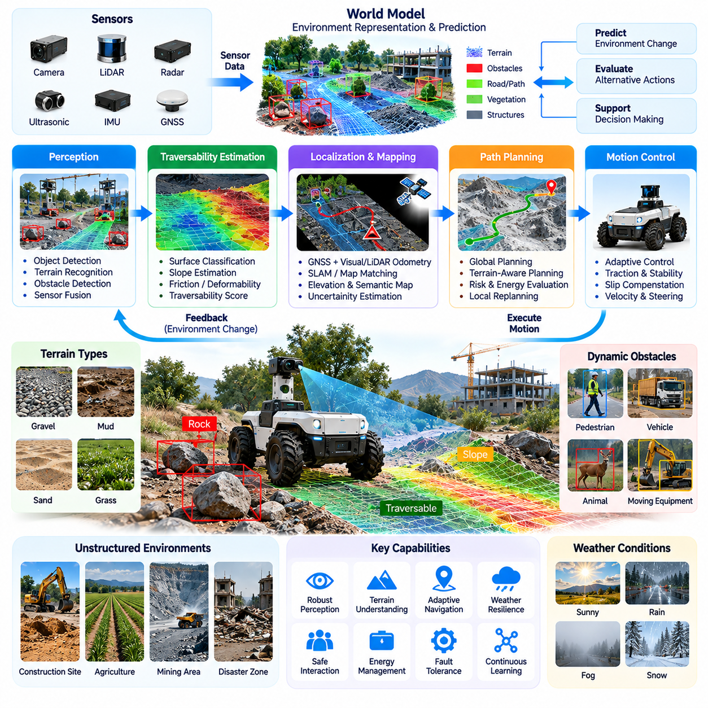{width="7.268055555555556in" height="7.268055555555556in"}

Outdoor Autonomous Mobile Robots (AMRs) extend Physical AI beyond controlled indoor facilities into environments characterized by uncertain terrain, changing weather, irregular obstacles, and incomplete infrastructure. Unlike warehouse robots operating on relatively predictable floors, outdoor AMRs must continuously interpret unfamiliar physical conditions. Their autonomy depends on combining environmental perception, terrain understanding, localization, predictive planning, and adaptive motion control.

Unstructured environments are spaces where geometric boundaries, surface conditions, and operational pathways cannot be assumed to remain consistent. Construction sites, agricultural fields, forests, mining areas, and disaster zones illustrate these conditions. Obstacles may appear unexpectedly, surfaces may deform, and traversable regions may change over time. Physical AI must therefore reason about environmental properties rather than depend exclusively on predefined maps.

Outdoor mobility introduces significant variation in terrain geometry and mechanical interaction. Slopes, gravel, mud, sand, grass, and uneven surfaces produce different traction and stability conditions. A route that appears geometrically accessible may still be physically unsafe. Intelligent navigation must evaluate ground characteristics, wheel contact, vehicle clearance, and expected motion behavior before selecting a feasible path.

Terrain perception is fundamental to autonomous navigation in unstructured environments. LiDAR, stereo cameras, depth sensors, radar, and inertial measurement units provide complementary information about surface geometry and robot movement. Their observations can support terrain classification, obstacle detection, slope estimation, and traversability analysis. Sensor fusion improves environmental understanding when individual sensing technologies become unreliable.

Traversability estimation determines whether a robot can safely move through a particular region under its current physical and operational constraints. This assessment extends beyond obstacle occupancy because surface friction, soil deformation, inclination, and ground clearance affect mobility. Physical AI can combine geometric measurements with learned terrain characteristics to estimate movement difficulty, energy requirements, and potential failure risks.

Localization becomes particularly challenging outdoors because environmental landmarks may be sparse, repetitive, or unstable. Global Navigation Satellite Systems provide useful positioning information, but buildings, vegetation, terrain, and signal interference can reduce reliability. Visual odometry, LiDAR odometry, inertial navigation, and map matching can complement satellite positioning. Robust autonomy requires estimating localization uncertainty and adapting navigation when positioning confidence decreases.

Outdoor mapping must accommodate environmental change and incomplete prior knowledge. Conventional occupancy maps represent obstacles and free space, while elevation maps describe surface height and terrain variation. Semantic maps identify roads, vegetation, structures, and operational regions. Dynamic mapping updates these representations as conditions evolve. Combining geometric, semantic, and temporal information enables robots to maintain useful environmental models during extended operations.

Weather introduces additional uncertainty into outdoor Physical AI systems. Rain can alter traction and sensor visibility, fog can reduce camera effectiveness, and snow may obscure recognizable environmental features. Temperature variation can influence batteries, actuators, and computing equipment. Outdoor robots must detect changing conditions and adjust their operating strategies rather than assume that perception and mobility performance remain constant.

Dynamic obstacles in outdoor environments include pedestrians, vehicles, animals, moving equipment, and natural disturbances. Their behavior may be less constrained than movement inside industrial facilities. Predictive perception can estimate possible trajectories and interactions, while uncertainty-aware planning evaluates the consequences of different avoidance strategies. Safe navigation requires sufficient margins for unpredictable motion and delayed observations.

Path planning in unstructured environments must consider terrain feasibility alongside geometric distance. The shortest route may cross unstable ground, steep slopes, or areas with insufficient traction. Terrain-aware planning evaluates traversability, vehicle capabilities, energy consumption, and environmental risk. Global planners identify promising routes, while local planners respond to newly observed obstacles and changing ground conditions during execution.

Motion control must account for the interaction between the robot and variable terrain. Wheel slip, uneven loading, changing friction, and suspension movement can cause deviations from planned trajectories. Feedback controllers use motion estimates and sensor measurements to compensate for disturbances. Adaptive control can modify velocity, steering, and acceleration according to observed terrain conditions, improving stability and movement reliability.

World models provide an important foundation for predictive outdoor mobility. A terrain-aware world model can represent surface characteristics, obstacle motion, and possible consequences of navigation actions. By predicting future states, Physical AI can compare alternative trajectories before execution. Such predictions are especially valuable when a robot approaches uncertain ground, limited-visibility regions, or obstacles that may change position.

Learning-based methods can improve outdoor navigation by extracting useful patterns from diverse terrain experiences. Supervised learning supports terrain classification, while reinforcement learning can develop adaptive movement strategies in simulation. Self-supervised learning may associate visual observations with measured traction or motion outcomes. However, learned capabilities require careful validation because unfamiliar environments can differ substantially from training conditions.

Simulation enables systematic evaluation of outdoor autonomy under controlled variations in terrain, weather, visibility, and vehicle dynamics. Digital environments can reproduce slopes, obstacles, deformable surfaces, and sensor disturbances. Domain randomization increases exposure to diverse operating conditions. Nevertheless, accurate simulation of soil interaction, wheel slip, vegetation, and unpredictable environmental changes remains difficult, making physical field testing essential.

Outdoor AMRs frequently operate with limited communication infrastructure and constrained energy resources. Remote locations may provide intermittent connectivity, while computationally intensive perception and planning consume substantial power. Edge computing supports immediate decisions without continuous cloud access. Energy-aware navigation must consider route difficulty, battery state, mission duration, and the availability of charging or recovery facilities.

Safety management must address hazards that are less predictable than those encountered in structured indoor environments. Robots may experience localization failure, loss of traction, unstable ground, sensor obstruction, or unexpected encounters with humans and equipment. Runtime monitoring should identify degraded operating conditions and trigger appropriate responses. Safe fallback behavior may include slowing down, stopping, retreating, or requesting remote assistance.

Operational design domains define the environmental and functional boundaries within which outdoor AMRs are expected to perform reliably. These boundaries may specify allowable terrain slopes, weather conditions, visibility, obstacle characteristics, and communication availability. Clearly defined operating limits help distinguish demonstrated autonomy from unsupported assumptions. Physical AI systems should recognize when conditions exceed their validated capabilities.

Outdoor autonomous mobility supports applications across agriculture, construction, mining, infrastructure inspection, environmental monitoring, and emergency response. Each domain introduces distinct physical requirements and operational priorities. Agricultural robots may navigate crop rows and soft soil, while inspection robots may traverse industrial yards or remote infrastructure corridors. Successful deployment requires adapting common Physical AI capabilities to specific environments and missions.

The evolution of outdoor AMRs reflects a transition from navigation based primarily on geometric maps toward intelligence grounded in physical understanding. Future systems may integrate richer terrain semantics, predictive world models, adaptive control, and accumulated operational experience. Their central challenge is to transform uncertain environmental observations into safe and purposeful movement while respecting the mechanical limits and operational responsibilities of real robotic platforms.

## 07.04. Manipulator and Manipulation Intelligence

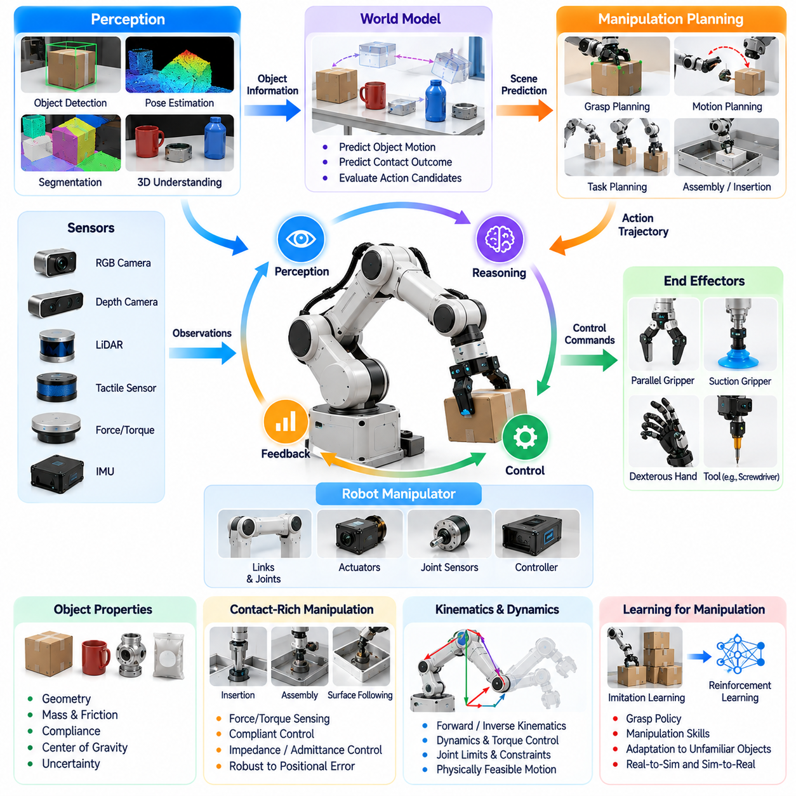{width="7.268055555555556in" height="7.268055555555556in"}

Robotic manipulators represent a fundamental embodiment of Physical AI because they enable intelligent systems to interact directly with objects and modify physical environments. Unlike mobile robots primarily concerned with navigation, manipulators perform actions involving grasping, lifting, positioning, assembly, and material handling. Manipulation intelligence emerges when perception, reasoning, planning, and feedback control are integrated to manage these interactions under uncertainty.

A robotic manipulator typically consists of interconnected links, joints, actuators, sensors, and an end effector. Its mechanical structure determines reachable positions, available orientations, payload capacity, and movement constraints. The end effector may be a parallel gripper, suction device, dexterous hand, or specialized tool. Physical AI must understand these characteristics because the feasibility of a manipulation task depends on both environmental conditions and mechanical capabilities.

Manipulation intelligence extends beyond executing predefined joint trajectories. A conventional industrial robot may repeatedly perform accurately programmed motions in a controlled workspace, while an intelligent manipulator must adapt to unfamiliar objects, uncertain positions, and changing contact conditions. This adaptation requires interpreting sensory information, estimating object properties, selecting appropriate actions, and correcting movements according to observed outcomes.

Visual perception provides essential information about object location, orientation, shape, and surrounding geometry. RGB cameras, depth cameras, stereo vision, and three-dimensional sensing can support object detection, segmentation, and pose estimation. However, visual observations may be incomplete because of occlusion, reflective surfaces, or limited viewpoints. Active perception allows a manipulator to reposition sensors or objects to obtain information needed for reliable interaction.

Object representations connect perception with manipulation planning. Geometric models describe surfaces, dimensions, and spatial relationships, while semantic representations identify object categories and functional properties. Physical attributes such as mass, friction, compliance, and center of gravity influence how objects respond to contact. Manipulation intelligence must combine available measurements with uncertainty estimates when these properties cannot be directly observed.

Grasp planning determines how an end effector should contact and secure an object. A successful grasp depends on contact geometry, friction, force distribution, object stability, and gripper limitations. Different objects require different strategies because rigid components, flexible packaging, fragile materials, and irregularly shaped items respond differently. Physical AI can evaluate candidate grasps and select actions that balance stability, accessibility, and task requirements.

Contact-rich manipulation introduces challenges that cannot be solved through geometric planning alone. Insertion, assembly, surface following, and tool use involve interactions where small positional errors can generate substantial forces. Force and torque sensing provides feedback about these interactions. Impedance control, admittance control, and compliant motion strategies help manipulators regulate contact behavior while accommodating uncertainty in object position and mechanical alignment.

Manipulation planning connects task objectives with executable physical movements. A robot assembling a component must identify the target, select a grasp, determine an approach trajectory, establish contact, and verify completion. Each stage introduces constraints involving collision avoidance, joint limits, object accessibility, and contact stability. Hierarchical planning can organize these stages while allowing local adjustments when execution differs from expectations.

Kinematics and dynamics provide the mathematical foundations for manipulator movement. Forward kinematics relates joint configurations to end-effector pose, while inverse kinematics determines joint configurations for desired poses. Dynamics describes the relationship between forces, torques, and motion. Physical AI integrates these models with learned representations and feedback control to generate movements that remain mechanically feasible and operationally reliable.

Sensorimotor feedback is essential because manipulation outcomes cannot always be predicted accurately before contact. Visual observations may indicate object movement, tactile sensors may detect slipping, and force sensors may reveal unexpected resistance. Closed-loop manipulation uses these measurements to adjust grasp force, trajectory, and contact behavior. This continuous correction enables greater robustness than open-loop execution based solely on initial object estimates.

Dexterous manipulation requires coordinated control of multiple contact points and degrees of freedom. Multifingered robotic hands can potentially perform regrasping, in-hand rotation, and complex object repositioning. However, their control is difficult because contact states change rapidly and many actuator combinations can produce similar outcomes. Learning-based policies and model-based control can complement each other when managing these high-dimensional interactions.

World models can support manipulation intelligence by predicting how objects and contact relationships evolve under different actions. An action-conditioned model may estimate whether an object will move, rotate, slip, deform, or collide with nearby structures. These predictions allow a robot to compare candidate actions before execution. Their usefulness depends on representing relevant physical interactions and acknowledging uncertainty in predicted outcomes.

Learning from demonstrations provides a practical method for acquiring manipulation skills. Human teleoperation, kinesthetic teaching, and recorded robot trajectories can supply examples of successful behavior. Imitation learning uses these examples to train policies that map observations to actions. Nevertheless, demonstration data may cover only limited operating conditions, making generalization to unfamiliar objects and environments an important challenge.

Reinforcement learning offers another approach by optimizing manipulation behavior through interaction and feedback. Simulation can provide repeated experience with grasping, insertion, and object repositioning while reducing physical wear and operational risk. Reward design, exploration efficiency, and simulation fidelity strongly influence results. Policies developed virtually must be evaluated carefully because real contact dynamics and sensing characteristics may differ from simulated conditions.

Vision-language-action models and robot foundation models introduce opportunities to connect semantic task understanding with physical manipulation. A system may interpret instructions such as placing a component into a container and generate corresponding action sequences. However, language understanding alone does not guarantee reliable execution. The model must remain grounded in observed geometry, available tools, actuator constraints, and feedback from physical interactions.

Generalization is a central objective of manipulation intelligence because real environments contain objects that differ from training examples. Variations in shape, material, orientation, lighting, and placement can substantially change task difficulty. Robust systems should adapt their perception and control strategies rather than rely on memorized trajectories. Evaluating generalization requires testing across unfamiliar objects, environmental conditions, and task configurations.

Safety and reliability are especially important when manipulators operate near humans or handle valuable materials. Excessive contact forces, unstable grasps, unexpected motion, and dropped objects can create significant hazards. Protective mechanisms must account for force limits, workspace restrictions, actuator faults, and uncertain object behavior. Intelligent manipulation should therefore combine adaptive decision-making with independently dependable safety functions.

Manipulation performance should be evaluated through task success, grasp stability, positioning accuracy, cycle time, contact force, recovery capability, and robustness under environmental variation. A successful action must satisfy the intended physical outcome rather than merely complete a planned trajectory. Long-duration evaluation also reveals whether performance remains consistent despite changing objects, accumulated errors, and repeated interactions.

The development of manipulation intelligence illustrates the transition from precisely programmed industrial automation toward adaptable Physical AI. Future manipulators may combine richer tactile perception, predictive world models, generalist policies, and continual learning to handle increasingly diverse tasks. Their fundamental purpose remains to transform environmental understanding into controlled physical interaction while respecting the mechanical, safety, and operational constraints of real-world systems.

## 07.05. Mobile Manipulators

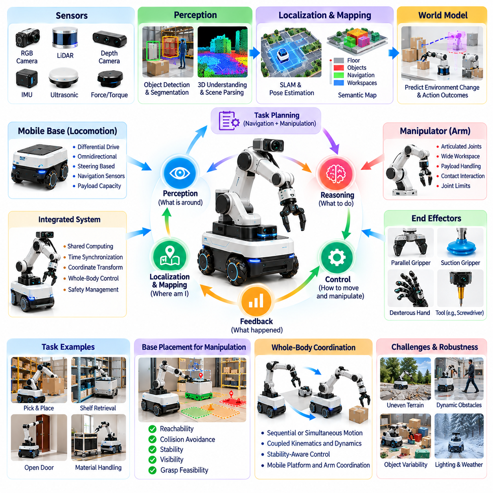{width="7.268055555555556in" height="7.268055555555556in"}

Mobile manipulators combine autonomous mobility with robotic manipulation, enabling Physical AI systems to navigate environments and interact directly with objects. Unlike fixed industrial arms, these robots can reposition their manipulation workspace by moving their mobile base. This integration expands operational flexibility but introduces complex relationships among navigation, perception, object handling, stability, and coordinated control.

A mobile manipulator typically consists of a mobile platform, one or more robotic arms, end effectors, sensors, and an integrated computing system. The platform may use differential-drive, omnidirectional, or steering-based locomotion, while the manipulator provides articulated movement for physical interaction. The combined mechanical structure determines reachability, payload capacity, workspace accessibility, and operational constraints.

The defining characteristic of mobile manipulation is the coordination of locomotion and object interaction within a shared task. A robot retrieving an item from a shelf must approach the correct location, position its base, identify the target, and execute a reliable grasp. Each operation influences the others because base positioning determines arm reachability, while manipulation forces and payload changes affect the mobile platform.

Perception for mobile manipulation requires understanding both navigable environments and manipulable objects. LiDAR, RGB cameras, depth sensors, and proprioceptive measurements can provide complementary information about obstacles, object geometry, robot configuration, and contact conditions. A unified perception system must maintain consistent spatial relationships between the environment, mobile base, robotic arm, and target objects.

Localization and coordinate transformation are essential for connecting mobility with manipulation. The robot must estimate its base pose relative to the environment while tracking the arm and end-effector configuration. Transformations between map, base, arm, camera, and tool coordinate frames allow object positions to be interpreted consistently. Calibration errors or localization drift can produce significant manipulation inaccuracies.

Task planning for mobile manipulators must coordinate navigation goals with manipulation requirements. Reaching an object involves more than arriving near its location because the base must occupy a position that permits collision-free arm movement and stable grasp execution. Task and motion planning can jointly evaluate navigation paths, reachable configurations, object accessibility, and manipulation sequences before execution.

Base placement is a critical decision because mobile manipulation provides additional degrees of freedom through platform movement. A robot may approach an object from several directions, each offering different reachability, visibility, and collision conditions. Intelligent base placement considers arm workspace, joint limits, obstacle clearance, grasp feasibility, and stability. Poor positioning can make an otherwise simple manipulation task impossible.

Whole-body coordination connects the motion of the mobile base and robotic arm into a unified control problem. Sequential operation may stop the base before manipulation, simplifying control and improving predictability. More advanced systems can move the base and arm simultaneously to extend reach or improve task efficiency. Such coordination requires managing coupled kinematics, dynamic interactions, and changing collision constraints.

Manipulation stability becomes particularly important when a robotic arm operates from a mobile platform. Extended arm configurations, heavy payloads, sudden acceleration, and external contact forces can influence balance and wheel loading. The robot must account for its center of mass, support geometry, actuator limits, and available traction. Stability-aware planning reduces the likelihood of tipping, slipping, or uncontrolled movement.

Mobile manipulation also introduces uncertainty through accumulated navigation and positioning errors. A robot may reach a workstation with imperfect localization, while objects may have shifted since the environment was mapped. Visual servoing and local perception updates can correct these discrepancies. Closed-loop control allows the system to refine base alignment, arm trajectories, and grasp execution according to current observations.

Contact-rich tasks require careful coordination between manipulation forces and mobile platform behavior. Opening doors, pushing carts, operating handles, and interacting with equipment can generate forces that affect both the arm and base. Force sensing, compliant control, and appropriate base constraints help regulate these interactions. The system must distinguish intentional contact from unexpected resistance or potentially hazardous collisions.

World models can support mobile manipulation by representing both environmental structure and possible action outcomes. A predictive model may estimate whether a planned base position provides sufficient reach, whether an object can be grasped, or whether movement will create a collision. Action-conditioned predictions allow the robot to evaluate alternatives before execution, connecting navigation decisions with physical interaction consequences.

Learning-based methods offer opportunities to acquire integrated mobility and manipulation skills. Demonstrations can illustrate how humans or robots approach objects, position themselves, and perform handling operations. Reinforcement learning can optimize coordinated behavior in simulated environments. However, successful transfer requires accounting for platform dynamics, object variability, sensing uncertainty, and differences between simulation and physical deployment.

Vision-language-action models may provide higher-level task understanding for mobile manipulators. A robot receiving an instruction to collect a tool and deliver it to a workstation must interpret the request, identify relevant objects and locations, and organize a sequence of navigation and manipulation actions. Language-guided reasoning can support task decomposition, but execution must remain grounded in physical feasibility and real-time feedback.

Mobile manipulators frequently operate in environments shared with humans, making safety a fundamental design requirement. Navigation hazards, arm collisions, unstable payloads, and unexpected human interactions must be addressed together. Protective mechanisms may include speed limits, force monitoring, workspace restrictions, emergency stopping, and safe recovery procedures. Safety assurance must consider the combined system rather than treating the mobile base and arm independently.

Operational reliability depends on coordinating multiple subsystems with different timing requirements. Navigation planning, object recognition, grasp selection, motion control, and safety monitoring may operate at different frequencies. Edge computing supports local decision-making, while higher-level orchestration can manage task allocation and operational priorities. Clear interfaces and fault-handling mechanisms are essential for maintaining dependable system behavior.

Mobile manipulation supports applications in logistics, manufacturing, healthcare, laboratories, retail, and facility maintenance. Robots can transport materials, replenish workstations, retrieve supplies, inspect equipment, and perform selected handling tasks. Their value is greatest when operations require both movement and physical interaction across multiple locations. Deployment feasibility nevertheless depends on environmental accessibility, task complexity, and economic constraints.

Performance evaluation must examine navigation and manipulation as an integrated process. Relevant measures include end-to-end task success, positioning accuracy, grasp reliability, completion time, payload stability, energy consumption, and recovery capability. A robot that navigates successfully but cannot complete the required interaction has not fulfilled its operational objective. Evaluation should therefore measure complete physical task outcomes under realistic conditions.

The evolution of mobile manipulators illustrates how Physical AI can integrate previously separate robotic capabilities into coordinated autonomous behavior. Advances in semantic perception, world models, whole-body control, and generalist learning may enable increasingly flexible task execution. The central objective is to transform environmental understanding into purposeful movement and reliable object interaction while respecting physical, computational, and safety constraints.

## 07.06. Humanoid and General Purpose Embodiment

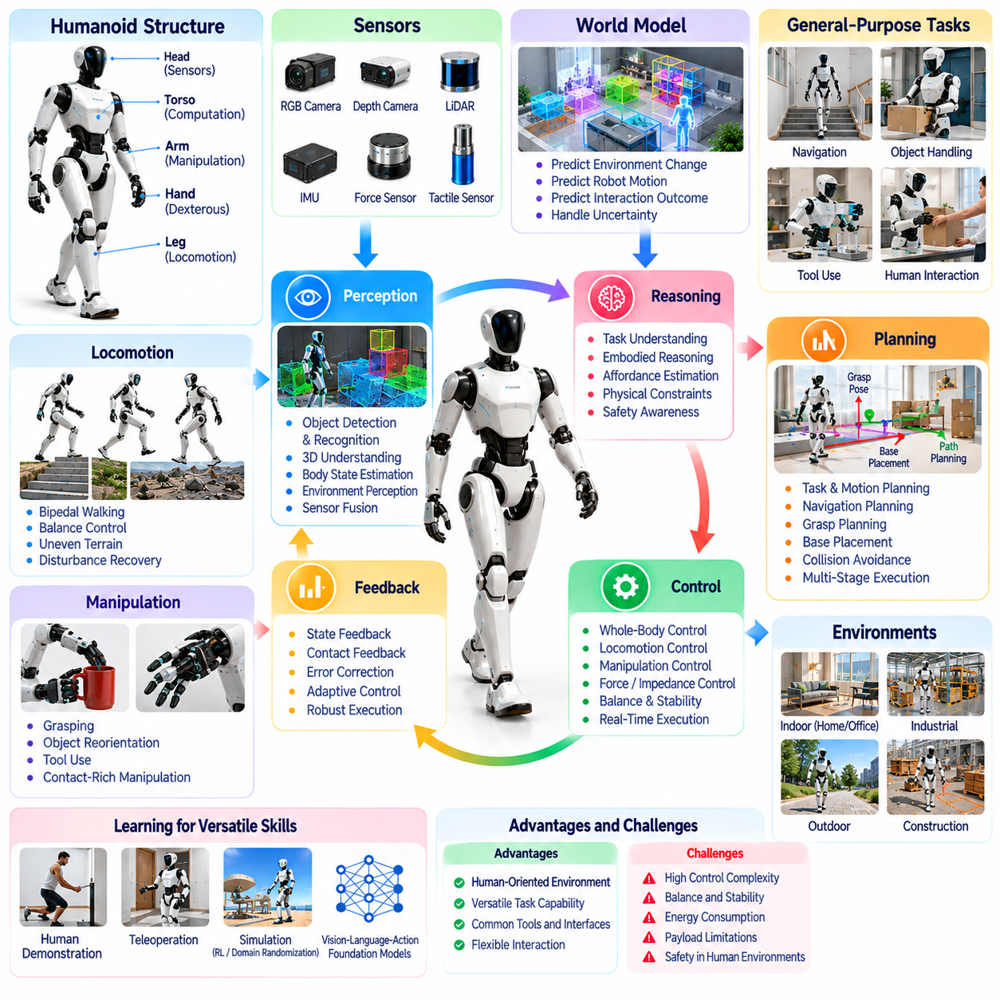{width="7.268055555555556in" height="7.268055555555556in"}

Humanoid robots represent a distinctive embodiment of Physical AI because their mechanical structures resemble the human body and support interaction with environments designed for human activity. Their combination of legs, arms, hands, and articulated joints enables locomotion and manipulation within shared workspaces. However, humanlike appearance alone does not establish intelligence. General-purpose capability depends on integrating perception, reasoning, planning, control, and adaptation.

General-purpose embodiment refers to a robotic configuration capable of supporting diverse physical tasks without requiring complete mechanical redesign for each application. Humanoid morphology offers potential advantages when operating around stairs, doors, shelves, tools, and workstations built for humans. Nevertheless, versatility introduces compromises involving stability, efficiency, payload, complexity, and cost. Physical AI must determine when humanlike embodiment provides meaningful functional benefits.

Humanoid systems typically integrate a mobile lower body, articulated torso, dual manipulators, sensor arrays, and distributed actuators. Their numerous degrees of freedom allow flexible positioning and coordinated movement, but significantly increase control complexity. Mechanical design determines joint range, torque capacity, structural stiffness, and reachable workspace. These physical limitations constrain which tasks can be performed safely and reliably.

Bipedal locomotion is a defining technical challenge because walking requires continuous management of balance, ground contact, and momentum. Unlike wheeled robots, humanoids repeatedly transition between changing support configurations. Controllers must coordinate joint motion while maintaining feasible contact forces and dynamic stability. Uneven surfaces, external disturbances, and unexpected obstacles further increase the difficulty of reliable locomotion.

Whole-body control coordinates the legs, torso, arms, and hands as an interconnected mechanical system. Reaching for an object may require adjusting posture, shifting weight, or repositioning the feet. These actions influence balance and manipulation accuracy simultaneously. Optimization-based controllers can manage multiple objectives and constraints, including joint limits, contact forces, collision avoidance, and task priorities.

Humanoid perception must support both navigation and physical interaction across changing viewpoints and body configurations. Cameras, depth sensors, inertial measurements, force sensors, and tactile sensing provide complementary observations. The robot must estimate surrounding geometry, object properties, body posture, and contact states. Consistent spatial representations allow perception results to guide coordinated locomotion and manipulation.

Dexterous hands expand the potential range of humanoid manipulation by enabling grasping, reorientation, and tool use. Multifingered mechanisms provide numerous contact possibilities but introduce challenging control and sensing requirements. Object shape, friction, compliance, and weight influence grasp selection and execution. General-purpose manipulation requires adapting these strategies across unfamiliar objects rather than repeating fixed motions.

Task planning connects high-level instructions with coordinated physical actions. A humanoid asked to retrieve a tool may need to identify its location, navigate toward it, adjust posture, grasp it, and deliver it safely. Each stage depends on environmental conditions and the robot\'s mechanical capabilities. Hierarchical planning can organize complex activities while allowing feedback-driven corrections during execution.

Embodied reasoning requires understanding how the robot\'s own physical structure influences possible actions. A humanoid may recognize that an object is reachable only after stepping closer or changing body orientation. It must also consider whether carrying an object affects balance or restricts future movements. Physical AI therefore connects semantic task understanding with geometric feasibility, dynamic constraints, and expected interaction outcomes.

World models can improve humanoid autonomy by predicting changes in the environment and the robot\'s physical state. Action-conditioned predictions may estimate body motion, contact transitions, object displacement, or potential loss of balance. Such models support comparison of candidate actions before execution. Their reliability depends on representing relevant physical dynamics and accounting for uncertainty in unfamiliar situations.

Learning from human demonstrations provides an important pathway toward acquiring versatile humanoid skills. Motion capture, teleoperation, video observations, and kinesthetic demonstrations can provide examples of movement and manipulation. Imitation learning may transform these examples into executable robot policies. However, differences between human anatomy and robotic mechanisms require careful adaptation rather than direct motion reproduction.

Reinforcement learning can develop locomotion, balance recovery, and manipulation behaviors through repeated interaction. Simulation provides opportunities to explore diverse conditions without exposing physical hardware to every training failure. Domain randomization and system identification can reduce differences between simulated and real dynamics. Nevertheless, learned policies require extensive physical validation before deployment in safety-critical environments.

Vision-language-action models and robotic foundation models may connect natural-language instructions with multimodal perception and motor behavior. These approaches seek reusable representations across objects, environments, and tasks. However, linguistic competence does not guarantee physical competence. Successful execution requires grounding generated actions in current sensor observations, actuator capabilities, contact conditions, and real-time safety constraints.

General-purpose intelligence must distinguish transferable skills from embodiment-specific capabilities. Object recognition, task decomposition, and semantic reasoning may transfer between humanoids and other robotic platforms. Walking balance, hand coordination, and whole-body contact control depend strongly on mechanical structure. Effective architectures can share high-level knowledge while retaining specialized controllers for distinct physical embodiments.

Energy efficiency and computational constraints are major considerations for humanoid deployment. Bipedal locomotion, continuous balance control, articulated manipulation, and onboard inference can impose substantial power demands. Battery capacity, thermal management, actuator efficiency, and computing resources influence mission duration. Intelligent task scheduling and motion planning should consider energy consumption alongside task completion and safety.

Safety becomes especially important when humanoids operate in environments shared with people. Their height, mass, moving limbs, and potential for falling create hazards that differ from those of fixed manipulators or low-profile mobile robots. Safety systems must address contact forces, collision avoidance, balance loss, emergency stopping, and controlled recovery. Adaptive intelligence must operate within independently enforced protective constraints.

Humanoid performance should be evaluated through complete task outcomes rather than isolated demonstrations of walking or grasping. Relevant measures include task success, balance stability, manipulation accuracy, recovery behavior, energy consumption, and operational reliability. Evaluation across unfamiliar environments reveals whether learned capabilities generalize beyond training conditions. Long-duration testing is essential for identifying accumulated errors and recurring failure modes.

Humanoids may support manufacturing, logistics, inspection, maintenance, research, and selected service activities where human-oriented infrastructure is difficult to redesign. Their economic value depends on achieving sufficient reliability, productivity, and adaptability relative to specialized alternatives. A humanoid is not automatically the optimal solution for every physical task. Platform selection should reflect environmental constraints, required capabilities, and lifecycle costs.

The development of humanoid and general-purpose embodiment illustrates the ambition of Physical AI to create adaptable machines capable of performing diverse real-world activities. Progress will depend on advances in perception, world modeling, dexterous manipulation, whole-body control, and transferable learning. The central objective is not merely to reproduce human movement, but to achieve reliable physical intelligence within the capabilities and limitations of an embodied robotic system.

## 07.07. Quadruped and Terrain Adaptive Intelligence

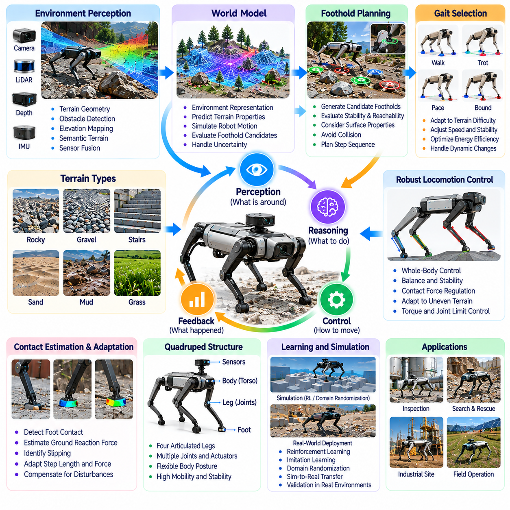{width="7.268055555555556in" height="7.268055555555556in"}

Quadruped robots represent an important embodiment of Physical AI because their four-legged structures enable mobility across terrain that may challenge conventional wheeled platforms. Their ability to establish multiple ground contacts supports adaptive movement over obstacles, slopes, and irregular surfaces. However, mechanical flexibility alone does not guarantee reliable locomotion. Terrain-adaptive intelligence requires coordinated perception, contact planning, dynamic control, and continuous environmental feedback.

Quadruped locomotion depends on the coordinated movement of four articulated legs, each containing multiple joints and actuators. This configuration provides flexibility in foot placement, body posture, and support distribution. Unlike wheeled systems that maintain relatively continuous ground contact, quadrupeds alternate between stance and swing phases. Physical AI must coordinate these transitions while maintaining stability and respecting mechanical constraints.

Terrain-adaptive intelligence refers to the ability to adjust locomotion according to environmental geometry, surface properties, and robot dynamics. A quadruped traversing rocks, gravel, stairs, or uneven industrial surfaces must continuously evaluate where and how its feet should contact the ground. Successful adaptation requires integrating terrain perception with movement planning and feedback control rather than relying exclusively on predetermined gait patterns.

Perception provides essential information about terrain elevation, slope, obstacles, and potential footholds. Depth cameras, LiDAR, stereo vision, and inertial sensors can contribute complementary measurements. Local elevation maps represent surface geometry, while semantic terrain models may distinguish vegetation, loose materials, and solid structures. Combining these representations helps the robot identify feasible movement regions and anticipate difficult contact conditions.

Foothold planning determines where individual feet should be placed to maintain balance and support forward movement. Candidate footholds must satisfy geometric reachability, surface stability, collision constraints, and expected contact forces. A visually accessible surface may be unsuitable because it is slippery, deformable, or structurally unstable. Intelligent planning therefore considers both observed terrain geometry and uncertainty about physical support.

Gait selection influences mobility efficiency, stability, and adaptability. Walking, trotting, pacing, and bounding involve different patterns of leg coordination and ground contact. Slower gaits may provide greater support margins on difficult terrain, while faster gaits can improve traversal speed under suitable conditions. Adaptive locomotion systems select or modify gait parameters according to terrain difficulty, mission requirements, and available mechanical capability.

Dynamic balance is fundamental because quadrupeds must regulate body motion while contact conditions change. The center of mass, support configuration, momentum, and ground reaction forces jointly influence stability. Model predictive control can evaluate future body states and optimize contact forces over a planning horizon. Feedback mechanisms correct deviations caused by unexpected disturbances, imperfect terrain estimates, or actuator limitations.

Whole-body control coordinates leg movements, body posture, and contact forces to achieve locomotion objectives. The robot may lower its body beneath an obstacle, shift weight before stepping, or adjust orientation while climbing a slope. These actions require managing joint limits, torque capacity, collision avoidance, and dynamic feasibility. Integrated control enables the quadruped to adapt its physical configuration to local environmental conditions.

Contact estimation is especially important because terrain interactions cannot always be inferred from visual observations. Joint encoders, motor current measurements, force sensors, and inertial feedback can indicate foot contact, slipping, and unexpected resistance. Comparing predicted and observed motion helps identify changes in surface conditions. This feedback allows controllers to adjust foot placement, contact timing, and applied forces during execution.

Traction and surface compliance strongly influence quadruped performance. Mud, sand, wet stone, and loose gravel may produce uncertain friction or deform under loading. A controller that assumes rigid, high-friction ground may generate unstable movements under these conditions. Terrain-aware locomotion can estimate contact reliability and modify step length, body speed, and force distribution to reduce slipping or sinking.

World models support terrain-adaptive intelligence by predicting how robot actions interact with surrounding geometry and surface conditions. A predictive model may estimate future body posture, contact transitions, or the consequences of stepping onto uncertain ground. These predictions enable comparison of alternative trajectories and foothold sequences. Reliable world modeling must represent uncertainty because terrain properties may remain partially unobserved.

Learning-based locomotion has expanded the range of behaviors achievable by quadruped robots. Reinforcement learning can optimize coordinated movement through repeated simulation experience, while imitation learning can reproduce demonstrated behaviors. Domain randomization exposes policies to variations in friction, mass, actuator response, and terrain geometry. Nevertheless, learned controllers require validation against physical disturbances and unfamiliar operating conditions.

Simulation provides a practical environment for developing and testing quadruped intelligence before physical deployment. Digital terrain can reproduce stairs, slopes, obstacles, and variable contact conditions while allowing repeated experiments. However, accurate modeling of deformable soil, impact forces, actuator dynamics, and complex friction remains challenging. Field testing is necessary to identify differences between simulated performance and real-world behavior.

Quadrupeds can perform autonomous navigation by combining global route planning with local terrain adaptation. A global planner identifies a route toward the mission objective, while a local planner evaluates obstacles, footholds, and immediate movement feasibility. Localization may combine visual, inertial, and LiDAR measurements. Robust operation requires updating plans when terrain conditions differ from prior maps or when localization confidence decreases.

Payload integration introduces additional considerations for quadruped deployment. Inspection cameras, thermal sensors, communication equipment, and robotic arms may increase mass or shift the center of gravity. These changes affect balance, energy consumption, and actuator loading. Physical AI must account for payload configuration when selecting locomotion strategies, particularly during climbing, turning, or operation on unstable surfaces.

Energy management is a significant constraint because articulated leg motion and continuous stabilization can consume substantial power. Locomotion efficiency depends on gait, terrain, speed, payload, and actuator characteristics. Energy-aware planning may favor routes that reduce climbing effort or avoid difficult ground even when they are geometrically longer. Battery state and mission duration must be considered alongside mobility performance.

Safety and recovery capabilities are essential when quadrupeds operate near people or valuable infrastructure. Slipping, stumbling, actuator faults, and unexpected obstacles can lead to loss of balance or uncontrolled contact. Runtime monitoring should detect degraded locomotion conditions and initiate appropriate responses. Recovery strategies may include posture adjustment, controlled stopping, retreating, or standing up after a fall when conditions permit.

Quadruped robots support applications in industrial inspection, construction, mining, disaster response, environmental monitoring, and research. Their ability to navigate stairs, narrow passages, and irregular ground can provide advantages where wheeled mobility is constrained. Nevertheless, platform selection must consider speed, endurance, payload, reliability, and lifecycle cost. Legged mobility is valuable when its terrain adaptability justifies the additional mechanical and computational complexity.

The evolution of quadruped robotics illustrates how Physical AI transforms locomotion from fixed movement patterns into adaptive interaction with uncertain terrain. Advances in perception, contact modeling, predictive control, and learning may enable increasingly robust mobility across diverse environments. The central objective is to convert incomplete terrain observations into stable, efficient, and purposeful movement while respecting the robot\'s physical limits and operational responsibilities.

## 07.08. UAV and Aerial Physical AI

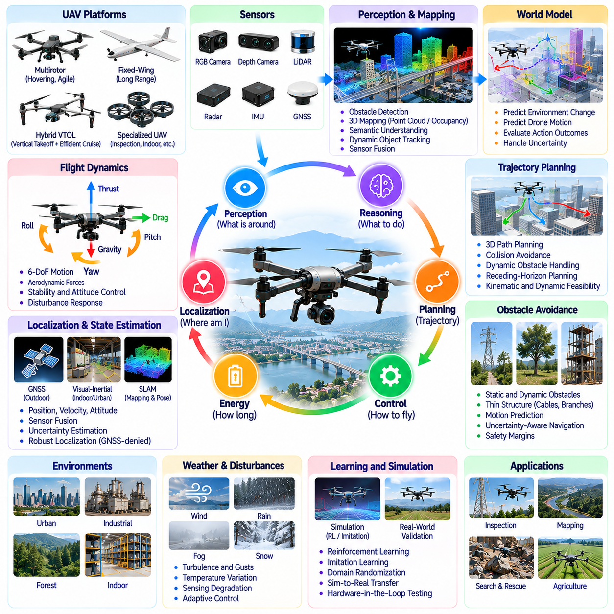{width="7.268055555555556in" height="7.268055555555556in"}

Unmanned Aerial Vehicles (UAVs) represent an important embodiment of Physical AI because they enable autonomous perception, decision-making, and movement within three-dimensional environments. Unlike ground robots, aerial platforms must continuously generate forces to maintain flight and regulate their position. Their autonomy requires integrating environmental sensing, flight dynamics, trajectory planning, and feedback control while accounting for limited energy and changing atmospheric conditions.

Aerial robotic platforms include multirotor drones, fixed-wing aircraft, hybrid vertical takeoff systems, and specialized flying robots. Each configuration offers different capabilities involving maneuverability, endurance, payload, and operational range. Multirotors provide hovering and precise positioning, while fixed-wing platforms support efficient long-distance travel. Physical AI must adapt its perception, planning, and control strategies to the aerodynamic characteristics of each platform.

Flight dynamics distinguish aerial Physical AI from ground-based robotic intelligence. UAV motion depends on thrust, gravity, aerodynamic forces, rotational inertia, and actuator response. Small disturbances can produce significant deviations when the vehicle operates near obstacles or in confined spaces. Intelligent flight control must continuously estimate vehicle state and adjust propulsion commands to maintain stability, orientation, and desired trajectories.

Aerial perception requires interpreting environments from viewpoints that change rapidly in position and orientation. RGB cameras, stereo vision, LiDAR, radar, and inertial sensors provide complementary information about surrounding structures and motion. Visual observations may support obstacle detection, mapping, and object recognition. Sensor fusion becomes especially important when vibration, motion blur, lighting variation, or limited visibility reduces individual sensor reliability.

Localization and state estimation are fundamental to autonomous flight because positioning errors can quickly become hazardous. Global Navigation Satellite Systems support outdoor navigation, while visual-inertial odometry and LiDAR-based methods provide alternatives in degraded satellite conditions. Indoor and underground environments may require navigation without GNSS. Robust estimation must track position, velocity, attitude, and uncertainty to support safe control decisions.

Three-dimensional mapping allows UAVs to represent obstacles, free space, terrain elevation, and structural geometry. Occupancy maps, point clouds, and semantic representations can support navigation through buildings, industrial facilities, and outdoor environments. Dynamic mapping updates these representations as new observations become available. Aerial Physical AI must balance map accuracy with computational requirements and the limited sensing opportunities available during flight.

Trajectory planning for UAVs must account for three-dimensional geometry and dynamic feasibility. A collision-free path may still be unsuitable if it requires excessive acceleration, abrupt turning, or insufficient clearance. Planners must consider vehicle dimensions, thrust limits, flight speed, obstacle uncertainty, and available energy. Receding-horizon planning enables continuous trajectory updates when new obstacles or changing conditions are detected.

Obstacle avoidance is particularly challenging because aerial robots may encounter structures, vegetation, cables, moving vehicles, and other aircraft. Thin obstacles can be difficult to detect, while dynamic objects require motion prediction. Safe avoidance depends on reliable perception, uncertainty-aware planning, and sufficient reaction margins. UAVs must also consider the consequences of evasive maneuvers for stability, energy consumption, and surrounding safety.

Atmospheric disturbances introduce uncertainties that are less prominent in many indoor robotic systems. Wind gusts, turbulence, precipitation, and temperature variation can influence flight stability, sensing performance, and battery efficiency. Disturbance observers and adaptive controllers may compensate for changing aerodynamic conditions. However, autonomous systems must recognize when environmental conditions exceed validated flight capabilities.

World models can strengthen aerial autonomy by predicting vehicle motion, obstacle behavior, and environmental changes. Action-conditioned models may estimate the consequences of alternative flight commands before execution. Predictive reasoning supports navigation through uncertain spaces and helps identify trajectories with acceptable risk. Reliable world models must account for fast-changing dynamics and uncertainty in both perception and aerodynamic response.

Learning-based approaches offer opportunities to improve aerial navigation and control. Reinforcement learning can develop adaptive flight policies through repeated simulated interactions, while imitation learning can reproduce demonstrated maneuvers. Learned perception models may identify obstacles, landing regions, and operational targets. Nevertheless, transferring these capabilities to real aircraft requires careful validation because simulation cannot reproduce every aerodynamic disturbance.

Simulation is essential for evaluating UAV autonomy across diverse flight conditions without exposing hardware to unnecessary risk. Digital environments can reproduce complex obstacles, sensor noise, wind disturbances, and vehicle dynamics. Hardware-in-the-loop testing can further assess interactions between flight software and physical control components. Field validation remains necessary because real atmospheric behavior and sensor characteristics may differ from simulated assumptions.

Energy management is a central constraint for aerial Physical AI because sustained flight requires continuous power. Battery capacity, payload mass, propulsion efficiency, flight speed, and wind conditions influence mission endurance. Energy-aware planning may select routes that balance travel distance, altitude changes, and expected power consumption. Autonomous systems must preserve sufficient reserves for return, landing, or safe contingency procedures.

Aerial manipulation extends UAV capabilities beyond observation and transportation toward direct physical interaction. Specialized platforms may carry grippers, tools, or lightweight robotic arms for inspection, contact measurement, and object handling. However, manipulation forces can disturb flight stability and introduce coupled dynamics. Successful aerial manipulation requires coordinating vehicle motion, contact control, payload constraints, and environmental safety.

Multi-UAV cooperation enables distributed sensing, mapping, inspection, and coordinated mission execution. Multiple aircraft can cover large areas or observe environments from complementary viewpoints. Such cooperation requires communication, task allocation, collision avoidance, and consistent spatial information. Distributed intelligence must remain robust when connectivity becomes intermittent or individual vehicles experience degraded performance.

Safety management for UAVs must address hazards associated with altitude, propulsion systems, uncontrolled descent, and interactions with people or infrastructure. Runtime monitoring should detect localization degradation, propulsion faults, low battery reserves, and unsafe environmental conditions. Protective responses may include controlled hovering, mission interruption, return-to-home, or emergency landing. Operational decisions must also respect applicable airspace rules and flight restrictions.

Operational design domains define the conditions under which aerial Physical AI systems are expected to perform reliably. These boundaries may specify weather limits, permitted altitude, visibility, communication availability, obstacle density, and navigation requirements. Clearly defined operating limits support realistic capability assessment and safety assurance. Autonomous UAVs should recognize when current conditions exceed their validated operational envelope.

UAVs support applications in infrastructure inspection, environmental monitoring, agriculture, mapping, emergency response, logistics, and industrial operations. Their elevated viewpoints and three-dimensional mobility provide advantages when ground access is difficult or rapid coverage is required. However, practical deployment depends on endurance, payload capacity, regulatory constraints, environmental conditions, and mission economics. Aerial mobility should be selected when its operational benefits justify these limitations.

The evolution of UAVs illustrates how Physical AI extends autonomous intelligence into continuously dynamic three-dimensional motion. Advances in multimodal perception, predictive world models, adaptive flight control, and cooperative autonomy may enable increasingly capable aerial systems. Their central objective is to transform uncertain observations into safe, efficient, and purposeful flight while respecting aerodynamic limits, energy constraints, and operational responsibilities.

## 07.09. Common Perception Reasoning Action Stack

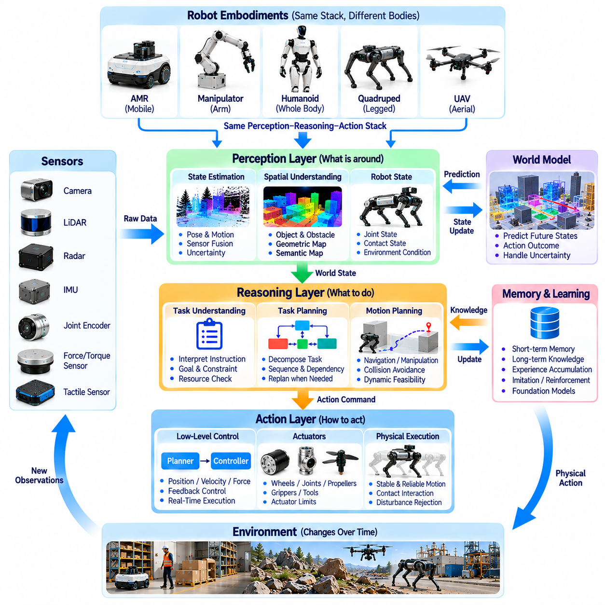{width="7.268055555555556in" height="7.268055555555556in"}

Physical AI systems require a common architectural foundation that connects environmental perception, intelligent reasoning, and physical action. Although autonomous mobile robots, manipulators, humanoids, quadrupeds, and UAVs differ mechanically, they share the need to interpret observations and execute purposeful behavior. A perception-reasoning-action stack provides a conceptual framework for organizing these capabilities while accommodating embodiment-specific constraints.

The perception layer transforms raw sensor measurements into representations of the robot and its surroundings. Cameras, LiDAR, radar, inertial sensors, joint encoders, and force sensors provide complementary information about geometry, motion, and physical interaction. Perception algorithms estimate objects, obstacles, poses, and environmental conditions. Their outputs must include uncertainty because incomplete observations can otherwise lead to unsafe decisions.

State estimation connects sensory observations with a consistent description of the robot\'s current condition. Position, orientation, velocity, joint configuration, contact state, and actuator status may all contribute to this representation. Filtering and sensor fusion reconcile measurements collected at different frequencies and with different noise characteristics. Reliable state estimation provides the foundation for planning and feedback control.

Spatial understanding extends perception beyond detecting isolated objects. Robots must represent relationships among obstacles, surfaces, tools, people, and operational regions. Geometric maps describe physical structure, while semantic maps associate locations and objects with functional meaning. These representations support decisions about navigation, grasping, inspection, and interaction. Their usefulness depends on remaining consistent as the environment changes.

The reasoning layer interprets perceived conditions in relation to objectives, constraints, and expected consequences. It determines what actions are appropriate, which resources are available, and whether a task can be completed safely. Symbolic reasoning may handle explicit rules and task relationships, while learned models support pattern recognition and prediction. Physical AI benefits from combining these approaches when tasks involve uncertainty.

Task planning converts high-level objectives into structured sequences of executable activities. A robot instructed to inspect equipment may need to navigate toward a target, acquire sensor measurements, evaluate results, and report completion. Each activity depends on prerequisites and operational constraints. Hierarchical planning organizes these dependencies while allowing the system to revise its strategy when observations contradict expectations.

Motion planning translates task decisions into physically feasible trajectories and configurations. Mobile robots require collision-free navigation paths, manipulators require reachable arm motions, and aerial vehicles require dynamically feasible flight trajectories. Planning must respect geometry, actuator limits, stability, and environmental uncertainty. Shared planning principles can support different embodiments even when their motion models differ.

The action layer executes planned behavior through actuators and low-level control systems. Motors, steering mechanisms, robotic joints, grippers, and propulsion devices convert control commands into physical motion. Feedback controllers regulate position, velocity, force, and contact behavior according to measured outcomes. The action layer must operate at appropriate frequencies to maintain stability and respond to disturbances.

Closed-loop interaction connects perception, reasoning, and action into a continuous process rather than a one-directional pipeline. Every physical action changes the robot\'s state and may alter the environment. New observations reveal whether the intended outcome occurred and whether corrective action is required. This feedback cycle enables adaptation to uncertainty, disturbances, moving obstacles, and unexpected contact conditions.

World models provide a predictive connection between current observations and possible future outcomes. They may represent object motion, terrain conditions, contact interactions, or changes in robot state. Action-conditioned predictions allow the reasoning layer to compare alternative behaviors before execution. Their accuracy depends on relevant physical representations, while uncertainty estimates help prevent excessive confidence in unfamiliar situations.

Memory and accumulated experience can improve the common intelligence stack over repeated operations. Short-term memory preserves recent observations and task context, while longer-term representations may capture environmental knowledge and learned interaction patterns. These capabilities support recovery, adaptation, and improved planning. However, stored information must be updated when environmental conditions or robot capabilities change.

Learning-based components can operate across perception, reasoning, and action. Supervised learning supports recognition and estimation, imitation learning provides examples of task execution, and reinforcement learning can optimize behavior through interaction. Foundation models may contribute reusable representations across tasks and environments. Nevertheless, learned outputs must be validated against physical constraints and operational requirements.

Multimodal integration enables robots to combine visual, spatial, tactile, inertial, and linguistic information. A manipulation task may require understanding an instruction, locating an object, estimating its geometry, and monitoring contact forces. Different modalities contribute complementary evidence about the same physical situation. Effective integration requires consistent timing, coordinate alignment, and mechanisms for handling conflicting observations.

Embodiment-specific adaptation is necessary because a shared intelligence architecture cannot eliminate mechanical differences. A wheeled AMR, humanoid, quadruped, and UAV may interpret the same obstacle differently because their mobility capabilities vary. Common semantic representations can support shared reasoning, while specialized motion planners and controllers enforce platform-specific feasibility. This separation improves reuse without assuming identical physical behavior.

Runtime orchestration coordinates the operation of perception, reasoning, planning, and control components. Different modules may require different update rates, computational resources, and communication priorities. Real-time control must remain responsive even when higher-level reasoning is computationally intensive. Modular interfaces, scheduling policies, and fault-handling mechanisms help maintain dependable operation across distributed computing resources.

Safety supervision must operate throughout the common stack rather than appear only as a final action filter. Perception uncertainty, planning failures, communication delays, and actuator faults can each create physical hazards. Runtime monitoring evaluates whether behavior remains within validated operating conditions. Protective functions may restrict commands, initiate controlled stopping, or trigger recovery procedures independently of high-level intelligence.

The common stack can be distributed across onboard computing, edge infrastructure, and cloud services according to timing and reliability requirements. Immediate perception and control generally require local execution, while fleet coordination, model updates, and large-scale analysis may use external resources. Communication failures must not compromise essential safety functions. Architectural partitioning should reflect latency, bandwidth, energy, and operational constraints.

Evaluation of the perception-reasoning-action stack must consider both component performance and complete task outcomes. Accurate object detection is insufficient if planning selects unsafe actions, while sophisticated reasoning is ineffective when control cannot execute its decisions. End-to-end testing should measure task success, latency, robustness, recovery behavior, and safety compliance. Cross-platform evaluation can reveal which capabilities genuinely transfer between embodiments.

The common perception-reasoning-action stack provides a foundation for organizing Physical AI across diverse robotic platforms. Its purpose is not to impose identical software or control methods on every embodiment, but to establish reusable intelligence functions with clear physical interfaces. Future progress may strengthen shared representations, predictive reasoning, and adaptive execution while preserving the specialized capabilities required for reliable real-world interaction.

## 07.10. Embodiment Specific Intelligence

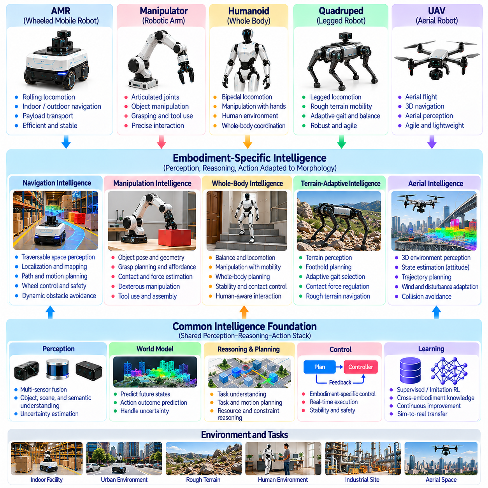{width="7.268055555555556in" height="7.268055555555556in"}

Embodiment-specific intelligence refers to the capabilities that enable a Physical AI system to perceive, reason, and act according to its particular mechanical structure and physical operating conditions. Although different robots may share common perception and planning architectures, their bodies impose distinct requirements on movement and interaction. Intelligence must therefore reflect the relationship between morphology, sensing, actuation, environmental constraints, and task objectives.

Robot embodiment determines which actions are physically possible and how those actions influence the surrounding environment. A wheeled mobile robot moves through rolling contact, a manipulator controls articulated joints, and a UAV generates aerodynamic forces to sustain flight. Humanoids and quadrupeds rely on coordinated leg contacts for locomotion. These differences require specialized motion representations, control strategies, and feasibility constraints within a shared intelligence framework.

Morphology influences intelligence by shaping the robot\'s reachable workspace, stability characteristics, and interaction capabilities. Joint arrangements, body dimensions, actuator placement, and mechanical compliance determine how the system can respond to environmental conditions. An effective controller must understand these properties rather than treat the body as an interchangeable execution device. Physical structure becomes part of the intelligence required for successful action.

Embodiment-specific perception transforms environmental observations into information relevant to the robot\'s physical capabilities. A mobile robot evaluates traversable space, while a manipulator estimates graspable surfaces and object poses. A quadruped identifies reliable footholds, and a UAV assesses three-dimensional clearance and flight hazards. Shared visual understanding remains useful, but actionable interpretations depend on the body\'s movement and interaction possibilities.

Action affordances describe opportunities for physical interaction that arise from the relationship between an object, an environment, and a particular robot. A handle may be graspable by a dexterous hand but inaccessible to a simple gripper. A staircase may be traversable by a legged robot but unsuitable for a wheeled platform. Affordance reasoning must therefore incorporate reachability, contact geometry, force limits, and task-specific manipulation requirements.

Embodiment-specific state estimation represents variables required to control a particular physical system. Wheeled robots emphasize planar motion, wheel odometry, and localization, while manipulators track joint positions, velocities, and contact forces. Legged robots additionally estimate support conditions and body balance. Aerial vehicles require continuous estimation of attitude, velocity, and flight dynamics. These specialized states support appropriate feedback and prediction.

Motion planning must account for the physical constraints associated with each embodiment. A wheeled robot may have nonholonomic steering limitations, while a robotic arm must satisfy joint limits and collision constraints. Humanoids and quadrupeds require dynamically stable contact sequences, whereas UAVs must respect thrust and aerodynamic restrictions. A common planning architecture can provide reusable algorithms, but its feasibility models must remain platform-specific.

Control intelligence translates desired behavior into commands that satisfy embodiment-dependent dynamics. Manipulators may regulate joint torque and end-effector force, while mobile robots control wheel velocity and steering. Legged systems coordinate ground reaction forces and whole-body balance, and aerial platforms regulate thrust and attitude. Specialized feedback loops must operate at suitable frequencies to maintain stability despite disturbances and uncertain physical interactions.

Humanoid intelligence presents particular challenges because bipedal locomotion and manipulation must operate together. A humanoid may need to shift its center of mass, maintain foot contacts, reach toward an object, and compensate for changing payload forces. Whole-body coordination requires balancing multiple objectives under joint, torque, and stability constraints. Human-like morphology offers useful interaction possibilities but does not automatically produce human-level physical competence.

Quadruped intelligence emphasizes adaptive locomotion over irregular and uncertain terrain. Foothold selection, gait adaptation, body posture, and contact force regulation must respond to changing ground conditions. Slipping, compliant surfaces, and unexpected obstacles introduce uncertainty that cannot be resolved through visual perception alone. Combining terrain sensing with proprioceptive feedback enables more robust movement while preserving mechanical and energy limits.

Aerial intelligence must address continuous flight dynamics and three-dimensional navigation. UAVs cannot rely on static ground support and must maintain stability through active propulsion. Wind disturbances, limited endurance, and rapid changes in viewpoint influence perception and planning. Autonomous aerial behavior requires integrating state estimation, collision avoidance, trajectory optimization, and contingency management within a tightly coupled control system.

Manipulation intelligence focuses on physically meaningful interaction with objects and tools. Grasp planning, contact estimation, force regulation, and dexterous movement depend on the robot\'s hand or gripper configuration. Object geometry alone is insufficient because friction, compliance, mass distribution, and contact uncertainty affect manipulation success. Intelligent manipulation must coordinate perception and control throughout the interaction rather than rely exclusively on predetermined motions.

Embodiment-specific world models predict how actions influence the robot and its environment under particular physical dynamics. A wheeled platform may model traction and turning behavior, while a manipulator predicts contact forces and object displacement. Legged robots require models of foot-ground interaction, and UAVs require aerodynamic predictions. Shared predictive representations can coexist with specialized dynamics models that preserve physical accuracy.

Learning systems must account for differences in action spaces, observation modalities, and mechanical constraints. Reinforcement learning policies trained for one robot may not transfer directly to another with different actuators or kinematics. Imitation learning similarly depends on whether demonstrated actions can be reproduced physically. Morphology-conditioned policies and adaptable representations may improve reuse, but transferred behaviors still require embodiment-specific validation.

Cross-embodiment intelligence can separate reusable task knowledge from platform-dependent execution. Concepts such as obstacle avoidance, object recognition, goal decomposition, and uncertainty estimation may apply across robotic systems. However, the same objective may require different action sequences and safety constraints. A shared reasoning system should delegate physical execution to specialized planners and controllers that understand each robot\'s capabilities.

Energy consumption and computational resources also shape embodiment-specific intelligence. Aerial platforms face strict flight endurance limits, while legged robots may expend substantial energy maintaining dynamic locomotion. Manipulators must manage actuator heating and repetitive loading, and mobile robots must consider payload and terrain resistance. Resource-aware intelligence evaluates physical performance alongside energy efficiency, processing latency, and operational reliability.

Safety requirements differ according to the hazards introduced by each embodiment. Manipulators may create crushing or contact-force risks, while mobile robots present collision hazards in shared spaces. Legged robots can lose balance, and UAVs introduce risks associated with uncontrolled descent. Safety supervision must reflect these distinct failure modes while enforcing common principles of uncertainty monitoring, operational limits, fault detection, and protective intervention.

Evaluation should distinguish general intelligence capabilities from embodiment-specific physical competence. A robot may correctly understand a task yet fail because its actuators cannot produce the required forces or its controller cannot maintain stability. Benchmarking must therefore assess perception, reasoning, physical feasibility, execution reliability, and recovery performance. Comparisons across embodiments should account for different mechanical capabilities rather than assume identical task conditions.

Embodiment-specific intelligence establishes the connection between reusable AI capabilities and the physical realities of individual robotic platforms. Its purpose is to ensure that perception, reasoning, learning, and control remain grounded in what a particular body can safely accomplish. Future Physical AI architectures may combine increasingly general intelligence with specialized physical models, enabling diverse robots to share knowledge while retaining reliable, adaptive, and purposeful behavior.

## 07.11. Cross Embodiment Learning and Transfer

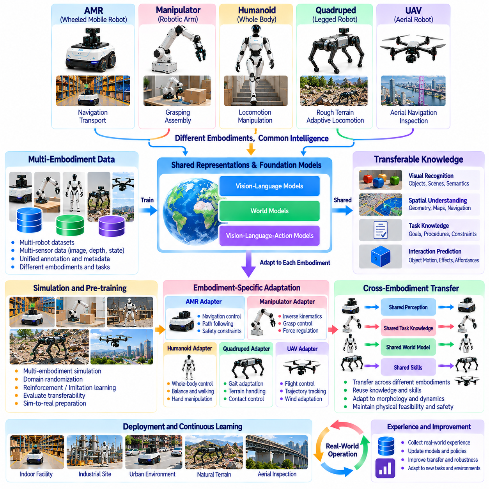{width="7.268055555555556in" height="7.268055555555556in"}

Cross-embodiment learning and transfer enable Physical AI systems to reuse knowledge across robots with different mechanical structures, sensors, and action capabilities. An autonomous mobile robot, manipulator, humanoid, quadruped, and UAV may perform different physical movements while sharing environmental concepts and task objectives. The central challenge is identifying which knowledge can be generalized and which capabilities must remain specific to each embodiment.

Traditional robot learning often produces policies closely associated with a particular platform. A controller trained for one robot may depend on its joint configuration, actuator characteristics, sensor placement, and motion constraints. Directly applying that controller to another embodiment can produce ineffective or unsafe behavior. Cross-embodiment learning seeks representations that preserve transferable knowledge without ignoring physical differences.

Transferable knowledge can exist at several levels of abstraction, including visual recognition, spatial understanding, task planning, and interaction prediction. Object categories and semantic relationships may remain useful across many robots, while motor commands are usually more platform-dependent. Separating these levels allows shared intelligence components to support diverse embodiments. Effective transfer requires explicit recognition of the boundaries between general knowledge and physical execution.

Shared perception representations provide an important foundation for cross-embodiment learning. Images, depth measurements, point clouds, and semantic maps can describe environments independently of a particular robot\'s actuator configuration. However, the meaning of an observation changes with physical capability. A staircase may represent a navigable route for a humanoid or quadruped but an inaccessible region for many wheeled platforms.

Action representations are more difficult to transfer because robots possess different degrees of freedom, kinematic structures, and control interfaces. Joint-angle commands from a manipulator cannot directly control a mobile robot or UAV. Higher-level descriptions such as approach, grasp, transport, and inspect can provide common behavioral abstractions. Embodiment-specific controllers must translate these intentions into feasible physical actions.

Task-level transfer allows robots to reuse knowledge about objectives, dependencies, and successful procedures. An inspection task may require locating equipment, approaching a target, collecting observations, and evaluating results. These logical relationships can remain consistent across ground and aerial platforms. Nevertheless, navigation strategies, sensor positioning, and safety constraints must be adapted to the physical capabilities of the executing robot.

Cross-embodiment imitation learning attempts to extract reusable behavior from demonstrations collected using different robotic platforms. Demonstrations may include trajectories, images, object interactions, and task outcomes. Learning systems must distinguish task intent from platform-specific movement patterns. A successful transfer process preserves the purpose of demonstrated actions while generating new movements compatible with the target embodiment.

Reinforcement learning can support transfer by exposing policies to variations in robot morphology, dynamics, and environmental conditions. Training across multiple embodiments may encourage representations that capture shared control principles. Morphology-conditioned policies can incorporate joint structures, actuator limits, and physical dimensions as inputs. However, broad training diversity does not guarantee reliable behavior on previously unseen hardware.

Foundation models offer another approach to learning reusable representations across robotic systems. Vision-language models may interpret instructions and environmental observations, while vision-language-action models can connect semantic understanding with action generation. Cross-embodiment datasets may improve their ability to recognize common task structures. Their physical outputs still require compatibility checks against robot-specific constraints and validated control systems.

World models can facilitate transfer by separating environmental dynamics from embodiment-dependent interactions. A shared model may represent object motion, spatial relationships, and task consequences, while specialized components predict contact forces or locomotion behavior. Action-conditioned predictions allow robots to evaluate alternative strategies before execution. Model uncertainty becomes especially important when transferred knowledge encounters unfamiliar physical conditions.

Data integration is a major challenge because robotic datasets often use different sensor configurations, coordinate systems, action formats, and sampling frequencies. Cross-embodiment training requires consistent metadata describing robot morphology, calibration, task context, and execution outcomes. Standardized representations can reduce integration complexity. However, normalization must preserve distinctions that are essential for physical feasibility and safety.

Simulation provides opportunities to evaluate transfer across multiple embodiments without requiring every experiment to use physical hardware. A shared virtual environment can contain different robot models performing related tasks under comparable conditions. Researchers can examine whether learned representations generalize across changes in kinematics and dynamics. Sim-to-real differences must still be addressed before transferred policies are deployed in operational environments.

Adaptation mechanisms help transferred models accommodate the characteristics of a target robot. Fine-tuning may update selected parameters using platform-specific demonstrations or interaction data. Modular architectures can retain shared perception and reasoning components while replacing motion planners and controllers. Online adaptation may further improve performance during operation, but its scope must be restricted when uncontrolled learning could create physical hazards.

Negative transfer occurs when knowledge from a source embodiment reduces performance on a target embodiment. This can happen when models assume incompatible contact conditions, actuator capabilities, or movement strategies. For example, a navigation policy developed for a quadruped may select routes unsuitable for a wheeled robot. Transfer systems should estimate compatibility and reject assumptions that conflict with the target platform\'s physical limitations.

Safety assurance must accompany every stage of cross-embodiment transfer. A behavior demonstrated successfully on one robot is not automatically safe on another with different mass, reach, speed, or stability characteristics. Constraint checking, simulation testing, controlled trials, and runtime monitoring help identify transfer-related hazards. Safety-critical functions should remain enforceable independently of learned policies and high-level reasoning.

Evaluation of cross-embodiment learning requires more than measuring success on familiar training platforms. Benchmarks should include unseen robot configurations, different sensor arrangements, environmental variations, and task modifications. Metrics may include task success, adaptation effort, sample efficiency, execution reliability, and safety violations. Comparisons should distinguish improvements in shared reasoning from gains achieved through extensive platform-specific retraining.

Cross-embodiment transfer also supports cooperation among heterogeneous robotic fleets. A UAV may identify an inspection target, a mobile robot may approach its location, and a manipulator may perform detailed physical interaction. Shared maps, semantic descriptions, and task representations enable knowledge exchange. Each robot must interpret this information through its own capabilities while maintaining consistent objectives and coordinated execution.

The long-term value of cross-embodiment learning lies in reducing the need to develop every robotic capability independently. Reusable representations, shared datasets, predictive models, and modular control interfaces can accelerate development across diverse platforms. Nevertheless, generalization must not erase essential differences in mechanics and dynamics. Effective Physical AI combines transferable intelligence with embodiment-aware adaptation, validation, and reliable physical execution.

## 07.12. Heterogeneous Physical AI Fleets

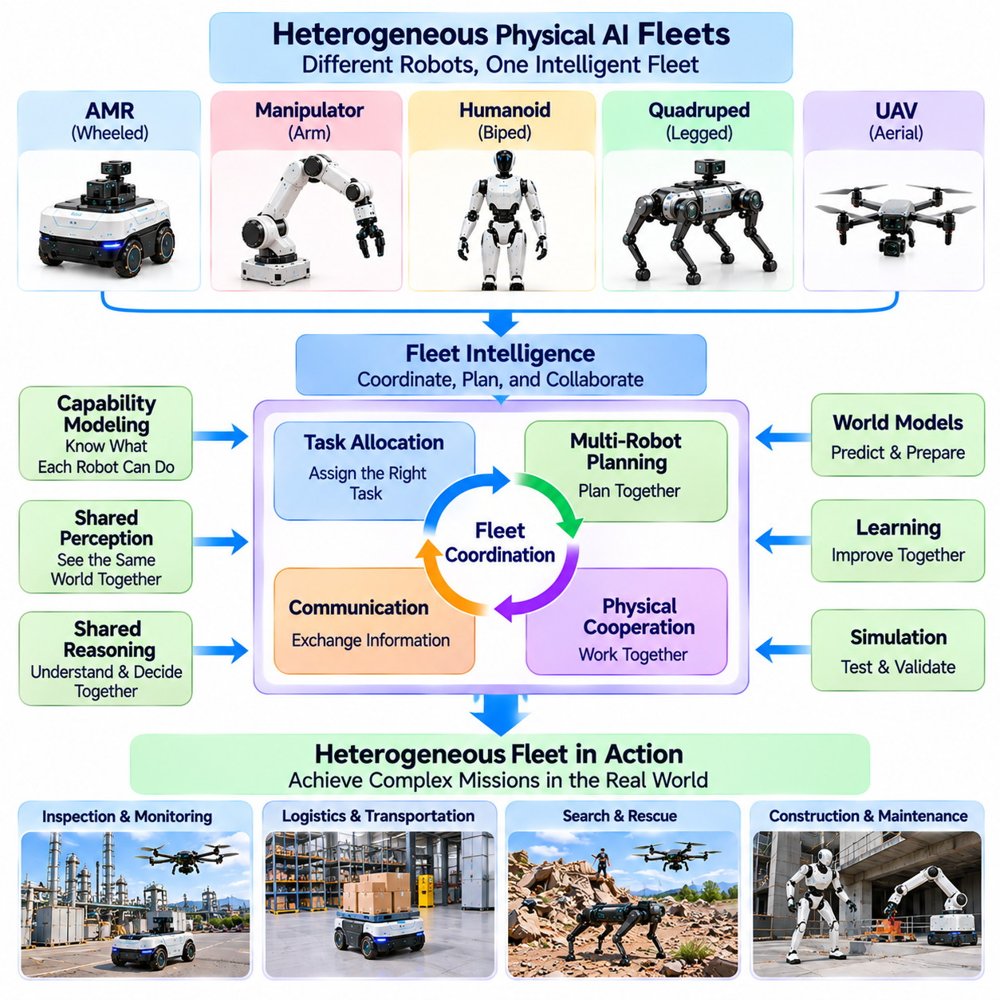{width="7.268055555555556in" height="7.268055555555556in"}

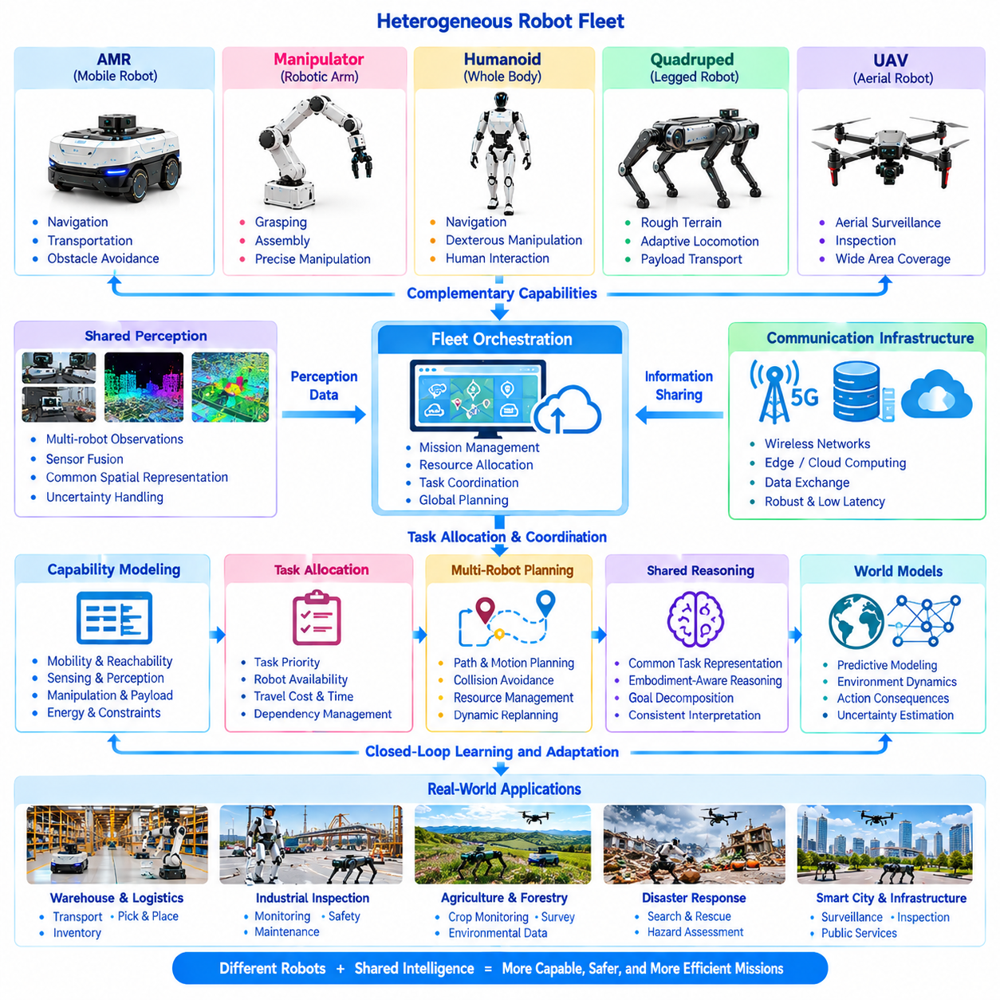{width="7.268055555555556in" height="7.268055555555556in"}

Heterogeneous Physical AI fleets combine robots with different mechanical structures, sensing capabilities, and operational roles into coordinated systems. Autonomous mobile robots, manipulators, humanoids, quadrupeds, and UAVs may contribute complementary capabilities to shared missions. Their collective effectiveness depends not only on individual autonomy but also on communication, task coordination, shared environmental understanding, and reliable interaction across diverse physical platforms.

A heterogeneous fleet differs from a homogeneous robotic fleet because its members possess distinct movement capabilities, payload capacities, and interaction mechanisms. Wheeled robots may provide efficient transportation, while quadrupeds traverse difficult terrain and UAVs perform aerial observation. Manipulators and humanoids can execute physical tasks requiring contact or dexterity. Fleet intelligence must recognize these differences when assigning responsibilities.

Fleet-level intelligence connects individual robot capabilities with broader operational objectives. A warehouse, industrial facility, or infrastructure site may require transportation, inspection, monitoring, and manipulation activities to occur simultaneously. Centralized coordination can maintain mission priorities and resource allocation, while distributed autonomy supports local decisions. Effective orchestration balances global efficiency with individual operational independence.

Capability modeling provides the foundation for assigning tasks to heterogeneous robots. Each platform can be described through mobility characteristics, sensing functions, manipulation abilities, payload limits, energy reserves, and operating constraints. These descriptions allow fleet managers to identify suitable robots for particular objectives. Capability models must also reflect changing conditions such as equipment faults, battery depletion, and environmental restrictions.

Task allocation determines which robots should perform specific activities and how their contributions should be coordinated. Allocation algorithms may consider task urgency, robot availability, travel cost, execution time, and expected reliability. A UAV may locate an inspection target before a ground robot approaches it. A manipulator may then perform detailed interaction. Such assignments must account for dependencies between tasks and the capabilities of participating robots.

Shared spatial representations enable heterogeneous robots to exchange knowledge about their operating environment. Maps may combine geometric structure, semantic information, obstacle locations, and operational zones. However, the same region may have different accessibility for wheeled, legged, and aerial platforms. Fleet intelligence must preserve a common environmental reference while allowing embodiment-specific interpretations of traversability and physical feasibility.

Communication infrastructure supports the exchange of observations, task assignments, robot states, and mission updates. Wireless networks, local computing infrastructure, and cloud services may provide different communication capabilities. Network latency, bandwidth limitations, and temporary disconnections influence coordination quality. Critical control functions should remain local, while fleet-level systems must tolerate delayed or incomplete information.

Distributed perception allows multiple robots to contribute complementary observations of the same environment. A UAV may provide elevated visual coverage, while ground robots collect detailed measurements near equipment or obstacles. Combining these observations can improve situational awareness and reduce individual sensing limitations. Data fusion requires consistent coordinate frames, time synchronization, uncertainty management, and mechanisms for resolving conflicting observations.

Multi-robot planning coordinates movements and activities across shared spaces. Fleet planners must account for traffic congestion, resource contention, collision risks, and operational priorities. Different robots may require different clearances, turning spaces, and access routes. Coordinated planning should prevent conflicts without unnecessarily restricting local autonomy. Dynamic replanning becomes essential when missions, obstacles, or robot availability change.

Physical cooperation extends beyond exchanging information because heterogeneous robots may interact with the same objects or infrastructure. A mobile platform may transport materials to a manipulator, while a humanoid performs an assembly operation. Coordinated manipulation requires compatible interfaces, accurate positioning, and predictable handover procedures. Physical collaboration introduces additional risks involving contact forces, timing errors, and unexpected movements.

Shared reasoning enables robots to maintain consistent interpretations of mission objectives while executing different physical actions. A high-level instruction such as inspecting a production line can be decomposed into navigation, observation, measurement, and reporting activities. Each robot translates assigned objectives into embodiment-specific plans. Common task representations improve coordination without requiring identical control policies or mechanical capabilities.

World models can support fleet intelligence by predicting environmental changes and the consequences of coordinated actions. Shared predictions may include robot trajectories, obstacle movements, resource availability, and task completion states. Individual robots can maintain detailed local models while contributing relevant information to fleet-level representations. Managing uncertainty and inconsistent observations is essential for reliable collective decisions.

Fleet orchestration requires coordinating computational resources as well as physical activities. Onboard processors support immediate perception and control, while edge infrastructure may perform shared mapping, coordination, and predictive analysis. Cloud systems can support historical learning and large-scale optimization. Architectural partitioning must consider latency, network reliability, cybersecurity, and the consequences of infrastructure failures.

Energy management becomes more complex when robots have different charging requirements, endurance characteristics, and mission priorities. Fleet scheduling must consider battery state, charging station availability, expected travel distance, and task duration. Some robots may require immediate charging while others continue operating. Energy-aware orchestration can reduce mission interruptions and improve fleet utilization without compromising safety reserves.

Fault tolerance is essential because individual robot failures should not automatically disrupt the entire fleet. A robot may become unavailable because of sensor degradation, actuator faults, communication loss, or environmental restrictions. Fleet management systems should detect these conditions and evaluate alternative task assignments. Graceful degradation allows remaining robots to continue feasible operations while respecting safety and capability limitations.

Safety management must address both platform-specific hazards and risks arising from coordination. Wheeled robots may collide with pedestrians, manipulators may generate hazardous contact forces, and UAVs may create overhead risks. Shared workspaces introduce additional concerns involving unexpected interactions between robot types. Fleet-wide safety supervision should coordinate access restrictions, emergency responses, and operational boundaries without replacing local protective controls.

Interoperability depends on standardized interfaces for capability descriptions, task communication, robot state reporting, and environmental data exchange. Different manufacturers may use incompatible software architectures and control protocols. Middleware and translation layers can support integration, but semantic consistency remains necessary. Reliable interoperability requires clear definitions of commands, coordinate systems, timing assumptions, and failure responses.

Evaluation of heterogeneous fleets must measure collective performance alongside individual robot capabilities. Relevant metrics include mission completion rate, task allocation efficiency, resource utilization, coordination latency, energy consumption, and recovery effectiveness. Testing should include communication failures, changing workloads, and unavailable robots. A fleet is successful when its coordinated operation provides benefits beyond the isolated performance of its members.

Heterogeneous Physical AI fleets represent a transition from isolated robotic autonomy toward coordinated physical intelligence. Their value emerges when specialized robots share information, distribute responsibilities, and adapt collectively to changing operational conditions. Future development may strengthen shared world models, cross-embodiment learning, distributed reasoning, and adaptive orchestration. The ultimate objective is reliable collective action across diverse physical embodiments.
