**Volume 02. Physical AI Foundations and Definitions**

# Chapter 08. Physical AI Product Strategy

## 08.01. From AI Research to Physical AI Product

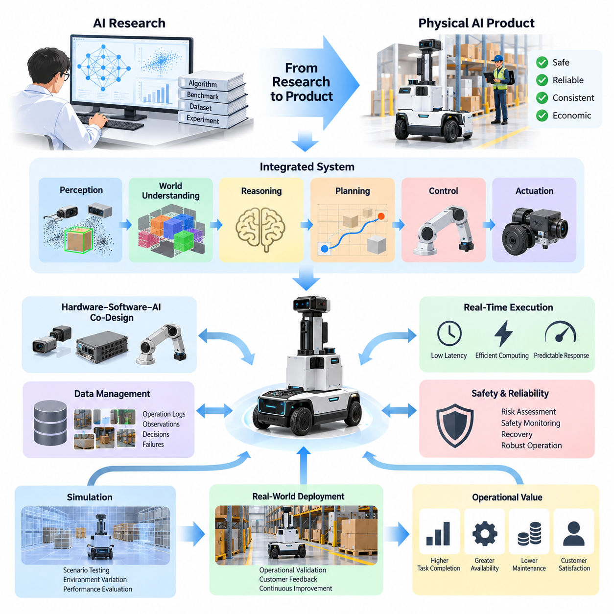{width="7.268055555555556in" height="7.268055555555556in"}

The transition from artificial intelligence research to a Physical AI product represents a fundamental shift from demonstrating computational capability to delivering dependable intelligence in the real world. Research typically emphasizes algorithmic novelty, benchmark performance, and experimental feasibility. Product development must transform these achievements into systems that operate safely, consistently, and economically under changing physical conditions.

An AI research prototype often succeeds within a controlled environment where datasets, computational resources, and evaluation procedures are predefined. A Physical AI product encounters unpredictable obstacles, sensor disturbances, mechanical wear, environmental variation, and human behavior. Consequently, successful commercialization requires more than transferring a trained model onto robotic hardware. It requires engineering an integrated operational system.

The central distinction between research and product development lies in the definition of success. Research may evaluate perception accuracy, planning efficiency, or reinforcement learning rewards. Product engineering must additionally consider task completion rates, operational availability, intervention frequency, maintenance costs, and customer satisfaction. These practical indicators determine whether intelligent behavior creates measurable operational value.

Physical AI product development should begin with a clearly identified operational problem rather than an assumption that advanced intelligence automatically creates demand. Developers must determine which physical tasks require automation, why existing solutions remain insufficient, and what measurable improvements customers expect. This process connects technological capabilities with operational requirements and prevents research complexity from becoming unnecessary product complexity.

A practical product strategy defines the intended environment, permitted operating conditions, task boundaries, and acceptable system behavior. These constraints establish the operational design domain within which autonomy can be evaluated and supported. A warehouse robot, for example, may initially operate on mapped indoor routes before expanding toward dynamic navigation, unfamiliar layouts, and increasingly complex interactions.

The research-to-product transition also requires converting experimental objectives into verifiable engineering requirements. Perception performance must become measurable detection and localization requirements, while planning capability must satisfy timing and collision-avoidance constraints. Control algorithms must respect actuator limits, and learning systems must operate within defined safety boundaries. Every major capability requires evidence of reliable operation.

Physical AI products depend on the coordinated operation of perception, world understanding, reasoning, planning, control, and actuation. Individual algorithms cannot be evaluated exclusively through isolated performance metrics because errors propagate across the system. An inaccurate object estimate may influence trajectory planning, while delayed control commands may invalidate otherwise correct decisions. Product engineering therefore prioritizes system-level behavior.

Hardware, software, and artificial intelligence must be developed through a coordinated engineering process. Sensor selection influences observation quality, computing hardware determines inference capacity, and actuator characteristics constrain achievable motion. Mechanical configuration affects perception coverage and control stability. Effective product development treats these dependencies as interconnected design decisions rather than independent engineering activities.

Real-time execution introduces constraints that are often absent from laboratory experiments. Physical AI systems must process observations, update internal representations, generate decisions, and execute actions before environmental conditions change significantly. Computational latency, communication delays, memory limitations, and power consumption directly affect operational performance. Product architectures must balance model complexity against predictable response times.

Safety represents another essential transformation from research capability to commercial readiness. A research experiment may tolerate occasional failure under supervision, but deployed systems must anticipate hazardous conditions and respond appropriately. Physical AI products require risk assessment, safety monitoring, emergency stopping, controlled degradation, and recovery procedures. Intelligent behavior must remain subordinate to enforceable physical safety constraints.

Reliability engineering extends beyond preventing catastrophic failures. Products must continue functioning despite sensor degradation, temporary communication loss, localization uncertainty, or unexpected environmental changes. Robust operation requires fault detection, health monitoring, diagnostic logging, and clearly defined fallback behavior. A commercially useful system should fail predictably and recover safely rather than depend on ideal operating conditions.

Data requirements also change during commercialization. Research datasets are often collected to train or compare algorithms, whereas product data must support deployment, validation, troubleshooting, and continuous improvement. Operational logs should capture observations, decisions, interventions, failures, and environmental context. Structured data management enables engineers to distinguish isolated model errors from recurring system weaknesses.

Simulation provides an important intermediate stage between experimental research and physical deployment. Developers can reproduce difficult scenarios, explore environmental variations, and evaluate control policies without exposing equipment or personnel to unnecessary risks. However, simulated success cannot independently establish product readiness. Differences in dynamics, sensing, friction, lighting, and human interaction require systematic real-world validation.

The development process benefits from progressive validation across software testing, simulation, hardware-in-the-loop environments, controlled field trials, and customer operations. Each stage should establish explicit acceptance criteria before broader deployment. This progression reduces the risk of discovering fundamental limitations after commercialization and creates traceable evidence that product requirements have been satisfied under representative conditions.

Product maturity also depends on understanding the relationship between specialized and generalized intelligence. A narrowly optimized system may deliver higher reliability and lower operating costs within a defined task. A generalist model may support broader adaptability but introduce additional computational and validation challenges. The appropriate strategy depends on customer requirements, environmental diversity, available data, and acceptable operational risk.

Foundation models, vision-language models, and vision-language-action architectures can accelerate Physical AI development by providing reusable representations and transferable capabilities. Nevertheless, broad model competence does not automatically guarantee dependable physical execution. Product teams must evaluate domain adaptation, embodiment compatibility, action precision, inference requirements, and failure behavior before integrating foundation models into operational systems.

Commercial deployment introduces economic considerations that research demonstrations rarely address comprehensively. Hardware acquisition, installation, energy consumption, maintenance, software updates, and human supervision contribute to total ownership costs. Product value depends on whether automation improves throughput, quality, safety, or resource efficiency sufficiently to justify these expenses. Technical superiority alone does not establish commercial viability.

A scalable Physical AI product requires an architecture that separates reusable intelligence capabilities from deployment-specific configurations. Shared perception services, planning interfaces, diagnostics, and data infrastructure can reduce repeated development effort. Meanwhile, application-specific sensors, actuators, safety functions, and workflows preserve operational suitability. This separation supports product families without assuming that every physical platform requires identical intelligence.

Edge, on-premise, and cloud computing introduce further architectural choices. Time-critical perception and control generally require local execution, while coordination, analytics, training, and fleet optimization may benefit from distributed infrastructure. Network availability, cybersecurity, privacy, and communication latency influence these decisions. Product engineering must ensure that essential safety functions remain dependable when external connectivity is interrupted.

Deployment readiness includes capabilities that extend beyond autonomous operation itself. Customers require installation procedures, configuration management, monitoring interfaces, technical documentation, maintenance support, and predictable software updates. Operators need understandable system states and practical intervention mechanisms. These supporting functions transform an experimental intelligent machine into a maintainable product that can be integrated into existing operations.

Continuous improvement becomes possible when deployed systems contribute structured operational experience to the development process. Failure cases, human interventions, environmental changes, and performance measurements can guide data collection and model refinement. However, updated models must undergo regression testing and controlled release procedures. Learning from deployment should strengthen reliability without introducing unverified behavior into safety-critical operations.

The transition from AI research to Physical AI products is therefore an iterative process of narrowing uncertainty and expanding operational confidence. Research establishes what intelligence might accomplish, engineering determines how it can operate dependably, and product strategy identifies where that capability creates sustainable value. Successful Physical AI commercialization emerges when these activities converge into safe, measurable, maintainable, and economically viable physical systems.

## 08.02. Use Case and Operational Design Domain

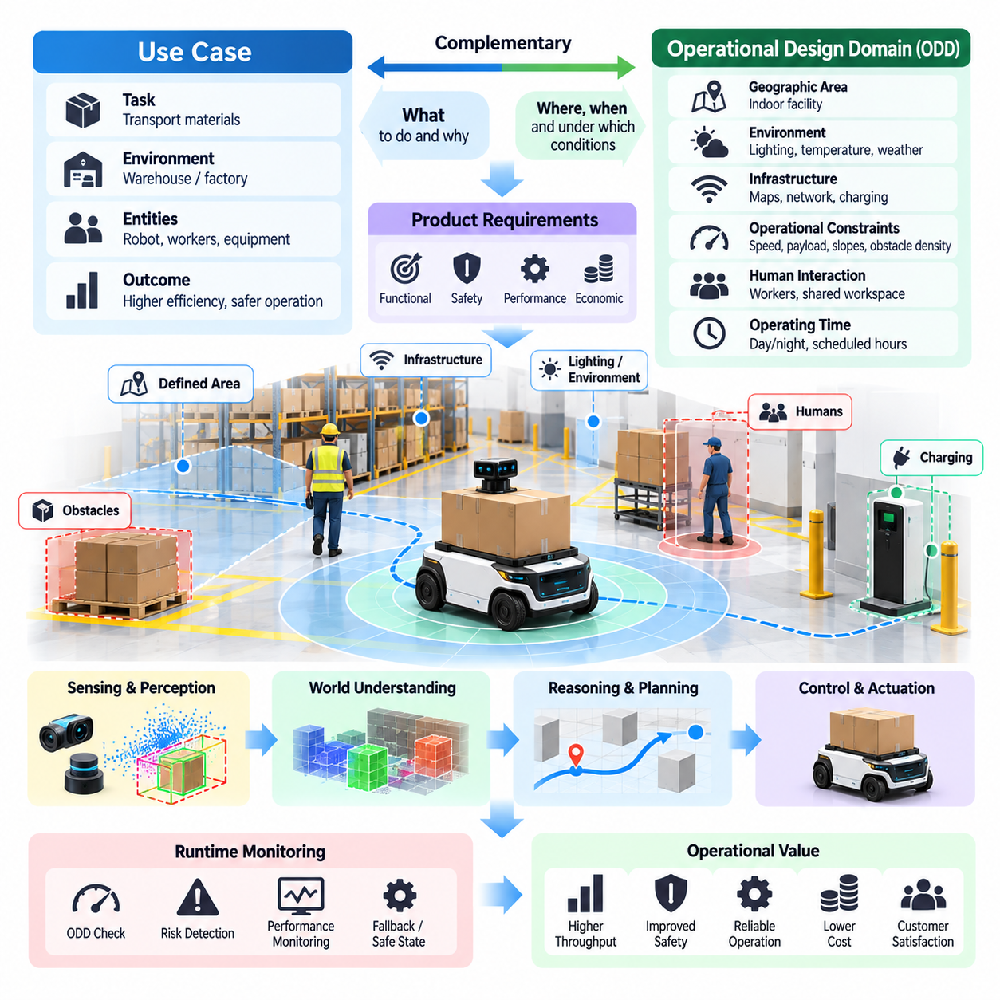{width="7.268055555555556in" height="7.268055555555556in"}

A use case defines the practical purpose of a Physical AI system by identifying the task, operating environment, participating entities, and expected outcome. Unlike a general statement of technological capability, a use case describes how intelligence creates measurable value through physical interaction. It connects customer needs with engineering requirements and establishes the foundation for product development, validation, and deployment.

The Operational Design Domain, commonly abbreviated as ODD, defines the specific conditions under which an autonomous system is designed to operate. These conditions may include geographical boundaries, environmental characteristics, infrastructure availability, operating speeds, lighting, weather, and human activity. An ODD establishes the limits of intended operation rather than assuming that intelligent behavior will remain reliable under every possible condition.

Use cases and operational design domains serve complementary purposes in Physical AI product strategy. The use case explains what the system must accomplish and why the task matters, while the ODD specifies where, when, and under which conditions the task can be performed. Together, they establish a practical relationship between business objectives, autonomous capabilities, engineering constraints, and operational responsibilities.

A useful Physical AI use case begins with a clearly defined operational problem. Developers must understand the existing workflow, identify inefficiencies or risks, and determine whether autonomous physical interaction offers meaningful improvement. Relevant objectives may include increasing throughput, reducing repetitive labor, improving safety, minimizing operational variability, or extending service availability. These objectives should be translated into measurable performance expectations.

Task definition requires more precision than simply identifying an application category. For example, autonomous material transportation may involve collecting a payload, navigating designated routes, avoiding obstacles, reaching a delivery location, and confirming successful transfer. Each activity introduces distinct perception, planning, control, and interaction requirements. Decomposing the workflow reveals the capabilities necessary for dependable execution.

The ODD transforms broad environmental assumptions into explicit operating conditions. An indoor autonomous mobile robot may be restricted to mapped corridors, defined floor surfaces, specified slopes, and controlled pedestrian densities. An outdoor robot may require additional constraints involving precipitation, visibility, terrain conditions, and positioning accuracy. These boundaries make system performance more predictable and provide a basis for systematic validation.

Environmental characterization is particularly important because physical conditions directly influence intelligent behavior. Illumination affects camera-based perception, reflective surfaces can disturb ranging sensors, and uneven terrain changes mobility requirements. Temperature, humidity, vibration, and electromagnetic interference may influence hardware reliability. Product developers must identify which environmental factors materially affect system performance and establish acceptable operating ranges.

The presence of humans introduces additional complexity into operational design. People may move unpredictably, obstruct planned routes, manipulate objects, or enter restricted areas. Physical AI systems must account for pedestrian behavior, human proximity, shared workspaces, and interaction expectations. The ODD should describe permitted human interactions and define circumstances requiring reduced speed, protective stopping, or human intervention.

Operational design also depends on infrastructure assumptions. Some systems rely on digital maps, localization markers, wireless connectivity, charging stations, or coordinated traffic management. Others are designed to function with minimal external support. These dependencies must be documented because infrastructure failure can invalidate normal operating assumptions. A product should distinguish essential infrastructure requirements from optional services that improve performance.

A well-defined ODD must include dynamic operating constraints rather than only static environmental descriptions. Maximum speed, payload limits, stopping distance, obstacle density, communication latency, and localization confidence can influence whether operation remains acceptable. These parameters may vary across operating modes. Product design should establish measurable thresholds that determine when autonomous behavior may continue, degrade, or terminate.

The relationship between use cases and system requirements should remain traceable throughout development. Each operational objective should correspond to functional requirements, performance metrics, safety constraints, and validation procedures. For example, a delivery use case may require a specified task completion rate, positioning tolerance, and maximum recovery time. Traceability allows engineers to determine whether demonstrated technical performance satisfies the original operational need.

ODD definition also provides a framework for managing uncertainty and incomplete perception. A robot may encounter objects that are difficult to classify, unfamiliar layouts, or sensor observations that conflict with its internal model. Such situations do not necessarily require immediate system failure, but they demand defined responses. Depending on risk, the system may slow down, request assistance, perform additional observations, or enter a safe state.

Operational boundaries should be connected to runtime monitoring mechanisms. The system must determine whether current conditions remain consistent with its approved ODD. Monitoring may include environmental measurements, localization quality, sensor health, computational availability, and infrastructure status. When operating conditions exceed permitted limits, the system should initiate an appropriate fallback strategy rather than continue under unsupported assumptions.

Fallback behavior is an essential component of operational design because autonomous systems cannot guarantee successful execution under every condition. A fallback strategy may involve controlled stopping, returning to a designated location, transferring control to a human operator, or entering a reduced-capability mode. The selected response must consider physical hazards, available infrastructure, and the consequences of interrupted operation.

Use-case evaluation should consider both technical feasibility and economic value. A technically achievable task may still be unsuitable for commercialization if deployment costs exceed expected benefits. Conversely, a narrowly defined use case may deliver substantial value through reliable automation of repetitive activities. Product strategy should evaluate operational frequency, labor requirements, safety improvements, infrastructure costs, and expected return on investment.

The selection of an initial ODD has significant implications for product development risk. Restricting deployment to controlled environments can reduce environmental variability, simplify testing, and accelerate operational validation. However, excessive restrictions may limit customer value or create impractical installation requirements. Effective product strategy seeks an operating domain that balances achievable autonomy with meaningful commercial applicability.

ODD expansion should be treated as a controlled engineering process rather than an automatic consequence of model improvement. Supporting additional environments, payloads, operating speeds, or human interactions may introduce new failure modes. Each expansion requires updated requirements, representative datasets, safety analysis, and validation evidence. A successful deployment within one domain does not independently establish readiness for substantially different conditions.

Simulation and field testing provide complementary methods for validating use cases and operational design domains. Simulation enables systematic variation of environmental parameters and exploration of rare scenarios, while physical testing reveals real sensor behavior, mechanical limitations, and unexpected interactions. Validation should cover normal operation, boundary conditions, degraded states, and recovery procedures to establish credible evidence of operational readiness.

A structured scenario library can connect ODD characteristics with repeatable evaluation procedures. Scenarios may represent pedestrian crossings, temporary obstructions, reduced visibility, localization disturbances, or communication interruptions. Each scenario should specify initial conditions, expected behavior, performance criteria, and safety outcomes. This approach transforms environmental complexity into testable engineering evidence and supports regression testing after system updates.

The ODD also influences architectural decisions concerning sensors, computing platforms, communication systems, and control mechanisms. A highly dynamic environment may require faster perception and planning, while remote operation may demand greater onboard autonomy during communication interruptions. Hardware and software capabilities should therefore be selected according to the intended operational conditions rather than generalized assumptions about technological sophistication.

For fleet-based Physical AI systems, operational design domains must account for interactions among multiple autonomous agents. Shared routes, traffic congestion, charging resources, and coordinated task execution introduce system-level constraints. Individual robots may operate within acceptable local conditions while collective behavior creates new risks. Fleet coordination policies must therefore remain consistent with both individual ODD boundaries and shared operational requirements.

The distinction between intended operation and actual operation is fundamental to lifecycle management. Changes in facility layouts, equipment placement, environmental conditions, or customer workflows may alter the validity of the original ODD. Continuous monitoring and periodic reassessment help identify these changes. Product maintenance must include procedures for updating maps, configurations, operating constraints, and validation records when necessary.

Ultimately, use-case definition and operational design domain specification establish the practical boundaries of Physical AI commercialization. The use case determines the value that autonomous intelligence is expected to deliver, while the ODD defines the conditions under which that value can be delivered reliably. Their integration supports disciplined engineering, transparent safety expectations, measurable performance, and progressive expansion toward more capable Physical AI products.

## 08.03. Requirements Driven Physical AI Design

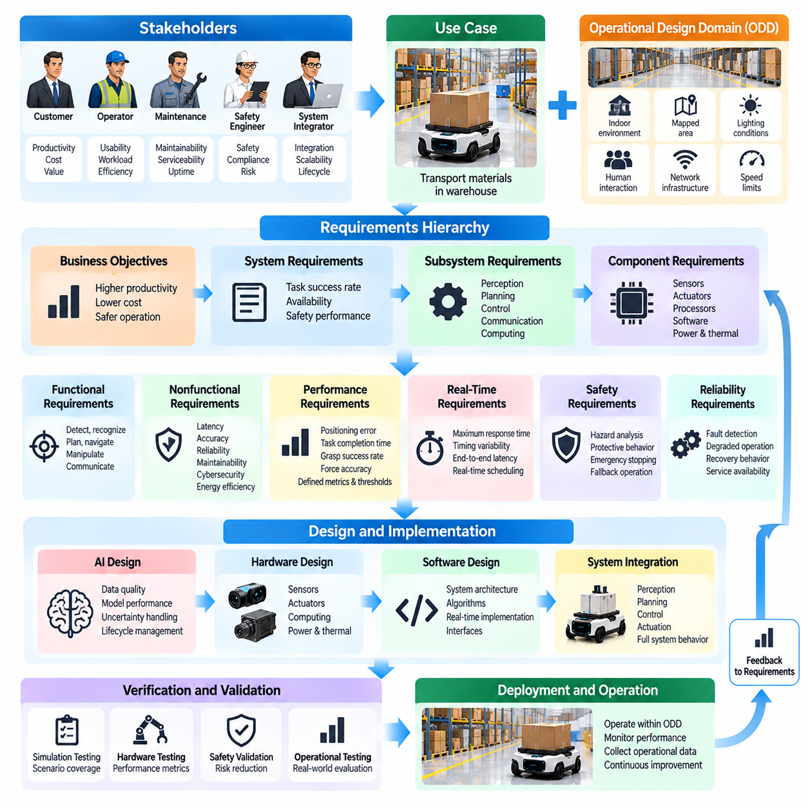{width="7.268055555555556in" height="7.268055555555556in"}

Requirements-driven Physical AI design is an engineering approach that transforms operational needs into measurable system capabilities, architectural decisions, and verification criteria. Unlike research-driven development, which often begins with algorithms or models, this approach starts with the intended physical task and its operating conditions. Every technical decision must contribute to an explicitly defined operational objective.

Physical AI requirements originate from multiple stakeholders, including customers, operators, maintenance personnel, safety engineers, and system integrators. Each stakeholder expresses different expectations concerning productivity, usability, reliability, safety, and cost. These expectations must be consolidated into a coherent requirements framework that distinguishes essential operational needs from desirable capabilities and future enhancements.

The requirements process begins by analyzing the use case and Operational Design Domain. The use case establishes what the system must accomplish, while the ODD defines the conditions under which successful operation is expected. Together, they determine task boundaries, environmental assumptions, human interactions, and infrastructure dependencies. Requirements developed without these foundations risk becoming technically impressive but operationally irrelevant.

A requirements hierarchy connects business objectives with system-level, subsystem-level, and component-level specifications. Business objectives may emphasize productivity or operational cost, while system requirements define task success rates, availability, and safety performance. Subsystem requirements address perception, planning, control, communication, and computing. Component requirements establish measurable hardware and software characteristics.

Functional requirements describe the behaviors a Physical AI system must perform. These may include detecting obstacles, estimating position, recognizing objects, generating trajectories, executing movements, and communicating task status. Each function should specify triggering conditions, expected outputs, and relevant operational constraints. Functional descriptions must be sufficiently precise to support implementation and objective verification.

Nonfunctional requirements determine how effectively and dependably the system performs its functions. They include latency, accuracy, reliability, availability, maintainability, cybersecurity, energy efficiency, and scalability. A robot may successfully complete a task while still violating essential timing or safety constraints. Product readiness therefore requires simultaneous satisfaction of functional and nonfunctional requirements.

Performance requirements should use measurable quantities rather than ambiguous descriptions such as fast, accurate, or robust. Navigation performance may be expressed through positioning error, trajectory deviation, and task completion time. Manipulation performance may involve grasp success rate, force accuracy, and placement tolerance. Each metric requires defined measurement conditions, acceptable thresholds, and evaluation procedures.

Real-time requirements are particularly important because Physical AI systems interact with environments that continue changing during computation. Sensor acquisition, state estimation, inference, planning, and actuation introduce cumulative delays. Requirements must establish maximum response times and acceptable timing variability for critical operations. These constraints influence computing architecture, scheduling, communication, and algorithm selection.

Safety requirements must be integrated into the initial design rather than introduced after functional development. Hazard analysis identifies situations involving collisions, uncontrolled movement, excessive force, or loss of environmental awareness. Safety requirements then define protective behavior, monitoring functions, emergency stopping, and fallback responses. These mechanisms must remain effective even when intelligent components behave unexpectedly.

Reliability requirements address the ability to sustain acceptable operation despite component degradation and environmental disturbances. Sensor failures, communication interruptions, computing overload, and actuator abnormalities must be considered during system design. Requirements should specify fault detection, degraded operation, recovery behavior, and service availability. Reliability becomes an engineered property rather than an assumption derived from successful demonstrations.

Requirements allocation distributes system responsibilities across hardware, software, artificial intelligence, and operational infrastructure. Perception accuracy depends on sensor quality and model performance, while navigation reliability involves localization, planning, control, and mechanical behavior. Allocation must recognize these dependencies and avoid assigning system-level outcomes to isolated components without considering their interactions.

Hardware and software co-design becomes necessary when requirements impose competing constraints. Higher-resolution sensors may improve perception but increase bandwidth, processing demand, and power consumption. Larger models may improve generalization while introducing unacceptable inference latency. Engineering tradeoffs must be evaluated against operational priorities, ensuring that improvements in one capability do not compromise essential system requirements.

Artificial intelligence introduces additional requirements concerning data quality, uncertainty, generalization, and model lifecycle management. Training datasets must represent relevant operational conditions, while evaluation datasets should include difficult and uncommon scenarios. Model performance must be assessed beyond average accuracy, including confidence calibration, distribution shifts, and failure behavior. These requirements connect learning performance with deployment reliability.

Requirements-driven design also establishes explicit boundaries for autonomous decision-making. The system must identify when observations are insufficient, predictions are unreliable, or operating conditions exceed validated limits. Requirements should define confidence thresholds, intervention conditions, and safe fallback actions. Autonomous capability is therefore evaluated not only by successful decisions but also by appropriate responses to uncertainty.

Traceability is essential for maintaining consistency between operational objectives and technical implementation. Each requirement should be linked to its source, responsible subsystem, design artifact, verification method, and validation evidence. When a requirement changes, traceability reveals affected components and tests. This structure supports configuration management, engineering reviews, regulatory assessments, and controlled product evolution.

Verification and validation serve different but complementary purposes. Verification determines whether the implemented system satisfies specified requirements, while validation determines whether those requirements adequately address the intended operational need. A robot may pass every technical test yet fail to improve customer productivity. Both activities are necessary to establish meaningful product readiness.

Simulation supports requirements verification by reproducing operating conditions and systematically varying environmental parameters. Engineers can evaluate obstacle avoidance, localization degradation, communication delays, and unexpected interactions without exposing physical equipment to unnecessary risk. However, simulation results must be complemented by hardware testing and real-world experiments because simulated conditions cannot fully reproduce physical complexity.

A structured test strategy should connect each requirement with measurable acceptance criteria. Unit tests verify individual software functions, integration tests evaluate subsystem interactions, and system tests assess complete operational behavior. Field trials demonstrate performance under representative conditions. Requirements that cannot be objectively tested should be clarified or decomposed before they become contractual or engineering commitments.

Requirements management must accommodate changes throughout the product lifecycle. Customer workflows evolve, hardware components become obsolete, software architectures change, and new operating environments introduce additional constraints. Change control should assess technical impact, safety implications, cost, and validation effort before modifications are approved. Uncontrolled changes can invalidate previous evidence and introduce unexpected system behavior.

Prioritization is necessary because Physical AI products operate under limited budgets, development schedules, and computational resources. Safety-critical and mission-essential requirements generally take precedence over optional intelligence features. Product teams should distinguish minimum viable capabilities from advanced functionality while preserving architectural flexibility. This approach supports progressive deployment without sacrificing operational integrity.

Requirements-driven development also enables collaboration across multidisciplinary engineering teams. Mechanical engineers, electrical engineers, AI researchers, software developers, safety specialists, and operations personnel require a common technical reference. Clear specifications reduce ambiguity and prevent conflicting assumptions. Shared requirements provide a foundation for coordinated development, integration planning, and objective decision-making.

For scalable Physical AI platforms, requirements should distinguish reusable capabilities from deployment-specific constraints. Common interfaces, diagnostic functions, communication protocols, and model management services may support multiple embodiments. However, mobility limits, manipulation forces, sensing configurations, and safety mechanisms remain application dependent. This separation enables platform reuse while preserving the integrity of individual product requirements.

Ultimately, requirements-driven Physical AI design transforms autonomous intelligence from an experimental capability into an accountable engineering system. It connects operational objectives with measurable behavior, architectural constraints, safety provisions, and validation evidence. By maintaining this connection throughout development and deployment, organizations can create Physical AI products that are technically coherent, operationally dependable, and commercially sustainable.

## 08.04. Hardware Software AI Co Design

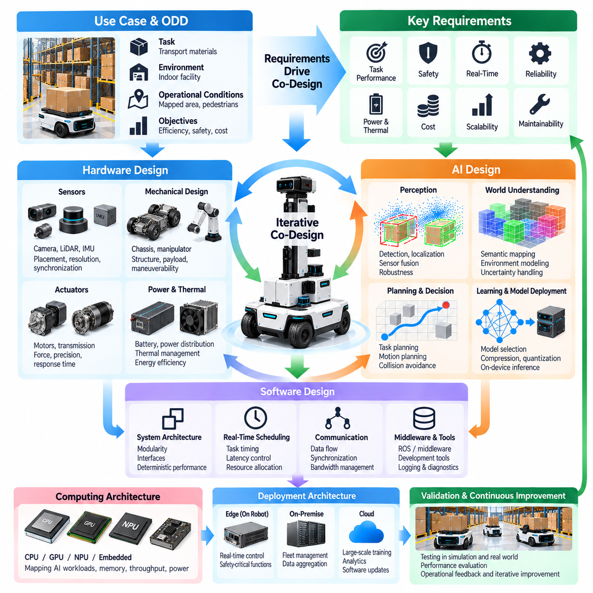{width="7.268055555555556in" height="7.268055555555556in"}

Hardware, software, and artificial intelligence co-design is a systems engineering approach that develops physical components, computational infrastructure, and intelligent algorithms as an integrated architecture. In Physical AI products, these elements cannot be optimized independently because sensing, reasoning, and action depend on their combined behavior. Co-design ensures that technical decisions reflect operational requirements rather than isolated component performance.

Traditional development often separates mechanical engineering, electronics, software, and AI research into sequential activities. This approach can create integration problems when computational demands exceed hardware capacity or mechanical limitations restrict intelligent behavior. Co-design replaces sequential optimization with iterative collaboration, allowing system constraints and capabilities to influence architectural decisions throughout development.

The foundation of co-design is a shared understanding of the intended use case and Operational Design Domain. Environmental conditions, task complexity, payload requirements, operating speeds, and safety expectations determine the necessary physical and computational capabilities. These requirements establish a common reference for selecting sensors, actuators, processors, communication interfaces, and AI models.

Sensor and AI co-design begins by examining the information required for reliable decision-making. Cameras provide visual appearance, LiDAR measures spatial geometry, and inertial sensors capture motion dynamics. Sensor placement, resolution, sampling frequency, and synchronization influence the quality of observations. AI architectures must accommodate these characteristics while maintaining sufficient accuracy under realistic environmental conditions.

Sensor selection also involves balancing information quality against bandwidth, processing demand, energy consumption, and cost. Higher-resolution observations may improve object recognition but increase memory usage and inference latency. Multiple sensors can provide redundancy and complementary information, although fusion introduces calibration and synchronization requirements. The optimal configuration depends on operational needs rather than maximum sensor specifications.

Actuator and control co-design connects intelligent planning with the physical capabilities of a robot. Motors, transmissions, braking systems, and mechanical structures determine achievable acceleration, force, precision, and response time. Planning algorithms must respect these limitations when generating trajectories or manipulation commands. Control performance depends on matching computational decisions with the dynamics and constraints of physical mechanisms.

Mechanical morphology influences the design of intelligent algorithms. Wheel configuration affects maneuverability, manipulator geometry determines reachable workspaces, and sensor mounting positions influence visibility. A robot designed for narrow corridors requires different navigation strategies from a platform operating in open environments. Co-design recognizes embodiment as an active determinant of intelligence rather than a passive carrier of software.

Computing architecture is another central element of Physical AI co-design. CPUs, GPUs, neural processing units, and embedded accelerators offer different performance, energy, and programmability characteristics. AI workloads must be mapped onto suitable processing resources according to latency, memory, and throughput requirements. Architectural decisions should account for both average computational demand and worst-case operating conditions.

Real-time scheduling connects software architecture with physical system behavior. Perception, state estimation, planning, and control operate at different frequencies and have different timing requirements. Delayed observations or commands can reduce stability even when individual algorithms are accurate. Co-design therefore requires coordinated scheduling, bounded communication delays, and predictable execution for time-critical functions.

AI model selection must consider deployment constraints from the beginning. Large neural networks may provide strong benchmark performance but exceed available memory, power, or thermal budgets. Smaller models may offer superior system-level performance through faster execution and greater operational consistency. Model compression, quantization, pruning, and optimized inference can improve deployment efficiency when their effects on accuracy and robustness are validated.

Power and thermal management are especially important for mobile Physical AI systems. Computing hardware, sensors, communication devices, and actuators compete for limited energy resources. Increased computational load generates heat and may reduce battery endurance or trigger thermal throttling. Co-design evaluates energy consumption across complete operating cycles rather than considering processor efficiency in isolation.

Software architecture must support modularity without introducing excessive communication overhead. Perception, localization, planning, control, diagnostics, and model management can be organized as reusable services with clearly defined interfaces. However, distributed processing introduces data transfer costs and synchronization challenges. System designers must balance modularity, maintainability, and deterministic performance.

Edge, on-premise, and cloud resources provide different opportunities for distributing Physical AI workloads. Safety-critical control and immediate environmental responses generally require local processing, while fleet coordination, analytics, and large-scale training may use remote infrastructure. Network latency, bandwidth, availability, and cybersecurity determine acceptable workload placement. Essential functions must remain dependable during communication interruptions.

World models and predictive AI introduce additional co-design requirements because they maintain internal representations of physical environments and anticipate future states. Their computational complexity depends on representation resolution, prediction horizon, and update frequency. Product architects must determine whether predictive benefits justify additional memory and processing requirements while ensuring that planning remains responsive.

Safety engineering must be incorporated across hardware, software, and AI boundaries. Mechanical braking, protective sensors, independent safety controllers, runtime monitors, and intelligent uncertainty estimation provide complementary protection mechanisms. No single component should be assumed to eliminate all hazards. Co-design establishes coordinated responses to faults while preserving essential safety functions independently of unreliable intelligent behavior.

Reliability depends on understanding how failures propagate between physical and computational subsystems. Sensor degradation may corrupt perception, processor overload may delay control, and actuator faults may invalidate planned motion. Diagnostic mechanisms should detect these conditions and initiate appropriate recovery or fallback behavior. Fault tolerance must be evaluated at the system level rather than through isolated component reliability.

Co-design also requires careful management of interfaces and data representations. Sensor timestamps, coordinate frames, calibration parameters, actuator commands, and communication protocols must remain consistent across subsystems. Interface mismatches can produce substantial physical errors even when individual modules function correctly. Explicit interface contracts and integration testing reduce ambiguity and support maintainable system evolution.

Simulation and digital twins support co-design by allowing engineers to evaluate alternative configurations before committing to physical hardware. Sensor placement, actuator sizing, computational scheduling, and AI policies can be explored within representative virtual environments. However, simulation fidelity must be assessed carefully, and promising configurations require physical validation to identify modeling errors and unanticipated interactions.

The co-design process benefits from quantitative tradeoff analysis. Improvements in perception accuracy may increase processing cost, while stronger actuators may improve mobility but reduce energy efficiency. Design alternatives should be compared using task success, latency, power consumption, safety margins, reliability, and total cost. Multi-objective optimization helps identify balanced configurations that satisfy product requirements.

Verification and validation must examine both component behavior and integrated system performance. Hardware testing establishes physical capabilities, software testing checks functional correctness, and AI evaluation measures learning-based behavior. Integrated testing determines whether these elements operate consistently under realistic conditions. Hardware-in-the-loop testing and field trials are particularly valuable for exposing timing and interaction problems.

Product scalability introduces additional architectural considerations. Reusable computing modules, standardized sensor interfaces, configurable software services, and adaptable AI models can support multiple robotic platforms. Nevertheless, different embodiments may require distinct control frequencies, power budgets, safety mechanisms, and perception configurations. Platform reuse should preserve application-specific requirements rather than enforce unnecessary uniformity.

Lifecycle management extends co-design beyond initial product development. Hardware revisions, software updates, and AI model improvements can alter system timing, energy consumption, or safety behavior. Configuration management and regression testing are necessary to maintain compatibility. Continuous operational feedback should inform coordinated improvements across physical components, computational infrastructure, and intelligent algorithms.

Ultimately, hardware, software, and AI co-design transforms Physical AI development from component integration into coordinated system optimization. Its objective is not to maximize the sophistication of individual technologies but to achieve dependable physical intelligence within practical constraints. Successful co-design produces systems whose sensing, computation, decision-making, and actuation operate together safely, efficiently, and consistently throughout their operational lifecycle.

## 08.05. Platform vs Product Strategy

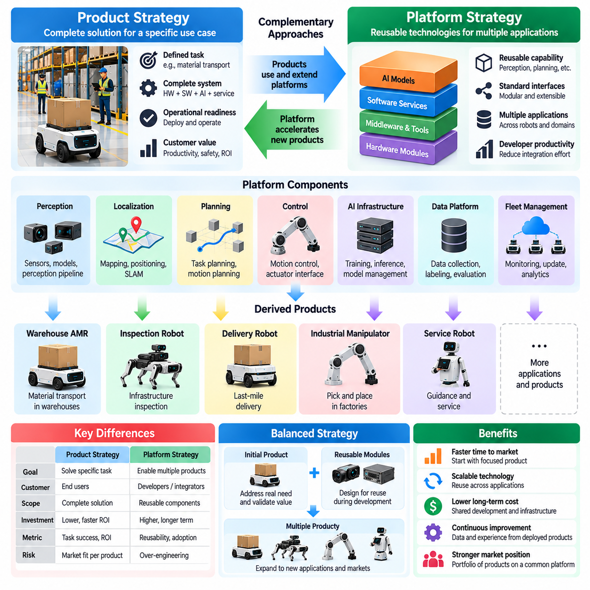{width="7.268055555555556in" height="7.268055555555556in"}

Platform strategy and product strategy represent two complementary approaches to developing and commercializing Physical AI systems. A product strategy focuses on delivering a complete solution for a defined operational problem, while a platform strategy emphasizes reusable technologies that support multiple applications. Understanding their differences helps organizations balance immediate customer value with long-term scalability and technological investment.

A Physical AI product integrates hardware, software, intelligence, and operational services into a deployable system. Its success depends on accomplishing specific tasks within an established Operational Design Domain. Customers evaluate products through reliability, productivity, safety, usability, and ownership costs. Product strategy therefore prioritizes operational completeness and measurable outcomes over the generality of underlying technologies.

A Physical AI platform provides common capabilities that can be reused across products, environments, or robotic embodiments. These capabilities may include perception frameworks, localization services, planning engines, AI model infrastructure, communication interfaces, and fleet management. A platform reduces duplicated engineering effort by establishing standardized components and interfaces that support multiple deployment configurations.

The fundamental distinction concerns the unit of value delivered. A product creates value by completing a customer task, such as transporting materials or inspecting infrastructure. A platform creates value by enabling developers and integrators to build or improve multiple products more efficiently. Both approaches can generate commercial value, but their customers, investment requirements, performance metrics, and development priorities may differ.

Product-first strategies begin with a narrow use case and develop the capabilities necessary to satisfy its requirements. This approach limits technical scope, accelerates field validation, and provides direct feedback from actual operations. However, tightly optimized product architectures may become difficult to reuse. Without deliberate modularity, expansion into new applications can require substantial redesign and repeated integration work.

Platform-first strategies prioritize reusable architecture, standardized interfaces, and extensible development tools before targeting multiple applications. They can establish strong technical foundations and reduce future integration costs. Nevertheless, platform development requires significant investment and may delay customer validation. Excessive generalization can produce complex infrastructure without sufficient evidence that customers need its capabilities.

A balanced strategy often begins with a commercially meaningful product while designing selected components for future reuse. Common perception services, data pipelines, model deployment mechanisms, and diagnostic interfaces can evolve into platform capabilities. This approach allows operational evidence to guide abstraction decisions. Reusability emerges from validated similarities between applications rather than assumptions about universal requirements.

Platform architecture must distinguish stable interfaces from implementation-specific details. Standardized communication protocols, data representations, configuration mechanisms, and software interfaces allow components to evolve independently. However, abstraction should not conceal critical physical constraints. Control timing, sensor calibration, actuator characteristics, and safety requirements must remain visible wherever they influence system behavior.

Hardware platform strategy introduces additional challenges because physical components are less easily generalized than software. Different robots require distinct payload capacities, mobility mechanisms, sensor arrangements, and power systems. Modular computing units and standardized electrical interfaces can improve reuse, but mechanical constraints remain application dependent. Hardware platforms must balance commonality with embodiment-specific performance.

Software platforms can provide substantial reuse through shared middleware, perception pipelines, planning interfaces, monitoring tools, and deployment infrastructure. Modular services reduce integration effort and support coordinated updates. However, excessive software layering may increase latency, memory consumption, and debugging complexity. Platform engineering must preserve deterministic behavior where real-time physical interaction requires predictable execution.

AI platform strategy focuses on reusable models, training infrastructure, data management, evaluation frameworks, and inference services. Foundation models may provide transferable representations, while specialized models address application-specific requirements. A successful AI platform supports adaptation without assuming that one model can reliably perform every physical task. Model selection and deployment remain constrained by embodiment and operational conditions.

Data infrastructure is a particularly important platform asset because operational experience can improve multiple products. Shared data schemas, labeling conventions, evaluation datasets, and model registries enable consistent learning workflows. However, data collected from different embodiments may vary in sensing, action spaces, and environmental context. Reuse requires careful normalization, metadata management, and validation of transferability.

The platform-versus-product decision also influences organizational structure. Product teams emphasize customer workflows, deployment readiness, support, and operational performance. Platform teams emphasize interfaces, architectural consistency, developer productivity, and reusable infrastructure. Effective organizations establish clear ownership boundaries while maintaining close collaboration. Platform priorities should remain connected to demonstrated product requirements.

Economic evaluation requires distinguishing product profitability from platform investment returns. Products generate value through equipment sales, subscriptions, service contracts, or operational outcomes. Platforms may generate value through licensing, integration services, developer ecosystems, or reduced internal development costs. Platform investment becomes justified when expected reuse and strategic benefits exceed the additional complexity and maintenance burden.

The timing of platform investment is critical. Building extensive infrastructure before validating product demand can consume resources without producing commercial evidence. Conversely, postponing architectural standardization until multiple products exist can create incompatible systems and expensive technical debt. Organizations should introduce reusable capabilities progressively as recurring engineering needs become sufficiently clear.

A platform roadmap should be informed by the requirements of current and anticipated products. Common capabilities deserve investment when multiple applications share stable technical needs. Application-specific features should remain within product architectures unless broader reuse is demonstrated. This distinction prevents platforms from becoming repositories of unrelated functionality and supports sustainable architectural evolution.

Operational Design Domains also influence platform reuse. Two robots may share perception algorithms but operate under substantially different environmental constraints. A warehouse navigation component cannot automatically be considered suitable for outdoor deployment. Platform capabilities should therefore include documented assumptions, supported operating conditions, performance boundaries, and validation evidence. Reusability must be demonstrated rather than presumed.

Safety and cybersecurity introduce additional responsibilities for platform providers. Shared software vulnerabilities or unsafe architectural assumptions can affect multiple products simultaneously. Platform components require controlled releases, dependency management, security updates, and documented safety interfaces. Nevertheless, product integrators remain responsible for validating complete systems within their intended operating environments and applicable requirements.

Verification strategies must distinguish platform-level correctness from product-level operational validity. Platform tests establish interface compliance, component behavior, and compatibility across supported configurations. Product tests determine whether integrated capabilities satisfy specific tasks, environmental constraints, and safety requirements. Successful platform verification does not replace validation of complete Physical AI products in realistic operating conditions.

Fleet-scale deployment can strengthen the economic case for platform development. Shared monitoring, task allocation, configuration management, and software distribution services become increasingly valuable as deployed systems grow. However, heterogeneous fleets introduce differences in capabilities, communication reliability, and operating constraints. Platform services must coordinate diverse products without assuming identical autonomy levels or physical performance.

A mature Physical AI ecosystem may combine reusable intelligence platforms with specialized product families. Common infrastructure supports data collection, learning, monitoring, and coordination, while individual products retain distinct mechanical designs and operational capabilities. This architecture can enable progressive expansion across applications without sacrificing the reliability required for each deployment.

Strategic success depends on measuring the appropriate outcomes for each approach. Product performance should be assessed through task completion, availability, customer value, safety, and total ownership cost. Platform performance should be evaluated through reuse, integration effort, development speed, compatibility, and maintenance efficiency. These measurements reveal whether architectural investments translate into practical operational advantages.

Ultimately, platform strategy and product strategy should reinforce rather than compete with each other. Products provide real-world requirements, operational evidence, and commercial validation, while platforms convert recurring capabilities into scalable technical assets. The most sustainable Physical AI strategy connects both through disciplined architecture, measurable customer value, and continuous learning from deployment experience.

## 08.06. Specialist vs Generalist Strategy

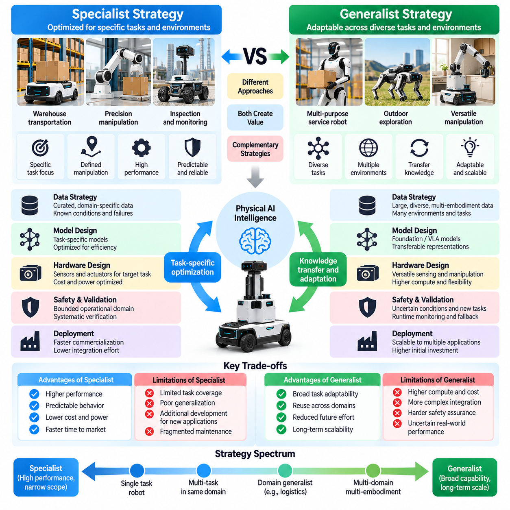{width="7.268055555555556in" height="7.268055555555556in"}

Specialist and generalist strategies represent different approaches to developing intelligence for Physical AI products. A specialist system is optimized for a limited set of tasks and operating conditions, while a generalist system aims to perform diverse tasks across environments and embodiments. The strategic choice influences model architecture, data requirements, hardware design, safety assurance, deployment costs, and the long-term evolution of autonomous capabilities.

Specialist Physical AI systems focus on clearly defined operational objectives. Examples include warehouse transportation, industrial inspection, agricultural harvesting, and precision manipulation. Their perception, planning, and control capabilities are tailored to specific tasks and environments. This specialization enables engineers to optimize performance, establish measurable acceptance criteria, and validate behavior within a bounded Operational Design Domain.

Generalist Physical AI systems seek broader adaptability by learning representations and policies that transfer across tasks. Instead of requiring a separately engineered solution for every application, they attempt to reuse knowledge about objects, actions, spatial relationships, and physical interactions. Their potential advantage lies in reducing task-specific development effort, although reliable generalization remains difficult in complex physical environments.

The primary benefit of specialization is engineering predictability. Restricted task boundaries allow developers to identify relevant hazards, collect representative data, and evaluate performance systematically. Models can be optimized for available computing resources and operating constraints. Consequently, specialist systems often provide a more direct path toward dependable commercial deployment when customer requirements are stable and well understood.

Specialization also creates limitations. A system trained for one environment may perform poorly when lighting, object geometry, terrain, or operational procedures change. Expanding its capabilities can require additional datasets, model modifications, and repeated validation. Excessive specialization may create fragmented product architectures in which each new application demands substantial engineering effort and independent maintenance.

Generalist strategies attempt to overcome these limitations through transferable learning. Foundation models, vision-language-action architectures, and multimodal representations can connect visual observations, language instructions, and physical actions. Such systems may support task adaptation without complete redevelopment. However, broad representational capacity does not automatically guarantee accurate control, physical robustness, or safe behavior.

The distinction between specialist and generalist intelligence should not be reduced to model size. A large model may remain specialized if its training and evaluation cover a narrow task distribution. Conversely, a compact model may generalize effectively across several related applications. Generality should be assessed through demonstrated transfer performance, operational coverage, and adaptability rather than parameter count alone.

Data strategy differs significantly between the two approaches. Specialist systems require carefully curated datasets representing their target operating conditions, including expected disturbances and failure scenarios. Generalist systems require diverse observations, actions, tasks, and embodiments. Dataset diversity may improve transferability, but inconsistent sensor configurations, action spaces, and annotations introduce additional training and evaluation challenges.

Embodiment diversity is particularly important for generalist Physical AI. Wheeled robots, manipulators, humanoids, and quadrupeds possess different kinematics, dynamics, sensing configurations, and control interfaces. Shared intelligence must account for these differences without assuming identical physical capabilities. Generalist architectures therefore need representations that separate transferable task knowledge from embodiment-specific execution constraints.

Hardware requirements also influence strategic feasibility. Specialist systems can use sensors, processors, and actuators selected for a known workload. Generalist systems may require broader sensing coverage, flexible manipulation, greater computational capacity, and adaptable interfaces. These capabilities increase cost, power consumption, and integration complexity. Hardware flexibility should be justified by operational benefits rather than theoretical generality.

Inference latency and computational efficiency remain critical constraints. Generalist models may require substantial memory and processing resources to interpret complex observations and instructions. Specialist models can often achieve faster responses through task-specific optimization. Product architects must evaluate whether generalist flexibility compensates for additional latency, energy consumption, and hardware expense under realistic deployment conditions.

Safety assurance presents different challenges for each strategy. Specialist systems operate within narrower boundaries, allowing hazards and expected behaviors to be evaluated systematically. Generalist systems may encounter unfamiliar tasks and combinations of conditions that are difficult to enumerate. Safety engineering must therefore establish explicit operational limits, runtime monitoring, uncertainty assessment, and fallback mechanisms independent of model generality.

A generalist model should not be interpreted as authorization for unrestricted autonomous operation. Even when a system demonstrates broad task competence, its deployment must remain constrained by validated capabilities and environmental conditions. Task selection, action execution, and human intervention policies should reflect documented evidence. Generalization claims must be separated from demonstrated safety and reliability.

Economic considerations often favor specialization during early commercialization. Customers generally purchase reliable operational outcomes rather than abstract intelligence capabilities. A specialist robot that performs a repetitive task consistently may generate greater immediate value than a flexible system with uncertain performance. Generalist investment becomes attractive when adaptability reduces deployment effort, customization costs, or the need for multiple dedicated systems.

The specialist-versus-generalist decision also affects product development schedules. Specialist teams can concentrate resources on limited requirements and establish field performance relatively quickly. Generalist development involves broader data acquisition, larger evaluation programs, and more complex integration. Organizations must balance long-term technological ambitions against available funding, customer demand, and the urgency of operational deployment.

Hybrid architectures offer a practical alternative to choosing either extreme. A general-purpose perception or reasoning model can interpret complex environments and user instructions, while specialized controllers execute safety-critical physical actions. Task-specific policies may operate beneath a shared planning layer. This arrangement combines transferable intelligence with predictable execution and provides clear boundaries for validation.

Hierarchical control supports hybrid strategies by separating high-level decision-making from low-level physical execution. Generalist components can select objectives, interpret context, and coordinate activities, while specialist modules handle navigation, grasping, stabilization, and emergency responses. Interfaces must specify allowable commands and operating constraints. Such separation reduces the risk that uncertain high-level decisions directly compromise physical stability.

Continuous learning can gradually expand specialist capabilities toward broader generalization. Operational data reveals recurring environmental variations, task similarities, and failure patterns. Shared representations may be developed when sufficient evidence demonstrates transfer across applications. However, updates must undergo regression testing and deployment validation. Capability expansion should follow verified performance rather than assumptions about model adaptability.

Evaluation frameworks must reflect the intended strategic objective. Specialist systems should be assessed through task success, accuracy, latency, availability, and safety within their defined domains. Generalist systems require additional measures of transfer learning, adaptation efficiency, task diversity, and performance under distribution shifts. Comparisons must account for differences in hardware, training data, operating conditions, and permitted intervention.

Platform strategy can benefit from combining reusable generalist infrastructure with specialized product implementations. Shared data pipelines, foundation models, evaluation tools, and model deployment services can support multiple applications. Individual products retain task-specific controllers, safety mechanisms, and operational configurations. This separation allows common intelligence capabilities to evolve without forcing every product to adopt identical behavior.

Organizational capabilities also shape the appropriate strategy. Specialist development requires deep application knowledge, systems engineering, and operational validation expertise. Generalist development places greater demands on large-scale data engineering, model training, computational infrastructure, and cross-domain evaluation. A hybrid strategy requires coordination between these disciplines and clear responsibility for system-level performance.

The strategic balance may change as technologies mature. Improvements in multimodal learning, simulation, world models, and transferable control could reduce the cost of adapting intelligence to new tasks. Nevertheless, physical differences between robots and operating environments will continue to impose constraints. Greater model generality does not eliminate the need for embodiment-aware engineering and application-specific safety validation.

Ultimately, specialist and generalist strategies should be evaluated according to the value, reliability, and adaptability required by the intended Physical AI product. Specialization provides focused optimization and predictable deployment, while generalization offers the potential for broader capability reuse. A sustainable strategy often combines both, using validated general-purpose intelligence where beneficial and specialized physical execution wherever operational dependability demands it.

## 08.07. Data Strategy and Data Flywheel

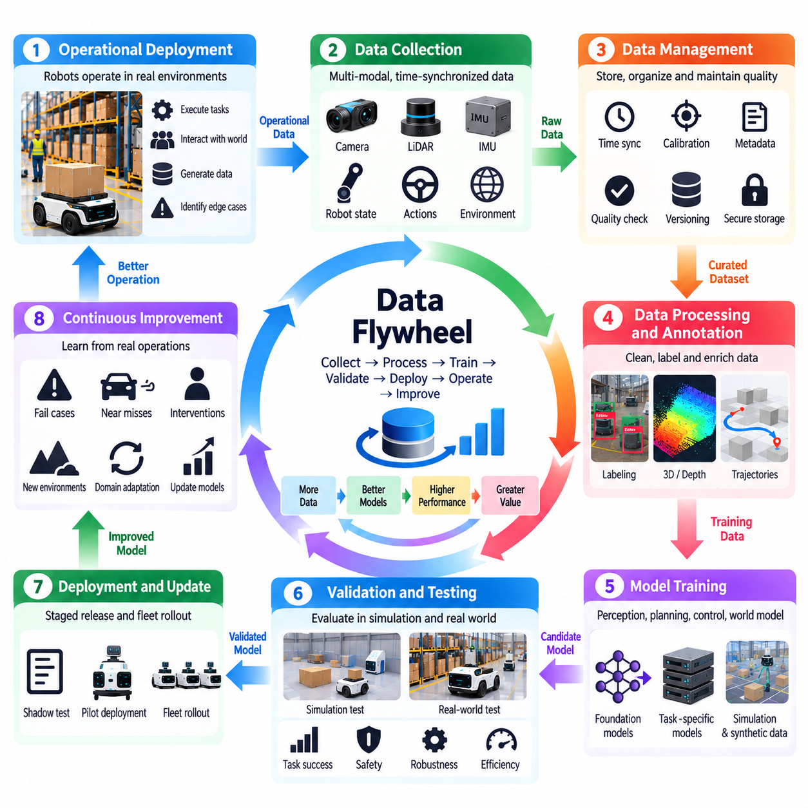{width="7.268055555555556in" height="7.268055555555556in"}

Data strategy is a foundational element of Physical AI product development because intelligent systems depend on continuous interaction with the physical world. Unlike digital applications, Physical AI must learn from observations, actions, environmental changes, and operational outcomes. A successful data strategy connects collection, processing, training, evaluation, deployment, and feedback into a coordinated system that improves intelligence throughout the product lifecycle.

Physical AI data includes camera images, LiDAR measurements, inertial signals, robot states, actuator commands, task instructions, and environmental observations. These sources describe both what the system perceives and how it interacts with its surroundings. Effective data management must preserve temporal relationships, spatial references, sensor calibration, and operational context so that learning algorithms can reconstruct meaningful physical experiences.

Data requirements should originate from the intended use case and Operational Design Domain. A warehouse robot requires observations of aisles, obstacles, pallets, and human activity, while an outdoor robot must capture terrain variation, weather, illumination, and localization uncertainty. Dataset design should reflect actual operational distributions rather than relying exclusively on convenient laboratory recordings or publicly available benchmarks.

A data flywheel describes a continuous improvement cycle in which deployed systems generate operational data that supports better models and products. Observations reveal performance limitations, selected experiences become training examples, and updated models improve subsequent operation. Improved deployment then produces additional evidence. The flywheel becomes valuable when each cycle generates measurable improvements rather than simply accumulating larger datasets.

Data collection must balance coverage, quality, storage requirements, communication bandwidth, and privacy obligations. Continuous recording may capture useful events but creates substantial operational costs. Event-triggered logging, selective sampling, and prioritized collection can focus resources on informative situations. Collection policies should preserve sufficient context around failures, uncertainty, interventions, and unusual environmental conditions.

Data quality is more important than raw volume when training reliable Physical AI models. Incorrect timestamps, inconsistent coordinate frames, missing calibration parameters, and corrupted sensor streams can undermine learning even in large datasets. Quality assurance should detect incomplete sequences, synchronization errors, annotation inconsistencies, and invalid measurements. Reliable metadata is essential for reproducibility and meaningful evaluation.

Annotation strategy depends on the learning objective. Perception models may require object classes, segmentation masks, depth information, or trajectories, while manipulation policies may require action sequences and task outcomes. Manual annotation provides control but is expensive at scale. Automated labeling, simulation-derived ground truth, and human review can reduce effort when their accuracy and limitations are explicitly assessed.

Operational data frequently contains strong imbalances because routine situations occur much more often than rare failures. A model trained primarily on successful operation may perform poorly during unexpected interactions or environmental disturbances. Data strategy should deliberately capture difficult cases, near misses, recovery attempts, and human interventions. These experiences often provide greater learning value than additional recordings of familiar conditions.

Active learning improves collection efficiency by identifying examples that are likely to reduce model uncertainty or reveal important performance gaps. Uncertain predictions, disagreement between models, and unusual sensor observations can trigger targeted review. However, uncertainty scores alone do not guarantee that samples are informative. Selection policies should combine statistical indicators with operational risk and task relevance.

Simulation and synthetic data expand coverage beyond situations that can be collected economically or safely in physical environments. Simulated environments can generate variations in lighting, geometry, motion, and interaction dynamics. Synthetic datasets are particularly useful for rare or hazardous scenarios. Nevertheless, differences between simulated and real-world distributions require validation, domain adaptation, and carefully designed evaluation procedures.

Data diversity is essential for generalization across operating conditions. Variation in objects, surfaces, sensor configurations, environmental dynamics, and human behavior helps models avoid dependence on narrow patterns. However, diversity must remain relevant to the intended product. Unstructured accumulation of unrelated data may increase training costs without improving operational performance or transferability.

Physical AI data pipelines must maintain relationships between perception, decision-making, and action. Sensor observations should be associated with robot states, selected commands, execution results, and task outcomes. This structure enables analysis of why an action succeeded or failed. Without action-outcome traceability, datasets may support perception training while providing insufficient evidence for improving autonomous behavior.

Dataset versioning and lineage are necessary for reproducible development. Each training or evaluation dataset should have identifiable sources, processing methods, annotation versions, and quality records. Model releases must reference the datasets and configurations used during training. This traceability allows engineers to investigate regressions, compare experiments, and determine whether observed improvements result from meaningful changes.

A mature data architecture separates raw recordings, processed datasets, training artifacts, and evaluation evidence. Raw data preserves original observations, while processed representations support efficient learning workflows. Access controls, retention policies, and storage tiers should reflect sensitivity and operational value. This separation supports scalable infrastructure without sacrificing the ability to reconstruct important development decisions.

Fleet deployment strengthens the data flywheel by collecting experiences from multiple robots and environments. Shared learning can reveal recurring failure patterns and previously unseen operating conditions. However, heterogeneous fleets may use different sensors, actuators, software versions, and task definitions. Data integration requires standardized metadata, compatibility checks, and explicit handling of embodiment-specific differences.

Edge, on-premise, and cloud infrastructure play complementary roles in data operations. Edge devices can filter events and retain time-critical records, while on-premise systems aggregate local fleet data and support operational analysis. Cloud infrastructure may provide large-scale storage, training, and cross-site evaluation. Workload placement must consider connectivity, bandwidth, cybersecurity, data governance, and operational continuity.

Privacy, security, and governance must be embedded into data strategy from the beginning. Cameras and other sensors may capture personal information, confidential facilities, or sensitive operational behavior. Collection and sharing policies should define permitted purposes, access permissions, retention periods, and protection mechanisms. Data ownership and contractual restrictions must also be respected when combining information across customers or deployment sites.

Model improvement requires more than adding new training samples. Engineers must identify the root causes of failures and determine whether additional data, architecture changes, calibration improvements, or control modifications are necessary. Some failures arise from physical limitations rather than insufficient learning. The data flywheel should therefore connect evidence to system-level engineering decisions instead of treating retraining as the universal solution.

Evaluation datasets must remain sufficiently independent from training data to provide credible performance measurements. Repeated optimization against a fixed benchmark can conceal weaknesses in unfamiliar conditions. Separate validation environments, temporal holdouts, and scenario-based testing help reveal distribution shifts. Safety-critical and low-frequency events require explicit evaluation even when their statistical representation is small.

Continuous learning introduces operational risks when model updates alter previously validated behavior. New releases should undergo regression testing, safety assessment, and staged deployment before widespread adoption. Shadow evaluation and limited fleet rollouts can provide additional evidence. Rollback mechanisms and version controls are necessary to restore dependable operation if updated models produce unexpected outcomes.

The economic value of a data flywheel depends on whether operational learning reduces costs or improves customer outcomes. Useful measures include task success, intervention frequency, recovery time, deployment effort, and model maintenance costs. Dataset growth alone is not evidence of strategic progress. Organizations should evaluate the relationship between collected experience, engineering investment, and measurable operational improvement.

Data strategy also influences organizational capabilities and product architecture. Robotics engineers, data engineers, AI researchers, safety specialists, and operations teams must share definitions of events, failures, and performance. Common schemas and feedback processes enable coordinated analysis. A well-designed architecture makes data collection and evaluation intrinsic product functions rather than temporary research activities.

Ultimately, data strategy and the data flywheel transform Physical AI products into systems capable of evidence-driven improvement. Operational experience becomes valuable when it is collected responsibly, structured consistently, evaluated rigorously, and converted into validated capabilities. The objective is not unlimited data accumulation but a sustainable learning process that improves reliability, adaptability, safety, and commercial value across successive deployments.

## 08.08. Model and Foundation Model Strategy

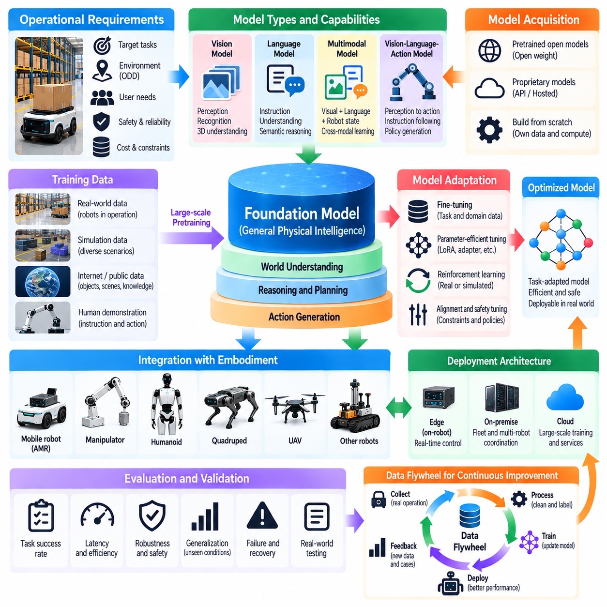{width="7.268055555555556in" height="7.268055555555556in"}

Model and foundation model strategy determines how Physical AI products acquire, adapt, deploy, and maintain intelligent capabilities. A model strategy must connect operational requirements with learning methods, computational resources, and validation evidence. Foundation models offer reusable representations across tasks, but their value depends on successful integration with physical sensing, decision-making, and control under real-world constraints.

Traditional AI model development often produces specialized models for perception, localization, prediction, planning, or manipulation. These models are trained and evaluated against narrowly defined objectives. Their advantages include predictable computational requirements and targeted optimization. However, maintaining numerous independent models can increase integration complexity, duplicate training effort, and limit knowledge transfer across applications.

Foundation models introduce an alternative approach by learning broadly reusable representations from diverse datasets and training objectives. Vision models, language models, multimodal models, and action-oriented models can provide capabilities that transfer across tasks. In Physical AI, these representations must connect semantic understanding with spatial relationships, temporal dynamics, physical constraints, and executable behavior.

A foundation model strategy should begin with the capabilities required by the intended product rather than the availability of a particular model. Engineers must determine whether the system needs object understanding, instruction interpretation, spatial reasoning, action generation, or predictive simulation. Each capability imposes different requirements on training data, inference latency, memory, hardware acceleration, and operational validation.

The choice between developing proprietary models and adopting existing models has major strategic implications. Building models internally provides control over architecture, training objectives, and intellectual property but requires substantial data and computing resources. Adopting external models can accelerate development, although licensing, dependencies, transparency, and long-term availability must be assessed before integration.

Open-weight models can provide greater deployment flexibility and opportunities for customization, while proprietary hosted models may offer managed infrastructure and frequent improvements. However, hosted inference can introduce network dependencies, recurring costs, and restrictions on sensitive operational data. Model selection must therefore consider ownership, portability, security, deployment autonomy, and total lifecycle cost.

Fine-tuning allows foundation models to adapt to specific Physical AI tasks without repeating the entire pretraining process. Task-specific demonstrations, operational recordings, and curated datasets can improve performance in target environments. Parameter-efficient adaptation methods may reduce training costs. Nevertheless, fine-tuning must be evaluated for catastrophic forgetting, unintended behavioral changes, and reduced performance outside the adaptation domain.

Multimodal learning is particularly relevant because physical intelligence depends on information from multiple sensing and action channels. Images, depth measurements, language instructions, robot states, and control commands represent different aspects of the same physical interaction. Models must align these modalities in time and space. Inconsistent calibration or synchronization can undermine performance regardless of model capacity.

Vision-language-action models attempt to connect perception and language understanding with executable robotic behavior. They may interpret instructions, identify relevant objects, and generate action representations. However, successful instruction following does not guarantee precise motion or safe interaction. Product architectures must integrate these models with embodiment-specific controllers, constraint checking, and independent safety mechanisms.

Model architecture should reflect the separation between high-level reasoning and low-level control. Large models may support task interpretation, contextual reasoning, and planning, while smaller specialized models execute time-critical perception and control functions. Hierarchical architectures can combine generalizable intelligence with predictable physical execution. Clear interfaces are essential for managing uncertainty and preventing unsafe commands.

Computational efficiency is a central consideration in deployment strategy. Foundation models may require substantial GPU memory, processing throughput, and electrical power. Quantization, distillation, pruning, and optimized inference runtimes can reduce resource requirements. However, optimization may alter accuracy, numerical stability, or robustness. Each deployment configuration must be evaluated against its operational performance requirements.

Edge, on-premise, and cloud computing provide complementary model deployment options. Edge inference supports immediate responses and continued operation during network interruptions. On-premise infrastructure can coordinate shared intelligence and serve multiple robots. Cloud resources support large-scale training and computationally intensive services. Workload allocation must account for latency, connectivity, privacy, cybersecurity, and safety-critical dependencies.

Model evaluation must extend beyond conventional benchmark accuracy. Physical AI systems require assessment of task success, response latency, robustness, uncertainty calibration, recovery behavior, and safety under realistic operating conditions. Evaluation should include environmental disturbances, unfamiliar objects, sensor degradation, and distribution shifts. A model that performs well offline may still fail when integrated into a closed-loop physical system.

Closed-loop evaluation is essential because model predictions influence subsequent observations and environmental states. Small perception or planning errors can accumulate through repeated interactions. Simulation, hardware-in-the-loop testing, and physical trials help reveal these effects. Model selection should therefore prioritize sustained task performance rather than isolated prediction quality or single-step benchmark results.

Training data strategy strongly influences foundation model performance. Broad pretraining datasets may provide transferable knowledge, while deployment-specific data establishes operational relevance. Robot demonstrations, teleoperation records, simulation trajectories, and fleet observations can support different learning objectives. Dataset provenance, embodiment differences, annotation quality, and action representations must be managed consistently.

World models can complement foundation models by representing environmental dynamics and predicting the consequences of actions. Language and vision models may provide semantic context, while predictive models support planning under physical constraints. Integrating these capabilities requires consistent state representations and uncertainty handling. Their combined value must be demonstrated through improved operational decisions rather than architectural complexity alone.

Safety assurance requires explicit boundaries around model authority. Foundation models may produce plausible but incorrect interpretations or actions, especially under unfamiliar conditions. Runtime monitors, constraint-based controllers, confidence assessment, and fallback mechanisms should limit unsafe execution. Safety-critical functions must not depend exclusively on unverified model outputs, regardless of the model\'s apparent generality.

Model governance establishes accountability across acquisition, training, evaluation, release, and retirement. Each model version should document its intended use, supported operating conditions, training lineage, known limitations, and validation status. Changes to weights, prompts, preprocessing, or inference software can affect behavior. Configuration management and traceability are necessary to preserve reproducibility and investigate failures.

Continuous model improvement should follow a controlled lifecycle. Operational feedback identifies performance gaps, while selected data supports targeted retraining or adaptation. Candidate models must undergo regression testing and staged deployment before replacing validated versions. Shadow evaluation, limited rollouts, and rollback procedures reduce the risk of unexpected changes affecting an entire fleet.

Economic evaluation must consider more than initial training expenditure. Model development and deployment involve data preparation, computing infrastructure, licensing, inference costs, integration, monitoring, and maintenance. Larger models are not automatically more economical or more capable at the system level. The preferred strategy minimizes total lifecycle cost while satisfying operational reliability, safety, and adaptability requirements.

A sustainable model portfolio may combine shared foundation models with specialized models for navigation, manipulation, perception, and safety-related functions. Reusable infrastructure supports training, evaluation, deployment, and monitoring across product families. Specialized components preserve application-specific performance. This hybrid approach avoids unnecessary duplication while recognizing that different physical tasks require different computational and control characteristics.

Ultimately, model and foundation model strategy should transform advances in artificial intelligence into dependable Physical AI product capabilities. Strategic success depends on choosing appropriate model architectures, validating transferability, managing deployment constraints, and maintaining controlled improvement processes. Foundation models become valuable not through generality alone but through measurable contributions to safe, reliable, adaptable, and commercially sustainable physical operation.

## 08.09. World Model and Predictive AI Strategy

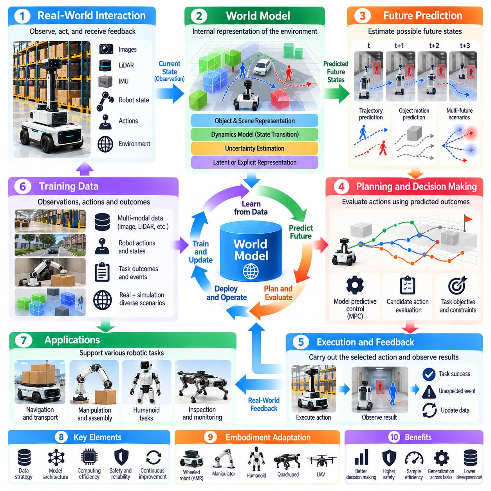{width="7.268055555555556in" height="7.268055555555556in"}

World model and predictive AI strategy defines how Physical AI systems represent environmental dynamics, anticipate future states, and evaluate possible actions before execution. Unlike reactive intelligence, which responds primarily to current observations, predictive intelligence estimates how the physical world may evolve. This capability supports planning, risk assessment, and adaptive control in environments where actions produce delayed and uncertain consequences.

A world model is an internal representation of the environment and its dynamics. It may describe objects, spatial relationships, robot states, physical interactions, and changes over time. By combining observations with learned transition mechanisms, the model estimates future conditions under candidate actions. Its purpose is not necessarily to reproduce every physical detail, but to preserve information relevant to reliable decisions.

Predictive AI extends perception by transforming current observations into expectations about future events. A mobile robot may predict pedestrian movement, while a manipulator may estimate how an object will respond to contact. Such predictions enable the system to compare possible actions before committing to physical execution. Their practical value depends on prediction accuracy, computational efficiency, and appropriate treatment of uncertainty.

World model strategy should begin with operational requirements rather than model architecture. Engineers must identify which future events influence task success, safety, and resource consumption. Navigation may require obstacle trajectory prediction, while manipulation may require contact and object motion forecasting. Prediction objectives should therefore reflect the intended Operational Design Domain and the decisions the product must support.

Temporal prediction horizons determine how far into the future a model attempts to estimate environmental behavior. Short horizons support collision avoidance and immediate control, while longer horizons assist route planning and task coordination. Increasing the horizon generally increases uncertainty because prediction errors accumulate. The appropriate horizon depends on environmental dynamics, decision frequency, and available computational resources.

Prediction frequency is equally important. High-frequency models can support rapid control decisions but impose substantial inference costs. Lower-frequency models may be sufficient for strategic planning or slow environmental changes. A hierarchical system can combine short-term predictions with longer-term forecasts. This arrangement allows different planning layers to operate at suitable temporal resolutions without unnecessary computational duplication.

World models can use several representation approaches, including explicit physical states, occupancy maps, object-centric representations, latent variables, and generated observations. Structured representations improve interpretability and constraint checking, while learned latent representations may capture complex relationships efficiently. The preferred representation should balance prediction quality, computational cost, observability, and compatibility with downstream planning.

Model-based reinforcement learning uses predictive models to estimate the consequences of actions and improve decision policies. Instead of learning exclusively through direct physical interaction, an agent can evaluate hypothetical trajectories within a learned environment model. This approach may improve sample efficiency and reduce experimentation costs. However, inaccurate models can produce misleading simulated experiences and unreliable policies.

Planning with world models commonly involves generating candidate actions, predicting their outcomes, and selecting actions according to task objectives and constraints. Model predictive control repeatedly updates predictions as new observations arrive. This feedback reduces dependence on long, uncorrected forecasts. Nevertheless, prediction-based planning must account for inference latency, optimization complexity, and the possibility of incorrect environmental assumptions.

Uncertainty estimation is essential because physical environments are only partially observable and often contain unpredictable agents. World models should distinguish uncertainty caused by incomplete observations from uncertainty arising from inherently variable behavior. Probabilistic forecasts, confidence intervals, and multiple plausible futures can support risk-aware planning. A single predicted trajectory may conceal important alternative outcomes.

Human behavior presents a particularly difficult prediction problem. Pedestrians, workers, and nearby operators may change direction or act unexpectedly. Predictive models can estimate likely motion patterns, but they should not assume deterministic human responses. Safety-critical planning must preserve margins for uncertainty and maintain conservative fallback behavior when forecasts become unreliable or unfamiliar interactions occur.

World models must also account for embodiment-specific dynamics. Wheeled robots, robotic arms, humanoids, and aerial vehicles respond differently to control inputs and environmental forces. A shared predictive representation may capture common physical relationships, while specialized dynamics models describe platform-specific behavior. Successful transfer requires explicit consideration of actuation limits, contact conditions, and control interfaces.

Training data should capture the relationship between observations, actions, and resulting environmental changes. Sensor recordings without corresponding actions may be insufficient for learning controllable dynamics. Robot state histories, command sequences, contact events, and task outcomes provide important supervision. Dataset coverage must include normal operation, disturbances, recovery behavior, and situations where predictions previously failed.

Simulation offers a practical environment for developing and evaluating predictive intelligence. Physics engines and digital environments can generate controlled trajectories and expose models to rare conditions. Synthetic experiences may expand training coverage and support policy testing. However, differences in friction, contact dynamics, sensing noise, and human behavior can create simulation-to-reality gaps that require systematic validation.

Foundation models and world models can provide complementary capabilities. Multimodal foundation models may interpret objects, instructions, and semantic relationships, while world models predict state transitions and physical consequences. Integrating these components can support context-aware planning. Their interfaces must preserve temporal consistency, spatial alignment, and uncertainty information to avoid propagating unreliable assumptions.

Predictive intelligence can improve coordination among multiple robots by anticipating shared resource usage, traffic conflicts, and task dependencies. Fleet-level models may forecast congestion or resource demand, while local models support immediate collision avoidance. Coordination requires consistent state estimates and timely information exchange. Predictions must remain useful even when communication is delayed or temporarily unavailable.

Deployment architecture influences predictive model feasibility. Edge computing supports low-latency forecasting near sensors and actuators, while on-premise infrastructure can coordinate shared environmental predictions. Cloud systems may support large-scale training and computationally intensive analysis. Prediction workloads should be allocated according to latency requirements, connectivity, model complexity, and safety-critical operational dependencies.

World model evaluation requires more than visual similarity between predicted and observed scenes. Useful measures include state prediction error, trajectory accuracy, uncertainty calibration, planning success, collision avoidance, and computational latency. Evaluation should examine how prediction errors affect downstream decisions. A visually convincing forecast may still be unsuitable if it misrepresents contact forces or safety-relevant object motion.

Long-horizon predictions require particular caution because small errors can accumulate into substantially incorrect future states. Models may also exploit shortcuts in training data that fail under unfamiliar conditions. Stress testing should include distribution shifts, unexpected disturbances, sensor degradation, and novel object interactions. Validation must establish where predictions remain reliable and when the system should reduce autonomy.

Safety engineering should prevent predictive models from becoming unchecked authorities over physical execution. Runtime constraints, independent collision checks, emergency stopping mechanisms, and conservative controllers provide protection when forecasts fail. Uncertainty thresholds can trigger replanning or human intervention. Predictive capability should enhance safety assurance without replacing established protective functions or operational boundaries.

Continuous improvement of world models depends on collecting evidence from deployed systems. Differences between predicted and observed outcomes reveal model weaknesses and changing environmental conditions. These prediction residuals can guide targeted data collection, retraining, and calibration. Updated models require regression testing and staged validation because improved average prediction accuracy does not necessarily guarantee safer physical behavior.

Ultimately, world model and predictive AI strategy should convert environmental understanding into better physical decisions. Its success depends on selecting relevant prediction objectives, managing uncertainty, integrating planning and control, and validating outcomes under realistic conditions. Predictive intelligence becomes commercially valuable when it measurably improves safety, task efficiency, adaptability, and operational reliability across successive deployments.

## 08.10. Simulation and Synthetic Data Strategy

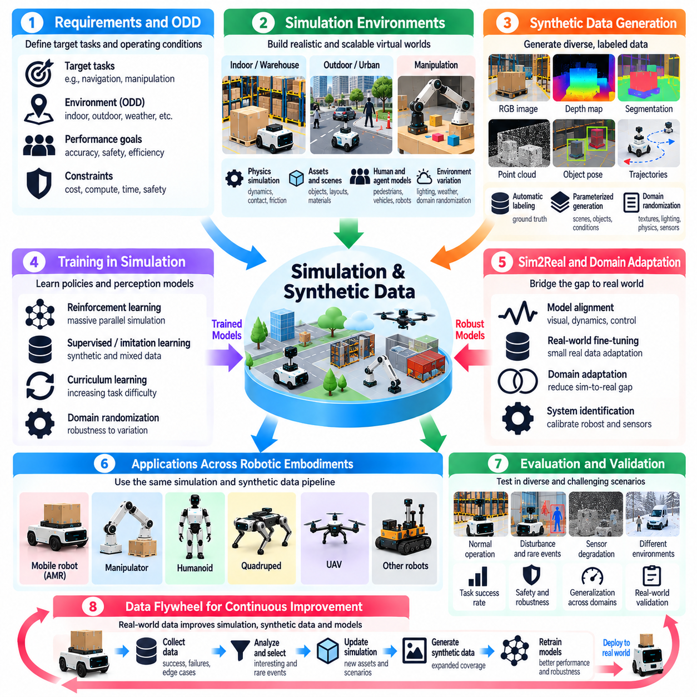{width="7.268055555555556in" height="7.268055555555556in"}

Simulation and synthetic data strategy is essential for developing Physical AI systems that must operate safely and reliably in complex environments. Physical experimentation is expensive, time-consuming, and sometimes hazardous, particularly when autonomous systems interact with people and equipment. Simulation provides controlled environments for learning and testing, while synthetic data expands training coverage beyond experiences available through direct observation.

Simulation strategy should begin with product requirements and the intended Operational Design Domain. Engineers must identify which physical processes, environmental conditions, and operational interactions influence system performance. A warehouse robot may require realistic pedestrian traffic and obstacle behavior, while a manipulator requires accurate contact dynamics. Simulation fidelity should be determined by these operational needs rather than visual realism alone.

Physics-based simulation represents motion, forces, collisions, friction, and interactions between objects. Such models allow engineers to evaluate how robots respond to commands and environmental disturbances. Their usefulness depends on the accuracy of physical parameters and numerical approximations. Simplified models may support rapid experimentation, while high-fidelity simulation is necessary when contact behavior, stability, or precise manipulation strongly affects performance.

Synthetic data generation creates artificial observations and annotations for model training and evaluation. Rendered images, depth maps, segmentation masks, object poses, and motion trajectories can be produced with consistent ground truth. This approach reduces manual labeling effort and enables systematic variation of conditions. However, synthetic data must remain representative of the physical relationships and sensor characteristics relevant to the intended deployment.

Domain randomization improves robustness by varying simulation parameters during data generation and training. Lighting, textures, object placement, sensor noise, friction, and motion characteristics can be randomized within plausible ranges. The objective is to prevent models from depending on narrow environmental patterns. Excessive randomization, however, may introduce unrealistic conditions that reduce learning efficiency or distort operational priorities.

Domain adaptation addresses differences between simulated and real-world data distributions. Models trained in simulation may encounter unfamiliar visual appearances, sensor artifacts, or physical dynamics after deployment. Adaptation techniques can align representations or refine models using limited real-world observations. Their effectiveness should be measured through performance in target environments rather than improvements on synthetic benchmarks alone.

Simulation-to-reality transfer is a central challenge in Physical AI development. A policy that performs successfully in simulation may fail because of inaccurate actuator models, communication delays, mechanical compliance, or unexpected contact forces. Engineers must identify these discrepancies and incorporate relevant corrections. Successful transfer requires coordinated validation of sensing, dynamics, control, and environmental assumptions.

Digital twins provide structured representations of physical assets, facilities, or operating processes. A digital twin may incorporate geometric models, equipment states, sensor observations, and operational constraints. When synchronized with real systems, it can support scenario analysis and predictive evaluation. Nevertheless, a digital twin should not be assumed to reproduce every physical behavior accurately, and its validity depends on maintained data and model consistency.

Scenario-based simulation enables systematic testing of operational situations that are difficult to reproduce in physical environments. Examples include sudden obstacle appearances, sensor degradation, communication interruptions, and unusual human interactions. Scenario parameters can be varied to explore performance boundaries. This approach supports repeatable evaluation and helps identify conditions under which autonomous behavior becomes unreliable.

Rare-event generation is particularly valuable for safety-related development. Dangerous collisions, equipment failures, and emergency interactions may occur too infrequently for conventional data collection. Simulation can create controlled representations of these events without exposing people or equipment to unnecessary hazards. However, generated scenarios must be physically plausible and should not replace independent real-world safety validation.

Synthetic datasets can complement public datasets and operational fleet recordings. Public data provides broad examples, while deployment-specific recordings capture actual environmental characteristics. Synthetic generation can fill gaps involving unusual objects, lighting conditions, or hazardous interactions. A balanced strategy combines these sources according to their strengths and limitations, avoiding dependence on any single data distribution.

Simulation environments must represent robot embodiment and hardware characteristics sufficiently for the intended evaluation. Wheeled robots, manipulators, humanoids, and aerial platforms exhibit different dynamics and actuation constraints. Sensor placement, mechanical geometry, payload, and controller behavior influence simulation outcomes. Reusable simulation infrastructure should therefore support platform-specific configurations without sacrificing physical consistency.

Reinforcement learning benefits from simulation because agents can explore large numbers of interactions without consuming physical hardware resources. Parallel environments accelerate experience collection and policy optimization. Curriculum learning can gradually increase task complexity, while controlled disturbances improve robustness. However, policies must be evaluated for exploitation of simulator artifacts and unrealistic behaviors before physical deployment.

World models and predictive AI can use simulated trajectories to learn environmental transitions and action consequences. Simulation supplies controlled sequences containing observations, actions, and resulting states. These sequences support predictive training and planning experiments. Yet learned models may inherit inaccuracies from their simulation sources, making real-world calibration and independent evaluation necessary before operational use.

Simulation fidelity should be managed according to the decisions being tested. High visual fidelity may benefit perception models, while accurate dynamics are more important for control and manipulation. Excessive detail increases computational costs without necessarily improving validation quality. A multi-fidelity strategy can combine simplified environments for rapid exploration with detailed models for critical verification activities.

Hardware-in-the-loop testing connects simulated environments with real controllers, processors, or communication interfaces. This approach exposes software to realistic timing constraints and hardware behavior while maintaining controlled environmental conditions. It helps identify integration problems that purely virtual testing may miss. Nevertheless, physical interactions remain partially simulated, so hardware-in-the-loop results cannot replace complete system testing.

Simulation infrastructure must support reproducibility and experiment management. Environment versions, physics parameters, random seeds, sensor configurations, and model checkpoints should be recorded consistently. Automated test pipelines can execute standardized scenarios and compare results across software releases. This traceability enables engineers to investigate regressions and distinguish genuine performance improvements from changes in experimental conditions.

Evaluation should measure how simulation contributes to real-world product performance. Relevant indicators include task success, collision frequency, trajectory error, recovery behavior, and robustness under disturbances. Synthetic data quality can be assessed through downstream model performance on independent real-world datasets. Visual realism or simulation throughput alone should not be treated as sufficient evidence of operational readiness.

Safety validation requires explicit recognition of simulation limitations. Unknown physical interactions, imperfect sensor models, and unexpected human behavior may remain outside the simulated scenario space. Engineers should document these gaps and design complementary physical tests. Simulation can strengthen evidence through broad scenario coverage, but safety claims must be supported by an appropriate combination of analysis, testing, and operational validation.

Edge, on-premise, and cloud infrastructure can support different simulation workloads. Local systems may enable interactive development and hardware integration, while centralized computing resources support large-scale synthetic generation and parallel training. Cloud infrastructure can accelerate computationally intensive experiments. Resource allocation should consider data sensitivity, computing costs, development speed, and the reproducibility of distributed workflows.

The economic value of simulation depends on reducing development risk, physical testing costs, and deployment delays. Simulation investment should be evaluated against measurable improvements in model performance, engineering productivity, and operational reliability. Expensive simulation environments are not automatically more valuable. The preferred strategy uses sufficient fidelity and scenario coverage to support product decisions without unnecessary computational or maintenance burdens.

Ultimately, simulation and synthetic data strategy should establish a reliable bridge between virtual experimentation and physical deployment. Simulation expands learning opportunities, supports systematic testing, and enables exploration of difficult conditions, while real-world evidence anchors model validity. A sustainable strategy combines both through iterative calibration, controlled evaluation, and continuous improvement to deliver safer, more adaptable, and commercially viable Physical AI products.

## 08.11. Edge On Premise and Cloud Strategy

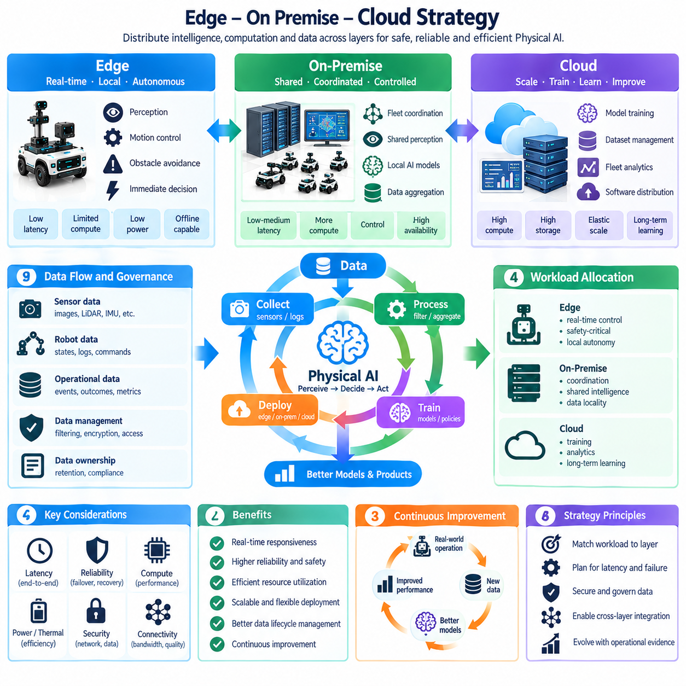{width="7.268055555555556in" height="7.268055555555556in"}

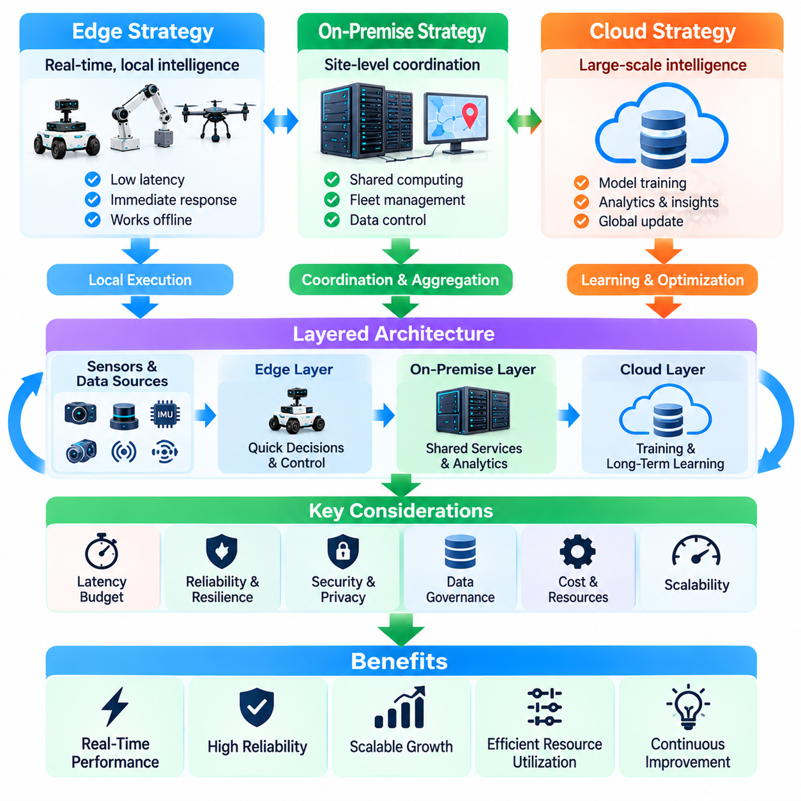{width="7.268055555555556in" height="7.268055555555556in"}

Edge, on-premise, and cloud strategy determines how Physical AI systems distribute intelligence, computation, data, and operational responsibilities across infrastructure layers. Unlike conventional digital services, Physical AI must satisfy real-time interaction, physical safety, and operational continuity requirements. An effective strategy allocates workloads according to latency, reliability, computational demand, connectivity, and the consequences of system failure.

Edge computing places intelligence close to sensors, actuators, and physical processes. Robot-mounted processors and local controllers execute perception, motion control, obstacle avoidance, and immediate decision-making. This proximity reduces communication delays and supports autonomous operation when external networks become unavailable. Edge architecture is particularly important for functions that require predictable response times and direct interaction with physical hardware.

On-premise infrastructure provides shared computing and coordination within a facility or operational site. Local servers can aggregate sensor information, maintain environmental representations, coordinate robot fleets, and execute computationally demanding models. Compared with isolated edge devices, on-premise systems enable collective intelligence and resource sharing while retaining greater control over data locality, network dependencies, and operational governance.

Cloud infrastructure supports large-scale model training, dataset management, fleet analytics, software distribution, and long-term intelligence development. Its elastic computing resources enable organizations to process information collected across multiple deployment sites. However, cloud connectivity should not become a mandatory dependency for immediate safety-critical actions. Cloud services are most effective when assigned workloads that tolerate communication delays and temporary disconnection.

The fundamental architectural principle is to place each workload at the infrastructure layer best suited to its operational requirements. Fast motor control and emergency responses belong near physical hardware, while fleet scheduling and shared perception may benefit from local coordination. Large-scale learning and historical analysis can operate centrally. These boundaries should reflect measured performance and failure consequences rather than arbitrary technology preferences.

Latency budgeting is essential because Physical AI operates through repeated sensing, inference, planning, and action cycles. Each stage contributes processing and communication delays that affect system responsiveness. Network transmission, model execution, and actuator interfaces must be evaluated together. A deployment strategy should specify acceptable end-to-end latency and allocate sufficient margins for workload variation, congestion, and unexpected disturbances.

Reliability requirements strongly influence infrastructure placement. Robots may experience wireless interference, network congestion, server outages, or cloud service interruptions. Essential local functions must remain operational within defined safety boundaries during such failures. Graceful degradation allows systems to reduce capability without losing fundamental protection. Recovery procedures should define how services reconnect, synchronize states, and resume coordinated operation.

Edge devices operate under constrained power, thermal, memory, and processing budgets. High-performance models may exceed the capabilities of robot-mounted hardware, particularly when multiple perception and control tasks execute simultaneously. Model compression, scheduling, hardware acceleration, and selective offloading can improve efficiency. Nevertheless, offloading must not introduce unacceptable delays or dependencies into safety-critical control loops.

On-premise computing can bridge the gap between constrained edge devices and distant cloud infrastructure. Facility-level accelerators may execute shared perception, predictive models, mapping, or coordination services for multiple robots. Resource pooling can improve utilization and simplify updates. However, centralized local services also create potential bottlenecks, making capacity planning, redundancy, and workload isolation important architectural considerations.

Shared environmental intelligence is a major opportunity for on-premise Physical AI. Fixed sensors and mobile robots can contribute observations to a common spatial representation. This shared context may improve obstacle awareness, traffic coordination, and operational planning beyond the sensing range of individual robots. Data fusion must address timestamp alignment, coordinate consistency, sensor uncertainty, and conflicting observations before shared information influences physical actions.

Cloud-based learning complements local execution by transforming operational experience into improved models and policies. Fleet data can reveal recurring failures, environmental variations, and opportunities for performance optimization. Centralized training supports large datasets and computationally intensive experimentation. Updated models can subsequently be distributed to local infrastructure, provided that deployment validation and rollback mechanisms preserve operational reliability.

Data movement across infrastructure layers requires deliberate governance. Raw camera recordings, sensor streams, robot states, and operational logs may contain sensitive information or consume substantial bandwidth. Edge filtering and on-premise aggregation can reduce unnecessary transfers. Retention policies, encryption, access controls, and data ownership agreements should determine which information may leave an operational site and under what conditions.

Cybersecurity architecture must account for communication between robots, facility servers, and cloud services. Mutual authentication, encrypted transport, network segmentation, and controlled software updates reduce exposure to unauthorized access. Compromised infrastructure can influence physical behavior, making cybersecurity a direct operational safety concern. Trust boundaries should be explicit, and critical commands must undergo authorization and validation before execution.

System orchestration determines how distributed services cooperate during normal operation and failure conditions. Workloads may be assigned dynamically according to available computing resources, network quality, and task priority. Service discovery, health monitoring, and resource scheduling support coordinated execution. However, dynamic orchestration must respect real-time deadlines and should not relocate essential control functions without validated fallback arrangements.

Model placement requires consideration of both computational efficiency and functional responsibility. Large foundation models may support high-level reasoning on shared infrastructure, while compact models execute immediate perception and control at the edge. Hybrid inference can distribute processing stages across layers. Clear interfaces are necessary to prevent delayed or uncertain remote outputs from overriding local safety constraints and validated control decisions.

Fleet management benefits from separating local autonomy from centralized coordination. Individual robots should retain sufficient intelligence to navigate safely and respond to immediate hazards. Facility systems can assign tasks, manage traffic, and coordinate shared resources. Cloud services can analyze performance across locations and support long-term optimization. This separation preserves operational independence while enabling improvements at fleet and organizational scales.

Infrastructure scalability should be evaluated as the number of robots, sensors, and supported tasks increases. Communication traffic, inference demand, storage requirements, and coordination complexity may grow at different rates. Architectural designs should identify capacity limits and expansion paths before widespread deployment. Horizontal scaling, workload partitioning, and hierarchical coordination can reduce the risk of centralized bottlenecks.

Observability is essential for operating distributed Physical AI systems. Engineers need consistent records of model versions, service health, communication latency, robot states, and operational events. Distributed tracing and synchronized timestamps help identify failures spanning multiple infrastructure layers. Monitoring should distinguish computational problems from sensing, networking, and physical execution failures so that corrective actions address their actual causes.

Deployment and lifecycle management must preserve compatibility between distributed components. Software updates, model releases, configuration changes, and security patches can alter behavior across edge, on-premise, and cloud systems. Version compatibility checks and staged rollouts reduce integration risks. Systems should support rollback and controlled recovery when an update produces unexpected behavior or violates established performance requirements.

Economic strategy must consider total infrastructure ownership and operation rather than hardware acquisition costs alone. Edge accelerators increase device cost and power demand, while shared servers require facility investment and maintenance. Cloud services introduce recurring computation, storage, and transfer expenses. The preferred allocation minimizes lifecycle cost while satisfying reliability, latency, privacy, and scalability requirements.

Architectural validation should include network degradation, server failures, computational overload, and inconsistent distributed states. Simulation, hardware-in-the-loop testing, and controlled field trials can expose dependencies that remain hidden during normal operation. Performance measurements should cover both individual services and complete physical tasks. Successful validation demonstrates that the system remains safe and operational within its defined failure assumptions.

Ultimately, edge, on-premise, and cloud strategy should establish a coherent hierarchy of physical execution, collective coordination, and large-scale intelligence development. Edge systems preserve immediate autonomy, on-premise infrastructure supports shared operational intelligence, and cloud services enable broader learning and improvement. Their integration becomes valuable when it delivers measurable gains in safety, responsiveness, reliability, adaptability, and sustainable product economics.

## 08.12. Safety Reliability and Cybersecurity

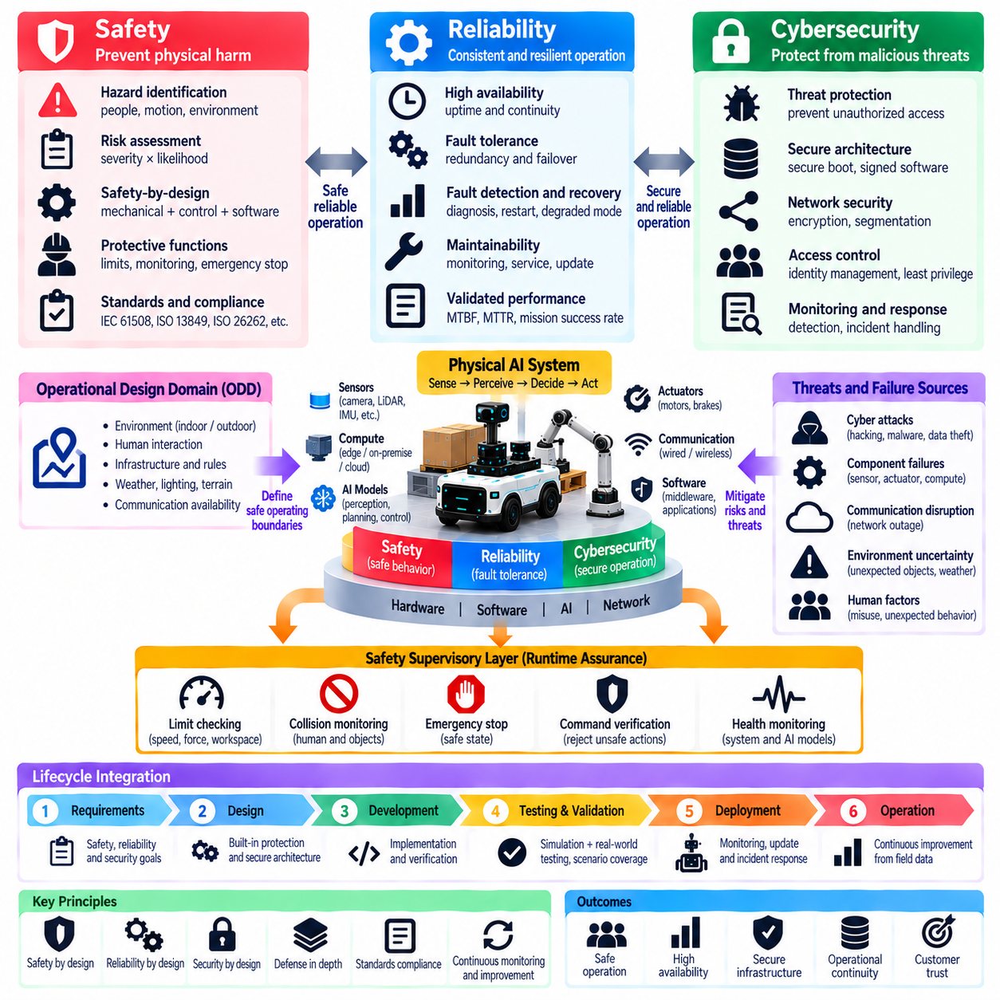{width="7.268055555555556in" height="7.268055555555556in"}

Safety, reliability, and cybersecurity are fundamental product requirements for Physical AI systems because intelligent decisions directly influence physical environments. Unlike purely digital applications, failures may cause injury, equipment damage, or operational disruption. Product strategy must therefore integrate these disciplines throughout design, development, deployment, and maintenance rather than treating them as independent compliance activities.

Safety engineering focuses on preventing unacceptable physical harm during normal operation and foreseeable failures. Hazard identification should examine robot motion, human interaction, environmental uncertainty, and unexpected control behavior. Risk assessment evaluates the severity and likelihood of hazardous events and the effectiveness of protective measures. Safety requirements must be translated into verifiable system functions and operational constraints.

Reliability engineering addresses the ability of Physical AI products to perform intended functions consistently over time. Hardware degradation, software defects, sensor failures, and communication interruptions can reduce operational performance. Reliability strategy should define availability targets, failure tolerance, maintenance intervals, and recovery expectations. These requirements must reflect actual deployment conditions rather than ideal laboratory environments.

Cybersecurity protects Physical AI systems against unauthorized access, manipulation, disruption, and information exposure. Connected robots contain computing platforms, sensors, communication interfaces, and software services that create multiple attack surfaces. A successful cyberattack may alter physical behavior or disable essential functions. Security architecture must therefore protect both information assets and the integrity of physical operations.

Safety, reliability, and cybersecurity are closely interconnected but represent different engineering concerns. A reliable system may still perform an unsafe action, while a secure system may contain hazardous design assumptions. Cybersecurity failures can also undermine safety functions, and reliability failures may expose security weaknesses. Product development requires coordinated analysis while maintaining distinct objectives, responsibilities, and verification criteria.

Safety-by-design establishes protective principles before system implementation. Mechanical limits, safe operating speeds, protective separation, emergency stopping, and controlled energy release should be considered during architecture development. Software safeguards can supplement these mechanisms but should not become their only foundation. Protective functions must remain effective when intelligent perception or decision models produce incorrect outputs.

Functional safety engineering evaluates whether safety-related control functions achieve the required risk reduction. Depending on the application, standards such as IEC 61508, ISO 13849, IEC 62061, or ISO 26262 may provide relevant frameworks. Their applicability depends on product category and operational context. Safety integrity requirements should follow hazard analysis and documented risk assessment rather than arbitrary classification.

Physical AI introduces additional uncertainty because learned models may behave unpredictably outside their training distributions. Perception errors, unfamiliar objects, ambiguous instructions, and distribution shifts can influence physical decisions. Conventional software testing alone cannot establish the behavior of every possible model input. Safety strategy must combine model evaluation, operational restrictions, runtime monitoring, and independent protective mechanisms.

Operational Design Domain defines the conditions under which an autonomous system is intended to function. Environmental characteristics, human activity, sensor visibility, surface conditions, and communication availability may determine safe operating boundaries. Systems should detect when relevant assumptions no longer hold. When operating conditions exceed validated limits, autonomous capability should be reduced or transferred to a defined safe operating procedure.

Runtime safety assurance continuously checks whether proposed actions satisfy operational constraints. Collision monitoring, speed limits, workspace restrictions, and actuator protection can operate independently of high-level AI decisions. Safety supervisors may reject unsafe commands or initiate controlled stopping. This separation prevents unverified model outputs from directly controlling hazardous physical behavior without appropriate validation.

Reliability architecture should account for component failures and their propagation across the system. Redundant sensors, watchdog mechanisms, fault detection, and degraded operating modes can improve resilience. However, redundancy is valuable only when common-cause failures and shared dependencies are addressed. Reliability analysis should consider how failures interact across hardware, software, networking, and AI components.

Fault detection and recovery are essential for maintaining operational continuity. Robots should recognize abnormal sensor readings, stalled processes, communication loss, and unexpected motion. Recovery procedures may include restarting services, switching to backup components, reducing functionality, or requesting human assistance. Every recovery action must preserve safety constraints and avoid creating additional hazards during system restoration.

Cybersecurity should follow defense-in-depth principles across devices, networks, applications, and operational infrastructure. Secure boot, signed software, encrypted communication, identity management, and least-privilege access reduce exposure to compromise. Network segmentation limits unauthorized movement between components. Security controls must also respect real-time requirements so that protective mechanisms do not introduce unacceptable operational delays.

Threat modeling identifies potential adversaries, attack paths, vulnerable interfaces, and consequences of compromise. Relevant threats include malicious command injection, sensor spoofing, unauthorized remote control, software supply-chain attacks, and denial of service. Risk prioritization should consider both cybersecurity impact and physical consequences. Threat models require periodic revision as connectivity, capabilities, and deployment environments evolve.

AI-specific security introduces concerns beyond conventional software vulnerabilities. Adversarial sensor inputs, manipulated training data, compromised model artifacts, and malicious instructions may influence autonomous behavior. Defensive measures include data provenance, model integrity verification, input validation, and behavioral monitoring. These controls should be evaluated against realistic attacks rather than assumed effective solely because they are implemented.

Secure lifecycle management begins with trusted development practices and continues through deployment and retirement. Software dependencies, firmware, model weights, and configuration files require controlled provenance and version management. Updates should be authenticated, tested, and deployed progressively. Rollback mechanisms and recovery images are important when a release introduces instability, unexpected behavior, or newly discovered vulnerabilities.

Safety validation requires evidence that protective measures work under representative operating conditions. Hazard-based scenarios, fault injection, simulation, hardware-in-the-loop testing, and field trials can reveal weaknesses. Testing should include combinations of degraded sensors, delayed communication, and abnormal robot behavior. Validation evidence must demonstrate risk reduction rather than merely successful execution of nominal tasks.

Reliability evaluation should measure availability, failure frequency, recovery time, and performance degradation under realistic workloads. Long-duration testing can expose memory leaks, thermal limitations, mechanical wear, and intermittent faults. Reliability growth depends on systematic failure analysis and corrective action. Operational metrics should distinguish temporary performance reductions from failures that interrupt essential services.

Cybersecurity testing complements safety and reliability validation through vulnerability assessment, penetration testing, configuration review, and security regression testing. Authorized testing should examine both digital compromise and possible physical consequences. Security findings must be prioritized according to exploitability and operational impact. Testing should continue after deployment because new vulnerabilities and attack techniques can emerge.

Human factors influence all three disciplines. Operators must understand system limitations, warning signals, emergency procedures, and responsibility boundaries. Poor interface design or ambiguous automation behavior can undermine technically sound protection mechanisms. Training, maintenance procedures, and incident reporting support dependable operation. Human intervention pathways should remain understandable and practical during time-critical situations.

Governance should establish clear ownership of safety cases, reliability evidence, cybersecurity controls, and operational risk acceptance. Cross-functional reviews help prevent gaps between mechanical engineering, software development, AI research, and infrastructure operations. Incident records and corrective actions should feed continuous improvement. Traceability between requirements, hazards, controls, tests, and releases supports accountability.

Ultimately, safety, reliability, and cybersecurity strategy must produce Physical AI products that remain trustworthy under uncertainty, component failure, and hostile conditions. Success requires coordinated engineering, measurable assurance evidence, and continuous lifecycle management. These capabilities are not merely regulatory obligations; they determine operational acceptance, customer confidence, deployment scalability, and long-term commercial sustainability.

## 08.13. Continuous Learning and Fleet Improvement

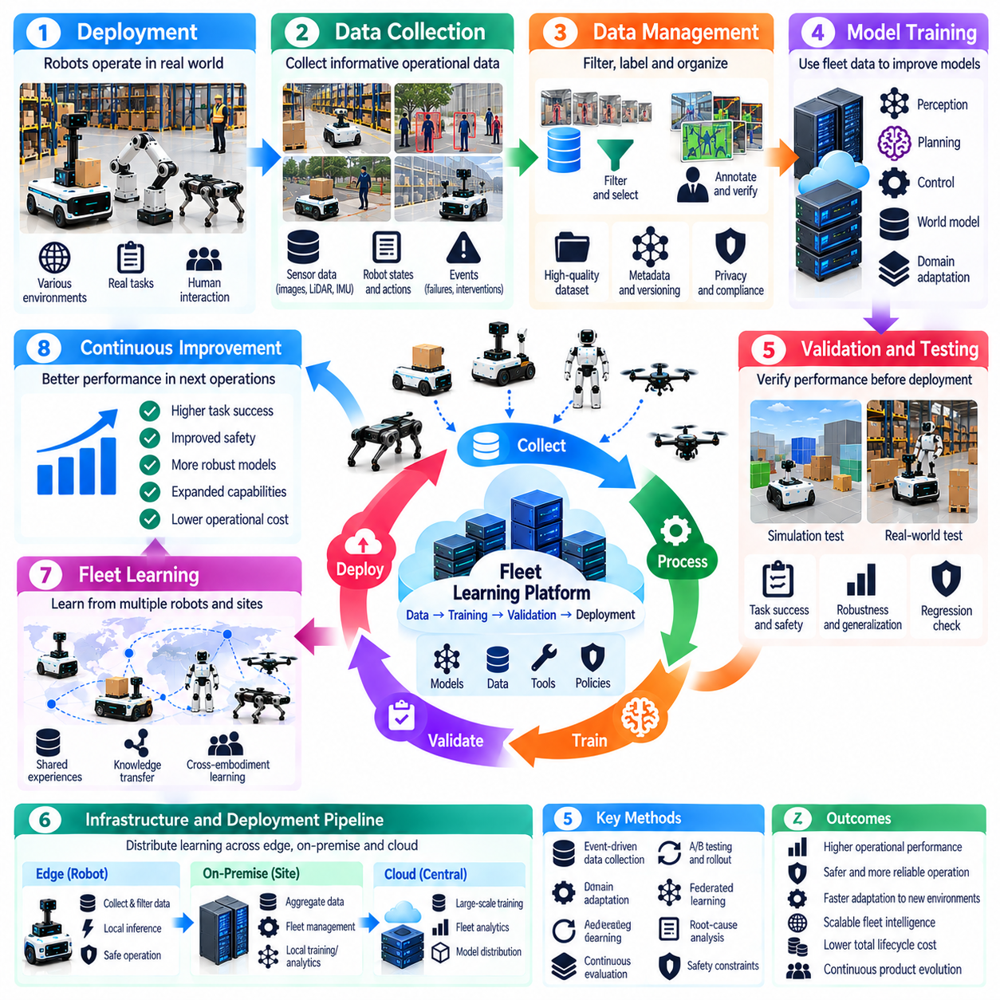{width="7.268055555555556in" height="7.268055555555556in"}

Continuous learning and fleet improvement strategy enables Physical AI products to evolve through operational experience after deployment. Unlike static automation systems, learning-enabled robots can generate valuable information from repeated interactions with physical environments. A successful strategy transforms operational data into validated improvements in perception, planning, control, and reliability while preserving safety and predictable product behavior.

Continuous learning should be understood as a controlled lifecycle process rather than unrestricted autonomous model modification. Deployed robots collect observations, execution outcomes, failures, and environmental changes that inform future development. These experiences are analyzed, curated, and incorporated into updated models or system configurations. Each improvement must undergo evaluation before it influences safety-critical physical operations.

Fleet learning extends improvement beyond individual robots by combining experience from multiple devices and deployment locations. Different environments expose systems to variations in lighting, geometry, human activity, equipment, and operational procedures. Aggregated evidence can reveal recurring limitations that remain invisible within a single deployment. The objective is to convert distributed experience into reusable intelligence without ignoring local differences.

Operational data collection should be guided by product objectives and measurable performance gaps. Sensor streams, robot states, planned actions, executed trajectories, intervention events, and task outcomes provide complementary evidence. Recording everything continuously may be expensive and unnecessary. Selective collection policies should prioritize informative events while respecting bandwidth, storage, privacy, and operational constraints.

A data flywheel connects deployment, observation, learning, validation, and redeployment into a repeating improvement cycle. Operational systems produce evidence that identifies weaknesses and training opportunities. Updated models are evaluated against representative conditions before returning to the fleet. The flywheel creates value only when each iteration produces measurable benefits rather than merely increasing dataset size or model complexity.

Event-driven data collection improves efficiency by focusing on situations that reveal system limitations. Near collisions, navigation failures, unexpected obstacles, human interventions, and abnormal sensor behavior may provide especially useful examples. Trigger conditions should capture sufficient context before and after an event. These records support failure reconstruction, targeted model improvement, and systematic verification of corrective actions.

Data quality is fundamental because inaccurate or inconsistent operational records can degrade learning outcomes. Timestamp synchronization, sensor calibration, coordinate alignment, and metadata consistency influence the usefulness of collected experiences. Data pipelines should identify corrupted recordings, duplicated events, and incomplete trajectories. Provenance records must preserve the relationship between observations, software versions, hardware configurations, and deployment conditions.

Active learning can reduce annotation costs by identifying examples that offer the greatest expected training value. Uncertain predictions, unfamiliar scenes, and disagreements between models can guide sample selection. Human reviewers may label or verify selected events rather than processing every recorded observation. Selection mechanisms must also preserve representative coverage so that rare but important conditions are not systematically overlooked.

Learning from failure requires distinguishing model limitations from hardware defects, configuration errors, and operational misuse. A navigation failure may result from incorrect perception, inaccurate localization, poor planning, or mechanical constraints. Root-cause analysis should connect observed outcomes to the responsible system components. Retraining a model without identifying the actual cause may waste resources or introduce additional problems.

Fleet diversity presents both opportunities and challenges for shared learning. Robots may differ in sensors, processors, actuators, payloads, and software configurations. Common representations can support knowledge transfer, while platform-specific adaptation preserves compatibility with individual embodiments. Training pipelines should record hardware and operational context to prevent inappropriate generalization across systems with different physical capabilities.

Domain adaptation is important when deployment conditions differ from training environments. Changes in facility layout, lighting, surface properties, and human traffic may reduce model performance over time. Continuous evaluation can detect distribution shifts and emerging failure patterns. Adaptation should target verified performance gaps while retaining competence in previously supported conditions, thereby reducing the risk of catastrophic forgetting.

Fleet improvement does not require every learning process to occur directly on robots. Edge devices can collect and filter observations, on-premise infrastructure can aggregate operational evidence, and cloud systems can perform large-scale training and analysis. This distribution balances responsiveness, computing capacity, and data governance. Safety-critical models should generally be updated through controlled deployment processes rather than uncontrolled online modification.

Federated learning offers an alternative when operational data cannot be transferred to centralized infrastructure. Participating devices or sites can contribute model updates while retaining local datasets. This approach may reduce raw-data movement but introduces challenges involving communication efficiency, heterogeneous data, and update integrity. Federated learning should be selected according to actual privacy and infrastructure requirements rather than assumed superiority.

Model evaluation must compare proposed improvements against established performance baselines. Task success, intervention frequency, collision risk, recovery behavior, inference latency, and resource consumption provide relevant indicators. Aggregate improvements can conceal regressions in difficult scenarios or particular deployment sites. Evaluation should therefore include representative subsets, rare-event cases, and operational conditions where earlier models performed reliably.

Simulation and replay testing allow candidate models to be examined before physical deployment. Historical sensor recordings can reproduce previously encountered situations, while simulation introduces controlled variations and disturbances. These methods support regression testing and targeted comparison between model versions. However, offline performance does not fully establish closed-loop behavior, making controlled real-world trials necessary for critical changes.

Deployment strategy should use staged releases to limit the consequences of unexpected model behavior. New versions may first undergo shadow evaluation, where predictions are recorded without controlling physical actions. Limited pilot deployments can then test performance under supervision. Expansion across the fleet should depend on predefined acceptance criteria, with rollback procedures available when safety or reliability indicators deteriorate.

Fleet monitoring provides the feedback required to determine whether an update actually improves operational performance. Dashboards and automated analysis can track task completion, interventions, system availability, energy consumption, and recurring errors. Metrics should be interpreted in relation to workload and environmental difficulty. Apparent improvements may reflect easier operating conditions rather than genuine advances in intelligence.

Knowledge management is necessary to preserve improvements across model generations and engineering teams. Dataset versions, experiment configurations, evaluation reports, and deployment histories should remain traceable. Failure cases and corrective actions can become reusable test scenarios. This accumulated evidence supports reproducibility, accelerates future development, and reduces the likelihood of rediscovering previously resolved problems.

Human expertise remains important throughout the continuous learning lifecycle. Operators identify practical limitations, maintenance teams recognize recurring equipment problems, and engineers interpret model failures. Structured feedback mechanisms can convert these observations into actionable development priorities. Human review is especially important when automated metrics cannot adequately represent safety, usability, or complex operational requirements.

Governance must define who may collect data, approve model updates, change operating parameters, and authorize fleet-wide deployment. Access controls, audit records, and release approvals protect system integrity. Data retention and privacy requirements must remain enforceable throughout learning pipelines. Clear accountability is essential because changes introduced through learning can alter physical behavior long after the original product release.

The economic value of fleet learning depends on measurable improvements in operational outcomes. Reduced intervention frequency, higher task completion rates, lower maintenance costs, and improved deployment efficiency can justify continued investment. Learning infrastructure also creates recurring costs for storage, annotation, computation, and validation. Product strategy should evaluate whether improvement benefits exceed these lifecycle expenses.

Ultimately, continuous learning and fleet improvement should establish a disciplined connection between deployed experience and product evolution. Distributed observations become valuable when transformed into reliable evidence, targeted learning, and validated operational improvements. A mature strategy combines data quality, model governance, staged deployment, and measurable feedback to increase adaptability and reliability without compromising physical safety.

## 08.14. Physical AI Product Roadmap

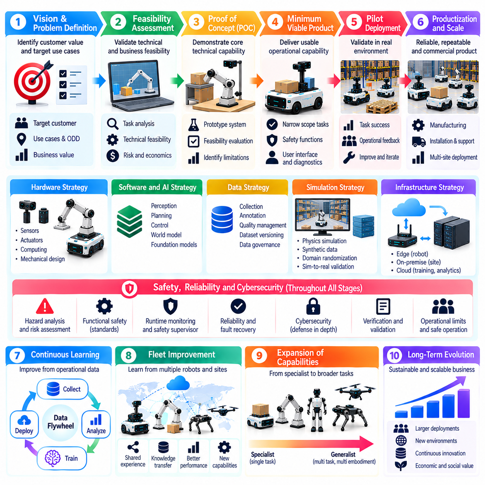{width="7.268055555555556in" height="7.268055555555556in"}

A Physical AI product roadmap defines the progressive transformation of intelligent robotics concepts into reliable, scalable, and commercially sustainable products. Unlike conventional software roadmaps, it must coordinate hardware development, AI capabilities, physical integration, safety assurance, and operational deployment. Each development stage should establish measurable evidence that the system can perform useful physical tasks under increasingly realistic conditions.

Roadmap development begins with a clear product vision and a defined operational problem. Organizations must identify target customers, deployment environments, economic objectives, and the physical tasks that justify automation. Technical capabilities should be selected according to these requirements rather than emerging technology trends alone. A successful roadmap connects engineering investment to customer value and measurable operational outcomes.

The initial roadmap phase focuses on problem validation and feasibility assessment. Engineers examine task complexity, environmental constraints, available sensors, computing resources, and actuator capabilities. Early experiments determine whether proposed AI methods can satisfy essential performance requirements. This phase should identify major technical uncertainties, safety hazards, and economic assumptions before substantial product development commitments are made.

Proof-of-concept development demonstrates whether the core technical approach can perform a representative physical task. Simplified prototypes may combine perception models, planning algorithms, controllers, and existing robotic hardware. Evaluation should emphasize feasibility, reproducibility, and identification of limitations rather than polished demonstrations. A successful proof of concept provides evidence for further investment without implying production readiness.

Minimum viable product development converts technical feasibility into a usable operational capability. The system should perform a narrowly defined set of valuable tasks within an explicit Operational Design Domain. Essential safety functions, operator interfaces, diagnostics, and recovery procedures must accompany AI capabilities. Product scope should remain controlled so that engineering teams can validate performance and respond effectively to early customer feedback.

Hardware, software, and AI co-design becomes increasingly important as prototypes approach product integration. Sensor placement, actuator selection, processor capacity, thermal constraints, and communication architecture influence achievable intelligence. Model complexity must reflect available computational resources and real-time requirements. Roadmap milestones should coordinate these dependencies to prevent late-stage incompatibilities and expensive redesign.

Data strategy must evolve alongside product maturity. Early development may depend on public datasets, simulation, and manually collected examples. Pilot deployments generate environment-specific observations and failure cases that improve model relevance. Mature products require systematic data pipelines, annotation processes, and governance. Each roadmap stage should define the evidence needed to justify expanding training coverage or model capability.

Simulation and synthetic data support roadmap acceleration by enabling controlled experimentation before extensive physical deployment. Engineers can explore operating conditions, generate rare events, and evaluate alternative system designs. However, simulation results must be connected to real-world validation. Roadmap gates should distinguish simulated achievement from demonstrated physical capability, especially for safety-critical functions and complex interactions.

Model strategy should progress from task-specific competence toward broader adaptability only when operational evidence supports expansion. Specialized models may provide predictable performance during early commercialization. Foundation models and world models can later improve semantic understanding, prediction, and generalization. Increased model capability should be justified by measurable product benefits rather than parameter count or benchmark performance alone.

Safety, reliability, and cybersecurity requirements must develop in parallel with functionality. Early hazard analysis informs architecture, while later stages require structured verification, operational testing, and documented assurance evidence. Security controls must cover devices, networks, software, and model assets. Roadmap milestones should not permit expanded autonomy or deployment scope without corresponding validation of protective mechanisms.

Pilot deployment is a critical transition from laboratory development to operational reality. Limited installations expose products to environmental variation, human interaction, maintenance demands, and unexpected failures. Pilot objectives should include task success, intervention frequency, system availability, and operational usability. Findings must guide product revisions before deployment is expanded to additional customers or facilities.

Productization requires capabilities beyond successful autonomous behavior. Installation procedures, configuration tools, monitoring interfaces, spare parts, maintenance processes, and customer support determine operational viability. Manufacturing consistency and component availability also influence delivery schedules. The roadmap must incorporate these activities because a technically capable prototype is not automatically a repeatable commercial product.

Infrastructure strategy should evolve with the scale and complexity of deployment. Early systems may operate primarily on robot-mounted computing, while larger installations can benefit from on-premise coordination and shared perception. Cloud services may support centralized training, fleet analytics, and software distribution. Infrastructure transitions should be driven by measured latency, reliability, privacy, and lifecycle cost requirements.

Fleet expansion introduces coordination challenges that individual robot testing cannot fully reveal. Multiple robots compete for space, communication bandwidth, charging resources, and operational priorities. Facility-level orchestration can improve utilization and reduce conflicts. Roadmap planning should include fleet simulation, integration testing, and progressive scaling to verify that coordination mechanisms remain effective as deployment density increases.

Continuous learning becomes a strategic capability after operational deployments generate sufficient evidence. Fleet observations can reveal recurring errors, distribution shifts, and opportunities for model improvement. Updated models should pass regression testing and staged release procedures before widespread deployment. The roadmap must distinguish experimental learning capability from production-grade model lifecycle management and controlled operational improvement.

Performance milestones should use measurable criteria that reflect customer outcomes. Task completion rate, cycle time, intervention frequency, energy consumption, availability, and recovery time provide practical indicators. AI-specific metrics remain useful but should be connected to physical task performance. Acceptance criteria must account for environmental difficulty and operating conditions to prevent misleading comparisons between development stages.

Economic validation should accompany technical progress throughout the roadmap. Hardware acquisition, integration labor, computing infrastructure, maintenance, and operational support contribute to total cost of ownership. Organizations should compare these costs against productivity improvements, service quality, and reduced operational risk. Commercial expansion should depend on credible unit economics rather than assumptions that future AI improvements will automatically reduce costs.

Partnership strategy can accelerate development when critical capabilities fall outside an organization\'s core expertise. Hardware suppliers, sensor manufacturers, robotics integrators, AI providers, and deployment partners may contribute specialized resources. Clear interface definitions and responsibility boundaries reduce integration risk. Roadmap planning should also account for supplier dependencies, intellectual property, interoperability, and long-term maintainability.

Roadmap governance requires explicit decision gates between research, prototype, pilot, productization, and scale-up activities. Each gate should review technical evidence, safety readiness, customer acceptance, financial assumptions, and unresolved risks. Milestone completion must depend on demonstrated outcomes rather than calendar progress alone. This discipline allows organizations to redirect investment when evidence contradicts initial expectations.

Risk management should identify dependencies that could delay or invalidate the product strategy. Component shortages, regulatory changes, model limitations, cybersecurity vulnerabilities, and unexpected operating conditions may require architectural or commercial adjustments. Alternative designs and contingency plans improve resilience. A roadmap should remain adaptable without abandoning the core requirements that define product value and safety.

Long-term product evolution should balance platform reuse with application-specific requirements. Common perception services, deployment tools, data pipelines, and monitoring infrastructure can support multiple product variants. However, different embodiments and operating environments may require specialized control and safety mechanisms. Platform expansion should follow proven architectural reuse rather than premature attempts to generalize every capability.

Ultimately, a Physical AI product roadmap should establish a disciplined progression from validated need to dependable physical autonomy and scalable commercial operation. Technical maturity, operational evidence, safety assurance, and economic sustainability must advance together. The strongest roadmap treats every deployment as both a customer commitment and a source of validated learning, enabling continuous improvement without compromising trust or reliability.
