**Volume 02. Physical AI Foundations and Definitions**

# Chapter 09. Standards and Definitions

## 09.01. Core Physical AI Terminology

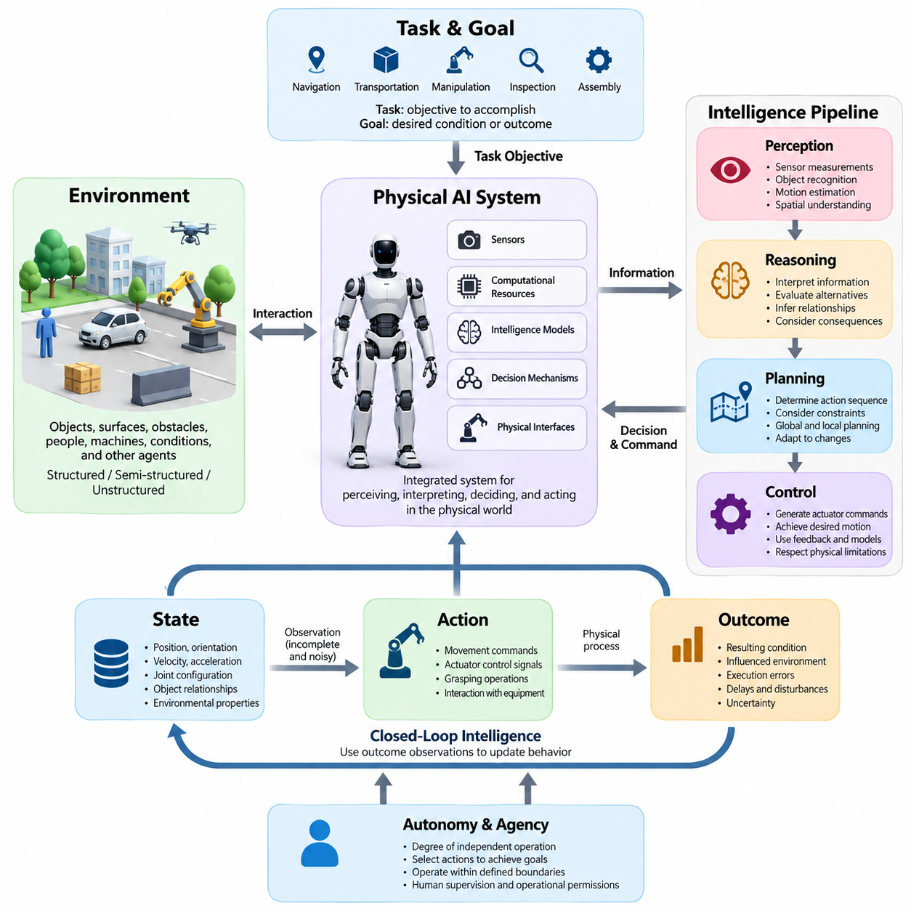{width="7.268055555555556in" height="7.268055555555556in"}

피지컬 인공지능(Physical AI)은 물리적 세계(Physical World)를 인식하고, 해석하고, 판단하며, 그 안에서 행동할 수 있는 인공지능 시스템(Artificial Intelligence System)을 의미한다. 디지털 정보 처리(Digital Information Processing)에 국한된 지능과 달리, 피지컬 인공지능은 물리 법칙(Physical Laws)의 지배를 받는 환경과 상호작용한다. 핵심적인 특징은 계산 지능(Computational Intelligence)을 감지(Sensing), 움직임(Movement), 물리적 제약(Physical Constraints), 피드백 기반 적응(Feedback-Driven Adaptation)과 통합하는 것이다.

피지컬 인공지능 시스템(Physical AI System)은 센서(Sensor), 컴퓨팅 자원(Computational Resources), 지능 모델(Intelligence Model), 의사결정 메커니즘(Decision Mechanism), 물리적 인터페이스(Physical Interface)가 통합된 구조이다. 이러한 구성요소들은 환경 관측(Environmental Observation)을 의미 있는 행동(Action)으로 변환한다. 이 용어는 개별 알고리즘보다 시스템 수준 지능(System-Level Intelligence)을 강조하며, 성공적인 물리적 행동이 인식(Perception), 추론(Reasoning), 제어(Control), 상호작용(Interaction)의 유기적인 협력에 의존한다는 점을 나타낸다.

물리적 에이전트(Physical Agent)는 환경을 관측하고 정의된 목표를 달성하기 위한 행동을 수행하는 자율적(Autonomous) 또는 부분 자율적(Partially Autonomous) 개체이다. 에이전트는 이동 로봇(Mobile Robot), 산업용 매니퓰레이터(Industrial Manipulator), 자율주행 차량(Autonomous Vehicle), 항공 플랫폼(Aerial Platform), 지능형 기계(Intelligent Machine) 등으로 구현될 수 있다. 핵심 속성에는 환경 인식(Environmental Awareness), 행동 선택(Action Selection), 물리적 상호작용(Physical Interaction), 변화하는 운영 조건에 대응하는 능력이 포함된다.

환경(Environment)은 에이전트가 작동하는 외부의 물리적 맥락(Physical Context)을 의미한다. 여기에는 객체(Object), 표면(Surface), 장애물(Obstacle), 사람(Human), 기계(Machine), 환경 조건(Environmental Conditions), 다른 에이전트(Agent)가 포함된다. 환경은 예측 가능성과 조직화 수준에 따라 정형 환경(Structured Environment), 반정형 환경(Semi-Structured Environment), 비정형 환경(Unstructured Environment)으로 구분할 수 있다. 피지컬 인공지능은 운영 결과에 영향을 미치는 환경 변화, 불완전한 정보, 외란(Disturbance), 상호작용을 고려해야 한다.

작업(Task)은 피지컬 인공지능 에이전트가 물리적 행동을 통해 달성해야 하는 목적을 의미한다. 작업에는 내비게이션(Navigation), 운송(Transportation), 조작(Manipulation), 검사(Inspection), 조립(Assembly), 모니터링(Monitoring), 협업 운영(Coordinated Operations) 등이 포함된다. 목표(Goal)는 원하는 상태 또는 결과를 지정하며, 작업 실행(Task Execution)은 운영 제약(Operational Constraints)과 안전 제약(Safety Constraints)을 준수하면서 시스템을 목표 상태로 이동시키는 행동을 선택하고 수행하는 과정이다.

물리 시스템의 상태(State)는 특정 시점의 시스템 조건을 표현하는 데 필요한 변수들을 의미한다. 상태 변수(State Variables)에는 위치(Position), 자세(Orientation), 속도(Velocity), 가속도(Acceleration), 관절 구성(Joint Configuration), 객체 관계(Object Relationships), 환경 속성(Environmental Properties) 등이 포함된다. 관측(Observation)은 센서 또는 외부 정보원에서 획득한 정보이다. 관측에는 불완전성과 잡음(Noise)이 존재하므로 실제 물리적 상태(True Physical State)를 직접 확인하지 못할 수 있다.

행동(Action)은 에이전트가 자신의 구성이나 물리적 환경에 영향을 주기 위해 시작하는 동작을 의미한다. 행동에는 이동 명령(Motion Command), 액추에이터 제어 신호(Actuator Control Signal), 파지 동작(Grasping Operation), 외부 장비와의 상호작용 등이 포함된다. 결과(Outcome)는 행동 이후에 형성된 상태를 의미한다. 물리적 과정에는 불확실성(Uncertainty), 지연(Delay), 외란(Disturbance), 실행 오차(Execution Error)가 발생하므로 의도한 행동과 실제 관측된 결과를 구분하는 것이 중요하다.

인식(Perception)은 센서 측정값(Sensor Measurements)을 주변 세계에 대한 유용한 정보로 변환하는 과정이다. 카메라(Camera), 라이다(LiDAR), 레이더(Radar), 관성 센서(Inertial Sensor), 힘 센서(Force Sensor) 등의 장치는 물리적 조건에 대한 관측 정보를 제공한다. 인식 알고리즘(Perception Algorithm)은 이러한 측정값을 해석하여 객체를 식별하고, 움직임을 추정하며, 공간적 관계를 파악하고, 관련 사건을 탐지한다. 인식은 지능적인 물리적 행동을 위한 정보적 기반을 제공한다.

추론(Reasoning)은 정보를 해석하고, 대안을 평가하고, 관계를 추론하며, 의사결정을 지원하는 계산 과정(Computational Process)을 의미한다. 피지컬 인공지능의 추론은 물리적 실현 가능성(Physical Feasibility), 불확실성(Uncertainty), 작업 목표(Task Objectives), 잠재적 결과(Possible Consequences)를 고려해야 한다. 추론에는 학습된 표현(Learned Representation), 논리적 제약(Logical Constraints), 확률적 추론(Probabilistic Inference), 예측 모델(Predictive Model)이 결합될 수 있다. 추론의 결론이 실제 의사결정과 물리적 행동에 영향을 미칠 때 운영상의 의미를 갖는다.

계획(Planning)은 원하는 목표를 달성하기 위한 행동 순서(Action Sequence) 또는 중간 목표(Intermediate Objectives)를 결정하는 과정이다. 물리적 계획(Physical Planning)은 환경의 기하학적 구조(Environmental Geometry), 시스템 동역학(System Dynamics), 자원 가용성(Resource Availability), 운영 제한(Operational Restrictions)을 고려해야 한다. 계획은 전역적으로 생성되거나 조건 변화에 따라 국소적으로 수정될 수 있다. 효과적인 계획은 장애물, 불확실성, 잠재적 실패를 예상하면서 상위 수준의 목표(High-Level Objectives)를 실행 가능한 행동(Executable Behavior)과 연결한다.

제어(Control)는 액추에이터(Actuator) 및 기타 실행 메커니즘(Execution Mechanism)에 명령을 생성하여 물리적 행동을 조절하는 과정이다. 제어기(Controller)는 물리적 한계(Physical Limitations)를 준수하면서 원하는 움직임이나 운영 조건을 달성하도록 작동한다. 제어에는 피드백(Feedback), 예측 모델(Predictive Model), 최적화(Optimization), 학습된 정책(Learned Policy)이 활용될 수 있다. 제어는 지능 시스템이 생성한 의사결정을 기계와 환경의 실제 동역학(Physical Dynamics)에 연결한다.

폐루프 지능(Closed-Loop Intelligence)은 행동 결과에 대한 관측 정보를 지속적으로 활용하여 자신의 행동을 갱신하는 시스템을 의미한다. 에이전트는 환경 조건을 인식하고, 행동을 선택하고, 그 결과로 발생한 변화를 평가하며, 이후의 의사결정을 조정한다. 이러한 피드백 메커니즘(Feedback Mechanism)은 적응적인 물리적 운영(Adaptive Physical Operation)을 고정된 실행 순서(Fixed Execution Sequence)와 구분한다. 폐루프 행동(Closed-Loop Behavior)은 외란, 불확실성, 환경 변화로 인해 사전에 결정된 행동만으로 충분하지 않은 상황에서 필수적이다.

자율성(Autonomy)은 시스템이 지속적인 인간 개입(Human Intervention) 없이 할당된 목표를 달성할 수 있는 정도를 의미한다. 자율 운영(Autonomous Operation)에는 정의된 경계 내에서 독립적인 인식, 의사결정, 계획, 실행이 포함될 수 있다. 행위 주체성(Agency)은 목표 달성을 위해 행동을 선택하는 능력을 강조한다. 그러나 두 개념 모두 무제한적인 권한을 의미하지는 않으며, 운영 권한(Operational Permissions), 인간 감독(Human Supervision), 안전 요구사항(Safety Requirements)에 의해 시스템 행동이 제한될 수 있다.

체화(Embodiment)는 지능과 감지 및 행동이 이루어지는 물리적 형태(Physical Form) 사이의 관계를 의미한다. 체화 형태에는 바퀴(Wheel), 다리(Leg), 로봇 팔(Robot Arm), 그리퍼(Gripper), 항공 추진 시스템(Aerial Propulsion System) 등의 물리적 메커니즘이 포함될 수 있다. 기하학적 구조(Geometry), 센서, 액추에이터, 동역학은 가능한 상호작용을 결정한다. 따라서 동일한 지능 모델이라도 서로 다른 물리적 체화 구조에 배치되면 상이한 능력을 나타낼 수 있다.

정책(Policy)은 이용 가능한 정보를 행동 또는 행동 확률분포(Action Distribution)에 대응시키는 의사결정 메커니즘(Decision Mechanism)이다. 정책은 규칙 기반(Rule-Based), 최적화 기반(Optimization-Based), 시연 학습(Demonstration Learning), 강화학습(Reinforcement Learning) 등을 통해 구성될 수 있다. 피지컬 인공지능에서 정책은 에이전트의 체화 구조와 운영 환경에 적합한 행동을 생성해야 한다. 정책의 효과성은 작업 성능(Task Performance), 적응성(Adaptability), 물리적 실현 가능성, 안전 제약 준수 여부에 따라 결정된다.

월드 모델(World Model)은 물리적 환경의 관련 요소를 표현하거나 예측하기 위해 사용하는 내부 표현(Internal Representation)이다. 월드 모델은 객체 상태(Object State), 공간적 관계(Spatial Relationships), 움직임 패턴(Motion Patterns), 물리 동역학(Physical Dynamics), 가능한 미래 상태(Future Conditions)를 표현할 수 있다. 예측 월드 모델(Predictive World Model)은 특정 행동에 따라 상태가 어떻게 변화할지 추정한다. 이러한 표현은 계획, 미래 예측(Anticipation), 불확실성 관리(Uncertainty Management), 즉각적인 센서 관측을 넘어서는 의사결정을 지원한다.

학습(Learning)은 경험이나 데이터를 활용하여 지능 시스템의 모델, 정책 또는 표현을 개선하는 과정이다. 적응(Adaptation)은 변화하는 조건에서 행동을 개선하기 위한 조정을 의미한다. 일반화(Generalization)는 학습 과정에서 정확히 경험하지 못한 상황에서도 효과적으로 작동하는 능력이다. 이러한 개념들은 서로 관련되어 있지만 구별되며, 특정 행동을 학습한 시스템이 반드시 익숙하지 않은 환경으로 안정적으로 전이(Transfer)할 수 있는 것은 아니다.

불확실성(Uncertainty)은 시스템 상태, 환경 조건, 모델 예측 또는 행동 결과에 대한 지식이 불완전한 상태를 의미한다. 부분 관측 가능성(Partial Observability)은 이용 가능한 관측 정보만으로 실제 내부 상태(Underlying State)를 완전히 결정할 수 없는 상황이다. 피지컬 인공지능 시스템은 센서 융합(Sensor Fusion), 확률적 추정(Probabilistic Estimation), 메모리(Memory), 예측(Prediction), 정보 수집 행동(Information-Gathering Actions)을 통해 이러한 한계를 해결한다. 명시적인 불확실성 관리는 불완전한 관측에 대한 과도한 확신으로 발생하는 잘못된 의사결정을 방지하는 데 도움이 된다.

실시간 운영(Real-Time Operation)은 계산 및 물리적 응답이 작업과 관련된 시간 요구사항(Timing Requirements)을 충족해야 한다는 의미이다. 지연시간(Latency)은 사건, 관측, 계산 또는 명령과 이에 대응하는 응답 사이에 발생하는 시간 차이를 의미한다. 시간 요구사항은 인식, 계획, 제어 기능에 따라 달라진다. 따라서 피지컬 인공지능은 계산 성능(Computational Performance)을 물리 동역학, 통신 지연(Communication Delay), 액추에이터 응답(Actuator Response), 마감시간 위반(Missed Deadline)의 결과와 조화시켜야 한다.

안전성(Safety)은 물리적 운영과 관련된 허용할 수 없는 위험(Unacceptable Risk)을 제한하는 속성이다. 신뢰성(Reliability)은 지정된 조건에서 요구 기능(Required Functions)을 일관되게 수행하는 능력과 관련된다. 강건성(Robustness)은 외란, 불확실성, 운영 조건 변화에 대한 저항 능력을 의미한다. 이러한 속성들은 밀접하게 연관되어 있지만 서로 대체할 수 없다. 신뢰성이 높은 지능 모델이라도 모든 운영 시나리오(Operational Scenario)에서 안전한 물리적 행동을 자동으로 보장하지는 않는다.

운영 설계 영역(Operational Design Domain, ODD)은 피지컬 인공지능 시스템이 작동하도록 의도된 조건을 정의한다. 이러한 조건에는 환경 특성(Environmental Characteristics), 운영 위치(Operating Locations), 허용 작업(Allowable Tasks), 속도 범위(Speed Ranges), 사람과의 근접성(Human Proximity), 인프라 요구사항(Infrastructure Requirements)이 포함될 수 있다. 운영 경계(Operational Boundaries)를 정의하면 성능 평가(Performance Evaluation)와 안전성 평가(Safety Assessment)의 기준이 마련된다. 특정 영역에서 입증된 능력을 다른 영역에서도 유효하다고 자동으로 가정해서는 안 된다.

피지컬 인공지능 역량(Physical AI Capability)은 단일 지능 지표(Single Intelligence Measure)가 아니라 다차원적 속성(Multidimensional Property)으로 이해하는 것이 적절하다. 관련 차원에는 인식 품질(Perception Quality), 추론 능력(Reasoning Competence), 계획 능력(Planning Capability), 행동 정밀도(Action Precision), 자율성, 적응성, 안전성, 환경 적용 범위(Environmental Coverage)가 포함된다. 시스템은 특정 차원에서 높은 성능을 나타내면서 다른 차원에서는 제한적일 수 있다. 일관된 용어 체계는 입증된 역량(Demonstrated Capabilities)과 일반 지능(General Intelligence)에 대한 광범위한 주장을 구분하는 데 도움이 된다.

특화형 피지컬 인공지능 시스템(Specialist Physical AI System)은 상대적으로 제한된 작업과 운영 조건에 맞게 설계되거나 최적화된 시스템이다. 범용형 시스템(Generalist System)은 보다 광범위한 작업, 환경 또는 체화 구조에서 작동하는 것을 목표로 한다. 범용성(Generality)이 물리적 제약을 제거하거나 보편적인 능력을 보장하는 것은 아니다. 특화형 및 범용형 시스템을 평가하려면 작업 분포(Task Distribution), 환경 변화(Environmental Variations), 성능 지표(Performance Measures), 허용 가능한 운영 경계(Acceptable Operating Boundaries)를 명확하게 정의해야 한다.

피지컬 인공지능은 개별 지능(Individual Intelligence)과 집단 지능(Collective Intelligence)도 구분한다. 개별 에이전트(Individual Agent)는 자체 관측, 모델, 가용 자원을 활용하여 의사결정을 수행한다. 다중 에이전트 시스템(Multi-Agent System)은 통신(Communication), 공유 정보(Shared Information), 분산 의사결정(Distributed Decision-Making)을 통해 여러 에이전트를 조정한다. 집단 지능은 협력된 역량이 개별 운영을 넘어서는 이점을 제공할 때 나타난다. 이러한 이점은 통신 신뢰성(Communication Reliability), 작업 할당(Task Allocation), 조정 메커니즘(Coordination Mechanism), 공유 환경 이해(Shared Environmental Understanding)에 의존한다.

피지컬 인공지능 아키텍처(Physical AI Architecture)는 감지, 지능, 컴퓨팅, 통신, 구동 기능이 어떻게 조직되는지를 정의한다. 엣지 컴퓨팅(Edge Computing)은 센서와 물리적 장비 가까이에 처리 기능을 배치하여 저지연 응답(Low-Latency Response)을 지원한다. 온프레미스 컴퓨팅(On-Premise Computing)은 지역 운영 인프라(Local Operational Infrastructure) 내에서 공유 자원을 제공하며, 클라우드 컴퓨팅(Cloud Computing)은 대규모 학습(Large-Scale Learning), 분석(Analysis), 조정(Coordination)을 지원할 수 있다. 적절한 기능 분산은 시간 요구사항, 연결성(Connectivity), 개인정보 보호(Privacy), 신뢰성, 계산 요구사항에 따라 결정된다.

표준화된 용어(Standardized Terminology)는 피지컬 인공지능의 요구사항, 역량, 한계, 평가 결과를 명확하게 전달하는 데 필수적이다. 자율성, 지능(Intelligence), 예측(Prediction), 적응, 안전성과 같은 용어는 홍보성 설명(Promotional Descriptions)이 아니라 명시적인 운영적 의미(Operational Meanings)와 연결되어야 한다. 일관된 정의(Consistent Definitions)는 로봇 플랫폼(Robotic Platforms), 연구 방법(Research Methods), 산업 응용(Industrial Applications) 간 비교를 가능하게 하며, 시스템 목표(System Objectives), 구현 메커니즘(Implementation Mechanisms), 입증된 성능(Demonstrated Performance) 사이의 모호성을 줄인다.

핵심 피지컬 인공지능 용어(Core Physical AI Terminology)는 궁극적으로 물리적 세계와의 지능적 상호작용(Intelligent Physical Interaction)을 이해하기 위한 공통 개념 언어(Common Conceptual Language)를 확립한다. 중심 개념들은 에이전트, 환경, 상태, 관측, 행동, 모델, 정책, 결과를 통합된 운영 프레임워크(Unified Operational Framework) 안에서 연결한다. 이러한 관계는 기계학습(Machine Learning), 로보틱스(Robotics), 월드 모델(World Model), 파운데이션 모델(Foundation Model), 시뮬레이션(Simulation), 안전 표준(Safety Standards), 성능 평가(Performance Evaluation)에 관한 더욱 전문적인 정의의 기반을 제공한다.

## 09.02. AI and Machine Learning Terminology

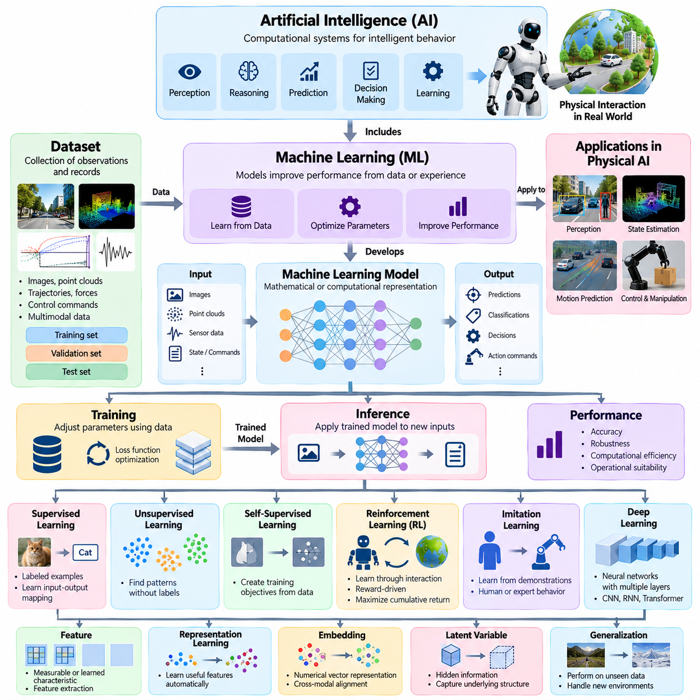{width="7.268055555555556in" height="7.268055555555556in"}

인공지능(Artificial Intelligence, AI)은 인식(Perception), 추론(Reasoning), 예측(Prediction), 의사결정(Decision-Making), 학습(Learning) 등 지능적 행동(Intelligent Behavior)과 관련된 기능을 수행하도록 설계된 컴퓨팅 시스템(Computational System)을 의미한다. 피지컬 인공지능(Physical AI)에서는 이러한 능력이 정보 처리(Information Processing)에 국한되지 않고 물리적 상호작용(Physical Interaction)과 연결된다. 인공지능은 기계가 관측 정보를 해석하고, 행동을 선택하며, 변화하는 환경에서 목표를 추구할 수 있도록 하는 계산적 기반(Computational Foundation)을 제공한다.

기계학습(Machine Learning, ML)은 컴퓨팅 모델(Computational Model)이 데이터 또는 경험에서 패턴(Pattern)을 식별하여 성능을 개선하는 인공지능의 한 분야이다. 모든 행동을 명시적으로 프로그래밍하는 대신, 기계학습은 최적화(Optimization)를 통해 표현(Representation)과 의사결정 함수(Decision Function)를 개발한다. 피지컬 인공지능은 기계학습을 인식, 상태 추정(State Estimation), 움직임 예측(Motion Prediction), 제어(Control), 실제 환경의 제약 조건(Real-World Constraints)에서 이루어지는 적응(Adaptation)에 적용한다.

기계학습 모델(Machine Learning Model)은 입력 정보(Input Information)를 예측, 분류(Classification), 의사결정 또는 생성된 출력(Generated Output)으로 변환하는 수학적 또는 계산적 표현(Mathematical or Computational Representation)이다. 모델에는 데이터의 유용한 관계를 포착하도록 학습 과정에서 조정되는 매개변수(Parameter)가 포함된다. 피지컬 인공지능에서 모델은 객체 위치(Object Position)를 추정하고, 환경 변화를 예측하거나, 행동 명령(Action Command)을 생성할 수 있다. 모델의 실용적 가치는 정확도(Accuracy), 강건성(Robustness), 계산 효율성(Computational Efficiency), 운영 적합성(Operational Suitability)에 따라 결정된다.

학습 과정(Training)은 데이터, 피드백(Feedback), 상호작용 경험(Interaction Experience)을 활용하여 모델 매개변수를 조정하는 과정이다. 학습 알고리즘(Training Algorithm)은 일반적으로 반복적인 갱신을 통해 손실 함수(Loss Function)를 최소화하거나 목적 함수(Objective Function)를 최대화한다. 추론(Inference)은 학습된 모델을 새로운 입력에 적용하는 과정으로, 동일한 매개변수 최적화를 수행하지 않는다. 피지컬 인공지능은 배포된 시스템(Deployed System)에서 예측 가능한 응답시간(Response Time)과 제한된 계산 자원(Computational Resources)이 요구되는 경우가 많으므로 학습과 추론을 구분한다.

데이터셋(Dataset)은 기계학습 시스템을 개발하고 평가하기 위해 사용되는 관측값(Observation), 측정값(Measurement), 시연(Demonstration), 상호작용 기록(Interaction Record)을 체계적으로 구성한 집합이다. 학습 데이터셋(Training Dataset)은 매개변수 최적화를 지원하고, 검증 데이터셋(Validation Dataset)은 모델 선택(Model Selection)을 안내하며, 테스트 데이터셋(Test Dataset)은 독립적인 성능 평가(Performance Assessment)를 제공한다. 피지컬 인공지능 데이터셋에는 이미지(Image), 포인트 클라우드(Point Cloud), 궤적(Trajectory), 힘 측정값(Force Measurement), 제어 명령(Control Command), 시간 동기화된 다중모달 관측(Synchronized Multimodal Observation)이 포함될 수 있다.

지도학습(Supervised Learning)은 입력 데이터(Input Data)와 이에 대응하는 목표 출력(Target Output)이 포함된 예제를 사용한다. 모델은 이러한 관계를 학습하여 이전에 관측하지 않은 입력에 대한 예측을 수행한다. 대표적인 응용에는 객체 분류(Object Classification), 의미론적 분할(Semantic Segmentation), 자세 추정(Pose Estimation), 결함 탐지(Defect Detection)가 포함된다. 피지컬 인공지능에서 지도학습은 대표성 있는 학습 데이터(Representative Training Data)와 신뢰할 수 있는 주석(Annotation)에 의존하며, 라벨링 오류(Labeling Error)와 환경 차이(Environmental Difference)는 운영 성능에 영향을 줄 수 있다.

비지도학습(Unsupervised Learning)은 모든 예제에 명시적인 목표 라벨(Target Label)을 요구하지 않고 데이터의 패턴이나 구조를 식별한다. 이러한 방법은 군집(Cluster), 잠재 표현(Latent Representation), 통계적 관계(Statistical Relationship)를 발견할 수 있다. 자기지도학습(Self-Supervised Learning)은 누락된 관측값이나 미래 상태를 예측하는 것처럼 데이터 자체에서 학습 목표(Training Objective)를 구성한다. 이러한 접근법은 수동 주석(Manual Annotation) 없이도 대량의 센서 기록(Sensor Recording)과 상호작용 데이터를 확보할 수 있는 피지컬 인공지능에서 중요한 가치를 갖는다.

강화학습(Reinforcement Learning, RL)은 에이전트(Agent)와 환경(Environment) 사이의 상호작용을 통해 의사결정 정책(Decision-Making Policy)을 개발한다. 에이전트는 행동을 선택하고, 보상(Reward) 또는 기타 피드백을 수신하며, 기대 누적 수익(Expected Cumulative Return)을 최대화하기 위한 행동을 학습한다. 피지컬 인공지능의 응용에는 보행(Locomotion), 조작(Manipulation), 내비게이션(Navigation), 적응 제어(Adaptive Control)가 포함된다. 실제 강화학습에서는 탐색 위험(Exploration Risk), 샘플 효율성(Sample Efficiency), 보상 설계(Reward Design), 시뮬레이션에서 실제 시스템으로의 전이(Simulation-to-Real Transfer)를 해결해야 한다.

모방학습(Imitation Learning)은 보상 기반 탐색(Reward-Driven Exploration)에만 의존하지 않고 바람직한 행동의 시연(Demonstration)을 활용하여 정책을 학습한다. 시연 데이터는 인간 조작자(Human Operator), 전문가 제어기(Expert Controller), 이전에 성공적으로 작동한 자율 시스템(Autonomous System)에서 얻을 수 있다. 행동 복제(Behavior Cloning)는 관측값에서 시연된 행동으로의 대응 관계를 직접 학습한다. 보다 발전된 접근법은 학습된 정책이 익숙하지 않은 상태를 만났을 때 발생하는 분포 변화(Distribution Shift)와 누적 오차(Compounding Error)를 해결한다.

딥러닝(Deep Learning)은 여러 계산 계층(Computational Layer)으로 구성된 신경망(Neural Network)을 사용하여 표현과 복잡한 입출력 관계(Input-Output Relationship)를 학습한다. 신경망은 학습 과정에서 매개변수가 조정되는 상호 연결된 계산 단위(Computational Unit)로 구성된다. 합성곱 신경망(Convolutional Neural Network), 순환 신경망(Recurrent Neural Network), 트랜스포머(Transformer) 등의 아키텍처는 서로 다른 형태의 정보 처리를 지원한다. 피지컬 인공지능에서 이러한 모델의 활용은 센서 데이터의 특성, 시간적 관계(Temporal Relationship), 배포 제약(Deployment Constraints)에 따라 결정된다.

특징(Feature)은 모델이 관련 정보를 표현하기 위해 사용하는 측정 가능하거나 학습된 특성이다. 특징 추출(Feature Extraction)은 원시 관측값(Raw Observation)을 예측이나 의사결정에 적합한 표현으로 변환한다. 표현학습(Representation Learning)은 사람이 직접 설계한 특징 설명(Handcrafted Description)에 전적으로 의존하지 않고 모델이 유용한 특징을 자동으로 발견하도록 한다. 피지컬 인공지능의 표현에는 기하학적 구조(Geometry), 움직임(Motion), 객체 식별 정보(Object Identity), 공간적 관계(Spatial Relationship), 물리적 속성(Physical Property)이 포함될 수 있다.

임베딩(Embedding)은 정보를 구조화된 벡터 공간(Structured Vector Space)에 배치하는 수치적 표현(Numerical Representation)이다. 임베딩은 이미지, 언어(Language), 센서 관측(Sensor Observation), 행동 또는 여러 모달리티(Modality)의 조합을 인코딩(Encoding)할 수 있다. 표현이 이러한 목적에 맞게 학습되었다면 유사한 정보는 벡터 공간에서 가까운 영역에 위치할 수 있다. 피지컬 인공지능에서 임베딩은 객체 인식(Object Recognition), 작업 해석(Task Interpretation), 교차 모달 정렬(Cross-Modal Alignment), 관련 관측이나 활동 사이의 지식 전이(Knowledge Transfer)를 지원한다.

잠재변수(Latent Variable)는 직접 관측되지 않지만 관측 가능한 행동을 설명하거나 예측하는 데 도움이 되는 정보를 나타낸다. 잠재공간(Latent Space)은 복잡한 입력과 환경 동역학(Environmental Dynamics)을 압축된 형태로 표현한다. 피지컬 인공지능 모델은 잠재상태(Latent State)를 활용하여 움직임 이력(Motion History), 객체 상호작용(Object Interaction), 숨겨진 환경 조건(Hidden Environmental Condition)을 요약할 수 있다. 이러한 표현의 유용성은 압축된 정보가 예측, 계획(Planning), 제어에 필요한 속성을 얼마나 잘 보존하는지에 따라 결정된다.

최적화(Optimization)는 정의된 목적을 개선하는 모델 매개변수 또는 의사결정을 찾는 과정이다. 손실 함수(Loss Function)는 모델 출력과 원하는 목표 사이의 불일치 정도를 측정하며, 최적화 알고리즘(Optimizer)은 매개변수를 갱신하는 방법을 결정한다. 경사하강법(Gradient Descent)과 그 변형 기법은 신경망 학습에 널리 사용된다. 피지컬 인공지능의 최적화에는 에너지 소비(Energy Consumption), 충돌 회피(Collision Avoidance), 시간 요구사항(Timing Requirements), 기계적 실현 가능성(Mechanical Feasibility)과 관련된 제약 조건이 추가될 수 있다.

일반화(Generalization)는 학습 과정에서 정확히 경험하지 않은 입력이나 상황에서도 모델이 효과적으로 작동하는 능력을 의미한다. 과적합(Overfitting)은 모델이 새로운 조건으로 안정적으로 전이되지 않는 학습 데이터 특유의 패턴을 학습할 때 발생한다. 과소적합(Underfitting)은 모델이 이용 가능한 데이터 내에서도 중요한 관계를 충분히 포착하지 못하는 경우이다. 피지컬 인공지능에서는 환경 변화가 기존의 오프라인 테스트(Offline Testing)에서 드러나지 않았던 취약점을 노출할 수 있으므로 신중한 평가가 필요하다.

분포 변화(Distribution Shift)는 실제 운영 데이터(Operational Data)가 모델 개발에 사용된 데이터와 달라지는 현상이다. 조명(Lighting), 센서 특성(Sensor Characteristics), 객체 외형(Object Appearance), 지형(Terrain), 인간 행동(Human Behavior)의 변화는 모델 성능을 바꿀 수 있다. 도메인 적응(Domain Adaptation)은 원천 환경(Source Environment)과 목표 환경(Target Environment) 사이의 차이를 줄이는 것을 목표로 한다. 도메인 일반화(Domain Generalization)는 개별 목표 도메인에 대한 별도의 적응 없이 이전에 경험하지 않은 조건에서도 효과적으로 작동하는 표현을 추구한다.

전이학습(Transfer Learning)은 하나의 작업, 데이터셋 또는 환경에서 획득한 지식을 재사용하여 다른 작업의 성능을 개선하는 방법이다. 미세조정(Fine-Tuning)은 목표 응용(Target Application)과 관련된 추가 데이터를 활용하여 기존 모델을 조정한다. 피지컬 인공지능에서 전이학습은 학습 비용(Training Cost)을 줄이고 관련 로봇 시스템 간 배포를 가속화할 수 있다. 그러나 로봇 형태(Morphology), 액추에이터 성능(Actuator Capability), 센서 구성(Sensor Configuration), 운영 조건의 차이는 성공적인 전이를 제한할 수 있다.

다중모달 학습(Multimodal Learning)은 이미지, 언어, 깊이 측정값(Depth Measurement), 촉각 신호(Tactile Signal), 고유수용감각 관측(Proprioceptive Observation)과 같은 서로 다른 데이터 유형의 정보를 결합한다. 센서 융합(Sensor Fusion)은 상호 보완적인 측정값을 통합하여 상태 추정이나 환경 이해(Environmental Understanding)를 개선한다. 두 개념은 관련되어 있지만 동일하지 않다. 이들을 결합하면 피지컬 인공지능 시스템은 물리적 상황에 대한 더욱 풍부한 표현과 신뢰성 높은 의사결정 능력을 확보할 수 있다.

예측 모델(Predictive Model)은 이용 가능한 정보를 바탕으로 미래 값, 상태 또는 사건을 추정한다. 시간적 모델링(Temporal Modeling)은 각 측정값을 독립적으로 처리하는 대신 연속적인 관측 사이의 관계를 포착한다. 시퀀스 모델(Sequence Model)은 움직임 이력, 행동 의존성(Action Dependency), 변화하는 환경 조건을 표현할 수 있다. 피지컬 인공지능에서 예측은 선제적 행동(Anticipatory Behavior), 궤적 예측(Trajectory Forecasting), 충돌 회피, 변화하는 물리적 상황에서의 계획을 지원한다.

확률적 모델링(Probabilistic Modeling)은 단일한 결정론적 추정값(Deterministic Estimate) 대신 확률분포(Probability Distribution)를 통해 불확실성을 표현한다. 베이지안 추론(Bayesian Inference)은 새로운 증거가 확보될 때 알려지지 않은 변수에 대한 믿음(Belief)을 갱신한다. 신뢰도 추정(Confidence Estimation)은 예측 확실성(Predictive Certainty)의 측면을 설명하며, 확률 보정(Calibration)은 예측 확률과 실제 관측 빈도 사이의 일치 정도를 다룬다. 피지컬 인공지능에서는 잘못된 확신이 물리적 상호작용 중 위험한 의사결정으로 이어질 수 있으므로 불확실성을 고려하는 모델이 중요하다.

정책 모델(Policy Model)은 관측값, 추정된 상태 또는 맥락 정보(Contextual Information)를 행동으로 대응시킨다. 가치 함수(Value Function)는 상태나 행동과 관련된 기대 미래 수익(Expected Future Return)을 추정하며, 보상 함수(Reward Function)는 강화학습에서 사용하는 피드백을 정의한다. 이러한 개념은 의사결정 시스템에서 서로 다른 목적을 수행한다. 피지컬 인공지능 정책은 액추에이터 한계(Actuator Limitations)와 환경 제약(Environmental Constraints)을 고려하면서 학습된 행동을 실행 가능한 명령(Executable Command)으로 변환해야 한다.

온라인 학습(Online Learning)은 운영 중 획득한 정보를 활용하여 모델을 갱신하는 반면, 오프라인 학습(Offline Learning)은 이전에 수집된 데이터셋이나 경험에 의존한다. 지속학습(Continual Learning)은 기존에 학습한 유용한 지식을 유지하면서 새로운 능력을 획득하는 것을 목표로 한다. 파국적 망각(Catastrophic Forgetting)은 모델 갱신으로 인해 이전에 획득한 능력이 저하되는 현상이다. 피지컬 인공지능에서는 배포된 모델을 제한 없이 변경하면 예기치 않은 행동이 발생하고 검증된 성능(Validated Performance)이 손상될 수 있으므로 통제된 학습 절차(Controlled Learning Procedure)가 필요하다.

모델 평가(Model Evaluation)는 학습된 시스템이 지정된 조건에서 정의된 목표를 얼마나 효과적으로 충족하는지 측정한다. 평가 지표(Evaluation Metrics)에는 정확도(Accuracy), 정밀도(Precision), 재현율(Recall), 예측 오차(Prediction Error), 작업 성공률(Task Success Rate), 계산 지연시간(Computational Latency)이 포함될 수 있다. 피지컬 인공지능 평가에서는 행동 품질(Action Quality), 신뢰성(Reliability), 안전성(Safety), 환경 다양성(Environmental Diversity)도 고려해야 한다. 벤치마크 결과(Benchmark Results)는 데이터셋, 테스트 프로토콜(Testing Protocol), 운영 조건, 평가 가정(Evaluation Assumptions)이 명확하게 문서화되었을 때 의미를 갖는다.

강건성(Robustness)은 외란(Disturbance), 잡음(Noise), 입력 조건 변화(Input Variation)에서도 기계학습 모델이 허용 가능한 성능을 유지하는 능력이다. 해석 가능성(Interpretability)은 모델 행동에 영향을 미치는 요인을 이해하는 것과 관련되며, 설명 가능성(Explainability)은 출력과 관련된 이유나 근거를 전달하는 것과 관련된다. 이러한 속성은 디버깅(Debugging), 검증(Validation), 운영 신뢰(Operational Trust)를 지원하지만, 해석 가능성이나 설명 가능성만으로 물리적 안전성이 확립되는 것은 아니다.

파운데이션 모델(Foundation Model)은 다양한 하위 작업(Downstream Task)에 적응할 수 있도록 광범위하게 학습된 모델이다. 사전학습(Pretraining)은 크고 다양한 데이터셋에서 재사용 가능한 표현이나 능력을 개발하며, 작업별 적응(Task-Specific Adaptation)은 이러한 능력을 특정 응용에 맞게 조정한다. 피지컬 인공지능에서 파운데이션 모델은 인식, 언어 이해(Language Understanding), 계획, 행동 생성(Action Generation)을 지원할 수 있다. 그러나 실제 배포에는 여전히 체화 구조별 인터페이스(Embodiment-Specific Interface)와 물리적 검증(Physical Validation)이 필요하다.

인공지능 및 기계학습 용어(AI and Machine Learning Terminology)는 피지컬 인공지능 시스템이 지식을 획득하고, 정보를 표현하고, 예측을 수행하며, 의사결정을 생성하는 방법을 설명하기 위한 공통 기반(Common Foundation)을 제공한다. 모델, 정책, 학습 방법(Learning Method), 추론, 불확실성, 평가 사이의 명확한 구분은 개념적 모호성(Conceptual Ambiguity)을 방지한다. 이러한 정의는 로보틱스(Robotics), 체화 지능(Embodied Intelligence), 월드 모델(World Model), 파운데이션 모델(Foundation Model), 안전 필수 물리적 자율성(Safety-Critical Physical Autonomy)에 관한 더욱 전문적인 논의의 기반을 확립한다.

## 09.03. Robotics and Autonomy Terminology

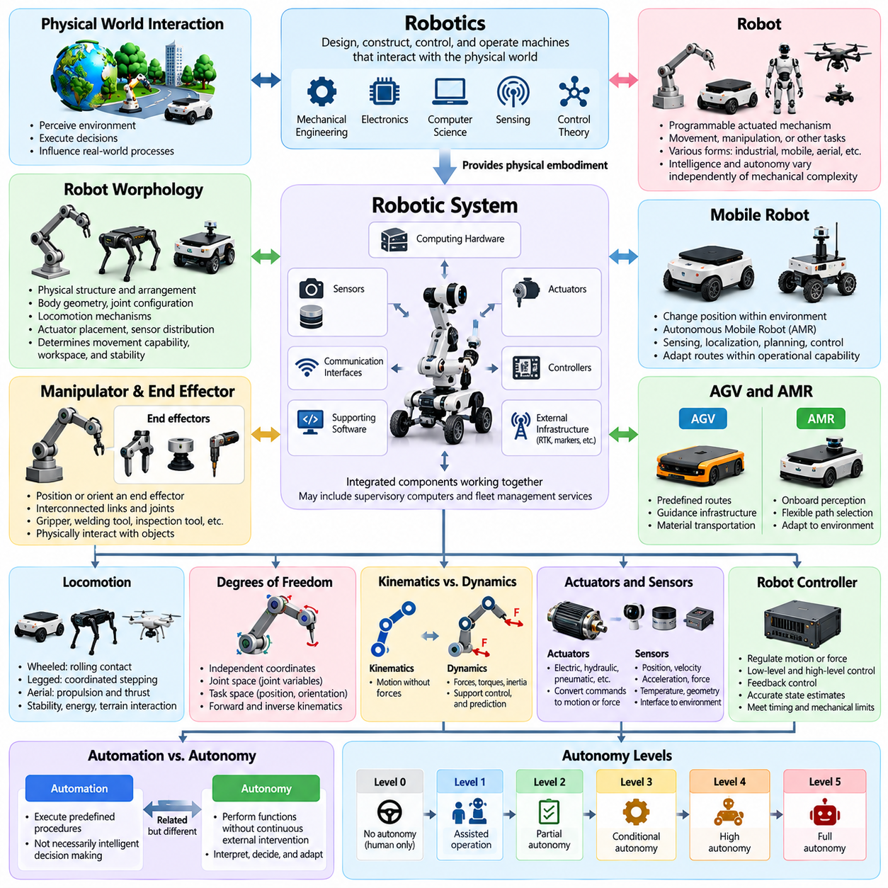{width="7.268055555555556in" height="7.268055555555556in"}

로보틱스(Robotics)는 물리적 세계(Physical World)와 상호작용할 수 있는 기계를 설계하고, 제작하고, 제어하며, 운영하는 데 중점을 두는 학제 간 분야(Interdisciplinary Field)이다. 로보틱스는 기계공학(Mechanical Engineering), 전자공학(Electronics), 컴퓨터과학(Computer Science), 센싱(Sensing), 제어 이론(Control Theory)을 통합한다. 피지컬 인공지능(Physical AI)에서 로보틱스는 지능형 시스템이 환경 조건을 인식하고, 의사결정을 실행하며, 실제 세계의 프로세스에 영향을 미치는 물리적 체화(Physical Embodiment)를 제공한다.

로봇(Robot)은 물리적 작업을 수행하기 위해 움직임, 조작 또는 기타 물리적 기능을 실행하는 프로그래밍 가능한 구동 메커니즘(Programmable Actuated Mechanism)으로서 일정 수준의 자율성(Degree of Autonomy)을 갖는다. 로봇은 산업 시설(Industrial Facility), 창고(Warehouse), 병원(Hospital), 가정(Home), 야외 환경(Outdoor Environment), 원격 위치(Remote Location) 등에서 작동할 수 있다. 로봇의 구성은 고정형 매니퓰레이터(Fixed Manipulator)부터 이동 플랫폼(Mobile Platform)과 항공 시스템(Aerial System)까지 다양하다. 지능(Intelligence)과 자율성(Autonomy)의 수준은 기계적 복잡성(Mechanical Complexity)과 별개로 달라질 수 있다.

로봇 시스템(Robotic System)은 물리적 로봇, 센서(Sensor), 액추에이터(Actuator), 제어기(Controller), 컴퓨팅 하드웨어(Computing Hardware), 통신 인터페이스(Communication Interface), 지원 소프트웨어(Supporting Software)를 포함한다. 응용 분야에 따라 외부 위치 추정 인프라(External Localization Infrastructure), 감독용 컴퓨터(Supervisory Computer), 로봇 플릿 관리 서비스(Fleet Management Service)가 추가될 수 있다. 시스템 경계(System Boundary)를 명확하게 정의해야 하는 이유는 운영 성능(Operational Performance)이 이러한 구성요소 사이의 상호작용에 의존하기 때문이다.

로봇 형태(Robot Morphology)는 로봇 구성요소의 물리적 구조와 배치를 설명한다. 주요 특성에는 본체 기하학적 구조(Body Geometry), 관절 구성(Joint Configuration), 이동 메커니즘(Locomotion Mechanism), 액추에이터 배치(Actuator Placement), 센서 분포(Sensor Distribution)가 포함된다. 로봇 형태는 이동 능력(Movement Capability), 작업 공간(Workspace), 안정성(Stability), 상호작용 가능성을 결정한다. 피지컬 인공지능은 지능적인 의사결정을 실행 가능한 행동으로 변환할 때 이러한 특성을 고려해야 한다.

매니퓰레이터(Manipulator)는 작업 공간(Workspace) 내에서 말단 장치(End Effector)의 위치나 방향을 설정하도록 설계된 로봇 메커니즘이다. 일반적으로 액추에이터로 제어되는 연결 링크(Link)와 관절(Joint)로 구성된다. 말단 장치는 매니퓰레이터의 끝부분에 부착되는 장치로, 그리퍼(Gripper), 용접 도구(Welding Tool), 검사 장비(Inspection Instrument) 등이 이에 해당한다. 조작(Manipulation)은 제어된 움직임과 힘을 통해 객체(Object)와 물리적으로 상호작용하는 활동이다.

이동 로봇(Mobile Robot)은 환경 내에서 자신의 위치를 변경할 수 있는 로봇 플랫폼(Robotic Platform)이다. 자율이동로봇(Autonomous Mobile Robot, AMR)은 센싱(Sensing), 위치 추정(Localization), 계획(Planning), 제어(Control)를 활용하여 다양한 수준의 독립성으로 이동한다. 고정된 유도 인프라(Fixed Guidance Infrastructure)에 제한되는 시스템과 달리, 자율이동로봇은 자신의 운영 능력 범위 안에서 경로에 적응할 수 있다. 다만 자율성은 환경 조건과 안전 요구사항(Safety Requirements)에 의해 제한된다.

무인운반차(Automated Guided Vehicle, AGV)는 일반적으로 사전에 정의된 경로나 유도 인프라(Guidance Infrastructure)를 따라 자재를 운반하는 시스템과 관련된다. 자율이동로봇(AMR)은 일반적으로 온보드 인식(Onboard Perception)과 내비게이션(Navigation) 기능을 사용하여 경로를 보다 유연하게 선택하거나 조정한다. 이러한 구분은 일반적인 아키텍처 접근법을 설명하는 것이며, 절대적인 기술적 경계를 의미하지는 않는다. 두 플랫폼 모두 자율 기능과 외부 감독 제어(External Supervisory Control)를 통합할 수 있다.

이동(Locomotion)은 로봇이 환경 내에서 움직이는 데 사용하는 메커니즘과 과정을 의미한다. 바퀴형 이동(Wheeled Locomotion)은 구름 접촉(Rolling Contact)을 활용하며, 다리형 이동(Legged Locomotion)은 지지와 보행을 위한 협응 동작(Coordinated Stepping)에 의존한다. 항공 이동(Aerial Locomotion)은 추진력과 공기역학적 제어(Aerodynamic Control) 또는 추력 기반 제어(Thrust-Based Control)를 활용한다. 각 이동 방식은 안정성, 에너지 소비(Energy Consumption), 지형 상호작용(Terrain Interaction), 움직임 계획(Motion Planning)에 서로 다른 요구사항을 발생시킨다.

자유도(Degrees of Freedom)는 로봇의 구성(Configuration)이나 움직임을 정의하는 데 필요한 독립 좌표(Independent Coordinate)의 수를 의미한다. 관절 공간(Joint Space)은 관절 변수(Joint Variable)를 통해 로봇 구성을 표현하며, 작업 공간(Task Space)은 작업 목표와 관련된 위치, 방향 또는 움직임을 표현한다. 순기구학(Forward Kinematics)은 관절 구성으로부터 결과적인 기하학적 상태를 계산한다. 역기구학(Inverse Kinematics)은 지정된 작업 공간 목표를 달성할 수 있는 관절 구성을 결정한다.

로봇 동역학(Robot Dynamics)은 힘(Force), 토크(Torque), 움직임(Motion), 관성(Inertia), 외부 상호작용 사이의 관계를 설명한다. 기구학(Kinematics)은 움직임을 발생시키는 힘을 직접 고려하지 않고 움직임 자체를 설명한다. 동역학 모델(Dynamic Model)은 제어, 시뮬레이션(Simulation), 물리적 행동 예측을 지원한다. 모델의 정확도는 기계적 매개변수(Mechanical Parameter), 접촉 조건(Contact Condition), 탑재 하중(Payload) 변화, 작동 중 달라질 수 있는 환경적 영향(Environmental Effect)에 따라 달라진다.

액추에이터(Actuator)는 제어 명령(Control Command)과 이용 가능한 에너지를 물리적 움직임이나 힘으로 변환한다. 액추에이터는 전기식(Electric), 유압식(Hydraulic), 공압식(Pneumatic) 또는 특수 메커니즘(Specialized Mechanism)을 기반으로 할 수 있다. 센서(Sensor)는 위치(Position), 속도(Velocity), 가속도(Acceleration), 힘(Force), 온도(Temperature), 환경 기하학(Environmental Geometry)과 같은 물리량을 측정한다. 센서와 액추에이터는 함께 계산 지능(Computational Intelligence)과 물리적 실행(Physical Execution) 사이의 인터페이스를 형성한다.

로봇 제어기(Robot Controller)는 움직임, 힘 또는 기타 운영 변수를 조절하기 위한 명령을 생성한다. 저수준 제어(Low-Level Control)는 일반적으로 액추에이터 동작과 안정화(Stabilization)를 담당하며, 상위 수준 제어(Higher-Level Control)는 궤적(Trajectory)과 작업 목표(Task Objective)를 조정한다. 피드백 제어(Feedback Control)는 측정된 결과를 활용하여 원하는 상태에서 벗어난 편차를 수정한다. 효과적인 제어에는 적절한 시간 제약 준수, 정확한 상태 추정(State Estimation), 기계적 한계(Mechanical Limitation) 준수가 필요하다.

자율성(Autonomy)은 로봇 시스템이 지속적인 외부 개입 없이 할당된 기능을 수행할 수 있는 능력을 의미한다. 자동화(Automation)는 사전에 정의된 메커니즘이나 절차를 통해 기능을 실행하는 보다 광범위한 개념이다. 자동화 시스템이라고 해서 반드시 상당한 수준의 의사결정 자율성을 갖는 것은 아니다. 자율 로봇(Autonomous Robot)은 일반적으로 조건을 해석하고, 행동을 선택하며, 운영 변화에 대응할 수 있는 능력을 요구한다.

자율성 수준(Autonomy Levels)은 인간 작업자(Human Operator)와 로봇 시스템 사이에 책임이 어떻게 분배되는지를 설명한다. 이러한 차이에는 인식, 의사결정 권한(Decision Authority), 실행, 감독(Supervision), 개입 요구사항(Intervention Requirements)이 포함될 수 있다. 모든 로봇 분야에 보편적으로 적용할 수 있는 단일 자율성 척도(Autonomy Scale)는 존재하지 않는다. 따라서 자율성 분류(Autonomy Classification)는 단순히 수준 번호에 의존하기보다 해당 프레임워크, 운영 가정(Operational Assumption), 구체적인 기능을 명시해야 한다.

원격 조작(Teleoperation)은 인간 작업자가 발행한 명령을 통해 로봇을 원격으로 제어하는 것을 의미한다. 직접 원격 조작(Direct Teleoperation)은 지속적인 인간 제어를 요구할 수 있지만, 감독 제어(Supervisory Control)는 작업자가 목표를 지정하고 자율적 실행을 모니터링하도록 한다. 공유 자율성(Shared Autonomy)은 인간의 안내와 기계가 생성한 지원을 결합한다. 이러한 운영 방식은 권한(Authority), 책임(Responsibility), 제어(Control)가 어떻게 분배되는지에 따라 구분된다.

인간-로봇 상호작용(Human-Robot Interaction)은 인간과 로봇 시스템 사이의 의사소통과 협응 행동(Coordinated Behavior)을 의미한다. 인터페이스에는 디스플레이(Display), 음성 명령(Voice Command), 제스처(Gesture), 물리적 제어 장치(Physical Control), 직접적인 물리적 상호작용이 포함될 수 있다. 인간-로봇 협업(Human-Robot Collaboration)은 공동의 운영 목표(Shared Operational Objective)를 달성하기 위해 활동을 조정하는 것을 의미한다. 효과적인 상호작용에는 이해하기 쉬운 시스템 행동, 적절한 권한 배분, 불확실성과 안전을 관리하는 메커니즘이 필요하다.

위치 추정(Localization)은 기준 좌표계(Reference Frame) 또는 지도(Map)를 기준으로 로봇의 위치와 방향을 추정하는 과정이다. 매핑(Mapping)은 환경의 기하학적 구조 또는 기타 관련 속성을 표현하는 지도를 구축하는 과정이다. 동시적 위치 추정 및 지도 작성(Simultaneous Localization and Mapping, SLAM)은 지도를 개발하거나 갱신하는 동시에 로봇의 자세(Robot Pose)를 추정한다. 이러한 기능은 내비게이션과 자율 운영(Autonomous Operation)에 필수적인 공간 정보를 제공한다.

내비게이션(Navigation)은 환경 조건과 운영 제약을 고려하면서 로봇을 목적지까지 이동시키는 과정이다. 경로 계획(Path Planning)은 기하학적 경로를 결정하며, 궤적 계획(Trajectory Planning)은 여기에 시간에 따른 움직임까지 고려한다. 움직임 계획(Motion Planning)은 구성(Configuration) 또는 상태(State) 사이에서 실현 가능한 전이를 다룬다. 장애물 회피(Obstacle Avoidance)는 실행 중 충돌 위험을 줄이기 위해 로봇의 행동을 조정한다.

로봇 작업(Robotic Task)은 원하는 운영 결과를 정의하며, 행동(Behavior)은 그 결과를 달성하기 위해 사용하는 동작이나 제어 패턴을 설명한다. 기술(Skill)은 물체 잡기(Grasping), 도킹(Docking), 경로 추종(Route Following), 문 열기와 같은 재사용 가능한 능력이다. 작업 계획(Task Planning)은 여러 기술이나 행동을 목적에 맞는 순서로 조정한다. 피지컬 인공지능은 학습된 기술(Learned Skill)을 기호 기반 계획(Symbolic Planning) 및 기존 제어 메커니즘과 결합할 수 있다.

로봇 운영 환경(Robot Operating Environment)에는 물리적 기하 구조, 표면, 장애물, 사람, 장비, 관련 환경 조건이 포함된다. 정형 환경(Structured Environment)은 상대적으로 예측 가능한 배치를 제공하지만, 비정형 환경(Unstructured Environment)은 더 큰 변동성을 포함한다. 동적 환경(Dynamic Environment)에는 움직이는 객체나 변화하는 조건이 존재한다. 운영 설계 영역(Operational Design Domain)은 특정 자율 기능이 작동하도록 의도된 조건을 명시한다.

로봇 플릿(Robot Fleet)은 운영 목표를 달성하기 위해 관리되거나 조정되는 로봇 시스템의 집합이다. 플릿 관리(Fleet Management)에는 작업 할당(Task Assignment), 일정 관리(Scheduling), 교통 조정(Traffic Coordination), 모니터링(Monitoring), 자원 배분(Resource Allocation)이 포함된다. 다중 로봇 조정(Multi-Robot Coordination)은 개별 에이전트 사이의 상호작용을 다룬다. 이기종 플릿(Heterogeneous Fleet)은 이동 로봇, 매니퓰레이터, 항공 시스템처럼 서로 다른 능력을 가진 플랫폼을 결합한다.

상호운용성(Interoperability)은 로봇 구성요소나 시스템이 정보를 교환하고 이를 의미 있게 활용할 수 있는 능력을 의미한다. 인터페이스(Interface)는 통신 방식, 데이터 구조(Data Structure), 명령, 운영상의 기대사항(Operational Expectation)을 정의한다. 모듈성(Modularity)은 전체 아키텍처에 미치는 영향을 제한하면서 구성요소를 개발하거나 교체할 수 있도록 한다. 표준화된 인터페이스(Standardized Interface)는 로봇 플랫폼 전반의 통합, 유지보수성(Maintainability), 호환성(Compatibility)을 향상할 수 있다.

로봇 안전(Robot Safety)은 기계적 움직임, 에너지, 상호작용, 자율적 의사결정과 관련된 허용할 수 없는 위험을 식별하고 줄이는 것을 의미한다. 비상 정지(Emergency Stopping), 보호 정지(Protective Stopping), 속도 제한(Speed Limitation), 충돌 모니터링(Collision Monitoring)은 안전 관련 기능의 사례이다. 기능 안전(Functional Safety)은 제어 시스템을 통해 구현되는 안전 기능을 다룬다. 인공지능 기반 의사결정(AI-Based Decision-Making)이 독립적으로 타당성이 입증된 안전 조치(Independently Justified Safety Measure)의 필요성을 없애지는 않는다.

신뢰성(Reliability)은 로봇 시스템이 정의된 기간 동안 지정된 조건에서 요구 기능을 수행할 수 있는 능력을 의미한다. 가용성(Availability)은 필요할 때 시스템이 작동 가능한 상태인지를 나타내며, 유지보수성(Maintainability)은 기능을 복구하는 작업의 용이성과 효과성을 설명한다. 강건성(Robustness)은 외란이나 불확실성이 존재해도 허용 가능한 행동을 지속하는 능력이다. 이러한 속성은 실제 배포와 운영의 지속가능성(Operational Sustainability)에 종합적으로 영향을 미친다.

로보틱스 및 자율성 용어(Robotics and Autonomy Terminology)는 물리적 메커니즘, 지능적 행동, 운영 책임, 시스템 성능을 설명하기 위한 공통 언어를 확립한다. 자동화, 자율성, 제어, 내비게이션, 조작, 협응 사이의 명확한 구분은 일관된 엔지니어링 의사소통(Engineering Communication)을 지원한다. 피지컬 인공지능에서 이러한 정의는 계산 지능을 체화된 운영(Embodied Operation)과 연결하며, 점점 더 높은 능력을 갖춘 자율 시스템을 평가하기 위한 기반을 제공한다.

## 09.04. Perception Localization Planning and Control Terms

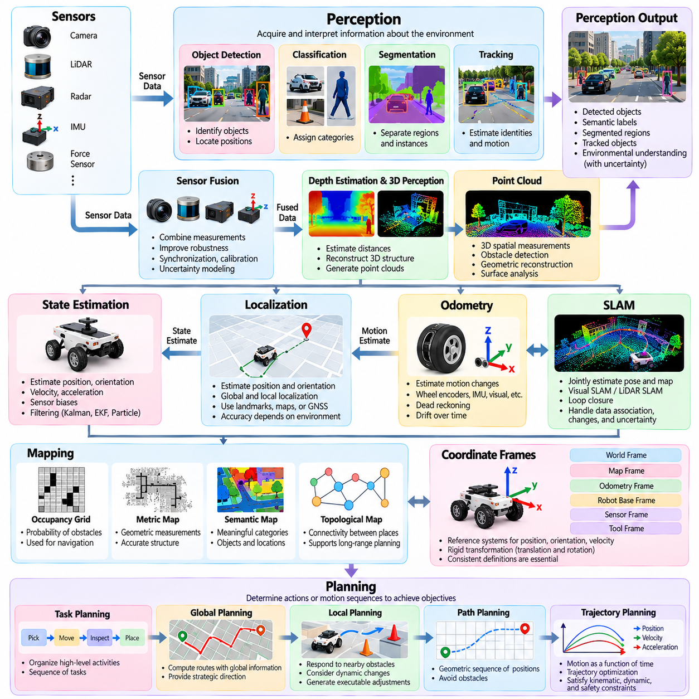{width="7.268055555555556in" height="7.268055555555556in"}

인식(Perception)은 피지컬 인공지능(Physical AI) 시스템이 센서(Sensor)와 계산 모델(Computational Model)을 사용하여 환경 정보를 획득하고 해석하는 과정이다. 인식은 원시 측정값(Raw Measurement)을 객체(Object), 표면(Surface), 움직임(Motion), 공간적 관계(Spatial Relationship)에 대한 표현으로 변환한다. 인식은 현재 상태에 관한 정보를 제공하여 위치 추정(Localization), 계획(Planning), 제어(Control)를 지원하지만, 그 결과에는 여전히 불확실성(Uncertainty)과 측정 오차(Measurement Error)가 존재할 수 있다.

센서 데이터(Sensor Data)는 카메라(Camera), 라이다(LiDAR), 레이더(Radar), 관성측정장치(Inertial Measurement Unit, IMU), 힘 센서(Force Sensor) 등의 장치에서 수집된 측정값을 의미한다. 센서 융합(Sensor Fusion)은 상호 보완적인 측정값을 결합하여 환경 이해(Environmental Understanding)와 상태 추정(State Estimation)을 개선한다. 융합은 원시 데이터 수준(Raw-Data Level), 특징 수준(Feature Level), 의사결정 수준(Decision Level)에서 수행될 수 있다. 여러 센싱 모달리티(Sensing Modality)의 관측값을 통합할 때는 정확한 시간 동기화(Synchronization), 보정(Calibration), 불확실성 모델링(Uncertainty Modeling)이 필수적이다.

객체 탐지(Object Detection)는 센서 관측값에서 객체의 존재와 위치를 식별하는 과정이다. 분류(Classification)는 의미적 범주(Semantic Category)를 할당하며, 분할(Segmentation)은 관측 정보를 의미 있는 영역이나 개별 객체 인스턴스(Instance)로 구분한다. 객체 추적(Object Tracking)은 시간에 따른 객체의 식별 정보와 움직임을 추정한다. 이러한 기능은 정적 구조물(Static Structure), 이동 가능한 객체(Movable Object), 사람(Human), 자율 운영(Autonomous Operation)과 관련된 기타 개체를 구분하여 환경 인식(Environmental Awareness)을 지원한다.

깊이 추정(Depth Estimation)은 센싱 장치와 관측된 표면 또는 객체 사이의 거리를 결정한다. 3차원 인식(Three-Dimensional Perception)은 깊이 카메라(Depth Camera), 스테레오 비전(Stereo Vision), 라이다 또는 학습된 기하학적 모델(Learned Geometric Model)을 사용하여 공간적 관계를 재구성한다. 포인트 클라우드(Point Cloud)는 3차원 좌표(Three-Dimensional Coordinates)로 표현된 공간 측정값의 집합이다. 이러한 정보를 해석하면 장애물 탐지(Obstacle Detection), 기하학적 재구성(Geometric Reconstruction), 표면 분석(Surface Analysis), 물리적 상호작용을 위한 공간 추론(Spatial Reasoning)이 가능해진다.

상태 추정(State Estimation)은 불완전하거나 잡음이 포함된 관측값으로부터 시스템의 가능한 상태를 결정하는 과정이다. 추정 변수(Estimated Variable)에는 위치(Position), 자세(Orientation), 속도(Velocity), 가속도(Acceleration), 센서 바이어스(Sensor Bias)가 포함될 수 있다. 필터링 기법(Filtering Technique)은 측정값과 수학적 모델(Mathematical Model)을 결합하여 시간에 따라 일관된 추정값을 유지한다. 칼만 필터(Kalman Filter), 확장 칼만 필터(Extended Kalman Filter), 파티클 필터(Particle Filter)는 서로 다른 추정 가정(Estimation Assumption)을 처리하기 위한 대표적인 접근법이다.

위치 추정(Localization)은 기준 좌표계(Reference Coordinate System)를 기준으로 로봇의 위치와 자세를 추정하는 과정이다. 전역 위치 추정(Global Localization)은 초기 위치를 알고 있다는 가정 없이 자세를 결정하며, 지역 위치 추정(Local Localization)은 기존 추정값을 기준으로 변화를 추적한다. 위치 추정은 랜드마크(Landmark), 지도(Map), 위성 항법(Satellite Navigation), 움직임 측정값(Motion Measurement)에 의존할 수 있다. 정확도(Accuracy)와 신뢰성(Reliability)은 환경 구조(Environmental Structure), 센서 품질(Sensor Quality), 추정 불확실성(Estimation Uncertainty)에 따라 달라진다.

오도메트리(Odometry)는 휠 엔코더(Wheel Encoder), 관성 측정값(Inertial Measurement), 시각 관측(Visual Observation), 기타 움직임 관련 정보를 사용하여 로봇의 이동 변화를 추정한다. 추측 항법(Dead Reckoning)은 연속적인 움직임 추정값을 적분하여 현재 자세(Pose)를 근사한다. 측정 오차가 누적되기 때문에 오도메트리에서는 일반적으로 시간이 지남에 따라 드리프트(Drift)가 발생한다. 외부 기준(External Reference), 지도 정합(Map Matching), 센서 융합은 누적된 불확실성을 줄이고 장기적인 위치 추정 성능을 개선할 수 있다.

동시적 위치 추정 및 지도 작성(Simultaneous Localization and Mapping, SLAM)은 로봇의 자세를 추정하면서 동시에 환경 지도를 구축하거나 갱신하는 기술이다. 시각 기반 SLAM(Visual SLAM)은 카메라 관측값을 사용하며, 라이다 기반 SLAM(LiDAR SLAM)은 주로 레이저 측정값에 의존한다. 루프 폐쇄(Loop Closure)는 이전에 방문한 위치를 다시 인식하여 누적된 지도 오차(Mapping Error)를 줄인다. SLAM 시스템은 데이터 연관(Data Association), 환경 변화(Environmental Change), 계산 자원 제약(Computational Limitation), 지도와 궤적(Trajectory)의 불확실성을 처리해야 한다.

지도 작성(Mapping)은 환경 구조와 관련 속성을 표현하는 정보를 생성하는 과정이다. 점유 격자 지도(Occupancy Grid)는 공간 셀(Spatial Cell)에 장애물이 존재할 확률을 표현하며, 계량 지도(Metric Map)는 기하학적 측정값(Geometric Measurement)을 보존한다. 의미 지도(Semantic Map)는 위치나 객체에 의미적 범주를 연결한다. 위상 지도(Topological Map)는 장소 사이의 연결 관계(Connectivity)를 표현한다. 서로 다른 지도 표현(Map Representation)은 내비게이션(Navigation), 계획, 환경 이해에 필요한 서로 다른 요구사항을 지원한다.

좌표계(Coordinate Frame)는 위치, 자세, 속도, 좌표 변환(Transformation)을 표현하기 위한 기준 체계를 제공한다. 일반적인 좌표계에는 월드 좌표계(World Frame), 지도 좌표계(Map Frame), 오도메트리 좌표계(Odometry Frame), 로봇 베이스 좌표계(Robot Base Frame), 센서 좌표계(Sensor Frame), 도구 좌표계(Tool Frame)가 포함된다. 강체 변환(Rigid Transformation)은 좌표계 사이의 상대적인 병진 이동(Translation)과 회전(Rotation)을 설명한다. 잘못된 좌표 변환은 위치 추정, 인식, 제어에서 심각한 오류를 발생시킬 수 있으므로 일관된 좌표계 정의가 필수적이다.

계획(Planning)은 정의된 제약 조건(Constraint) 아래에서 목표를 달성할 수 있는 행동이나 움직임의 순서를 결정한다. 작업 계획(Task Planning)은 상위 수준의 활동(High-Level Activity)을 구성하며, 움직임 계획(Motion Planning)은 물리적으로 실행 가능한 움직임을 결정한다. 경로 계획(Path Planning)은 기하학적 공간(Geometric Space)을 통과하는 경로를 식별하고, 궤적 계획(Trajectory Planning)은 시간과 동역학적 요구사항(Dynamic Requirement)을 추가로 고려한다. 이러한 계획 기능은 서로 다른 추상화 수준(Abstraction Level)에서 작동하지만 실행 과정에서 일관성을 유지해야 한다.

전역 계획(Global Planning)은 광범위한 환경 정보와 작업 목표를 활용하여 경로를 계산한다. 지역 계획(Local Planning)은 주변 장애물(Nearby Obstacle), 동적 변화(Dynamic Change), 즉각적인 움직임 제약(Motion Constraint)에 대응한다. 전역 계획은 전략적 방향(Strategic Direction)을 제공하고, 지역 계획기(Local Planner)는 실행 가능한 조정 동작을 생성할 수 있다. 두 계획 기능의 협력은 로봇이 장거리 목표(Long-Distance Objective)를 추구하면서도 빠르게 변화하는 조건이나 예상하지 못한 환경 외란(Environmental Disturbance)에 대응하도록 한다.

경로(Path)는 실행 시간을 반드시 지정하지 않고 구성(Configuration)이나 위치(Location)를 연결하는 기하학적 순서(Geometric Sequence)이다. 궤적(Trajectory)은 시간의 함수(Function of Time)로 표현되는 움직임으로, 위치, 속도, 가속도를 포함할 수 있다. 궤적 최적화(Trajectory Optimization)는 소요 시간(Duration), 에너지 소비(Energy Consumption), 부드러움(Smoothness), 장애물 이격 거리(Clearance) 등의 목적에 따라 후보 움직임(Candidate Motion)을 개선한다. 실행 가능한 궤적(Feasible Trajectory)은 기구학적 제약(Kinematic Constraint), 동역학적 제약(Dynamic Constraint), 안전 제약(Safety Constraint)을 충족해야 한다.

충돌 탐지(Collision Detection)는 객체의 기하학적 표현(Geometric Representation)이 서로 교차하거나 지정된 분리 조건(Separation Condition)을 위반하는지 판단한다. 충돌 회피(Collision Avoidance)는 충돌 위험(Collision Risk)을 줄이기 위해 행동을 선택하거나 수정한다. 구성 공간(Configuration Space)은 계획을 위해 로봇의 구성과 관련 장애물을 표현한다. 안전 여유(Safety Margin)는 불확실성, 객체 크기(Object Dimension), 위치 추정 오차(Localization Error), 센싱 또는 제어 성능의 한계를 고려한다.

행동 계획(Behavior Planning)은 목표, 환경 맥락(Environmental Context), 시스템 규칙(System Rule)에 따라 운영 행동(Operational Action)을 선택한다. 행동에는 양보(Yielding), 정지(Stopping), 추종(Following), 접근(Approaching), 도킹(Docking), 객체 조작(Object Manipulation)이 포함될 수 있다. 의사결정 메커니즘(Decision-Making Mechanism)에는 유한 상태 기계(Finite-State Machine), 행동 트리(Behavior Tree), 최적화 기법(Optimization Method), 학습된 정책(Learned Policy)이 사용될 수 있다. 행동 계획은 추상적인 작업 목표(Abstract Task Objective)를 움직임 생성(Motion Generation)과 실행(Execution)에 연결한다.

제어(Control)는 액추에이터(Actuator)와 기계 동역학(Mechanical Dynamics)에 영향을 미치는 명령을 생성하여 물리 시스템의 행동을 조절한다. 개루프 제어(Open-Loop Control)는 측정된 결과를 보정에 사용하지 않고 명령을 적용하지만, 폐루프 제어(Closed-Loop Control)는 피드백(Feedback)을 활용한다. 기준 신호(Reference Signal)는 원하는 행동을 지정하며, 제어 오차(Control Error)는 기준값과 실제 상태 사이의 편차를 측정한다. 피드백은 운영 한계(Operational Limit) 내에서 외란과 모델링 부정확성(Modeling Inaccuracy)을 보상할 수 있도록 한다.

비례-적분-미분 제어(Proportional-Integral-Derivative Control, PID Control)는 현재 오차, 누적 오차(Accumulated Error), 오차 변화량(Changing Error)을 활용하여 보정 명령(Corrective Command)을 생성한다. 모델 예측 제어(Model Predictive Control, MPC)는 시스템 동역학과 제약 조건을 고려하면서 유한한 예측 구간(Finite Prediction Horizon)에 걸쳐 미래 제어 행동(Future Control Action)을 최적화한다. 두 방법은 복잡성과 모델링 요구사항(Modeling Requirement)에서 차이가 있다. 적합성은 응답시간(Response Time), 가용 계산 자원(Available Computation), 물리적 운영 조건(Physical Operating Condition)에 따라 결정된다.

운동 제어(Motion Control)는 위치, 속도, 가속도, 자세와 같은 변수를 조절한다. 힘 제어(Force Control)는 상호작용 힘(Interaction Force)을 조절하며, 임피던스 제어(Impedance Control)는 움직임과 가해지는 힘 사이에 원하는 동적 관계(Dynamic Relationship)를 설정한다. 이러한 접근법은 로봇이 객체와 접촉하거나 사람과 상호작용할 때 특히 중요하다. 효과적인 상호작용 제어(Interaction Control)는 기계적 순응성(Mechanical Compliance), 접촉 불확실성(Contact Uncertainty), 액추에이터 한계(Actuator Limitation)를 고려해야 한다.

제어 정책(Control Policy)은 관측값이나 추정된 상태를 실행 가능한 행동(Executable Action)에 대응시킨다. 고전적 제어기(Classical Controller)는 일반적으로 명시적인 수학적 모델(Mathematical Model)이나 공학적으로 설계된 규칙(Engineered Rule)을 사용하지만, 학습 기반 제어기(Learned Controller)는 데이터나 경험으로부터 행동을 도출한다. 하이브리드 접근법(Hybrid Approach)은 모델 기반 제어(Model-Based Control)와 기계학습(Machine Learning)을 결합한다. 구현 방식과 관계없이 제어 정책은 물리적 제약, 시간 요구사항, 운영 안전 경계(Operational Safety Boundary)를 준수해야 한다.

실시간 제약(Real-Time Constraint)은 인식, 추정, 계획, 제어 계산이 사용 가능한 결과를 생성해야 하는 시점을 지정한다. 지연시간(Latency)은 처리 또는 통신 지연(Communication Delay)을 설명하며, 갱신 주파수(Update Frequency)는 정보나 명령이 얼마나 자주 갱신되는지를 나타낸다. 지터(Jitter)는 실행 타이밍(Execution Timing)의 변동을 의미한다. 과도한 지연이나 불규칙한 타이밍은 제어 안정성(Control Stability)을 저하시키고, 추적 정확도(Tracking Accuracy)를 감소시키며, 협응된 자율 행동(Coordinated Autonomous Behavior)에 문제를 일으킬 수 있다.

불확실성 전파(Uncertainty Propagation)는 센싱과 추정에서 발생한 오차가 이후의 예측, 계획, 제어 행동에 어떻게 영향을 미치는지를 설명한다. 위치 추정 오차는 장애물 위치(Obstacle Position)를 왜곡할 수 있으며, 부정확한 움직임 예측(Motion Prediction)은 궤적 실현 가능성(Trajectory Feasibility)을 감소시킬 수 있다. 강건한 피지컬 인공지능 아키텍처(Robust Physical AI Architecture)는 완벽한 정보를 가정하는 대신 신뢰도 추정(Confidence Estimation), 보수적 제약(Conservative Constraint), 모니터링(Monitoring), 보정 피드백(Corrective Feedback)을 통해 이러한 의존 관계를 고려한다.

인식, 위치 추정, 계획, 제어는 서로 분리된 계산 기능이 아니라 상호 연결된 운영 프레임워크(Interconnected Operational Framework)를 구성한다. 인식은 환경 관측(Environmental Observation)을 해석하고, 위치 추정은 공간적 맥락(Spatial Context)을 확립하며, 계획은 의도한 행동(Intended Behavior)을 결정하고, 제어는 물리적 행동(Physical Action)을 실행한다. 실행 결과에서 얻은 피드백은 이후의 추정과 의사결정을 갱신하여 물리적 세계와의 지능적 상호작용(Intelligent Interaction)이 지속되는 순환 구조를 형성한다.

이러한 기능 전반에서 일관된 용어 체계(Consistent Terminology)를 유지하는 것은 시스템 통합(System Integration), 기술 문서화(Technical Documentation), 성능 평가(Performance Evaluation)에 필수적이다. 자세(Pose), 상태(State), 경로(Path), 궤적(Trajectory), 정책(Policy), 제어기(Controller), 불확실성(Uncertainty)과 같은 용어는 공학 분야 전반에서 정확한 의미를 유지해야 한다. 명확한 정의는 개발자가 시스템 경계(System Boundary)를 식별하고, 오류를 추적하며, 인터페이스(Interface)를 확립하고, 재현 가능한 운영 조건(Reproducible Operating Condition)에서 피지컬 인공지능 역량(Physical AI Capability)을 평가할 수 있도록 한다.

## 09.05. Embodied AI and World Model Terms

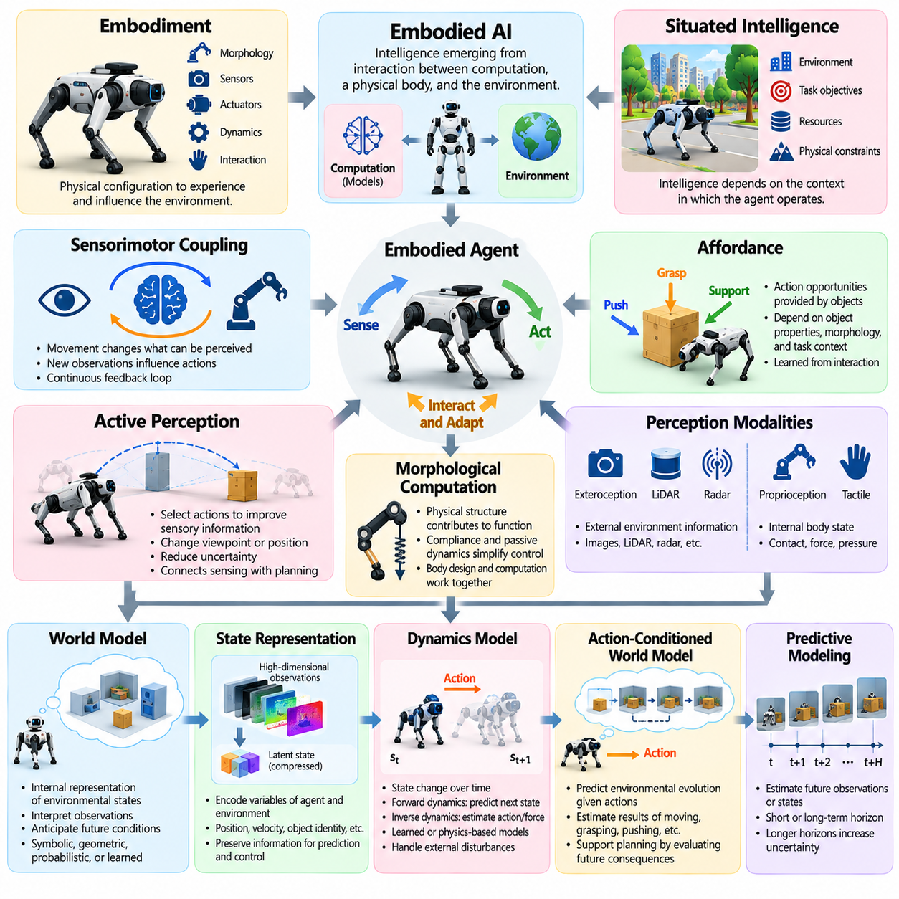{width="7.268055555555556in" height="7.268055555555556in"}

체화 인공지능(Embodied AI)은 계산 과정(Computational Process), 물리적 신체(Physical Body), 주변 환경(Surrounding Environment) 사이의 상호작용을 통해 지능적 능력이 발현되는 인공지능을 의미한다. 순수한 기호적 지능(Symbolic Intelligence)이나 디지털 지능(Digital Intelligence)과 달리, 체화 지능(Embodied Intelligence)은 센싱(Sensing), 움직임(Movement), 물리적 제약(Physical Constraint)에 의존한다. 신체는 단순한 실행 메커니즘(Execution Mechanism)이 아니라 인식(Perception), 학습(Learning), 추론(Reasoning), 행동(Action)에 영향을 미치는 핵심 구성요소이다.

체화(Embodiment)는 지능형 에이전트(Intelligent Agent)가 환경을 경험하고 환경에 영향을 미치는 물리적 구성을 설명한다. 여기에는 형태학적 구조(Morphology), 센서(Sensor), 액추에이터(Actuator), 기계 동역학(Mechanical Dynamics), 상호작용 능력(Interaction Capability)이 포함된다. 서로 다른 체화 형태는 학습과 행동에 서로 다른 기회와 한계를 제공한다. 따라서 특정 로봇 플랫폼(Robotic Platform)을 위해 개발된 지능은 다른 물리적 형태에서 효과적으로 작동하기 전에 적응(Adaptation)이 필요할 수 있다.

상황 기반 지능(Situated Intelligence)은 지능적 행동(Intelligent Behavior)이 에이전트가 작동하는 맥락(Context)에 의존한다는 점을 강조한다. 환경 구조(Environmental Structure), 작업 목표(Task Objective), 가용 자원(Available Resource), 물리적 제약은 의사결정(Decision-Making)에 영향을 미친다. 체화 에이전트(Embodied Agent)는 운영 조건(Operating Condition)과 독립적으로 완전히 이해될 수 없다. 따라서 상황 기반 접근법(Situated Approach)은 지능을 에이전트, 환경, 수행 중인 활동 사이에서 지속적으로 형성되는 관계로 분석한다.

감각운동 결합(Sensorimotor Coupling)은 감각 관측(Sensory Observation)과 운동 행동(Motor Action) 사이의 지속적인 관계를 설명한다. 움직임은 에이전트가 인식할 수 있는 대상을 변화시키며, 새로운 관측값은 이후의 움직임에 영향을 미친다. 이러한 상호적 과정(Reciprocal Process)은 능동적 탐색(Active Exploration), 피드백 기반 제어(Feedback-Based Control), 적응적 상호작용(Adaptive Interaction)을 가능하게 한다. 체화 시스템에서 인식과 행동은 독립적인 계산 단계가 아니라 서로 연결된 과정이다.

행동 유도성(Affordance)은 환경이나 객체가 에이전트의 능력에 따라 제공하는 행동 가능성(Action Opportunity)을 의미한다. 손잡이(Handle)는 당기는 행동을 가능하게 할 수 있으며, 평평한 표면(Flat Surface)은 지지하거나 물체를 놓는 행동을 가능하게 할 수 있다. 행동 유도성은 객체 속성(Object Property), 로봇 형태(Robot Morphology), 작업 맥락(Task Context)에 따라 달라진다. 행동 유도성 학습(Affordance Learning)은 피지컬 인공지능(Physical AI) 시스템이 사전에 정의된 객체 범주(Object Category)에만 의존하지 않고 가능한 상호작용을 추론하도록 한다.

능동 인식(Active Perception)은 감각 정보(Sensory Information)의 품질이나 유용성을 개선하기 위해 의도적으로 행동을 선택하는 것을 의미한다. 로봇은 불확실성(Uncertainty)을 줄이기 위해 카메라 위치를 변경하거나, 객체에 접근하거나, 관측 시점(Viewpoint)을 바꿀 수 있다. 이러한 행동은 당장의 물리적 작업을 직접 진전시키지 않더라도 가치가 있다. 능동 인식은 정보 수집(Information Gathering)과 계획(Planning)을 연결하며, 센싱이 지능적 행동의 의도적인 구성요소가 될 수 있음을 보여준다.

고유수용감각(Proprioception)은 관절 위치(Joint Position), 속도(Velocity), 신체 방향(Body Orientation) 등 에이전트 내부의 물리적 상태를 감지하는 것을 의미한다. 외수용감각(Exteroception)은 카메라(Camera), 라이다(LiDAR), 레이더(Radar) 및 관련 센서를 통해 외부 환경에 관한 정보를 획득하는 것을 의미한다. 촉각 인식(Tactile Perception)은 압력(Pressure), 힘(Force), 표면 상호작용(Surface Interaction)과 같은 접촉 관련 속성을 측정한다. 이러한 감각 모달리티(Sensory Modality)를 결합하면 신체 인식(Body Awareness)과 신뢰할 수 있는 물리적 상호작용을 지원할 수 있다.

형태적 계산(Morphological Computation)은 물리적 구조와 기계적 특성이 명시적인 계산(Explicit Computation)을 통해 수행해야 할 수도 있는 기능에 기여하는 현상을 설명한다. 순응성(Compliance), 수동 동역학(Passive Dynamics), 신체 기하학(Body Geometry)은 안정화(Stabilization)나 조작(Manipulation)을 단순화할 수 있다. 이러한 개념이 신체 자체가 모든 지능적 추론을 독립적으로 수행한다는 의미는 아니다. 오히려 물리적 설계(Physical Design)와 계산 제어(Computational Control)가 체화 행동(Embodied Behavior)을 공동으로 결정한다는 점을 강조한다.

세계 모델(World Model)은 환경 상태(Environmental State), 관계(Relationship), 동역학(Dynamics)에 대한 내부 표현(Internal Representation)으로, 관측값을 해석하거나 미래 조건을 예측하는 데 사용된다. 세계 모델은 기호적(Symbolic), 기하학적(Geometric), 확률적(Probabilistic) 형태이거나 신경망(Neural Network)을 통해 학습될 수 있다. 세계 모델의 목적은 예측(Prediction)과 의사결정에 필요한 정보를 포착하는 것이다. 모든 물리적 세부사항을 재현할 필요는 없지만, 의도한 작업에 중요한 속성은 보존해야 한다.

상태 표현(State Representation)은 에이전트와 환경의 조건을 설명하는 변수(Variable)를 부호화한다. 이러한 변수에는 위치(Position), 속도(Velocity), 객체 식별 정보(Object Identity), 공간적 관계(Spatial Relationship), 상호작용 상태(Interaction Status)가 포함될 수 있다. 잠재 상태(Latent State)는 관측값으로부터 추론된 압축된 내부 표현(Compressed Internal Representation)이다. 잠재 표현(Latent Representation)은 원시 감각 데이터(Raw Sensory Data)가 고차원(High-Dimensional)일 때 유용하지만, 압축 과정에서도 정확한 예측과 효과적인 제어에 필요한 정보는 보존되어야 한다.

동역학 모델(Dynamics Model)은 행동(Action)과 외부 외란(External Disturbance)에 대한 반응을 포함하여 시스템 상태가 시간에 따라 어떻게 변화하는지를 설명한다. 순방향 동역학(Forward Dynamics)은 현재 조건과 적용된 행동으로부터 미래 상태를 예측한다. 역동역학(Inverse Dynamics)은 원하는 상태 전이(State Transition)와 관련된 행동이나 힘을 추정한다. 학습 기반 동역학 모델(Learned Dynamics Model)은 경험을 통해 이러한 관계를 근사하며, 물리 기반 모델(Physics-Based Model)은 물리적 과정에 대한 수학적 설명으로부터 관계를 도출한다.

행동 조건부 세계 모델(Action-Conditioned World Model)은 에이전트가 선택한 행동을 고려하여 환경의 변화를 예측한다. 이 모델은 이동(Moving), 파지(Grasping), 밀기(Pushing), 객체와의 상호작용이 미래 상태를 어떻게 변화시킬 수 있는지 추정한다. 이러한 능력은 행동을 고려한 예측(Action-Aware Prediction)을 수동적 예측(Passive Forecasting)과 구별한다. 행동 조건화(Action Conditioning)는 후보 의사결정(Candidate Decision)의 예상되는 물리적 결과(Expected Physical Consequence)를 평가할 수 있게 하므로 계획을 지원한다.

예측적 세계 모델링(Predictive World Modeling)은 이용 가능한 정보로부터 미래 관측값(Future Observation), 상태(State), 잠재 표현(Latent Representation)을 추정한다. 예측은 짧은 제어 구간(Control Interval)부터 더 긴 계획 구간(Planning Horizon)까지 수행될 수 있다. 예측 지평(Prediction Horizon)은 모델이 시스템의 변화를 미래의 어느 시점까지 추정하려 하는지를 나타낸다. 예측 지평이 길어질수록 작은 모델링 오차(Modeling Error), 환경 외란(Environmental Disturbance), 알려지지 않은 미래 상호작용이 누적될 수 있으므로 불확실성이 증가한다.

모델 기반 계획(Model-Based Planning)은 환경 동역학(Environmental Dynamics)에 대한 표현을 사용하여 실행 전에 가능한 행동을 평가한다. 시스템은 후보 궤적(Candidate Trajectory)을 시뮬레이션하고, 예측 결과(Predicted Outcome)를 비교하며, 목표와 제약 조건을 만족하는 행동을 선택할 수 있다. 모델 예측 제어(Model Predictive Control, MPC)는 이동하는 예측 지평(Moving Horizon)에 걸쳐 이러한 과정을 반복적으로 수행한다. 세계 모델 기반 계획(World-Model-Based Planning)은 이 원리를 복잡한 환경과 상호작용에 대한 학습된 표현(Learned Representation)으로 확장한다.

모델 기반 강화학습(Model-Based Reinforcement Learning)에서 상상(Imagination)은 내부 동역학 모델(Internal Dynamics Model)을 사용하여 가상의 미래 경험(Hypothetical Future Experience)을 생성하는 것을 의미한다. 에이전트는 모든 대안을 실제로 실행하지 않고도 가능한 행동 순서(Action Sequence)를 평가할 수 있다. 상상된 궤적(Imagined Trajectory)은 정책 학습(Policy Learning), 가치 추정(Value Estimation), 계획을 지원할 수 있다. 그 유용성은 모델 충실도(Model Fidelity), 불확실성 관리(Uncertainty Management), 시뮬레이션 예측과 실제 물리적 결과 사이의 관계에 따라 달라진다.

신념 상태(Belief State)는 실제 상태를 완전히 관측할 수 없을 때 가능한 환경 상태에 대한 에이전트의 확률 분포(Probability Distribution)를 나타낸다. 부분 관측 가능성(Partial Observability)은 센서가 불완전하거나 잡음이 포함되거나 가려진 측정값을 제공하기 때문에 발생한다. 신념 갱신(Belief Updating)은 새로운 관측값과 행동 정보를 반영하여 상태 추정값을 수정한다. 이러한 확률적 관점(Probabilistic Perspective)은 불확실성과 제한된 가시성(Limited Visibility) 아래에서 작동하는 체화 에이전트에 중요하다.

객체 중심 세계 모델(Object-Centric World Model)은 관측값을 구분되지 않은 신호(Undifferentiated Signal)로만 처리하는 대신 객체와 객체 사이의 관계를 통해 환경을 표현한다. 객체는 위치, 기하학적 구조(Geometry), 속도, 상호작용 속성(Interaction Property)과 같은 특성을 가질 수 있다. 관계형 표현(Relational Representation)은 개체 사이의 연결과 의존 관계(Dependency)를 설명한다. 이러한 모델은 구조화된 추론(Structured Reasoning), 구성적 예측(Compositional Prediction), 여러 객체가 상호작용하는 상황의 계획을 지원할 수 있다.

공간 세계 모델(Spatial World Model)은 환경 내의 기하학적 관계(Geometric Relationship)와 위상적 관계(Topological Relationship)를 부호화한다. 점유 표현(Occupancy Representation)은 장애물이 존재하는 영역을 추정하며, 의미적 표현(Semantic Representation)은 공간과 객체에 의미 있는 범주를 연결한다. 조감도 표현(Bird\'s-Eye-View Representation)은 정보를 공통된 공간적 관점(Common Spatial Perspective)으로 구성한다. 이러한 모델은 내비게이션(Navigation), 충돌 회피(Collision Avoidance), 환경 이해(Environmental Understanding), 물리적 공간에서의 이동 예측을 지원한다.

시간적 세계 모델(Temporal World Model)은 환경 조건과 상호작용이 시간에 따라 어떻게 변화하는지를 표현한다. 이러한 모델에는 메모리(Memory), 순환 계산(Recurrent Computation), 어텐션 메커니즘(Attention Mechanism), 학습된 상태 전이(Learned State Transition)가 포함될 수 있다. 시간적 일관성(Temporal Consistency)은 움직임, 접촉 사건(Contact Event), 다단계 상호작용(Multi-Step Interaction)을 예측할 때 필수적이다. 개별 관측값을 정확하게 해석하는 모델이라도 물리적으로 의존하는 사건의 연속을 예측할 때는 성능이 저하될 수 있다.

인과적 세계 모델(Causal World Model)은 개입(Intervention)이 이후의 물리적 결과(Physical Outcome)에 영향을 미치는 관계를 표현하려고 한다. 인과 추론(Causal Reasoning)은 행동이나 조건을 변경했을 때 미래 상태가 어떻게 달라지는지를 고려하므로 통계적 연관성(Statistical Association)과 구별된다. 반사실적 추론(Counterfactual Reasoning)은 실제로 발생한 사건과 다른 가상의 대안을 평가한다. 이러한 능력은 의사결정 분석(Decision Analysis), 실패 조사(Failure Investigation), 계획을 지원할 수 있지만, 신뢰할 수 있는 인과관계 식별(Causal Identification)은 여전히 어려운 과제이다.

물리 지식 기반 세계 모델(Physics-Informed World Model)은 학습된 표현이나 예측 메커니즘(Predictive Mechanism)에 물리적 지식(Physical Knowledge)을 통합한다. 움직임(Motion), 접촉(Contact), 보존 법칙(Conservation Principle), 시스템 동역학(System Dynamics)에 관한 제약은 물리적 행동과의 일관성을 개선할 수 있다. 하이브리드 접근법(Hybrid Approach)은 해석적 모델(Analytical Model)과 신경망을 결합하여 명시적으로 설명하기 어려운 효과를 포착한다. 그 효과성은 물리적 가정(Physical Assumption)의 타당성과 이용 가능한 관측값의 품질에 따라 달라진다.

세계 모델의 불확실성(Uncertainty)은 불완전한 관측(Incomplete Observation), 확률적 과정(Stochastic Process), 학습된 표현의 한계에서 발생한다. 우연적 불확실성(Aleatoric Uncertainty)은 관측값이나 결과에 내재된 변동성(Inherent Variability)을 의미하며, 인식론적 불확실성(Epistemic Uncertainty)은 모델 지식(Model Knowledge)의 불완전성을 의미한다. 신뢰할 수 있는 예측에는 적용 가능한 경우 두 가지 불확실성을 모두 인식하는 것이 필요하다. 불확실성 인식 계획(Uncertainty-Aware Planning)은 모델이 입증한 능력 범위(Model Competence)를 벗어나는 예측에 대한 의존도를 줄일 수 있다.

체화 학습(Embodied Learning)은 물리적 상호작용(Physical Interaction)이나 시뮬레이션 상호작용(Simulated Interaction)을 통해 지식이나 기술을 습득하는 것을 의미한다. 경험(Experience)에는 탐색(Exploration), 시연(Demonstration), 작업 실행(Task Execution), 환경 결과에 대한 피드백(Feedback)이 포함될 수 있다. 시뮬레이션-현실 전이(Sim-to-Real Transfer)는 시뮬레이션에서 개발한 능력을 실제 물리 시스템에 적용하는 것이다. 동역학, 센싱, 접촉 행동(Contact Behavior), 환경 조건의 차이는 전이 성능을 제한할 수 있으므로 실제 배포(Deployment) 전에 적응과 검증(Validation)이 필요하다.

체화 인공지능 및 세계 모델 용어(Embodied AI and World Model Terminology)는 물리적 상호작용과 예측적 이해(Predictive Understanding)에 기반한 지능을 설명하는 개념적 토대(Conceptual Foundation)를 확립한다. 체화는 에이전트가 환경을 경험하고 행동하는 방식을 정의하며, 세계 모델은 환경이 어떻게 변화할 수 있는지를 표현한다. 두 개념의 통합은 인식, 예측(Anticipation), 계획, 적응적 제어(Adaptive Control)가 협응된 시스템(Coordinated System)으로 작동하도록 하며, 점점 더 높은 능력을 갖춘 피지컬 인공지능 에이전트(Physical AI Agent)의 발전을 지원한다.

## 09.06. Foundation Model VLM VLA and Agent Terms

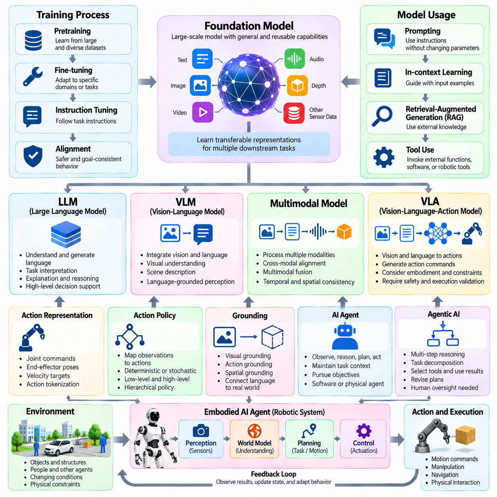{width="7.268055555555556in" height="7.268055555555556in"}

파운데이션 모델(Foundation Model)은 다양한 하위 작업(Downstream Task)을 지원하기 위해 광범위한 데이터셋(Dataset)으로 학습된 대규모 인공지능 모델(Artificial Intelligence Model)이다. 특정 응용 분야만을 위해 개발되는 대신, 프롬프팅(Prompting), 미세조정(Fine-Tuning), 추가 학습(Additional Training)을 통해 적응할 수 있는 재사용 가능한 표현(Reusable Representation)을 학습한다. 피지컬 인공지능(Physical AI)에서 파운데이션 모델은 일반적인 인식(Perception), 추론(Reasoning), 계획(Planning), 상호작용(Interaction) 능력을 제공할 수 있지만, 물리적 신뢰성(Physical Reliability)을 확보하려면 추가 검증(Validation)이 필요하다.

사전학습(Pretraining)은 파운데이션 모델이 대규모 데이터셋으로부터 폭넓게 전이 가능한 지식(Transferable Knowledge)을 습득하는 초기 학습 과정이다. 미세조정(Fine-Tuning)은 사전학습된 모델(Pretrained Model)을 특정 작업, 환경 또는 운영 요구사항(Operational Requirement)에 맞게 적응시킨다. 지시 미세조정(Instruction Tuning)은 작업 설명(Task Description)에 대한 응답 능력을 개선하며, 정렬 기법(Alignment Method)은 정의된 목표(Objective)와 제약 조건(Constraint)에 부합하는 행동을 유도한다. 이러한 과정은 모델의 능력에 영향을 미치지만, 그 자체만으로 안전성(Safety)을 보장하지는 않는다.

대규모 언어 모델(Large Language Model, LLM)은 언어 기반 시퀀스(Language-Based Sequence)를 처리하고 생성하도록 학습된 신경망(Neural Network)이다. 대규모 언어 모델은 지시사항(Instruction)을 해석하고, 설명을 생성하며, 계획을 구성하고, 기호적 추론(Symbolic Reasoning)을 지원할 수 있다. 로봇 시스템(Robotic System)에서는 작업 해석(Task Interpretation)과 의사결정 지원(Decision Support)을 위한 상위 수준 인터페이스(High-Level Interface)로 활용될 수 있다. 그러나 언어적 능력(Linguistic Competence)이 반드시 정확한 물리적 이해(Physical Understanding)나 신뢰할 수 있는 실행(Reliable Execution)을 의미하지는 않는다.

비전-언어 모델(Vision-Language Model, VLM)은 시각 정보(Visual Information)와 자연어(Natural Language)를 공유 계산 프레임워크(Shared Computational Framework) 내에서 통합한다. 이미지와 설명을 연결하고, 시각적 질문(Visual Question)에 답하며, 의미적 관계(Semantic Relationship)를 식별하고, 장면 맥락(Scene Context)을 해석할 수 있다. 피지컬 인공지능에서 비전-언어 모델은 언어 기반 시각 인식(Language-Grounded Perception)과 작업 이해(Task Understanding)를 지원한다. 다만 정밀한 기하학적 구조(Precise Geometry), 객체 상태(Object State), 안전 필수 의사결정(Safety-Critical Decision)과 관련된 출력은 검증이 필요하다.

멀티모달 파운데이션 모델(Multimodal Foundation Model)은 텍스트(Text), 이미지(Image), 비디오(Video), 오디오(Audio), 깊이(Depth), 구조화된 센서 측정값(Structured Sensor Measurement) 등 여러 모달리티(Modality)의 정보를 처리한다. 교차 모달 정렬(Cross-Modal Alignment)은 서로 다른 정보 출처에서 생성된 표현 사이의 관계를 확립한다. 멀티모달 융합(Multimodal Fusion)은 상호 보완적인 신호를 결합하여 해석이나 예측(Prediction)에 활용한다. 효과적인 물리적 응용에는 시간 동기화(Temporal Synchronization), 공간적 일관성(Spatial Consistency), 불확실성(Uncertainty)에 대한 적절한 처리가 필요하다.

비전-언어-행동 모델(Vision-Language-Action Model, VLA)은 시각 관측(Visual Observation)과 언어 지시(Language Instruction)를 행동 생성(Action Generation)에 연결한다. 주로 해석을 목적으로 설계된 비전-언어 모델과 달리, 비전-언어-행동 모델은 물리적 행동(Physical Behavior)에 영향을 미치도록 의도된 출력을 생성한다. 이러한 출력은 이산 행동(Discrete Action), 운동 명령(Motion Command), 연속 제어 변수(Continuous Control Variable)를 나타낼 수 있다. 따라서 VLA 시스템은 체화(Embodiment), 액추에이터 제약(Actuator Constraint), 실행 타이밍(Execution Timing), 운영 안전(Operational Safety)을 명시적으로 고려해야 한다.

행동 표현(Action Representation)은 학습과 실행을 위해 물리적 의사결정(Physical Decision)을 부호화하는 방식을 정의한다. 표현에는 관절 명령(Joint Command), 말단 장치 자세(End-Effector Pose), 속도 목표(Velocity Target), 상위 수준 로봇 기술(High-Level Robotic Skill)이 포함될 수 있다. 행동 토큰화(Action Tokenization)는 행동 정보를 시퀀스 모델(Sequence Model)에 적합한 이산 단위(Discrete Unit)로 변환한다. 선택한 표현 방식은 일반화(Generalization), 정밀도(Precision), 계산 요구사항(Computational Requirement), 서로 다른 로봇 플랫폼(Robotic Platform)과의 호환성(Compatibility)에 영향을 미친다.

행동 정책(Action Policy)은 관측값(Observation), 지시사항(Instruction), 추정 상태(Estimated State)를 목표 달성을 위한 행동에 대응시킨다. 정책(Policy)은 결정적(Deterministic)이거나 확률적(Stochastic)일 수 있으며, 서로 다른 시간적·기능적 수준에서 작동할 수 있다. 저수준 정책(Low-Level Policy)은 즉각적인 움직임을 조절하고, 고수준 정책(High-Level Policy)은 작업이나 기술을 선택한다. 계층적 정책(Hierarchical Policy)은 이러한 수준을 조정하여 추상적인 지시사항(Abstract Instruction)을 물리적으로 실행 가능한 행동(Physically Executable Behavior)에 연결한다.

인공지능 에이전트(AI Agent)는 관련 정보를 관측하고, 작업 맥락(Task Context)을 유지하며, 행동을 선택하고, 환경과의 상호작용을 통해 목표를 추구하는 시스템이다. 행위 주체성(Agency)은 목표 지향적 의사결정(Goal-Directed Decision-Making)과 행동을 수행하는 능력을 의미한다. 에이전트는 소프트웨어(Software) 내부에서만 작동하거나 물리적 로봇(Physical Robot)을 통해 작동할 수 있다. 물리적 에이전트(Physical Agent)는 추가적으로 센싱 불확실성(Sensing Uncertainty), 기계적 제약(Mechanical Constraint), 환경 외란(Environmental Disturbance), 실제 세계에서의 실행으로 발생하는 결과를 처리해야 한다.

에이전트형 인공지능(Agentic AI)은 여러 단계에 걸쳐 목표를 추구하기 위해 추론(Reasoning), 계획(Planning), 메모리(Memory), 행동 선택(Action Selection)을 조정하는 시스템을 설명한다. 에이전트형 행동(Agentic Behavior)에는 작업 분해(Task Decomposition), 도구 선택(Tool Selection), 결과 평가(Result Evaluation), 계획 수정(Plan Revision)이 포함될 수 있다. 이 용어는 보장된 자율성 수준(Autonomy Level)이 아니라 아키텍처적 또는 행동적 특성(Architectural or Behavioral Characteristic)을 설명한다. 응용 분야의 위험 수준(Application Risk)에 따라 인간 감독(Human Oversight)과 실행 경계(Execution Boundary)가 여전히 필요하다.

도구 사용(Tool Use)은 인공지능 시스템이 작업을 완료하기 위해 외부 함수(External Function), 소프트웨어 서비스(Software Service), 데이터베이스(Database), 로봇 기능(Robotic Capability)을 호출하는 것을 의미한다. 도구 인터페이스(Tool Interface)는 사용 가능한 작업(Operation), 필요한 입력(Required Input), 예상 출력(Expected Output)을 정의한다. 피지컬 인공지능에서 도구에는 내비게이션 서비스(Navigation Service), 조작 계획기(Manipulation Planner), 인식 모듈(Perception Module), 플릿 인터페이스(Fleet Interface)가 포함될 수 있다. 명령이 실패하거나 예상하지 못한 결과를 생성할 수 있으므로 도구 호출(Tool Invocation)은 검증된 물리적 실행(Verified Physical Execution)과 구별해야 한다.

그라운딩(Grounding)은 추상적 표현(Abstract Representation), 특히 언어를 물리적 환경에서 관측 가능한 개체(Entity), 행동(Action), 조건(Condition)에 연결하는 과정이다. 시각적 그라운딩(Visual Grounding)은 설명을 이미지 영역(Image Region)이나 객체(Object)와 연결하며, 행동 그라운딩(Action Grounding)은 지시사항을 실행 가능한 행동(Executable Behavior)과 연결한다. 공간적 그라운딩(Spatial Grounding)은 위치(Location)와 기준 좌표계(Reference Frame) 사이의 관계를 확립한다. 신뢰할 수 있는 그라운딩은 언어적 의도(Linguistic Intention)와 물리적 운영 요구사항(Physical Operational Requirement) 사이의 모호성(Ambiguity)을 줄인다.

프롬프팅(Prompting)은 모델 매개변수(Model Parameter)를 반드시 변경하지 않으면서 모델 출력(Model Output)에 영향을 미치는 지시사항이나 맥락 정보를 제공하는 것이다. 문맥 내 학습(In-Context Learning)은 입력 시퀀스(Input Sequence)에 포함된 예시를 사용하여 행동을 유도한다. 검색 증강 생성(Retrieval-Augmented Generation, RAG)은 외부에서 검색한 정보(Externally Retrieved Information)를 모델 응답에 통합한다. 이러한 기법은 작업 해석(Task Interpretation)을 개선할 수 있지만, 검색된 내용과 생성된 지시사항은 현재의 물리적 조건(Current Physical Condition)에 비추어 검증해야 한다.

인공지능 에이전트의 메모리(Memory)는 여러 상호작용에 걸쳐 의사결정을 지원하기 위해 유지하거나 검색하는 정보를 의미한다. 단기 메모리(Short-Term Memory)는 최근 관측값(Recent Observation)과 작업 맥락을 유지하며, 장기 메모리(Long-Term Memory)는 재사용 가능한 지식(Reusable Knowledge)이나 경험(Experience)을 보존한다. 일화 기억(Episodic Memory)은 특정 사건(Particular Event)을 표현하고, 의미 기억(Semantic Memory)은 일반적인 개념(General Concept)과 관계(Relationship)를 체계화한다. 로봇 메모리 시스템(Robotic Memory System)은 오래된 정보(Outdated Information), 환경 변화(Environmental Change), 불확실한 관측값(Uncertain Observation)을 고려해야 한다.

체화 파운데이션 모델(Embodied Foundation Model)은 범용 학습(General-Purpose Learning)을 물리적 상태(Physical State), 행동(Action), 상호작용(Interaction)을 포함하는 작업으로 확장한다. 학습에는 로봇 시연(Robot Demonstration), 센서 스트림(Sensor Stream), 궤적(Trajectory), 시뮬레이션 데이터(Simulation Data), 언어 지시(Language Instruction)가 포함될 수 있다. 교차 체화 학습(Cross-Embodiment Learning)은 서로 다른 형태학적 구조(Morphology)를 가진 로봇 사이에서 전이 가능한 능력(Transferable Capability)을 추구한다. 그러나 행동 공간(Action Space), 동역학(Dynamics), 센서 구성(Sensor Configuration), 운영 조건(Operating Condition)이 크게 달라질 수 있으므로 이러한 전이는 여전히 어려운 과제로 남아 있다.

## 09.07. Simulation and Digital Twin Terms

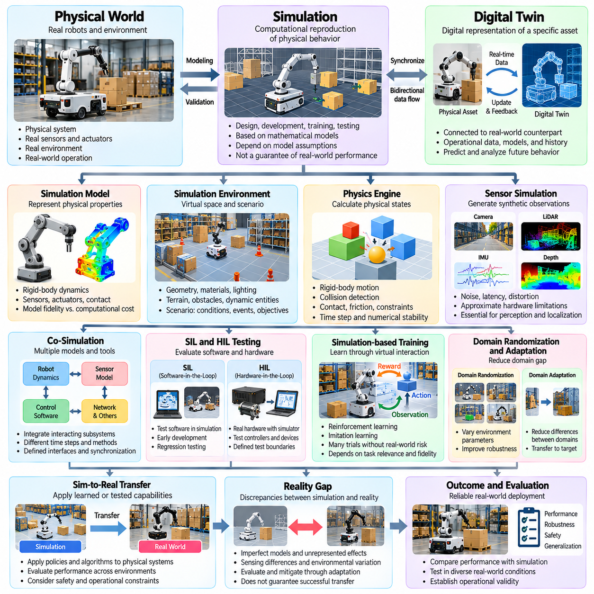{width="7.268055555555556in" height="7.268055555555556in"}

시뮬레이션(Simulation)은 수학적 모델(Mathematical Model)과 소프트웨어(Software)를 사용하여 물리 시스템(Physical System)이나 환경(Environment)의 특정 행동을 계산적으로 재현하는 것이다. 로보틱스(Robotics)에서 시뮬레이션은 모든 실험을 실제 하드웨어(Physical Hardware)에서 수행하지 않고도 설계(Design), 알고리즘 개발(Algorithm Development), 학습(Training), 테스트(Testing)를 지원한다. 시뮬레이션 결과는 모델 가정(Model Assumption), 수치해석 기법(Numerical Method), 환경 표현(Environmental Representation)에 의존하므로 실제 세계의 성능(Real-World Performance)을 자동으로 입증하지는 않는다.

시뮬레이션 모델(Simulation Model)은 특정 공학적 목표(Engineering Objective)와 관련된 속성과 과정을 표현한다. 모델은 강체 동역학(Rigid-Body Dynamics), 센서(Sensor), 액추에이터(Actuator), 접촉 상호작용(Contact Interaction), 통신(Communication), 환경 조건(Environmental Condition)을 설명할 수 있다. 모델 충실도(Model Fidelity)는 시뮬레이션된 행동이 대상 물리 시스템과 얼마나 밀접하게 일치하는지를 나타낸다. 높은 충실도는 현실성(Realism)을 개선할 수 있지만 계산 비용(Computational Cost)을 증가시키는 경우가 많으며, 더 높은 예측 정확도(Predictive Accuracy)를 반드시 보장하지는 않는다.

시뮬레이션 환경(Simulation Environment)은 에이전트(Agent), 객체(Object), 물리적 과정(Physical Process)이 상호작용하는 가상 공간(Virtual Space)을 정의한다. 여기에는 기하학적 구조(Geometry), 재질(Material), 조명(Lighting), 지형(Terrain), 장애물(Obstacle), 동적 개체(Dynamic Entity)가 포함될 수 있다. 시나리오(Scenario)는 해당 환경 내의 특정 초기 조건(Initial Condition), 사건(Event), 목표(Objective), 환경 제약(Environmental Constraint)을 지정한다. 환경과 시나리오를 분리하면 공통 가상 자산(Virtual Asset)을 활용하여 다양한 운영 상황(Operational Situation)을 체계적으로 테스트할 수 있다.

물리 엔진(Physics Engine)은 구현된 역학 모델(Mechanical Model)과 수치 알고리즘(Numerical Algorithm)에 따라 물리적 상태(Physical State)의 변화를 계산한다. 주요 기능에는 강체 운동(Rigid-Body Motion), 충돌 탐지(Collision Detection), 접촉 해석(Contact Resolution), 마찰(Friction), 관절 제약(Joint Constraint)이 포함된다. 시뮬레이션 시간 간격(Simulation Time Step)은 상태가 갱신되는 빈도를 결정한다. 수치적 안정성(Numerical Stability), 적분 정확도(Integration Accuracy), 접촉 모델링(Contact Modeling)은 시뮬레이션 궤적(Simulated Trajectory)이 실제 물리적 행동을 얼마나 적절하게 근사하는지에 영향을 미친다.

센서 시뮬레이션(Sensor Simulation)은 가상 환경 조건(Virtual Environmental Condition)에 대응하는 합성 관측값(Synthetic Observation)을 생성한다. 카메라 시뮬레이션(Camera Simulation)은 영상 형성(Image Formation), 조명, 광학적 효과(Optical Effect)를 표현할 수 있으며, 라이다 시뮬레이션(LiDAR Simulation)은 거리 측정(Range Measurement)과 기하학적 가시성(Geometric Visibility)을 모델링한다. 하드웨어의 한계를 근사하기 위해 잡음(Noise), 지연시간(Latency), 왜곡(Distortion), 관측 누락(Missing Observation)을 도입할 수 있다. 센서 현실성(Sensor Realism)은 실제 배포(Physical Deployment)를 목적으로 하는 인식(Perception) 및 위치 추정(Localization) 알고리즘을 평가할 때 필수적이다.

디지털 트윈(Digital Twin)은 특정 물리적 개체(Physical Entity)나 시스템의 디지털 표현(Digital Representation)으로, 실제 대상(Real-World Counterpart)과 적절한 연결 관계를 유지한다. 디지털 트윈에는 운영 데이터(Operational Data), 모델(Model), 이력 기록(Historical Record), 예측 기능(Predictive Capability)이 포함될 수 있다. 독립형 시뮬레이션(Standalone Simulation)과 달리 디지털 트윈은 식별 가능한 물리적 자산(Identifiable Physical Asset)과의 대응 관계(Correspondence)를 강조한다. 필요한 갱신 주기(Update Frequency)와 동기화 수준(Degree of Synchronization)은 의도한 목적에 따라 달라진다.

디지털 모델(Digital Model)은 운영 데이터를 반드시 자동으로 교환하지 않더라도 물리 시스템을 디지털 방식으로 표현한다. 디지털 섀도(Digital Shadow)는 일반적으로 물리 시스템에서 디지털 대응체(Digital Counterpart)로 흐르는 데이터를 통해 갱신되는 표현을 의미한다. 디지털 트윈은 양방향 정보 교환(Bidirectional Information Exchange)과 운영 피드백(Operational Feedback)을 지원할 수 있다. 이러한 구분은 채택한 프레임워크(Framework)에 따라 달라지므로 보편적으로 통용된다고 가정하기보다 명시적으로 정의해야 한다.

동기화(Synchronization)는 물리적 관측값(Physical Observation)과 디지털 표현 사이의 일관성(Consistency)을 유지하는 것을 의미한다. 상태 동기화(State Synchronization)는 위치(Position), 속도(Velocity), 장비 상태(Equipment Status), 환경 조건과 같은 변수를 갱신한다. 시간 동기화(Temporal Synchronization)는 서로 다른 데이터 소스(Data Source)의 측정값과 사건을 시간적으로 정렬한다. 부정확한 타임스탬프(Timestamp), 통신 지연(Communication Delay), 일관되지 않은 좌표계(Coordinate Frame)는 개별 모델이 정확하더라도 디지털 트윈의 신뢰성(Reliability)을 저하시킬 수 있다.

연동 시뮬레이션(Co-Simulation)은 여러 시뮬레이션 모델이나 소프트웨어 도구를 결합하여 상호작용하는 하위 시스템(Subsystem)을 표현한다. 로봇 응용 시스템(Robotic Application)은 기계 동역학(Mechanical Dynamics), 센서 처리(Sensor Processing), 제어 소프트웨어(Control Software), 네트워킹(Networking), 운영 워크플로(Operational Workflow)를 통합할 수 있다. 각 하위 시스템은 서로 다른 시간 간격(Time Step)이나 수치해석 기법으로 작동할 수 있다. 연동 시뮬레이션에는 정의된 인터페이스(Interface), 동기화 전략(Synchronization Strategy), 허용할 수 없는 오차를 발생시키지 않으면서 상태 정보를 교환하는 절차가 필요하다.

소프트웨어 인 더 루프 테스트(Software-in-the-Loop Testing, SIL)는 시뮬레이션된 실행 환경(Simulated Execution Environment)에서 소프트웨어 구성요소(Software Component)를 평가한다. 하드웨어 인 더 루프 테스트(Hardware-in-the-Loop Testing, HIL)는 실제 하드웨어 구성요소를 시뮬레이션 시스템이나 신호(Signal)에 연결한다. SIL은 초기 개발(Early Development)과 회귀 테스트(Regression Testing)를 지원하며, HIL은 실제 제어기(Controller)나 장치(Device)가 포함된 상호작용을 검토한다. 어느 접근법도 단독으로 완전한 시스템 안전(System Safety)을 입증하지 못하며, 두 방법 모두 명확하게 정의된 테스트 경계(Test Boundary)가 필요하다.

시뮬레이션 기반 학습(Simulation-Based Training)은 로봇 정책(Robotic Policy)이 반복적인 가상 상호작용(Virtual Interaction)을 통해 경험(Experience)을 획득하도록 한다. 강화학습(Reinforcement Learning) 에이전트는 모든 실험적 위험(Experimental Risk)에 물리적 장비를 노출하지 않고도 행동을 탐색하고, 보상(Reward)을 받고, 행동을 개선할 수 있다. 모방학습(Imitation Learning)은 시뮬레이션된 시연(Simulated Demonstration)이나 궤적(Trajectory)을 활용할 수 있다. 학습 효과(Training Effectiveness)는 작업 관련성(Task Relevance), 환경 다양성(Environment Diversity), 모델 충실도, 학습 신호(Learning Signal)의 품질에 따라 달라진다.

도메인 무작위화(Domain Randomization)는 학습 과정에서 조명, 텍스처(Texture), 마찰, 질량(Mass), 센서 잡음(Sensor Noise), 객체 배치(Object Placement)와 같은 시뮬레이션 매개변수(Simulation Parameter)를 변화시키는 기법이다. 그 목적은 학습 시스템을 다양한 조건에 노출하여 실제 환경의 변동성(Real-World Variation)에 대한 강건성(Robustness)을 개선하는 것이다. 반면 도메인 적응(Domain Adaptation)은 소스 도메인(Source Domain)과 대상 도메인(Target Domain) 사이의 차이를 줄이는 것을 목표로 한다. 두 접근법 모두 전이 한계(Transfer Limitation)를 해결하지만 검증된 조건(Validated Condition)을 벗어난 성공적인 작동을 보장하지는 않는다.

시뮬레이션-현실 전이(Sim-to-Real Transfer)는 시뮬레이션에서 개발하거나 평가한 능력을 실제 물리 시스템에 적용하는 것을 의미한다. 현실 격차(Reality Gap)는 불완전한 모델(Imperfect Model), 센싱 차이(Sensing Difference), 표현되지 않은 상호작용(Unrepresented Interaction)으로 인해 시뮬레이션 행동과 실제 행동 사이에 발생하는 불일치를 설명한다. 전이 평가(Transfer Evaluation)는 가상 환경(Virtual Environment)과 물리적 환경(Physical Environment)의 성능을 비교한다. 성공적인 배포(Deployment)를 위해서는 핵심 행동(Critical Behavior)이 실제 운영 조건(Real Operating Condition)에서도 허용 가능한 수준을 유지한다는 증거(Evidence)가 필요하다.

합성 데이터(Synthetic Data)는 학습과 평가에 사용하기 위해 인공적으로 생성한 관측값(Observation), 주석 정보(Annotation), 궤적을 의미한다. 시뮬레이션은 레이블이 지정된 이미지(Labeled Image), 깊이 지도(Depth Map), 분할 마스크(Segmentation Mask), 객체 자세(Object Pose), 상호작용 기록(Interaction Record)을 대규모로 생성할 수 있다. 합성 데이터셋(Synthetic Dataset)은 주석 작업 비용(Annotation Cost)을 줄이고 드문 상황(Rare Situation)에 대한 학습 기회를 제공할 수 있다. 그 유용성은 대표성(Representativeness), 다양성(Diversity), 생성된 패턴(Generated Pattern)이 실제 물리적 관측값과 얼마나 일치하는지에 따라 달라진다.

시나리오 기반 테스트(Scenario-Based Testing)는 집계 성능 지표(Aggregate Performance Metric)에만 의존하지 않고 지정된 운영 상황에서 시스템 행동을 평가한다. 시나리오에는 이동 장애물(Moving Obstacle), 센서 성능 저하(Sensor Degradation), 예상하지 못한 사람의 움직임(Unexpected Human Motion), 제한된 내비게이션 공간(Restricted Navigation Space)이 포함될 수 있다. 매개변수화된 시나리오(Parameterized Scenario)는 조건을 체계적으로 변화시킬 수 있도록 한다. 시나리오 커버리지(Scenario Coverage)는 정의된 운영 상황 집합 가운데 실제로 시험된 범위를 설명한다.

검증(Verification)은 시뮬레이션 모델이나 구현(Implementation)이 지정된 요구사항(Specified Requirement)과 수학적 기대사항(Mathematical Expectation)을 충족하는지 판단한다. 타당성 확인(Validation)은 모델이 특정 용도에 대해 대상 물리 시스템을 적절하게 표현하는지 평가한다. 보정(Calibration)은 측정값이나 기준 데이터(Reference Data)를 사용하여 모델 매개변수를 조정한다. 이러한 활동은 서로 관련되어 있지만 구별되며, 구현이 검증되었더라도 기본 가정(Underlying Assumption)이 부적절하면 오해를 유발하는 결과(Misleading Result)가 생성될 수 있다.

피지컬 인공지능(Physical AI)을 위한 디지털 트윈은 로봇 시스템의 수명주기(Lifecycle) 전반에서 모니터링(Monitoring), 예측(Prediction), 계획(Planning), 운영 최적화(Operational Optimization)를 지원할 수 있다. 플릿 수준 디지털 트윈(Fleet-Level Digital Twin)은 여러 로봇, 공유 인프라(Shared Infrastructure), 환경 자원(Environmental Resource)을 표현할 수 있다. 예측 시뮬레이션(Predictive Simulation)은 혼잡(Congestion), 장비 성능 저하(Equipment Degradation), 대체 작업 할당(Alternative Task Assignment)을 검토할 수 있다. 그 운영적 가치(Operational Value)는 신뢰할 수 있는 데이터 통합(Data Integration), 지속적으로 유지되는 모델 정확도(Model Accuracy), 명확하게 정의된 의사결정 권한(Decision Authority)에 달려 있다.

## 09.08. Robot and Mobile Robot Safety Standards

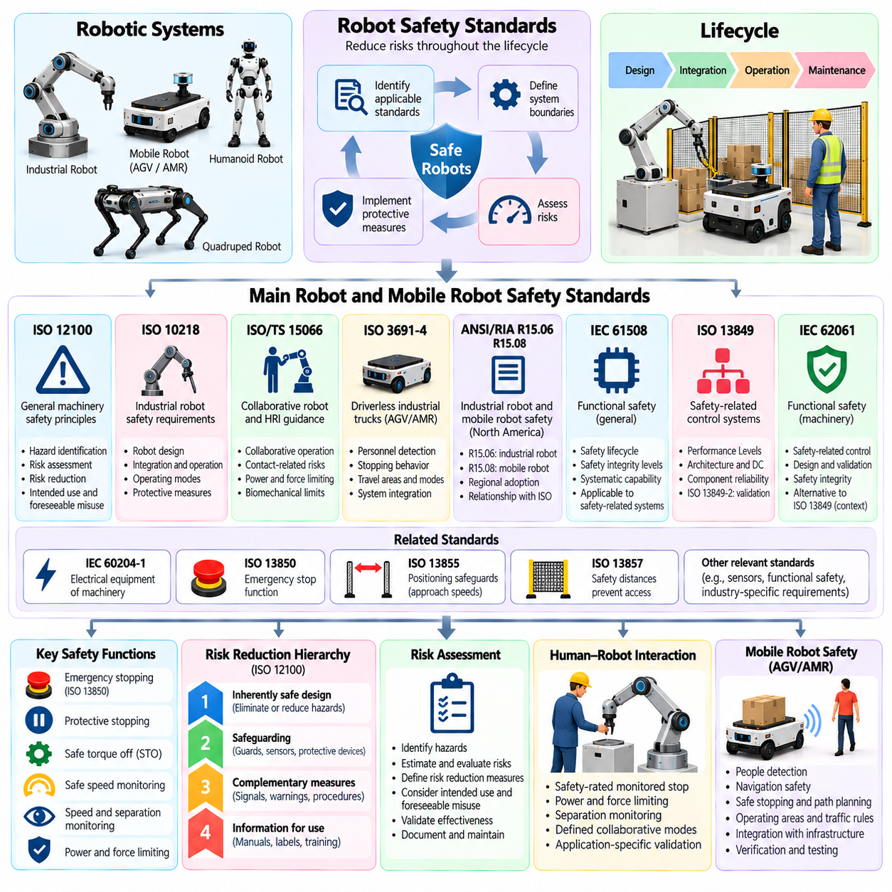{width="7.268055555555556in" height="7.268055555555556in"}

로봇 안전 표준(Robot Safety Standards)은 로봇 시스템(Robotic System)의 전체 수명주기(Lifecycle)에 걸쳐 발생할 수 있는 위험(Risk)을 줄이기 위한 요구사항과 공학적 원칙(Engineering Principles)을 확립한다. 이러한 표준은 기계적 움직임(Mechanical Motion), 전기 에너지(Electrical Energy), 제어 고장(Control Failure), 인간과의 상호작용(Human Interaction), 환경 조건(Environmental Conditions)에서 발생하는 위험요인(Hazard)을 다룬다. 안전 준수(Safety Compliance)를 위해서는 적용 가능한 표준을 식별하고, 시스템 경계(System Boundary)를 정의하며, 예측 가능한 위험을 평가하고, 보호 조치(Protective Measure)가 허용 가능한 성능을 달성한다는 사실을 입증해야 한다.

ISO 12100은 위험요인 식별(Hazard Identification), 위험성 평가(Risk Assessment), 위험 감소(Risk Reduction)를 통해 기계 안전(Machinery Safety)에 관한 일반 원칙을 제공한다. 이 표준은 의도된 사용(Intended Use)과 합리적으로 예측 가능한 오용(Reasonably Foreseeable Misuse)을 검토하기 위한 체계적인 절차를 확립한다. 위험 감소는 본질적으로 안전한 설계(Inherently Safe Design)를 우선하고, 이후 안전 방호(Safeguarding)와 보완적 보호 조치(Complementary Protective Measure)를 적용하며, 마지막으로 사용 정보(Information for Use)를 제공하는 순서로 진행된다. 이러한 프레임워크는 다양한 로봇 응용 분야에서 체계적인 안전 공학(Safety Engineering)을 지원한다.

ISO 10218은 산업용 로봇(Industrial Robot)과 산업용 로봇 응용 시스템(Industrial Robot Application)에 대한 안전 요구사항(Safety Requirements)을 다룬다. 이 표준의 프레임워크는 로봇 설계(Robot Design)와 관련된 요구사항을 시스템 통합(System Integration) 및 운영(Operation)에 관한 요구사항과 구분한다. 안전 고려사항에는 운영 모드(Operating Mode), 보호 조치(Protective Measure), 제어 기능(Control Function), 로봇 셀(Robotic Cell) 내부의 상호작용이 포함된다. 요구사항과 참조 문서(Referenced Document)는 변경될 수 있으므로 적용되는 판본(Edition)과 관할 지역(Jurisdiction)을 명확하게 식별해야 한다.

ISO/TS 15066은 협동 산업용 로봇 응용 시스템(Collaborative Industrial Robot Application)과 인간-로봇 상호작용(Human-Robot Interaction)에 관한 지침을 제공한다. 이 기술 규격(Technical Specification)은 협동 운영 방식(Collaborative Operating Method)과 접촉 관련 위험 감소(Contact-Related Risk Reduction)에 관한 고려사항을 설명한다. 동력 및 힘 제한(Power and Force Limiting)을 적용하려면 잠재적인 접촉 조건(Potential Contact Condition)과 관련 생체역학적 한계(Biomechanical Limit)를 평가해야 한다. 협동 운영(Collaborative Operation)이 응용 분야별 위험성 평가(Application-Specific Risk Assessment)나 적절한 보호 조치의 필요성을 없애는 것은 아니다.

ISO 3691-4는 관련 무인운반차(Automated Guided Vehicle, AGV)와 자율이동로봇(Autonomous Mobile Robot, AMR)을 포함하는 무인 산업용 트럭(Driverless Industrial Truck) 및 관련 시스템의 안전 요구사항과 검증(Verification)을 다룬다. 이 표준의 적용 여부는 차량 분류(Vehicle Classification), 의도된 사용, 운영 환경(Operating Environment)에 따라 결정된다. 주요 고려사항에는 인원 탐지(Personnel Detection), 정지 동작(Stopping Behavior), 주행 구역(Travel Area), 운영 모드, 시스템 통합이 포함된다. 이 표준이 모든 유형의 이동 로봇(Mobile Robot)을 포괄한다고 가정해서는 안 된다.

ANSI/RIA R15.06은 관련 북미 지역(North American Context)에서 사용되는 산업용 로봇 안전 프레임워크(Industrial Robot Safety Framework)를 제공한다. ANSI/RIA R15.08은 이동 플랫폼(Mobile Platform)과 응용 시스템에 관련된 요구사항을 포함하여 산업용 이동 로봇 안전(Industrial Mobile Robot Safety)을 다룬다. 이러한 문서는 각각의 구성 부분(Part), 판본, 적용 범위(Scope)에 따라 해석해야 한다. 규정 준수 계획(Compliance Planning)에서는 지역별 채택(Regional Adoption), 규제상 요구사항(Regulatory Expectation), ISO 표준과의 관계를 검토해야 한다.

IEC 61508은 전기·전자·프로그램 가능 전자 안전 관련 시스템(Electrical, Electronic and Programmable Electronic Safety-Related System)에 대한 일반적인 기능 안전 프레임워크(Functional Safety Framework)를 확립한다. 이 표준은 안전 수명주기 활동(Safety Lifecycle Activity), 체계적 능력(Systematic Capability), 안전 무결성 요구사항(Safety Integrity Requirement)을 다룬다. 안전 무결성 수준(Safety Integrity Level, SIL)은 해당 프레임워크 내에서 정의된 무결성 목표(Integrity Target)를 나타낸다. IEC 61508을 로보틱스에 적용하려면 관련 안전 기능(Safety Function)을 식별하고, 분야별 특화 표준(Sector-Specific Standard)이 더 적절한 요구사항을 제공하는지 판단해야 한다.

ISO 13849-1은 기계 제어 시스템의 안전 관련 부분(Safety-Related Parts of Machinery Control Systems)을 설계하기 위한 원칙을 규정한다. 성능 수준(Performance Level, PL)은 예측 가능한 조건에서 이러한 시스템이 안전 기능을 수행할 수 있는 능력을 나타낸다. 평가에서는 아키텍처(Architecture), 구성요소 신뢰성(Component Reliability), 진단 범위(Diagnostic Coverage), 공통 원인 고장(Common-Cause Failure)을 고려한다. ISO 13849-2는 타당성 확인(Validation)을 다루며, 구현된 안전 관련 제어 기능이 지정된 요구사항을 충족한다는 증거를 확보하도록 지원한다.

IEC 62061은 기계의 안전 관련 제어 시스템(Safety-Related Control System)에 대한 기능 안전(Functional Safety)을 다룬다. 이 표준은 안전 관련 제어 기능(Safety-Related Control Function)을 명세하고, 설계하고, 통합하고, 타당성을 확인하기 위한 방법을 제공한다. 안전 무결성(Safety Integrity)에 대한 접근법은 ISO 13849의 성능 수준 프레임워크(Performance Level Framework)와 구조적으로 차이가 있다. 적용 가능한 프레임워크의 선택은 규제 환경(Regulatory Context), 시스템 아키텍처(System Architecture), 공학적 요구사항(Engineering Requirement), 인정된 적합성 평가 관행(Accepted Conformity Practice)에 따라 달라진다.

IEC 60204-1은 보호 조치, 제어 회로(Control Circuit), 배선(Wiring), 전기 인터페이스(Electrical Interface)를 포함하는 기계의 전기 장비(Electrical Equipment of Machinery)를 다룬다. ISO 13850은 비상 정지 기능(Emergency Stop Function)의 원칙을 확립하며, ISO 13855는 접근 속도(Approach Speed)를 고려한 안전 방호장치(Safeguard)의 배치를 다룬다. ISO 13857은 위험 구역(Hazard Zone)에 접근하는 것을 방지하기 위한 안전 거리(Safety Distance)를 다룬다. 이러한 표준은 로봇별 안전 요구사항을 보완하지만 시스템 수준 위험성 평가(System-Level Risk Assessment)를 대체하지는 않는다.

안전 기능(Safety Function)은 지정된 위험 상황(Hazardous Circumstance)이 발생했을 때 안전 상태(Safe Condition)를 달성하거나 유지하기 위한 보호 기능(Protective Function)이다. 대표적인 사례에는 비상 정지(Emergency Stopping), 보호 정지(Protective Stopping), 안전 속도 감시(Safe Speed Monitoring), 예기치 않은 움직임 방지(Prevention of Unexpected Motion)가 포함된다. 각 기능에는 명확하게 정의된 작동 조건(Triggering Condition), 응답 동작(Response Behavior), 성능 요구사항(Performance Requirement)이 필요하다. 안전 기능은 의도된 운영 조건과 예측 가능한 고장 모드(Foreseeable Failure Mode)를 기준으로 검증해야 한다.

비상 정지(Emergency Stopping)는 이미 존재하거나 임박한 위험요인을 방지하거나 줄이기 위한 보완적 보호 조치(Complementary Protective Measure)이다. 보호 정지(Protective Stopping)는 안전 방호 시스템(Safeguarding System)이나 운영 조건에 의해 자동으로 시작될 수 있다. 안전 토크 차단(Safe Torque Off, STO)은 모터(Motor)에 토크를 발생시키는 전력이 공급되지 않도록 하지만, 반드시 즉각적인 기계적 정지(Immediate Mechanical Stopping)를 보장하지는 않는다. 정지 동작(Stopping Behavior)을 설계할 때는 관성(Inertia), 중력(Gravity), 저장 에너지(Stored Energy), 기계적 구성(Mechanical Configuration)을 고려해야 한다.

속도 및 이격 거리 감시(Speed and Separation Monitoring)는 사람과 움직이는 로봇 장비 사이의 보호 이격 거리(Protective Separation)를 유지한다. 안전 등급 감시 정지(Safety-Rated Monitored Stop)는 정의된 협동 작업(Collaborative Activity) 중에 감시되는 정지 상태(Monitored Stopped Condition)를 유지한다. 동력 및 힘 제한(Power and Force Limiting)은 잠재적인 상호작용 힘(Interaction Force)과 압력(Pressure)을 제한한다. 이러한 개념을 구현하려면 응용 분야별 설계(Application-Specific Implementation), 적절한 센싱(Sensing), 검증된 제어 동작(Validated Control Behavior), 예측 가능한 사람의 움직임(Foreseeable Human Movement)에 대한 고려가 필요하다.

이동 로봇 안전(Mobile Robot Safety)은 변화하는 경로(Changing Route), 공유 작업 공간(Shared Workspace), 이동 장애물(Moving Obstacle), 가변적인 바닥 조건(Variable Surface Condition)과 관련된 문제를 수반한다. 보호 영역(Protective Field)과 인원 탐지 시스템(Personnel Detection System)은 차량 속도(Vehicle Speed), 정지 거리(Stopping Distance), 이동 방향(Travel Direction), 운영 맥락(Operating Context)을 반영해야 한다. 위치 추정 오차(Localization Error)와 내비게이션 오류(Navigation Error)는 위험 상황에 영향을 미칠 수 있다. 일반 인식 기능(Ordinary Perception Function)이 적용 가능한 안전 요구사항을 충족하지 않는 한, 안전 관련 장애물 탐지(Safety-Related Obstacle Detection)와 구별해야 한다.

위험성 평가(Risk Assessment)는 위험요인(Hazard)을 식별하고, 관련 위험을 추정하며, 허용 가능성(Acceptability)을 평가하고, 필요한 위험 감소 조치(Risk Reduction Measure)를 결정한다. 관련 요소에는 피해의 심각도(Severity of Harm), 노출 빈도(Exposure Frequency), 위험 사건(Hazardous Event)을 회피할 가능성이 포함된다. 잔여 위험(Residual Risk)은 보호 조치를 시행한 이후에도 남아 있는 위험을 의미한다. 문서화(Documentation)에는 가정(Assumption), 의사결정(Decision), 검증 증거(Verification Evidence), 작업자(Operator)와 유지보수 담당자(Maintainer)에게 전달한 정보를 기록해야 한다.

적합성 평가(Conformity Assessment)는 로봇 장비(Robotic Equipment)가 적용 가능한 법적 요구사항(Legal Requirement)과 기술적 요구사항(Technical Requirement)을 충족하는지 입증하는 과정이다. 관할 지역에 따라 기계 관련 법규(Machinery Legislation), 조화 표준 또는 지정 표준(Harmonized or Designated Standard), 기술 문서(Technical Documentation), 시험(Testing), 적합성 선언(Declaration of Conformity)이 포함될 수 있다. 인증(Certification)과 규정 준수(Compliance)는 서로 동일한 개념이 아니다. 유효한 안전 입증 체계(Safety Case)는 실제 시스템 구성(Actual Configuration), 의도된 응용 분야(Intended Application), 배포 조건(Deployment Condition)을 다루어야 한다.

## 09.09. AI Safety and Governance Frameworks

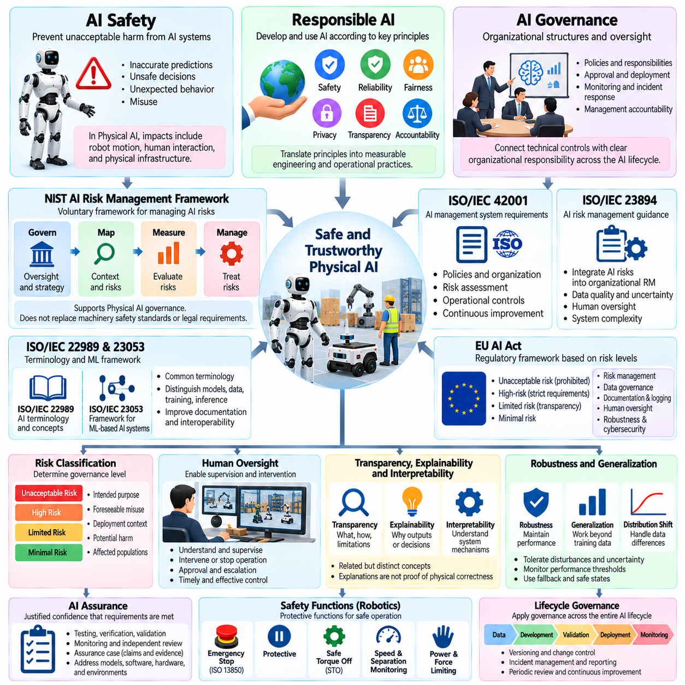{width="7.268055555555556in" height="7.268055555555556in"}

인공지능 안전(AI Safety)은 인공지능 시스템(Artificial Intelligence System)이 허용할 수 없는 피해(Unacceptable Harm)를 발생시키지 않도록 예방하는 원칙(Principle), 방법(Method), 통제 수단(Control)을 의미한다. 이는 부정확한 예측(Inaccurate Prediction), 안전하지 않은 의사결정(Unsafe Decision), 예상하지 못한 행동(Unexpected Behavior), 부적절한 시스템 사용(Inappropriate System Use)에서 발생하는 실패를 다룬다. 피지컬 인공지능(Physical AI)에서는 지능적 의사결정(Intelligent Decision)이 기계적 움직임(Mechanical Motion), 인간과의 상호작용(Human Interaction), 물리적 인프라(Physical Infrastructure)에 직접적인 영향을 미칠 수 있으므로 안전 고려사항이 디지털 출력(Digital Output)의 범위를 넘어 확장된다.

인공지능 거버넌스(AI Governance)는 인공지능 시스템의 개발과 운영을 관리하기 위한 조직 구조(Organizational Structure), 책임(Responsibility), 정책(Policy), 감독 체계(Oversight Mechanism)를 확립한다. 이는 모델 승인(Model Approval), 배포 승인(Deployment Authorization), 성능 모니터링(Performance Monitoring), 사고 대응(Incident Response)에 대한 권한과 책임을 정의한다. 효과적인 거버넌스는 기술적 통제(Technical Control)를 경영 책임(Management Accountability)과 연결한다. 또한 인공지능 시스템 수명주기(AI System Lifecycle) 전반에서 문서화된 의사결정 절차(Decision Process)와 명확한 책임 분담을 요구한다.

책임 있는 인공지능(Responsible AI)은 안전성(Safety), 신뢰성(Reliability), 투명성(Transparency), 공정성(Fairness), 개인정보 보호(Privacy), 책임성(Accountability)과 같은 원칙에 따라 인공지능을 개발하고 사용하는 것을 의미한다. 이러한 원칙은 측정 가능한 공학적 실무(Engineering Practice)와 운영 절차(Operational Practice)로 구체화되어야 한다. 로봇 응용 분야(Robotic Application)에서는 물리적 접근성(Physical Accessibility), 인간 자율성(Human Autonomy), 작업자 보호(Worker Protection), 공유 환경(Shared Environment)에 영향을 미치는 의사결정의 결과도 고려한다.

미국 국립표준기술연구소 인공지능 위험관리 프레임워크(NIST AI Risk Management Framework)는 인공지능 시스템과 관련된 위험을 식별하고 평가하며 관리하기 위한 자발적 적용 체계(Voluntary Framework)를 제공한다. 핵심 기능(Core Function)은 거버넌스(Govern), 맥락 파악(Map), 측정(Measure), 관리(Manage)로 구성된다. 이러한 기능은 조직적 감독(Organizational Oversight), 시스템 맥락(System Context), 위험 평가(Risk Evaluation), 위험 대응(Risk Treatment)을 다룬다. 이 프레임워크는 피지컬 인공지능 거버넌스를 지원할 수 있지만 기계 안전 표준(Machinery Safety Standard)이나 적용 가능한 법적 요구사항(Legal Requirement)을 대체하지는 않는다.

ISO/IEC 42001은 인공지능 관리 시스템(Artificial Intelligence Management System, AIMS)을 수립하고 구현하며 유지하고 지속적으로 개선하기 위한 요구사항을 규정한다. 이 표준은 조직 정책(Organizational Policy), 위험성 평가(Risk Assessment), 책임, 운영 통제(Operational Control)를 하나의 관리 프레임워크(Management Framework)로 연결한다. 인증(Certification)은 관리 시스템 표준(Management System Standard)에 대한 적합성(Conformity)을 입증할 수 있지만, 배포된 모든 인공지능 모델(AI Model)이나 로봇 응용 시스템의 안전성을 독립적으로 보장하지는 않는다.

ISO/IEC 23894는 인공지능과 관련된 위험을 관리하기 위한 지침(Guidance)을 제공한다. 이 표준은 인공지능 특유의 고려사항(AI-Specific Consideration)을 조직의 전반적인 위험관리 활동(Risk Management Activity)에 통합하도록 지원한다. 주요 고려사항에는 데이터 품질(Data Quality), 모델 불확실성(Model Uncertainty), 인간 감독(Human Oversight), 시스템 복잡성(System Complexity), 변화하는 운영 조건(Changing Operating Condition)이 포함된다. 피지컬 인공지능에서는 이러한 요소를 물리적 행동(Physical Action)과 환경 상호작용(Environmental Interaction)에서 발생하는 위험요인(Hazard)과 연결해야 한다.

ISO/IEC 22989는 인공지능의 용어(Terminology)와 개념(Concept)을 정립하여 기술적·조직적 맥락에서 일관된 의사소통(Consistent Communication)을 지원한다. ISO/IEC 23053은 기계학습(Machine Learning)을 사용하는 인공지능 시스템의 프레임워크를 설명한다. 공통 용어(Shared Terminology)는 모델(Model), 데이터(Data), 학습(Training), 추론(Inference), 시스템 기능(System Function)을 구분하는 데 도움이 된다. 이러한 개념적 표준(Conceptual Standard)은 문서화(Documentation)와 상호운용성(Interoperability)을 개선하지만 그 자체로 완전한 안전 보증(Safety Assurance)을 제공하지는 않는다.

유럽연합 인공지능법(European Union AI Act)은 인공지능 관련 위험의 범주(Risk Category)와 그에 따른 의무(Obligation)를 기반으로 규제 프레임워크(Regulatory Framework)를 확립한다. 규제 대상 제품(Regulated Product)이나 안전 기능(Safety Function)과 관련된 일부 인공지능 시스템은 법적 적용 조건을 충족하는 경우 고위험 요구사항(High-Risk Requirement)의 적용 대상이 될 수 있다. 관련 의무에는 위험관리(Risk Management), 데이터 거버넌스(Data Governance), 문서화, 기록 관리(Logging), 투명성, 인간 감독, 강건성(Robustness), 사이버보안(Cybersecurity)이 포함될 수 있다.

인공지능 위험 분류(AI Risk Classification)는 특정 응용 분야에 필요한 거버넌스의 수준과 성격을 결정한다. 위험 분류에서는 의도된 목적(Intended Purpose), 예측 가능한 오용(Foreseeable Misuse), 배포 맥락(Deployment Context), 잠재적 피해(Potential Harm), 영향을 받는 집단(Affected Population)을 고려해야 한다. 중요도가 낮은 보고 업무(Noncritical Reporting)에 사용되는 모델은 로봇 내비게이션(Robot Navigation)이나 조작(Manipulation)에 영향을 미치는 모델과 다른 통제 수준을 요구할 수 있다. 위험 분류는 모델 아키텍처(Model Architecture)만이 아니라 전체 응용 시스템(Complete Application)을 반영해야 한다.

인간 감독(Human Oversight)은 권한을 가진 사람이 인공지능 기반 운영(AI-Supported Operation)을 이해하고 감독하며 개입하거나 중지할 수 있도록 하는 체계를 의미한다. 감독에는 승인 워크플로(Approval Workflow), 운영 모니터링(Operational Monitoring), 문제 상향 보고 절차(Escalation Procedure), 정의된 개입 권한(Intervention Authority)이 포함될 수 있다. 효과적인 감독을 위해서는 의미 있는 정보(Meaningful Information)와 실질적인 제어 능력(Practical Control Capability)이 필요하다. 단순히 업무 절차에 사람을 포함시키는 것만으로 적시에 효과적인 개입이 이루어진다고 보장할 수는 없다.

투명성(Transparency)은 인공지능 시스템의 목적(Purpose), 능력(Capability), 한계(Limitation), 운영 조건(Operating Condition)에 관한 관련 정보의 이용 가능성을 의미한다. 설명 가능성(Explainability)은 특정 출력이나 의사결정이 발생한 이유를 전달하는 방법과 관련된다. 해석 가능성(Interpretability)은 시스템의 내부 메커니즘(System Mechanism)이나 표현(Representation)을 어느 정도 이해할 수 있는지를 나타낸다. 이러한 개념은 서로 관련되어 있지만 구별되며, 설명(Explanation)을 물리적 정확성(Physical Correctness)에 대한 증거로 혼동해서는 안 된다.

인공지능 보증(AI Assurance)은 인공지능 시스템이 지정된 요구사항(Specified Requirement)과 허용 가능한 위험 기준(Acceptable Risk Criteria)을 충족한다는 정당화된 신뢰(Justified Confidence)를 구축하는 과정이다. 보증 활동(Assurance Activity)에는 테스트(Testing), 검증(Verification), 타당성 확인(Validation), 모니터링(Monitoring), 독립적 검토(Independent Review), 체계적인 증거 수집(Structured Evidence Collection)이 포함될 수 있다. 보증 사례(Assurance Case)는 주장(Claim), 논증(Argument), 뒷받침하는 증거(Supporting Evidence)를 체계화한다. 피지컬 인공지능에서는 학습된 모델(Learned Model), 기존 소프트웨어(Conventional Software), 하드웨어(Hardware), 운영 환경(Operating Environment) 사이의 상호작용을 다루어야 한다.

강건성(Robustness)은 교란(Disturbance), 불확실성(Uncertainty), 입력 조건의 변화(Input Variation)에도 인공지능 시스템이 허용 가능한 성능을 유지하는 능력을 의미한다. 일반화(Generalization)는 학습 과정에서 경험한 특정 사례를 벗어난 상황에서의 성능과 관련된다. 분포 변화(Distribution Shift)는 운영 데이터(Operational Data)가 학습 데이터 분포(Training Distribution)와 달라질 때 발생한다. 거버넌스 절차는 모델 성능이 저하되는 경우를 대비하여 모니터링 임계값(Monitoring Threshold), 평가 절차(Evaluation Procedure), 대응 조치(Response)를 확립해야 한다.

데이터 거버넌스(Data Governance)는 인공지능 수명주기 전반에서 정보를 수집(Collection), 레이블링(Labeling), 저장(Storage), 접근(Access), 보존(Retention), 활용(Use)하기 위한 정책을 확립한다. 데이터셋 문서화(Dataset Documentation)는 데이터 출처(Provenance), 의도된 사용(Intended Use), 한계, 관련 품질 특성(Quality Characteristic)을 기록한다. 모델 문서화(Model Documentation)는 학습 가정(Training Assumption), 평가 결과(Evaluation Result), 알려진 제약사항(Known Constraint)을 설명한다. 추적성(Traceability)은 데이터셋, 모델 버전(Model Version), 소프트웨어 릴리스(Software Release), 테스트 증거(Test Evidence), 배포 결정(Deployment Decision)을 연결한다.

지속적 모니터링(Continuous Monitoring)은 배포 이후 인공지능의 행동을 평가하여 성능 저하(Performance Degradation), 예상하지 못한 조건(Unexpected Condition), 새롭게 나타나는 위험(Emerging Risk)을 탐지한다. 사고 관리(Incident Management)는 유해하거나 안전하지 않은 행동을 보고(Reporting), 조사(Investigation), 억제(Containment), 시정(Correction)하기 위한 절차를 정의한다. 변경 관리(Change Management)는 모델, 데이터셋, 프롬프트(Prompt), 시스템 구성(System Configuration)의 변경을 평가한다. 중대한 변경(Significant Change)이 발생하면 운영 릴리스(Operational Release) 전에 새로운 타당성 확인이 필요할 수 있다.

인공지능 안전 및 거버넌스 프레임워크(AI Safety and Governance Framework)는 지능형 시스템(Intelligent System)의 개발, 배포, 운영 전반에 걸쳐 위험을 관리하기 위한 상호보완적 기반(Complementary Foundation)을 제공한다. 기술적 안전 조치(Technical Safety Measure)는 특정 위험요인을 줄이는 반면, 거버넌스는 책임성(Accountability), 증거 요구사항(Evidence Requirement), 감독 체계(Oversight)를 확립한다. 피지컬 인공지능에서 효과적인 안전 보증(Safety Assurance)을 달성하려면 인공지능 위험관리(AI Risk Management)를 로봇 안전 공학(Robotics Safety Engineering), 사이버보안(Cybersecurity), 인간공학적 요소(Human Factors), 지속적인 운영 평가(Continuous Operational Evaluation)와 통합해야 한다.

## 09.10. Data Cybersecurity and Privacy Frameworks

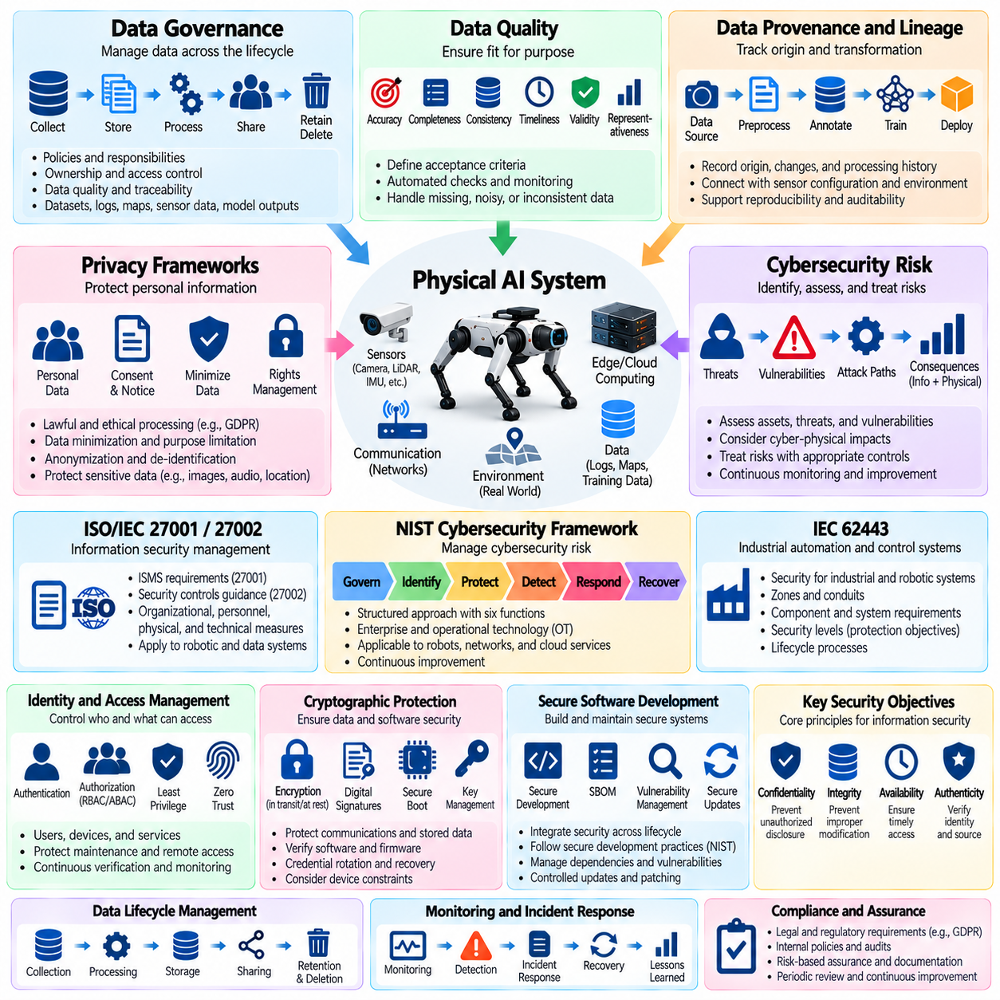{width="7.268055555555556in" height="7.268055555555556in"}

데이터 거버넌스(Data Governance), 사이버보안(Cybersecurity), 개인정보 보호 프레임워크(Privacy Framework)는 정보를 관리하고 연결된 지능형 시스템(Connected Intelligent System)을 보호하기 위한 상호보완적인 통제 체계(Complementary Control)를 확립한다. 데이터 거버넌스는 정보 품질(Information Quality), 소유권(Ownership), 수명주기 관리(Lifecycle Management)를 다루며, 사이버보안은 무단 접근(Unauthorized Access)과 시스템 장애(Disruption)로부터 시스템을 보호한다. 개인정보 보호(Privacy)는 개인정보(Personal Information)의 적절한 처리에 중점을 둔다. 피지컬 인공지능(Physical AI)에서는 데이터 관련 장애(Data Failure)가 물리적 결과(Physical Consequence)를 초래할 수 있으므로 이러한 분야의 통합이 필요하다.

데이터 거버넌스(Data Governance)는 정보의 수집(Collection), 저장(Storage), 변환(Transformation), 공유(Sharing), 보존(Retention), 삭제(Deletion)에 관한 정책(Policy), 책임(Responsibility), 절차(Procedure)를 정의한다. 로봇 시스템(Robotic System)에서 관리 대상 데이터 자산(Data Asset)에는 센서 기록(Sensor Recording), 위치 추정 지도(Localization Map), 운영 로그(Operational Log), 학습 데이터셋(Training Dataset), 모델 출력(Model Output)이 포함될 수 있다. 효과적인 거버넌스는 데이터 소유권(Data Ownership), 접근 권한(Access Permission), 품질 요구사항(Quality Requirement), 추적성(Traceability)을 확립한다. 이러한 통제는 신뢰할 수 있는 인공지능 개발과 책임 있는 운영 의사결정(Operational Decision)을 지원한다.

데이터 품질(Data Quality)은 정보가 의도된 목적(Intended Purpose)에 얼마나 적합한지를 설명한다. 관련 품질 차원(Quality Dimension)에는 정확성(Accuracy), 완전성(Completeness), 일관성(Consistency), 적시성(Timeliness), 유효성(Validity), 대표성(Representativeness)이 포함된다. 센서 데이터셋(Sensor Dataset)에는 누락된 타임스탬프(Missing Timestamp), 보정 오류(Calibration Error), 중복 관측값(Duplicated Observation), 일관되지 않은 좌표계(Coordinate Frame)가 존재할 수 있다. 품질 관리(Quality Management)를 위해서는 데이터가 학습 또는 운영 파이프라인(Training or Operational Pipeline)에 입력되기 전에 명확한 수용 기준(Acceptance Criteria), 자동화된 검사(Automated Check), 문서화된 시정 조치(Corrective Action)가 필요하다.

데이터 출처 정보(Data Provenance)는 정보의 원천(Origin), 변환 과정(Transformation), 처리 이력(Processing History)을 식별한다. 데이터 계보(Data Lineage)는 데이터 레코드(Data Record)가 수집, 전처리(Preprocessing), 주석 작업(Annotation), 학습(Training), 배포(Deployment) 과정에서 어떻게 이동하는지를 추적한다. 이러한 개념은 재현성(Reproducibility), 감사 가능성(Auditability), 예상하지 못한 모델 행동(Unexpected Model Behavior)에 대한 조사를 지원한다. 피지컬 인공지능에서는 데이터 출처 기록(Provenance Record)을 센서 구성(Sensor Configuration), 환경 조건(Environmental Condition), 소프트웨어 버전(Software Version), 적용 가능한 사용 제한(Usage Restriction)과 연결해야 한다.

ISO/IEC 27001은 정보보호 관리체계(Information Security Management System, ISMS)를 수립하고 구현하며 유지하고 개선하기 위한 요구사항을 규정한다. ISO/IEC 27002는 정보보호 통제(Information Security Control)에 관한 지침(Guidance)을 제공한다. 이러한 표준은 조직적(Organizational), 인적(Personnel), 물리적(Physical), 기술적(Technological) 조치를 통해 정보 자산(Information Asset)을 위험 기반(Risk-Based)으로 보호하도록 지원한다. 로보틱스(Robotics)에 적용하려면 기존 정보보호 위험(Information Security Risk)과 사이버 물리적 의존성(Cyber-Physical Dependency)을 모두 식별해야 한다.

미국 국립표준기술연구소 사이버보안 프레임워크(NIST Cybersecurity Framework)는 거버넌스(Govern), 식별(Identify), 보호(Protect), 탐지(Detect), 대응(Respond), 복구(Recover)의 기능을 통해 사이버보안 위험(Cybersecurity Risk)을 관리하는 체계적인 접근법을 제공한다. 이러한 기능은 조직 정책(Organizational Policy)을 자산 관리(Asset Management), 예방적 통제(Preventive Control), 위협 탐지(Threat Detection), 사고 처리(Incident Handling), 운영 복구(Operational Restoration)와 연결한다. 로봇 플릿(Robotic Fleet)에서는 엣지 장치(Edge Device), 로컬 인프라(Local Infrastructure), 클라우드 서비스(Cloud Service) 전반에 일관된 사이버보안 거버넌스를 구축하는 데 활용할 수 있다.

IEC 62443은 산업 자동화 및 제어 시스템(Industrial Automation and Control System)의 사이버보안을 다룬다. 이 프레임워크는 시스템 아키텍처(System Architecture), 보안 구역(Security Zone), 통신 경로(Communication Conduit), 구성요소 요구사항(Component Requirement), 수명주기 프로세스(Lifecycle Process)를 고려한다. 보안 수준(Security Level)은 해당 프레임워크에서 정의된 공격자 능력(Attacker Capability)에 대응하는 보호 목표(Protection Objective)를 나타낸다. 산업용 로봇(Industrial Robot)과 연결된 제조 시스템(Connected Manufacturing System)은 방어 가능한 운영기술 환경(Operational Technology Environment)을 구축할 때 IEC 62443의 개념을 활용할 수 있다.

사이버보안 위험성 평가(Cybersecurity Risk Assessment)는 자산(Asset), 위협(Threat), 취약점(Vulnerability), 공격 경로(Attack Path), 잠재적 결과(Potential Consequence)를 식별한다. 위협 모델링(Threat Modeling)은 공격자(Adversary)가 센서(Sensor), 통신 채널(Communication Channel), 제어 소프트웨어(Control Software), 관리 인터페이스(Management Interface)를 어떻게 침해할 수 있는지 검토한다. 피지컬 인공지능에서는 무단 이동(Unauthorized Motion), 손상된 인식(Corrupted Perception), 서비스 중단(Service Interruption), 운영 가시성 상실(Loss of Operational Visibility)과 같은 결과가 발생할 수 있다. 위험 대응(Risk Treatment)은 정보보호 영향(Information Security Impact)과 물리적 안전 영향(Physical Safety Implication)을 모두 반영해야 한다.

기밀성·무결성·가용성 모델(Confidentiality, Integrity, and Availability Model, CIA Model)은 세 가지 기본적인 정보보호 목표(Information Security Objective)를 정의한다. 기밀성(Confidentiality)은 무단 공개(Unauthorized Disclosure)를 제한하고, 무결성(Integrity)은 부적절한 변경(Improper Modification)을 방지하며, 가용성(Availability)은 필요한 서비스에 적시에 접근할 수 있도록 지원한다. 로봇 시스템에서는 진위성(Authenticity)과 운영 복원력(Operational Resilience)에도 주의를 기울여야 한다. 통신이 계속 가능하더라도 명령(Command)이 침해되거나 센서 메시지(Sensor Message)가 조작되면 안전한 행동(Safe Behavior)이 저해될 수 있다.

신원 및 접근 관리(Identity and Access Management, IAM)는 사용자(User), 장치(Device), 서비스(Service)를 인증(Authentication)하고 허용된 작업을 인가(Authorization)하기 위한 메커니즘을 확립한다. 최소 권한 원칙(Least Privilege)은 필요한 기능으로 접근을 제한하며, 역할 기반 접근 제어(Role-Based Access Control, RBAC)와 속성 기반 접근 제어(Attribute-Based Access Control, ABAC)는 권한을 체계적으로 관리한다. 제로 트러스트(Zero Trust) 원칙은 암묵적인 네트워크 신뢰(Implicit Network Trust)보다 지속적인 검증(Continuous Verification)을 강조한다. 로봇 배포 환경에서는 유지보수 인터페이스(Maintenance Interface), 원격 명령(Remote Command), 서비스 계정(Service Account), 기계 신원(Machine Identity)을 보호해야 한다.

암호학적 보호(Cryptographic Protection)는 안전한 통신(Secure Communication), 저장 데이터 보호(Stored-Data Protection), 소프트웨어 진위성(Software Authenticity)을 지원한다. 전송 암호화(Transport Encryption)는 원격 측정 데이터(Telemetry)와 명령을 보호할 수 있으며, 디지털 서명(Digital Signature)은 펌웨어(Firmware)와 소프트웨어 패키지(Software Package)의 진위성을 검증하는 데 도움이 된다. 보안 부팅(Secure Boot)은 선택된 시작 구성요소(Startup Component)에 대한 신뢰를 확립하며, 키 관리(Key Management)는 암호화 자격증명(Cryptographic Credential)을 관리한다. 효과적인 구현을 위해서는 계산 자원 제약(Computational Constraint), 자격증명 교체(Credential Rotation), 복구 절차(Recovery Procedure), 장치 수명주기 관리(Device Lifecycle Management)를 고려해야 한다.

보안 소프트웨어 개발(Secure Software Development)은 요구사항 정의(Requirements Definition), 설계(Design), 구현(Implementation), 테스트(Testing), 유지보수(Maintenance) 전반에 사이버보안 통제를 통합한다. 미국 국립표준기술연구소 보안 소프트웨어 개발 프레임워크(NIST Secure Software Development Framework, SSDF)는 소프트웨어 취약점(Software Vulnerability)을 줄이기 위한 실무 지침을 제공한다. 소프트웨어 자재명세서(Software Bill of Materials, SBOM)는 포함된 구성요소와 의존성(Dependency)을 식별하여 취약점 관리(Vulnerability Management)를 지원한다. 로봇 소프트웨어 보증(Robotic Software Assurance)에는 통제된 업데이트(Controlled Update), 의존성 평가(Dependency Evaluation), 무단 코드 실행(Unauthorized Code Execution)에 대한 보호도 필요하다.

개인정보 보호 프레임워크(Privacy Framework)는 지능형 시스템(Intelligent System)이 수집하는 개인정보(Personal Data)의 합법적이고 책임 있는 처리(Lawful and Responsible Processing)를 다룬다. 유럽연합 일반개인정보보호규정(European Union General Data Protection Regulation, GDPR)은 적용 대상에 해당하는 경우 적법한 처리(Lawful Processing), 투명성(Transparency), 정보주체 권리(Individual Rights), 책임성(Accountability)에 관한 요구사항을 확립한다. ISO/IEC 27701은 개인정보 관리체계(Privacy Information Management System, PIMS)를 위한 프레임워크를 제공한다. 적용되는 의무는 관할 지역(Jurisdiction), 처리 활동(Processing Activity), 조직의 역할(Organizational Role), 데이터 특성(Data Characteristic)에 따라 달라진다.

설계 단계부터의 개인정보 보호(Privacy by Design)는 시스템 아키텍처(System Architecture)와 운영 절차(Operational Procedure)에 개인정보 보호 요구사항을 초기 단계부터 통합하는 접근법이다. 데이터 최소화(Data Minimization)는 정의된 목적에 필요한 정보로 수집 범위를 제한하며, 목적 제한(Purpose Limitation)은 목적과 양립할 수 없는 재사용을 제한한다. 보존 통제(Retention Control)는 적절한 저장 기간(Storage Period)과 삭제 절차(Deletion Procedure)를 확립한다. 카메라(Camera), 마이크(Microphone), 위치 추정 시스템(Localization System)을 장착한 이동 로봇(Mobile Robot)은 공유 공간(Shared Space)에서 사람을 관측할 때 특별한 주의가 필요하다.

익명화(Anonymization)는 개인을 식별할 수 없도록 하는 것을 목표로 하며, 가명처리(Pseudonymization)는 직접 식별자(Direct Identifier)를 대체하지만 특정 조건에서는 재식별(Reidentification)이 가능할 수 있다. 암호화(Encryption)는 데이터 기밀성(Data Confidentiality)을 보호하지만 반드시 정보를 익명화하는 것은 아니다. 개인정보 영향평가(Privacy Impact Assessment)는 데이터 처리 위험(Processing Risk)과 적절한 보호 조치(Safeguard)를 평가한다. 로봇 데이터셋(Robotics Dataset)에서는 얼굴(Face), 음성(Voice), 움직임 패턴(Movement Pattern), 위치 이력(Location History), 간접 식별 정보(Indirectly Identifying Information)를 신중하게 고려해야 한다.

사이버보안 사고 대응(Cybersecurity Incident Response)은 보안 사건(Security Event)을 탐지(Detection), 분석(Analysis), 억제(Containment), 복구(Recovery)하고, 사고로부터 교훈을 도출하기 위한 절차를 확립한다. 침해된 시스템(Compromised System)이 이동이나 기계 작동에 영향을 미칠 수 있는 경우, 로봇 운영(Robotic Operation)은 기술적 대응(Technical Response)과 물리적 안전 절차(Physical Safety Procedure)를 조정해야 한다. 백업(Backup), 복원(Restoration), 재해 복구(Disaster Recovery)는 운영 연속성(Operational Continuity)을 지원한다. 사고 후 분석(Post-Incident Analysis)에서는 근본 원인(Root Cause), 영향을 받은 자산(Affected Asset), 시정 조치(Corrective Measure), 잔여 위험(Residual Risk)을 식별해야 한다.

데이터, 사이버보안, 개인정보 보호 프레임워크는 피지컬 인공지능 수명주기(Physical AI Lifecycle) 전반에서 통합적으로 운영되어야 한다. 거버넌스(Governance)는 정보에 대한 책임(Information Responsibility)을 확립하고, 사이버보안은 연결된 인프라(Connected Infrastructure)를 보호하며, 개인정보 보호 통제(Privacy Control)는 개인정보 처리를 관리한다. 효과적인 구현을 위해서는 문서화된 요구사항(Documented Requirement), 지속적 모니터링(Continuous Monitoring), 정기 감사(Periodic Audit), 조정된 사고 관리(Coordinated Incident Management)가 필요하다. 이러한 통합은 전용 기능 안전 공학(Dedicated Functional Safety Engineering)을 대체하지 않으면서 신뢰할 수 있는 로봇 자율성(Trustworthy Robotic Autonomy)을 지원한다.

## 09.11. Performance Evaluation and Benchmark Definitions

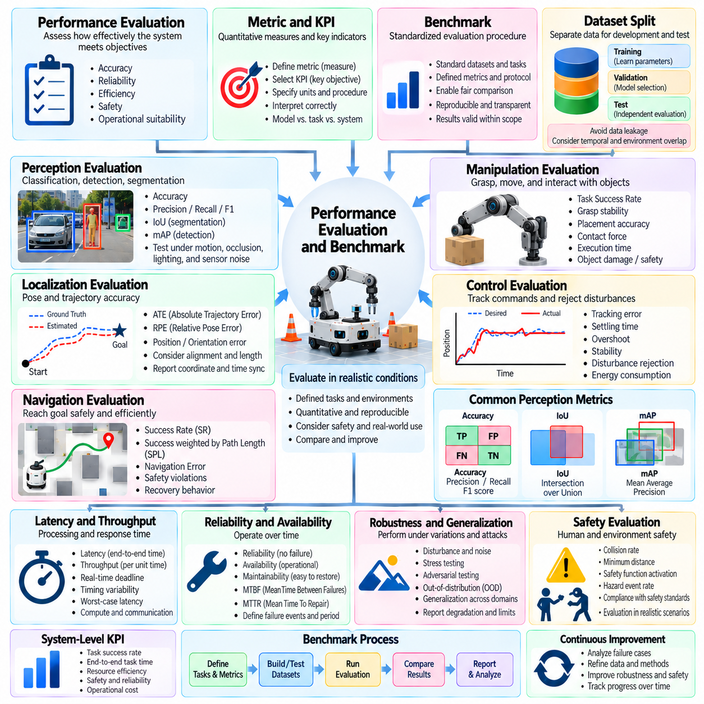{width="7.268055555555556in" height="7.268055555555556in"}

성능 평가(Performance Evaluation)는 인공지능(Artificial Intelligence) 또는 로봇 시스템(Robotic System)이 지정된 조건에서 정의된 목표(Objective)를 얼마나 효과적으로 충족하는지 체계적으로 평가하는 과정이다. 평가에서는 정확성(Accuracy), 신뢰성(Reliability), 효율성(Efficiency), 안전성(Safety), 운영 적합성(Operational Suitability)을 고려한다. 피지컬 인공지능(Physical AI)에서는 지능적 의사결정(Intelligent Decision)이 물리적 행동(Physical Action)과 환경 상호작용(Environmental Interaction)을 통해 허용 가능한 결과를 만들어야 하므로 모델 예측(Model Prediction)만으로 성능을 판단할 수 없다.

성능 지표(Performance Metric)는 시스템 행동(System Behavior)의 특정 측면을 설명하기 위해 사용하는 정량적 측정값(Quantitative Measure)이다. 핵심성과지표(Key Performance Indicator, KPI)는 중요한 운영 목표(Operational Objective)와 관련하여 선정된 지표이다. 지표에는 정확한 정의(Definition), 측정 절차(Measurement Procedure), 단위(Unit), 해석 규칙(Interpretation Rule)이 필요하다. 의미 있는 평가 프레임워크(Evaluation Framework)는 기술적 모델 성능(Technical Model Performance), 작업 수준의 효과성(Task-Level Effectiveness), 전체 시스템 성능(Overall System Performance)을 구분한다.

벤치마크(Benchmark)는 알고리즘(Algorithm), 모델(Model), 시스템(System) 사이의 일관된 비교를 지원하도록 설계된 표준화된 평가 절차(Standardized Evaluation Procedure)이다. 일반적으로 데이터셋(Dataset), 작업(Task), 환경 조건(Environmental Condition), 평가 지표(Evaluation Metric), 보고 요구사항(Reporting Requirement)을 지정한다. 벤치마크 재현성(Benchmark Reproducibility)은 통제된 구성(Controlled Configuration)과 투명한 방법론(Transparent Methodology)에 따라 달라진다. 벤치마크 결과는 모든 배포 상황(Deployment Situation)에서의 보편적인 우수성이 아니라 정의된 평가 범위(Evaluation Boundary) 내에서의 성능을 나타낸다.

데이터셋 분할(Dataset Split)은 사용 가능한 관측값(Observation)을 학습(Training), 검증(Validation), 테스트(Testing)에 사용되는 부분집합(Subset)으로 구분하는 것이다. 학습 데이터(Training Data)는 매개변수 최적화(Parameter Optimization)를 지원하고, 검증 데이터(Validation Data)는 모델 선택(Model Selection)을 안내하며, 테스트 데이터(Test Data)는 독립적인 성능 추정(Independent Performance Estimate)을 제공한다. 데이터 누출(Data Leakage)은 평가용 부분집합의 정보가 개발 과정에 부적절하게 영향을 미칠 때 발생한다. 로봇 데이터셋(Robotic Dataset)에서는 시간적 상관관계(Temporal Correlation), 반복되는 환경(Repeated Environment), 중복되는 궤적(Overlapping Trajectory)도 고려해야 한다.

정확도(Accuracy)는 지정된 분류 절차(Classification Procedure)에서 올바른 예측(Correct Prediction)이 차지하는 비율을 측정한다. 정밀도(Precision)는 양성으로 예측한 사례(Predicted Positive Instance) 중 실제로 올바른 사례의 비율을 나타내며, 재현율(Recall)은 실제 양성 사례(Actual Positive Instance) 중 성공적으로 탐지한 비율을 측정한다. F1 점수(F1 Score)는 정밀도와 재현율의 조화평균(Harmonic Mean)을 통해 두 지표를 결합한다. 이러한 지표는 서로 다른 관점을 제공하므로 클래스 분포(Class Distribution)와 오류의 결과(Error Consequence)를 함께 고려하여 해석해야 한다.

교집합 대 합집합 비율(Intersection over Union, IoU)은 예측 영역(Predicted Region)과 기준 영역(Reference Region) 사이의 중첩 정도를 측정한다. 평균 정밀도 평균(Mean Average Precision, mAP)은 정의된 클래스(Class)와 평가 임계값(Evaluation Threshold)에 걸친 객체 탐지 성능(Object Detection Performance)을 요약한다. 객체 탐지 벤치마크(Object Detection Benchmark)에서는 매칭 규칙(Matching Rule), 신뢰도 임계값(Confidence Threshold), 평균 계산 절차(Averaging Procedure)를 명시해야 한다. 로봇 인식(Robotic Perception)에서는 움직임(Motion), 가림(Occlusion), 조명 변화(Lighting Variation), 센서 성능 저하(Sensor Degradation) 조건에서도 탐지 품질(Detection Quality)을 평가해야 한다.

위치 추정 성능(Localization Performance)은 로봇이 기준 좌표계(Reference Frame) 내에서 자신의 위치(Position)와 방향(Orientation)을 얼마나 정확하게 추정하는지 평가한다. 절대 궤적 오차(Absolute Trajectory Error, ATE)는 명시적으로 정의된 정렬 절차(Alignment Procedure)를 거친 후 추정 궤적(Estimated Trajectory)과 기준 궤적(Reference Trajectory) 사이의 차이를 측정한다. 상대 자세 오차(Relative Pose Error, RPE)는 국소 이동 추정(Local Motion Estimation)의 일관성을 평가한다. 결과는 좌표 규약(Coordinate Convention), 시간 정렬(Temporal Alignment), 궤적 길이(Trajectory Length), 기준 측정 품질(Reference Measurement Quality)에 따라 달라진다.

내비게이션 성능(Navigation Performance)은 로봇이 운영 제약(Operational Constraint)을 충족하면서 의도된 목적지(Intended Destination)에 도달하는지를 측정한다. 성공률(Success Rate, SR)은 완료된 내비게이션 작업(Navigation Task)의 비율을 나타낸다. 경로 길이 가중 성공률(Success Weighted by Path Length, SPL)은 기준 최단 경로(Reference Shortest Path) 대비 작업 성공(Task Success)과 경로 효율성(Path Efficiency)을 결합한다. 내비게이션 오차(Navigation Error)는 정의에 따라 목표(Target) 또는 기준(Reference)으로부터의 편차를 측정한다. 안전 위반(Safety Violation)과 복구 행동(Recovery Behavior)은 별도로 보고해야 한다.

조작 평가(Manipulation Evaluation)는 물리적 객체(Physical Object)를 파지(Grasp), 이동(Move), 배치(Position), 조립(Assemble)하거나 다른 방식으로 상호작용하는 능력을 검토한다. 작업 성공률(Task Success Rate)은 정의된 수용 기준(Acceptance Criteria)에 따라 작업 완료(Task Completion)를 측정한다. 추가 지표에는 파지 안정성(Grasp Stability), 배치 정확도(Placement Accuracy), 접촉력(Contact Force), 실행 시간(Execution Time), 객체 손상(Object Damage)이 포함된다. 조작 벤치마크(Manipulation Benchmark)는 성공적인 작업 완료를 일시적 접촉(Temporary Contact), 부분적 진행(Partial Progress), 안전하지 않은 실행(Unsafe Execution)과 구분해야 한다.

제어 성능(Control Performance)은 제어기(Controller)가 명령(Command)과 외란(Disturbance)에 대응하여 시스템 행동을 얼마나 효과적으로 조절하는지를 설명한다. 추종 오차(Tracking Error)는 목표 궤적(Desired Trajectory)과 실제 궤적(Actual Trajectory) 사이의 편차를 측정하며, 정착 시간(Settling Time)과 오버슈트(Overshoot)는 과도 응답(Transient Response)의 특성을 나타낸다. 안정성(Stability)과 외란 억제(Disturbance Rejection)는 중요한 평가 차원(Evaluation Dimension)이다. 물리 시스템에서는 액추에이터 포화(Actuator Saturation), 에너지 소비(Energy Consumption), 기계적 한계(Mechanical Limit), 제어 지연시간(Control Latency)도 고려해야 한다.

지연시간(Latency)은 정의된 시작 사건(Initiating Event)과 이에 대응하는 시스템 응답(System Response) 사이에 경과한 시간을 측정한다. 처리량(Throughput)은 단위 시간당 처리된 작업량(Processing Amount) 또는 완료된 작업량(Completed Work)을 나타낸다. 실시간 성능(Real-Time Performance)은 단순히 낮은 평균 지연시간(Average Latency)을 달성하는 것이 아니라 지정된 마감시간(Deadline)을 충족하는지에 따라 결정된다. 평가에서는 시간 변동성(Timing Variability), 타당한 경우 최악 조건의 행동(Worst-Case Behavior), 계산 자원 활용률(Computational Utilization), 통신 지연(Communication Delay)의 영향을 보고해야 한다.

신뢰성(Reliability)은 시스템이 지정된 조건에서 일정 기간 동안 요구된 기능(Required Function)을 수행할 수 있는 능력을 설명한다. 가용성(Availability)은 필요할 때 시스템이 작동 가능한 상태인지와 관련되며, 유지보수성(Maintainability)은 시스템을 얼마나 효과적으로 복구하거나 정비할 수 있는지를 나타낸다. 평균 고장 간격(Mean Time Between Failures, MTBF)과 평균 수리 시간(Mean Time To Repair, MTTR)은 일반적으로 사용되는 유지보수 지표(Maintenance Metric)이다. 이러한 지표를 해석하려면 고장 사건(Failure Event), 관측 기간(Observation Period), 운영 가정(Operating Assumption)을 명확하게 정의해야 한다.

강건성 평가(Robustness Evaluation)는 외란(Disturbance), 불확실성(Uncertainty), 변화하는 환경 조건(Changing Environmental Condition)에서 시스템의 행동을 검토한다. 스트레스 테스트(Stress Testing)는 의도적으로 시스템을 까다로운 상황(Demanding Situation)에 노출하며, 적대적 테스트(Adversarial Testing)는 전략적으로 선택된 입력(Input)이나 조건에 대한 취약점(Vulnerability)을 조사한다. 분포 외 평가(Out-of-Distribution Evaluation)는 학습 분포(Training Distribution)를 벗어난 상황에서의 행동을 측정한다. 피지컬 인공지능 평가는 성능 저하(Degraded Performance)를 위험한 고장(Hazardous Failure)이나 통제되지 않은 행동(Uncontrolled Behavior)과 구분해야 한다.

시뮬레이션 벤치마크(Simulation Benchmark)는 통제된 시나리오(Controlled Scenario), 알려진 기준 상태(Reference State), 확장 가능한 테스트 실행(Scalable Test Execution)을 통해 반복적인 실험을 가능하게 한다. 실제 환경 벤치마크(Real-World Benchmark)는 시뮬레이션에서 누락되거나 부정확하게 근사될 수 있는 물리적 효과(Physical Effect)를 포착한다. 시뮬레이션-현실 전이 평가(Sim-to-Real Evaluation)는 두 환경의 결과를 비교하여 전이 한계(Transfer Limitation)를 식별한다. 신뢰할 수 있는 벤치마킹(Credible Benchmarking)을 위해서는 대표적인 시나리오(Representative Scenario), 문서화된 가정(Documented Assumption), 평가 조건이 의도된 운영을 반영한다는 증거(Evidence)가 필요하다.

통계적 평가(Statistical Evaluation)는 관측된 성능 차이(Performance Difference)가 무작위 변동(Random Variation)의 결과가 아니라 의미 있는 차이인지를 판단한다. 반복 실험(Repeated Trial), 신뢰구간(Confidence Interval), 적절한 유의성 검정(Significance Testing)은 더욱 신뢰할 수 있는 비교를 지원한다. 실험 프로토콜(Experimental Protocol)은 난수 시드(Random Seed), 하드웨어 구성(Hardware Configuration), 소프트웨어 버전(Software Version), 환경 요인(Environmental Factor)을 통제해야 한다. 평균 점수(Average Score)만 제시하는 것보다 성능 분포(Performance Distribution)와 실패 사례(Failure Case)를 보고하는 것이 더 유용한 경우가 많다.

안전 중심 평가(Safety-Oriented Evaluation)는 위험 사건(Hazardous Event), 보호 응답(Protective Response), 정의된 운영 제약(Operating Constraint)의 준수 여부를 측정한다. 관련 지표에는 충돌 빈도(Collision Frequency), 최소 이격 거리(Minimum Separation Distance), 비상 정지 성능(Emergency Stopping Performance), 안전 개입률(Safety Intervention Rate)이 포함될 수 있다. 이러한 지표는 문서화된 위험요인 분석(Hazard Analysis)과 적절한 수용 기준(Acceptance Criteria)에 연결되어야 한다. 높은 벤치마크 점수(Benchmark Score)가 기능 안전 타당성 확인(Functional Safety Validation)이나 규제 준수(Regulatory Compliance)를 대체할 수는 없다.

포괄적인 피지컬 인공지능 벤치마크 프레임워크(Comprehensive Physical AI Benchmark Framework)는 인식(Perception), 위치 추정(Localization), 계획(Planning), 제어(Control), 작업 성공(Task Success), 신뢰성(Reliability), 효율성(Efficiency), 안전성(Safety)을 조정된 평가 과정(Coordinated Evaluation Process)으로 통합한다. 평가 결과는 데이터셋, 시나리오, 소프트웨어 버전, 테스트 조건(Test Condition)까지 추적할 수 있어야 한다. 표준화된 정의(Standardized Definition)는 비교 가능성(Comparability)을 개선하며, 운영 타당성 확인(Operational Validation)은 실질적인 관련성(Practical Relevance)을 확립한다. 효과적인 평가는 복잡한 로봇 능력(Robotic Capability)을 하나의 점수로 단순화하지 않으면서 공학적 의사결정(Engineering Decision)을 지원한다.

## 09.12. Toward Physical AI Standardization

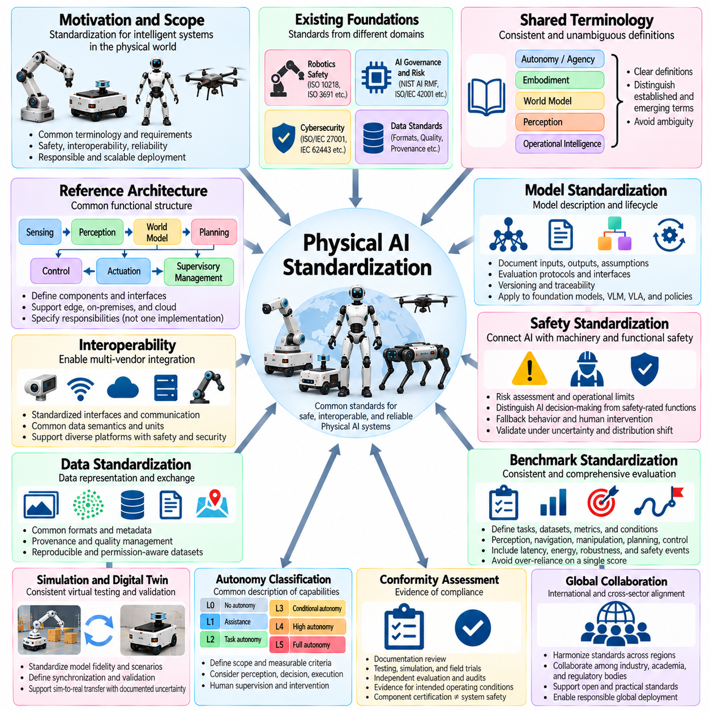{width="7.268055555555556in" height="7.268055555555556in"}

피지컬 인공지능 표준화(Physical AI Standardization)는 물리적 세계(Physical World)에서 작동하는 지능형 시스템(Intelligent System)을 위한 공통 용어(Common Terminology), 기술적 요구사항(Technical Requirement), 평가 방법(Evaluation Method), 보증 체계(Assurance Practice)를 확립하는 것을 목표로 한다. 기존 디지털 인공지능(Digital AI)과 달리 피지컬 인공지능(Physical AI)은 인식(Perception), 추론(Reasoning), 의사결정(Decision-Making), 물리적 행동(Physical Action)을 결합한다. 따라서 표준화는 계산 지능(Computational Intelligence)과 물리적 결과(Physical Consequence)를 모두 다루어야 하며, 안전성(Safety), 상호운용성(Interoperability), 신뢰성(Reliability), 책임 있는 배포(Responsible Deployment)를 위한 기반을 마련해야 한다.

기존 표준(Existing Standard)은 중요한 기반을 제공하지만 서로 다른 공학 분야(Engineering Discipline)에서 출발하였다. 로봇 표준(Robotics Standard)은 기계적 위험요인(Machinery Hazard)과 운영 안전(Operational Safety)을 다루는 반면, 인공지능 프레임워크(AI Framework)는 모델 위험(Model Risk), 거버넌스(Governance), 신뢰할 수 있는 행동(Trustworthy Behavior)을 강조한다. 사이버보안 표준(Cybersecurity Standard)은 연결된 인프라(Connected Infrastructure)를 보호하고, 데이터 표준(Data Standard)은 정보 품질(Information Quality)을 지원한다. 피지컬 인공지능 표준화는 어느 하나의 프레임워크가 모든 영역을 완전하게 포괄한다고 가정하지 않고 이러한 분야를 조정해야 한다.

공통 용어 체계(Shared Terminology Framework)는 연구자(Researcher), 제조업체(Manufacturer), 시스템 통합업체(System Integrator), 규제기관(Regulator), 운영자(Operator) 사이의 일관된 의사소통(Consistent Communication)에 필수적이다. 자율성(Autonomy), 에이전트성(Agency), 체화(Embodiment), 세계 모델(World Model), 인식(Perception), 운영 지능(Operational Intelligence)과 같은 용어에는 명확한 정의(Definition)와 적용 경계(Boundary)가 필요하다. 표준 용어(Standard Terminology)는 확립된 공학 개념(Established Engineering Concept)과 새롭게 등장하는 연구 용어(Emerging Research Terminology)를 구분해야 한다. 모호한 정의(Ambiguous Definition)는 일관되지 않은 요구사항(Inconsistent Requirement), 오해를 유발하는 비교(Misleading Comparison), 불완전한 안전성 평가(Incomplete Safety Assessment)를 초래할 수 있다.

참조 아키텍처(Reference Architecture)는 피지컬 인공지능 시스템의 주요 기능 구성요소(Functional Component)와 구성요소 사이의 관계(Relationship)를 설명한다. 일반적인 구성요소에는 센싱(Sensing), 인식(Perception), 상태 추정(State Estimation), 세계 모델링(World Modeling), 계획(Planning), 제어(Control), 구동(Actuation), 감독 관리(Supervisory Management)가 포함된다. 아키텍처는 이러한 기능을 로봇(Robot), 엣지 인프라(Edge Infrastructure), 온프레미스 컴퓨팅(On-Premises Computing), 클라우드 서비스(Cloud Service)에 분산할 수 있다. 표준화는 하나의 구현 방식(Implementation)을 강제하지 않으면서 인터페이스(Interface)와 책임(Responsibility)을 정의해야 한다.

상호운용성(Interoperability)은 서로 다른 공급업체(Supplier)의 구성요소와 시스템이 정보를 교환하고 운영을 조정할 수 있도록 한다. 표준화된 인터페이스(Standardized Interface)는 센서 통합(Sensor Integration), 로봇 통신(Robot Communication), 작업 할당(Task Assignment), 지도 작성(Mapping), 플릿 관리(Fleet Management)를 지원할 수 있다. 의미적 상호운용성(Semantic Interoperability)을 확보하려면 데이터 의미(Data Meaning), 단위(Unit), 좌표계(Coordinate System), 운영 상태(Operational State)에 대한 공통된 이해도 필요하다. 상호운용성 표준은 안전 및 보안 경계(Safety and Security Boundary)를 유지하면서 다양한 하드웨어 플랫폼(Hardware Platform)을 수용해야 한다.

데이터 표준화(Data Standardization)는 피지컬 인공지능 개발 파이프라인(Development Pipeline) 전반에서 데이터 표현(Data Representation), 메타데이터(Metadata), 출처 정보(Provenance), 품질(Quality), 교환(Exchange)을 다룬다. 로봇 데이터셋(Robotics Dataset)은 이미지(Image), 포인트 클라우드(Point Cloud), 궤적(Trajectory), 행동(Action), 힘 측정값(Force Measurement), 환경 설명(Environmental Description)을 결합할 수 있다. 공통 스키마(Common Schema)는 재현성(Reproducibility)과 플랫폼 간 학습(Cross-Platform Learning)을 개선할 수 있다. 그러나 표준 형식(Standard Format)만으로 데이터셋 대표성(Dataset Representativeness), 주석 정확성(Annotation Correctness), 후속 활용 권한(Downstream Use Permission)을 보장할 수는 없다.

모델 표준화(Model Standardization)는 하나의 보편적인 인공지능 아키텍처(Universal AI Architecture)를 강제하기보다 문서화(Documentation), 인터페이스(Interface), 평가 프로토콜(Evaluation Protocol), 수명주기 관리(Lifecycle Management)를 다룬다. 파운데이션 모델(Foundation Model), 비전-언어 모델(Vision-Language Model, VLM), 비전-언어-행동 모델(Vision-Language-Action Model, VLA), 특화된 제어 정책(Specialized Control Policy)은 서로 다른 능력(Capability)과 한계(Limitation)를 가진다. 공통 모델 설명(Common Model Description)은 입력(Input), 출력(Output), 가정(Assumption), 학습 맥락(Training Context), 운영 제약(Operating Constraint)을 식별해야 한다. 버전 관리(Versioning)와 추적성(Traceability)은 통제된 배포(Controlled Deployment)에 필수적이다.

안전 표준화(Safety Standardization)는 학습 기반 의사결정(Learned Decision-Making)을 기존 기계 안전(Machinery Safety) 및 기능 안전(Functional Safety) 원칙과 연결해야 한다. 인공지능 기반 행동(AI-Driven Behavior)은 익숙하지 않은 관측값(Unfamiliar Observation), 분포 변화(Distribution Shift), 예상하지 못한 상호작용(Unexpected Interaction)에 따라 달라질 수 있다. 안전 요구사항(Safety Requirement)은 안전 등급이 부여되지 않은 지능 기능(Non-Safety-Rated Intelligence)과 검증된 보호 기능(Verified Protective Function)을 구분해야 한다. 자율성(Autonomy)이 증가하더라도 위험성 평가(Risk Assessment), 운영 한계(Operational Limit), 대체 동작(Fallback Behavior), 인간 개입(Human Intervention)은 명시적으로 정의되어야 한다.

벤치마크 표준화(Benchmark Standardization)는 인식(Perception), 내비게이션(Navigation), 조작(Manipulation), 계획(Planning), 제어(Control) 성능을 비교하기 위한 일관된 방법을 제공한다. 평가 프로토콜(Evaluation Protocol)은 작업(Task), 데이터셋(Dataset), 환경 조건(Environmental Condition), 지표(Metric), 수용 기준(Acceptance Criteria)을 정의해야 한다. 피지컬 인공지능 벤치마크(Physical AI Benchmark)는 지연시간(Latency), 에너지 소비(Energy Consumption), 강건성(Robustness), 복구(Recovery), 안전 관련 사건(Safety-Related Event)도 다루어야 한다. 하나의 종합 점수(Aggregate Score)만으로 모든 운영 차원(Operational Dimension)의 성능을 적절하게 표현할 수는 없다.

시뮬레이션 및 디지털 트윈 표준화(Simulation and Digital Twin Standardization)는 가상 테스트(Virtual Testing)와 물리적 배포(Physical Deployment) 사이의 일관성(Consistency)을 개선할 수 있다. 모델 충실도(Model Fidelity), 시나리오 표현(Scenario Representation), 동기화(Synchronization), 타당성 확인(Validation), 시뮬레이션-현실 전이(Simulation-to-Reality Transfer)에 대한 공통 정의가 필요하다. 디지털 트윈(Digital Twin)은 물리적 자산(Physical Asset)과 디지털 표현(Digital Representation) 사이의 관계도 명확하게 정의해야 한다. 표준화된 증거(Standardized Evidence)는 시뮬레이션의 성공을 실제 세계의 안전성에 대한 증명으로 간주하기보다 가정(Assumption)과 불확실성(Uncertainty)을 문서화해야 한다.

자율성 분류(Autonomy Classification)는 지능형 물리 시스템(Intelligent Physical System)의 능력과 책임을 설명하기 위한 공통 언어(Common Language)를 제공한다. 의미 있는 분류 체계(Classification Scheme)는 인식(Perception), 의사결정 권한(Decision Authority), 환경 적응성(Environmental Adaptability), 작업 실행(Task Execution), 인간 감독(Human Supervision)을 고려해야 한다. 시스템은 기능에 따라 서로 다른 능력을 나타낼 수 있으므로 자율성이 반드시 하나의 선형적 속성(Single Linear Property)인 것은 아니다. 분류 체계는 측정 가능성(Measurability), 응용 분야의 특성(Application Awareness), 명시적인 적용 범위(Explicit Scope)를 유지해야 한다.

적합성 평가(Conformity Assessment)는 기술적 요구사항(Technical Requirement)을 시스템이 적용 가능한 표준과 규정(Standard and Regulation)을 충족한다는 증거(Evidence)로 전환하는 과정이다. 평가에는 문서 검토(Documentation Review), 실험실 테스트(Laboratory Testing), 시뮬레이션(Simulation), 현장 시험(Field Trial), 감사(Audit), 독립적 평가(Independent Evaluation)가 포함될 수 있다. 증거는 실제 시스템 구성(Actual System Configuration)과 의도된 운영 조건(Intended Operating Condition)에 대응해야 한다. 개별 구성요소(Component)의 인증(Certification)이 통합된 피지컬 인공지능 시스템(Integrated Physical AI System)의 안전성이나 규정 준수(Compliance)를 자동으로 입증하는 것은 아니다.

수명주기 표준화(Lifecycle Standardization)는 개발(Development), 배포(Deployment), 모니터링(Monitoring), 유지보수(Maintenance), 업데이트(Updating), 폐기(Retirement)를 다룬다. 피지컬 인공지능 시스템은 모델 재학습(Model Retraining), 소프트웨어 업데이트(Software Update), 센서 교체(Sensor Replacement), 환경 적응(Environmental Adaptation)을 통해 변화할 수 있다. 변경 통제(Change Control)는 수정 사항에 추가 테스트(Additional Testing)나 재승인(Renewed Approval)이 필요한 시점을 결정해야 한다. 운영 모니터링(Operational Monitoring)은 성능 저하(Performance Deterioration), 새롭게 발생하는 위험요인(Emerging Hazard), 사이버보안 취약점(Cybersecurity Vulnerability), 검증된 조건(Validated Condition)으로부터의 이탈을 식별해야 한다.

국제 표준화(International Standardization)를 위해서는 표준화 기구(Standards Organization), 산업 협회(Industry Group), 학술기관(Academic Institution), 규제기관(Regulator), 기술 공급업체(Technology Provider) 사이의 협력이 필요하다. 국제표준화기구(ISO), 국제전기기술위원회(IEC), 전기전자공학자협회(IEEE) 및 기타 조직은 각각의 적용 범위(Scope) 내에서 상호보완적인 기술 프레임워크(Technical Framework)를 제공한다. 조직 간 조정(Coordination)은 중복되는 요구사항(Duplicated Requirement)과 상충하는 용어(Conflicting Terminology)를 줄일 수 있다. 개방적인 기술 참여(Open Technical Participation)와 투명한 증거(Transparent Evidence)는 표준이 다양한 지역과 산업에서 실용성을 유지하는 데 중요하다.

미래의 피지컬 인공지능 표준(Future Physical AI Standard)은 혁신(Innovation)과 예측 가능한 공학적 보증(Predictable Engineering Assurance) 사이의 균형을 유지해야 한다. 지나치게 경직된 명세(Overly Rigid Specification)는 새롭게 등장하는 아키텍처(Emerging Architecture)를 제한할 수 있으며, 모호한 원칙(Vague Principle)은 충분한 보호(Protection)나 비교 가능성(Comparability)을 제공하지 못할 수 있다. 계층적 접근법(Layered Approach)은 기본 용어(Foundational Terminology), 참조 아키텍처(Reference Architecture), 인터페이스 명세(Interface Specification), 성능 벤치마크(Performance Benchmark), 응용 분야별 안전 요구사항(Application-Specific Safety Requirement)을 결합할 수 있다. 이러한 접근법은 책임성(Accountability)을 유지하면서 기술적 진화(Technical Evolution)를 지원한다.

피지컬 인공지능 표준화의 장기적 목표(Long-Term Objective)는 동일한 로봇이나 지능 모델(Intelligence Model)을 강제하는 것이 아니라 신뢰할 수 있는 물리적 행동(Trustworthy Physical Behavior)에 대한 공통 기대사항(Common Expectation)을 확립하는 것이다. 성공적인 표준은 시스템 능력(Capability)을 이해할 수 있고, 위험(Risk)을 평가할 수 있으며, 인터페이스(Interface)가 상호운용되고, 성능(Performance)을 검증할 수 있도록 해야 한다. 지능형 시스템(Intelligent System)의 자율성과 연결성이 증가함에 따라 표준화는 대규모의 책임 있는 배포(Responsible Deployment at Scale)를 위한 공통 공학적 기반(Shared Engineering Foundation)을 제공하게 될 것이다.
