**Volume 02. Physical AI Foundations and Definitions**

# Chapter 10. Future Directions

## 10.01. From Reactive to Predictive Physical AI

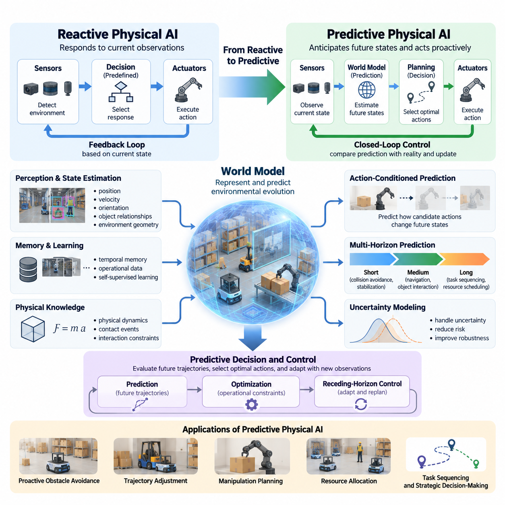{width="7.268055555555556in" height="7.268055555555556in"}

피지컬 인공지능(Physical AI)은 즉각적인 센서 입력(Sensory Input)에 반응하는 시스템에서 미래 환경 상태(Future Environmental State)를 예측하고 중요한 사건이 발생하기 전에 행동할 수 있는 시스템으로 발전하고 있다. 반응형 지능(Reactive Intelligence)은 주로 현재 관측과 사전에 정의된 대응에 의존하지만, 예측형 지능(Predictive Intelligence)은 인식(Perception), 기억(Memory), 학습된 동역학(Learned Dynamics), 계획(Planning)을 결합하여 물리적 세계(Physical World)의 변화를 추정한다. 이러한 전환은 자율 행동(Autonomous Behavior)의 근본적인 발전을 의미한다.

반응형 피지컬 인공지능(Reactive Physical AI)은 센서가 환경 조건을 감지하고, 의사결정 메커니즘(Decision-Making Mechanism)이 대응을 선택하며, 액추에이터(Actuator)가 해당 동작을 실행하는 연속적인 피드백 루프(Feedback Loop)를 통해 작동한다. 이러한 접근 방식은 환경 변화가 관측 가능하고 응답 시간이 충분히 짧으며 작업 요구사항이 비교적 예측 가능할 때 효과적이다. 그러나 관측 지연(Observation Delay), 이동 장애물(Moving Obstacle), 불확실한 상호작용(Uncertain Interaction), 복잡한 물리적 의존관계(Physical Dependency)로 인해 사전 예측이 필요한 환경에서는 반응형 행동만으로 충분하지 않다.

예측형 피지컬 인공지능(Predictive Physical AI)은 미래 상태(Future State)에 대한 추정치를 의사결정 과정에 통합함으로써 기존 피드백 제어(Feedback Control)를 확장한다. 예측형 에이전트(Predictive Agent)는 현재 조건에서 어떤 행동을 수행해야 하는지만 판단하는 것이 아니라, 서로 다른 행동을 실행한 이후 어떤 결과가 발생할 수 있는지를 평가한다. 이러한 능력은 물리적 환경과의 지속적인 상호작용을 유지하면서 선제적 장애물 회피(Proactive Obstacle Avoidance), 궤적 조정(Trajectory Adjustment), 조작 계획(Manipulation Planning), 자원 할당(Resource Allocation)을 가능하게 한다.

반응형 지능에서 예측형 지능으로의 전환은 피드백 제어(Feedback Control)를 제거하는 것이 아니다. 오히려 예측(Prediction)은 예상 결과(Expected Outcome)와 실제 관측(Actual Observation)을 지속적으로 비교하는 폐루프 아키텍처(Closed-Loop Architecture)의 추가적인 능력으로 통합된다. 예측과 현실이 일치하지 않으면 시스템은 내부 추정치(Internal Estimate)를 갱신하고 이후 행동을 조정한다. 이러한 통합은 반응형 시스템의 응답성을 유지하면서 더욱 복잡한 자율 운영(Autonomous Operation)에 필요한 미래 예측 능력(Foresight)을 제공한다.

예측형 피지컬 인공지능(Predictive Physical AI)의 기본 요구사항은 시간에 따른 물리적 상태(Physical State)를 표현하는 것이다. 시스템은 위치(Position), 속도(Velocity), 방향(Orientation), 객체 관계(Object Relationship), 환경 기하구조(Environmental Geometry), 상호작용 제약조건(Interaction Constraint)과 같은 관련 속성을 추정해야 한다. 센서는 잡음(Noise)이 포함된 부분적인 관측만 제공하므로 이러한 추정은 불완전한 경우가 많다. 따라서 예측형 지능은 상태 추정(State Estimation), 시간적 기억(Temporal Memory), 불확실성 모델링(Uncertainty Modeling), 새로운 증거를 반영하는 메커니즘에 의존한다.

월드 모델(World Model)은 물리적 동역학(Physical Dynamics)과 에이전트 행동(Agent Action)에 따라 환경 상태가 어떻게 변화하는지를 표현함으로써 예측형 피지컬 인공지능의 중요한 기반을 제공한다. 월드 모델은 객체 움직임(Object Motion), 접촉 사건(Contact Event), 점유 상태 변화(Occupancy Change), 조작 결과(Manipulation Consequence)를 예측할 수 있다. 이러한 모델은 해석적 물리 원리(Analytical Physical Principle)와 운영 경험(Operational Experience)으로부터 학습한 표현을 결합하여 즉각적인 센서 측정만으로 판단하기 어려운 결과를 예측하도록 지원한다.

예측(Prediction)은 물리적 작업의 특성에 따라 다양한 시간 척도(Temporal Scale)에서 수행될 수 있다. 단기 예측(Short-Horizon Prediction)은 충돌 회피(Collision Avoidance), 안정화(Stabilization), 동적 제어(Dynamic Control)를 지원하고, 중기 예측(Medium-Horizon Prediction)은 내비게이션(Navigation), 객체 상호작용(Object Interaction), 협조 운동(Coordinated Motion)을 지원한다. 장기 예측(Long-Horizon Prediction)은 작업 순서 결정(Task Sequencing), 자원 일정 관리(Resource Scheduling), 전략적 의사결정(Strategic Decision-Making)을 지원한다. 각 예측 구간에서는 계산 복잡도(Computational Complexity), 불확실성(Uncertainty), 물리적 정확도(Physical Accuracy), 운영 관련성(Operational Relevance) 사이의 적절한 균형이 필요하다.

행동 조건부 예측(Action-Conditioned Prediction)은 물리적 에이전트(Physical Agent)가 자신이 관측하는 환경에 직접 영향을 미치기 때문에 특히 중요하다. 창고를 이동하는 로봇은 작업자 및 장애물과의 상대적 위치를 변화시키고, 매니퓰레이터(Manipulator)는 접촉을 통해 객체 배치(Object Configuration)를 변경한다. 따라서 예측 모델(Predictive Model)은 환경이 독립적으로 어떻게 변화하는지뿐 아니라 후보 행동(Candidate Action)이 미래 상태에 어떤 영향을 미치는지도 추정해야 한다. 이러한 특성은 환경 예측(Environmental Forecasting)을 지능형 의사결정(Intelligent Decision-Making)과 직접 연결한다.

모델 예측 제어(Model Predictive Control, MPC)는 예측이 물리적 자율성(Physical Autonomy)을 어떻게 향상할 수 있는지를 보여준다. 제어기(Controller)는 제한된 예측 구간(Prediction Horizon)에서 가능한 미래 궤적(Future Trajectory)을 평가하고, 운영 제약조건(Operational Constraint)을 만족하는 행동 시퀀스(Action Sequence)를 선택한 후 해당 시퀀스의 초기 부분을 실행한다. 새로운 관측이 확보되면 최적화 과정(Optimization Process)을 반복한다. 이러한 이동 예측 구간 전략(Receding-Horizon Strategy)은 불완전한 모델과 지속적으로 변화하는 환경에서도 예측형 행동의 적응성을 유지하도록 한다.

학습 기반 예측(Learning-Based Prediction)은 기존 수학적 모델(Mathematical Model)로 정확하게 설명하기 어려운 환경까지 이러한 능력을 확장한다. 신경망(Neural Network)은 센서 기록(Sensor Recording), 시연(Demonstration), 시뮬레이션(Simulation), 상호작용 이력(Interaction History)으로부터 시간적 관계(Temporal Relationship)를 학습할 수 있다. 순환 신경망 구조(Recurrent Architecture), 트랜스포머(Transformer), 잠재 동역학 모델(Latent Dynamics Model)은 환경 변화를 포착하는 서로 다른 메커니즘을 제공한다. 이러한 모델의 유용성은 학습된 표현이 신뢰할 수 있는 물리적 의사결정에 필요한 정보를 보존하는지에 따라 결정된다.

자기지도학습(Self-Supervised Learning)은 대규모 운영 데이터(Operational Data)로부터 예측 표현(Predictive Representation)을 개발하기 위한 확장 가능한 접근 방식을 제공한다. 미래 관측(Future Observation), 잠재 상태(Latent State), 객체 관계(Object Relationship), 행동 결과(Action Consequence)를 예측함으로써 모델은 모든 사건에 상세한 수동 레이블(Manual Label)을 부여하지 않고도 시간적 구조(Temporal Structure)를 학습할 수 있다. 그러나 기록된 데이터를 정확하게 예측하는 것이 자동으로 안전한 제어(Safe Control)를 보장하지는 않으므로 물리적 검증(Physical Validation)과 작업별 평가(Task-Specific Evaluation)가 필수적이다.

예측 구간(Prediction Horizon)이 길어질수록 불확실성(Uncertainty)의 중요성은 더욱 커진다. 추정 속도(Estimated Velocity), 객체 행동(Object Behavior), 접촉 동역학(Contact Dynamics), 환경 조건(Environmental Condition)의 작은 오차도 누적되면 예측 결과와 실제 결과 사이에 상당한 차이를 발생시킬 수 있다. 따라서 예측형 피지컬 인공지능은 모든 예측을 확정적인 것으로 취급하지 않고 불확실성을 표현해야 한다. 확률 모델(Probabilistic Model), 앙상블(Ensemble), 신뢰도 추정(Confidence Estimation), 보수적 계획 제약조건(Conservative Planning Constraint)은 신뢰할 수 있는 예측과 불확실한 가능성을 구분하도록 지원한다.

예측형 안전 메커니즘(Predictive Safety Mechanism)은 예상되는 미래 조건을 활용하여 위험이 즉각적인 위협으로 발전하기 전에 식별한다. 자율이동로봇(Autonomous Mobile Robot, AMR)은 현재 이동 궤적이 작업자의 예상 이동 경로와 교차할 가능성을 추정할 수 있으며, 산업용 매니퓰레이터(Industrial Manipulator)는 조립 과정에서 과도한 접촉력(Contact Force)이 발생할 가능성을 예측할 수 있다. 시스템은 미래 안전 여유(Future Safety Margin)를 평가하여 위험 상황이 발생하기 전에 속도를 줄이거나 궤적을 수정하고, 지원을 요청하거나 안전 운영 상태(Safe Operating State)로 전환할 수 있다.

예측형 인식(Predictive Perception)은 로봇이 센싱 자원(Sensing Resource)과 계산 자원(Computational Resource)을 할당하는 방식도 변화시킨다. 모든 관측을 동일한 우선순위로 처리하는 대신, 에이전트는 향후 의사결정에 영향을 미칠 것으로 예상되는 객체나 영역에 주의를 집중할 수 있다. 예상 가림 현상(Anticipated Occlusion), 이동 장애물(Moving Obstacle), 불확실한 객체 위치(Uncertain Object Location)는 능동 인식(Active Perception)을 유도할 수 있다. 이를 통해 인식이 예측을 지원하고 예측이 추가 관측의 가치를 결정하는 상호보완적 관계가 형성된다.

물리적 추론(Physical Reasoning)은 예측형 지능을 수치적 궤적 예측(Numerical Trajectory Forecasting) 이상의 영역으로 확장한다. 에이전트는 객체가 떨어질지, 표면이 하중을 지탱할 수 있는지, 이동 중 파지(Grasp)가 안정적으로 유지될지를 추론해야 할 수 있다. 이러한 예측은 기하구조(Geometry), 재료 특성(Material Property), 접촉 관계(Contact Relationship), 인과적 상호작용(Causal Interaction)에 의존한다. 학습된 표현(Learned Representation)과 물리적 제약조건(Physical Constraint)을 결합하면 이전에 관측한 사례와 다른 상황에 대한 추론 능력을 향상할 수 있다.

예측 능력(Predictive Capability)은 동적 환경(Dynamic Environment)에서 작동하는 자율이동로봇(Autonomous Mobile Robot)에 특히 유용하다. 창고 로봇(Warehouse Robot)은 보행자 움직임(Pedestrian Movement), 차량 상호작용(Vehicle Interaction), 일시적 장애물(Temporary Obstruction), 변화하는 교통 패턴(Traffic Pattern)을 예측해야 한다. 실외 로봇(Outdoor Robot)은 지형 조건(Terrain Condition), 날씨(Weather), 예측하기 어려운 이동 주체로 인한 추가적인 불확실성에 직면한다. 예측형 내비게이션(Predictive Navigation)은 즉각적인 장애물 감지에만 의존하지 않고 미래 주행 가능성(Future Traversability)과 충돌 위험(Collision Risk)을 평가하도록 한다.

조작 작업(Manipulation Task)은 접촉 상호작용(Contact Interaction)이 물리적 상태의 불연속적 변화(Discontinuous Change)를 발생시킬 수 있기 때문에 추가적인 어려움을 수반한다. 파지(Grasping), 밀기(Pushing), 삽입(Insertion), 조립(Assembly)에는 마찰(Friction), 변형(Deformation), 힘 전달(Force Transmission), 객체 안정성(Object Stability)에 대한 예측이 필요하다. 예측형 조작 시스템(Predictive Manipulation System)은 실행 전에 대안 행동(Alternative Action)을 평가하고 실제 접촉 행동이 예상과 다를 때 전략을 조정할 수 있다. 이러한 작업 전반에서 신뢰할 수 있는 힘 피드백(Force Feedback)은 필수적이다.

예측형 피지컬 인공지능의 컴퓨팅 아키텍처(Computing Architecture)는 엄격한 지연시간(Latency), 전력(Power), 신뢰성(Reliability) 제약조건을 고려해야 한다. 고주파 제어(High-Frequency Control)는 일반적으로 로컬 처리(Local Processing)가 필요하지만, 계산 집약적인 예측(Forecasting)과 계획(Planning)은 상대적으로 낮은 주기로 수행될 수 있다. 엣지 컴퓨팅(Edge Computing)은 즉각적인 예측과 행동 선택을 지원하며, 온프레미스(On-Premise) 및 클라우드(Cloud) 자원은 통신 조건이 허용되는 경우 모델 학습(Model Training), 대규모 시뮬레이션(Large-Scale Simulation), 공유 환경 지식(Shared Environmental Knowledge)을 지원할 수 있다.

다중 로봇 환경(Multi-Robot Environment)은 개별 에이전트를 넘어서는 예측형 지능(Predictive Intelligence)의 기회를 제공한다. 로봇은 관측 정보(Observation), 예상 궤적(Anticipated Trajectory), 작업 의도(Task Intention)를 교환하여 불확실성을 줄이고 협조 능력을 향상할 수 있다. 공유 예측 표현(Shared Predictive Representation)은 교통 관리(Traffic Management), 협동 조작(Cooperative Manipulation), 플릿 일정 관리(Fleet Scheduling)를 지원할 수 있다. 그러나 통신 지연(Communication Delay), 일관되지 않은 상태 추정(Inconsistent State Estimation), 상충하는 예측(Conflicting Prediction)에 대응하기 위해서는 로컬 안전성(Local Safety)과 자율성(Autonomy)을 유지하는 강건한 협조 메커니즘(Robust Coordination Mechanism)이 필요하다.

예측형 피지컬 인공지능의 평가(Evaluation)는 예측 품질(Forecasting Quality)과 운영 결과(Operational Consequence)를 모두 검토해야 한다. 예측 오차(Prediction Error)는 궤적 편차(Trajectory Deviation), 상태 추정 정확도(State Estimation Accuracy), 불확실성 보정(Uncertainty Calibration), 사건 예측 성능(Event Forecasting Performance)을 통해 측정할 수 있다. 그러나 매우 정확한 예측 모델도 그 출력이 계획 과정에 적절히 통합되지 않으면 비효율적인 행동을 생성할 수 있다. 따라서 평가에는 작업 성공률(Task Success Rate), 안전 위반(Safety Violation), 개입 빈도(Intervention Frequency), 계산 지연시간(Computational Latency), 환경 변화에 대한 강건성(Robustness)이 포함되어야 한다.

예측형 지능(Predictive Intelligence)의 개발에는 시뮬레이션과 현실 간 격차(Simulation-to-Reality Gap)에 대한 신중한 관리도 필요하다. 시뮬레이션 환경에서 학습된 모델은 유용한 물리적 관계를 학습하더라도 실제 마찰, 센서 잡음(Sensor Noise), 액추에이터 한계(Actuator Limitation), 인간 행동(Human Behavior)을 충분히 반영하지 못할 수 있다. 도메인 무작위화(Domain Randomization), 시스템 식별(System Identification), 실제 환경 보정(Real-World Calibration), 지속적 검증(Continuous Validation)은 전이 성능(Transfer Performance)을 향상할 수 있다. 운영 데이터는 통제된 학습 과정(Controlled Learning Process)에서 예측 실패를 식별하고 모델을 개선하는 데 활용되어야 한다.

실용적인 전환 전략(Practical Transition Strategy)은 기존 반응형 아키텍처(Reactive Architecture)의 상태 추정(State Estimation)과 시간적 인식(Temporal Awareness)을 강화하는 것에서 시작한다. 이후 충돌 예측(Collision Forecasting), 운동 계획(Motion Planning), 장비 상태 모니터링(Equipment Condition Monitoring)과 같이 명확하게 정의된 기능에 예측 모듈(Predictive Module)을 도입할 수 있다. 신뢰성이 향상되면 이러한 모듈은 점차 통합된 의사결정(Integrated Decision-Making)을 지원하게 된다. 점진적 배포(Incremental Deployment)는 검증된 제어 및 안전 메커니즘을 성급하게 대체하지 않으면서 측정 가능한 성능 향상을 가능하게 한다.

피지컬 인공지능(Physical AI)의 장기적인 발전 방향은 물리적 세계에서 지속적으로 감지(Sense), 모델링(Model), 예측(Predict), 계획(Plan), 행동(Act), 학습(Learn)을 수행하는 시스템으로 나아가는 것이다. 예측형 지능(Predictive Intelligence)은 더욱 높은 수준의 자율성(Autonomy)을 위한 기반을 제공하지만, 그 효과는 신뢰할 수 있는 인식(Perception), 현실에 기반한 물리 모델(Physically Grounded Model), 불확실성 인식(Uncertainty Awareness), 안전한 실행(Safe Execution)에 달려 있다. 핵심 목표는 미래를 완벽하게 아는 것이 아니라 가능한 결과를 사전에 예측하면서 현실의 변화에 지속적으로 대응하여 더 나은 의사결정을 수행하는 능력을 확보하는 것이다.

## 10.02. World Model Centric Physical AI

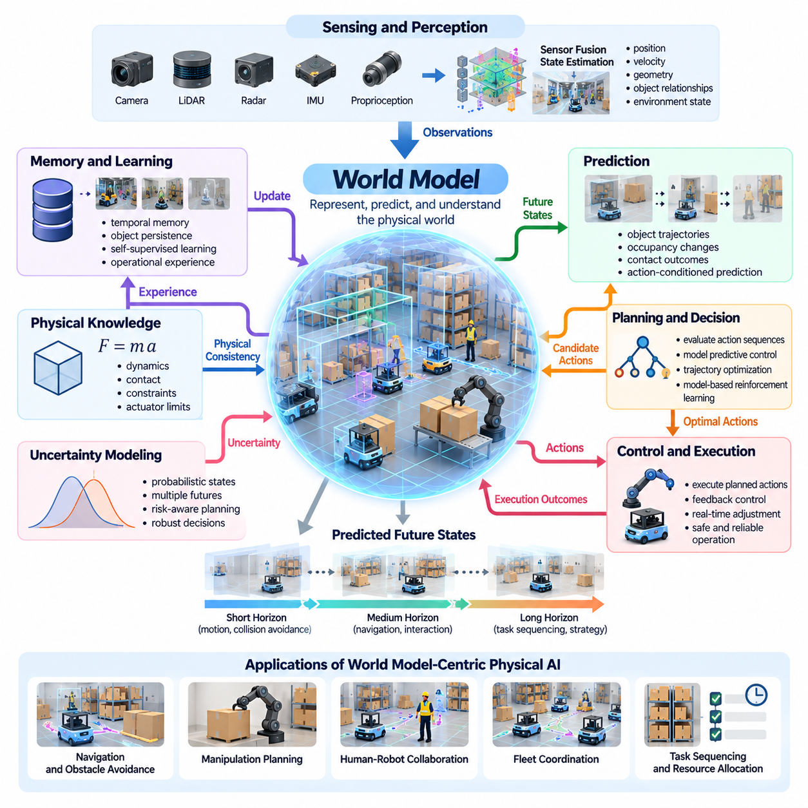{width="7.268055555555556in" height="7.268055555555556in"}

월드 모델 중심 피지컬 인공지능(World Model-Centric Physical AI)은 주로 관측에 반응하는 시스템에서 물리적 세계(Physical World)의 내부 표현(Internal Representation)을 유지하고 그 변화를 예측하는 아키텍처(Architecture)로의 전환을 의미한다. 월드 모델(World Model)은 지능형 에이전트(Intelligent Agent)가 환경 상태(Environmental State)를 추정하고, 물리적 관계(Physical Relationship)를 이해하며, 행동의 결과(Action Consequence)를 예측하도록 한다. 이러한 능력은 인식(Perception), 추론(Reasoning), 계획(Planning), 제어(Control), 학습(Learning)을 일관된 자율 시스템(Autonomous System)으로 통합하는 기반을 제공한다.

전통적인 로봇 아키텍처(Traditional Robotic Architecture)는 인식(Perception), 위치 추정(Localization), 계획(Planning), 제어(Control)를 별도의 기능 모듈(Functional Module)로 구성하는 경우가 많다. 이러한 모듈형 구조(Modular Structure)는 엔지니어링의 명확성을 제공하지만, 구성요소 사이에서 정보가 분산될 수 있다. 월드 모델 중심 아키텍처(World Model-Centric Architecture)는 환경 상태, 물리적 동역학(Physical Dynamics), 예상 결과(Anticipated Outcome)에 대한 일관된 추정치를 통해 이러한 기능을 연결하는 공유 표현(Shared Representation)을 도입하면서 필요한 경우 전문화된 모듈을 유지한다.

월드 모델(World Model)의 핵심 목적은 물리적 환경(Physical Environment)이 시간에 따라 어떻게 변화하는지를 표현하는 것이다. 월드 모델은 객체(Object), 공간적 관계(Spatial Relationship), 움직임(Motion), 상호작용(Interaction), 환경 제약조건(Environmental Constraint)에 관한 정보를 포착한다. 정적 지도(Static Map)나 단일 센서 관측(Sensor Observation)과 달리 동적 월드 모델(Dynamic World Model)은 현재 조건과 가능한 미래 변화를 함께 설명한다. 월드 모델의 유용성은 단순히 감각 정보를 재구성하는 것이 아니라 신뢰할 수 있는 의사결정(Reliable Decision-Making)을 지원하는지에 따라 결정된다.

월드 모델(World Model)은 명시적 물리 상태(Explicit Physical State), 학습된 잠재 표현(Learned Latent Representation), 또는 두 방식을 결합한 하이브리드 구조(Hybrid Structure)를 통해 작동할 수 있다. 명시적 표현(Explicit Representation)은 위치(Position), 속도(Velocity), 기하구조(Geometry), 접촉 조건(Contact Condition)과 같은 물리량을 설명하고, 잠재 모델(Latent Model)은 복잡한 관계를 학습된 특징 공간(Learned Feature Space)에 인코딩한다. 하이브리드 아키텍처(Hybrid Architecture)는 해석 가능한 물리 변수(Interpretable Physical Variable)와 유연한 학습 동역학(Learned Dynamics)을 결합하여 유용한 구조적 제약조건(Structural Constraint)을 유지하면서 예측 능력을 향상할 가능성을 제공한다.

월드 모델 중심 에이전트(World Model-Centric Agent)는 관측과 상호작용을 통해 내부 표현(Internal Representation)을 지속적으로 갱신한다. 카메라(Camera), 라이다(LiDAR), 관성 센서(Inertial Sensor), 고유수용성 측정(Proprioceptive Measurement), 기타 센싱 모달리티(Sensing Modality)는 환경에 관한 상호보완적인 정보를 제공한다. 센서 융합(Sensor Fusion)과 상태 추정(State Estimation)은 이러한 관측을 일관된 추정치로 변환한다. 시간적 기억(Temporal Memory)은 일시적으로 가려지거나 부분적으로만 관측 가능한 객체와 환경 조건에 관한 정보를 유지하도록 지원한다.

예측(Prediction)은 월드 모델 중심 지능(World Model-Centric Intelligence)을 정의하는 핵심 능력이다. 추정된 현재 상태(Current State)와 후보 행동(Candidate Action)이 주어지면 모델은 가능한 미래 상태(Future State)와 상호작용 결과(Interaction Outcome)를 예측한다. 이러한 예측에는 객체 궤적(Object Trajectory), 점유 상태 변화(Occupancy Change), 접촉 사건(Contact Event), 환경 변화(Environmental Transformation)가 포함될 수 있다. 에이전트는 대안적인 미래 상황을 비교함으로써 실행 전에 행동을 평가하고 작업 목표(Task Objective)와 운영 제약조건(Operational Constraint)을 더 효과적으로 만족하는 행동을 선택할 수 있다.

행동 조건부 월드 모델(Action-Conditioned World Model)은 물리적 에이전트(Physical Agent)가 주변 환경을 능동적으로 변화시키기 때문에 특히 중요하다. 이동 로봇(Mobile Robot)은 내비게이션(Navigation)을 통해 공간적 관계(Spatial Relationship)를 변화시키고, 매니퓰레이터(Manipulator)는 파지(Grasping)와 접촉(Contact)을 통해 객체 배치(Object Configuration)를 변경한다. 따라서 모델은 환경 자체의 변화와 에이전트 행동으로 발생한 변화를 구분해야 한다. 행동(Action)과 예측된 결과(Predicted Consequence) 사이의 이러한 관계는 모델 기반 계획(Model-Based Planning)과 적응형 제어(Adaptive Control)의 기반을 형성한다.

월드 모델 중심 계획(World Model-Centric Planning)은 예측된 상태 전이(Predicted State Transition)를 활용하여 후보 행동 시퀀스(Candidate Action Sequence)를 평가한다. 계획기(Planner)는 즉각적인 관측만으로 행동을 선택하는 대신 서로 다른 선택이 미래 조건에 어떤 영향을 미칠 수 있는지 고려한다. 모델 예측 제어(Model Predictive Control), 궤적 최적화(Trajectory Optimization), 모델 기반 강화학습(Model-Based Reinforcement Learning)은 상호보완적인 접근 방식을 제공한다. 각 방식은 계산 비용(Computational Cost), 불확실성(Uncertainty), 물리적 제약조건(Physical Constraint)의 균형을 유지하면서 예측 표현(Predictive Representation)과 의사결정 메커니즘(Decision Mechanism)을 결합한다.

계층적 예측(Hierarchical Prediction)은 월드 모델(World Model)이 서로 다른 시간적 및 공간적 척도(Temporal and Spatial Scale)에서 의사결정을 지원하도록 한다. 단기 예측 모델(Short-Horizon Model)은 즉각적인 움직임과 접촉 동역학(Contact Dynamics)을 추정할 수 있으며, 장기 예측 모델(Long-Horizon Model)은 작업 진행(Task Progression), 환경 변화(Environmental Change), 전략적 목표(Strategic Objective)를 표현할 수 있다. 계층적 아키텍처(Hierarchical Architecture)는 빠른 로컬 예측(Local Prediction)과 상대적으로 느린 추상적 추론(Abstract Reasoning)을 결합하여 물리적 에이전트가 즉각적인 제어와 장기적인 행동 목표를 조정하도록 한다.

기억(Memory)은 현재 관측만으로 물리적 세계를 항상 재구성할 수 없기 때문에 필수적이다. 객체는 가려질 수 있고, 환경 조건은 점진적으로 변화할 수 있으며, 이전 상호작용(Previous Interaction)은 미래 결과(Future Outcome)에 영향을 미칠 수 있다. 월드 모델(World Model)은 시간적 이력(Temporal History), 지속적인 객체 표현(Persistent Object Representation), 학습된 환경 규칙성(Learned Environmental Regularity)을 통합할 수 있다. 이러한 기억은 추론의 연속성(Continuity of Reasoning)을 지원하고 부분 관측 가능성(Partial Observability) 조건에서 의사결정 능력을 향상한다.

물리적 일관성(Physical Consistency)은 유용한 월드 모델(World Model)을 위한 핵심 요구사항이다. 예측은 기하구조(Geometry), 움직임(Motion), 접촉(Contact), 보존 법칙(Conservation Principle), 액추에이터 능력(Actuator Capability)과 관련된 제약조건을 준수해야 한다. 순수 데이터 기반 모델(Purely Data-Driven Model)은 시각적으로 그럴듯하지만 물리적으로 일관되지 않은 결과를 생성할 수 있다. 물리 정보 기반 학습(Physics-Informed Learning)과 하이브리드 모델링(Hybrid Modeling)은 일반화 성능(Generalization Performance)을 향상하는 구조적 지식(Structural Knowledge)을 도입할 수 있지만, 그 효과는 작업별 평가(Task-Specific Evaluation)를 통해 검증되어야 한다.

불확실성 모델링(Uncertainty Modeling) 역시 중요하다. 환경 복잡도(Environmental Complexity)와 예측 구간(Forecasting Horizon)이 증가할수록 예측의 신뢰성이 감소하기 때문이다. 센서 잡음(Sensor Noise), 알려지지 않은 객체 특성(Unknown Object Property), 예측하기 어려운 인간 행동(Human Behavior), 불완전한 동역학(Imperfect Dynamics)은 여러 가지 가능한 미래 상황을 발생시킬 수 있다. 확률적 월드 모델(Probabilistic World Model)은 확률 분포(Probability Distribution)나 대안 가설(Alternative Hypothesis)을 통해 이러한 모호성을 표현한다. 계획 메커니즘(Planning Mechanism)은 안전 여유(Safety Margin)를 평가하고 행동을 선택할 때 이러한 불확실성을 고려할 수 있다.

월드 모델(World Model)의 학습에는 환경 상태(Environmental State), 행동(Action), 그에 따른 상태 전이(State Transition)를 포괄하는 다양한 경험이 필요하다. 실제 환경 상호작용 데이터(Real-World Interaction Data)는 물리적 현실에 기반한 학습(Physical Grounding)을 제공하며, 시뮬레이션(Simulation)은 드문 사건(Rare Event)과 통제된 변화(Controlled Variation)에 대한 학습 범위를 확장할 수 있다. 자기지도학습 목표(Self-Supervised Objective)는 광범위한 수동 주석(Manual Annotation) 없이 시간적 구조(Temporal Structure)를 학습하도록 한다. 그러나 수동적인 시각 예측(Passive Visual Prediction)을 넘어 신뢰할 수 있는 계획을 지원하려면 학습 데이터에 의미 있는 행동 결과(Action Consequence)가 포함되어야 한다.

시뮬레이션 환경(Simulation Environment)과 디지털 트윈(Digital Twin)은 월드 모델 개발(World Model Development)을 위한 중요한 인프라(Infrastructure)를 제공한다. 이러한 환경은 물리적 장비를 불필요한 위험에 노출하지 않으면서 반복 실험(Repeated Experiment), 통제된 개입(Controlled Intervention), 대안 행동(Alternative Action)의 평가를 가능하게 한다. 합성 궤적(Synthetic Trajectory)은 운영 데이터(Operational Data)를 보완하고 체계적인 테스트(Systematic Testing)를 지원할 수 있다. 그러나 시뮬레이션 동역학(Simulated Dynamics)과 실제 동역학(Real Dynamics) 사이의 차이를 해결하려면 배포 전에 보정(Calibration), 도메인 적응(Domain Adaptation), 검증(Validation)이 필요하다.

월드 모델(World Model)은 아직 실행되지 않은 행동에서 어떤 결과가 발생할 수 있는지를 추정함으로써 반사실적 추론(Counterfactual Reasoning)을 지원할 수도 있다. 로봇은 내부 시뮬레이션 전개(Internal Rollout)를 사용하여 대안적인 이동 경로(Navigation Route), 조작 전략(Manipulation Strategy), 복구 절차(Recovery Procedure)를 비교할 수 있다. 이러한 추론은 에이전트가 바람직하지 않은 결과(Undesirable Consequence)를 예측하고 상충관계(Tradeoff)를 평가하도록 지원한다. 그 신뢰성은 모델이 관련 운영 조건(Operating Condition)에서 인과관계(Causal Relationship)를 얼마나 정확하게 표현하는지에 달려 있다.

월드 모델(World Model)과 비전 언어 모델(Vision-Language Model, VLM), 비전 언어 행동 아키텍처(Vision-Language-Action Architecture, VLA)의 통합은 의미적 이해(Semantic Understanding)와 물리적 예측(Physical Prediction)을 결합할 수 있는 기회를 제공한다. 언어(Language)는 목표와 제약조건을 설명하고, 시각적 관측(Visual Observation)은 환경에 관한 증거를 제공한다. 월드 모델은 물리적 결과를 추정하고 행동 정책(Action Policy)은 선택된 계획을 실행 가능한 행동(Executable Behavior)으로 변환한다. 이러한 구성요소는 실제 로봇 능력(Robot Capability)과 관측 가능한 환경 조건에 기반해야 한다.

월드 모델 중심 피지컬 인공지능(World Model-Centric Physical AI)은 동적 환경(Dynamic Environment)에서 작동하는 자율이동로봇(Autonomous Mobile Robot, AMR)에 특히 중요하다. 예측형 점유 표현(Predictive Occupancy Representation)은 작업자, 차량, 장애물이 이동함에 따라 주변 공간이 어떻게 변화할 수 있는지를 추정한다. 내비게이션 시스템(Navigation System)은 궤적을 선택하기 전에 미래 충돌 위험(Future Collision Risk)과 주행 가능성(Traversability)을 평가할 수 있다. 지속적인 모델 갱신(Continuous Model Update)은 실제 환경 행동이 예상과 다를 때 로봇이 예측을 수정하도록 한다.

조작 시스템(Manipulation System)은 객체 기하구조(Object Geometry), 접촉 동역학(Contact Dynamics), 파지 안정성(Grasp Stability), 재료 상호작용(Material Interaction)을 표현하는 월드 모델(World Model)의 이점을 활용할 수 있다. 로봇은 행동을 실행하기 전에 객체가 이동하거나 회전하거나 변형되거나 불안정해질 가능성을 예측할 수 있다. 이러한 능력은 파지 선택(Grasp Selection), 삽입 계획(Insertion Planning), 협조 조작(Coordinated Manipulation)을 지원한다. 그러나 신뢰할 수 있는 실행을 위해서는 여전히 힘 센싱(Force Sensing), 피드백 제어(Feedback Control), 예측 실패 감지(Prediction Failure Detection) 메커니즘이 필요하다.

월드 모델(World Model)은 공유 환경 표현(Shared Environmental Representation)과 집단 학습(Collective Learning)을 통해 개별 로봇을 넘어 확장될 수 있다. 여러 에이전트(Multiple Agent)는 관측 정보를 제공하고 공통 지도(Common Map)를 갱신하며 예상 궤적(Anticipated Trajectory)이나 작업 의도(Task Intention)를 교환할 수 있다. 공유 모델(Shared Model)은 특히 개별 로봇의 가시 범위(Visibility)가 제한된 경우 플릿 협조(Fleet Coordination)와 환경 인식(Environmental Awareness)을 향상할 수 있다. 일관성을 유지하려면 통신 지연(Communication Latency), 상충하는 관측(Conflicting Observation), 동기화(Synchronization)에 주의를 기울여야 한다.

컴퓨팅 배포(Computational Deployment)는 중요한 아키텍처적 과제(Architectural Challenge)를 제시한다. 상세한 예측 모델(Predictive Model)은 상당한 처리 능력(Processing Power), 메모리 대역폭(Memory Bandwidth), 에너지(Energy)를 요구할 수 있다. 엣지 시스템(Edge System)은 저지연 추론(Low-Latency Inference)과 즉각적인 안전 의사결정(Safety Decision)을 우선해야 하며, 온프레미스(On-Premise) 또는 클라우드(Cloud) 자원은 더 집약적인 학습(Training), 시뮬레이션(Simulation), 모델 개선(Model Refinement)을 지원할 수 있다. 분산 아키텍처(Distributed Architecture)는 통신이 불안정하거나 사용할 수 없는 경우에도 로컬 자율성(Local Autonomy)을 유지해야 한다.

월드 모델 중심 시스템(World Model-Centric System)의 평가는 시각적 재구성(Visual Reconstruction)이나 예측 정확도(Prediction Accuracy)를 넘어야 한다. 유용한 평가 지표(Evaluation Metric)에는 상태 예측 오차(State Forecasting Error), 불확실성 보정(Uncertainty Calibration), 계획 성능(Planning Performance), 작업 완료(Task Completion), 안전 위반(Safety Violation), 계산 지연시간(Computational Latency)이 포함된다. 또한 모델은 분포 변화(Distribution Shift), 익숙하지 않은 객체(Unfamiliar Object), 예상하지 못한 상호작용(Unexpected Interaction), 센서 성능 저하(Sensor Degradation) 조건에서 테스트되어야 한다. 결정적인 평가 기준은 월드 모델이 현실적인 운영 조건에서 신뢰할 수 있는 물리적 행동(Reliable Physical Behavior)을 향상하는지 여부이다.

안전 보증(Safety Assurance)을 위해서는 예측 결과(Predicted Outcome)와 관측 결과(Observed Outcome)를 지속적으로 비교해야 한다. 모델 신뢰도(Model Confidence)가 감소하거나 물리적 행동이 예상과 달라지면 시스템은 추정치를 수정하고 행동을 제한하거나 적절한 대체 메커니즘(Fallback Mechanism)을 활성화해야 한다. 학습된 예측(Learned Prediction)은 정확성을 보장할 수 없으므로 실행 중 모니터링(Runtime Monitoring)과 독립적인 안전 제어(Independent Safety Control)가 여전히 필요하다. 월드 모델은 단일 장애점(Single Point of Failure)이 되지 않으면서 안전 의사결정을 강화해야 한다.

월드 모델 중심 피지컬 인공지능(World Model-Centric Physical AI)의 장기적인 중요성은 예측 표현(Predictive Representation)을 자율적 물리 지능(Autonomous Physical Intelligence)의 기반으로 확립하는 데 있다. 인식(Perception), 기억(Memory), 물리적 추론(Physical Reasoning), 행동 조건부 학습(Action-Conditioned Learning)이 더욱 긴밀하게 통합됨에 따라 로봇은 다양한 작업과 환경에 걸쳐 점점 더 높은 수준의 전이 가능한 능력(Transferable Capability)을 개발할 수 있다. 이러한 발전은 단순히 더 큰 모델(Larger Model)에 의존하는 것이 아니라 물리적 현실 기반성(Physical Grounding), 효율적인 계산(Efficient Computation), 신뢰할 수 있는 평가(Trustworthy Evaluation), 실제 환경 경험(Real-World Experience)을 통한 지속적인 적응(Continuous Adaptation)에 달려 있다.

## 10.03. Robot Foundation Models and Generalist Policies

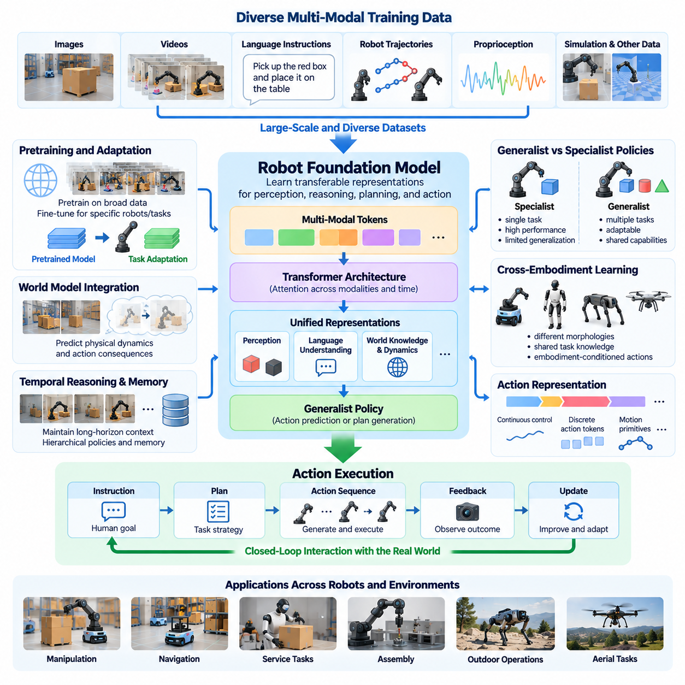{width="7.268055555555556in" height="7.268055555555556in"}

로봇 파운데이션 모델(Robot Foundation Model)은 다양한 로봇 작업(Task), 환경(Environment), 로봇 형태(Embodiment)에 걸쳐 폭넓게 재사용할 수 있는 지능을 개발하려는 피지컬 인공지능(Physical AI)의 새로운 발전 방향을 나타낸다. 좁게 정의된 작업만을 수행하도록 설계된 기존 모델과 달리, 파운데이션 모델(Foundation Model)은 다양한 데이터셋과 상호작용 경험(Interaction Experience)으로부터 전이 가능한 표현(Transferable Representation)을 학습한다. 이러한 모델의 목표는 인식(Perception), 추론(Reasoning), 계획(Planning), 행동(Action)을 위한 공통 기반을 제공하여 각 응용 분야마다 별도의 지능 시스템을 개발해야 하는 필요성을 줄이는 것이다.

전통적인 로봇 학습(Robot Learning)은 객체 파지(Object Grasping), 내비게이션(Navigation), 조립(Assembly)과 같은 개별 작업을 위해 학습된 전문화 정책(Specialized Policy)에 의존하는 경우가 많다. 이러한 정책은 명확하게 정의된 운영 조건에서 높은 성능을 달성할 수 있지만, 객체와 환경 또는 작업 요구사항이 변경되면 어려움을 겪는 경우가 많다. 범용 정책(Generalist Policy)은 여러 작업에 적용할 수 있는 공통 행동 능력(Shared Behavioral Capability)을 학습함으로써 이러한 한계를 극복하고, 매번 전체 재학습을 수행하지 않고도 다양한 작업을 수행할 수 있도록 한다.

로봇 파운데이션 모델(Robot Foundation Model)은 일반적으로 이미지(Images), 비디오(Videos), 언어 지시문(Language Instruction), 로봇 궤적(Robot Trajectory), 고유수용성 측정(Proprioceptive Measurement), 행동 시퀀스(Action Sequence)를 포함한 다양한 정보원을 활용하여 학습한다. 이러한 모달리티(Modality)는 물리적 상호작용(Physical Interaction)에 관한 상호보완적인 설명을 제공한다. 시각 정보(Visual Information)는 환경 구조(Environmental Structure)를 포착하고, 언어(Language)는 목표와 제약조건을 표현하며, 행동 데이터(Action Data)는 관측과 실행 가능한 행동을 연결한다. 이러한 정보의 통합은 모델이 인식(Perception), 의도(Intention), 물리적 결과(Physical Consequence) 사이의 관계를 학습하도록 한다.

범용 로봇 정책(Generalist Robot Policy)의 개발은 대규모의 다양한 학습 데이터(Training Data)에 크게 의존한다. 원격조작(Teleoperation), 자율 탐색(Autonomous Exploration), 시뮬레이션(Simulation), 인간 활동 기록(Human Activity Recording)을 통해 수집한 시연 데이터(Demonstration Data)는 서로 다른 형태의 경험을 제공한다. 그러나 이러한 데이터 소스를 결합하면 센서 구성(Sensor Configuration), 행동 정의(Action Definition), 좌표계(Coordinate System), 작업 주석(Task Annotation)의 불일치와 관련된 문제가 발생한다. 따라서 효과적인 데이터 정규화(Data Normalization)와 표현 정렬(Representation Alignment)이 필수적이다.

사전학습(Pretraining)은 특정 로봇 응용 분야에 맞게 모델을 조정하기 전에 재사용 가능한 표현(Reusable Representation)을 학습하는 메커니즘을 제공한다. 파운데이션 모델은 먼저 광범위한 데이터셋을 통해 시각적 구조(Visual Structure), 객체 관계(Object Relationship), 시간적 동역학(Temporal Dynamics), 언어 조건부 행동(Language-Conditioned Behavior)을 학습할 수 있다. 이후 미세조정(Fine-Tuning)을 통해 이러한 능력을 특정 로봇이나 환경에 특화할 수 있다. 이러한 접근 방식은 작업별 데이터(Task-Specific Data)의 요구량을 줄일 가능성이 있지만, 적응 품질(Adaptation Quality)은 사전학습된 지식의 관련성에 따라 달라진다.

범용 정책(Generalist Policy)과 전문화 정책(Specialist Policy)은 주로 목표로 하는 운영 능력의 범위에서 차이가 난다. 전문화 정책은 하나의 조작 절차에서 성능을 최적화할 수 있지만, 범용 정책은 서로 다른 객체와 환경에서 다양한 지시문을 수행하려고 한다. 그러나 범용성이 반드시 더 높은 성능을 의미하지는 않는다. 정밀도(Precision), 결정론적 타이밍(Deterministic Timing), 엄격한 안전 요구사항(Stringent Safety Requirement)이 운영 목표에서 가장 중요한 경우에는 전문화 제어기(Specialized Controller)가 여전히 더 적합할 수 있다.

트랜스포머 아키텍처(Transformer Architecture)는 관측(Observation), 지시문(Instruction), 행동(Action)을 포함하는 시퀀스를 처리할 수 있기 때문에 로봇 파운데이션 모델의 중요한 구성요소가 되었다. 어텐션 메커니즘(Attention Mechanism)은 모델이 여러 모달리티와 시간적 맥락(Temporal Context)에 걸친 관계를 표현하도록 한다. 아키텍처에 따라 모델은 행동을 직접 예측하거나 중간 계획(Intermediate Plan)을 생성하거나 미래 표현(Future Representation)을 추정할 수 있다. 궁극적으로 아키텍처의 효과는 예측 정확도만이 아니라 실제 물리적 실행(Physical Execution)을 통해 평가되어야 한다.

비전 언어 행동 모델(Vision-Language-Action Model, VLA)은 파운데이션 모델을 로봇 제어(Robot Control)와 통합하는 하나의 접근 방식이다. 이러한 시스템은 시각적 관측(Visual Observation)과 언어 지시문(Language Instruction)을 행동 예측(Action Prediction)과 결합하여 로봇이 작업 설명(Task Description)을 물리적 행동으로 변환하도록 한다. 행동 표현(Action Representation)은 연속적인 제어 명령(Continuous Control Command), 이산 행동 토큰(Discrete Action Token), 시간적으로 확장된 행동 묶음(Action Chunk)을 포함할 수 있다. 각 접근 방식은 표현력(Expressiveness), 지연시간(Latency), 정밀도(Precision), 로봇 하드웨어와의 호환성(Compatibility) 측면에서 서로 다른 절충점을 가진다.

교차 형태 학습(Cross-Embodiment Learning)은 로봇마다 형태(Morphology), 센싱(Sensing), 구동(Actuation), 물리적 능력(Physical Capability)이 다르기 때문에 핵심적인 연구 과제이다. 이동형 매니퓰레이터(Mobile Manipulator), 휴머노이드(Humanoid), 사족보행 로봇(Quadruped), 공중 로봇(Aerial Robot)은 유사한 목표를 추구하더라도 동일한 모터 명령을 실행할 수 없다. 범용 모델(Generalist Model)은 전이 가능한 작업 지식(Transferable Task Knowledge)과 로봇 형태에 특화된 제어 요구사항(Embodiment-Specific Control Requirement)을 구분해야 한다. 공유 의미 표현(Shared Semantic Representation)과 로봇 형태 조건부 행동 인터페이스(Embodiment-Conditioned Action Interface)는 이러한 분리를 달성하기 위한 잠재적인 메커니즘을 제공한다.

행동 토큰화(Action Tokenization)는 범용 시퀀스 모델링(General-Purpose Sequence Modeling)과 연속적인 물리 제어(Continuous Physical Control)를 연결하는 방법이 될 수 있다. 로봇 움직임(Robot Movement)은 이산화된 명령(Discretized Command), 학습된 운동 원시 동작(Learned Motion Primitive), 구조화된 행동 시퀀스(Structured Action Sequence)로 표현할 수 있다. 이러한 표현은 서로 다른 데이터셋을 통합한 학습을 용이하게 할 수 있지만, 이산화(Discretization)는 정밀도를 낮추거나 추가적인 디코딩 복잡도(Decoding Complexity)를 발생시킬 수 있다. 적절한 행동 표현은 제어 주파수(Control Frequency), 작업 특성(Task Characteristic), 액추에이터 제약조건(Actuator Constraint)에 따라 달라진다.

시간적 추론(Temporal Reasoning)은 많은 물리적 작업이 장시간에 걸친 행동 조정을 요구하기 때문에 범용 정책(Generalist Policy)에 필수적이다. 작업 공간을 준비하고 객체를 회수한 뒤 조립 작업을 완료하는 로봇은 여러 중간 단계를 거치는 동안 작업 맥락(Task Context)을 유지해야 한다. 계층적 정책(Hierarchical Policy)은 상위 수준 목표(High-Level Objective)와 하위 수준 제어(Low-Level Control)를 분리할 수 있으며, 기억 메커니즘(Memory Mechanism)은 관련 상호작용 이력(Interaction History)을 유지한다. 신뢰할 수 있는 실행을 위해서는 실패를 감지하고 계획을 수정하는 능력도 필요하다.

월드 모델(World Model)은 물리적 동역학(Physical Dynamics)과 행동 결과(Action Consequence)에 대한 예측을 제공함으로써 로봇 파운데이션 모델(Robot Foundation Model)을 강화할 수 있다. 범용 정책은 후보 행동(Candidate Action)을 제안하고, 예측형 월드 모델(Predictive World Model)은 실행 전에 해당 행동의 예상 결과를 평가할 수 있다. 이러한 결합은 폭넓은 작업 이해(Task Understanding)와 물리적 현실에 기반한 계획(Physically Grounded Planning)을 연결한다. 그러나 부정확한 예측은 의사결정을 잘못된 방향으로 이끌 수 있으므로 지속적인 관측과 피드백 기반 수정(Feedback-Based Correction)이 필요하다.

물리적 상호작용 데이터(Physical Interaction Data)를 수집하는 데는 비용과 시간이 많이 들고 잠재적인 위험도 따르기 때문에 시뮬레이션(Simulation)은 범용 로봇 학습(Generalist Robot Learning)을 확장하는 데 중요한 역할을 한다. 시뮬레이션 환경(Simulated Environment)은 다양한 작업에서 반복적인 시연(Repeated Demonstration), 무작위화된 조건(Randomized Condition), 통제된 실험(Controlled Experiment)을 가능하게 한다. 합성 경험(Synthetic Experience)은 행동 범위(Behavioral Coverage)를 확장할 수 있지만, 접촉 동역학(Contact Dynamics), 센싱(Sensing), 액추에이터 행동(Actuator Behavior)의 차이로 인해 실제 환경으로의 전이(Transfer)에 어려움이 발생하며, 이를 해결하려면 실제 환경 검증(Real-World Validation)이 필요하다.

모방학습(Imitation Learning)은 범용 로봇 정책(Generalist Robot Policy)을 학습시키는 실용적인 기반으로 계속 활용된다. 시연을 통해 학습함으로써 모델은 광범위한 온라인 탐색(Online Exploration) 없이도 행동 패턴(Behavioral Pattern)을 습득할 수 있다. 시연 품질(Demonstration Quality), 작업 다양성(Task Diversity), 복구 상황(Recovery Situation)에 대한 학습 범위는 최종 성능에 큰 영향을 미친다. 시연에는 일관되지 않거나 최적이 아닌 행동이 포함될 수 있으므로, 데이터 필터링(Data Filtering)과 정책 평가(Policy Evaluation)를 통해 바람직하지 않은 행동 패턴이 학습된 정책에 내재화되는 것을 방지해야 한다.

강화학습(Reinforcement Learning)은 상호작용과 작업 기반 피드백(Task-Based Feedback)을 통해 행동을 개선함으로써 모방학습을 보완할 수 있다. 사전학습된 정책(Pretrained Policy)은 초기 행동 사전정보(Behavioral Prior)를 제공하고, 강화학습은 정의된 목표와 제약조건 아래에서 성능을 최적화할 수 있다. 그러나 물리적 탐색(Physical Exploration)은 안전하지 않은 행동이 장비를 손상하거나 사람을 위험에 빠뜨릴 수 있으므로 신중하게 통제해야 한다. 시뮬레이션(Simulation), 제약 최적화(Constrained Optimization), 감독된 배포(Supervised Deployment)는 중요한 안전장치를 제공한다.

범용 정책(Generalist Policy)은 모든 지시문이 학습된 능력 범위에 포함된다고 가정하지 않고 불확실성과 낯선 상황에 대응해야 한다. 새로운 객체(Novel Object), 예상하지 못한 접촉(Unexpected Contact), 센서 성능 저하(Sensor Degradation), 모호한 명령(Ambiguous Command)은 실패를 유발할 수 있다. 신뢰도 추정(Confidence Estimation), 분포 외 탐지(Out-of-Distribution Detection), 대체 메커니즘(Fallback Mechanism)은 추가적인 인식, 보수적인 행동, 인간의 지원이 필요한 상황을 식별하는 데 도움이 된다. 신뢰할 수 있는 일반화(Reliable Generalization)에는 자율 실행이 적절하지 않은 상황을 인식하는 능력도 포함된다.

로봇 파운데이션 모델(Robot Foundation Model)의 배포는 상당한 계산상의 과제를 수반한다. 대규모 멀티모달 아키텍처(Large Multimodal Architecture)는 많은 메모리(Memory), 처리 능력(Processing Capacity), 에너지(Energy)를 요구할 수 있지만, 로봇 제어(Robot Control)는 예측 가능한 지연시간(Predictable Latency)을 필요로 한다. 모델 압축(Model Compression), 양자화(Quantization), 지식 증류(Knowledge Distillation), 효율적 추론(Efficient Inference)은 배포 비용(Deployment Cost)을 줄일 수 있다. 하이브리드 아키텍처(Hybrid Architecture)는 상위 수준 추론(High-Level Reasoning)을 대규모 모델에 할당하면서 즉각적인 물리적 상호작용은 경량 로컬 제어기(Lightweight Local Controller)가 담당하도록 할 수 있다.

엣지(Edge), 온프레미스(On-Premise), 클라우드(Cloud) 컴퓨팅은 분산 로봇 지능 아키텍처(Distributed Robot Intelligence Architecture)에서 서로 다른 기능을 지원할 수 있다. 엣지 장치(Edge Device)는 시간에 민감한 인식(Perception), 제어(Control), 안전 대응(Safety Response)을 처리하고, 온프레미스 시스템(On-Premise System)은 여러 로봇을 조정하고 공유 운영 지식(Shared Operational Knowledge)을 유지할 수 있다. 클라우드 인프라(Cloud Infrastructure)는 대규모 학습(Training), 시뮬레이션(Simulation), 모델 업데이트(Model Update)를 지원할 수 있다. 통신 장애(Communication Failure)가 발생하더라도 필수적인 로컬 안전 기능(Local Safety Function)이 훼손되어서는 안 된다.

지속적 학습(Continuous Learning)은 누적된 운영 경험(Operational Experience)을 통해 파운데이션 모델(Foundation Model)을 개선하는 경로를 제공한다. 로봇 플릿(Robot Fleet)은 상호작용 궤적(Interaction Trajectory)을 수집하고 반복적으로 발생하는 실패를 식별하며 검증된 사례를 공유 학습 데이터셋(Shared Training Dataset)에 제공할 수 있다. 이후 업데이트된 모델은 호환 가능한 플랫폼(Compatible Platform) 전반에 걸쳐 개선된 능력을 전이할 수 있다. 그러나 통제되지 않은 온라인 적응(Uncontrolled Online Adaptation)은 예상하지 못한 행동을 유발할 수 있으므로 버전 관리(Version Management), 회귀 테스트(Regression Testing), 신중하게 관리되는 배포 절차(Governed Deployment Procedure)가 필요하다.

범용 로봇 정책(Generalist Robot Policy)의 평가는 기존의 단일 작업 테스트(Single-Task Testing)보다 폭넓은 벤치마크(Benchmark)를 요구한다. 관련 평가 차원에는 작업 다양성(Task Diversity), 성공률(Success Rate), 적응 효율성(Adaptation Efficiency), 강건성(Robustness), 복구 능력(Recovery Capability), 낯선 조건에서의 성능(Performance Under Unfamiliar Conditions)이 포함된다. 교차 형태 평가(Cross-Embodiment Evaluation)는 실제 지식 전이(Genuine Knowledge Transfer)와 작업별 미세조정(Task-Specific Tuning)으로 인한 성능 향상을 구분해야 한다. 안전성(Safety), 지연시간(Latency), 에너지 소비(Energy Consumption), 운영 신뢰성(Operational Reliability)도 측정해야 한다.

파운데이션 모델의 능력(Foundation Model Capability)과 완전한 로봇 자율성(Complete Robotic Autonomy)은 구분해야 한다. 모델은 지시문을 이해하고 그럴듯한 행동 시퀀스(Action Sequence)를 생성할 수 있지만, 정확한 물리적 상태 추정(Physical State Estimation), 신뢰할 수 있는 조작 기술(Reliable Manipulation Skill), 충분한 안전 메커니즘(Safety Mechanism)을 갖추지 못할 수 있다. 따라서 실용적인 피지컬 인공지능(Physical AI)은 센싱(Sensing), 위치 추정(Localization), 계획(Planning), 피드백 제어(Feedback Control), 실행 중 보증(Runtime Assurance)과의 통합을 필요로 한다. 파운데이션 모델은 전체 로봇 시스템을 대체하는 것이 아니라 재사용 가능한 지능 구성요소(Reusable Intelligence Component)를 제공한다.

로봇 파운데이션 모델(Robot Foundation Model)의 장기적인 중요성은 로봇 개발을 개별적으로 프로그래밍된 행동에서 적응 가능하고 재사용 가능한 물리적 지능(Reusable Physical Intelligence)으로 전환할 가능성에 있다. 범용 정책(Generalist Policy)은 점차 더 폭넓은 작업을 지원하고 다양한 환경과 로봇 형태에 걸쳐 더 빠르게 적응할 수 있다. 이러한 비전을 실현하려면 데이터 다양성(Data Diversity), 물리적 현실 기반성(Physical Grounding), 효율적인 계산(Efficient Computation), 일반화(Generalization), 안전 보증(Safety Assurance), 실제 운영 환경에서의 체계적인 평가(Systematic Evaluation)가 함께 발전해야 한다.

## 10.04. VLA and Multimodal Action Models

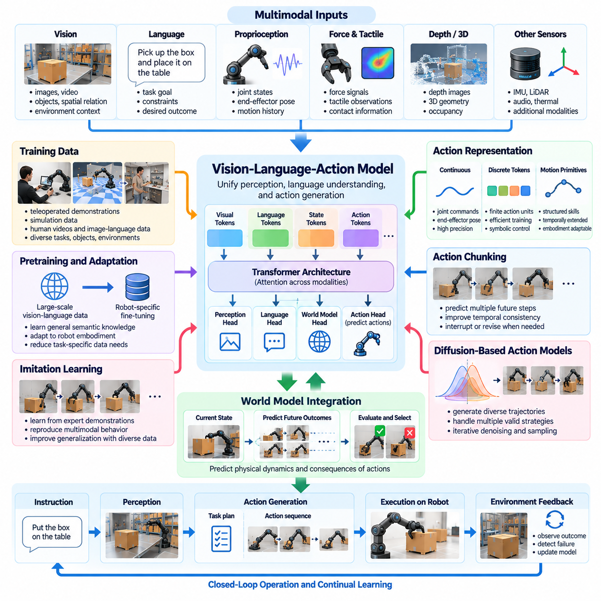{width="7.268055555555556in" height="7.268055555555556in"}

비전 언어 행동 모델(Vision-Language-Action Model, VLA)은 시각적 인식(Visual Perception), 언어 이해(Language Understanding), 실행 가능한 물리적 행동(Executable Physical Action)을 통합된 학습 프레임워크(Unified Learning Framework)로 연결함으로써 피지컬 인공지능(Physical AI)의 중요한 발전 방향을 제시한다. 물리적 장치를 직접 제어하지 않고 이미지나 지시문만 해석하는 시스템과 달리, VLA 모델은 멀티모달 관측(Multimodal Observation)과 작업 의도(Task Intention)를 로봇 행동(Robot Behavior)으로 변환한다. 이러한 모델의 개발 목표는 다양한 작업, 객체, 환경에서 작동할 수 있는 재사용 가능한 행동 지능(Reusable Action Intelligence)을 확립하는 것이다.

VLA 모델(VLA Model)의 기본 아키텍처(Fundamental Architecture)는 시각적 관측(Visual Observation), 언어 지시문(Language Instruction), 행동 표현(Action Representation)을 결합한다. 카메라(Camera)는 객체(Object), 공간적 관계(Spatial Relationship), 환경 조건(Environmental Condition)에 관한 정보를 제공하고, 언어(Language)는 목표(Goal), 제약조건(Constraint), 원하는 결과(Desired Outcome)를 지정한다. 통합 모델(Integrated Model)은 이러한 입력을 처리하여 로봇의 능력에 적합한 행동을 생성한다. 이러한 연결은 의미적 이해(Semantic Understanding)를 물리적 현실에 기반한 행동(Physically Grounded Behavior)으로 변환한다.

멀티모달 행동 모델(Multimodal Action Model)은 시각과 언어를 넘어 추가적인 센서 정보(Sensory Information)를 통합함으로써 이러한 개념을 확장한다. 고유수용성 측정(Proprioceptive Measurement), 관절 상태(Joint State), 힘 신호(Force Signal), 촉각 관측(Tactile Observation), 깊이 측정(Depth Measurement), 움직임 이력(Motion History)은 물리적 상호작용(Physical Interaction)에 관한 상호보완적인 증거를 제공한다. 이러한 모달리티(Modality)를 결합하면 특히 시각 정보만으로 접촉 조건(Contact Condition)이나 객체 안정성(Object Stability)을 신뢰성 있게 설명하기 어려운 조작 작업(Manipulation Task)에서 더욱 정확한 의사결정이 가능해진다.

VLA 개발의 핵심 과제는 서로 다른 모달리티(Modality)에 표현된 정보를 정렬하는 것이다. 언어(Language)는 상징적 표현(Symbolic Expression)을 통해 의도를 설명하고, 이미지(Image)는 공간적 정보(Spatial Information)와 의미적 정보(Semantic Information)를 인코딩하며, 로봇 행동(Robot Action)은 수치적 제어 변수(Numerical Control Variable)를 통해 실행된다. 멀티모달 정렬 메커니즘(Multimodal Alignment Mechanism)은 이러한 표현 사이에 의미 있는 관계를 확립해야 한다. 성공적인 정렬은 모델이 추상적 지시문(Abstract Instruction)을 구체적인 물리적 상태(Physical State) 및 실행 가능한 움직임(Executable Movement)과 연결하도록 한다.

트랜스포머 아키텍처(Transformer Architecture)는 어텐션 메커니즘(Attention Mechanism)을 통해 이질적인 정보(Heterogeneous Information)를 공유 계산 표현(Shared Computational Representation)에 통합할 수 있기 때문에 많은 VLA 시스템의 공통 기반을 제공한다. 시각 특징(Visual Feature), 언어 토큰(Language Token), 고유수용성 상태(Proprioceptive State), 행동 이력(Action History)은 상호 연결된 인코더(Interconnected Encoder)나 통합 토큰 시퀀스(Unified Token Sequence)를 통해 처리될 수 있다. 결과적으로 생성된 표현은 지시문, 관측, 이전 행동 사이의 맥락적 관계(Contextual Relationship)를 유지하면서 행동 예측(Action Prediction)을 지원한다.

행동 표현(Action Representation)은 멀티모달 행동 모델(Multimodal Action Model)의 핵심 설계 결정사항이다. 연속 행동(Continuous Action)은 관절 위치(Joint Position), 속도(Velocity), 말단효과기 자세(End-Effector Pose), 액추에이터 명령(Actuator Command)을 직접 표현할 수 있으며, 이산 행동 토큰(Discrete Action Token)은 움직임을 유한한 기호 단위(Finite Symbolic Unit)로 인코딩한다. 다른 접근 방식에서는 학습된 운동 원시 동작(Learned Motion Primitive)이나 구조화된 행동 묶음(Structured Action Chunk)을 사용한다. 각 표현 방식은 제어 정밀도(Control Precision), 학습 효율성(Training Efficiency), 시간적 일관성(Temporal Consistency), 서로 다른 로봇 형태(Robotic Embodiment)와의 호환성에 영향을 미친다.

행동 청킹(Action Chunking)은 모델이 각 제어 명령을 독립적으로 생성하는 대신 여러 미래 제어 단계(Future Control Step)를 한 번에 예측하도록 한다. 이러한 접근 방식은 연속적인 운영 과정에서 시간적 일관성(Temporal Consistency)을 향상하고 반복적인 추론 오버헤드(Inference Overhead)를 줄일 수 있다. 그러나 긴 행동 묶음(Long Action Chunk)은 환경 조건이 예상하지 못하게 변화할 때 응답성을 감소시킬 수 있다. 따라서 실용적인 시스템에는 갱신된 센서 피드백(Sensory Feedback)을 활용하여 예측된 행동 시퀀스(Action Sequence)를 중단하거나 수정하거나 대체하는 메커니즘이 필요하다.

VLA 모델(VLA Model)의 학습에는 관측(Observation), 지시문(Instruction), 행동(Action), 그에 따른 환경 변화(Environmental Change)를 연결하는 데이터셋(Dataset)이 필요하다. 원격조작 시연(Teleoperated Demonstration)은 로봇 행동의 직접적인 사례를 제공하고, 시뮬레이션(Simulation)은 추가적인 작업 변형(Task Variation)을 생성할 수 있다. 인간 비디오(Human Video)와 이미지 언어 데이터셋(Image-Language Dataset)은 의미적 지식(Semantic Knowledge)을 제공할 수 있지만 반드시 실행 가능한 로봇 행동을 포함하는 것은 아니다. 효과적인 학습을 위해서는 로봇 형태(Embodiment), 센서 구성(Sensor Configuration), 좌표계(Coordinate System), 행동 주파수(Action Frequency)의 차이를 고려해야 한다.

광범위한 시각 및 언어 데이터셋(Visual and Linguistic Dataset)을 활용한 사전학습(Pretraining)은 로봇별 적응(Robot-Specific Adaptation)에 앞서 VLA 모델에 유용한 의미 표현(Semantic Representation)을 제공할 수 있다. 이러한 표현은 객체 인식(Object Recognition), 지시문 해석(Instruction Interpretation), 맥락 이해(Contextual Understanding)를 향상할 수 있다. 그러나 수동적 관측(Passive Observation)으로부터 획득한 지식이 자동으로 신뢰할 수 있는 물리적 제어(Reliable Physical Control)로 전환되는 것은 아니다. 의미적 능력(Semantic Capability)을 액추에이터 수준 실행(Actuator-Level Execution)과 연결하려면 로봇 상호작용 데이터(Robot Interaction Data)와 물리적 현실에 기반한 최적화(Physically Grounded Optimization)가 여전히 필요하다.

모방학습(Imitation Learning)은 멀티모달 행동 모델(Multimodal Action Model)이 시연된 행동(Demonstrated Behavior)을 재현하도록 학습시키는 실용적인 방법이다. 모델은 지도학습 목표(Supervised Objective)를 통해 관측, 작업 지시문, 전문가 행동(Expert Action) 사이의 관계를 학습한다. 다양한 시연(Diverse Demonstration)은 객체와 환경 전반에 걸친 일반화(Generalization)를 향상할 수 있다. 그러나 모방학습은 실제 실행이 시연 궤적(Demonstrated Trajectory)에서 벗어날 때 어려움을 겪을 수 있으므로 복구 데이터(Recovery Data)와 피드백 기반 적응(Feedback-Based Adaptation)이 특히 중요하다.

확산 기반 행동 모델(Diffusion-Based Action Model)은 연속적인 로봇 행동(Continuous Robot Behavior)을 예측하기 위한 대안적인 접근 방식을 제공한다. 이러한 모델은 하나의 결정론적 행동(Deterministic Action)을 생성하는 대신 가능한 움직임에 대한 복잡한 확률 분포(Probability Distribution)를 표현하고 후보 행동 시퀀스(Candidate Action Sequence)를 반복적으로 생성할 수 있다. 이러한 능력은 여러 조작 전략(Manipulation Strategy)이 동일한 목표를 만족할 수 있는 경우 유용하다. 그러나 실시간 배포(Real-Time Deployment)에서는 계산 비용(Computational Cost)과 추론 지연시간(Inference Latency)이 중요한 고려사항으로 남는다.

월드 모델(World Model)은 물리적 실행 전에 제안된 행동의 결과를 예측함으로써 VLA 아키텍처(VLA Architecture)를 보완할 수 있다. VLA 정책(VLA Policy)은 멀티모달 관측(Multimodal Observation)으로부터 후보 움직임(Candidate Movement)을 생성하고, 예측 모델(Predictive Model)은 해당 움직임이 객체, 로봇 상태(Robot State), 환경 조건(Environmental Condition)에 미치는 영향을 평가할 수 있다. 이러한 결합은 물리적 추론(Physical Reasoning)의 추가적인 계층을 도입한다. 그 효과는 예측 정확도(Prediction Accuracy), 계산 효율성(Computational Efficiency), 실제 관측을 통한 지속적인 수정(Continuous Correction)에 달려 있다.

장기 작업 실행(Long-Horizon Task Execution)을 위해서는 멀티모달 행동 모델(Multimodal Action Model)이 여러 의사결정에 걸쳐 맥락(Context)을 유지해야 한다. 부품을 회수하고 작업 공간을 준비한 후 조립 작업을 완료하도록 지시받은 로봇은 여러 중간 행동(Intermediate Action)을 조정해야 한다. 계층적 아키텍처(Hierarchical Architecture)는 의미적 작업 계획(Semantic Task Planning)과 하위 수준 움직임 생성(Low-Level Motion Generation)을 분리할 수 있다. 기억 메커니즘(Memory Mechanism)은 장시간의 작업 수행 과정에서 작업 진행 상태(Task Progress), 객체 관계(Object Relationship), 이전 실행 결과(Previous Execution Outcome)를 유지하도록 지원한다.

교차 형태 일반화(Cross-Embodiment Generalization)는 서로 다른 로봇이 각기 다른 운동학적 구조(Kinematic Structure), 센서(Sensor), 액추에이터 능력(Actuator Capability)을 보유하기 때문에 중요한 목표이다. 휴머노이드(Humanoid), 이동형 매니퓰레이터(Mobile Manipulator), 산업용 로봇(Industrial Robot)은 동일한 지시문을 해석하더라도 서로 다른 물리적 움직임을 수행해야 한다. 로봇 형태 조건부 정책(Embodiment-Conditioned Policy)과 공유 행동 추상화(Shared Action Abstraction)는 전이 가능한 작업 지식(Transferable Task Knowledge)과 하드웨어별 실행(Hardware-Specific Execution)을 분리할 수 있다. 그러나 신뢰할 수 있는 전이를 위해서는 보정(Calibration)과 플랫폼별 검증(Platform-Specific Validation)이 여전히 필요하다.

멀티모달 입력(Multimodal Input)은 불완전하거나 상충하거나 신뢰할 수 없는 경우가 있으므로 불확실성 인식(Uncertainty Awareness)이 필수적이다. 시각적 가림(Visual Occlusion), 모호한 언어(Ambiguous Language), 잡음이 포함된 힘 측정(Noisy Force Measurement), 익숙하지 않은 객체(Unfamiliar Object)는 부적절한 행동 예측(Inappropriate Action Prediction)을 유발할 수 있다. 강건한 VLA 시스템(Robust VLA System)은 불확실한 조건을 인식하고 추가적인 센싱(Additional Sensing), 보수적 실행(Conservative Execution), 인간 지원(Human Assistance)을 통해 대응해야 한다. 신뢰도 추정(Confidence Estimate)은 실제 운영 실패(Operational Failure)를 기준으로 평가되지 않는다면 그 자체만으로 충분하지 않다.

VLA 모델(VLA Model)이 물리적 행동을 생성할 때 안전 제약조건(Safety Constraint)은 명시적으로 유지되어야 한다. 학습된 정책(Learned Policy)은 그럴듯한 움직임을 생성하더라도 관절 한계(Joint Limit), 충돌 경계(Collision Boundary), 힘 제한(Force Restriction), 운영 절차(Operational Procedure)를 위반할 수 있다. 독립적인 안전 감시기(Independent Safety Monitor), 제약 기반 제어기(Constrained Controller), 실행 중 검증(Runtime Validation)은 안전하지 않은 명령이 액추에이터(Actuator)에 전달되는 것을 방지할 수 있다. 따라서 상위 수준 모델 출력(High-Level Model Output)은 물리적 및 운영상의 한계를 강제하는 제어 아키텍처(Control Architecture) 내에서 작동해야 한다.

실시간 배포(Real-Time Deployment)는 멀티모달 모델(Multimodal Model)이 상당한 메모리(Memory), 처리 능력(Processing Power), 에너지(Energy)를 요구할 수 있기 때문에 중요한 계산상의 과제를 제시한다. 시각 인코딩(Visual Encoding), 언어 처리(Language Processing), 행동 생성(Action Generation)은 작업별 지연시간 예산(Task-Specific Latency Budget) 내에서 수행되어야 한다. 양자화(Quantization), 모델 증류(Model Distillation), 효율적인 어텐션 메커니즘(Efficient Attention Mechanism), 최적화된 추론 파이프라인(Optimized Inference Pipeline)은 계산 요구량을 줄일 수 있다. 고주파 안정화(High-Frequency Stabilization)와 즉각적인 안전 대응(Immediate Safety Response)을 위해서는 로컬 제어기(Local Controller)가 여전히 필요하다.

분산 컴퓨팅 아키텍처(Distributed Computing Architecture)는 VLA 기능을 엣지(Edge), 온프레미스(On-Premise), 클라우드(Cloud) 자원에 분산하여 할당할 수 있다. 엣지 프로세서(Edge Processor)는 시간에 민감한 추론(Time-Sensitive Inference)과 물리적 제어(Physical Control)를 처리하고, 온프레미스 시스템(On-Premise System)은 협조(Coordination)와 공유 환경 표현(Shared Environmental Representation)을 지원할 수 있다. 클라우드 인프라(Cloud Infrastructure)는 대규모 학습(Large-Scale Training)과 모델 개선(Model Refinement)을 제공할 수 있다. 이러한 기능 분할(Function Partitioning)은 통신 지연(Communication Delay)을 고려해야 하며, 네트워크 중단(Network Interruption) 중에도 필수 안전 기능(Essential Safety Function)이 작동하도록 보장해야 한다.

VLA 모델(VLA Model)의 평가는 언어 이해(Language Understanding)와 오프라인 행동 예측(Offline Action Prediction)을 넘어야 한다. 관련 평가 지표(Evaluation Metric)에는 물리적 작업 성공률(Physical Task Success Rate), 조작 정밀도(Manipulation Precision), 객체 전반에 걸친 일반화(Generalization Across Objects), 외란에 대한 강건성(Robustness to Disturbances), 복구 능력(Recovery Capability), 실행 지연시간(Execution Latency)이 포함된다. 테스트에서는 익숙하지 않은 지시문(Unfamiliar Instruction), 변화하는 환경(Changing Environment), 센서 성능 저하(Sensor Degradation)를 검토해야 한다. 벤치마크 결과(Benchmark Result)는 성공적인 의미 해석(Semantic Interpretation)과 의도된 물리적 작업의 신뢰할 수 있는 완료(Reliable Task Completion)를 구분해야 한다.

지속적인 개선(Continuous Improvement)은 성공적인 행동(Successful Action), 실패한 시도(Failed Attempt), 복구 행동(Recovery Behavior)에 관한 운영 증거(Operational Evidence)를 수집하는 데 달려 있다. 로봇 플릿(Robot Fleet)은 학습된 정책(Learned Policy)의 약점을 드러내는 다양한 상호작용 궤적(Interaction Trajectory)을 제공할 수 있다. 선별된 데이터셋(Curated Dataset)과 통제된 재학습(Controlled Retraining)은 이후 모델 버전(Model Version)의 성능을 향상할 수 있다. 그러나 한 작업에서의 성능 향상이 다른 작업에서 새로운 실패를 유발하지 않도록 업데이트에는 회귀 테스트(Regression Testing), 버전 추적(Version Tracking), 배포 거버넌스(Deployment Governance)가 필요하다.

VLA 및 멀티모달 행동 모델(VLA and Multimodal Action Model)의 장기적인 중요성은 인간의 의도(Human Intention)와 로봇의 능력(Robotic Capability) 사이에 공통 인터페이스(Common Interface)를 확립할 가능성에 있다. 의미적 이해(Semantic Understanding), 멀티모달 인식(Multimodal Perception), 예측적 추론(Predictive Reasoning), 행동 생성(Action Generation)을 결합함으로써 이러한 시스템은 점점 더 높은 적응성을 갖춘 물리적 에이전트(Physical Agent)를 지원할 수 있다. 이러한 발전은 신뢰할 수 있는 물리적 현실 기반성(Physical Grounding), 다양한 학습 경험(Diverse Training Experience), 효율적인 실행(Efficient Execution), 안전 보증(Safety Assurance), 실제 환경에서 검증된 일반화(Demonstrated Real-World Generalization)에 달려 있다.

## 10.05. Physical Reasoning and Test Time Compute

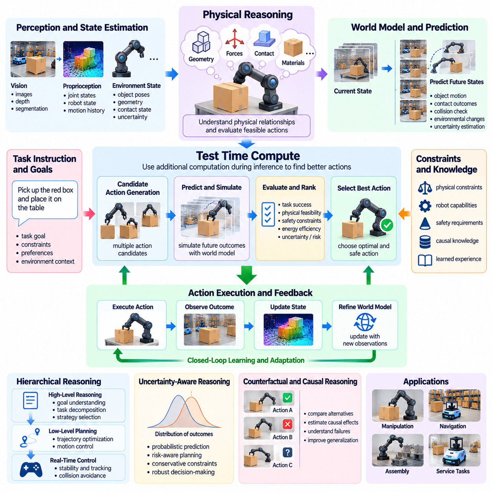{width="7.268055555555556in" height="7.268055555555556in"}

물리적 추론(Physical Reasoning)은 지능형 에이전트(Intelligent Agent)가 물리적 관계(Physical Relationship)를 이해하고, 행동의 결과를 예측하며, 실제 세계의 제약조건(Real-World Constraint)에 부합하는 행동을 선택하는 능력을 의미한다. 순수한 의미적 추론(Semantic Reasoning)과 달리 물리적 추론은 기하학적 구조(Geometry), 운동(Motion), 힘(Force), 접촉(Contact), 재료 특성(Material Property), 환경 불확실성(Environmental Uncertainty)을 고려해야 한다. 이를 통해 피지컬 인공지능(Physical AI) 시스템은 행동이 무엇을 의미하는지뿐만 아니라 해당 행동을 안전하고 효과적으로 실행할 수 있는지도 평가할 수 있다.

추론 시점 연산(Test-Time Compute)은 모델이 즉각적으로 생성하는 응답을 넘어 의사결정의 품질을 향상하기 위해 추론 시점(Inference Time)에 할당하는 계산 자원(Computational Resource)을 의미한다. 피지컬 인공지능(Physical AI)에서 추가적인 연산은 후보 행동 생성(Candidate Action Generation), 예측 시뮬레이션(Predictive Simulation), 궤적 최적화(Trajectory Optimization), 불확실성 평가(Uncertainty Evaluation)를 지원할 수 있다. 에이전트는 단일 정책 출력(Single Policy Output)에만 의존하지 않고 실행 전에 여러 대안 행동(Alternative Action)을 검토할 수 있다. 이러한 접근 방식의 실질적인 가치는 사용 가능한 시간, 처리 능력, 작업 복잡도에 따라 달라진다.

물리적 추론(Physical Reasoning)은 현재 환경과 에이전트의 능력에 대한 내부 표현(Internal Representation)에서 시작된다. 관련 정보에는 객체 위치(Object Position), 속도(Velocity), 공간적 관계(Spatial Relationship), 접촉 조건(Contact Condition), 액추에이터 한계(Actuator Limitation)가 포함된다. 관측(Observation)은 불완전하므로 시스템은 숨겨진 상태(Hidden State)를 추정하고 알려지지 않은 특성에 대한 불확실성(Uncertainty)을 유지해야 한다. 이후 추론 과정은 이러한 추정치를 물리적 원리(Physical Principle) 및 학습된 경험(Learned Experience)과 연결하여 실행 가능한 행동(Feasible Action)을 결정한다.

핵심적인 과제는 의미적 개연성(Semantic Plausibility)과 물리적 실행 가능성(Physical Feasibility)을 구분하는 것이다. 언어 기반 모델(Language-Based Model)은 무거운 객체를 이동하라는 지시문을 올바르게 해석할 수 있지만, 파지력(Gripping Force)이 부족하거나 지지 조건(Support Condition)이 불안정하다는 사실을 인식하지 못할 수 있다. 물리적 추론(Physical Reasoning)은 의도된 작업이 기계적 제약조건(Mechanical Constraint)과 환경적 제약조건(Environmental Constraint)을 충족하는지 평가한다. 이러한 구분은 추상적인 목표(Abstract Goal)를 물리적 객체와 직접 상호작용하는 행동으로 변환할 때 필수적이다.

월드 모델(World Model)은 서로 다른 행동에 따라 환경 상태(Environmental State)가 어떻게 변화하는지 추정함으로써 물리적 추론(Physical Reasoning)을 위한 계산적 기반(Computational Foundation)을 제공한다. 에이전트는 학습 기반 동역학 모델(Learned Dynamics Model)이나 물리 기반 동역학 모델(Physics-Based Dynamics Model)을 사용하여 객체 이동(Object Movement), 충돌(Collision), 변형(Deformation), 접촉 결과(Contact Outcome)를 예측할 수 있다. 이러한 예측은 후보 행동(Candidate Behavior)에 대한 내부 평가를 지원한다. 그러나 시뮬레이션 결과의 유용성은 모델 충실도(Model Fidelity), 불확실성 인식(Uncertainty Awareness), 실제 물리적 관측과의 일관성에 따라 달라진다.

추론 시점 연산(Test-Time Compute)은 후보 생성(Candidate Generation), 평가(Evaluation), 선택(Selection), 실행(Execution)의 연속적인 과정으로 구성할 수 있다. 먼저 정책(Policy)이 가능한 행동이나 궤적(Trajectory)을 제안하고, 이후 예측 모델(Predictive Model)이 해당 행동의 결과를 추정한다. 계획 메커니즘(Planning Mechanism)은 작업 목표(Task Objective), 안전 제약조건(Safety Constraint), 자원 제한(Resource Limitation)을 기준으로 대안들을 비교한다. 선택된 행동은 피드백 제어(Feedback Control) 아래에서 실행되며, 이후 관측을 통해 최초 추론 과정의 오류를 수정할 수 있다.

물리적 추론(Physical Reasoning)에 필요한 계산량은 작업에 따라 크게 달라진다. 단순한 장애물 회피(Obstacle Avoidance)는 신속한 기하학적 평가(Geometric Evaluation)만으로 충분할 수 있지만, 복잡한 조작 작업(Complex Manipulation)은 접촉 상호작용(Contact Interaction)에 대한 반복적인 시뮬레이션을 요구할 수 있다. 장기 계획(Long-Horizon Planning)은 수많은 행동 시퀀스(Action Sequence)를 탐색해야 할 수도 있다. 적응형 연산(Adaptive Computation)은 어려운 의사결정이나 불확실성이 높은 상황에 더 많은 추론 자원을 할당하면서 일상적인 작업에서는 응답성(Responsiveness)을 유지하도록 한다.

실시간 제약조건(Real-Time Constraint)은 물리적 추론 시점 연산(Physical Test-Time Compute)을 제한 없는 디지털 추론(Digital Reasoning)과 근본적으로 구분한다. 로봇은 대안을 평가하는 동안 물리적 환경(Physical Environment)이 계속 변화하기 때문에 제어 결정을 무기한 지연할 수 없다. 이동 장애물(Moving Obstacle), 불안정한 객체(Unstable Object), 액추에이터 동역학(Actuator Dynamics)은 엄격한 시간 제한(Deadline)을 부과한다. 따라서 추론 메커니즘(Reasoning Mechanism)은 제한된 지연시간 예산(Bounded Latency Budget) 내에서 작동해야 하며, 추가 연산을 완료할 수 없는 경우 안전한 대체 행동(Safe Fallback Behavior)을 제공해야 한다.

계층적 추론(Hierarchical Reasoning)은 계산 깊이(Computational Depth)와 실행 속도(Execution Speed)의 균형을 유지하기 위한 실용적인 접근 방식이다. 상위 수준 추론(High-Level Reasoning)은 목표를 해석하고 작업 의존성(Task Dependency)을 평가하며 행동 전략(Behavioral Strategy)을 선택하는 반면, 하위 수준 계획(Low-Level Planning)은 궤적과 제어 매개변수(Control Parameter)를 결정한다. 고속 제어기(Fast Controller)는 즉각적인 안정성(Stability)과 충돌 회피(Collision Avoidance)를 유지한다. 이러한 분리는 계산 집약적인 추론(Computationally Intensive Reasoning)이 시간에 민감한 물리적 제어를 방해하지 않으면서 복잡한 의사결정을 지원하도록 한다.

반사실적 물리 추론(Counterfactual Physical Reasoning)은 에이전트가 서로 다른 행동을 수행했을 경우 어떤 결과가 발생할지 고려하도록 한다. 로봇은 실제 행동에 앞서 대안적인 파지 위치(Alternative Grasp Location), 내비게이션 경로(Navigation Route), 객체 배치 전략(Object Placement Strategy)을 비교할 수 있다. 각 가상 결과(Hypothetical Outcome)는 실행 가능성(Feasibility), 안전성(Safety), 예상 작업 성공률(Expected Task Success)을 기준으로 평가할 수 있다. 반사실적 평가(Counterfactual Evaluation)는 실수의 비용이 높거나 되돌릴 수 없거나 위험한 물리적 상호작용을 유발할 가능성이 있는 경우 특히 유용하다.

인과적 추론(Causal Reasoning)은 행동과 물리적 결과 사이의 관계를 식별함으로써 예측(Prediction)을 보완한다. 접촉 이후 객체가 움직이는 것을 관측했다고 해서 어떤 힘이나 제약조건이 해당 움직임을 발생시켰는지 반드시 알 수 있는 것은 아니다. 인과 모델(Causal Model)은 지지(Support), 마찰(Friction), 운동량 전달(Momentum Transfer), 접촉 전이(Contact Transition)와 같은 메커니즘을 표현하려고 한다. 이러한 표현은 익숙하지 않은 상황에 대한 추론을 개선할 수 있지만, 인과적 타당성(Causal Validity)은 적절한 증거(Evidence)와 실험(Experiment)을 통해 확립되어야 한다.

물리적 예측(Physical Prediction)은 거의 완벽하게 정확하지 않으므로 불확실성 인식 추론(Uncertainty-Aware Reasoning)이 필수적이다. 센서 잡음(Sensor Noise), 알려지지 않은 재료 특성(Unknown Material Property), 모델 근사(Model Approximation), 예측하기 어려운 환경 변화(Unpredictable Environmental Change)는 여러 개의 가능한 결과를 발생시킬 수 있다. 강건한 시스템(Robust System)은 예상 성능(Expected Performance)뿐만 아니라 불리한 결과(Unfavorable Outcome)와 관련된 위험도 평가한다. 확률적 예측(Probabilistic Forecasting), 보수적 제약조건(Conservative Constraint), 위험 민감형 계획(Risk-Sensitive Planning)은 불확실한 예측에 대한 과도한 확신을 방지하는 데 도움이 된다.

추론 시점 연산(Test-Time Compute)은 내부 추론만으로 불확실성을 해결할 수 없는 경우 능동적 정보 수집(Active Information Gathering)을 지원할 수도 있다. 에이전트는 카메라 위치를 변경하거나 객체를 검사하거나 조심스러운 탐침 행동(Probing Action)을 수행하거나 추가 센서 측정(Sensor Measurement)을 요청할 수 있다. 이러한 행동은 이후 의사결정에 사용할 수 있는 정보를 개선한다. 이는 계산 과정이 즉각적인 실행보다 추가 관측이 더 가치 있는지 판단하는 추론(Reasoning)과 능동 인식(Active Perception) 사이의 관계를 형성한다.

멀티모달 파운데이션 모델(Multimodal Foundation Model)은 물리적 추론(Physical Reasoning)에 의미적 지식(Semantic Knowledge)과 맥락적 이해(Contextual Understanding)를 제공할 수 있다. 시각적 관측(Visual Observation)은 객체와 공간 구성을 식별하고, 언어 지시문(Language Instruction)은 목표를 표현하며, 고유수용성 신호(Proprioceptive Signal)나 촉각 신호(Tactile Signal)는 상호작용 조건(Interaction Condition)을 설명한다. 이러한 입력은 후보 행동 생성(Candidate Action Generation)과 작업 해석(Task Interpretation)을 안내할 수 있다. 그러나 행동을 실행하기 전에 의미적 이해는 물리적 상태 추정(Physical State Estimation) 및 검증된 제약조건(Verified Constraint)과 연결되어야 한다.

비전 언어 행동 모델(Vision-Language-Action Model, VLA)은 직접적인 행동 예측(Direct Action Prediction)이 충분하지 않을 때 추론 시점 추론(Test-Time Reasoning)의 이점을 얻을 수 있다. 시스템은 생성된 명령을 즉시 실행하는 대신 예측 모델(Predictive Model), 실행 가능성 검사(Feasibility Check), 제약 최적화(Constrained Optimization)를 사용하여 여러 행동 제안(Action Proposal)을 평가할 수 있다. 이러한 아키텍처(Architecture)는 학습된 정책(Learned Policy)의 폭넓은 행동 지식(Behavioral Knowledge)과 명시적인 물리적 평가(Explicit Physical Evaluation)를 결합한다. 효과는 추가적인 추론이 계산 비용을 정당화할 만큼 실행 성능을 개선하는지에 달려 있다.

조작 작업(Manipulation)은 접촉 동역학(Contact Dynamics)이 불연속성(Discontinuity)과 불확실성(Uncertainty)을 발생시키기 때문에 까다로운 응용 분야이다. 부품을 삽입하는 로봇은 정렬(Alignment), 마찰(Friction), 가해지는 힘(Applied Force), 끼임 가능성(Possible Jamming)을 고려해야 한다. 추론 시점 추론(Test-Time Reasoning)은 실행 전에 대안적인 삽입 궤적(Insertion Trajectory)이나 접촉 전략(Contact Strategy)을 비교할 수 있다. 실제 작업 중에는 예측을 갱신하고 과도한 하중(Excessive Load)이나 기계적 손상(Mechanical Damage)을 방지하기 위해 힘 피드백(Force Feedback)과 관측된 편차(Observed Deviation)가 필요하다.

자율 내비게이션(Autonomous Navigation) 역시 물리적 추론(Physical Reasoning)과 적응형 연산(Adaptive Computation)의 이점을 얻는다. 이동 로봇(Mobile Robot)은 좁은 통로의 통과 가능성(Traversability), 이동 장애물과 자신의 궤적 사이의 교차 가능성(Trajectory Intersection), 지형 조건(Terrain Condition)이 이동 능력(Mobility Capability)을 초과하는지 평가할 수 있다. 혼잡하거나 불확실한 영역에는 추가적인 계획 연산(Planning Computation)을 할당할 수 있다. 익숙한 환경에서의 일상적인 이동에는 안전 제약조건이 지속적으로 강제된다는 전제 아래 더 빠른 정책(Faster Policy)을 사용할 수 있다.

시뮬레이션 기반 추론(Simulation-Based Reasoning)은 물리적 장비를 행동의 결과에 즉시 노출하지 않고도 가상 행동(Hypothetical Action)을 평가하도록 한다. 내부 롤아웃(Internal Rollout)은 여러 시간 단계에 걸친 미래 상태(Future State)를 추정할 수 있으며, 더욱 정교한 시뮬레이터(Detailed Simulator)는 복잡한 상호작용(Complex Interaction)을 검토할 수 있다. 그러나 모델의 가정(Model Assumption)이 잘못된 경우 광범위한 시뮬레이션도 신뢰할 수 있는 의사결정을 보장하지 못한다. 효과적인 시스템은 시뮬레이션 깊이(Simulation Depth), 모델 정확도(Model Accuracy), 계산 비용(Computational Cost), 사용 가능한 의사결정 시간(Decision Time) 사이의 균형을 유지해야 한다.

배포 아키텍처(Deployment Architecture)는 물리적 추론 연산(Physical Reasoning Computation)을 어디에서 수행할 수 있는지 결정한다. 엣지 프로세서(Edge Processor)는 지연시간에 민감한 추론(Latency-Sensitive Inference), 로컬 계획(Local Planning), 즉각적인 안전 대응(Immediate Safety Response)을 담당한다. 온프레미스 자원(On-Premise Resource)은 더 많은 계산이 필요한 예측 평가(Predictive Evaluation)와 여러 로봇 사이의 협조(Coordination)를 지원할 수 있다. 클라우드 인프라(Cloud Infrastructure)는 모델 개발(Model Development)과 대규모 분석(Large-Scale Analysis)을 지원할 수 있지만, 통신 지연(Communication Delay)으로 인해 원격 연산(Remote Computation)은 필수적인 고주파 안전 제어(High-Frequency Safety Control)에 적합하지 않다.

안전 보증(Safety Assurance)은 추론 모델(Reasoning Model)의 겉으로 드러나는 신뢰도(Confidence)나 계산적 정교함(Computational Sophistication)과 독립적으로 유지되어야 한다. 많은 후보 행동(Candidate Action)을 평가하는 시스템도 월드 모델(World Model)이나 목적함수(Objective Function)가 잘못되었다면 안전하지 않은 행동을 선택할 수 있다. 실행 중 감시기(Runtime Monitor), 액추에이터 한계(Actuator Limit), 충돌 제약조건(Collision Constraint), 비상 메커니즘(Emergency Mechanism)은 추가적인 보호를 제공한다. 추론 시점 추론(Test-Time Reasoning)은 기존의 안전 제어(Safety Control)를 대체하는 것이 아니라 검증된 안전 경계(Verified Safety Boundary) 내에서 작동해야 한다.

물리적 추론(Physical Reasoning)의 평가는 의사결정 품질(Decision Quality)과 계산 효율성(Computational Efficiency)을 모두 측정해야 한다. 관련 평가 지표(Evaluation Metric)에는 작업 성공률(Task Success), 제약조건 충족(Constraint Satisfaction), 예측 오차(Prediction Error), 충돌 빈도(Collision Frequency), 복구 능력(Recovery Capability), 추론 지연시간(Inference Latency), 에너지 소비(Energy Consumption)가 포함된다. 비교 평가에서는 추가 연산(Additional Computation)이 단순한 정책(Simpler Policy)보다 측정 가능한 개선을 제공하는지 검토해야 한다. 테스트에는 익숙하지 않은 객체(Unfamiliar Object), 예상하지 못한 외란(Unexpected Disturbance), 불완전한 관측(Incomplete Observation), 엄격한 실시간 마감시간(Real-Time Deadline)도 포함되어야 한다.

주요 미래 발전 방향은 작업 난이도(Task Difficulty), 불확실성(Uncertainty), 잠재적 결과(Potential Consequence)에 따라 추론 깊이(Reasoning Depth)를 동적으로 조정하는 적응형 추론 시점 연산(Adaptive Test-Time Computation)이다. 단순한 의사결정은 최소한의 처리만 필요할 수 있지만, 고위험 상호작용(High-Risk Interaction)은 더욱 광범위한 평가를 정당화할 수 있다. 이러한 시스템은 학습된 정책(Learned Policy), 월드 모델(World Model), 계획 알고리즘(Planning Algorithm), 불확실성 추정기(Uncertainty Estimator)를 통합된 의사결정 프레임워크(Unified Decision Framework) 내에서 결합할 수 있다. 목표는 제한 없는 계산 확장이 아니라 효율적인 지능(Efficient Intelligence)을 구현하는 것이다.

물리적 추론(Physical Reasoning)과 추론 시점 연산(Test-Time Compute)은 함께 더욱 신중하고 높은 능력을 갖춘 피지컬 인공지능(Physical AI) 시스템으로 발전하는 경로를 제공한다. 이들의 중요성은 예측(Prediction), 평가(Evaluation), 피드백(Feedback)을 통해 추상적 이해(Abstract Understanding)를 물리적으로 실행 가능한 의사결정(Physically Feasible Decision)과 연결하는 데 있다. 발전을 위해서는 신뢰할 수 있는 월드 모델(Reliable World Model), 물리적 현실에 기반한 멀티모달 표현(Grounded Multimodal Representation), 제한된 연산(Bounded Computation), 엄격한 안전 검증(Rigorous Safety Validation)이 필요하다. 궁극적인 목표는 자율 에이전트(Autonomous Agent)가 행동하기 전에 추론하면서도 지속적으로 변화하는 물리적 세계(Physical World)에 신속하게 대응하도록 하는 것이다.

## 10.06. Long Horizon Planning and Memory

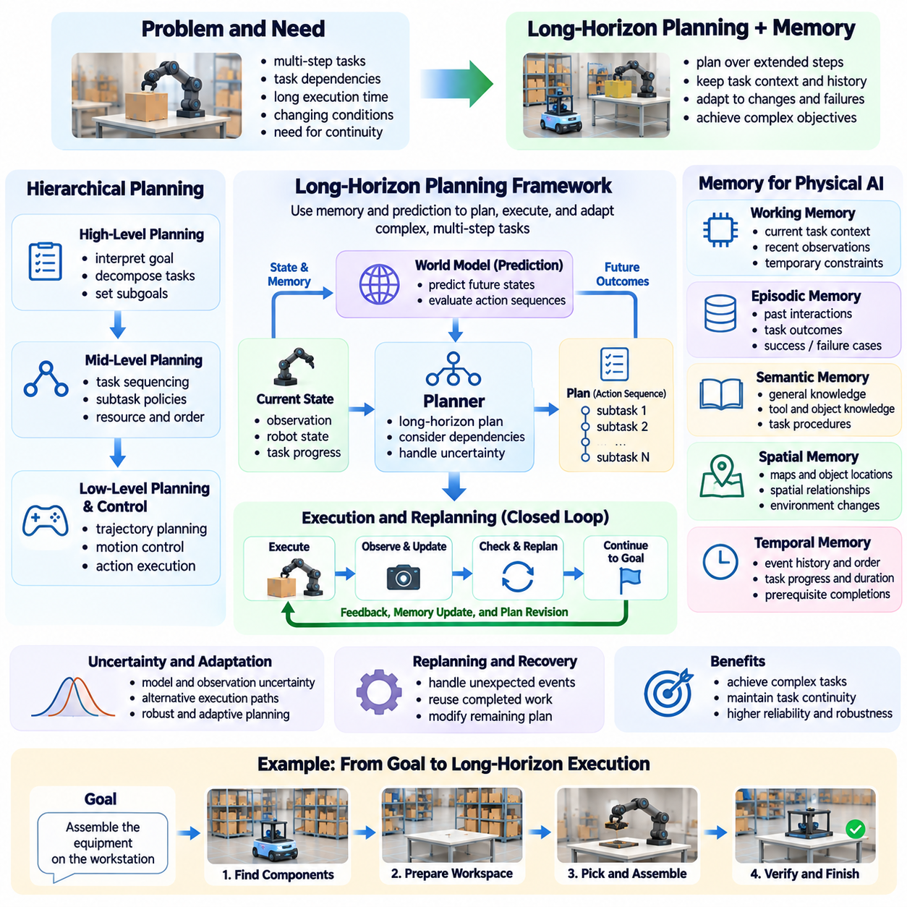{width="7.268055555555556in" height="7.268055555555556in"}

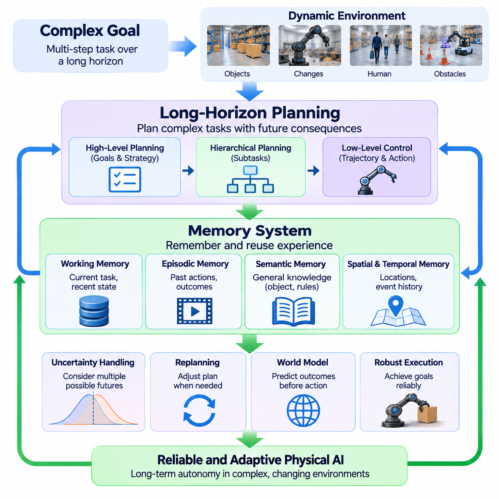{width="7.268055555555556in" height="7.268055555555556in"}

장기 계획(Long-Horizon Planning)은 피지컬 인공지능(Physical AI) 시스템이 장시간에 걸쳐 여러 행동을 조정해야 하는 목표를 수행할 수 있도록 한다. 주로 즉각적인 관측(Immediate Observation)에 반응하는 반응형 제어(Reactive Control)와 달리, 장기 계획은 작업 의존성(Task Dependency), 미래 결과(Future Consequence), 중간 목표(Intermediate Objective)를 고려한다. 기억(Memory)은 이러한 의사결정 전반에 걸쳐 맥락(Context)을 유지하는 데 필요한 연속성을 제공한다. 계획(Planning)과 기억은 함께 로봇이 개별적인 움직임이나 짧은 행동 시퀀스(Action Sequence)를 넘어 복잡한 행동을 체계적으로 구성할 수 있도록 한다.

물리적 작업(Physical Task)은 즉각적인 행동 선택(Immediate Action Selection)만으로 해결할 수 없는 의존성을 포함하는 경우가 많다. 장비를 조립하는 로봇은 작업을 완료하기 전에 부품을 찾고, 도구를 준비하고, 작업 공간의 장애물을 제거하고, 중간 결과를 검증해야 할 수 있다. 장기 계획(Long-Horizon Planning)은 이러한 의존성을 구조화된 시퀀스(Structured Sequence) 또는 계층적 목표(Hierarchical Objective)로 표현한다. 성공적인 실행을 위해서는 어떤 행동이 다른 행동보다 먼저 수행되어야 하는지, 어떤 조건이 작업 진행(Progress)을 나타내는지 이해해야 한다.

계층적 계획(Hierarchical Planning)은 서로 다른 시간 척도(Temporal Scale)에 걸친 복잡성을 관리하기 위한 실용적인 아키텍처(Architecture)를 제공한다. 상위 수준 계획기(High-Level Planner)는 목표를 해석하고 의미 있는 하위 작업(Subtask)으로 분해하며, 하위 수준 계획기(Low-Level Planner)는 궤적(Trajectory)과 실행 가능한 제어 명령(Executable Control Command)을 생성한다. 중간 수준 정책(Intermediate Policy)은 의미적 목표(Semantic Objective)를 물리적 작업(Physical Operation)과 연결한다. 이러한 분리는 개별 의사결정의 복잡성을 줄이면서 전체 시스템이 장시간의 작업 실행 과정에서 일관성(Coherence)을 유지하도록 한다.

기억(Memory)이 필수적인 이유는 로봇이 현재 센서 관측(Current Sensor Observation)만으로 운영 이력(Operating History)의 모든 관련 정보를 재구성할 수 없기 때문이다. 객체가 가려질 수 있고, 지시문이 이전 사건을 참조할 수 있으며, 완료된 하위 작업은 더 이상 직접 관측되지 않을 수 있다. 기억 메커니즘(Memory Mechanism)은 환경 상태(Environmental State), 작업 진행 상태(Task Progress), 이전 행동(Previous Action), 상호작용 결과(Interaction Outcome)에 관한 정보를 보존한다. 이러한 연속성은 즉각적인 관측 범위(Observation Window)를 벗어난 사건에 의존하는 의사결정을 지원한다.

작업 기억(Working Memory)은 현재 의사결정과 단기 실행(Near-Term Execution)에 필요한 정보를 유지한다. 여기에는 활성 작업 목표(Active Task Objective), 최근 관측된 객체(Recently Observed Object), 현재 로봇 상태(Current Robot State), 일시적인 제약조건(Temporary Constraint)이 포함될 수 있다. 계산 자원(Computational Resource)이 제한되어 있으므로 작업 기억은 모든 관측을 보존하기보다 관련성이 높은 정보를 우선해야 한다. 효과적인 기억 관리(Memory Management)는 맥락의 풍부함(Contextual Richness)과 추론 지연시간(Inference Latency), 저장 요구사항(Storage Requirement), 오래된 정보(Outdated Information)의 위험 사이에서 균형을 유지해야 한다.

일화 기억(Episodic Memory)은 수행된 행동, 환경 조건(Environmental Condition), 결과(Outcome)를 포함한 이전 상호작용(Previous Interaction)의 기록을 저장한다. 이러한 기록을 통해 로봇은 유사한 상황의 사례를 검색하고 과거에 성공하거나 실패했던 전략을 평가할 수 있다. 일화 기억은 복구 계획(Recovery Planning)과 반복 작업(Recurring Task)에 대한 적응을 지원할 수 있다. 그러나 저장된 경험(Stored Experience)이 서로 다른 물리적 조건에서 부적절하게 재사용되지 않도록 충분한 맥락 정보(Contextual Information)를 유지해야 한다.

의미 기억(Semantic Memory)은 객체, 환경, 절차, 물리적 관계에 관한 보다 일반적인 지식(General Knowledge)을 표현한다. 로봇은 모든 원본 관측(Original Observation)을 저장하지 않고도 도구의 기능(Tool Function), 작업 공간 구성(Workspace Organization), 일반적인 작업 의존성(Common Task Dependency)에 관한 지식을 유지할 수 있다. 이러한 정보는 여러 작업 수행 과정(Episode)에 걸쳐 계획을 안내할 수 있다. 의미적 지식(Semantic Knowledge)을 일화 기록(Episodic Record)과 분리하면 시스템이 재사용 가능한 이해(Reusable Understanding)와 구체적인 운영 경험(Specific Operational Experience)을 결합할 수 있다.

공간 기억(Spatial Memory)은 변화하는 환경에서 작동하는 이동 로봇(Mobile Robot)과 매니퓰레이터(Manipulator)에 특히 중요하다. 지도(Map), 객체 위치(Object Location), 점유 추정(Occupancy Estimate), 공간적 관계(Spatial Relationship)는 객체가 센서 시야(Field of View)를 벗어나더라도 정보의 연속성을 제공한다. 동적 공간 기억(Dynamic Spatial Memory)은 움직임(Motion), 환경 변화(Environmental Change), 불확실성(Uncertainty)을 고려해야 한다. 로봇은 저장된 공간 정보를 사용하여 행동을 생성할 때 확인된 관측(Confirmed Observation)과 오래된 가정(Outdated Assumption)을 구분해야 한다.

시간적 기억(Temporal Memory)은 시간에 걸쳐 발생하는 사건을 연결하고 행동 순서(Action Order), 지속시간(Duration), 작업 진행 상태(Task Progress)에 대한 추론을 지원한다. 많은 작업에서는 선행 조건(Prerequisite)이 완료되었는지 또는 대기 조건(Waiting Condition)이 아직 해결되지 않았는지 인식해야 한다. 시간적 표현(Temporal Representation)에는 사건 이력(Event History), 타임스탬프(Timestamp), 상태 전이(State Transition), 예측된 완료 조건(Predicted Completion Condition)이 포함될 수 있다. 이러한 메커니즘은 장시간의 작업 과정에서 반복 행동(Repeated Action), 성급한 실행(Premature Execution), 협조 손실(Loss of Coordination)을 방지하는 데 도움이 된다.

장기 계획(Long-Horizon Planning)은 미래의 환경 조건(Future Environmental Condition)을 완벽하게 예측할 수 없으므로 불확실성(Uncertainty)을 고려해야 한다. 객체가 이동하거나 인간 작업자(Human Operator)가 개입하거나 장비가 예상과 다르게 작동할 수 있다. 따라서 계획은 가정(Assumption), 의존성(Dependency), 대안 실행 경로(Alternative Execution Path)를 표현해야 한다. 불확실성 추정(Uncertainty Estimate)을 유지하면 시스템은 이전 예측과 관측이 일치하지 않을 때 점점 더 유효성을 잃는 계획을 계속 수행하는 대신 의사결정을 수정할 수 있다.

재계획(Replanning)은 신뢰할 수 있는 장기 자율성(Long-Horizon Autonomy)을 위한 기본 요구사항이다. 로봇은 차단된 경로(Blocked Route), 누락된 부품(Missing Component), 파지 실패(Failed Grasp), 예상하지 못한 작업 중단(Unexpected Task Interruption)을 경험할 수 있다. 전체 절차를 처음부터 다시 시작하는 대신 계획기(Planner)는 어떤 목표가 여전히 유효하고 어떤 행동을 수정해야 하는지 식별해야 한다. 기억(Memory)은 완료된 작업(Completed Work)과 이전 실패 정보(Previous Failure Information)를 보존함으로써 불필요한 반복 없이 효율적인 복구(Recovery)를 가능하게 한다.

월드 모델(World Model)은 행동이 미래의 물리적 상태(Future Physical State)에 어떤 영향을 미치는지 예측함으로써 장기 계획(Long-Horizon Planning)을 강화할 수 있다. 후보 계획(Candidate Plan)은 실행 전에 시뮬레이션된 궤적(Simulated Trajectory)이나 학습된 상태 전이(Learned State Transition)를 통해 평가할 수 있다. 이러한 예측은 실행 불가능한 시퀀스(Infeasible Sequence)와 하위 작업 사이의 잠재적 충돌(Potential Conflict)을 식별하는 데 도움이 된다. 그러나 예측 오차(Prediction Error)는 계획 기간이 길어질수록 누적되므로 신뢰할 수 있는 운영을 위해 주기적인 관측(Periodic Observation), 모델 수정(Model Correction), 재계획(Replanning)이 필요하다.

작업 및 동작 계획(Task and Motion Planning)은 추상적 목표(Abstract Objective)가 물리적 실행 가능성(Physical Feasibility)에 의존하기 때문에 통합되어야 한다. 상위 수준 계획(High-Level Plan)은 객체를 선반에 배치하도록 지정할 수 있지만, 로봇은 목표 위치에 도달할 수 있는지, 객체를 안전하게 파지할 수 있는지 판단해야 한다. 기하학적 계획(Geometric Planning), 충돌 검사(Collision Checking), 조작 제약조건(Manipulation Constraint)은 작업 계획기(Task Planner)에 피드백을 제공한다. 이러한 상호작용은 의미적 계획(Semantic Plan)이 물리적 실행 능력(Physical Execution Capability)과 분리되는 것을 방지한다.

파운데이션 모델(Foundation Model)은 복잡한 지시문(Complex Instruction)을 해석하고 구조화된 작업 분해(Structured Task Decomposition)를 생성함으로써 장기 계획(Long-Horizon Planning)을 지원할 수 있다. 언어 기반 추론(Language-Based Reasoning)은 목표(Goal), 의존성(Dependency), 가능한 전략(Possible Strategy)을 식별할 수 있으며, 인식 모델(Perception Model)은 환경적 맥락(Environmental Context)을 제공한다. 그러나 생성된 계획(Generated Plan)은 로봇의 능력(Robot Capability), 물리적 제약조건(Physical Constraint), 실제 작업 상태(Actual Task State)를 기준으로 검증되어야 한다. 신뢰할 수 있는 자율성(Reliable Autonomy)은 학습 기반 추론(Learned Reasoning)과 명시적인 실행 모니터링(Explicit Execution Monitoring)을 결합하는 데 달려 있다.

기억 검색(Memory Retrieval)은 대규모 운영 이력(Operational History)을 항상 직접 처리할 수 없기 때문에 추가적인 설계 과제를 제시한다. 검색 메커니즘(Retrieval Mechanism)은 현재 작업(Current Task), 환경(Environment), 로봇 형태(Robot Embodiment)와 관련된 경험을 식별해야 한다. 유사도 기반 검색(Similarity-Based Search), 구조화된 인덱싱(Structured Indexing), 맥락 기반 필터링(Contextual Filtering)은 불필요한 정보를 줄일 수 있다. 검색된 기억(Retrieved Memory)은 현재 의사결정에 영향을 미치기 전에 관련성(Relevance)과 신뢰성(Reliability)을 평가해야 한다.

다중 로봇 시스템(Multi-Robot System)은 공유 작업 할당(Shared Task Allocation)과 집단 기억(Collective Memory)을 통해 장기 계획(Long-Horizon Planning)을 확장한다. 로봇들은 작업 진행 상태(Task Progress)에 대한 공통 표현(Common Representation)을 유지하면서 배송(Delivery), 검사(Inspection), 조작 작업(Manipulation Operation)을 협조적으로 수행할 수 있다. 공유 기억(Shared Memory)은 중복 작업(Duplicated Effort)을 줄이고 개별 로봇을 사용할 수 없게 되었을 때 복구를 지원할 수 있다. 그러나 동기화 지연(Synchronization Delay), 일치하지 않는 관측(Inconsistent Observation), 충돌하는 업데이트(Conflicting Update)는 분산 상태(Distributed State)에 대한 신중한 관리를 요구한다.

분산 피지컬 인공지능 아키텍처(Distributed Physical AI Architecture)는 계획(Planning)과 기억(Memory) 기능을 엣지(Edge), 온프레미스(On-Premise), 클라우드(Cloud) 자원에 분산할 수 있다. 엣지 시스템(Edge System)은 즉각적인 작업 맥락(Immediate Task Context)을 유지하고 시간에 민감한 행동(Time-Sensitive Action)을 실행하며, 온프레미스 인프라(On-Premise Infrastructure)는 공유 계획(Shared Plan)과 운영 기억(Operational Memory)을 조정할 수 있다. 클라우드 자원(Cloud Resource)은 장기 지식 통합(Long-Term Knowledge Consolidation)과 모델 개선(Model Improvement)을 지원할 수 있다. 통신이 중단되더라도 필수 실행 기능(Essential Execution Function)과 안전 기능(Safety Function)은 계속 사용 가능해야 한다.

영속 기억(Persistent Memory)은 데이터 무결성(Data Integrity), 개인정보 보호(Privacy), 운영 거버넌스(Operational Governance)에 관한 중요한 요구사항을 발생시킨다. 저장된 관측(Stored Observation)에는 민감한 환경 정보(Sensitive Environmental Information)가 포함될 수 있으며, 잘못된 기억(Incorrect Memory)은 안전하지 않은 의사결정을 유발할 수 있다. 시스템에는 접근 제어(Access Control), 버전 추적(Version Tracking), 기억 만료(Memory Expiration), 유효하지 않은 기록의 수정(Correction of Invalid Records)을 위한 메커니즘이 필요하다. 출처 정보(Provenance Information)는 직접 관측(Direct Observation), 추론된 상태(Inferred State), 외부에서 제공된 지시문(Externally Supplied Instruction)을 구분하는 데 도움이 된다.

장기 계획(Long-Horizon Planning)의 평가는 개별 행동 정확도(Isolated Action Accuracy)가 아니라 전체 작업 실행(Complete Task Execution)을 검토해야 한다. 관련 평가 지표(Evaluation Metric)에는 전체 성공률(Overall Success Rate), 하위 작업 완료(Subtask Completion), 계획 효율성(Planning Efficiency), 복구 성능(Recovery Performance), 불필요한 행동 빈도(Unnecessary Action Frequency), 실행 시간(Execution Duration)이 포함된다. 기억 품질(Memory Quality)은 검색 관련성(Retrieval Relevance), 상태 일관성(State Consistency), 오래된 정보에 대한 저항성(Resistance to Outdated Information)을 통해 평가할 수 있다. 테스트에는 작업 중단(Interruption), 환경 변화(Environmental Change), 의존적인 목표(Dependent Objective)를 포함한 장시간의 행동 시퀀스도 포함되어야 한다.

지속적 학습(Continual Learning)은 누적된 운영 경험(Accumulated Operational Experience)을 더욱 효과적인 미래 행동(Future Behavior)으로 전환함으로써 계획과 기억을 개선할 수 있다. 반복적인 실패(Repeated Failure)는 누락된 선행 조건(Missing Prerequisite), 비효율적인 행동 시퀀스(Inefficient Action Sequence), 신뢰할 수 없는 환경 가정(Unreliable Environmental Assumption)을 드러낼 수 있다. 검증된 경험(Validated Experience)은 절차적 지식(Procedural Knowledge)과 계획 전략(Planning Strategy)을 갱신하는 데 활용할 수 있다. 그러나 통제되지 않은 수정(Uncontrolled Modification)은 일관되지 않은 기억(Inconsistent Memory)을 생성하거나 기존의 신뢰할 수 있는 행동을 저하시킬 위험이 있으므로 평가(Evaluation)와 버전 관리(Version Management)가 필수적이다.

주요 미래 발전 방향은 작업, 환경, 장기간에 걸쳐 일관된 목표(Coherent Goal)와 운영 지식(Operational Knowledge)을 유지하는 에이전트(Agent)의 개발이다. 이러한 시스템은 계층적 계획(Hierarchical Planning), 예측형 월드 모델(Predictive World Model), 일화 기억(Episodic Memory), 의미적 지식(Semantic Knowledge), 적응형 검색(Adaptive Retrieval)을 결합할 수 있다. 효과는 관련 경험(Relevant Experience)과 오래된 정보(Obsolete Information)를 구분하고 장기 목표(Long-Term Objective)와 즉각적인 물리적 제약조건(Immediate Physical Constraint) 사이에서 균형을 유지하는 능력에 달려 있다.

장기 계획(Long-Horizon Planning)과 기억(Memory)은 함께 지속적이고 목표 지향적인 피지컬 인공지능 행동(Persistent Goal-Directed Physical AI Behavior)의 기반을 확립한다. 그 중요성은 이전 관측을 기억하거나 더 긴 행동 시퀀스를 생성하는 것 이상에 있다. 이들은 자율 시스템(Autonomous System)이 의도(Intent)를 유지하고, 진행 상태(Progress)를 추적하고, 실패로부터 복구하고, 물리적 조건(Physical Condition)의 변화에 따라 계획을 조정하도록 한다. 신뢰할 수 있는 구현을 위해서는 물리적 현실에 기반한 상태 표현(Grounded State Representation), 효율적인 기억 메커니즘(Efficient Memory Mechanism), 지속적인 피드백(Continual Feedback), 실제 운영 조건에서의 체계적인 검증(Systematic Validation)이 필요하다.

## 10.07. Causal and Counterfactual Physical Reasoning

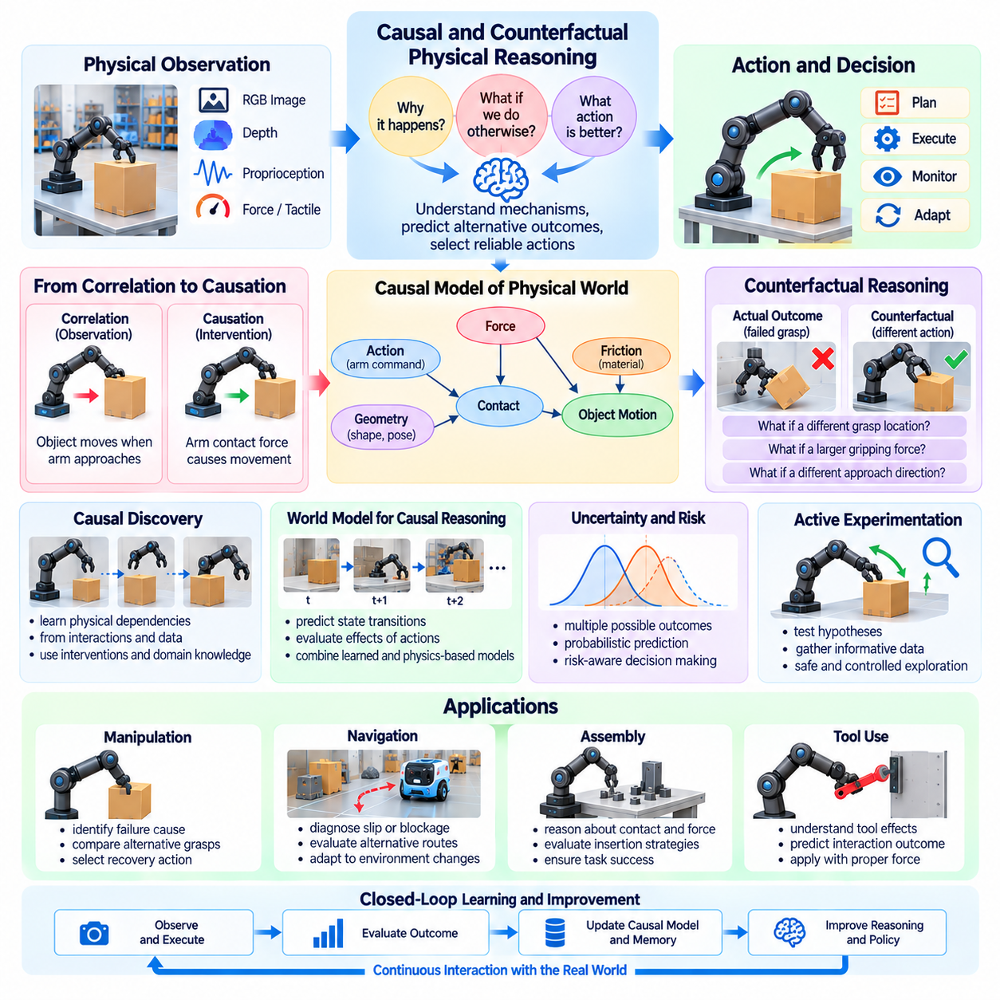{width="7.268055555555556in" height="7.268055555555556in"}

인과적 및 반사실적 물리 추론(Causal and Counterfactual Physical Reasoning)은 피지컬 인공지능(Physical AI) 시스템이 물리적 사건(Physical Event)이 발생하는 원인을 이해하고, 대안적인 행동(Alternative Action)에 따라 결과가 어떻게 달라질지 예측하도록 한다. 관측과 미래 상태(Future State) 사이의 통계적 관계(Statistical Relationship)를 식별하는 기존 예측(Prediction)과 달리, 인과적 추론(Causal Reasoning)은 행동(Action), 힘(Force), 객체(Object), 환경 조건(Environmental Condition)을 연결하는 메커니즘을 조사한다. 이러한 능력은 익숙하지 않은 물리적 상황에서 더욱 신뢰할 수 있는 계획(Planning), 진단(Diagnosis), 적응(Adaptation), 의사결정(Decision-Making)을 지원한다.

인과적 추론(Causal Reasoning)은 상관관계(Correlation)와 개입(Intervention)을 구분한다. 로봇은 다른 객체가 접근할 때마다 특정 객체가 움직이는 현상을 관측할 수 있지만, 이러한 연관성만으로 움직임을 발생시키는 메커니즘을 확립할 수는 없다. 접촉력(Contact Force), 자기적 상호작용(Magnetic Interaction), 기류(Airflow), 외부 교란(External Disturbance)이 관측된 현상을 설명할 수 있다. 인과관계(Causal Relationship)를 식별하려면 물리적 메커니즘(Physical Mechanism)을 추론하고 특정 변수(Variable)를 의도적으로 변경했을 때 결과가 어떻게 달라지는지 판단해야 한다.

반사실적 추론(Counterfactual Reasoning)은 실제로 관측된 사건과 다른 가상의 결과(Hypothetical Outcome)를 고려한다. 파지 실패(Failed Grasp)가 발생한 후 로봇은 접촉 위치(Contact Location), 파지력(Gripping Force), 접근 방향(Approach Direction)을 다르게 선택했다면 실패를 방지할 수 있었는지 검토할 수 있다. 이러한 추론은 변경된 조건(Modified Condition)에서 관측된 결과(Observed Outcome)와 대안적인 가능성(Alternative Possibility)을 비교한다. 이를 통해 모든 대안 행동을 실제로 실행하지 않고도 실패로부터 학습(Learning from Failure)할 수 있는 기반을 제공한다.

물리적 인과성(Physical Causality)은 기하학적 구조(Geometry), 동역학(Dynamics), 재료(Material), 환경 제약조건(Environmental Constraint) 사이의 관계에 의존한다. 객체의 움직임(Object Movement)은 가해진 힘(Applied Force), 중력(Gravity), 마찰(Friction), 충돌(Collision), 지지 조건(Support Condition)의 변화로 인해 발생할 수 있다. 인과적 표현(Causal Representation)은 관측된 모든 상태 전이(State Transition)를 임의의 패턴으로 취급하는 대신 이러한 메커니즘을 구분해야 한다. 이러한 구분은 에이전트가 시각적으로 다르지만 근본적인 동역학(Underlying Dynamics)을 공유하는 객체와 상황에 물리적 지식(Physical Knowledge)을 전이하는 데 도움이 된다.

구조적 인과 모델(Structural Causal Model)은 물리적 변수(Physical Variable) 사이의 의존성(Dependency)을 표현하기 위한 형식적인 접근 방식을 제공한다. 변수는 객체 위치(Object Position), 속도(Velocity), 접촉 상태(Contact State), 가해진 힘(Applied Force), 액추에이터 명령(Actuator Command)을 설명할 수 있으며, 구조적 관계(Structural Relationship)는 이러한 물리량이 서로 어떤 영향을 미치는지 표현한다. 개입(Intervention)은 선택된 변수를 변경하여 결과적인 변화를 추정한다. 그러나 인과적 결론(Causal Conclusion)은 가정된 구조(Assumed Structure)의 타당성과 그 관계를 뒷받침하는 증거(Evidence)에 따라 달라진다.

인과 발견(Causal Discovery)은 관측 데이터(Observational Data)와 실험 데이터(Experimental Data)로부터 물리적 의존성(Physical Dependency)을 추론하려고 한다. 반복적인 상호작용(Repeated Interaction)은 힘, 방향(Orientation), 접촉 위치(Contact Location)의 변화가 결과에 어떤 영향을 미치는지 드러낼 수 있다. 그러나 숨겨진 변수(Hidden Variable)가 잘못된 연관성(Misleading Association)을 만들어낼 수 있으므로 관측 데이터만으로는 고유한 인과 구조(Causal Structure)를 식별하지 못할 수 있다. 따라서 통제된 개입(Controlled Intervention), 도메인 지식(Domain Knowledge), 물리적 제약조건(Physical Constraint)은 신뢰할 수 있는 인과적 설명(Causal Explanation)을 확립하는 데 중요하다.

반사실적 분석(Counterfactual Analysis)은 일반적으로 대안적인 행동을 평가하기 전에 관측된 사건을 둘러싼 조건을 재구성해야 한다. 객체를 떨어뜨린 원인을 조사하는 로봇은 추정된 파지 상태(Estimated Grasp State), 객체 특성(Object Property), 움직임 이력(Motion History), 환경 조건(Environmental Condition)을 고려해야 한다. 이후 시스템은 관련 맥락 요소(Contextual Factor)를 유지하면서 선택된 행동이나 가정(Assumption)을 변경한다. 이러한 과정은 의미 있는 반사실적 평가(Counterfactual Evaluation)를 제약 없는 추측(Unconstrained Speculation)과 구분한다.

월드 모델(World Model)은 개입(Intervention)에 따라 물리적 상태(Physical State)가 어떻게 변화하는지 시뮬레이션함으로써 인과적 및 반사실적 추론(Causal and Counterfactual Reasoning)을 지원할 수 있다. 행동 조건부 모델(Action-Conditioned Model)은 대안적인 제어 명령(Control Command)에 대한 미래 결과(Future Outcome)를 추정하고, 물리 기반 시뮬레이터(Physics-Based Simulator)는 알려진 기계적 관계(Mechanical Relationship)를 표현한다. 하이브리드 접근 방식(Hybrid Approach)은 학습된 동역학(Learned Dynamics)과 명시적인 물리적 제약조건(Explicit Physical Constraint)을 결합한다. 이러한 모델의 유용성은 단순히 시각적으로 그럴듯한 예측을 생성하는 것이 아니라 실제 인과 메커니즘(Causal Mechanism)을 재현할 수 있는지에 달려 있다.

조작 작업(Manipulation Task)은 인과적 추론(Causal Reasoning)의 필요성을 명확하게 보여준다. 객체 삽입(Object Insertion) 과정에서 과도한 힘(Excessive Force)은 정렬 불량(Misalignment), 마찰(Friction), 변형(Deformation), 예상하지 못한 장애물(Unexpected Obstruction)로 인해 발생할 수 있다. 원인을 식별한 로봇은 동일한 행동을 반복하는 대신 적절한 수정 행동(Corrective Action)을 선택할 수 있다. 반사실적 평가(Counterfactual Evaluation)는 복구(Recovery)를 시도하기 전에 대안적인 삽입 각도(Insertion Angle), 접촉력(Contact Force), 움직임 궤적(Motion Trajectory)을 비교할 수 있다.

자율 내비게이션(Autonomous Navigation) 역시 환경 조건(Environmental Condition)이 변화할 때 인과적 이해(Causal Understanding)를 필요로 한다. 예상하지 못한 바퀴 미끄러짐(Wheel Slip)을 경험한 이동 로봇(Mobile Robot)은 접지력 감소(Reduced Traction), 위치 추정 오류(Localization Error), 액추에이터 오작동(Actuator Malfunction), 지형 변형(Terrain Deformation)을 구분해야 한다. 이러한 원인들은 서로 다른 수정 행동(Corrective Action)을 요구한다. 반사실적 추론(Counterfactual Reasoning)은 속도 감소(Speed Reduction), 방향 변경(Direction Change), 대체 경로 선택(Alternative Route Selection)이 안정성(Stability)과 내비게이션 성공률(Navigation Success)을 향상할 수 있는지 평가할 수 있다.

인과적 표현(Causal Representation)은 변하지 않는 물리적 관계(Invariant Physical Relationship)를 표면적인 환경 특성(Superficial Environmental Characteristic)과 분리함으로써 일반화(Generalization)를 향상할 수 있다. 로봇은 익숙하지 않은 용기(Container), 도구(Tool), 표면(Surface)을 접하더라도 지지(Support), 마찰(Friction), 중력(Gravity)과 관련된 익숙한 메커니즘을 인식할 수 있다. 이러한 지식은 학습 사례(Training Example)가 제한적인 상황에서 행동을 안내할 수 있다. 그러나 인과적 불변성(Causal Invariance)은 변화된 운영 조건(Operating Condition)에서 검증이 필요한 가설(Hypothesis)로 취급해야 한다.

능동적 실험(Active Experimentation)은 로봇이 불확실한 인과관계(Causal Relationship)에 관한 정보를 수집하도록 한다. 에이전트는 객체의 이동 가능성(Object Mobility)을 추정하기 위해 작은 힘을 가하거나, 접촉 기하학(Contact Geometry)을 검사하기 위해 관측 시점(Viewpoint)을 조정하거나, 기계적 가설(Mechanical Hypothesis)을 검증하기 위해 통제된 움직임(Controlled Movement)을 수행할 수 있다. 이러한 개입은 정보 획득량(Information Gain)과 운영 위험(Operational Risk) 사이에서 균형을 유지해야 한다. 안전한 실험(Safe Experimentation)은 객체 특성을 알 수 없거나 물리적 실수가 손상을 유발할 수 있는 경우 특히 중요하다.

물리적 시스템(Physical System)에는 숨겨진 상태(Hidden State)와 불완전한 측정(Imperfect Measurement)이 존재하는 경우가 많으므로 불확실성(Uncertainty)은 피할 수 없다. 알려지지 않은 마찰계수(Friction Coefficient), 객체 내부 구조(Internal Object Structure), 센서 잡음(Sensor Noise), 관측되지 않은 외력(Unobserved External Force)은 서로 경쟁하는 인과적 설명(Competing Causal Explanation)을 발생시킬 수 있다. 확률적 인과 모델(Probabilistic Causal Model)은 이러한 대안을 표현하고 상대적인 개연성(Relative Plausibility)을 추정할 수 있다. 강건한 의사결정(Robust Decision-Making)은 인과 구조(Causal Structure)와 개입의 예측 결과(Predicted Consequence)에 존재하는 불확실성을 모두 고려해야 한다.

인과적 추론(Causal Reasoning)은 행동 결과(Action Outcome)에 대한 해석을 개선함으로써 강화학습(Reinforcement Learning)을 보완할 수 있다. 에이전트는 보상(Reward)을 독립적인 피드백(Isolated Feedback)으로 취급하는 대신 어떤 행동 선택(Behavioral Choice)이 성공이나 실패를 발생시켰는지 조사할 수 있다. 반사실적 추정(Counterfactual Estimate)은 실행하지 않은 대안(Unexecuted Alternative)을 비교하고 미래 탐색(Future Exploration)을 안내하는 데 도움이 될 수 있다. 그러나 잘못된 인과적 가정(Incorrect Causal Assumption)은 학습에 편향(Bias)을 유발할 수 있으므로 실험적 검증(Experimental Validation)과 신뢰할 수 있는 불확실성 추정(Uncertainty Estimation)이 필수적이다.

비전 언어 행동 모델(Vision-Language-Action Model, VLA)은 인과적 추론(Causal Reasoning)을 활용하여 의미적 지시문(Semantic Instruction)을 물리적 메커니즘(Physical Mechanism)과 연결할 수 있다. 불안정한 객체를 고정하라는 언어 지시문(Language Instruction)은 단어를 인식하는 것만으로는 충분하지 않으며 지지(Support), 균형(Balance), 접촉 조건(Contact Condition)을 이해해야 한다. 멀티모달 관측(Multimodal Observation)은 이러한 메커니즘에 관한 증거를 제공하고, 행동 모델(Action Model)은 가능한 개입(Possible Intervention)을 생성한다. 인과적 근거를 바탕으로 선택한 행동이라도 실행 전에는 물리적 실행 가능성 검사(Physical Feasibility Check)가 필요하다.

장기 계획(Long-Horizon Planning)은 복잡한 작업에 중간 상태(Intermediate State)와 미래 결과(Future Outcome) 사이의 의존성이 존재하기 때문에 인과적 표현(Causal Representation)의 이점을 얻는다. 장애물을 제거하면 부품에 접근할 수 있게 되고, 객체 배치(Object Placement)를 변경하면 이후 조작 단계(Manipulation Step)에 영향을 미칠 수 있다. 인과적 작업 모델(Causal Task Model)은 선행 조건(Prerequisite)을 식별하고 즉각적인 행동을 넘어서는 결과를 예측할 수 있다. 반사실적 계획(Counterfactual Planning)은 대안적인 작업 시퀀스(Alternative Task Sequence)를 비교하고 후속 실패(Downstream Failure)를 예상하는 데 도움이 된다.

다중 로봇 시스템(Multi-Robot System)은 공유 환경(Shared Environment)과 협조 행동(Coordinated Action)에 관련된 추가적인 인과관계(Causal Relationship)를 발생시킨다. 한 로봇의 움직임이 다른 로봇을 방해하거나 객체의 이용 가능성(Object Availability)을 변경하거나 협업 작업(Collaborative Task)의 조건을 변화시킬 수 있다. 공유 인과적 표현(Shared Causal Representation)은 충돌 예측(Conflict Prediction)과 협조 계획(Coordinated Planning)을 지원할 수 있다. 그러나 통신 지연(Communication Delay)과 일치하지 않는 관측(Inconsistent Observation)은 인과적 귀속(Causal Attribution)을 복잡하게 만들 수 있으므로 동기화된 증거(Synchronized Evidence)와 명시적인 불확실성 관리(Explicit Uncertainty Management)가 필요하다.

추론 시점 연산(Test-Time Compute)은 대안적인 개입(Alternative Intervention)을 평가하기 위한 추가 계산 자원(Computational Resource)을 할당함으로써 반사실적 추론(Counterfactual Reasoning)을 강화할 수 있다. 시스템은 여러 가설(Hypothesis)을 생성하고 가능한 결과(Possible Outcome)를 시뮬레이션하며 안전성(Safety)과 예상 효과(Expected Effectiveness)를 비교할 수 있다. 더 많은 계산 노력(Computational Effort)은 행동이 되돌릴 수 없거나 잠재적으로 위험한 경우 특히 가치가 있다. 그러나 실시간 제약조건(Real-Time Constraint)은 제한된 추론 시간(Bounded Reasoning Time)과 평가 결과가 불확실할 때 사용할 안전한 대체 전략(Safe Fallback Strategy)을 요구한다.

안전 보증(Safety Assurance)은 인과적 물리 추론(Causal Physical Reasoning)의 중요한 응용 분야이다. 충돌(Collision), 과도한 힘(Excessive Force), 불안정한 하중(Unstable Load), 장비 고장(Equipment Failure)을 발생시킬 수 있는 메커니즘을 식별하면 예방적 행동 선택(Preventive Action Selection)을 지원할 수 있다. 반사실적 분석(Counterfactual Analysis)은 대안적인 의사결정(Alternative Decision)이 위험한 사건(Hazardous Event)을 방지할 수 있었는지도 검토할 수 있다. 그러나 학습된 인과적 설명(Learned Causal Explanation)이 검증된 안전 제약조건(Verified Safety Constraint), 독립적인 감시(Independent Monitoring), 기존의 보호 제어 메커니즘(Protective Control Mechanism)을 대체해서는 안 된다.

평가(Evaluation)는 인과적 이해(Causal Understanding)와 일반적인 예측 정확도(Predictive Accuracy)를 구분해야 한다. 모델은 익숙한 결과를 정확하게 예측하더라도 개입(Intervention)이 근본적인 관계를 변경하면 실패할 수 있다. 적절한 테스트는 개입 예측(Intervention Prediction), 반사실적 일관성(Counterfactual Consistency), 인과적 전이(Causal Transfer), 실패 진단(Failure Diagnosis), 복구 효과(Recovery Effectiveness)를 검토한다. 평가 환경(Evaluation Environment)에는 숨겨진 변수(Hidden Variable), 익숙하지 않은 재료(Unfamiliar Material), 변화된 동역학(Changed Dynamics), 관측된 물리적 결과에 대한 설명이 필요한 시나리오(Scenario)가 포함되어야 한다.

지속적 학습(Continual Learning)은 누적된 상호작용 경험(Accumulated Interaction Experience)을 통해 인과적 지식(Causal Knowledge)을 개선할 수 있다. 반복적인 관측(Repeated Observation)과 통제된 개입(Controlled Intervention)은 물리적 메커니즘(Physical Mechanism)에 대한 추정치를 정교하게 만들고, 이전에 알려지지 않은 의존성(Unknown Dependency)을 발견하며, 부정확한 가정(Inaccurate Assumption)을 수정할 수 있다. 로봇 플릿(Robot Fleet)은 다양한 환경과 로봇 형태(Embodiment)에 걸친 증거를 제공할 수 있다. 업데이트 과정에서는 근거가 부족한 결론(Unsupported Conclusion)이 공유 운영 모델(Shared Operational Model)로 확산되지 않도록 출처 정보(Provenance), 실험 조건(Experimental Condition), 불확실성(Uncertainty)을 보존해야 한다.

주요 연구 방향은 인과 모델(Causal Model)을 학습 기반 월드 모델(Learned World Model), 멀티모달 파운데이션 모델(Multimodal Foundation Model), 계층적 계획 시스템(Hierarchical Planning System)과 통합하는 것이다. 이러한 아키텍처(Architecture)는 의미적 이해(Semantic Understanding)를 물리적 메커니즘(Physical Mechanism)과 개입 결과(Intervention Outcome)에 대한 명시적인 표현(Explicit Representation)과 결합할 수 있다. 발전을 위해서는 더 나은 인과 식별(Causal Identification), 효율적인 실험(Efficient Experimentation), 신뢰할 수 있는 시뮬레이션(Reliable Simulation), 익숙하지 않은 환경으로의 전이(Transfer)가 필요하다. 목표는 단순히 다음에 어떤 일이 발생할지 예측하는 것이 아니라 어떤 행동이 발생할 결과를 변화시킬 수 있는지 이해하는 것이다.

인과적 및 반사실적 물리 추론(Causal and Counterfactual Physical Reasoning)은 자율 에이전트(Autonomous Agent)가 실패를 설명하고, 대안을 평가하며, 변화하는 물리적 조건(Physical Condition)에 지능적으로 적응할 수 있도록 하는 발전 경로를 제공한다. 장기적인 중요성은 경험(Experience)을 물리적 메커니즘에 관한 실행 가능한 지식(Actionable Knowledge)으로 전환하는 데 있다. 신뢰할 수 있는 구현을 위해서는 물리적 현실에 기반한 관측(Grounded Observation), 검증된 인과적 가정(Validated Causal Assumption), 불확실성 인식 예측(Uncertainty-Aware Prediction), 안전한 개입 전략(Safe Intervention Strategy), 실제 환경 실행(Real-World Execution)으로부터 얻는 지속적인 피드백(Continuous Feedback)이 필요하다.

## 10.08. Self Supervised and Continual Robot Learning

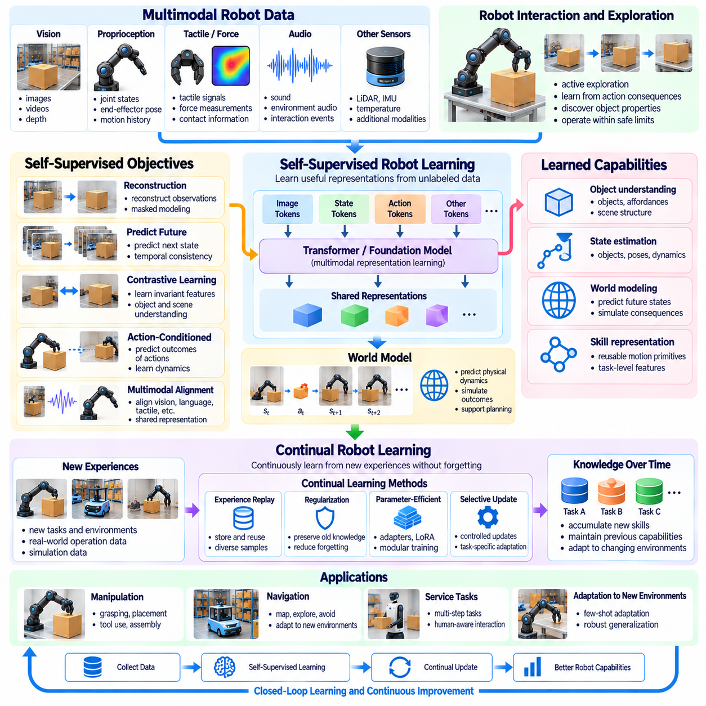{width="7.268055555555556in" height="7.268055555555556in"}

자기지도학습(Self-Supervised Learning)과 지속적 로봇 학습(Continual Robot Learning)은 수작업으로 레이블이 지정된 데이터셋(Manually Labeled Dataset)과 고정된 학습 절차(Fixed Training Procedure)에 전적으로 의존하지 않고 경험(Experience)을 통해 개선되는 피지컬 인공지능(Physical AI) 시스템을 개발하기 위한 핵심적인 발전 방향이다. 자기지도학습은 관측(Observation)과 상호작용(Interaction)으로부터 학습 신호(Training Signal)를 추출하며, 지속적 학습(Continual Learning)은 연속적으로 축적되는 경험을 통해 지식(Knowledge)을 갱신한다. 이러한 접근 방식은 변화하는 물리적 환경(Physical Environment)에서 더욱 적응력 있는 로봇 지능(Robotic Intelligence)을 지원한다.

기존 로봇 학습(Conventional Robot Learning)은 정교하게 주석 처리된 시연 데이터(Annotated Demonstration), 사전에 정의된 작업 목표(Predefined Task Objective), 광범위한 지도(Supervision)를 요구하는 경우가 많다. 물리적 상호작용(Physical Interaction)에는 하드웨어 제약조건(Hardware Limitation), 운영 시간(Operational Time), 안전 제약조건(Safety Constraint)이 수반되므로 이러한 데이터를 수집하는 데 많은 비용이 발생할 수 있다. 자기지도학습(Self-Supervised Learning)은 센서 데이터(Sensory Data)의 구조, 시간적 관계(Temporal Relationship), 로봇 행동의 관측 가능한 결과(Observable Consequence)를 활용하여 학습 목표(Learning Objective)를 구성함으로써 수작업 주석(Manual Annotation)에 대한 의존성을 줄인다.

자기지도학습(Self-Supervised Learning)은 사용 가능한 데이터에서 도출된 예측(Prediction), 재구성(Reconstruction), 일관성(Consistency), 표현 학습(Representation Learning) 목표에 기반한다. 로봇은 미래 관측(Future Observation)을 예측하거나 누락된 센서 측정값(Missing Sensor Measurement)을 재구성하거나 연속적인 상태(Successive State) 사이의 관계를 학습할 수 있다. 이러한 목표는 모든 상호작용에 명시적인 레이블(Explicit Label)을 요구하지 않으면서 모델이 유용한 환경 구조(Environmental Structure)를 포착하도록 한다. 그러나 성공적인 사전학습(Pretraining)이 후속 제어 작업(Downstream Control)의 효과적인 수행을 자동으로 보장하는 것은 아니다.

시각적 자기지도학습(Visual Self-Supervised Learning)은 로봇이 대규모 이미지와 비디오 데이터로부터 객체(Object), 장면(Scene), 움직임(Motion), 공간적 관계(Spatial Relationship)에 대한 표현을 개발하도록 한다. 대조학습(Contrastive Learning), 마스킹 재구성(Masked Reconstruction), 예측적 표현 학습(Predictive Representation Learning)은 관측 전반에 걸쳐 의미 있는 패턴을 식별할 수 있다. 이러한 표현은 객체 인식(Object Recognition), 장면 이해(Scene Understanding), 내비게이션(Navigation)을 지원할 수 있다. 실제 활용 가치는 학습된 특징(Learned Feature)이 실제 운영 조건(Real Operating Condition)에서도 관련성을 유지하는지에 달려 있다.

시간적 예측(Temporal Prediction)은 물리적 환경(Physical Environment)이 구조화된 동역학(Structured Dynamics)에 따라 변화하기 때문에 중요한 학습 신호(Learning Signal)를 제공한다. 로봇은 객체가 어떻게 움직이고, 접촉 상태(Contact State)가 어떻게 변화하며, 환경 상태(Environmental State)가 행동에 어떻게 반응하는지 관측할 수 있다. 미래 표현(Future Representation)을 예측하면 모델이 현재 조건(Current Condition)과 후속 결과(Subsequent Outcome) 사이의 관계를 포착하도록 유도한다. 행동 조건부 예측(Action-Conditioned Prediction)은 학습된 동역학(Learned Dynamics)을 의사결정(Decision-Making) 및 계획(Planning)과 더욱 직접적으로 연결한다.

멀티모달 자기지도학습(Multimodal Self-Supervised Learning)은 시각(Visual), 촉각(Tactile), 고유수용감각(Proprioceptive), 청각(Auditory) 및 기타 센서 측정값(Sensor Measurement)을 결합하여 물리적 상호작용(Physical Interaction)에 대한 더욱 풍부한 표현을 구성한다. 서로 다른 모달리티(Modality)는 객체 특성(Object Property)과 환경 조건(Environmental Condition)에 관한 상호보완적인 증거(Complementary Evidence)를 제공할 수 있다. 교차 모달 예측(Cross-Modal Prediction)과 정렬(Alignment)은 모델이 시각적 관측을 접촉력(Contact Force), 움직임(Motion), 물리적 결과(Physical Outcome)와 연관시키도록 한다. 이러한 통합은 개별 센서가 불완전한 정보를 제공하는 경우 특히 중요하다.

로봇 상호작용(Robot Interaction)은 수동적 관측(Passive Observation)을 넘어서는 학습 기회를 제공한다. 행동(Action)을 통해 이미지에서 항상 추론할 수 없는 특성을 발견할 수 있기 때문이다. 객체를 밀면 마찰(Friction)과 이동 가능성(Mobility)을 파악할 수 있으며, 통제된 파지(Controlled Grasping)는 안정성(Stability)과 접촉 특성(Contact Behavior)을 드러낼 수 있다. 자기지도학습 목표(Self-Supervised Objective)는 이러한 상태 변화(State Change)를 학습 신호(Training Signal)로 활용할 수 있다. 그러나 정보 수집(Information Gathering)은 물리적 위험(Physical Risk)을 초래할 수 있으므로 탐색(Exploration)은 검증된 운영 한계(Verified Operational Limit) 내에서 수행되어야 한다.

지속적 학습(Continual Learning)은 새로운 작업(Task), 환경(Environment), 경험(Experience)이 추가됨에 따라 모델 능력(Model Capability)을 유지하고 개선하는 과제를 다룬다. 고정된 데이터셋(Fixed Dataset)을 이용한 학습 이후 배포(Deployment)를 가정하는 경우가 많은 기존 학습(Conventional Training)과 달리, 지속적 학습은 시스템의 운영 수명(Operational Lifetime) 전반에 걸친 연속적인 업데이트(Successive Update)를 고려한다. 목표는 이전 경험(Earlier Experience)에서 학습한 능력을 불필요하게 저하시키지 않으면서 유용한 새로운 지식(New Knowledge)을 획득하는 것이다.

파국적 망각(Catastrophic Forgetting)은 지속적 로봇 학습(Continual Robot Learning)의 주요 장애 요인이다. 모델이 최근 작업(Recent Task)에 적응할 때 매개변수 업데이트(Parameter Update)가 이전에 학습된 행동(Previously Learned Behavior)을 지원하는 표현을 방해할 수 있다. 특정 환경에서 성능을 개선한 로봇이 다른 환경에서는 오히려 신뢰성(Reliability)이 낮아질 수 있다. 리플레이 버퍼(Replay Buffer), 매개변수 정규화(Parameter Regularization), 모듈형 아키텍처(Modular Architecture), 선택적 적응(Selective Adaptation)은 이러한 간섭(Interference)을 줄이기 위한 가능한 메커니즘을 제공한다.

경험 리플레이(Experience Replay)는 이전 학습 단계(Previous Learning Stage)에서 선택된 관측(Observation), 행동(Action), 결과(Outcome)를 보존한다. 이후 업데이트 과정에서는 과거 사례(Historical Example)를 새로운 데이터(New Data)와 결합하여 기존 능력(Earlier Capability)을 유지할 수 있다. 리플레이 데이터 선택(Replay Selection)은 작업 다양성(Task Diversity), 환경 포괄성(Environmental Coverage), 실패 사례(Failure Case), 저장 용량 제약(Storage Limitation)을 고려해야 한다. 적절하게 구성되지 않은 리플레이 데이터(Poorly Curated Replay Data)는 오래된 가정(Outdated Assumption)을 강화하거나 중요한 운영 조건(Operational Condition)을 충분히 대표하지 못할 수 있다.

매개변수 효율적 적응(Parameter-Efficient Adaptation)은 사전학습 모델(Pretrained Model)의 제한된 부분만 수정하는 지속적 학습(Continual Learning)의 또 다른 접근 방식이다. 어댑터(Adapter), 저랭크 업데이트(Low-Rank Update), 특화 모듈(Specialized Module)은 기존 표현(Original Representation)의 상당 부분을 보존하면서 새로운 능력(New Capability)을 도입할 수 있다. 이러한 방법은 계산 비용(Computational Cost)을 줄이고 모델 버전 관리(Model Version Management)를 단순화할 수 있다. 그러나 새로운 작업이 이전 경험과 크게 다를 경우 제한된 적응 용량(Restricted Adaptation Capacity)이 성능을 제약할 수 있다.

온라인 학습(Online Learning)은 로봇이 운영 중 새로운 관측(New Observation)을 반영하도록 하지만, 제한 없는 매개변수 업데이트(Unrestricted Parameter Update)는 예측하기 어려운 행동(Unpredictable Behavior)을 발생시킬 수 있다. 센서 잡음(Sensor Noise), 비정상적인 사건(Unusual Event), 잘못된 피드백(Incorrect Feedback)은 학습 신호(Learning Signal)를 오염시킬 수 있다. 실제 시스템은 운영 데이터 수집(Operational Data Collection)과 통제된 모델 업데이트(Controlled Model Update)를 분리하는 경우가 많다. 후보 모델(Candidate Model)을 독립적으로 학습하고 검증한 후 배포된 모델(Deployed Model)을 교체하면 통제되지 않은 행동 변화(Uncontrolled Behavioral Change)의 위험을 줄일 수 있다.

월드 모델(World Model)은 상태 전이(State Transition)와 행동 결과(Action Consequence)를 예측함으로써 자기지도학습(Self-Supervised Learning)과 지속적 적응(Continual Adaptation)을 자연스럽게 연결한다. 로봇은 예상 결과(Expected Outcome)와 관측 결과(Observed Outcome) 사이의 차이를 식별할 수 있다. 이러한 예측 오차(Prediction Error)는 객체 동역학(Object Dynamics), 환경 조건(Environmental Condition), 센서 동작(Sensor Behavior)의 변화를 나타낼 수 있다. 갱신된 월드 모델(Updated World Model)은 새로운 추정치(New Estimate)가 신뢰할 수 있는 관측(Reliable Observation)을 통해 검증된다면 계획(Planning)을 개선할 수 있다.

지속적 학습(Continual Learning)은 관련 운영 경험(Relevant Operational Experience)을 보존하는 구조화된 기억 시스템(Structured Memory System)의 이점도 얻는다. 일화 기억(Episodic Memory)은 구체적인 상호작용(Specific Interaction)을 저장하고, 의미 기억(Semantic Memory)은 객체(Object), 환경(Environment), 절차(Procedure)에 관한 재사용 가능한 지식(Reusable Knowledge)을 통합한다. 검색 메커니즘(Retrieval Mechanism)은 현재 작업(Current Task)과 관련된 경험을 식별하고 즉각적인 매개변수 업데이트 없이 적응을 지원할 수 있다. 기억 품질(Memory Quality)은 정확한 맥락(Accurate Context), 출처 정보(Provenance), 오래된 정보(Outdated Information)의 적절한 처리에 달려 있다.

시뮬레이션 환경(Simulated Environment)은 반복적인 상호작용(Repeated Interaction)과 다양한 물리적 조건(Physical Condition)을 제공함으로써 자기지도학습(Self-Supervised Learning)을 가속할 수 있다. 도메인 무작위화(Domain Randomization)는 모델을 외관(Appearance), 동역학(Dynamics), 센서 특성(Sensor Characteristic)의 변화에 노출한다. 시뮬레이션(Simulation)은 실제 환경에서 재현하는 데 비용이 많이 들거나 위험할 수 있는 드문 실패 시나리오(Rare Failure Scenario)도 생성할 수 있다. 그러나 시뮬레이션 기반 학습(Simulation-Based Learning)은 합성 동역학(Synthetic Dynamics)과 실제 로봇 시스템(Actual Robotic System) 사이의 차이를 고려해야 한다.

능동학습(Active Learning)과 호기심 기반 탐색(Curiosity-Driven Exploration)은 로봇이 특히 정보 가치가 높은 경험(Informative Experience)을 선택하도록 도울 수 있다. 에이전트는 관측을 균등하게 수집하는 대신 불확실한 객체(Uncertain Object), 익숙하지 않은 상호작용(Unfamiliar Interaction), 예측 모델(Predictive Model) 사이에 의견 차이가 발생하는 상황을 우선할 수 있다. 정보 획득량(Information Gain)은 지식의 공백(Knowledge Gap)을 향한 탐색을 안내할 수 있다. 안전 제약조건(Safety Constraint)과 작업 우선순위(Task Priority)는 호기심 기반 행동(Curiosity-Driven Behavior)이 필수 운영(Essential Operation)을 방해하지 않도록 해야 한다.

플릿 학습(Fleet Learning)은 분산 배포(Distributed Deployment) 환경에서 여러 로봇의 경험을 집계하여 지속적인 개선(Continual Improvement)을 확장한다. 서로 다른 환경에서 작동하는 로봇들은 관측(Observation), 작업 결과(Task Outcome), 실패 사례(Failure Example)를 공유 데이터셋(Shared Dataset)에 제공할 수 있다. 중앙집중형 학습(Centralized Learning) 또는 연합학습(Federated Learning) 절차는 이러한 경험을 활용하여 공통 모델(Common Model)을 개선할 수 있다. 하드웨어(Hardware), 운영 조건(Operating Condition), 데이터 품질(Data Quality)의 차이로 인해 지식 전이(Knowledge Transfer) 이전에 신중한 정규화(Normalization)와 검증(Validation)이 필요하다.

로봇 형태 간 학습(Cross-Embodiment Learning)은 로봇마다 센서(Sensor), 운동학(Kinematics), 행동 공간(Action Space)이 다를 수 있으므로 추가적인 과제를 발생시킨다. 공유 표현(Shared Representation)은 객체와 작업 구조(Task Structure)에 관한 전이 가능한 지식(Transferable Knowledge)을 포착할 수 있으며, 로봇 형태별 모듈(Embodiment-Specific Module)은 물리적 실행(Physical Execution)을 처리한다. 지속적 학습 메커니즘(Continual Learning Mechanism)은 한 플랫폼(Platform)에서 성공한 행동이 다른 플랫폼으로 직접 전이된다고 가정해서는 안 된다. 업데이트된 정책(Updated Policy)을 배포하기 전에 플랫폼별 평가(Platform-Specific Evaluation)가 필요하다.

자기지도학습(Self-Supervised Learning)의 평가는 표현 손실(Representation Loss)이나 예측 정확도(Prediction Accuracy)에만 의존하지 않고 후속 로봇 작업 성능(Downstream Robotic Performance)을 검토해야 한다. 관련 지표에는 샘플 효율성(Sample Efficiency), 작업 성공률(Task Success), 강건성(Robustness), 전이 능력(Transfer Capability), 적응 속도(Adaptation Speed)가 포함된다. 지속적 학습(Continual Learning)은 이전 작업(Earlier Task)에서 유지되는 성능(Retained Performance)도 추가로 측정해야 한다. 평가 프로토콜(Evaluation Protocol)에는 변화하는 환경(Changing Environment), 순차적인 작업 도입(Sequential Task Introduction), 현실적인 운영 교란(Realistic Operational Disturbance)이 포함되어야 한다.

학습 시스템(Learning System)이 시간에 따라 행동을 수정할 때는 안전 보증(Safety Assurance)이 특히 중요하다. 업데이트된 모델(Updated Model)은 평균 작업 성능(Average Task Performance)이 개선되더라도 이전에 관측되지 않았던 실패 모드(Failure Mode)를 도입할 수 있다. 회귀 테스트(Regression Testing), 런타임 모니터링(Runtime Monitoring), 롤백 메커니즘(Rollback Mechanism), 통제된 배포 절차(Controlled Deployment Procedure)는 의도하지 않은 변화(Unintended Change)에 대한 보호 기능을 제공한다. 안전 필수 제어 기능(Safety-Critical Control Function)은 학습 과정 전반에 걸쳐 독립적으로 검증된 제약조건(Independently Verified Constraint)을 준수해야 한다.

데이터 거버넌스(Data Governance)는 운영 데이터셋(Operational Dataset)에 일관되지 않은 관측(Inconsistent Observation), 민감한 정보(Sensitive Information), 검증되지 않은 레이블(Unverified Label)이 포함될 수 있으므로 지속적 로봇 학습(Continual Robot Learning)의 신뢰성에 영향을 미친다. 효과적인 데이터 파이프라인(Data Pipeline)에는 출처 추적(Provenance Tracking), 품질 평가(Quality Assessment), 데이터셋 버전 관리(Dataset Versioning), 접근 제어(Access Control)가 필요하다. 실패 사례(Failure Case)는 이후 분석(Later Analysis)에 충분한 맥락(Context)을 포함하여 보존해야 한다. 투명한 데이터 관리(Transparent Data Management)는 실제 모델 개선(Genuine Model Improvement)과 편향되거나 불완전한 학습 증거(Biased or Incomplete Training Evidence)로 인한 변화를 구분하는 데 도움이 된다.

장기적인 발전 방향은 이전에 획득한 신뢰할 수 있는 능력(Previously Acquired Reliable Capability)을 유지하면서 유용한 물리적 경험(Physical Experience)을 지속적으로 축적하는 로봇을 구현하는 것이다. 자기지도학습(Self-Supervised Learning)은 센서 기반 상호작용(Sensory Interaction)으로부터 광범위한 표현(Broad Representation)을 제공할 수 있으며, 지속적 학습(Continual Learning)은 이러한 표현을 변화하는 작업(Evolving Task)과 환경(Environment)에 적응시킨다. 신뢰할 수 있는 자기개선(Self-Improvement)을 달성하려면 안정적인 학습 목표(Stable Learning Objective), 선택적 기억(Selective Memory), 안전한 탐색(Safe Exploration), 효율적인 적응(Efficient Adaptation), 체계적인 실제 환경 검증(Systematic Real-World Validation)이 필요하다.

## 10.09. Cross Embodiment Generalization

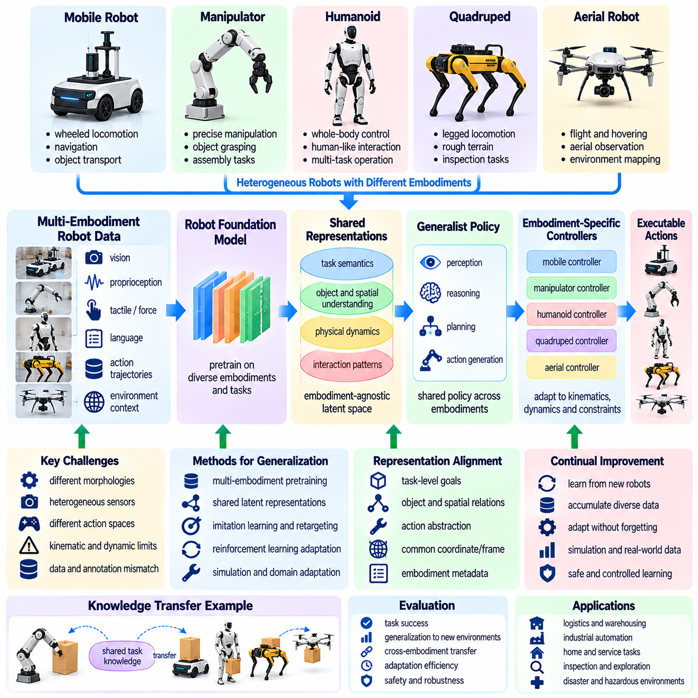{width="7.268055555555556in" height="7.268055555555556in"}

로봇 형태 간 일반화(Cross-Embodiment Generalization)는 피지컬 인공지능(Physical AI) 시스템이 서로 다른 기계적 구조(Mechanical Structure), 센서(Sensor), 액추에이터(Actuator), 제어 인터페이스(Control Interface)를 가진 로봇 사이에서 지식(Knowledge)과 능력(Capability)을 전이할 수 있도록 한다. 하나의 로봇 플랫폼(Robotic Platform)에서 학습된 정책(Policy)은 이상적으로 전체 재학습(Complete Retraining) 없이도 다른 플랫폼의 성능 향상에 기여해야 한다. 이러한 목표는 학습된 행동(Learned Behavior)이 특정 하드웨어 구성(Hardware Configuration)과 운영 조건(Operating Condition)에 강하게 결합되는 기존 로봇공학(Conventional Robotics)의 근본적인 한계를 해결하기 위한 것이다.

로봇 형태(Robot Embodiment)는 지능형 에이전트(Intelligent Agent)가 물리적 세계(Physical World)를 인식하고 상호작용하는 방식을 결정한다. 이동 로봇(Mobile Robot), 매니퓰레이터(Manipulator), 휴머노이드(Humanoid), 사족보행 로봇(Quadruped), 무인 항공기(Aerial Vehicle)는 서로 다른 자유도(Degrees of Freedom), 이동 제약조건(Movement Constraint), 감지 능력(Sensing Capability), 행동 공간(Action Space)을 가진다. 이러한 차이는 수행 가능한 작업과 행동 실행 방식에 영향을 미친다. 따라서 로봇 형태 간 학습(Cross-Embodiment Learning)은 전이 가능한 작업 지식(Transferable Task Knowledge)과 플랫폼별 물리적 능력(Platform-Specific Physical Capability)을 구분해야 한다.

핵심 과제는 로봇의 형태적 차이(Morphological Difference)를 수용하면서 작업의 의미(Task Meaning)를 보존하는 표현(Representation)을 개발하는 것이다. 객체를 목적지로 이동시키는 작업은 로봇 팔을 장착한 바퀴형 로봇(Wheeled Robot with Arm)과 휴머노이드(Humanoid)에게 동일한 목표를 의미할 수 있지만, 필요한 움직임은 크게 다르다. 공유 표현(Shared Representation)은 특정 관절 명령(Joint Command)과 독립적으로 목표(Goal), 객체 관계(Object Relationship), 원하는 결과(Desired Outcome)를 인코딩할 수 있다. 이후 로봇 형태별 제어기(Embodiment-Specific Controller)가 이러한 목표를 실행 가능한 행동(Feasible Action)으로 변환한다.

관측 공간(Observation Space)은 센서 유형(Sensor Type), 장착 위치(Mounting Position), 해상도(Resolution), 보정 절차(Calibration Procedure)가 로봇 플랫폼마다 다르기 때문에 차이가 발생한다. 한 로봇은 스테레오 카메라(Stereo Camera)와 라이다(LiDAR)에 의존할 수 있지만, 다른 로봇은 단안 시각(Monocular Vision), 촉각 센싱(Tactile Sensing), 고유수용감각(Proprioception)을 결합할 수 있다. 로봇 형태 간 시스템(Cross-Embodiment System)은 동일한 측정값을 가정하지 않으면서 이러한 이질적인 정보원(Heterogeneous Source)을 정렬해야 한다. 공통 공간 표현(Common Spatial Representation), 기하학적 표현(Geometric Representation), 의미적 표현(Semantic Representation)은 관측의 차이를 줄일 수 있다.

행동 공간 정렬(Action-Space Alignment)은 동일한 명령이 로봇마다 서로 다른 물리적 의미(Physical Meaning)를 가질 수 있기 때문에 더욱 큰 과제를 제시한다. 관절 각도(Joint Angle), 말단 효과기 자세(End-Effector Pose), 바퀴 속도(Wheel Velocity), 항공 추력 명령(Aerial Thrust Command)은 직접 교환할 수 없다. 중간 행동 표현(Intermediate Action Representation)은 원하는 움직임(Desired Motion), 접촉 조건(Contact Condition), 작업 수준 효과(Task-Level Effect)를 기술할 수 있다. 이후 플랫폼별 제어 모듈(Platform-Specific Control Module)은 이러한 표현을 유효한 액추에이터 명령(Valid Actuator Command)으로 매핑하고 물리적 제약조건(Physical Constraint)을 적용할 수 있다.

운동학적 및 동역학적 차이(Kinematic and Dynamic Difference)는 전이된 행동(Transferred Behavior)이 물리적으로 실행 가능한지를 결정한다. 로봇은 도달 가능성(Reachability), 적재 용량(Payload Capacity), 관절 한계(Joint Limit), 안정성(Stability), 가속도(Acceleration), 접촉 역학(Contact Mechanics)에서 차이를 보인다. 강력한 산업용 로봇 팔(Industrial Robot Arm)에서 성공한 조작 전략(Manipulation Strategy)은 경량 이동 매니퓰레이터(Lightweight Mobile Manipulator)에는 적합하지 않을 수 있다. 따라서 일반화(Generalization)는 실행 가능성 검사(Feasibility Check)를 포함하고 각 대상 플랫폼(Target Platform)의 물리적 한계에 맞게 움직임 생성(Motion Generation)을 조정해야 한다.

로봇 파운데이션 모델(Robot Foundation Model)은 이질적인 로봇 데이터셋(Heterogeneous Robotic Dataset)으로부터 공유 능력(Shared Capability)을 학습하기 위한 잠재적인 메커니즘을 제공한다. 여러 로봇 형태(Multiple Embodiments)에 걸친 학습은 모델을 다양한 관측(Observation), 행동(Action), 작업 결과(Task Outcome)에 노출할 수 있다. 목표는 개별 플랫폼을 넘어 인식(Perception), 계획(Planning), 제어(Control)를 지원하는 재사용 가능한 패턴(Reusable Pattern)을 발견하는 것이다. 그러나 데이터셋 다양성(Dataset Diversity)이 증가한다고 해서 효과적인 전이(Effective Transfer)가 자동으로 보장되는 것은 아니며, 로봇 형태의 차이가 명시적으로 표현되어야 한다.

데이터셋 표준화(Dataset Standardization)는 서로 다른 로봇 시스템에서 수집된 경험을 결합하는 데 필수적이다. 기록된 궤적(Recorded Trajectory)은 좌표계(Coordinate Frame), 행동 주파수(Action Frequency), 센서 규약(Sensor Convention), 작업 설명(Task Description)이 서로 호환되지 않을 수 있다. 공통 메타데이터(Common Metadata)는 로봇 형태(Robot Morphology), 센서 구성(Sensor Configuration), 보정(Calibration), 제어 인터페이스(Control Interface), 환경 조건(Environmental Condition)을 식별해야 한다. 정확한 정규화(Accurate Normalization)는 기록된 행동의 의미를 보존하면서 플랫폼 간 잘못된 비교(Misleading Comparison)를 방지한다.

로봇 형태 간 일반화(Cross-Embodiment Generalization)는 공통적인 물리적 관계(Common Physical Relationship)를 인코딩하는 공유 잠재 표현(Shared Latent Representation)을 통해 접근할 수 있다. 모델은 로봇별 좌표(Robot-Specific Coordinate)에 대한 의존성이 낮은 표현 공간(Representation Space)에서 객체 움직임(Object Motion), 접촉 상태 전이(Contact Transition), 공간 목표(Spatial Goal), 작업 진행 상태(Task Progress)를 학습할 수 있다. 이러한 잠재 공간(Latent Space)은 정책 적응(Policy Adaptation)과 지식 전이(Knowledge Transfer)를 지원할 수 있다. 그러나 그 유용성은 표현 유사성(Representation Similarity)만이 아니라 실제 실행 성공(Successful Execution)을 통해 입증되어야 한다.

계층적 정책(Hierarchical Policy)은 전이 가능한 추론(Transferable Reasoning)과 로봇 형태에 의존하는 실행(Embodiment-Dependent Execution)을 분리하는 실용적인 방법을 제공한다. 상위 수준 정책(High-Level Policy)은 목표(Objective), 하위 작업(Subtask), 원하는 상태 변화(Desired State Change)를 선택하고, 하위 수준 제어기(Low-Level Controller)는 이동(Locomotion), 조작(Manipulation), 안정화(Stabilization)를 처리한다. 이러한 구조를 통해 서로 다른 로봇이 특화된 운동 기술(Specialized Motor Skill)을 유지하면서 계획 지식(Planning Knowledge)을 공유할 수 있다. 계층 구조(Hierarchy)의 효과는 명확하게 정의된 인터페이스(Well-Defined Interface)와 계층 간 정확한 피드백(Accurate Feedback)에 달려 있다.

모방학습(Imitation Learning)은 서로 다른 로봇 형태에서 수집된 시연(Demonstration)을 활용할 수 있을 때 행동 지식(Behavioral Knowledge)을 전이할 수 있다. 모델은 서로 다른 움직임을 포함하지만 유사한 결과를 달성하는 궤적(Trajectory)으로부터 공통 작업 의도(Shared Task Intention)를 추론할 수 있다. 리타기팅 방법(Retargeting Method)은 충분한 기하학적 정보(Geometric Information)와 운동학적 정보(Kinematic Information)가 제공될 경우 시연을 대상 로봇 구성(Target Robot Configuration)으로 변환할 수 있다. 그러나 기계적으로 유사한 움직임이라도 서로 다른 접촉력(Contact Force)이나 안정성 조건(Stability Condition)을 발생시킬 수 있으므로 변환된 궤적(Retargeted Trajectory)은 검증이 필요하다.

강화학습(Reinforcement Learning)은 각 대상 로봇(Target Robot)의 동역학(Dynamics)에 따라 정책(Policy)을 최적화함으로써 로봇 형태 간 적응(Cross-Embodiment Adaptation)을 지원한다. 공유 정책(Shared Policy)은 초기화(Initialization)에 활용할 수 있으며, 플랫폼별 학습(Platform-Specific Training)은 제어 매개변수(Control Parameter)와 행동 전략(Action Strategy)을 조정한다. 시뮬레이션(Simulation)은 서로 다른 로봇 모델(Robot Model)에 대한 반복 실험(Repeated Trial)을 통해 이러한 과정을 가속할 수 있다. 그러나 전이 품질(Transfer Quality)은 시뮬레이션 충실도(Simulation Fidelity), 탐색 안전성(Exploration Safety), 기본 작업 표현(Underlying Task Representation)의 호환성에 달려 있다.

월드 모델(World Model)은 환경 동역학(Environmental Dynamics)을 로봇별 행동 효과(Robot-Specific Action Effect)와 분리함으로써 로봇 형태 간 학습(Cross-Embodiment Learning)을 개선할 수 있다. 공유 모델(Shared Model)은 객체 행동(Object Behavior)과 작업 결과(Task Consequence)를 표현하고, 로봇 형태 조건부 구성요소(Embodiment-Conditioned Component)는 특정 로봇이 환경에 어떤 영향을 미치는지 예측할 수 있다. 이러한 구분은 이질적인 플랫폼(Heterogeneous Platform) 사이의 계획을 지원할 수 있다. 정확한 전이를 위해서는 접촉 역학(Contact Mechanics), 구동 한계(Actuation Limit), 감지 불확실성(Sensing Uncertainty)의 차이를 고려해야 한다.

언어 조건부 정책(Language-Conditioned Policy)은 서로 다른 로봇 형태에 공통 의미적 인터페이스(Common Semantic Interface)를 제공할 수 있다. 장비를 검사하거나 객체를 운반하라는 지시문(Instruction)은 세부적인 운동 명령(Motor Command)을 지정하지 않고 의도된 결과(Intended Outcome)를 설명한다. 비전 언어 행동 모델(Vision-Language-Action Model, VLA)은 이러한 지시문을 관측(Observation) 및 로봇 형태 정보(Embodiment Information)와 결합하여 적절한 행동을 생성할 수 있다. 그러나 언어 수준의 유사성(Language-Level Similarity)이 물리적 실행 가능성(Physical Feasibility)을 보장하지는 않으며, 생성된 명령(Generated Command)은 플랫폼별 검증(Platform-Specific Validation)이 필요하다.

로봇 형태 간 전이(Cross-Embodiment Transfer)는 상호보완적인 능력(Complementary Capability)을 가진 협업 로봇 플릿(Collaborative Robot Fleet)에서 특히 유용하다. 이동 로봇(Mobile Robot)은 자재를 운반하고, 매니퓰레이터(Manipulator)는 정밀 조립(Precision Assembly)을 수행하며, 사족보행 로봇(Quadruped)은 접근하기 어려운 지형(Difficult Terrain)을 검사할 수 있다. 공유 작업 표현(Shared Task Representation)은 이러한 플랫폼이 공통 목표(Common Objective)를 중심으로 협조하도록 한다. 그러나 작업 할당(Task Allocation)은 각 로봇의 도달 가능성(Reachability), 감지 능력(Sensing Capability), 적재 한계(Payload Limit), 운영 가용성(Operational Availability)을 고려해야 한다.

지속적 학습(Continual Learning)은 새로운 플랫폼(New Platform)과 경험(Experience)이 추가됨에 따라 로봇 형태 간 일반화(Cross-Embodiment Generalization)를 확장할 수 있다. 한 로봇이 획득한 지식(Knowledge)은 공유 표현(Shared Representation)을 개선할 수 있으며, 로봇 형태별 모듈(Embodiment-Specific Module)은 특화된 실행 능력(Specialized Execution Capability)을 보존한다. 리플레이 메커니즘(Replay Mechanism)과 선택적 매개변수 업데이트(Selective Parameter Update)는 플랫폼 간 간섭(Interference)을 줄일 수 있다. 한 로봇의 성능 개선이 다른 로봇의 기존 신뢰할 수 있는 행동(Previously Reliable Behavior)을 저하시키지 않도록 신중한 검증(Validation)이 필요하다.

불확실성 인식 전이(Uncertainty-Aware Transfer)는 대상 로봇 형태(Target Embodiment)가 원래 학습 분포(Original Training Distribution)에 존재하지 않았던 물리적 조건(Physical Condition)을 경험할 수 있으므로 필요하다. 액추에이터 응답(Actuator Response), 센서 배치(Sensor Placement), 지형 상호작용(Terrain Interaction), 객체 취급(Object Handling)의 차이는 예상하지 못한 실패(Unexpected Failure)를 발생시킬 수 있다. 모델은 전이된 지식(Transferred Knowledge)의 신뢰성이 낮은 상황을 추정하고 추가 관측(Additional Observation)이나 적응(Adaptation)을 요청해야 한다. 실행 신뢰도(Execution Confidence)가 충분하지 않을 때는 보수적인 대체 행동(Conservative Fallback Behavior)이 바람직하다.

평가(Evaluation)는 작업 수준 일반화(Task-Level Generalization)와 특정 움직임의 성공적인 재현(Successful Reproduction of Particular Movement)을 구분해야 한다. 관련 지표에는 제로샷 전이 성능(Zero-Shot Transfer Performance), 적응 효율성(Adaptation Efficiency), 작업 성공률(Task Success), 안전 위반(Safety Violation), 로봇 형태 전반의 강건성(Robustness Across Robot Morphologies)이 포함된다. 테스트는 이전에 관측하지 못한 플랫폼(Unseen Platform), 센서 구성(Sensor Configuration), 환경 조건(Environmental Condition)을 포함해야 한다. 평가 결과는 어떤 능력이 직접 전이되고 어떤 능력에 추가 학습(Additional Training)이나 특화 제어(Specialized Control)가 필요한지 명확하게 식별해야 한다.

전이된 정책(Transferred Policy)은 대상 로봇(Target Robot)의 기계적 한계(Mechanical Limit)와 호환되지 않는 행동을 생성할 수 있으므로 안전 보증(Safety Assurance)은 필수적이다. 독립적인 제약조건 검사(Independent Constraint Checking), 충돌 회피(Collision Avoidance), 안정성 모니터링(Stability Monitoring), 비상 정지(Emergency Stopping)는 정책의 출처(Policy Origin)와 관계없이 효과적으로 작동해야 한다. 배포 절차(Deployment Procedure)에는 시뮬레이션 평가(Simulation Evaluation), 통제된 물리적 테스트(Controlled Physical Testing), 단계적 운영 검증(Staged Operational Validation)이 포함되어야 한다. 공유 지능(Shared Intelligence)이 플랫폼별 안전 요구사항(Platform-Specific Safety Requirement)을 우회해서는 안 된다.

분산 피지컬 인공지능 아키텍처(Distributed Physical AI Architecture)는 공유 지식 서비스(Shared Knowledge Service)와 로컬 실행 모듈(Local Execution Module)을 통해 로봇 형태 간 학습(Cross-Embodiment Learning)을 지원할 수 있다. 클라우드 인프라(Cloud Infrastructure)는 여러 플랫폼의 경험을 통합할 수 있으며, 온프레미스 시스템(On-Premise System)은 작업을 조정하고 검증된 모델 업데이트(Validated Model Update)를 배포할 수 있다. 엣지 제어기(Edge Controller)는 로봇 형태별 인식(Embodiment-Specific Perception)과 실시간 제어(Real-Time Control)를 유지한다. 이러한 구성은 모든 로봇이 동일한 하드웨어(Hardware)나 제어 소프트웨어(Control Software)를 사용할 필요 없이 지식 공유(Knowledge Sharing)를 가능하게 한다.

장기적인 목표는 특정 로봇 설계(Robot Design)에 종속되지 않고 작업(Task)과 물리적 관계(Physical Relationship)를 이해하는 피지컬 인공지능(Physical AI) 시스템을 개발하는 것이다. 이러한 시스템은 제한적인 보정(Limited Calibration), 목표 지향적 학습(Targeted Learning), 플랫폼별 제어(Platform-Specific Control)를 통해 새롭게 도입된 로봇 형태(Newly Introduced Embodiment)에 공통 지식(Common Knowledge)을 적응시킬 수 있다. 이러한 능력을 달성하려면 표준화된 데이터(Standardized Data), 전이 가능한 표현(Transferable Representation), 신뢰할 수 있는 월드 모델(Reliable World Model), 체계적인 검증(Systematic Validation)이 필요하다. 따라서 로봇 형태 간 일반화(Cross-Embodiment Generalization)는 확장 가능하고 재사용 가능한 로봇 지능(Scalable and Reusable Robotic Intelligence)의 기반이 된다.

## 10.10. Fleet and Collective Intelligence

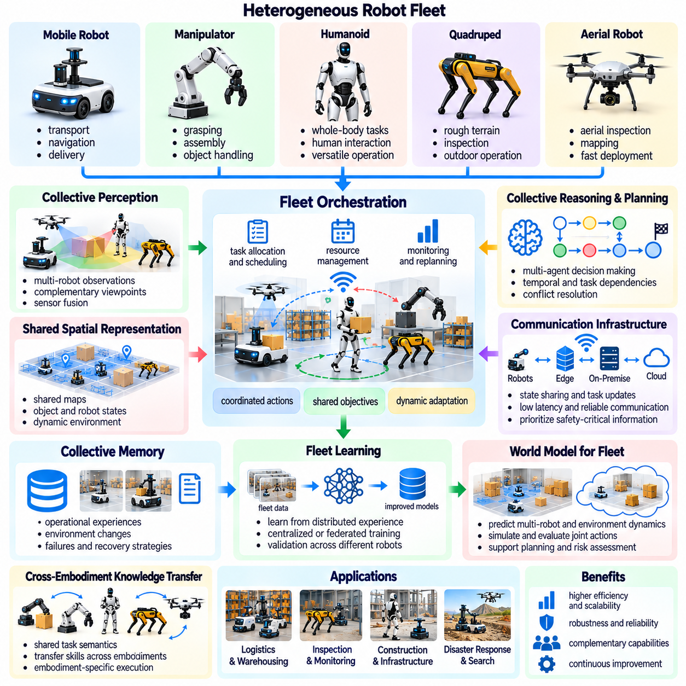{width="7.268055555555556in" height="7.268055555555556in"}

플릿 지능(Fleet Intelligence)과 집단 지능(Collective Intelligence)은 여러 자율 시스템(Autonomous System)이 행동을 조정하고, 지식을 교환하며, 공동 목표(Shared Objective)를 추구하도록 함으로써 피지컬 인공지능(Physical AI)을 개별 로봇의 범위를 넘어 확장한다. 플릿 지능은 배포된 로봇 전반의 운영 조정(Operational Coordination)에 중점을 두며, 집단 지능은 분산 인식(Distributed Perception), 추론(Reasoning), 학습(Learning)으로부터 나타나는 능력에 초점을 맞춘다. 이들은 개별 로봇만으로 복잡한 작업을 효율적으로 관리하기 어려운 환경에서 확장 가능한 자율성(Scalable Autonomy)을 구현하기 위한 기반을 제공한다.

로봇 플릿(Robotic Fleet)은 이동 로봇(Mobile Robot), 매니퓰레이터(Manipulator), 휴머노이드(Humanoid), 사족보행 로봇(Quadruped), 특수 검사 플랫폼(Specialized Inspection Platform)을 포함할 수 있다. 각 로봇은 서로 다른 감지 능력(Sensing Capability), 이동 능력(Mobility Capability), 조작 능력(Manipulation Capability)을 제공한다. 집단 운영(Collective Operation)을 위해서는 이러한 차이를 표현하면서 공통 작업 목표(Common Task Objective)와 환경 이해(Environmental Understanding)를 유지해야 한다. 결과적으로 시스템은 모든 로봇이 동일한 행동을 수행할 수 있다고 가정하는 대신 이질적인 능력(Heterogeneous Capability)을 조정해야 한다.

플릿 오케스트레이션(Fleet Orchestration)은 여러 로봇에 걸친 작업 할당(Task Allocation), 일정 관리(Scheduling), 자원 가용성(Resource Availability), 실행 우선순위(Execution Priority)를 관리한다. 조정 시스템(Coordination System)은 로봇의 능력(Capability), 위치(Location), 작업 부하(Workload), 배터리 상태(Battery State)에 따라 운송(Transportation), 검사(Inspection), 조작 작업(Manipulation Task)을 할당할 수 있다. 효과적인 오케스트레이션은 작업 간 의존성(Task Dependency)과 변화하는 운영 조건(Operational Condition)을 고려한다. 로봇이 고장 나거나 사용 불가능해지거나 예상하지 못한 장애물을 만나는 경우에는 동적 재할당(Dynamic Reassignment)이 필요하다.

집단 인식(Collective Perception)은 여러 로봇과 환경 센서(Environmental Sensor)의 관측을 결합하여 상황 인식(Situational Awareness)을 향상한다. 개별 로봇은 가림 현상(Occlusion), 제한된 관측 시점(Restricted Viewpoint), 제한된 센서 커버리지(Limited Sensor Coverage)를 경험할 수 있다. 공유 관측(Shared Observation)은 객체 위치(Object Location), 장애물(Obstacle), 환경 변화(Environmental Change)에 관한 상호보완적인 정보(Complementary Information)를 제공할 수 있다. 그러나 효과적인 융합(Fusion)을 위해서는 일관된 좌표계(Consistent Coordinate Frame), 정확한 타임스탬프(Accurate Timestamp), 보정(Calibration), 상충하는 측정값(Conflicting Measurement)에 대한 명시적인 처리가 필요하다.

공유 공간 표현(Shared Spatial Representation)은 분산된 로봇들이 공통 환경(Common Environment)에서 협조할 수 있도록 한다. 지도(Map)에는 점유 정보(Occupancy Information), 의미적 랜드마크(Semantic Landmark), 동적 객체(Dynamic Object), 내비게이션 제약조건(Navigational Constraint)이 포함될 수 있다. 로봇들은 독립적인 위치 추정값(Independent Localization Estimate)을 유지하면서 로컬 관측(Local Observation)을 공유 환경 모델(Shared Environmental Model)에 제공할 수 있다. 지도 동기화(Map Synchronization)는 지연된 업데이트(Delayed Update), 불확실한 관측(Uncertain Observation), 연속적인 측정 사이에 발생하는 변화(Change)를 고려해야 한다.

집단 추론(Collective Reasoning)은 공유 인식(Shared Perception)을 협조적인 해석(Coordinated Interpretation)과 의사결정(Decision-Making)으로 확장한다. 로봇들은 관측을 결합하여 작업 진행 상태(Task Progress)를 추론하고, 운영 위험(Operational Risk)을 식별하거나, 어떤 에이전트(Agent)가 행동을 수행하기에 가장 적합한 위치에 있는지 판단할 수 있다. 분산 추론(Distributed Reasoning)은 복잡한 환경의 관측 범위(Coverage)를 개선하고 중복 작업(Duplicated Effort)을 줄일 수 있다. 그러나 일치하지 않는 정보(Inconsistent Information)가 인지되지 않은 채 확산되지 않도록 집단적 결론(Collective Conclusion)은 관측과 가정(Assumption)까지 추적 가능해야 한다.

다중 에이전트 계획(Multi-Agent Planning)은 다른 로봇의 행동에 따라 결과가 달라지는 행동들을 조정한다. 배송 로봇(Delivery Robot)은 매니퓰레이터(Manipulator)가 적재 작업(Loading)을 완료할 때까지 기다려야 할 수 있으며, 검사 로봇(Inspection Robot)들은 시설을 상호보완적인 구역(Complementary Region)으로 나누어 작업할 수 있다. 계획(Plan)은 공유 자원(Shared Resource), 시간적 의존성(Temporal Dependency), 잠재적 충돌(Potential Conflict)을 표현해야 한다. 플릿 규모(Fleet Size)가 증가하고 독립적으로 작동하는 에이전트 사이의 상호작용이 예측하기 어려워질수록 협조는 더욱 복잡해진다.

통신 인프라(Communication Infrastructure)는 집단 운영(Collective Operation)에 필요한 정보 교환(Information Exchange)을 제공한다. 로봇들은 상태 추정값(State Estimate), 작업 할당(Task Assignment), 지도 업데이트(Map Update), 경고(Alert), 학습된 경험(Learned Experience)을 전송할 수 있다. 네트워크 지연(Network Latency), 대역폭 제한(Bandwidth Limitation), 패킷 손실(Packet Loss), 간헐적 연결(Intermittent Connectivity)은 협조 신뢰성(Coordination Reliability)에 영향을 미친다. 통신 정책(Communication Policy)은 제한 없는 연속적인 데이터 교환을 가정하기보다 안전 필수 정보(Safety-Critical Information)와 핵심 운영 업데이트(Essential Operational Update)를 우선해야 한다.

분산 아키텍처(Distributed Architecture)는 로봇 수준의 엣지 컴퓨팅(Edge Computing), 온프레미스 조정 인프라(On-Premise Coordination Infrastructure), 클라우드 서비스(Cloud Service)에 지능 기능을 배분할 수 있다. 엣지 시스템(Edge System)은 시간에 민감한 인식(Time-Sensitive Perception)과 제어(Control)를 실행하며, 온프레미스 자원(On-Premise Resource)은 공유 운영 맥락(Shared Operational Context)을 유지하고 인접한 에이전트를 조정한다. 클라우드 인프라(Cloud Infrastructure)는 플릿 전체 분석(Fleet-Wide Analytics), 장기 학습(Long-Term Learning), 모델 배포(Model Distribution)를 지원할 수 있다. 이러한 분리는 응답성(Responsiveness), 계산 효율성(Computational Efficiency), 시스템 확장성(System Scalability) 사이의 균형을 유지하는 데 도움이 된다.

집단 기억(Collective Memory)은 여러 로봇과 운영 에피소드(Operational Episode)에 걸쳐 생성된 정보를 보존한다. 공유 기록(Shared Record)은 환경 변화(Environmental Change), 완료된 작업(Completed Task), 반복적인 실패(Recurring Failure), 성공적인 복구 전략(Successful Recovery Strategy)을 설명할 수 있다. 개별 로봇은 모든 조건을 독립적으로 다시 발견하지 않고도 관련 경험(Relevant Experience)을 검색할 수 있다. 기억 시스템(Memory System)은 오래된 지식(Outdated Knowledge)의 부적절한 재사용을 방지하기 위해 출처 식별 정보(Source Identity), 타임스탬프(Timestamp), 환경적 맥락(Environmental Context), 신뢰도 추정값(Confidence Estimate)을 보존해야 한다.

플릿 학습(Fleet Learning)은 분산된 운영 경험(Distributed Operational Experience)을 여러 로봇에 도움이 되는 개선 사항으로 전환한다. 서로 다른 환경에서 수집된 데이터는 반복적인 실패 패턴(Recurring Failure Pattern), 내비게이션 문제(Navigation Difficulty), 조작 한계(Manipulation Limitation)를 드러낼 수 있다. 중앙집중형 학습(Centralized Training)은 이러한 경험을 통합하여 모델을 업데이트할 수 있으며, 연합학습(Federated Learning)은 모든 원시 데이터(Raw Data)를 전송하지 않고 모델 정보(Model Information)를 교환할 수 있다. 그러나 로봇마다 하드웨어(Hardware), 운영 조건(Operating Condition), 데이터 품질(Data Quality)이 다를 수 있으므로 검증(Validation)이 필요하다.

로봇 형태 간 일반화(Cross-Embodiment Generalization)는 이질적인 로봇(Heterogeneous Robot)이 작업 지식(Task Knowledge)을 공유하도록 함으로써 집단 지능(Collective Intelligence)을 강화한다. 이동 플랫폼(Mobile Platform)과 휴머노이드(Humanoid)는 서로 다른 이동 및 조작 전략(Movement and Manipulation Strategy)을 사용하면서도 동일한 배송 목표(Delivery Objective)를 해석할 수 있다. 공유 의미적 표현(Shared Semantic Representation)은 공통 계획(Common Planning)을 지원하며, 로봇 형태별 제어기(Embodiment-Specific Controller)는 실행을 담당한다. 지식 전이(Knowledge Transfer)는 감지(Sensing), 도달 가능성(Reachability), 적재 용량(Payload), 물리적 동역학(Physical Dynamics)의 차이를 고려해야 한다.

월드 모델(World Model)은 협조적인 플릿 운영(Coordinated Fleet Operation)에 예측 능력(Predictive Capability)을 제공할 수 있다. 공유 모델(Shared Model)은 미래 로봇 위치(Future Robot Position), 작업 완료 상태(Task Completion State), 교통 혼잡(Traffic Congestion), 환경 변화(Environmental Change)를 추정할 수 있다. 예측 계획(Predictive Planning)은 잠재적인 충돌(Potential Conflict)이 발생하기 전에 식별하고 선제적인 자원 할당(Proactive Resource Allocation)을 지원할 수 있다. 그러나 불확실성(Uncertainty)과 계획 기간(Planning Horizon)이 증가하면 예측 오차(Prediction Error)도 커지므로 지속적인 관측(Continuous Observation)과 재계획(Replanning)이 필수적이다.

집단 지능(Collective Intelligence)은 모든 의사결정을 중앙에서 제어하지 않더라도 로컬 협력(Local Cooperation)을 통해 나타날 수 있다. 탈중앙화 에이전트(Decentralized Agent)는 작업 할당(Task Assignment)을 협상하거나 의도(Intention)를 교환하거나 공유 프로토콜(Shared Protocol)을 통해 움직임을 조정할 수 있다. 이러한 접근 방식은 복원력(Resilience)을 개선하고 단일 조정기(Single Coordinator)에 대한 의존성을 줄일 수 있다. 그러나 협조 규칙(Coordination Rule)과 시스템 수준 목표(System-Level Objective)가 명확하게 정의되지 않으면 로컬 의사결정(Local Decision)이 전체적인 비효율(Global Inefficiency)이나 충돌(Conflict)을 발생시킬 수 있다.

인간 감독(Human Supervision)은 특히 안전(Safety), 불확실한 환경(Uncertain Environment), 운영 예외 상황(Operational Exception)이 포함된 플릿 운영(Fleet Operation)에서 여전히 중요하다. 감독자(Supervisor)는 우선순위(Priority)를 설정하고, 고위험 행동(High-Risk Action)을 승인하며, 자동화된 협조(Automated Coordination)가 실패할 때 개입할 수 있다. 인간-기계 인터페이스(Human-Machine Interface)는 플릿 상태(Fleet Status), 작업 진행 상태(Task Progress), 경고(Alert), 주요 의사결정에 대한 설명(Decision Explanation)을 제공해야 한다. 효과적인 감독을 위해서는 운영자 상황 인식(Operator Awareness)과 관리 가능한 정보 복잡성(Manageable Information Complexity) 사이의 균형이 필요하다.

안전 협조(Safety Coordination)는 여러 자율 시스템(Autonomous System) 사이의 상호작용으로 발생하는 위험(Hazard)을 다루어야 한다. 개별적으로 안전한 로봇 행동(Individually Safe Robot Action)도 이동 궤적(Trajectory)이 교차하거나 자원을 공유하거나 주변에서 예상하지 못한 움직임이 발생하면 위험해질 수 있다. 플릿 수준 안전 메커니즘(Fleet-Level Safety Mechanism)은 독립적인 온보드 보호 기능(Onboard Protection)을 보완해야 한다. 충돌 회피(Collision Avoidance), 비상 절차(Emergency Procedure), 교통 관리(Traffic Management), 운영 구역 설정(Operational Zoning)은 참여하는 모든 로봇에 일관되게 적용되어야 한다.

로봇들이 운영 데이터(Operational Data)와 제어 정보(Control Information)를 교환함에 따라 사이버보안(Cybersecurity)은 더욱 중요해진다. 손상된 통신(Compromised Communication), 승인되지 않은 명령(Unauthorized Command), 조작된 공유 지도(Manipulated Shared Map)는 여러 에이전트에 동시에 영향을 미칠 수 있다. 안전한 인증(Secure Authentication), 암호화된 통신(Encrypted Communication), 접근 제어(Access Control), 소프트웨어 무결성 검증(Software Integrity Verification)은 분산 운영(Distributed Operation)을 보호하는 데 도움이 된다. 보안 모니터링(Security Monitoring)은 정상적인 협조 변화(Legitimate Coordination Change)와 의심스럽거나 일관되지 않은 시스템 동작(Suspicious or Inconsistent System Behavior)을 구분해야 한다.

플릿 신뢰성(Fleet Reliability)은 개별 로봇, 네트워크 연결(Network Connection), 조정 서비스(Coordination Service)를 사용할 수 없게 되었을 때 점진적 성능 저하(Graceful Degradation)를 지원하는 능력에 달려 있다. 강건한 시스템(Robust System)은 통신 장애(Communication Failure) 중에도 필수적인 로컬 자율성(Essential Local Autonomy)을 유지하고 안전한 운영 모드(Safe Operating Mode)로 전환해야 한다. 작업 재할당(Task Reassignment)과 복구 절차(Recovery Procedure)는 자원이 복구되었을 때 집단 성능(Collective Performance)을 회복할 수 있다. 복원력(Resilience)은 인프라가 항상 사용 가능하다고 가정하는 대신 현실적인 장애 조건(Realistic Failure Condition)에서 평가되어야 한다.

집단 지능(Collective Intelligence)의 평가는 개별 로봇 성공률(Individual Robot Success Rate)을 넘어 확장되어야 한다. 관련 지표에는 플릿 처리량(Fleet Throughput), 작업 완료 시간(Task Completion Time), 자원 활용률(Resource Utilization), 협조 오버헤드(Coordination Overhead), 안전 사고(Safety Incident), 복구 효과(Recovery Effectiveness), 확장성(Scalability)이 포함된다. 집단 학습(Collective Learning)은 로봇과 환경 전반에 걸친 성능 개선(Performance Improvement)을 통해 평가할 수 있다. 테스트는 통신 장애(Communication Failure), 상충하는 관측(Conflicting Observation), 이질적인 능력(Heterogeneous Capability), 변화하는 플릿 구성(Changing Fleet Membership)을 검토해야 한다.

주요 미래 발전 방향은 공유 월드 모델(Shared World Model), 분산 기억(Distributed Memory), 다중 에이전트 계획(Multi-Agent Planning), 지속적 학습(Continual Learning)을 통합된 피지컬 인공지능 인프라(Unified Physical AI Infrastructure)에 결합하는 것이다. 이러한 시스템은 다양한 로봇 플랫폼(Robotic Platform)을 조정하면서 여러 시설(Facility)과 배포 환경(Deployment)에 걸쳐 운영 지식(Operational Knowledge)을 축적할 수 있다. 발전을 위해서는 상호운용 가능한 인터페이스(Interoperable Interface), 신뢰할 수 있는 통신(Reliable Communication), 불확실성 인식 추론(Uncertainty-Aware Reasoning), 검증된 모델 업데이트(Validated Model Update)가 필요하다. 거버넌스(Governance)는 공유 의사결정(Shared Decision)과 시스템 전체 행동(System-Wide Behavior)에 대한 책임을 정의해야 한다.

플릿 지능(Fleet Intelligence)과 집단 지능(Collective Intelligence)은 로봇공학(Robotics)을 고립된 자율 기계(Isolated Autonomous Machine)에서 인식(Perception), 경험(Experience), 의사결정(Decision-Making)을 공유할 수 있는 협조적인 물리 시스템(Coordinated Physical System)으로 전환한다. 장기적인 가치는 이질적인 환경(Heterogeneous Environment) 전반에서 적응성(Adaptability), 운영 효율성(Operational Efficiency), 지식 재사용(Knowledge Reuse)을 향상하는 데 있다. 신뢰할 수 있는 구현을 위해서는 중앙집중형 협조(Centralized Coordination)와 로컬 자율성(Local Autonomy) 사이의 균형을 유지하고, 불확실성(Uncertainty) 속에서도 안전을 보존하며, 실제 환경 운영(Real-World Operation) 중 집단 행동(Collective Behavior)을 지속적으로 검증해야 한다.

## 10.11. Edge and Distributed Physical AI

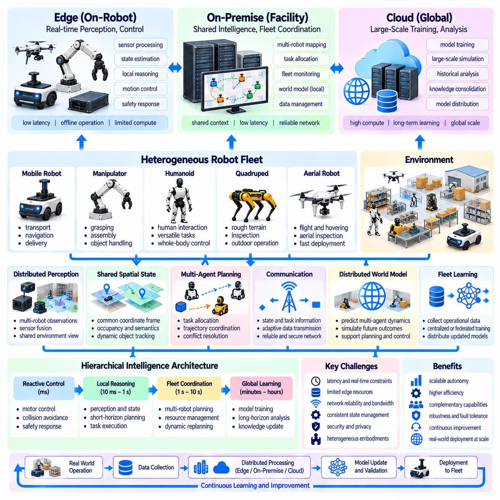{width="7.268055555555556in" height="7.268055555555556in"}

엣지 및 분산 피지컬 인공지능(Edge and Distributed Physical AI)은 인식(Perception), 추론(Reasoning), 계획(Planning), 제어(Control) 기능을 로봇 장치(Robotic Device)와 상호 연결된 컴퓨팅 자원(Interconnected Computing Resource)에 분산하는 아키텍처 방향(Architectural Direction)을 의미한다. 모든 지능을 단일 프로세서(Single Processor)나 원격 클라우드(Remote Cloud)에 집중하는 대신, 이러한 시스템은 지연시간(Latency), 신뢰성(Reliability), 자원 요구사항(Resource Requirement)에 따라 연산을 배분한다. 이러한 접근 방식은 빠르게 변화하는 물리적 조건(Physical Condition)에 대한 응답성(Responsiveness)을 유지하면서 확장 가능한 자율성(Scalable Autonomy)을 지원한다.

엣지 피지컬 인공지능(Edge Physical AI)은 연산 지능(Computational Intelligence)을 센서(Sensor), 액추에이터(Actuator), 물리적 프로세스(Physical Process)에 가까운 위치에 배치한다. 로컬 프로세서(Local Processor)는 지속적인 원격 통신(Remote Communication)에 의존하지 않고 관측(Observation)을 해석하고, 로봇 상태(Robot State)를 추정하며, 제어 정책(Control Policy)을 실행할 수 있다. 이러한 근접성(Proximity)은 통신 지연(Communication Delay)을 줄이고 시간 제약조건(Timing Constraint)이 중요한 환경에서 결정론적 실행(Deterministic Execution)을 지원한다. 그러나 엣지 장치(Edge Device)는 처리 능력(Processing Capacity), 메모리(Memory), 전력 소비(Power Consumption), 열 관리(Thermal Management)와 관련된 제약을 가진다.

분산 피지컬 인공지능(Distributed Physical AI)은 로봇, 시설(Facility), 클라우드 인프라(Cloud Infrastructure)에 배치된 컴퓨팅 자원(Computing Resource)을 조정하여 로컬 지능(Local Intelligence)을 확장한다. 서로 다른 연산 노드(Computational Node)는 상태 추정값(State Estimate), 작업 정보(Task Information), 학습된 표현(Learned Representation)을 교환하면서 특화된 기능(Specialized Function)을 수행할 수 있다. 효과적인 분산(Effective Distribution)을 위해서는 책임 범위(Responsibility), 통신 인터페이스(Communication Interface), 운영 의존성(Operational Dependency)을 명확하게 정의해야 한다. 개별 노드나 네트워크 연결(Network Connection)을 사용할 수 없게 되더라도 아키텍처(Architecture)는 기능을 유지해야 한다.

실시간 요구사항(Real-Time Requirement)은 피지컬 인공지능(Physical AI) 기능의 배치 위치에 큰 영향을 미친다. 모터 제어(Motor Control), 충돌 회피(Collision Avoidance), 즉각적인 안전 대응(Immediate Safety Response)은 일반적으로 물리 시스템(Physical System)에 가까운 위치에서 실행되어야 한다. 상위 수준 계획(Higher-Level Planning), 플릿 조정(Fleet Coordination), 대규모 모델 분석(Large-Scale Model Analysis)은 상대적으로 긴 처리 지연(Processing Delay)을 허용할 수 있다. 따라서 연산 배치(Computational Placement)는 단순히 사용 가능한 처리 능력(Processing Power)이나 중앙집중형 인프라(Centralized Infrastructure)에 의존하기보다 지연시간이 초래하는 결과(Consequence of Latency)를 반영해야 한다.

엣지 컴퓨팅(Edge Computing)은 카메라(Camera), 라이다(LiDAR), 레이더(Radar), 관성 센서(Inertial Sensor), 고유수용감각 센서(Proprioceptive Sensor)의 측정값을 데이터 발생 지점 가까이에서 처리함으로써 로컬 인식(Local Perception)을 지원한다. 센서 융합(Sensor Fusion)은 모든 원시 측정값(Raw Measurement)을 전송하지 않고도 객체 위치(Object Position), 로봇 움직임(Robot Motion), 환경 조건(Environmental Condition)에 대한 추정값을 생성할 수 있다. 이는 네트워크 트래픽(Network Traffic)을 줄이고 응답시간(Response Time)을 개선한다. 그러나 정확한 융합(Accurate Fusion)을 위해서는 동기화(Synchronization), 보정(Calibration), 불확실성 추정(Uncertainty Estimation), 불완전한 센서 관측(Incomplete Sensor Observation)에 대한 적절한 처리가 필요하다.

온프레미스 컴퓨팅(On-Premise Computing)은 개별 로봇과 원격 클라우드 서비스(Remote Cloud Service) 사이에서 중간 지능 계층(Intermediate Intelligence Layer)을 제공한다. 시설 수준 서버(Facility-Level Server)는 공유 지도(Shared Map)를 유지하고, 로봇 플릿(Robot Fleet)을 조정하며, 예측 모델(Predictive Model)을 실행하고, 운영 기억(Operational Memory)을 관리할 수 있다. 이러한 인프라는 여러 로봇과 고정 센서(Fixed Sensor)의 관측을 결합하여 환경 이해(Environmental Understanding)를 향상할 수 있다. 그 가치는 신뢰할 수 있는 로컬 네트워킹(Reliable Local Networking)과 공유 지능(Shared Intelligence) 및 안전 필수 온보드 기능(Safety-Critical Onboard Function) 사이의 명확한 분리에 달려 있다.

클라우드 인프라(Cloud Infrastructure)는 대규모 학습(Large-Scale Training), 모델 평가(Model Evaluation), 과거 데이터 분석(Historical Analysis), 지식 통합(Knowledge Consolidation)을 위한 컴퓨팅 자원(Computing Resource)을 제공한다. 축적된 운영 경험(Accumulated Operational Experience)으로 학습된 모델은 검증(Validation)을 거쳐 엣지 시스템(Edge System)이나 온프레미스 시스템(On-Premise System)에 배포될 수 있다. 클라우드 자원은 연산 비용이 높은 시뮬레이션(Computationally Expensive Simulation)과 장기 계획(Long-Horizon Planning)도 지원할 수 있다. 그러나 필수적인 물리 제어(Essential Physical Control)는 예측하기 어려운 광역 네트워크 지연(Wide-Area Network Latency)이나 지속적인 클라우드 가용성(Continuous Cloud Availability)에 의존해서는 안 된다.

계층적 지능 아키텍처(Hierarchical Intelligence Architecture)는 시간적 요구사항(Temporal Requirement)과 기능적 요구사항(Functional Requirement)에 따라 연산을 구성한다. 빠른 제어 루프(Fast Control Loop)는 액추에이터(Actuator) 가까이에서 작동하고, 중간 수준 추론 프로세스(Intermediate Reasoning Process)는 로컬 작업(Local Task)을 조정하며, 상대적으로 느린 서비스(Slower Service)는 장기 지식(Long-Term Knowledge)과 최적화(Optimization)를 관리한다. 정보는 정의된 인터페이스(Defined Interface)와 피드백 메커니즘(Feedback Mechanism)을 통해 이러한 계층 사이를 이동한다. 이러한 구성은 즉각적인 행동(Immediate Action)과 전략적 목표(Strategic Objective) 사이의 일관성을 유지하면서 불필요한 연산(Unnecessary Computation)을 줄일 수 있다.

통신(Communication)은 분산 지능(Distributed Intelligence)이 시의적절하고 신뢰할 수 있는 정보 교환(Timely and Trustworthy Information Exchange)에 의존하기 때문에 기본적인 설계 제약조건(Design Constraint)이 된다. 대역폭 제한(Bandwidth Limitation), 패킷 손실(Packet Loss), 네트워크 혼잡(Network Congestion), 가변 지연시간(Variable Latency)은 공유 인식(Shared Perception)과 협조적 계획(Coordinated Planning)의 성능을 저하시킬 수 있다. 시스템은 중요한 메시지(Critical Message)를 우선 처리하고 불필요한 대용량 데이터(High-Volume Data)의 전송을 피해야 한다. 통신 인식 알고리즘(Communication-Aware Algorithm)은 현재 네트워크 조건(Current Network Condition)에 따라 업데이트 주기(Update Frequency)와 정보 내용(Information Content)을 조정할 수 있다.

분산 상태 관리(Distributed State Management)는 서로 다른 연산 노드(Computing Node)가 물리적 환경(Physical Environment)에 대해 충분히 일관된 표현(Consistent Representation)을 유지하도록 한다. 로봇은 로컬 추정값(Local Estimate)을 보유하고, 시설 서버(Facility Server)는 공유 지도(Shared Map)와 작업 상태(Task State)를 관리할 수 있다. 관측(Observation)은 비동기적으로(Asynchronously) 도착하므로 일시적인 불일치(Temporary Disagreement)는 피할 수 없다. 타임스탬프 관리(Timestamping), 버전 관리(Version Control), 불확실성 추적(Uncertainty Tracking), 충돌 해결(Conflict Resolution)은 오래되거나 모순된 정보(Outdated or Contradictory Information)가 안전하지 않은 협조 행동(Unsafe Coordinated Behavior)을 유발하지 않도록 지원한다.

월드 모델(World Model)은 예측 기간(Prediction Horizon), 연산 복잡도(Computational Complexity), 운영 범위(Operational Scope)에 따라 분산될 수 있다. 경량 모델(Lightweight Model)은 엣지(Edge)에서 즉각적인 움직임(Immediate Motion)과 접촉 결과(Contact Outcome)를 추정하고, 대규모 모델(Larger Model)은 다중 에이전트 상호작용(Multi-Agent Interaction)과 장기적인 환경 변화(Long-Term Environmental Change)를 평가할 수 있다. 공유 예측(Shared Prediction)은 현재 관측(Current Observation)과 동기화될 때 협조적 계획(Coordinated Planning)을 개선할 수 있다. 예측이 물리적 행동(Physical Action)에 영향을 미치기 전에 모델 불확실성(Model Uncertainty)과 통신 지연(Communication Delay)을 고려해야 한다.

분산 추론(Distributed Inference)은 복잡한 인공지능 워크로드(AI Workload)를 사용 가능한 컴퓨팅 자원(Computing Resource)에 분할하여 배치할 수 있도록 한다. 모델 구성요소(Model Component)는 연산 수요(Computational Demand)에 따라 로컬 장치(Local Device), 인접한 가속기(Nearby Accelerator), 원격 서비스(Remote Service)에서 실행될 수 있다. 이러한 분할(Partitioning)은 장치 요구사항(Device Requirement)을 줄일 수 있지만 통신 오버헤드(Communication Overhead)와 동기화 비용(Synchronization Cost)을 발생시킨다. 효과적인 스케줄링(Effective Scheduling)은 종단 간 지연시간(End-to-End Latency), 데이터 이동(Data Movement), 메모리 가용성(Memory Availability), 실행 중단(Interrupted Execution)의 영향을 평가해야 한다.

적응형 연산(Adaptive Computation)은 피지컬 인공지능(Physical AI) 시스템이 작업 난이도(Task Difficulty)와 운영 긴급성(Operational Urgency)에 따라 처리 자원(Processing Resource)을 할당하도록 한다. 일반적인 내비게이션(Routine Navigation)은 경량 추론(Lightweight Inference)만으로 충분할 수 있지만, 불확실한 조작(Uncertain Manipulation)이나 복잡한 계획(Complex Planning)은 추가 연산(Additional Computation)을 통해 이점을 얻을 수 있다. 자원 관리자(Resource Manager)는 모델 선택(Model Selection), 추론 주기(Inference Frequency), 워크로드 배치(Workload Placement)를 조정할 수 있다. 이러한 적응(Adaptation)은 물리적 안전(Physical Safety)에 직접 영향을 미치는 기능에 대해 제한된 응답시간(Bounded Response Time)을 보장해야 한다.

에너지 효율성(Energy Efficiency)은 배터리 구동 로봇(Battery-Powered Robot)과 임베디드 컴퓨팅 장치(Embedded Computing Device)에서 특히 중요하다. 고성능 인식 및 추론 모델(High-Performance Perception and Reasoning Model)은 전력 소비(Power Consumption)를 증가시키고 운영 시간(Operating Time)을 단축하며 열적 제약조건(Thermal Constraint)을 발생시킬 수 있다. 양자화(Quantization), 가지치기(Pruning), 효율적인 모델 아키텍처(Efficient Model Architecture), 선택적 추론(Selective Inference)은 연산 수요(Computational Demand)를 줄일 수 있다. 에너지 인식 스케줄링(Energy-Aware Scheduling)은 지능 품질(Intelligence Quality)과 배터리 가용성(Battery Availability), 냉각 용량(Cooling Capacity), 임무 지속시간(Mission Duration) 사이의 균형을 유지해야 한다.

분산 피지컬 인공지능(Distributed Physical AI)은 협력 인식(Cooperative Perception)과 집단 지능(Collective Intelligence)을 위한 기회도 제공한다. 여러 로봇과 환경 센서(Environmental Sensor)는 개별 센서의 관측 범위(Individual Sensor Coverage)를 넘어서는 공유 표현(Shared Representation)에 관측을 제공할 수 있다. 시설 수준 지능(Facility-Level Intelligence)은 장애물(Obstacle)을 식별하고, 교통 충돌(Traffic Conflict)을 예측하며, 상호보완적인 로봇 능력(Complementary Robotic Capability)을 조정할 수 있다. 그러나 집단적 의사결정(Collective Decision)은 관측 불확실성(Observation Uncertainty), 동기화 오류(Synchronization Error), 로봇 형태(Robot Embodiment)의 차이를 고려해야 한다.

신뢰성(Reliability)을 확보하려면 연산 노드(Computing Node), 통신 링크(Communication Link), 공유 서비스(Shared Service)에 장애가 발생했을 때 점진적 성능 저하(Graceful Degradation)를 지원해야 한다. 로봇은 외부 지능(External Intelligence)을 사용할 수 없게 되더라도 필수적인 로컬 능력(Essential Local Capability)을 유지하고 안전한 운영 상태(Safe Operating State)로 전환해야 한다. 캐시된 지도(Cached Map), 로컬 정책(Local Policy), 제한된 대체 절차(Bounded Fallback Procedure)는 제약된 조건(Restricted Condition)에서 지속적인 운영을 지원할 수 있다. 복구 메커니즘(Recovery Mechanism)은 정상적인 분산 협조(Normal Distributed Coordination)를 재개하기 전에 로컬 상태(Local State)와 공유 상태(Shared State)를 일치시켜야 한다.

분산 구성요소(Distributed Component)는 운영 정보(Operational Information)를 교환하고 경우에 따라 물리 제어(Physical Control)에 영향을 미치므로 사이버보안(Cybersecurity)은 시스템 수준 요구사항(System-Level Requirement)이 된다. 인증(Authentication), 암호화된 통신(Encrypted Communication), 접근 제어(Access Control), 소프트웨어 무결성 검사(Software Integrity Check)는 승인되지 않은 조작(Unauthorized Manipulation)으로부터 시스템을 보호한다. 손상된 공유 모델(Compromised Shared Model)이나 위조된 센서 정보(Falsified Sensor Information)는 여러 로봇에 동시에 영향을 미칠 수 있다. 따라서 보안 아키텍처(Security Architecture)는 핵심 기능(Critical Function)을 격리하고 모니터링(Monitoring), 사고 대응(Incident Response), 통제된 복구(Controlled Recovery)를 지원해야 한다.

모델 생명주기 관리(Model Lifecycle Management)는 이질적인 연산 노드(Heterogeneous Computing Node)에 걸친 학습(Training), 검증(Validation), 배포(Deployment), 모니터링(Monitoring)을 조정한다. 업데이트된 인식 모델(Perception Model)이나 계획 모델(Planning Model)은 배포 전에 대표적인 운영 조건(Representative Operating Condition)에 대해 테스트되어야 한다. 버전 호환성(Version Compatibility)과 롤백 절차(Rollback Procedure)는 로봇 플릿(Robot Fleet) 전반에서 일관되지 않은 행동(Inconsistent Behavior)이 발생하는 것을 방지하는 데 도움이 된다. 배포 정책(Deployment Policy)은 실험적 능력(Experimental Capability)과 물리적 운영에 영향을 미치도록 허용된 검증된 기능(Validated Function)을 구분해야 한다.

확장성(Scalability)은 단순히 연산 용량(Computational Capacity)을 증가시키는 것 이상의 요소에 달려 있다. 로봇 수(Robot Population)가 증가하면 통신 트래픽(Communication Traffic), 공유 상태 복잡도(Shared State Complexity), 스케줄링 충돌(Scheduling Conflict), 인프라 의존성(Infrastructure Dependency)도 증가한다. 분산 아키텍처(Distributed Architecture)는 모듈형 서비스(Modular Service), 로컬 의사결정(Localized Decision-Making), 선택적 정보 공유(Selective Information Sharing)를 지원해야 한다. 성능 평가(Performance Evaluation)는 추가적인 로봇과 연산 노드가 과도한 협조 오버헤드(Disproportionate Coordination Overhead)를 발생시키지 않으면서 전체 생산성(Overall Productivity)을 개선하는지 검토해야 한다.

엣지 및 분산 피지컬 인공지능(Edge and Distributed Physical AI)의 평가는 개별 모델 처리량(Isolated Model Throughput)이 아니라 종단 간 시스템 동작(End-to-End System Behavior)을 측정해야 한다. 관련 지표에는 인식 지연시간(Perception Latency), 제어 응답시간(Control Response Time), 통신 오버헤드(Communication Overhead), 에너지 소비(Energy Consumption), 작업 성공률(Task Success), 신뢰성(Reliability), 복구 성능(Recovery Performance)이 포함된다. 테스트에는 네트워크 장애(Network Failure), 자원 경합(Resource Contention), 지연된 관측(Delayed Observation), 연산 과부하(Computational Overload)가 포함되어야 한다. 평가 결과는 아키텍처 복잡도(Architectural Complexity)의 증가가 측정 가능한 운영상의 이점(Measurable Operational Benefit)을 제공한다는 것을 입증해야 한다.

미래의 피지컬 인공지능 인프라(Physical AI Infrastructure)는 특화된 엣지 가속기(Specialized Edge Accelerator), 시설 수준 지능 서비스(Facility-Level Intelligence Service), 공유 월드 모델(Shared World Model), 클라우드 기반 학습 시스템(Cloud-Based Learning System)을 결합할 수 있다. 이러한 환경은 변화하는 워크로드(Changing Workload)와 운영 조건(Operational Condition)에 따라 연산 배치(Computational Placement)를 조정하면서 이질적인 로봇(Heterogeneous Robot)을 협조시킬 수 있다. 발전을 위해서는 상호운용 가능한 인터페이스(Interoperable Interface), 효율적인 분산 추론(Efficient Distributed Inference), 신뢰할 수 있는 동기화(Reliable Synchronization), 검증된 안전 경계(Validated Safety Boundary)가 필요하다. 아키텍처 유연성(Architectural Flexibility)은 예측 가능한 물리적 실행(Predictable Physical Execution)과 양립할 수 있어야 한다.

엣지 및 분산 피지컬 인공지능(Edge and Distributed Physical AI)은 로컬 응답성(Local Responsiveness)과 공유 연산 지식(Shared Computational Knowledge)을 결합하는 지능형 물리 시스템(Intelligent Physical System)의 기반을 제공한다. 그 중요성은 인식(Perception), 추론(Reasoning), 계획(Planning), 행동(Action)에 가장 효과적으로 기여할 수 있는 위치에 지능을 배치하는 데 있다. 신뢰할 수 있는 구현(Reliable Implementation)을 위해서는 지연시간(Latency), 에너지(Energy), 통신(Communication), 보안(Security), 불확실성(Uncertainty)을 신중하게 관리해야 한다. 궁극적인 목표는 개별 물리 에이전트(Individual Physical Agent)의 안전성(Safety)과 신뢰성(Reliability)을 희생하지 않으면서 확장 가능한 집단 자율성(Scalable Collective Autonomy)을 실현하는 것이다.

## 10.12. Self Improving Physical AI Systems

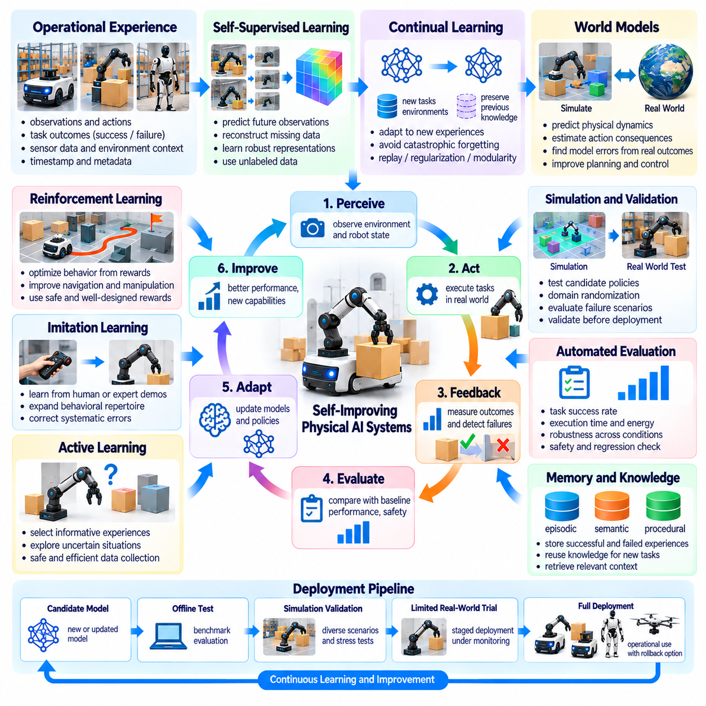{width="7.268055555555556in" height="7.268055555555556in"}

자기 개선형 피지컬 인공지능 시스템(Self-Improving Physical AI Systems)은 고정된 능력(Fixed Capability)을 가진 로봇에서 경험(Experience)을 통해 성능을 점진적으로 향상하는 자율 시스템(Autonomous System)으로의 전환을 의미한다. 이러한 시스템은 운영 결과(Operational Outcome)를 관측하고, 한계(Limitation)를 식별하며, 새로운 지식(Knowledge)을 획득하고, 시간이 지남에 따라 행동(Behavior)을 개선한다. 기존 소프트웨어 업데이트(Conventional Software Update)와 달리 자기 개선(Self-Improvement)은 학습 알고리즘(Learning Algorithm), 물리적 환경(Physical Environment), 제안된 변경 사항이 유익하고 안전한지를 평가하는 메커니즘(Evaluation Mechanism) 사이의 지속적인 상호작용을 포함한다.

자기 개선(Self-Improvement)의 기반은 인식(Perception), 행동(Action), 피드백(Feedback), 평가(Evaluation), 적응(Adaptation)을 연결하는 폐루프 학습 구조(Closed Learning Loop)이다. 로봇은 작업(Task)을 수행하고 행동의 결과(Consequence)를 측정하며, 관측된 결과(Observed Outcome)를 예상 결과(Expected Result)와 비교한다. 성능 차이(Performance Difference)는 내부 모델(Internal Model)이나 제어 전략(Control Strategy)을 업데이트하기 위한 근거를 제공한다. 효과적인 학습 루프(Learning Loop)는 실제 개선(Genuine Improvement)을 일시적으로 유리한 환경 조건(Temporary Environmental Advantage), 측정 오류(Measurement Error), 우연한 성공(Accidental Success)과 구분해야 한다.

운영 경험(Operational Experience)은 자기 개선형 피지컬 인공지능(Self-Improving Physical AI)의 주요 데이터 원천(Primary Data Source)을 제공한다. 로봇은 정상적인 운영 과정에서 관측 데이터(Observation Data), 행동 궤적(Action Trajectory), 작업 결과(Task Outcome), 실패 기록(Failure Record), 환경 측정값(Environmental Measurement)을 생성한다. 이러한 기록은 초기 학습 데이터셋(Initial Training Dataset)에 포함되지 않았던 반복적인 한계(Recurring Limitation)를 드러낼 수 있다. 그러나 유용한 경험 데이터(Useful Experience Data)를 확보하려면 정확한 타임스탬프(Timestamp), 맥락 메타데이터(Contextual Metadata), 센서 보정(Sensor Calibration), 행동과 결과에 대한 일관된 설명(Consistent Description)이 필요하다.

자기지도학습(Self-Supervised Learning)은 로봇이 대량의 레이블이 없는 운영 데이터(Unlabeled Operational Data)에서 지식을 추출하도록 한다. 예측 목적함수(Predictive Objective)는 이전 상태(Preceding State)와 행동(Action)을 바탕으로 미래 관측(Future Observation), 객체 움직임(Object Motion), 접촉 결과(Contact Outcome)를 추정하도록 모델을 학습시킬 수 있다. 표현학습(Representation Learning)은 지속적인 인간 주석(Human Annotation) 없이 인식 성능(Perception Performance)을 개선할 수 있다. 그러나 예측 정확도(Predictive Accuracy)만으로 학습된 표현(Learned Representation)이 실제 물리적 작업 수행(Physical Task Execution)을 개선한다고 보장할 수는 없다.

지속적 학습(Continual Learning)은 피지컬 인공지능(Physical AI) 시스템이 기존 학습 데이터(Original Training Data)로 모델을 반복적으로 처음부터 재구축하지 않고 새로운 경험(New Experience)을 통합하도록 한다. 로봇은 변화하는 조명(Changing Lighting), 익숙하지 않은 객체(Unfamiliar Object), 수정된 작업 공간(Modified Workspace), 점진적인 기계적 마모(Gradual Mechanical Wear)에 적응할 수 있다. 핵심 과제는 새로운 환경에 대한 적응이 이전에 숙달한 작업(Previously Mastered Task)의 성능을 저하시키는 파국적 망각(Catastrophic Forgetting)이다. 리플레이 메커니즘(Replay Mechanism), 매개변수 격리(Parameter Isolation), 정규화(Regularization)는 기존 능력(Established Capability)을 보존하는 데 도움이 될 수 있다.

월드 모델(World Model)은 서로 다른 행동에 따라 환경(Environment)이 어떻게 변화하는지 예측함으로써 자기 개선(Self-Improvement)을 위한 구조화된 메커니즘(Structured Mechanism)을 제공한다. 로봇은 예측된 상태 전이(Predicted State Transition)를 실제 관측(Actual Observation)과 비교하여 모델링 오류(Modeling Error)를 식별할 수 있다. 이러한 불일치(Discrepancy)는 움직임(Motion), 접촉(Contact), 객체 동역학(Object Dynamics)에 대한 표현을 개선할 기회를 제공한다. 개선된 모델(Improved Model)은 이후 더욱 정확한 계획(Accurate Planning)을 지원할 수 있지만, 예측은 실제 물리적 조건(Real Physical Condition)에 맞게 지속적으로 보정되어야 한다.

강화학습(Reinforcement Learning)은 작업 결과(Task Outcome)와 보상 신호(Reward Signal)에 따라 행동을 최적화함으로써 자기 개선(Self-Improvement)에 기여한다. 로봇은 반복적인 경험(Repeated Experience)을 통해 내비게이션 전략(Navigation Strategy), 조작 궤적(Manipulation Trajectory), 자원 할당 정책(Resource Allocation Policy)을 개선할 수 있다. 그러나 잘못 정의된 보상(Poorly Specified Reward)은 바람직하지 않은 지름길(Undesirable Shortcut)이나 안전하지 않은 행동(Unsafe Behavior)을 유도할 수 있다. 보상 설계(Reward Design)는 협소한 성능 지표(Narrow Performance Indicator)가 아니라 운영 목표(Operational Objective), 물리적 제약조건(Physical Constraint), 장기적인 결과(Long-Term Consequence)를 반영해야 한다.

모방학습(Imitation Learning)과 교정 시연(Corrective Demonstration)은 로봇 행동(Robotic Behavior)을 개선하기 위한 또 다른 경로를 제공한다. 인간 운영자(Human Operator)나 더 높은 능력을 가진 시스템(More Capable System)은 자율 정책(Autonomous Policy)이 어려움을 겪을 때 성공적인 작업 수행(Successful Task Execution)을 시연할 수 있다. 이러한 시연은 로봇의 행동 레퍼토리(Behavioral Repertoire)를 확장하고 체계적인 오류(Systematic Error)를 교정할 수 있다. 학습 과정(Learning Process)은 시연 품질(Demonstration Quality), 작업 맥락(Task Context), 교사 로봇 또는 시스템(Teacher)과 대상 로봇(Target Robot) 사이의 차이에 관한 정보를 보존해야 한다.

능동학습(Active Learning)은 가장 높은 잠재적 학습 가치(Potential Learning Value)를 제공하는 경험을 선택함으로써 데이터 효율성(Data Efficiency)을 개선한다. 로봇은 불확실한 관측(Uncertain Observation), 익숙하지 않은 객체(Unfamiliar Object), 서로 다른 모델의 예측이 일치하지 않는 상황(Model Disagreement)을 우선할 수 있다. 시스템은 가능한 모든 상호작용(Possible Interaction)을 수집하는 대신 정보 가치가 높은 사례(Informative Case)에 학습 자원(Learning Resource)을 집중한다. 그러나 불확실성이 높은 상황은 물리적 위험(Physical Risk)도 증가시킬 수 있으므로 탐색(Exploration)은 안전 요구사항(Safety Requirement)에 의해 제한되어야 한다.

시뮬레이션(Simulation)은 제안된 개선 사항(Proposed Improvement)을 실제 물리적 배포(Physical Deployment) 전에 평가하기 위한 통제된 환경(Controlled Environment)을 제공한다. 후보 정책(Candidate Policy)은 다양한 객체(Object), 지형 조건(Terrain Condition), 센서 교란(Sensor Disturbance), 장애 시나리오(Failure Scenario)에서 테스트할 수 있다. 도메인 무작위화(Domain Randomization)와 적대적 시나리오 생성(Adversarial Scenario Generation)은 일반적인 테스트(Routine Testing)에서 발견하기 어려운 약점을 드러낼 수 있다. 그러나 시뮬레이션과 현실 사이의 차이(Simulation-to-Reality Difference) 때문에 개선 사항을 운영상 신뢰할 수 있는 것으로 인정하기 전에 물리적 검증(Physical Validation)이 필요하다.

자동화된 평가(Automated Evaluation)는 모델 업데이트(Model Update)가 실제로 시스템 성능(System Performance)을 개선하는지 판단하는 데 필수적이다. 후보 모델(Candidate Model)은 작업 성공률(Task Success), 실행 시간(Execution Time), 에너지 소비(Energy Consumption), 강건성(Robustness), 안전 지표(Safety Metric)를 사용하여 기존 기준 모델(Established Baseline)과 비교해야 한다. 평가는 성능 회귀(Regression)를 탐지하기 위해 이전에 숙달한 작업(Previously Mastered Task)을 포함해야 한다. 개선이 성공적이라고 선언하기 전에 통계적 불확실성(Statistical Uncertainty)과 운영 조건(Operating Condition)에 따른 변동성(Variation)을 고려해야 한다.

자기 개선형 시스템(Self-Improving System)은 학습된 능력(Learned Capability)을 배포하기 위한 통제된 메커니즘(Controlled Mechanism)을 필요로 한다. 모델 업데이트(Model Update)는 오프라인 테스트(Offline Testing), 시뮬레이션 검증(Simulation Validation), 제한된 물리적 시험(Limited Physical Trial), 단계적 운영 배포(Staged Operational Release)를 거쳐 진행할 수 있다. 버전 관리(Version Management)와 롤백 절차(Rollback Procedure)는 예상하지 못한 성능 저하(Unexpected Performance Degradation)가 발생했을 때 시스템을 복구하도록 한다. 안전 필수 기능(Safety-Critical Function)은 제한 없는 학습(Unrestricted Learning)을 통해 자동으로 변경되기보다 독립적인 제약조건(Independent Constraint)에 의해 보호되어야 한다.

기억 아키텍처(Memory Architecture)는 여러 운영 에피소드(Operational Episode)에 걸쳐 유용하게 유지되는 경험(Experience)을 보존함으로써 개선을 지원한다. 일화 기억(Episodic Memory)은 특정 사건(Specific Event)을 저장하고, 의미 기억(Semantic Memory)은 객체(Object), 환경(Environment), 절차(Procedure)에 관한 일반화된 지식(Generalized Knowledge)을 저장한다. 검색 메커니즘(Retrieval Mechanism)은 미래의 의사결정(Future Decision)에 관련 맥락(Relevant Context)을 제공할 수 있다. 기억 관리(Memory Maintenance)는 오래된 정보(Outdated Information), 상충하는 관측(Conflicting Observation), 저장 공간 제약(Storage Limitation), 잘못된 가정(Incorrect Assumption)을 강화할 위험을 다루어야 한다.

플릿 학습(Fleet Learning)은 자기 개선(Self-Improvement)을 개별 로봇(Individual Robot)에서 분산된 로봇 집단(Distributed Robotic Population)으로 확장한다. 여러 시설(Facility)과 플랫폼(Platform)에서 수집된 경험은 반복적인 실패(Recurring Failure)와 전이 가능한 해결책(Transferable Solution)을 드러낼 수 있다. 공유 학습 인프라(Shared Training Infrastructure)는 검증된 지식(Validated Knowledge)을 통합하고 개선된 모델(Improved Model)을 호환 가능한 로봇(Compatible Robot)에 배포할 수 있다. 그러나 이질적인 하드웨어(Heterogeneous Hardware), 환경적 차이(Environmental Difference), 일관되지 않은 데이터 품질(Inconsistent Data Quality) 때문에 플릿 전체 배포(Fleet-Wide Deployment) 전에 신중한 평가가 필요하다.

자기 개선(Self-Improvement)은 행동 정책(Behavioral Policy)뿐 아니라 연산 전략(Computational Strategy)의 적응도 포함할 수 있다. 피지컬 인공지능(Physical AI) 시스템은 작업 복잡도(Task Complexity)에 따라 추론 주기(Inference Frequency), 모델 선택(Model Selection), 계획 깊이(Planning Depth), 워크로드 배치(Workload Placement)를 조정할 수 있다. 이러한 변화는 응답성(Responsiveness)과 에너지 효율성(Energy Efficiency)을 개선할 수 있다. 연산 적응(Computational Adaptation)은 제어 기능(Control Function)의 예측 가능한 실행 시간(Predictable Execution Time)을 보존하고 안전을 저해할 수 있는 자원 경합(Resource Contention)을 방지해야 한다.

불확실성 추정(Uncertainty Estimation)은 자율 적응(Autonomous Adaptation) 과정에서 중요한 안전장치(Safeguard)를 제공한다. 로봇은 관측(Observation)이 학습 조건(Training Condition)과 크게 다르거나 모델 예측(Model Prediction)의 신뢰성이 낮아지는 상황을 인식해야 한다. 높은 불확실성(High Uncertainty)은 추가 감지(Additional Sensing), 보수적인 행동(Conservative Action), 인간 지원 요청(Request for Human Assistance)을 유발할 수 있다. 과도한 확신(Excessive Confidence)은 학습된 행동(Learned Behavior)의 심각한 약점을 감출 수 있으므로 신뢰도 추정값(Confidence Estimate)은 실제 관측 결과(Observed Outcome)에 맞게 보정되어야 한다.

인과 추론(Causal Reasoning)은 실제 실패 원인(Genuine Cause of Failure)을 상관관계가 있는 관측(Correlated Observation)과 구분함으로써 자기 개선(Self-Improvement)을 더욱 체계적으로 만들 수 있다. 객체 파지(Object Grasping)에 반복적으로 실패하는 로봇은 문제가 기하학적 구조(Geometry), 마찰(Friction), 인식(Perception), 제어 타이밍(Control Timing) 중 어디에서 발생하는지 조사해야 한다. 반사실적 평가(Counterfactual Evaluation)는 유사한 조건(Similar Condition)에서 대안적 행동(Alternative Action)을 비교할 수 있다. 이러한 추론은 일반화(Generalization) 가능성이 높은 메커니즘(Mechanism)에 학습을 집중하도록 돕는다.

자율 학습(Autonomous Learning)은 예측하기 어려운 방식으로 행동(Behavior)을 변경할 수 있으므로 인간 감독(Human Oversight)은 여전히 필요하다. 운영자(Operator)는 학습 경계(Learning Boundary)를 설정하고, 중요한 업데이트(Important Update)를 승인하며, 실패 사례(Failure Case)를 검토하고, 허용 가능한 운영 위험(Acceptable Operational Risk)을 정의할 수 있다. 투명한 기록(Transparent Record)은 무엇이 변경되었는지, 업데이트가 제안된 이유는 무엇인지, 그 효과가 어떻게 평가되었는지를 설명해야 한다. 책임성(Accountability)을 확보하려면 안전 필수 배포 의사결정(Safety-Critical Deployment Decision)에 대한 인간의 권한(Human Authority)을 유지해야 한다.

로봇이 축적된 운영 경험(Accumulated Operational Experience)을 활용하여 모델을 수정함에 따라 보안(Security)과 데이터 거버넌스(Data Governance)는 더욱 중요해진다. 조작된 학습 데이터(Manipulated Training Data), 침해된 업데이트 파이프라인(Compromised Update Pipeline), 승인되지 않은 매개변수 변경(Unauthorized Parameter Change)은 지속적인 취약점(Persistent Vulnerability)을 발생시킬 수 있다. 안전한 데이터 출처 관리(Secure Data Provenance), 인증된 업데이트(Authenticated Update), 접근 제어(Access Control), 무결성 검증(Integrity Verification)은 학습 과정(Learning Process)을 보호하는 데 도움이 된다. 개인정보 보호 요구사항(Privacy Requirement)과 데이터 소유권 제약조건(Data Ownership Constraint)도 운영 경험(Operational Experience)의 보존과 공유 방식을 규율해야 한다.

자기 개선형 피지컬 인공지능(Self-Improving Physical AI)의 장기적인 목표는 안정적인 운영 성능(Stable Operational Performance)을 유지하면서 지식(Knowledge)을 축적하는 신뢰할 수 있는 시스템(Reliable System)을 구축하는 것이다. 발전은 지속적 학습(Continual Learning), 월드 모델(World Model), 능동적 탐색(Active Exploration), 자동화된 평가(Automated Evaluation), 통제된 배포(Controlled Deployment)를 통합된 학습 아키텍처(Unified Learning Architecture)에 결합하는 데 달려 있다. 진정한 자율성(Genuine Autonomy)은 단순히 매개변수(Parameter)를 업데이트하는 능력 이상을 요구한다. 승인된 각각의 개선 사항(Accepted Improvement)이 실제 환경 조건(Real-World Condition)에서 효과적이고(Effective), 전이 가능하며(Transferable), 안전하다(Safe)는 근거가 필요하다.

## 10.13. Physical AI and AGI Convergence

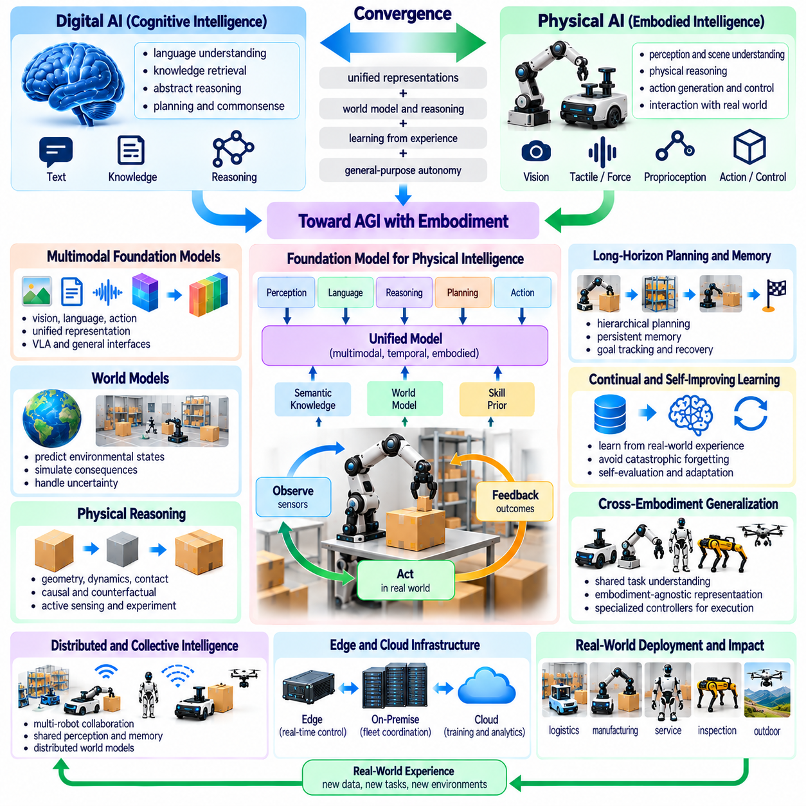{width="7.268055555555556in" height="7.268055555555556in"}

피지컬 인공지능(Physical AI)과 범용 인공지능(Artificial General Intelligence, AGI)의 융합(Convergence)은 다양한 물리적 환경(Physical Environment)에서 추론(Reasoning), 학습(Learning), 행동(Action)을 수행할 수 있는 지능형 시스템(Intelligent System)으로의 잠재적인 전환을 의미한다. 범용 인공지능(AGI)은 일반적으로 다양한 작업에 걸친 폭넓은 인지 능력(Broad Cognitive Competence)을 의미하며, 피지컬 인공지능은 현실 세계(Real World)에서의 인식(Perception), 상호작용(Interaction), 제어(Control)를 강조한다. 두 분야의 융합은 범용 추론(General-Purpose Reasoning)과 체화된 능력(Embodied Capability)을 연결할 수 있지만, 어느 개념도 보편적으로 합의된 운영적 정의(Operational Definition)를 가지고 있지는 않다.

디지털 지능(Digital Intelligence)은 언어 처리(Language Processing), 지식 검색(Knowledge Retrieval), 추상적 문제 해결(Abstract Problem Solving)에서 상당한 능력을 보여주었다. 물리적 환경(Physical Environment)은 불확실성(Uncertainty), 연속적인 움직임(Continuous Motion), 접촉 동역학(Contact Dynamics), 되돌릴 수 없는 결과(Irreversible Consequence)와 관련된 추가 요구사항을 제시한다. 지능형 시스템(Intelligent System)은 상징적 목표(Symbolic Objective)를 물리적으로 실행 가능한 행동(Physically Executable Action)으로 변환해야 한다. 이러한 전환에는 인지적 표현(Cognitive Representation)을 인식(Perception), 계획(Planning), 제어(Control), 환경 피드백(Environmental Feedback)과 통합하는 과정이 필요하다.

체화(Embodiment)는 추상적 개념(Abstract Concept)을 물리적 경험(Physical Experience)에 기반하도록 함으로써 일반 지능(General Intelligence)의 발전에 기여할 수 있다. 포함 관계(Containment), 지지(Support), 힘(Force), 거리(Distance), 인과성(Causality)에 대한 이해는 서로 다른 조건에서 객체(Object)가 어떻게 상호작용하는지 관측함으로써 향상될 수 있다. 로봇은 감지(Sensing)와 통제된 실험(Controlled Experimentation)을 통해 이러한 지식을 획득할 수 있다. 그러나 물리적 체화(Physical Embodiment)가 모든 형태의 일반 지능(General Intelligence)에 반드시 필요한 조건이라고 가정해서는 안 된다.

월드 모델(World Model)은 일반 추론(General Reasoning)과 물리적 행동(Physical Action)을 연결할 수 있는 잠재적인 수단을 제공한다. 이러한 모델은 환경 상태(Environmental State)를 표현하고, 미래의 전개(Future Development)를 예측하며, 대안적 의사결정(Alternative Decision)의 결과를 추정한다. 추상적 추론(Abstract Reasoning)과 결합된 월드 모델은 즉각적인 관측(Immediate Observation)을 넘어서는 계획(Planning)을 지원할 수 있다. 그 효과는 불확실성(Uncertainty)을 표현하고, 물리적 증거(Physical Evidence)와의 일관성을 유지하며, 환경 조건(Environmental Condition)이 변화할 때 예측을 조정하는 능력에 달려 있다.

멀티모달 파운데이션 모델(Multimodal Foundation Model)은 언어(Language), 시각(Vision), 공간 정보(Spatial Information), 로봇 행동(Robotic Action)을 연결하는 인터페이스(Interface)로 기능할 수 있다. 시스템은 인간의 지시(Human Instruction)를 해석하고, 관련 객체(Relevant Object)를 식별하며, 작업 제약조건(Task Constraint)을 추론하고, 행동 계획(Action Plan)을 생성할 수 있다. 비전 언어 행동 모델(Vision-Language-Action Model, VLA)은 멀티모달 이해(Multimodal Understanding)를 운동 행동(Motor Behavior)과 연결함으로써 이러한 접근 방식을 확장한다. 그러나 성공적인 언어 해석(Language Interpretation)이 신뢰할 수 있는 물리적 실행(Reliable Physical Execution)을 자동으로 보장하는 것은 아니다.

물리적 추론(Physical Reasoning)은 언어적 설명(Linguistic Description)만으로 완전히 표현하기 어려운 관계(Relationship)를 이해해야 한다. 익숙하지 않은 객체(Unfamiliar Object)를 조작하려면 질량(Mass), 마찰(Friction), 안정성(Stability), 접촉 기하학(Contact Geometry)에 대한 추정이 필요할 수 있다. 이러한 물리적 속성(Physical Property)은 관측(Observation)과 상호작용(Interaction)을 통해 추론할 수 있지만, 상당한 불확실성(Uncertainty)이 남아 있을 수 있다. 따라서 범용 물리 지능(General-Purpose Physical Intelligence)은 사전 지식(Prior Knowledge)을 능동적 감지(Active Sensing), 실험(Experimentation), 내부 가정(Internal Assumption)의 지속적인 수정과 결합해야 한다.

장기 계획(Long-Horizon Planning)은 피지컬 인공지능(Physical AI)과 범용 인공지능(AGI)의 접점에서 중요한 또 다른 능력이다. 복잡한 목표(Complex Objective)는 수많은 상호 의존적 행동(Dependent Action), 변화하는 환경(Changing Environment), 예상하지 못한 실패(Unexpected Failure)를 포함할 수 있다. 지능형 로봇(Intelligent Robot)은 목표(Goal)를 유지하고, 진행 상황(Progress)을 추적하며, 계획(Plan)을 수정하고, 실패한 작업(Unsuccessful Operation)으로부터 복구해야 한다. 계층적 계획(Hierarchical Planning)과 지속적 기억(Persistent Memory)은 전략적 추론(Strategic Reasoning)과 시간에 민감한 제어(Time-Sensitive Control)를 분리하면서 이러한 요구사항을 지원할 수 있다.

인과 추론(Causal Reasoning)과 반사실적 추론(Counterfactual Reasoning)은 지능형 시스템(Intelligent System)이 물리적 결과(Physical Consequence)를 이해하는 능력을 향상할 수 있다. 시스템은 관측(Observation)과 행동(Action) 사이의 상관관계(Correlation)만 학습하는 대신 사건이 발생하는 원인과 대안적 개입(Alternative Intervention)에 따라 어떤 결과가 나타날 수 있는지 조사할 수 있다. 이러한 능력은 진단(Diagnosis), 계획(Planning), 복구(Recovery)에 유용하다. 신뢰할 수 있는 인과 추론(Reliable Causal Reasoning)을 위해서는 물리적 상호작용(Physical Interaction)에서 얻은 증거와 숨겨진 변수(Hidden Variable)에 대한 신중한 처리가 필요하다.

지속적 학습(Continual Learning)은 변화하는 환경(Changing Environment)과 익숙하지 않은 작업(Unfamiliar Task) 전반에서 작동해야 하는 시스템에 필수적이다. 물리 에이전트(Physical Agent)는 새로운 객체(New Object), 변경된 공간 배치(Altered Layout), 기계적 마모(Mechanical Wear), 예상하지 못한 인간 행동(Unexpected Human Behavior)을 경험한다. 이러한 시스템은 이전에 획득한 능력(Previously Acquired Capability)을 손상하지 않으면서 유용한 경험(Useful Experience)을 통합해야 한다. 일반 지능(General Intelligence)으로의 융합을 위해서는 적응(Adaptation), 지식 보존(Knowledge Retention), 불확실성 추정(Uncertainty Estimation), 안전하지 않은 행동 변화(Unsafe Behavioral Change)에 대한 보호 사이의 균형이 필요하다.

로봇 형태 간 일반화(Cross-Embodiment Generalization)는 공유 지능(Shared Intelligence)이 서로 다른 기계적 구조(Mechanical Structure)를 가진 로봇에서 작동하도록 할 수 있다. 공통 추론 시스템(Common Reasoning System)은 이동 로봇(Mobile Robot), 매니퓰레이터(Manipulator), 휴머노이드(Humanoid), 기타 플랫폼을 지원하면서 실행에는 특화된 제어기(Specialized Controller)를 활용할 수 있다. 이러한 전이를 위해서는 특정 액추에이터(Actuator)에 종속되지 않는 목표(Goal)와 물리적 관계(Physical Relationship)의 표현이 필요하다. 도달 가능성(Reachability), 동역학(Dynamics), 감지 능력(Sensing Capability)의 차이는 여전히 근본적인 제약조건(Fundamental Constraint)으로 남는다.

집단 지능(Collective Intelligence)은 융합을 위한 또 다른 가능성을 제시한다. 여러 로봇은 관측(Observation), 학습된 경험(Learned Experience), 작업 정보(Task Information)를 교환하여 협조적 의사결정(Coordinated Decision-Making)을 개선할 수 있다. 공유 기억(Shared Memory)과 분산 월드 모델(Distributed World Model)은 개별 에이전트(Individual Agent)가 보유한 능력을 넘어서는 기능을 제공할 수 있다. 그러나 집단 성능(Collective Performance)이 반드시 일반 지능(General Intelligence)을 의미하는 것은 아니며, 분산 협조(Distributed Coordination)는 일관성(Consistency), 통신(Communication), 책임성(Accountability)과 관련된 추가 과제를 발생시킨다.

엣지 및 분산 컴퓨팅 아키텍처(Edge and Distributed Computing Architecture)는 고도화된 물리 지능(Advanced Physical Intelligence)이 배포되는 방식에 영향을 미친다. 시간 필수 제어(Time-Critical Control)는 물리 시스템(Physical System) 가까이에서 높은 응답성(Responsiveness)을 유지해야 하며, 연산 집약적인 추론(Computationally Intensive Reasoning)과 학습(Learning)은 온프레미스 자원(On-Premise Resource)이나 클라우드 자원(Cloud Resource)을 활용할 수 있다. 워크로드 할당(Workload Allocation)은 지연시간(Latency), 에너지(Energy), 신뢰성(Reliability), 통신 가용성(Communication Availability)을 고려해야 한다. 향상된 추론 능력(Reasoning Capability)만으로 예측할 수 없는 제어 지연(Control Delay)이나 불충분한 안전 보호(Insufficient Safety Protection)를 보완할 수는 없다.

자율 실험(Autonomous Experimentation)은 피지컬 인공지능(Physical AI) 시스템이 익숙하지 않은 환경(Unfamiliar Environment)에 대한 이해를 개선하도록 할 수 있다. 로봇은 가설(Hypothesis)을 수립하고, 정보 가치가 높은 상호작용(Informative Interaction)을 선택하며, 결과(Outcome)를 관측하고, 내부 모델(Internal Model)을 업데이트할 수 있다. 이러한 과정은 과학적 추론(Scientific Reasoning)의 일부 측면과 유사하지만, 물리적 탐색(Physical Exploration)은 실제 운영 위험(Operational Risk)을 발생시킨다. 따라서 실험은 안전 제약조건(Safety Constraint), 불확실성 임계값(Uncertainty Threshold), 통제된 평가 절차(Controlled Evaluation Procedure)에 의해 제한되어야 한다.

일반 지능(General Intelligence)과 로봇 수행 능력(Robotic Competence)의 관계는 신중하게 해석해야 한다. 시스템은 폭넓은 언어적 능력(Linguistic Capability)이나 분석 능력(Analytical Capability)을 보여주면서도 단순한 물리적 조작(Physical Manipulation)에 실패할 수 있다. 반대로 특화된 로봇(Specialized Robot)은 폭넓은 추론 능력(Broad Reasoning Ability) 없이도 어려운 운동 작업(Motor Task)을 수행할 수 있다. 따라서 일반 지능과 물리적 수행 능력(Physical Competence)은 서로 교환 가능한 성취(Interchangeable Achievement)로 취급하기보다 구별되면서도 상호보완적인 평가 기준(Complementary Evaluation Measure)을 통해 평가해야 한다.

평가 프레임워크(Evaluation Framework)는 지능형 시스템(Intelligent System)이 익숙하지 않은 작업(Task), 환경(Environment), 로봇 형태(Embodiment) 전반에 걸쳐 지식(Knowledge)을 전이할 수 있는지 테스트해야 한다. 관련 기준에는 적응 효율성(Adaptation Efficiency), 물리적 작업 성공률(Physical Task Success), 인과적 이해(Causal Understanding), 계획 강건성(Planning Robustness), 안전성(Safety), 실패 복구(Recovery from Failure)가 포함된다. 성공이 암기된 환경(Memorized Environment)이나 제한된 작업 분포(Narrow Task Distribution)에 의존하는 경우 벤치마크 성능(Benchmark Performance)만으로는 충분하지 않다. 실제 환경 평가(Real-World Evaluation)는 불확실성(Uncertainty), 분포 변화(Distribution Shift), 장기 신뢰성(Long-Term Reliability)을 검토해야 한다.

물리 시스템(Physical System)이 더 폭넓은 자율성(Broader Autonomy)을 획득함에 따라 안전성(Safety)과 정렬(Alignment)은 더욱 중요해진다. 잘못된 의사결정(Incorrect Decision)은 충돌(Collision), 장비 손상(Equipment Damage), 인명 피해(Harm to People)를 초래할 수 있다. 범용 에이전트(General-Purpose Agent)는 강제 적용 가능한 물리적 제약조건(Enforceable Physical Constraint) 안에서 작동하고 인간의 지시(Human Instruction), 운영 경계(Operational Boundary), 승인 요구사항(Authorization Requirement)을 준수해야 한다. 추론 성능(Reasoning Performance)이 향상되더라도 독립적인 안전 메커니즘(Independent Safety Mechanism), 투명한 의사결정 기록(Transparent Decision Record), 인간 개입 능력(Human Intervention Capability)은 계속 필요하다.

거버넌스(Governance)는 지능형 시스템(Intelligent System)이 여러 운영 영역(Operational Domain)에 걸쳐 의사결정(Decision-Making)을 수행할 때의 책임(Responsibility)을 다루어야 한다. 조직(Organization)은 능력 검증(Capability Validation), 배포 승인(Deployment Authorization), 행동 모니터링(Behavior Monitoring), 사고 조사(Incident Investigation)를 위한 절차를 마련해야 한다. 모델 업데이트(Model Update)와 자율 적응(Autonomous Adaptation)은 기술적으로 가능한 범위에서 추적 가능(Traceable)하고 되돌릴 수 있어야(Reversible) 한다. 지능형 시스템의 범용성(Generality)이 증가할수록 인간 감독(Human Oversight)을 축소하기보다 명확한 책임성(Explicit Accountability)을 확보해야 할 필요성이 커진다.

체화(Embodiment), 월드 모델링(World Modeling), 일반 지능(General Intelligence) 사이의 관계에는 여전히 중요한 과학적 불확실성(Scientific Uncertainty)이 존재한다. 물리적 상호작용(Physical Interaction)이 범용 인공지능(AGI)에 필수적인지, 현재의 파운데이션 모델 아키텍처(Foundation Model Architecture)가 강건한 물리적 일반화(Robust Physical Generalization)를 달성할 수 있는지, 폭넓은 능력(Broad Competence)을 어떻게 측정해야 하는지는 아직 확립되지 않았다. 발전을 위해서는 통제된 실험(Controlled Experiment), 재현 가능한 벤치마크(Reproducible Benchmark), 한계에 대한 투명한 보고(Transparent Reporting of Limitations)가 필요하다. 융합에 관한 주장(Claim of Convergence)은 실제로 입증된 능력(Demonstrated Capability)과 구분되어야 한다.

미래 연구(Future Research)는 멀티모달 추론(Multimodal Reasoning), 월드 모델(World Model), 계층적 제어(Hierarchical Control), 지속적 학습(Continual Learning), 분산 지능(Distributed Intelligence)을 점점 더 높은 능력을 가진 로봇 시스템(Robotic System)에 통합할 수 있다. 이러한 통합은 유연한 작업 수행(Flexible Task Execution)과 물리적 환경 사이의 더욱 효과적인 지식 전이(Knowledge Transfer)를 지원할 수 있다. 그러나 아키텍처 통합(Architectural Integration)만으로 일반 지능(General Intelligence)이 보장되지는 않는다. 성공 여부는 익숙하지 않은 조건(Unfamiliar Condition)에서 입증 가능한 강건성(Robustness), 적응성(Adaptability), 인과적 이해(Causal Understanding), 안전한 행동(Safe Behavior)에 달려 있다.

피지컬 인공지능(Physical AI)과 범용 인공지능(AGI)의 융합(Convergence)은 필연적인 기술적 종착점(Inevitable Technological Endpoint)이 아니라 발전 중인 연구 방향(Evolving Research Direction)으로 이해하는 것이 적절하다. 피지컬 인공지능은 지능(Intelligence)을 인식(Perception)과 행동(Action)에 기반하도록 하는 메커니즘을 제공할 수 있으며, 일반 추론(General Reasoning)의 발전은 로봇 적응성(Robotic Adaptability)을 확장할 수 있다. 두 분야의 결합된 발전은 더욱 다재다능한 자율 시스템(Versatile Autonomous System)을 만들어낼 수 있다. 핵심 과제는 확장된 인지 능력(Broader Cognitive Capability)이 신뢰할 수 있고(Reliable), 검증 가능하며(Verifiable), 책임 있는(Responsible) 물리적 행동(Physical Behavior)으로 이어지도록 보장하는 것이다.

## 10.14. 2030 and Long Term Physical AI Roadmap

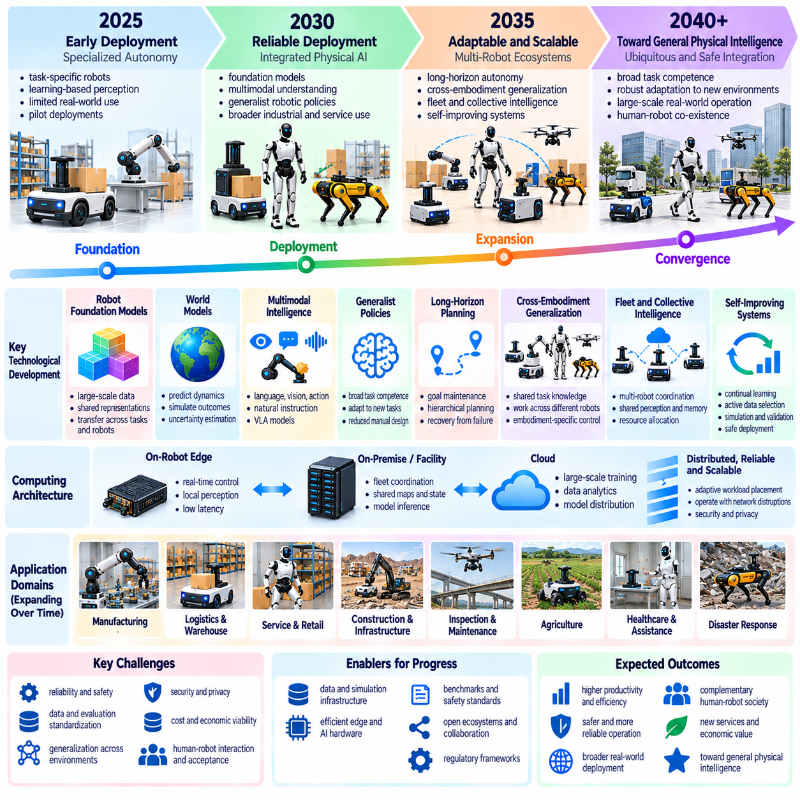{width="7.268055555555556in" height="7.268055555555556in"}

2030년과 그 이후를 향한 로드맵(Roadmap)은 피지컬 인공지능(Physical AI)이 특화된 로봇 자율성(Specialized Robotic Autonomy)에서 적응 가능하고(Adaptable), 상호 연결되며(Interconnected), 점차 고도화되는 지능형 물리 시스템(Intelligent Physical System)으로 발전하는 예상 경로를 설명한다. 이러한 발전은 인식(Perception), 월드 모델링(World Modeling), 계획(Planning), 학습(Learning), 체화된 제어(Embodied Control)의 진보에 달려 있다. 이 로드맵은 미리 결정된 기술 발전 일정(Predetermined Technological Schedule)이 아니라 연구 우선순위(Research Priority), 엔지니어링 의존성(Engineering Dependency), 측정 가능한 이정표(Measurable Milestone)를 식별하기 위한 프레임워크(Framework)를 제공한다.

2030년까지 피지컬 인공지능(Physical AI)의 발전은 구조화된 환경(Structured Environment)과 반구조화된 환경(Semi-Structured Environment)에서 학습 기반 능력(Learning-Based Capability)을 더욱 신뢰성 있게 배포하는 데 중점을 둘 것으로 예상된다. 산업 시설(Industrial Facility), 물류센터(Logistics Center), 서비스 환경(Service Environment)에서는 기존 제어(Conventional Control)와 학습 기반 인식(Learned Perception) 및 의사결정(Decision-Making)을 결합한 로봇의 도입이 증가할 수 있다. 발전 수준은 단순한 시연(Demonstration)이 아니라 지속적인 작업 성능(Sustained Task Performance), 운영 가용성(Operational Availability), 안전성(Safety), 경제적 실현 가능성(Economic Viability)을 통해 측정되어야 한다.

로봇 파운데이션 모델(Robot Foundation Model)은 미래 피지컬 인공지능 아키텍처(Physical AI Architecture)의 중요한 구성요소가 될 가능성이 높다. 다양한 로봇 데이터셋(Robotic Dataset)에 걸친 학습은 플랫폼 간 인식(Perception), 작업 이해(Task Understanding), 행동 지식(Behavioral Knowledge)의 전이를 개선할 수 있다. 그러나 익숙하지 않은 객체(Unfamiliar Object), 환경(Environment), 로봇 형태(Embodiment)에 대한 일반화(Generalization)는 여전히 중요한 과제이다. 미래 시스템은 표준화된 데이터셋(Standardized Dataset), 일관된 평가 절차(Consistent Evaluation Procedure), 공유 모델(Shared Model)을 특정 하드웨어(Specific Hardware)에 적응시키는 메커니즘(Adaptation Mechanism)을 필요로 한다.

월드 모델(World Model)은 예측형 피지컬 인공지능(Predictive Physical AI)에서 점점 더 중요한 역할을 수행할 것으로 예상된다. 로봇은 실행 전에 가능한 환경 변화(Possible Environmental Change)를 시뮬레이션하고 대안적 행동(Alternative Action)을 평가하는 능력을 점차 확대할 수 있다. 이러한 능력은 불확실성(Uncertainty) 속에서 조작(Manipulation), 내비게이션(Navigation), 장기 계획(Long-Horizon Planning)을 개선할 수 있다. 신뢰할 수 있는 성능(Reliable Performance)을 달성하려면 물리적 동역학(Physical Dynamics)에 대한 정확한 표현(Accurate Representation), 보정된 불확실성 추정값(Calibrated Uncertainty Estimate), 실제 관측(Real-World Observation)을 활용한 지속적인 수정(Continuous Correction)이 필요하다.

멀티모달 지능(Multimodal Intelligence)은 언어(Language), 시각(Vision), 공간 이해(Spatial Understanding), 행동(Action)을 더욱 긴밀하게 연결할 것이다. 미래의 로봇은 상위 수준 지시(High-Level Instruction)를 해석하고 물리적 제약조건(Physical Constraint)을 고려하면서 이를 실행 가능한 행동 순서(Executable Sequence)로 변환할 수 있다. 비전 언어 행동 모델(Vision-Language-Action Model, VLA)은 인간의 의도(Human Intention)와 로봇 행동(Robotic Behavior)을 연결하는 재사용 가능한 인터페이스(Reusable Interface)를 제공할 수 있다. 그러나 신뢰할 수 있는 실행(Reliable Execution)을 위해서는 여전히 특화된 제어(Specialized Control), 피드백 메커니즘(Feedback Mechanism), 독립적인 안전 검증(Independent Safety Validation)이 필요하다.

범용 로봇 정책(Generalist Robotic Policy)의 발전은 모든 작업마다 별도로 설계된 솔루션(Separately Engineered Solution)에 대한 의존성을 줄일 수 있다. 공유 정책(Shared Policy)은 관련 환경(Related Environment) 전반에서 내비게이션(Navigation), 객체 상호작용(Object Interaction), 검사(Inspection), 조작(Manipulation)을 지원할 수 있다. 그 효과는 학습 다양성(Training Diversity), 로봇 형태 조건화(Embodiment Conditioning), 적응 효율성(Adaptation Efficiency)에 달려 있다. 현실적인 로드맵(Realistic Roadmap)은 폭넓은 작업 수행 능력(Broad Task Competence)과 아직 해결되지 않은 연구 목표인 보편적 물리 능력(Universal Physical Capability)을 구분해야 한다.

장기 자율성(Long-Horizon Autonomy)을 위해서는 시스템이 장시간에 걸친 행동 순서(Extended Sequence of Actions) 동안 목표(Goal)와 운영 맥락(Operational Context)을 유지해야 한다. 로봇은 의존 관계(Dependency)를 인식하고, 예상하지 못한 사건(Unexpected Event)으로부터 복구하며, 환경 조건(Environmental Condition)이 변화할 때 계획(Plan)을 수정해야 한다. 지속적 기억(Persistent Memory), 계층적 계획(Hierarchical Planning), 인과 추론(Causal Reasoning)은 이러한 능력을 개선할 수 있다. 평가(Evaluation)에는 다단계 작업(Multi-Stage Task), 중단 후 복구(Interruption Recovery), 장시간 운영(Long Operating Period)에 걸친 신뢰성(Reliability)이 포함되어야 한다.

로봇 플랫폼(Robotic Platform)이 다양해짐에 따라 로봇 형태 간 일반화(Cross-Embodiment Generalization)는 점점 더 중요해질 것이다. 공유 지능(Shared Intelligence)은 이동 로봇(Mobile Robot), 매니퓰레이터(Manipulator), 휴머노이드(Humanoid), 사족보행 로봇(Quadruped), 특수 자율 기계(Specialized Autonomous Machine)를 지원할 수 있다. 목표(Goal)와 물리적 관계(Physical Relationship)에 대한 공통 표현(Common Representation)은 지식 전이(Knowledge Transfer)를 촉진하며, 플랫폼별 제어기(Platform-Specific Controller)는 실행 가능성(Execution Feasibility)을 보존한다. 발전은 서로 유사한 하드웨어 구성(Hardware Configuration)이 아니라 실제로 다른 로봇 형태(Genuinely Different Morphology) 사이에서 입증되어야 한다.

플릿 지능(Fleet Intelligence)과 집단 지능(Collective Intelligence)은 고립된 로봇 배포(Isolated Robotic Deployment)를 협조적인 운영 생태계(Coordinated Operational Ecosystem)로 전환할 수 있다. 여러 로봇은 관측(Observation), 환경 모델(Environmental Model), 작업 정보(Task Information), 검증된 경험(Validated Experience)을 공유할 수 있다. 시설 수준 협조(Facility-Level Coordination)는 자원 할당(Resource Allocation), 교통 관리(Traffic Management), 운영 장애 복구(Operational Failure Recovery)를 개선할 수 있다. 그러나 집단 지능을 구현하려면 신뢰할 수 있는 통신(Dependable Communication), 일관된 공유 상태(Consistent Shared State), 사이버보안 보호(Cybersecurity Protection), 분산 의사결정(Distributed Decision)에 대한 명확한 책임이 필요하다.

엣지 및 분산 피지컬 인공지능(Edge and Distributed Physical AI)은 점점 더 높은 능력을 갖춘 로봇 시스템(Robotic System)에 필요한 컴퓨팅 인프라(Computational Infrastructure)를 제공할 것이다. 시간 필수 인식(Time-Critical Perception)과 제어(Control)는 물리적 장치(Physical Device) 가까이에 유지되고, 온프레미스(On-Premise)와 클라우드 자원(Cloud Resource)은 협조(Coordination), 고급 추론(Advanced Reasoning), 대규모 학습(Large-Scale Learning)을 지원한다. 적응형 워크로드 배치(Adaptive Workload Placement)는 에너지 효율성(Energy Efficiency)과 응답성(Responsiveness)을 개선할 수 있다. 아키텍처의 발전은 네트워크 장애(Network Disruption) 중에도 예측 가능한 지연시간(Predictable Latency)과 필수적인 로컬 자율성(Essential Local Autonomy)을 유지해야 한다.

자기 개선형 피지컬 인공지능 시스템(Self-Improving Physical AI System)은 운영 경험(Operational Experience)을 검증된 모델 업데이트(Validated Model Update)에 점진적으로 통합할 수 있다. 지속적 학습(Continual Learning), 능동적 데이터 선택(Active Data Selection), 시뮬레이션(Simulation), 자동화된 평가(Automated Evaluation)는 반복적인 수동 엔지니어링(Manual Engineering)의 필요성을 줄일 수 있다. 그러나 제한 없는 온라인 적응(Unrestricted Online Adaptation)은 파국적 망각(Catastrophic Forgetting), 안전하지 않은 탐색(Unsafe Exploration), 예상하지 못한 행동(Unexpected Behavior)과 관련된 위험을 발생시킨다. 개선 파이프라인(Improvement Pipeline)에는 회귀 테스트(Regression Testing), 배포 통제(Deployment Control), 추적 가능성(Traceability), 신뢰할 수 있는 롤백 절차(Reliable Rollback Procedure)가 포함되어야 한다.

2030년부터 2035년 사이의 실현 가능한 발전 방향(Plausible Development Direction)은 여러 운영 영역(Operational Domain)에 걸쳐 적응형 로봇(Adaptable Robot)의 배포를 확대하는 것이다. 시스템은 제한된 시연(Limited Demonstration), 목표 지향적 학습(Targeted Training), 공유 지식 서비스(Shared Knowledge Service)를 통해 새로운 작업 능력(New Task Capability)을 획득할 수 있다. 더욱 고도화된 협조(Coordination)는 동적 시설(Dynamic Facility)에서 운영되는 혼합 로봇 플릿(Mixed Robot Fleet)을 지원할 수 있다. 이러한 가능성은 신뢰성(Reliability), 비용 효율성(Cost Efficiency), 상호운용성(Interoperability), 규제 수용성(Regulatory Acceptance)의 발전을 전제로 한다.

2035년 이후에는 장기 기억(Long-Term Memory), 인과적 월드 모델(Causal World Model), 다양한 환경에 걸친 자율 학습(Autonomous Learning)을 통합하는 지속적 물리 지능(Persistent Physical Intelligence)에 대한 연구가 더욱 확대될 수 있다. 로봇은 익숙하지 않은 작업(Unfamiliar Task)에 대해 더욱 유연한 전략(Flexible Strategy)을 개발하고 서로 다른 로봇 형태(Different Embodiment) 사이에서 지식(Knowledge)을 전이할 수 있다. 이러한 발전에는 물리적 추론(Physical Reasoning)과 일반화(Generalization)에서 상당한 진보가 필요하다. 이러한 능력이 고정된 일정(Fixed Timetable)에 따라 출현할 것이라고 가정해서는 안 된다.

하드웨어 발전(Hardware Evolution)은 피지컬 인공지능(Physical AI)의 발전 속도에 큰 영향을 미칠 것이다. 임베디드 가속기(Embedded Accelerator), 감지 시스템(Sensing System), 액추에이터(Actuator), 배터리(Battery), 통신 기술(Communication Technology)의 개선은 로봇이 수행할 수 있는 작업의 복잡도(Task Complexity)를 확장할 수 있다. 에너지 효율성(Energy Efficiency)과 열 관리(Thermal Management)는 특히 이동 플랫폼(Mobile Platform)에서 중요한 제약조건으로 남을 것이다. 연산 지능(Computational Intelligence)이 물리적 메커니즘(Physical Mechanism)의 모든 한계를 극복할 수는 없으므로 하드웨어와 소프트웨어(Software)는 함께 발전해야 한다.

시뮬레이션(Simulation)과 디지털 트윈(Digital Twin)은 학습(Training), 검증(Validation), 운영 최적화(Operational Optimization)를 지속적으로 지원할 것이다. 더욱 정확한 시뮬레이션은 접촉 동역학(Contact Dynamics), 센서 교란(Sensor Disturbance), 환경 변화(Environmental Change), 다중 로봇 상호작용(Multi-Robot Interaction)을 표현할 수 있다. 합성 경험(Synthetic Experience)은 학습을 가속하고 시스템을 드물게 발생하는 시나리오(Rare Scenario)에 노출할 수 있다. 그러나 시뮬레이션과 현실 사이의 격차(Simulation-to-Reality Gap)는 계속해서 중요한 문제가 될 것이며, 체계적인 물리적 테스트(Systematic Physical Testing)와 지속적인 모델 보정(Continuous Model Calibration)이 필요하다.

로봇이 더욱 폭넓은 의사결정 권한(Decision-Making Authority)을 획득함에 따라 안전 공학(Safety Engineering)은 점점 더 핵심적인 역할을 하게 될 것이다. 미래 시스템은 학습된 지능(Learned Intelligence)을 강제 적용 가능한 운영 제약조건(Enforceable Operational Constraint), 독립적인 보호 메커니즘(Independent Protection Mechanism), 투명한 사고 분석(Transparent Incident Analysis)과 결합해야 한다. 검증(Validation)은 불확실한 환경(Uncertain Environment), 변화하는 정책(Changing Policy), 여러 자율 에이전트(Autonomous Agent) 사이의 상호작용을 다루어야 한다. 신뢰할 수 있는 자율성(Trustworthy Autonomy)을 위해서는 개별 구성요소(Isolated Component)의 인증만이 아니라 전체 시스템 생명주기(System Lifecycle)에 걸친 안전성의 증거(Evidence of Safety)가 필요하다.

표준화(Standardization)와 상호운용성(Interoperability)은 피지컬 인공지능(Physical AI)이 제조사(Manufacturer), 시설(Facility), 응용 영역(Application Domain) 전반으로 확장될 수 있는지를 결정할 것이다. 센서 데이터(Sensor Data), 로봇 능력(Robot Capability), 작업 설명(Task Description), 모델 인터페이스(Model Interface), 평가 결과(Evaluation Result)에 대한 공통 규약(Common Convention)은 통합 복잡도(Integration Complexity)를 줄일 수 있다. 공개 벤치마크(Open Benchmark)와 재현 가능한 테스트(Reproducible Testing)는 기술적 비교 가능성(Technical Comparability)을 향상할 수 있다. 표준(Standard)은 호환성(Compatibility), 보안(Security), 검증 가능한 운영 요구사항(Verifiable Operational Requirement)을 유지하면서 혁신(Innovation)을 지원해야 한다.

경제적 요인(Economic Factor)과 조직적 요인(Organizational Factor)은 기술적 돌파구(Technical Breakthrough)만큼이나 도입(Adoption)에 큰 영향을 미칠 것이다. 배포 의사결정(Deployment Decision)은 총소유비용(Total Cost of Ownership), 유지보수 요구사항(Maintenance Requirement), 생산성 향상(Productivity Improvement), 인력 통합(Workforce Integration), 운영 위험(Operational Risk)에 달려 있다. 조직(Organization)은 로봇 감독(Robot Supervision), 데이터 관리(Data Management), 모델 검증(Model Validation), 사고 대응(Incident Response)을 위한 능력을 개발해야 한다. 지속 가능한 도입(Sustainable Adoption)을 위해서는 자동화 자체를 목적으로 삼기보다 명확한 사업적 가치(Business Value)와 인간 노동(Human Work)과의 책임 있는 통합(Responsible Integration)이 필요하다.

피지컬 인공지능(Physical AI)과 범용 인공지능(Artificial General Intelligence, AGI)의 관계는 장기 로드맵(Long-Term Roadmap) 전반에서 중요한 연구 문제(Research Question)로 남을 것이다. 멀티모달 추론(Multimodal Reasoning)과 월드 모델(World Model)의 발전은 로봇 적응성(Robotic Adaptability)을 개선할 수 있지만, 일반적인 인지 능력(General Cognitive Competence)이 신뢰할 수 있는 물리적 능력(Reliable Physical Capability)을 자동으로 의미하지는 않는다. 물리 지능(Physical Intelligence)은 불확실성(Uncertainty) 속에서의 상호작용(Interaction), 작업 수행(Task Execution), 복구(Recovery)를 통해 평가되어야 한다. 융합에 관한 주장(Claim of Convergence)은 실제로 입증된 증거(Demonstrated Evidence)에 기반해야 한다.

로드맵 평가(Roadmap Evaluation)는 달력상의 날짜(Calendar Date)에만 의존하기보다 측정 가능한 능력 이정표(Measurable Capability Milestone)를 사용해야 한다. 관련 지표에는 작업 일반화(Task Generalization), 적응 시간(Adaptation Time), 물리적 추론 정확도(Physical Reasoning Accuracy), 운영 신뢰성(Operational Reliability), 에너지 효율성(Energy Efficiency), 안전 성능(Safety Performance), 플릿 확장성(Fleet Scalability)이 포함된다. 발전 수준은 대표적인 환경(Representative Environment)과 이전에 경험하지 못한 조건(Previously Unseen Condition) 전반에서 평가되어야 한다. 실패(Failure)와 한계(Limitation)에 대한 투명한 보고(Transparent Reporting)는 실제 발전(Genuine Advancement)과 특정 벤치마크에 최적화된 성능(Benchmark-Specific Optimization)을 구분하는 데 필수적이다.

피지컬 인공지능(Physical AI)의 장기 비전(Long-Term Vision)은 인간의 목표(Human Objective)에 대한 책임성(Accountability)을 유지하면서 인식(Perception), 추론(Reasoning), 협업(Collaboration), 자기 개선(Self-Improvement)을 수행할 수 있는 지능형 물리 에이전트(Intelligent Physical Agent)의 생태계(Ecosystem)를 구축하는 것이다. 이러한 비전을 달성하려면 알고리즘(Algorithm), 하드웨어(Hardware), 분산 인프라(Distributed Infrastructure), 안전(Safety), 거버넌스(Governance), 경제적 배포(Economic Deployment) 전반에서 조화로운 발전(Coordinated Progress)이 필요하다. 로드맵(Roadmap)은 과학적 증거(Scientific Evidence)와 운영 경험(Operational Experience)이 축적됨에 따라 유연하게 조정될 수 있어야 한다. 궁극적인 성공 기준(Ultimate Measure of Success)은 물리적 세계(Physical World)에서 책임 있게 행동하는 신뢰할 수 있고 유익한 지능(Reliable and Beneficial Intelligence)을 실현하는 것이다.
